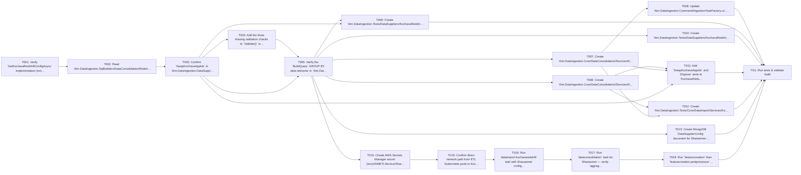

## Implementation Task Matrix — wi_prd059_f23ea8

**Matrix ID:** `wi_prd059_f23ea8-r7` · **Generated:** 2026-11-02T18:24:34.805211+00:00 · **Source:** `tasks` · **Verdict:** **READY with 17 warnings**

### Summary

| Metric | Value |
| :--- | :--- |
| Tasks total | 19 |
| AI-allocated | 13 |
| Manual-allocated | 6 |
| Waves | 11 |
| Conflicts | 0 |
| Requirements uncovered | 0 |
| Low-confidence allocations (<0.6) | 6 |

### Wave 0

| Task | Title | Repo | Owner | Allocation | Confidence | Status |
| :--- | :--- | :--- | :--- | :--- | :--- | :--- |
| T001 | Verify `GetKochavaRedshiftConfigAsync` implementation (not just the interface)… | Kochava/aim-data-ingestion | coding-agent | ai | 0.50 | planned |

### Wave 1

| Task | Title | Repo | Owner | Allocation | Confidence | Status |
| :--- | :--- | :--- | :--- | :--- | :--- | :--- |
| T002 | Read `Aim.DataIngestion.SqlBuilders/DataConsolidation/Redshift/RedshiftDataAggr… | Kochava/aim-data-ingestion | coding-agent | ai | 0.50 | planned |

### Wave 2

| Task | Title | Repo | Owner | Allocation | Confidence | Status |
| :--- | :--- | :--- | :--- | :--- | :--- | :--- |
| T003 | Confirm `SwapKochavaAppIds` in `Aim.DataIngestion.DataSuppliers/KochavaRedshift… | Kochava/aim-data-ingestion | coding-agent | ai | 0.28 | planned |

### Wave 3

| Task | Title | Repo | Owner | Allocation | Confidence | Status |
| :--- | :--- | :--- | :--- | :--- | :--- | :--- |
| T004 | Add the three missing validation checks to `Validate()` in `Aim.DataIngestion.D… | Kochava/aim-data-ingestion | coding-agent | ai | 0.28 | planned |

### Wave 4

| Task | Title | Repo | Owner | Allocation | Confidence | Status |
| :--- | :--- | :--- | :--- | :--- | :--- | :--- |
| T005 | Verify the `BuildQuery` GROUP BY alias behavior in `Aim.DataIngestion.DataSuppl… | Kochava/aim-data-ingestion | coding-agent | ai | 0.28 | planned |

### Wave 5

| Task | Title | Repo | Owner | Allocation | Confidence | Status |
| :--- | :--- | :--- | :--- | :--- | :--- | :--- |
| T006 | Create `Aim.DataIngestion.Core/DataConsolidation/Services/KochavaRedshift/Kocha… | Kochava/aim-data-ingestion | coding-agent | ai | 0.50 | planned |
| T007 | Create `Aim.DataIngestion.Core/DataConsolidation/Services/KochavaRedshift/Kocha… | Kochava/aim-data-ingestion | coding-agent | ai | 0.70 | planned |
| T009 | Create `Aim.DataIngestion.Tests/DataSuppliers/KochavaRedshift/KochavaRedshiftRe… | Kochava/aim-data-ingestion | coding-agent | ai | 0.70 | planned |
| T010 | Create `Aim.DataIngestion.Tests/DataSuppliers/KochavaRedshift/KochavaRedshiftRe… | Kochava/aim-data-ingestion | coding-agent | ai | 0.70 | planned |
| T013 | Create MongoDB `DataSupplierConfig` document for Sharawmer in `data_supplier_co… | Kochava/aim-data-ingestion | manual-developer | manual | 0.80 | planned |
| T014 | Create AWS Secrets Manager secret `{env}/AIMETLService/Sharawmer` (for each of… | Kochava/aim-data-ingestion | manual-developer | manual | 0.80 | planned |

### Wave 6

| Task | Title | Repo | Owner | Allocation | Confidence | Status |
| :--- | :--- | :--- | :--- | :--- | :--- | :--- |
| T008 | Update `Aim.DataIngestion.Command/IngestionTaskFactory.cs` DataConsolidation ca… | Kochava/aim-data-ingestion | coding-agent | ai | 0.70 | planned |
| T011 | Add `SwapKochavaAppIds` and `Dispose` tests to `KochavaRedshiftReportTests.cs`… | Kochava/aim-data-ingestion | coding-agent | ai | 0.70 | planned |
| T012 | Create `Aim.DataIngestion.Tests/Core/DataImport/Services/KochavaRedshift/Kochav… | Kochava/aim-data-ingestion | coding-agent | ai | 0.70 | planned |
| T015 | Confirm direct network path from ETL Kubernetes pods to Kochava RS hostname on… | Kochava/aim-data-ingestion | manual-developer | manual | 0.80 | planned |

### Wave 7

| Task | Title | Repo | Owner | Allocation | Confidence | Status |
| :--- | :--- | :--- | :--- | :--- | :--- | :--- |
| T016 | Run `dataimport.kochavaredshift` task with Sharawmer configId against dev Kocha… | Kochava/aim-data-ingestion | manual-developer | manual | 0.80 | planned |

### Wave 8

| Task | Title | Repo | Owner | Allocation | Confidence | Status |
| :--- | :--- | :--- | :--- | :--- | :--- | :--- |
| T017 | Run `dataconsolidation` task for Sharawmer — verify `aggregated_kochavaredshift… | Kochava/aim-data-ingestion | manual-developer | manual | 0.80 | planned |

### Wave 9

| Task | Title | Repo | Owner | Allocation | Confidence | Status |
| :--- | :--- | :--- | :--- | :--- | :--- | :--- |
| T018 | Run `featurecreation` then `featurecreation.postprocessor` for Sharawmer — smok… | Kochava/aim-data-ingestion | manual-developer | manual | 0.80 | planned |

### Wave 10

| Task | Title | Repo | Owner | Allocation | Confidence | Status |
| :--- | :--- | :--- | :--- | :--- | :--- | :--- |
| TG1 | Run tests & validate build | Kochava/aim-data-ingestion | test-change-gate | ai | 0.90 | planned |

### Dependency Graph

### Open Questions

- `T001` — Is `GetKochavaRedshiftConfigAsync` implemented in `MetadataConfigService.cs` or only declared in the interface? (jkumar code read)
- `T002` — Does `RedshiftDataAggregationSql.GetStandardAggregateTableQuery` include campaign_type CASE WHEN for KochavaRedshift, or does the aggregator need custom SQL? (jkumar code read)
- `T006` — Does `RedshiftDataAggregationSql.GetStandardAggregateTableQuery` include campaign_type CASE WHEN for KochavaRedshift, or does the aggregator need custom SQL? (jkumar code read)
- `T006` — Does `RedshiftDataAggregationSql.GetStandardAggregateTableQuery` include campaign_type CASE WHEN for KochavaRedshift, or does the aggregator need custom SQL? (jkumar code read)
- `T003` — Owner allocation for T003 has low confidence (0.28); confirm coding-agent manually before dispatch. (backend: backend stack csharp)
- `T004` — Owner allocation for T004 has low confidence (0.28); confirm coding-agent manually before dispatch. (backend: backend stack csharp)
- `T005` — Owner allocation for T005 has low confidence (0.28); confirm coding-agent manually before dispatch. (backend: backend stack csharp)

### Warnings

- T001: `IMetadataConfigService.cs` has no folder in the repo; check where it belongs
- T004: `data-model.md` has no folder in the repo; check where it belongs
- T005: `eng-plan.md` has no folder in the repo; check where it belongs
- T005: `KochavaRedshiftReport.cs` has no folder in the repo; check where it belongs
- T006: `BigQueryDataAggregator.cs` has no folder in the repo; check where it belongs
- T007: `BigQueryDataConsolidator.cs` has no folder in the repo; check where it belongs
- T011: `KochavaRedshiftReportTests.cs` has no folder in the repo; check where it belongs
- T012: `BigQueryDataImportServiceTests.cs` has no folder in the repo; check where it belongs
- T013: `data-model.md` has no folder in the repo; check where it belongs
- grounding pinned to d105b11f; knowledge graph skipped for Kochava/aim-data-ingestion
- T004: path not found in repo: Aim.DataIngestion.DataSuppliers/KochavaRedshift/KochavaRedshiftReport.cs
- T004: path not found in repo: data-model.md
- T005: path not found in repo: Aim.DataIngestion.DataSuppliers/KochavaRedshift/KochavaRedshiftReport.cs
- T005: path not found in repo: eng-plan.md
- Open item T001: Is `GetKochavaRedshiftConfigAsync` implemented in `MetadataConfigService.cs` or only declared in the interface?
- Open item T002: Does `RedshiftDataAggregationSql.GetStandardAggregateTableQuery` include campaign_type CASE WHEN for KochavaRedshift, or does the aggregator need custom SQL?
- Open item T006: Does `RedshiftDataAggregationSql.GetStandardAggregateTableQuery` include campaign_type CASE WHEN for KochavaRedshift, or does the aggregator need custom SQL?

---
> Generated by: taskmatrix 0.1.0
