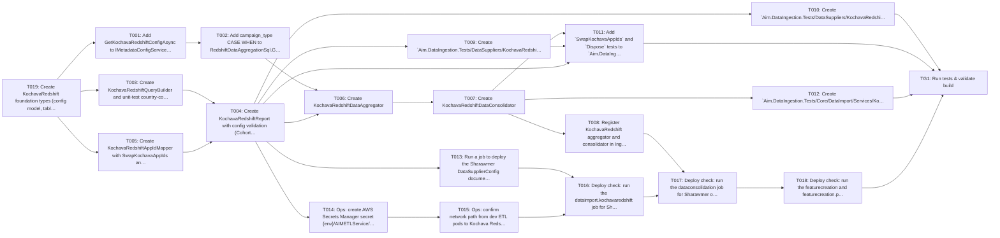

## Implementation Task Matrix — wi_prd059_baba21

**Matrix ID:** `wi_prd059_baba21-r9` · **Generated:** 2026-10-30T06:44:37.468246+00:00 · **Source:** `tasks` · **Verdict:** **READY with 5 warnings**

### Summary

| Metric | Value |
| :--- | :--- |
| Tasks total | 20 |
| AI-allocated | 14 |
| Manual-allocated | 6 |
| Waves | 9 |
| Conflicts | 0 |
| Requirements uncovered | 1 |
| Low-confidence allocations (<0.6) | 3 |

### Wave 0

| Task | Title | Repo | Owner | Allocation | Confidence | Status |
| :--- | :--- | :--- | :--- | :--- | :--- | :--- |
| T019 | Create KochavaRedshift foundation types (config model, table definitions, repor… | Kochava/aim-data-ingestion | coding-agent | ai | 0.70 | planned |

### Wave 1

| Task | Title | Repo | Owner | Allocation | Confidence | Status |
| :--- | :--- | :--- | :--- | :--- | :--- | :--- |
| T001 | Add GetKochavaRedshiftConfigAsync to IMetadataConfigService and MetadataConfigS… | Kochava/aim-data-ingestion | coding-agent | ai | 0.50 | planned |
| T003 | Create KochavaRedshiftQueryBuilder and unit-test country-code CASE / GROUP BY a… | Kochava/aim-data-ingestion | coding-agent | ai | 0.70 | planned |
| T005 | Create KochavaRedshiftAppIdMapper with SwapKochavaAppIds and the 100% unmatched… | Kochava/aim-data-ingestion | coding-agent | ai | 0.70 | planned |

### Wave 2

| Task | Title | Repo | Owner | Allocation | Confidence | Status |
| :--- | :--- | :--- | :--- | :--- | :--- | :--- |
| T002 | Add campaign_type CASE WHEN to RedshiftDataAggregationSql.GetStandardAggregateT… | Kochava/aim-data-ingestion | coding-agent | ai | 0.50 | planned |
| T004 | Create KochavaRedshiftReport with config validation (CohortPeriods, LookbackWee… | Kochava/aim-data-ingestion | coding-agent | ai | 0.70 | planned |

### Wave 3

| Task | Title | Repo | Owner | Allocation | Confidence | Status |
| :--- | :--- | :--- | :--- | :--- | :--- | :--- |
| T006 | Create KochavaRedshiftDataAggregator | Kochava/aim-data-ingestion | coding-agent | ai | 0.50 | planned |
| T009 | Create `Aim.DataIngestion.Tests/DataSuppliers/KochavaRedshift/KochavaRedshiftRe… | Kochava/aim-data-ingestion | coding-agent | ai | 0.70 | planned |
| T010 | Create `Aim.DataIngestion.Tests/DataSuppliers/KochavaRedshift/KochavaRedshiftRe… | Kochava/aim-data-ingestion | coding-agent | ai | 0.70 | planned |
| T013 | Run a job to deploy the Sharawmer DataSupplierConfig document into MongoDB data… | Kochava/aim-data-ingestion | manual-developer | manual | 0.80 | planned |
| T014 | Ops: create AWS Secrets Manager secret {env}/AIMETLService/Sharawmer | Kochava/aim-data-ingestion | manual-developer | manual | 0.80 | planned |

### Wave 4

| Task | Title | Repo | Owner | Allocation | Confidence | Status |
| :--- | :--- | :--- | :--- | :--- | :--- | :--- |
| T007 | Create KochavaRedshiftDataConsolidator | Kochava/aim-data-ingestion | coding-agent | ai | 0.70 | planned |
| T015 | Ops: confirm network path from dev ETL pods to Kochava Redshift | Kochava/aim-data-ingestion | manual-developer | manual | 0.80 | planned |

### Wave 5

| Task | Title | Repo | Owner | Allocation | Confidence | Status |
| :--- | :--- | :--- | :--- | :--- | :--- | :--- |
| T008 | Register KochavaRedshift aggregator and consolidator in IngestionTaskFactory | Kochava/aim-data-ingestion | coding-agent | ai | 0.70 | planned |
| T011 | Add `SwapKochavaAppIds` and `Dispose` tests to `Aim.DataIngestion.Tests/DataSup… | Kochava/aim-data-ingestion | coding-agent | ai | 0.70 | planned |
| T012 | Create `Aim.DataIngestion.Tests/Core/DataImport/Services/KochavaRedshift/Kochav… | Kochava/aim-data-ingestion | coding-agent | ai | 0.70 | planned |
| T016 | Deploy check: run the dataimport.kochavaredshift job for Sharawmer on dev and v… | Kochava/aim-data-ingestion | manual-developer | manual | 0.80 | planned |

### Wave 6

| Task | Title | Repo | Owner | Allocation | Confidence | Status |
| :--- | :--- | :--- | :--- | :--- | :--- | :--- |
| T017 | Deploy check: run the dataconsolidation job for Sharawmer on dev and verify the… | Kochava/aim-data-ingestion | manual-developer | manual | 0.80 | planned |

### Wave 7

| Task | Title | Repo | Owner | Allocation | Confidence | Status |
| :--- | :--- | :--- | :--- | :--- | :--- | :--- |
| T018 | Deploy check: run the featurecreation and featurecreation.postprocessor jobs fo… | Kochava/aim-data-ingestion | manual-developer | manual | 0.80 | planned |

### Wave 8

| Task | Title | Repo | Owner | Allocation | Confidence | Status |
| :--- | :--- | :--- | :--- | :--- | :--- | :--- |
| TG1 | Run tests & validate build | Kochava/aim-data-ingestion | test-change-gate | ai | 0.90 | planned |

### Dependency Graph

### Open Questions

- `T001` — Is `GetKochavaRedshiftConfigAsync` implemented in `MetadataConfigService.cs` or only declared in the interface? (Resolved: does not exist in either `IMetadataConfigService` or `MetadataConfigService`; T001 adds it to both as new code)
- `T002` — Does `RedshiftDataAggregationSql.GetStandardAggregateTableQuery` include campaign_type CASE WHEN for KochavaRedshift, or does the aggregator need custom SQL? (Resolved: not present today; T002 adds campaign_type CASE WHEN to `GetStandardAggregateTableQuery` in `RedshiftDataAggregationSql.cs`)
- `T006` — Does `RedshiftDataAggregationSql.GetStandardAggregateTableQuery` include campaign_type CASE WHEN for KochavaRedshift, or does the aggregator need custom SQL? (Resolved: not present today; T002 adds campaign_type CASE WHEN to `GetStandardAggregateTableQuery` in `RedshiftDataAggregationSql.cs`)
- `T006` — Does `RedshiftDataAggregationSql.GetStandardAggregateTableQuery` include campaign_type CASE WHEN for KochavaRedshift, or does the aggregator need custom SQL? (Resolved: not present today; T002 adds campaign_type CASE WHEN to `GetStandardAggregateTableQuery` in `RedshiftDataAggregationSql.cs`)
- `T002` — Does `RedshiftDataAggregationSql.GetStandardAggregateTableQuery` include campaign_type CASE WHEN for KochavaRedshift, or does the aggregator need custom SQL? (Resolved: not present today; T002 adds campaign_type CASE WHEN to `GetStandardAggregateTableQuery` in `RedshiftDataAggregationSql.cs`)

### Uncovered Requirements

`PRD-059`

### Warnings

- T012: `BigQueryDataImportServiceTests.cs` has no folder in the repo; check where it belongs
- grounding pinned to d105b11f; knowledge graph skipped for Kochava/aim-data-ingestion
- Open item T001: Is `GetKochavaRedshiftConfigAsync` implemented in `MetadataConfigService.cs` or only declared in the interface?
- Open item T002: Does `RedshiftDataAggregationSql.GetStandardAggregateTableQuery` include campaign_type CASE WHEN for KochavaRedshift, or does the aggregator need custom SQL?
- Open item T006: Does `RedshiftDataAggregationSql.GetStandardAggregateTableQuery` include campaign_type CASE WHEN for KochavaRedshift, or does the aggregator need custom SQL?

---
> Generated by: taskmatrix 0.1.0
