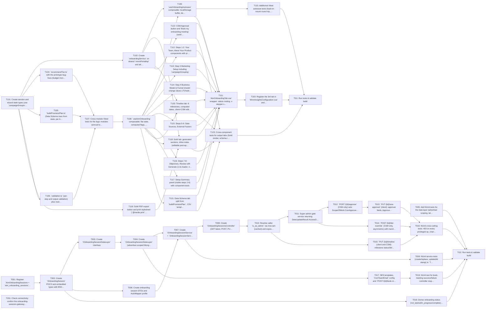

## Implementation Task Matrix — wi_prd061_47cf2c

**Matrix ID:** `wi_prd061_47cf2c-r4` · **Generated:** 2026-10-29T16:03:37.563709+00:00 · **Source:** `tasks` · **Verdict:** **READY with 9 warnings**

### Summary

| Metric | Value |
| :--- | :--- |
| Tasks total | 45 |
| AI-allocated | 44 |
| Manual-allocated | 1 |
| Waves | 12 |
| Conflicts | 0 |
| Requirements uncovered | 4 |
| Low-confidence allocations (<0.6) | 0 |

### Wave 0

| Task | Title | Repo | Owner | Allocation | Confidence | Status |
| :--- | :--- | :--- | :--- | :--- | :--- | :--- |
| T001 | Register `AimOnboardingSessions = 'aim_onboarding_sessions'` in CollectionNames… | Kochava/mmm-portal-api | coding-agent | ai | 0.90 | planned |
| T005 | Add NUnit tests for the data layer (advertiser scoping, latest-wins) in `Kochav… | Kochava/mmm-portal-api | coding-agent | ai | 0.90 | planned |
| T101 | Create session and wizard state types (use `campaignGrouping`/`campaignGrouping… | Kochava/frontend-mos | coding-agent | ai | 0.80 | planned |
| T201 | Check connectivity: confirm the onboarding-sessions gateway rule is deployed in… | Kochava/ko-k8s-apps | manual-developer | manual | 0.90 | planned |

### Wave 1

| Task | Title | Repo | Owner | Allocation | Confidence | Status |
| :--- | :--- | :--- | :--- | :--- | :--- | :--- |
| T002 | Create `OnboardingSession` POCO and embedded types with BSON attributes | Kochava/mmm-portal-api | coding-agent | ai | 0.90 | planned |
| T102 | Create `onboardingService` on shared `mmmPortalApi` and attach x-user-id for on… | Kochava/frontend-mos | coding-agent | ai | 0.80 | planned |
| T104 | `recommendTier.ts` with the prototype bug-fixes (budget monthly/annual with ann… | Kochava/frontend-mos | coding-agent | ai | 0.80 | planned |
| T105 | `buildProvisionPlan.ts` (Data Schema rows from state, per Anupam's CSV format d… | Kochava/frontend-mos | coding-agent | ai | 0.80 | planned |
| T106 | `validation.ts` (per-step and output validation) plus routing-flag computation | Kochava/frontend-mos | coding-agent | ai | 0.80 | planned |
| T119 | SoW PDF export button and print stylesheet (`@media print` + `window.print()`) | Kochava/frontend-mos | coding-agent | ai | 0.80 | planned |

### Wave 2

| Task | Title | Repo | Owner | Allocation | Confidence | Status |
| :--- | :--- | :--- | :--- | :--- | :--- | :--- |
| T003 | Create `IOnboardingSessionDataLayer` interface | Kochava/mmm-portal-api | coding-agent | ai | 0.90 | planned |
| T006 | Create onboarding session DTOs and AutoMapper profile | Kochava/mmm-portal-api | coding-agent | ai | 0.90 | planned |
| T018 | Derive onboarding status (not_started/in_progress/complete) from the session do… | Kochava/mmm-portal-api | coding-agent | ai | 0.90 | planned |
| T107 | Cross-module Vitest tests for the logic modules (annual to monthly, 12-24mo qua… | Kochava/frontend-mos | coding-agent | ai | 0.80 | planned |
| T122 | CSM Approval button and 'Book my onboarding meeting' (sent/retry) component; no… | Kochava/frontend-mos | coding-agent | ai | 0.80 | planned |

### Wave 3

| Task | Title | Repo | Owner | Allocation | Confidence | Status |
| :--- | :--- | :--- | :--- | :--- | :--- | :--- |
| T004 | Create `OnboardingSessionDataLayer` (advertiser-scoped Mongo CRUD + change-log… | Kochava/mmm-portal-api | coding-agent | ai | 0.90 | planned |
| T108 | `useAimOnboarding` composable: flat state, computed flags, step nav, business-m… | Kochava/frontend-mos | coding-agent | ai | 0.80 | planned |

### Wave 4

| Task | Title | Repo | Owner | Allocation | Confidence | Status |
| :--- | :--- | :--- | :--- | :--- | :--- | :--- |
| T007 | Create `IOnboardingSessionService` + `OnboardingSessionService` (get-latest, cr… | Kochava/mmm-portal-api | coding-agent | ai | 0.90 | planned |
| T017 | SES templates, `CsmTeamEmail` config and `POST /{id}/book-meeting` (clear 200 /… | Kochava/mmm-portal-api | coding-agent | ai | 0.90 | planned |
| T109 | `useOnboardingAutosave` composable: localStorage buffer, debounced full-doc PUT… | Kochava/frontend-mos | coding-agent | ai | 0.80 | planned |
| T112 | Steps 1-2: Your Team, About Your Product components with progressive disclosure | Kochava/frontend-mos | coding-agent | ai | 0.80 | planned |
| T113 | Step 3 Marketing Setup including `campaignGrouping` | Kochava/frontend-mos | coding-agent | ai | 0.80 | planned |
| T114 | Step 4 Business Model & Funnel (model change clears LTV/webFunnel; internal eve… | Kochava/frontend-mos | coding-agent | ai | 0.80 | planned |
| T115 | Steps 5-6: Data Sources, External Factors | Kochava/frontend-mos | coding-agent | ai | 0.80 | planned |
| T116 | Steps 7-8: Objectives, Review with Generate (1.6s loader, no backend call) | Kochava/frontend-mos | coding-agent | ai | 0.80 | planned |
| T117 | Setup Summary panel (visible steps 2-6) with component tests | Kochava/frontend-mos | coding-agent | ai | 0.80 | planned |
| T118 | SoW tab: generated sections, inline notes (editable post-approval), approval bl… | Kochava/frontend-mos | coding-agent | ai | 0.80 | planned |
| T120 | Timeline tab: 6 milestones, computed dates, client+CSM editing, cascade, audit-… | Kochava/frontend-mos | coding-agent | ai | 0.80 | planned |
| T121 | Data Schema tab: split from `buildProvisionPlan`, CSV template download (Blob),… | Kochava/frontend-mos | coding-agent | ai | 0.80 | planned |

### Wave 5

| Task | Title | Repo | Owner | Allocation | Confidence | Status |
| :--- | :--- | :--- | :--- | :--- | :--- | :--- |
| T008 | Create `OnboardingSessionsController` (GET latest, POST, PUT /{id}) | Kochava/mmm-portal-api | coding-agent | ai | 0.90 | planned |
| T009 | NUnit service tests (create/replace, updatedAt stamp) in `Tests/OnboardingSessi… | Kochava/mmm-portal-api | coding-agent | ai | 0.90 | planned |
| T019 | NUnit test for book-meeting success/failure controller response | Kochava/mmm-portal-api | coding-agent | ai | 0.90 | planned |
| T110 | Additional Vitest autosave tests (load-on-mount round trip, localStorage fallba… | Kochava/frontend-mos | coding-agent | ai | 0.80 | planned |
| T111 | `AimOnboardingTab.vue` wrapper: status routing, v-stepper shell, isASAdmin CSM… | Kochava/frontend-mos | coding-agent | ai | 0.80 | planned |
| T123 | Cross-component tests for output tabs (SoW render, schema rows, CSM gating) | Kochava/frontend-mos | coding-agent | ai | 0.80 | planned |

### Wave 6

| Task | Title | Repo | Owner | Allocation | Confidence | Status |
| :--- | :--- | :--- | :--- | :--- | :--- | :--- |
| T010 | Resolve caller `is_as_admin` via mos-iam (cached) and expose `IsSuperAdmin` on… | Kochava/mmm-portal-api | coding-agent | ai | 0.90 | planned |
| T103 | Register the 3rd tab in `MmmInsightsConfiguration.vue` and add i18n key `mmm_co… | Kochava/frontend-mos | coding-agent | ai | 0.80 | planned |

### Wave 7

| Task | Title | Repo | Owner | Allocation | Confidence | Status |
| :--- | :--- | :--- | :--- | :--- | :--- | :--- |
| T011 | Super-admin gate service returning DataUpdateResult.AccessDenied (403) | Kochava/mmm-portal-api | coding-agent | ai | 0.90 | planned |
| T015 | `PUT /{id}/timeline` (client and CSM): milestone status/delay/notes, cascade, s… | Kochava/mmm-portal-api | coding-agent | ai | 0.90 | planned |
| TG1 | Run tests & validate build | Kochava/frontend-mos | test-change-gate | ai | 0.90 | planned |

### Wave 8

| Task | Title | Repo | Owner | Allocation | Confidence | Status |
| :--- | :--- | :--- | :--- | :--- | :--- | :--- |
| T012 | `POST /{id}/approve` (CSM only) sets ScopeOfWork.CsmApproved with audit entry | Kochava/mmm-portal-api | coding-agent | ai | 0.90 | planned |
| T014 | `POST /{id}/tier-override` (CSM only, asymmetric) with mandatory audit entry (r… | Kochava/mmm-portal-api | coding-agent | ai | 0.90 | planned |

### Wave 9

| Task | Title | Repo | Owner | Allocation | Confidence | Status |
| :--- | :--- | :--- | :--- | :--- | :--- | :--- |
| T013 | `PUT /{id}/sow-approval` (client): approver fields, ApprovedAt, status=complete… | Kochava/mmm-portal-api | coding-agent | ai | 0.90 | planned |

### Wave 10

| Task | Title | Repo | Owner | Allocation | Confidence | Status |
| :--- | :--- | :--- | :--- | :--- | :--- | :--- |
| T016 | NUnit cross-cutting tests: 403 on every privileged op, change-log appended, cas… | Kochava/mmm-portal-api | coding-agent | ai | 0.90 | planned |

### Wave 11

| Task | Title | Repo | Owner | Allocation | Confidence | Status |
| :--- | :--- | :--- | :--- | :--- | :--- | :--- |
| TG2 | Run tests & validate build | Kochava/mmm-portal-api | test-change-gate | ai | 0.90 | planned |

### Dependency Graph

### Open Questions

- `is_as_admin` vs `ROLE_CSM`; mos-iam endpoint for T010 (Satish + Identity)
- `onboarding_status` field shape on `app_config` (T018) (Satish)
- Data Schema template columns per source (T121) (Gary / Data)
- SES recipient config + copy (T017) (Gary / Backend)

### Uncovered Requirements

`US1`, `US2`, `US3`, `US4`

### Warnings

- anchored 1 partial file path to full paths from the PRD plan docs
- grounding pinned to db6f837c; knowledge graph skipped for Kochava/mmm-portal-api
- grounding pinned to 66bc506c; knowledge graph skipped for Kochava/frontend-mos
- T010: task too large (6 files (max 5)); consider splitting
- T017: task too large (8 files (max 5)); consider splitting
- Open item: `is_as_admin` vs `ROLE_CSM`; mos-iam endpoint for T010
- Open item: `onboarding_status` field shape on `app_config` (T018)
- Open item: Data Schema template columns per source (T121)
- Open item: SES recipient config + copy (T017)

---
> Generated by: taskmatrix 0.1.0
