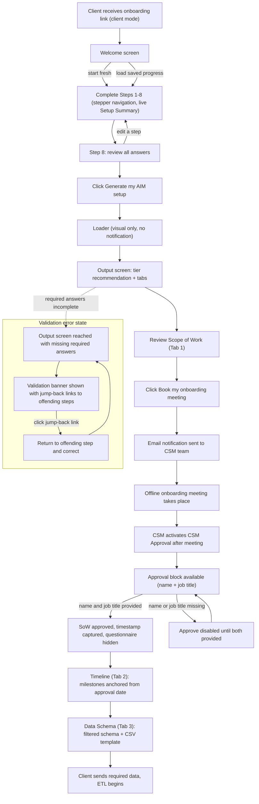
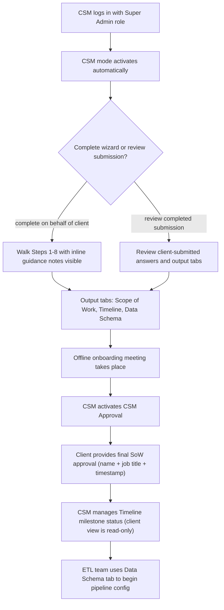

# Product Specification: AIM Onboarding Decision Tool

## 1. Business Logic & Context

### Problem

Kochava's current AIM (AI Marketing) onboarding process is open-ended. New clients are handed a static spreadsheet containing every possible question — ignorant of their business model, with no decision tree. Clients are asked what they want, they ask for everything, and the team says yes. This produces scope creep, delays model builds, and over-engineers ETL pipelines. Across eight discovery interviews (April 2026) spanning every persona (CSM, Data Engineering, Data Science), this was the #1 internal pain point.

The defining failure case: a client was promised a feature not yet built; the Lead Data Scientist had to build a new framework from scratch; the client was lost and a downstream partnership was damaged. Scope creep at the point of onboarding has direct revenue and relationship consequences.

### Value

The tool is a guided, 8-step onboarding wizard that replaces the open-ended questionnaire with a constrained, progressive-disclosure flow. It collects exactly what is needed to configure an AIM model (platforms, business model, KPI, funnel events, data sources, objectives) and generates usable output documents: a draft Scope of Work, a delivery Timeline, and a filtered Data Schema. It is the prerequisite for AIM X zero-touch (self-serve) onboarding and the primary mechanism for eliminating scope creep before any engineering begins.

Business outcomes targeted:
- **Eliminate scope creep at source** — the wizard produces a deterministic, agreed Scope of Work before engineering starts.
- **Enable AIM X zero-touch onboarding** — the self-serve path requires near-zero CSM or engineering effort per client. Any manual per-client effort breaks the AIM X product model; this is a hard constraint on the eventual self-serve phase.
- **Reduce model configuration time** — manual interpretation drops from hours/days to a targeted sub-10-minute window per client.
- **Give clients exact data requirements** — a filtered Data Schema shows only the data a given client must provide, not the full master schema.
- **Reduce CSM discovery burden** — a structured wizard replaces the open-ended discovery call.

### Business Rules

**Tier model.** The wizard recommends one of two tiers: **AIM X** (default/self-serve) or **AIM Pro**. Recommendation starts at AIM X and upgrades to AIM Pro if ANY of the following are true:
- **Spend + history:** monthly spend ≥ $250K AND data history is at least 12–24 months.
- **Data sources:** 2 or more additional non-MMP data sources are connected.
- **UA/UE routing:** the UA/UE routing flag is in the "AIM Pro eligible" state — set when both User Acquisition and User Engagement campaign types are present at a mid share (each between 10% and 90%).

AIM Pro can always be manually downgraded to AIM X. AIM X can only be upgraded to Pro when the auto-recommendation itself is Pro. A user may override the recommended model structure (Unified vs Separate) regardless of the system's auto-recommendation.

**Budget eligibility.** $50K/month is the hard minimum for AIM eligibility. The budget slider range is a fixed estimation aid (not configurable): Monthly $50K→$10M, Annual $5M→$200M+. $50K is a floor and must not be lowered.

**AIM X vs AIM Pro scope boundary.** Campaign-level attribution is AIM Pro only. Retrospective offline analysis is AIM Pro. Novel/bespoke business models route to the AIM Enterprise path and are out of scope for this wizard.

**Computed routing flags.** Two flags are recomputed live on every state change and drive both the tier algorithm and the eventual Model Config:
- **UA/UE routing flag** — derived from the presence and share of UA and UE campaign types.
- **Brand routing flag** — derived from the presence of Brand campaigns. Brand campaigns require a longer (~30-day) ad-stock window versus ~7-day for UA/UE; mixed-network campaign-level combination is explicitly unproven territory and must be flagged in the generated Scope of Work.

**User modes.** Two modes share the same UI structure:
- **Client mode** — a new AIM client completing the wizard themselves. Access: Steps 1–8 and the Scope of Work, Timeline, and Data Schema output tabs. The internal Model Config document is never visible.
- **CSM mode** — a Kochava CSM completing on behalf of, or reviewing after, a client. Access: the same steps and tabs, plus inline internal guidance notes per answer. CSM mode is granted automatically to any user holding the existing K4A Super Admin role — no separate toggle or URL. The Model Config tab is a later phase and is not in scope here.

**Primary persona.** The tool is designed primarily for the advertiser to complete. The CSM reviews the generated Scope of Work after the client submits; the CSM does not lead wizard completion by default.

**Approval and handoff.** Completing the wizard ("Generate my AIM setup") does NOT send any automated notification — the loader is visual polish only. A notification email to the CSM team is sent only when the client chooses to book an onboarding meeting. An offline onboarding meeting then takes place. A manual "CSM Approval" action becomes available only after that meeting, which unlocks the final Scope of Work approval. Scope of Work approval requires a named individual's name and official job title plus a captured approval timestamp. Once approved, the questionnaire form is hidden and only the output tabs remain; core generated content locks, though inline notes stay editable. An explicit "Unlock to edit" action clears the approval and re-surfaces the approval block (a CSM-led re-approval cycle).

**Multi-region.** Each region is an independent onboarding instance, processed sequentially (not in parallel). The user may add another region at the end of the flow and switch between regions/apps mid-session via a dropdown, even when different regions sit at different approval stages. The full model-count multiplier logic is a later phase.

**Commercial confidentiality.** All collected answers (company name, lead contacts, budget) are commercial-confidential and must be handled accordingly (see Section 5).

### Affected-services note (KG cross-check)

An independent knowledge-graph lookup for this requirement surfaced a candidate set of services for the eventual implementation (an onboarding tool UI, its backing portal API, an onboarding-initialization service, and lower-confidence candidates for reference data, attribution, workflow orchestration, and an MCP surface). The precedent PRD instead frames delivery as an embed inside the K4A console with client-side state and a later backend persistence/submission layer. These two framings do not obviously agree, and the KG candidates are mostly low/medium confidence role guesses, not confirmed call-graph evidence. This spec does not pick an implementation target — service selection and the UI-versus-additional-MCP-surface question are engineering/downstream decisions and are noted here only so the discrepancy is not silently resolved. [DECISION REQUIRED: DEC-001]

---

## 2. User Flows (Visuals)





---

## 3. Functional Requirements

> Gherkin convention: "the wizard" refers to the onboarding tool in whichever mode is active. "Required field" means a field whose absence surfaces either as a hard block on "Next" (empty critical field) or as a validation banner on the output screen, per each FR. Validation is non-blocking by design except where an FR states a hard block.

### Feature Area A — Wizard Shell, Navigation & State

**FR-001 — Linear 8-step wizard with stepper navigation**
```gherkin
Given a user has opened the wizard
When the wizard renders
Then an 8-step stepper/breadcrumb is shown with Steps 1 through 8
And every step is directly selectable from the stepper at any time
And a completed step shows a completion indicator
And a step with a validation error (evaluated at the output stage) shows an error indicator
```

**FR-002 — Non-blocking in-step progression with hard block on empty critical fields**
```gherkin
Given a user is on any wizard step with one or more incomplete answers
When the user clicks "Next"
And the step contains no empty critical required field
Then the user advances to the next step despite the incomplete answers

Given a user is on a wizard step that contains an empty critical required field
When the user clicks "Next"
Then advancement is blocked
And the empty critical field is indicated as requiring a value
```

**FR-003 — Full validation deferred to the output screen**
```gherkin
Given a user has reached the output screen with one or more required answers still missing
When the output screen renders
Then a validation banner is displayed
And the banner lists each offending step with a jump-back link
When the user clicks a jump-back link
Then the wizard navigates directly to the offending step
```

**FR-004 — Automatic progress persistence and resume**
```gherkin
Given a user has entered or changed any answer in the wizard
When the change occurs
Then the current wizard state is saved automatically

Given a user has previously saved wizard progress
When the user re-opens the wizard
Then the welcome screen offers an option to continue saved progress
And selecting it restores all previously entered answers
```
> The persistence mechanism (local-only in the early phase versus account-backed persistence) is an engineering decision; this FR requires only that saved progress survives reload and can be resumed.

**FR-005 — Live Setup Summary panel (Steps 2–6)**
```gherkin
Given a user is on any of Steps 2 through 6
When the step renders
Then a Setup Summary panel is visible on the right edge of the wizard
And the panel reflects, in real time, the current platform list, model-count estimate, business model, KPI event, MMP, and data sources

Given a user changes a platform or region answer
When the change is applied
Then the model-count estimate in the Setup Summary panel updates immediately

Given a user is on Step 8
When the step renders
Then the Setup Summary panel is hidden and replaced by the full review layout
```

### Feature Area B — Step 1: Your Team

**FR-010 — Company and lead collection**
```gherkin
Given a user is on Step 1
When the step renders
Then a required company-name text input is shown
And at least one project-lead row (name + email) and at least one data-lead row (name + email) can be added
And each repeating row supports "+ Add another" and remove
And a "Same as project lead" option synchronises data-lead rows from project-lead rows in real time
```

**FR-011 — Step 1 validation**
```gherkin
Given a user has reached the output screen
When company name is empty
Then a validation error is raised for the company name

Given a user has reached the output screen
When no project-lead row contains both a name and an email
Then a validation error is raised for project leads

Given a user has reached the output screen
When no data-lead row exists and data leads are not synced from project leads
Then a validation error is raised for data leads
```

**FR-012 — Step 1 feeds the Scope of Work**
```gherkin
Given Step 1 answers are complete
When the Scope of Work is generated
Then the company name and lead names populate the Scope of Work header and signoff block verbatim
```

### Feature Area C — Step 2: About Your Product

**FR-020 — Product name, platforms, and iOS callout**
```gherkin
Given a user is on Step 2
When the step renders
Then a required app/brand name input is shown
And a multi-select platform control offers iOS, Android, and Web with at least one required
When the user selects iOS
Then an ATT/SKAN callout note is shown
```

**FR-021 — Conversion share allocator totalling 100%**
```gherkin
Given a user has selected 2 or more platforms
When the conversion-share allocator is shown
Then a slider and stepper is presented per selected platform
And the shares must total 100 percent
When exactly 2 platforms are selected and the user moves one share
Then the other share auto-adjusts to keep the total at 100
When 3 platforms are selected and the user moves one share
Then the remaining platforms are redistributed proportionally to keep the total at 100
```

**FR-022 — Spend separability and cross-journey migration (progressive disclosure)**
```gherkin
Given a user has selected Web plus at least one mobile platform
When Step 2 renders the spend-separability question
Then options Yes, No, and Not sure are shown
When the user selects "Not sure"
Then an optional free-text field is revealed

Given the spend-separability question has been answered
When the cross-journey migration question is shown
Then options Yes, No, and Not sure are shown with a "See an example" disclosure
```

**FR-023 — Recommended model structure with override**
```gherkin
Given both the spend-separability and cross-journey migration questions have been answered
When the recommended model structure is shown
Then Unified and Separate choice cards are displayed
And the system's preferred structure carries an auto-recommended badge
When the user selects the non-recommended card
Then the user's override is accepted and retained
```

**FR-024 — Primary market**
```gherkin
Given a user is on Step 2
When no platform has been selected
Then the primary-market selector is locked

Given at least one platform is selected
When the primary-market selector is enabled
Then options US, UK, Germany, France, Canada, and Other are shown as a required selection
When the user selects "Other"
Then a free-text market field is revealed
```

**FR-025 — Step 2 feeds output**
```gherkin
Given Step 2 answers are complete
When output is generated
Then platform list, conversion shares, modelling approach, and region populate the Scope of Work and the Setup Summary model-count estimate
```

### Feature Area D — Step 3: Marketing Setup

**FR-030 — Media budget with period toggle and fixed range**
```gherkin
Given a user is on Step 3
When the budget control renders
Then a slider with a Monthly/Annual toggle is shown as a required field
And the Monthly range is fixed at $50K to $10M and the Annual range at $5M to $200M+
And the slider range is not user-configurable
And $50K per month is enforced as the minimum AIM eligibility floor
```

**FR-031 — Offline media and split**
```gherkin
Given a user is on Step 3
When the offline-media question renders
Then a required Yes/No choice is shown
When the user selects Yes
Then a digital/offline spend-split slider defaulting to 80/20 is revealed
And an offline-media schema row is marked for inclusion in the Data Schema
```

**FR-032 — Digital media types and attribution reliability**
```gherkin
Given a user is on Step 3
When the digital-media-types control renders
Then a multi-select of Self-attributed, Standard attributed, Affiliates/partner networks, and Other is shown with at least one required

Given a user is on Step 3
When the attribution-reliability question renders
Then a required Yes/No/Not sure choice is shown
When the user selects Yes or Not sure
Then a multi-select of gap categories (Offline media, DSP, Affiliates, Branded/awareness, Mobile networks, Influencer, Podcasts, Not sure, Other) is revealed
When the user selects "Not sure"
Then a reassurance callout is shown
```

**FR-033 — Coverage confidence and organic/paid split**
```gherkin
Given a user is on Step 3
When the coverage-confidence question renders
Then a required Yes/No/Not sure choice is shown

Given a user is on Step 3
When the organic/paid split control renders
Then a per-platform slider shows the percentage of installs that are paid
And the controls default to iOS 65%, Android 80%, and Web 50%
```

**FR-034 — Campaign types and budget split**
```gherkin
Given a user is on Step 3
When the campaign-types control renders
Then toggle cards for User Acquisition, User Engagement, and Brand are shown with at least one required
When the user toggles on a campaign type
Then its budget share is initialised at an equal split across active types

Given 2 or more campaign types are active
When the budget-split control renders
Then a slider and stepper per active type is shown constrained to total 100 percent
When 3 types are active and one share is changed
Then the remaining types are redistributed proportionally
When any active type's share is below 5 percent or above 90 percent
Then a warning banner is displayed
```

**FR-035 — Campaign shares drive routing flags (live)**
```gherkin
Given the user has set campaign types and their shares
When any campaign-type or share value changes
Then the UA/UE routing flag and the brand routing flag are recomputed immediately
And the UA/UE routing flag is set to the AIM-Pro-eligible state when both UA and UE are present and each sits at a mid share between 10 and 90 percent
And these flags feed the tier recommendation
```

### Feature Area E — Step 4: Business Model & Conversion Funnel

**FR-040 — Business model selection resets the funnel**
```gherkin
Given a user is on Step 4
When the business-model control renders
Then required choice cards for Subscription, E-commerce, and Gaming are shown
When the user changes the previously selected business model
Then the funnel resets to the default funnel for the newly selected model
```

**FR-041 — Gaming revenue type**
```gherkin
Given the business model is Gaming
When Step 4 renders
Then a required revenue-type choice of IAP, Ads, or Both is shown
```

**FR-042 — Funnel events and primary KPI**
```gherkin
Given a business model is selected
When the app-funnel checklist renders
Then the default events for that business model are pre-selected, with required events locked on and optional events togglable
And at least 3 events must remain on
And each event has an editable name field and a "Set as Primary KPI" action
And exactly one event must be set as the primary KPI
And the default Subscription funnel is Install (required) + Registration + Trial Start + Subscription Start (KPI: Trial Start) + Revenue
And the default E-commerce funnel is Install (required) + Registration + First Purchase (required, KPI: First Purchase) + Total Purchases + Revenue
And the Gaming funnel follows the E-commerce funnel
```

**FR-043 — Web funnel (conditional)**
```gherkin
Given the Web platform is selected
When Step 4 renders the web funnel
Then the same funnel pattern is shown for web events
And at least 2 web events must remain on
```

**FR-044 — LTV model (conditional chain)**
```gherkin
Given the funnel has been configured
When the LTV question renders
Then an "Include LTV model?" Yes/No choice is shown
When the user selects Yes
Then a "Cohort revenue data available?" Yes/No/Partial choice is shown
When the user selects Partial
Then a choice between supplying partial data or skipping is offered
```

**FR-045 — Step 4 feeds output**
```gherkin
Given Step 4 answers are complete
When output is generated
Then the funnel events are expressed as model dependent-variable slugs for downstream use
And the primary KPI event populates the Scope of Work
And an LTV "Yes" with cohort data available adds 7-day, 30-day, 90-day, and 360-day revenue cohort rows to the Data Schema
```

### Feature Area F — Step 5: Data Sources

**FR-050 — Historical data per platform**
```gherkin
Given a user is on Step 5
When the historical-data control renders per selected platform
Then tile options 12–24 months, 24–36 months, and 36 months+ are shown
When the user selects 12–24 months
Then a warning banner noting partial seasonality modelling is shown
When the user selects 24 months or more
Then a green confirmation is shown
```

**FR-051 — MMP selection and collection method**
```gherkin
Given at least one mobile platform is selected
When the MMP control renders
Then a required selection of AppsFlyer, Adjust, Singular, Branch, Kochava, and Other/none is shown
When the user selects "Other/none"
Then a custom-connector milestone marked "to be confirmed" is injected into the Timeline

Given an MMP other than "Other/none" is selected
When the collection-method control renders
Then Direct API (with a Recommended badge), File, and cloud options are shown
When the user selects File
Then storage-type options (Google Drive, S3) are revealed
```

**FR-052 — AppsFlyer cohort access (conditional)**
```gherkin
Given AppsFlyer is the selected MMP
When Step 5 renders
Then a Yes/No AppsFlyer cohort-access sub-question with an explanatory note is shown
```

**FR-053 — Web attribution sources (conditional)**
```gherkin
Given the Web platform is selected
When the web-attribution control renders
Then a required multi-select of Google Analytics 4, Google Drive, S3, Database, and Other is shown
When the user selects "Other"
Then a free-text field is revealed
```

**FR-054 — Ad spend data**
```gherkin
Given a user is on Step 5
When the ad-spend control renders
Then a required collection-method choice of Direct API, File, or Manual is shown first
And then source chips for MMP direct, Supermetrics, Google Drive, S3, Database, and Other are shown
When the user selects "Other"
Then a free-text field is revealed and a "to be confirmed" milestone is injected into the Timeline
```

**FR-055 — Step 5 feeds output**
```gherkin
Given Step 5 answers are complete
When output is generated
Then each data source's MMP and collection method produces a provision plan in the Data Schema distinguishing direct versus client-supplied sources
And every "Other" selection produces a corresponding custom-connector "to be confirmed" milestone in the Timeline
And the selected data history produces a seasonality note in the Scope of Work
```

### Feature Area G — Step 6: External Factors (Optional)

**FR-060 — Auto-included factors (read-only)**
```gherkin
Given a user is on Step 6
When the step renders
Then two read-only cards are shown: Seasonality and National holidays
And Seasonality shows "Included" when history is 24 months or more and "Partial" when history is 12–24 months
And National holidays shows "Included" with the client's selected region
And Step 6 applies no hard validation
```

**FR-061 — Additional external factors**
```gherkin
Given a user is on Step 6
When the additional-factors control renders
Then a 6-item multi-select is shown: Promotional activity, Competitor activity, Major product launch/rebrand, PR/earned media spike, Macro economic event, and Other
And a warning callout states the client must be able to supply data for any flagged factor
When any factor is selected
Then a free-text description field is revealed for a brief description with no dates or data required
```

**FR-062 — Step 6 feeds output**
```gherkin
Given Step 6 factors and notes are provided
When output is generated
Then the selected factors and notes appear in the Scope of Work
```

### Feature Area H — Step 7: Objectives (Optional)

**FR-070 — Objectives capture**
```gherkin
Given a user is on Step 7
When the step renders
Then three optional textareas are shown for the AIM-model goal, what success looks like, and 12-month marketing goals
And a hint states the answers are shared with the onboarding manager to frame the kickoff call
And Step 7 applies no validation
```

**FR-071 — Objectives feed the review and the Scope of Work**
```gherkin
Given a user has entered any objective answer
When the Step 8 review summary renders
Then all three objective answers appear in the review

Given objective answers exist
When the Scope of Work is generated
Then all three objective answers appear in a dedicated Objectives section of the Scope of Work
```

### Feature Area I — Step 8: Review & Generate

**FR-080 — Read-back review with per-section edit**
```gherkin
Given a user is on Step 8
When the step renders
Then no new input is collected
And seven sections are shown: Your team, Product, Marketing, Business & funnel, Data sources, External factors, and Objectives
And each section renders key/value rows from the current answers
And each section has an Edit action that jumps directly to its step
And any unanswered field renders a placeholder dash at reduced opacity
```

**FR-081 — Generate action**
```gherkin
Given a user is on Step 8
When the user clicks "Generate my AIM setup"
Then a loader is shown as visual feedback only, with no notification sent and no handoff triggered
And the output screen is then displayed
```

### Feature Area J — Output Screen & Tabs

**FR-090 — Output screen structure and tier recommendation**
```gherkin
Given the output screen renders
Then a header shows the app name and an "Edit answers" action
And a tier recommendation (AIM X or AIM Pro) is shown above the tab strip
And the default active tab is the Scope of Work
And the available tabs are Scope of Work, Timeline, and Data Schema
```

**FR-091 — Tier recommendation algorithm**
```gherkin
Given the output screen computes a tier recommendation
When no upgrade condition is met
Then the recommendation is AIM X
When monthly spend is at least $250K and history is at least 12–24 months
Then the recommendation upgrades to AIM Pro
When 2 or more additional non-MMP data sources are connected
Then the recommendation upgrades to AIM Pro
When the UA/UE routing flag is in the AIM-Pro-eligible state
Then the recommendation upgrades to AIM Pro
And a recommendation of AIM Pro may be manually downgraded to AIM X
And a recommendation of AIM X may be manually changed to AIM Pro only when the auto-recommendation is AIM Pro
```

**FR-092 — Tab 1: Scope of Work content**
```gherkin
Given the Scope of Work tab is active
When it renders
Then a generated document is shown in a document-card style, pre-populated from all wizard answers
And it contains sections for engagement details, platform & region, campaign types, business model & KPI, funnel events, data sources, external factors, and model structure
And each section has an inline notes textarea that expands on click
When Brand campaigns are present
Then the Scope of Work explicitly flags that mixed-network campaign-level combination is unproven territory
```

**FR-093 — Scope of Work approval gating**
```gherkin
Given the offline onboarding meeting has not yet occurred
When the Scope of Work tab renders
Then the "CSM Approval" action is not yet active and the approval block is not available

Given a CSM has activated "CSM Approval" after the offline meeting
When the approval block renders
Then a name field and a job-title field are shown
And the Approve action is disabled until both name and job title are provided
When the user provides both and approves
Then the approver name, approver job title, and a full approval timestamp are captured
And the approval timestamp is passed to the Timeline tab for date anchoring
```

**FR-094 — Post-approval lock and unlock**
```gherkin
Given the Scope of Work has been approved
When the output screen renders
Then the questionnaire form is removed from view and only the output tabs remain
And core generated content (scope, tier, data schema) is locked while inline notes remain editable

Given an approved Scope of Work
When a user invokes "Unlock to edit"
Then the approval timestamp is cleared and the approval block is re-surfaced for a re-approval cycle
```

**FR-095 — Tab 2: Timeline milestones and anchoring**
```gherkin
Given the Timeline tab is active
When it renders for an AIM X recommendation
Then 7 milestones spanning approximately 7 weeks minimum are shown
When it renders for an AIM Pro recommendation
Then 8 milestones including a Results Review, spanning approximately 9+ weeks, are shown
And milestone dates cascade from the approval timestamp when set, otherwise from today
And each milestone start date is the next Monday on or after its calculated date
And custom-connector rows are injected for any "Other/none" MMP, web attribution, or ad spend selection
```

**FR-096 — Timeline cascade delay**
```gherkin
Given a milestone is marked "Delayed" with a saved new date
When the delay is applied
Then all subsequent milestone dates shift by the corresponding number of weeks
And a delay banner shows the total accumulated delay
```

**FR-097 — Timeline status and notes with change log**
```gherkin
Given a user interacts with a Timeline milestone
When the user changes its status (In progress / Complete / Delayed), sets a delay date, or adds, edits, or deletes a note
Then the milestone reflects the change
And the change is written to a Change Log at the bottom of the Timeline tab recording the action and the acting authenticated user's identity
```
> The Change Log records state-changing actions on a client deliverable and must capture the acting user from the authenticated session (not a free-text name) — this is the authoritative actor record for timeline changes.

**FR-098 — Timeline edit permissions by mode**
```gherkin
Given the active mode is CSM
When the Timeline tab renders
Then milestone status updates and notes are editable

Given the active mode is client
When the Timeline tab renders
Then the Timeline is presented read-only
```

**FR-099 — Tab 3: Data Schema filtered provision plan**
```gherkin
Given the Data Schema tab is active
When it renders
Then it is split into "Kochava collects automatically" and "You need to provide"
And the provision plan is built dynamically from the wizard answers
And an offline-media schema is included only when offline media is used
And LTV cohort rows (7-day, 30-day, 90-day, 360-day revenue) are included only when an LTV model is wanted and cohort data is available
And a web schema is included only when the Web platform is selected
And iOS SKAN fields are included only when iOS is selected
And MMP-specific column names reflect the selected MMP
And each client-supplied item shows a schema table of field name, format, and required/optional status with a downloadable CSV template
When all sources are direct
Then a green confirmation banner is shown instead of schema tables
```

**FR-100 — CSV template download per schema type**
```gherkin
Given the Data Schema tab shows a client-supplied schema type
When the user clicks that schema type's "Download template" action
Then a template file is generated pre-configured with exactly the fields that type requires based on the client's answers
```

**FR-101 — Scope of Work PDF export**
```gherkin
Given the Scope of Work tab is active
When the user clicks "Download Scope of Work (PDF)"
Then a PDF of the generated Scope of Work is produced (a real export, not a stub)
```

### Feature Area K — Modes, Submission & Multi-Region

**FR-110 — CSM mode via Super Admin role (server-enforced)**
```gherkin
Given a user is authenticated with the K4A Super Admin role
When the wizard loads
Then CSM mode is activated automatically and per-answer internal guidance notes are shown

Given a user is authenticated without the Super Admin role
When the wizard loads
Then client mode applies and the internal guidance notes are not shown
And CSM-only capabilities are rejected if requested directly, regardless of what the UI exposes, with eligibility re-derived from the authoritative role source on each request
```
> Role gating must be enforced server-side on every request from the authoritative identity source, not by UI-hiding alone; an ineligible caller is rejected even if it reaches a protected capability directly.

**FR-111 — Book meeting triggers notification**
```gherkin
Given a client is reviewing the generated Scope of Work
When the client clicks "Book my onboarding meeting"
Then an email notification is sent to the CSM onboarding team to initiate the offline meeting
And generating the setup alone (without booking) sends no notification
```

**FR-112 — Add another region (sequential instances)**
```gherkin
Given a user has reached the end of the onboarding flow
When the user chooses "Add another region"
Then a new independent onboarding session is initiated for the additional region
And regions are processed sequentially, each as its own onboarding instance
And a dropdown allows switching between regions and apps mid-session, including when they are at different approval stages
```

**FR-113 — Demo mode**
```gherkin
Given the demo mode is enabled
When the tool opens
Then all answers are pre-filled with the fictional demo app
And the tool jumps directly to the output screen with all tabs populated for demonstration
```

I used exactly one `[DECISION REQUIRED: DEC-002]` tag in Sections 0–3 (the affected-services / delivery-surface framing discrepancy in Section 1). Reporting it now.

## 4. Information Requirements

The system must track the following business information to support the Functional Requirements. Types, schema constraints, and storage choices are deliberately omitted (they belong in eng-plan).

**Client identity & contacts**
- **Company name** — User-Entered (Step 1). Populates the Scope of Work header and signoff block; a required anchor for the whole onboarding record.
- **Project leads and data leads (name + email per lead)** — User-Entered (Step 1). Identify who is accountable on the client side and populate the Scope of Work signoff; data leads may be synced from project leads.
- **App/brand name** — User-Entered (Step 2). Labels the output screen and the Scope of Work.

**Product & market profile**
- **Selected platforms (iOS / Android / Web)** — User-Entered (Step 2). Drives conditional funnel, schema, SKAN, and model-structure logic throughout.
- **Platform conversion shares** — User-Entered (Step 2). Feeds model-count estimate and Scope of Work; must total 100%.
- **Modelling approach (Unified / Separate) and system recommendation** — System-Derived recommendation with User override (Step 2). Determines model structure in the Scope of Work.
- **Primary market / region** — User-Entered (Step 2). Drives national-holidays factor and appears in output documents.
- **Spend separability and cross-journey migration answers** — User-Entered (Step 2). Inputs to the model-structure recommendation.

**Marketing setup**
- **Total paid media budget + period (monthly/annual)** — User-Entered (Step 3). Gates AIM eligibility ($50K/month floor) and feeds the tier algorithm.
- **Offline media flag and digital/offline split** — User-Entered (Step 3). Determines inclusion of the offline-media schema row.
- **Digital media types** — User-Entered (Step 3). Describes the channel mix in the Scope of Work.
- **Attribution reliability, gap categories, and coverage confidence** — User-Entered (Step 3). Frames reassurance messaging and model expectations.
- **Organic/paid split per platform** — User-Entered with defaults (Step 3). Informs volume estimation.
- **Campaign types and budget shares (UA / UE / Brand)** — User-Entered (Step 3). Primary inputs to the computed routing flags and the tier algorithm.

**Business model & funnel**
- **Business model (Subscription / E-commerce / Gaming) and gaming revenue type** — User-Entered (Step 4). Determines the default funnel; changing it resets the funnel.
- **Funnel events, editable names, and primary KPI** — User-Entered on a System-seeded default (Step 4). Funnel events become model dependent-variable slugs; the KPI appears in the Scope of Work.
- **Web funnel** — User-Entered (Step 4, conditional). Parallel funnel for web events.
- **LTV scope and cohort data availability** — User-Entered (Step 4). Adds conditional cohort rows to the Data Schema.

**Data sources**
- **Historical data window per platform** — User-Entered (Step 5). Drives seasonality notes and the tier algorithm's history condition.
- **MMP selection, collection method, and file-storage type** — User-Entered (Step 5). Produces the direct-vs-client-supplied provision plan and may inject "to be confirmed" Timeline milestones.
- **AppsFlyer cohort access** — User-Entered (Step 5, conditional).
- **Web attribution sources** — User-Entered (Step 5, conditional).
- **Ad spend collection method and sources** — User-Entered (Step 5). Feeds the provision plan and Timeline milestones.

**External factors & objectives**
- **Selected external factors and free-text notes** — User-Entered (Step 6, optional). Appear in the Scope of Work.
- **Objectives (goal, success definition, 12-month marketing goals)** — User-Entered (Step 7, optional). Appear in the review and a dedicated Scope of Work section.

**Computed routing & tier state**
- **UA/UE routing flag** — System-Derived from campaign types and shares (recomputed live). Drives the tier algorithm.
- **Brand routing flag** — System-Derived from Brand campaign presence (recomputed live). Flags the ad-stock caveat in the Scope of Work.
- **Tier recommendation (AIM X / AIM Pro) and any manual override** — System-Derived with constrained override. Shown on the output screen and anchors Timeline milestone counts.

**Generated outputs & workflow state**
- **Scope of Work document and inline section notes** — System-Generated from answers, with User-Entered notes. The approvable client deliverable.
- **Approval record (approver name, official job title, approval timestamp)** — User-Entered at approval. Formalises signoff and anchors the Timeline; locks generated content.
- **CSM-Approval activation state** — System/CSM-controlled. Gates availability of the approval block after the offline meeting.
- **Timeline milestones, statuses, delay dates, and notes** — System-Generated then User-Edited (CSM). The delivery plan with cascade-delay logic.
- **Timeline Change Log entries (action + acting authenticated user identity + timestamp)** — System-Derived from the authenticated session. The authoritative actor record for every timeline state change.
- **Data Schema provision plan and per-type CSV templates** — System-Generated from answers. Tells the client exactly what to provide.
- **Onboarding-meeting notification state** — System-Derived, triggered on "Book my onboarding meeting." Initiates the offline handoff to the CSM team.
- **Additional-region sessions** — User-initiated independent instances. Each region is its own sequential onboarding record.

---

## 5. Non-Functional Requirements & Guardrails

### Performance

**NFR-001 — Wizard interaction latency.** Wizard steps and progressive-disclosure transitions must respond immediately to user input, with no perceptible delay for client-side state updates (live routing flags, Setup Summary, model-count estimate). Target: p95 ≤ 100ms for in-step state updates measured under normal single-session use.

**NFR-002 — Output generation latency.** Generating the output screen (Scope of Work, Timeline, Data Schema) from completed answers must complete in under 500ms for the computed portions. Where a later phase introduces a real backend call in place of the visual loader, that call's own latency target and failure posture are a separate engineering decision at that time; it must not regress the sub-500ms client-side computation.

**NFR-003 — PDF and CSV generation.** Scope of Work PDF export and per-schema-type CSV template generation must complete and deliver a file within a bounded, user-tolerable window (target p95 ≤ 3s) and must surface an explicit error state on failure rather than hanging.

### Security, Access Control & Data Sensitivity

**NFR-004 — Commercial-confidential handling.** All collected answers — company name, lead contact details, and budget data — are commercial-confidential. They must not be written to client-side logs or exposed in browser developer tooling in production. Raw contact details and budget figures must never be emitted to application logs.

**NFR-005 — Server-side role enforcement.** CSM mode and all CSM-only capabilities (internal guidance notes, CSM Approval activation, Timeline editing) are gated by the K4A Super Admin role. Enforcement must be server-side on every request, with the role re-derived from the authoritative identity source per request — never trusted from a client-supplied claim and never enforced by UI-hiding alone. A direct request to a CSM-only capability from an ineligible identity must be rejected (fail closed if the identity source is unreachable). This re-states FR-110 as a standing guardrail across all CSM surfaces.

**NFR-006 — Authenticated actor for timeline changes.** Every Timeline status change and note action must record the acting user's identity from the authenticated session, not a free-text name. The Change Log is append-only — entries cannot be edited or deleted through any code path or role — and is retained as the authoritative audit trail for changes to a client deliverable. Minimum retention: 24 months. [DECISION REQUIRED: DEC-003]

**NFR-007 — Client-mode authentication.** In production, client mode requires an authenticated, identifiable client (required so the eventual CRM handoff can attribute the submission). Each wizard session is isolated per authenticated user; concurrent completion by multiple CSMs or clients must not cause cross-session state conflicts.

### Accessibility & Compatibility

**NFR-008 — Accessibility.** The wizard must meet WCAG 2.1 AA: all form controls keyboard-navigable, error messages associated with their fields programmatically, and managed focus on step transitions.

**NFR-009 — Browser support.** Chrome, Safari, Firefox, and Edge — latest two major versions each. Mobile-browser support is not required for this phase (the assisted flow is desktop).

### Risk Mitigation

The Context Seed's risks and hard constraints and the conditions required to mitigate each:

**NFR-010 — Scope-creep elimination (core product risk).** Mitigated only when the wizard produces a deterministic Scope of Work from constrained inputs that is explicitly approved (named approver + job title + timestamp) before any engineering begins, and generated scope content locks on approval (FR-093, FR-094). Re-scoping requires an explicit CSM-led unlock-and-re-approve cycle — scope cannot drift silently.

**NFR-011 — Mixed-network / Brand ad-stock caveat.** Brand campaigns require a ~30-day ad-stock window versus ~7-day for UA/UE, and mixed-network campaign-level combination is unproven. Mitigated only when the generated Scope of Work explicitly flags this wherever Brand campaigns are present (FR-092), so no client is implicitly promised unproven behavior.

**NFR-012 — AIM X zero-touch mandate (hard constraint).** Any manual engineering or CSM effort per AIM X onboarding breaks the product model. For the self-serve phase, the self-serve path must achieve near-zero per-client manual effort: the wizard output must be complete and valid enough to configure a model without a discovery call or manual interpretation. This phase establishes the constrained, auto-generating flow that the zero-touch phase depends on; it is a release gate for the self-serve phase, not this one.

**NFR-013 — Commercial-confidential exposure.** Mitigated by NFR-004 (no sensitive data in client-side logs or dev tooling) and NFR-005/NFR-007 (authenticated, isolated sessions). A session's answers must not be retrievable by another client session.

**NFR-014 — Validation / incomplete-submission risk.** Because validation is intentionally non-blocking, the risk is an incomplete configuration reaching output. Mitigated only when full validation runs at the output screen and surfaces every offending step with working jump-back links (FR-003), and when critical empty fields hard-block advancement (FR-002).

**NFR-015 — Notification misfire / premature handoff.** Mitigated only when no notification is sent on "Generate my AIM setup" and a single notification is sent to the CSM team exclusively on "Book my onboarding meeting" (FR-081, FR-111). Final approval is gated behind manual CSM activation after the offline meeting (FR-093), preventing a client from self-approving before the meeting occurs.

---

## 6. Out of Scope & Phasing

### Explicitly Out of Scope (all phases of this tool)

| Item | Rationale |
|------|-----------|
| Campaign-level attribution | AIM Pro capability, not part of the wizard's scope. |
| Offline media handling (beyond flagging) | Separate ETL project; post-ingestion tagging only. |
| In-form region routing/assignment | Onboarding notifications are sent centrally; no regional routing in the form. |
| Airbyte direct client access | AIM is the client-facing layer; Airbyte is internal infrastructure. |
| Full data-quality validation | Schema/format validation is in scope; deep data-quality validation is not. |
| AIM Enterprise bespoke configuration | Novel business models route explicitly to the Enterprise path. |
| Look-back periods and weekly grouping | System/engineering configuration, not customer-facing. |
| Offline/cross-platform network identification | Happens post-ingestion, not in the questionnaire. |

### Deferred to a Later Phase (not in this phase)

| Item | Phase | Notes |
|------|-------|-------|
| Model Config tab (CSM-only, Tab 4) | Later | Excluded from this phase. Depends on the app_config schema being finalised with the data science lead before it can be specified. |
| MongoDB app_config auto-population (LLM layer) | Later | Translates Model Config output into the model configuration record; human review mandatory during pilot. |
| Backend schema API service (filter master schema by answers) | Later | Server-side generation of the filtered Data Schema. |
| Timeline backend persistence | Later | This phase persists wizard/timeline state via the resume mechanism in FR-004; durable server-side persistence is deferred. |
| Airflow pipeline auto-trigger from wizard completion | Later | Required for zero-touch; not in this phase. |
| CRM write / full submission-handoff flow | Later | Architecture decision outstanding; this phase sends only the onboarding-meeting notification. |
| Full model-count multiplier logic for multi-region | Later | This phase supports sequential independent region instances (FR-112); the model-count multiplier is deferred. |
| ETL UI auto-population from wizard answers | Later | The wizard determines *what*; ETL handles *how*, in a later phase. |

### Phase-boundary decisions carried as working defaults

- **Data Schema tab delivery shape** — this phase delivers a dynamic downloadable filtered schema plus per-type CSV templates (FR-099, FR-100). Whether the tab should additionally collect API credentials for direct connections is a product/architecture decision deferred to the later backend-schema-API phase; it does not block this phase's downloadable-schema delivery.
- **Unused MMM Insights preview component** — not included in this phase. If product later decides it adds value, it slots in as an additional output tab; absent that decision it is omitted rather than shipped speculatively.

## Appendix: Engineering Reference

_The sections below are derived automatically from the codebase knowledge graph, for the engineering team's reference during planning — not required reading for product/requirement review._

### Affected Services (grounded context, not implementation direction)

An independent knowledge-graph lookup for this requirement surfaced the following candidate services. These are KG-derived role guesses (confidence as noted), not confirmed call-graph evidence, and they do not cleanly reconcile with the precedent PRD's "embed in the K4A console with client-side state plus a later backend persistence/submission layer" framing. The discrepancy is deliberately left for engineering to resolve during planning (see the Section 1 decision tag); this list is grounding context only, not an implementation directive.

- **aim-portal-ui** (frontend, confidence: medium) — likely home for the onboarding decision-tool UI.
- **aim-portal-api** (backend, confidence: medium) — likely backend for the portal/onboarding tool; candidate for new or extended decision-tool endpoints.
- **aim-customers-onboarding-initialization** (backend, confidence: medium) — onboarding initialization logic; a real integration point if the tool's output triggers or configures onboarding.
- **aim-reference-data-api** (backend, confidence: low) — possible source of reference/lookup data feeding onboarding decisions.
- **aim-attribution-api** (backend, confidence: low) — possibly consumed by onboarding; unconfirmed, may not be in scope.
- **aim-workflow-manager** (backend, confidence: low) — may orchestrate onboarding workflow steps; the decision output could become a step/branch if onboarding is workflow-driven.
- **aim-mcp-server** (backend, confidence: low) — may expose the onboarding tool via MCP as an additional delivery surface distinct from the portal UI; unconfirmed.

---
## Open Questions & Decisions Register

_Durable, ID'd reference for HITL 2 (G1) and beyond — inline `[DECISION REQUIRED: DEC-00N]` tags in the sections above point back here. Reflects the latest round only._

### Decisions Required (business trade-offs — needs a human call)

_Each carries an **Owner** (accountable for supplying the answer) and a **Provisional Value** (the working assumption engineering may build against until the decision lands), so none of these fully block engineering — implementation proceeds on the provisional value and adjusts if the confirmed decision differs._

| ID | Decision | Owner | Provisional Value (build against until confirmed) |
|----|----------|-------|-----------------------------------------------------|
| **DEC-001** | Should the onboarding decision tool ship only as the in-portal wizard, or also be exposed through the separate agent/assistant tool surface that a fresh system lookup flagged as a possible home for it? | Product owner (with Engineering input on the candidate services) | Ship Phase 1 as the in-portal wizard embedded in the K4A console only (matching the precedent PRD). Do not build the additional agent/assistant tool surface in this phase; revisit it as a later-phase enhancement once the in-portal flow is proven. |
| **DEC-002** | How long must the Timeline change log be kept before it can be deleted, and does any client data-sharing agreement require a longer retention period than our standard? | Compliance/Security with Product owner | Retain the append-only Timeline change log for 24 months, matching Kochava's upper standard audit-retention range, unless a specific client agreement requires longer. |
| **DEC-003** | An independent knowledge-graph lookup for this requirement surfaced a candidate set of services for the eventual implementation (an onboarding tool UI, its backing portal API, an onboarding-initialization service, and lower-confidence candidates for reference data, attribution, workflow orchestration, and an MCP surface). The precedent PRD instead frames delivery as an embed inside the K4A console with client-side state and a later backend persistence/submission layer. These two framings do not obviously agree, and the KG candidates are mostly low/medium confidence role guesses, not confirmed call-graph evidence. This spec does not pick an implementation target — service selection and the UI-versus-additional-MCP-surface question are engineering/downstream decisions and are noted here only so the discrepancy is not silently resolved. | _(not yet assigned)_ | _(not yet specified)_ |

### Open Questions (evidence gaps — needs more input)

- **OQ-001**: Is the decision tool delivered only as a portal UI, or also exposed as an MCP tool for agent/LLM consumption? This determines whether aim-mcp-server is in scope and whether decision logic needs to be shared across surfaces.
- **OQ-002**: What inputs does the decision tool consume to produce its recommendation (e.g. reference data, attribution data, customer details)? This settles whether aim-reference-data-api and aim-attribution-api are actually in scope.
- **OQ-003**: Is the tool's output advisory only, or does it actively trigger/configure customer onboarding initialization and/or workflow steps? This drives whether aim-customers-onboarding-initialization and aim-workflow-manager need write-path changes vs. none at all.
- **OQ-004**: Does the decision logic itself need to be computed server-side, or is it simple enough to live in the UI? This affects how much backend work aim-portal-api needs.
- **OQ-005**: Is this a standalone new tool/flow, or an extension bolted onto an existing onboarding flow in the AIM portal?

---
> **Classification:** Type A
