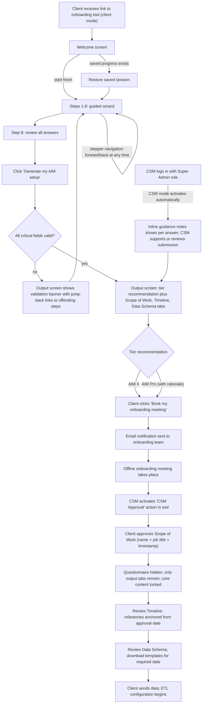

# Product Specification: AIM Onboarding Decision Tool

## 1. Business Logic & Context

### Problem

Kochava's current AIM onboarding process is open-ended. Clients are handed a static spreadsheet of questions that ignores their business model and contains no decision tree. Clients ask for everything, the team says yes, and the result is scope creep, delayed model builds, and over-engineered ETL pipelines. This was the single most consistent pain point across every persona interviewed (CSM, Data Engineering, Data Science) in the April 2026 discovery exercise.

The defining failure case: a client was promised a feature not yet built, a data scientist had to build a new framework from scratch, the client was lost, and a partnership was damaged. The onboarding process produced no deterministic, agreed scope before engineering work began.

### Value

The AIM Onboarding Decision Tool replaces the open-ended questionnaire with a constrained, progressive-disclosure wizard. It collects exactly what the data science team needs to configure an AIM model — platforms, business model, KPI, funnel events, data sources, and objectives — and generates agreed output documents (a draft Scope of Work, a delivery Timeline, and a filtered Data Schema). The tool:

- Eliminates scope creep at source by producing a deterministic, agreed Scope of Work before any engineering begins.
- Enables the zero-touch onboarding model for the self-serve AIM tier, where manual engineering or CSM effort per client breaks the product's ability to scale.
- Reduces model-configuration interpretation time from hours/days to minutes.
- Gives clients their exact data requirements — a filtered schema showing only what they need, not the full master schema.
- Reduces CSM discovery burden by replacing the open-ended call with a structured flow.

### Business Rules

**User tiers (products):**
- **AIM X** — the self-serve, zero-touch tier. Default starting recommendation for every client.
- **AIM Pro** — the assisted tier with additional milestones (including a Results Review).

**Tier recommendation logic.** Every client starts at AIM X. The recommendation upgrades to AIM Pro if ANY of the following conditions is met:
1. **Spend + history:** monthly spend is at least $250K AND data history is 12–24 months or longer.
2. **Data sources:** two or more additional non-MMP data sources are connected.
3. **UA/UE routing flag:** both User Acquisition and User Engagement campaign types are present at a mid share (each between 10% and 90%).

AIM Pro can always be manually downgraded to AIM X. AIM X can only be upgraded to AIM Pro when the automatic recommendation is Pro.

**Eligibility floor.** The paid media budget floor for AIM eligibility is a monthly minimum of $50K. The budget slider's lower bound ($50K monthly) is a hard eligibility minimum and is not configurable — it exists to estimate advertiser volume.

**User modes.** Two modes share one UI structure:
- **Client mode** — the new AIM client completes the wizard themselves. Access: Steps 1–8 and the Scope of Work, Timeline, and Data Schema outputs. The internal Model Config output is never visible.
- **CSM mode** — a Kochava CSM completes or reviews on behalf of a client. Access: the same steps and outputs, plus internal guidance notes shown inline per answer. CSM mode is granted by the existing portal Super Admin role — no separate toggle or URL. The internal Model Config output is out of scope for Phase 1 (see Section 6).

**Primary persona.** The tool is designed primarily for the advertiser to complete. The CSM reviews the generated Scope of Work after the client submits; the CSM does not lead wizard completion by default.

**Approval and handoff rules.**
- Generating the setup produces no automated notification — the generation step is visual feedback only.
- A notification to the onboarding team is sent only when the client requests an onboarding meeting.
- The meeting is held offline. A manual CSM Approval action becomes available in the tool only after the offline meeting has taken place; this unlocks final Scope of Work approval.
- Final Scope of Work approval requires a named individual's name AND official job title, plus a captured approval timestamp. Requiring an official job title is a deliberate rule that formalises the signoff as a named, titled individual.
- Once approved, the questionnaire form is removed from view; only the output tabs remain. Core generated content (scope, tier, data schema) is locked after approval; inline notes remain editable. An explicit "Unlock to edit" action clears the approval and re-surfaces the approval block, requiring a CSM-led re-approval cycle.

**Validation rule.** Validation is non-blocking during the flow. Users may proceed with incomplete answers. Hard blocks apply only on "Next" when critical required fields are empty. Full validation runs only when the output screen is reached and surfaces as a banner with jump-back links to the offending steps.

**State persistence.** A session's answers are auto-saved and restored, so a client can save progress and return to a partially completed wizard.

**Multi-region rule.** A client may initiate a new, independent onboarding session for a different region via an "Add another region" action at the end of the flow. Regions are processed sequentially — each region is its own onboarding instance, not parallel. A region/app switcher allows moving between sessions even when they are at different approval stages. [DECISION REQUIRED: DEC-001]

### Affected systems note (independent cross-check)

An independent lookup against the codebase knowledge graph identifies the AIM portal front end and its backend as the high-confidence core of this work, with the customer-onboarding-initialization service as a medium-confidence actor if the tool's output is meant to trigger onboarding. Reference-data, workflow-manager, and the unified console front end are low-confidence and overlap in ways the evidence cannot resolve — in particular, which service actually owns the onboarding flow is unresolved. The Context Seed precedent does not enumerate these services by name; it frames integration at the level of the advertiser console, the model-config store, the ETL layer, and the pipeline trigger. There is no direct contradiction, but note the discrepancy: the fresh lookup surfaces candidate services the Context Seed does not name, and their involvement is unconfirmed. Scope here is "which repos are likely touched," not "which code." Per-service grounding evidence is captured in a separate appendix.

---

## 2. User Flows



---

## 3. Functional Requirements

### Feature Area A — Wizard Shell, Navigation & State

**FR-001 — Linear 8-step wizard with free stepper navigation**
```gherkin
Given a user is in the onboarding wizard
When the wizard renders
Then an 8-step stepper is displayed
And the user can jump to any of the 8 steps directly from the stepper at any time
And a completed step shows a completion indicator in the stepper
And a step with a validation error (evaluated when the output screen is reached) shows an error indicator in the stepper
```

**FR-002 — Non-blocking in-flow progression**
```gherkin
Given a user is on any wizard step with one or more incomplete non-critical fields
When the user clicks "Next"
Then the user is allowed to proceed to the following step
And no validation banner is shown mid-flow
```

**FR-003 — Hard block on empty critical required fields**
```gherkin
Given a user is on a wizard step that has a critical required field left empty
When the user clicks "Next"
Then progression is blocked
And an inline error identifies the empty critical field(s) on that step
```

**FR-004 — Full validation deferred to output screen**
```gherkin
Given a user has reached the output screen
And one or more required fields across any step were left incomplete
When the output screen renders
Then a validation banner is displayed
And the banner lists each offending step with a jump-back link that navigates directly to that step
```

**FR-005 — Auto-save and restore of in-progress session**
```gherkin
Given a user has entered answers into the wizard
When the user's answer state changes
Then the current session state is persisted automatically
And when the user returns to the tool later in the same browser session
Then the welcome screen offers to continue the saved progress
And selecting that option restores all previously entered answers
```

**FR-006 — Independent, isolated sessions**
```gherkin
Given multiple users complete the wizard at the same time
When each user enters and saves answers
Then each session's state is isolated from every other session
And no user's answers conflict with or overwrite another user's answers
```

### Feature Area B — Step 1: Your Team

**FR-010 — Company and lead contact collection**
```gherkin
Given a user is on Step 1 "Your Team"
When the step renders
Then a required company name text field is shown
And a repeating list of project lead rows (each with a name and an email) is shown with add and remove controls
And a repeating list of data lead rows (each with a name and an email) is shown with add and remove controls
And a "Same as project lead" control is available that syncs the data leads from the project leads in real time
```

**FR-011 — Step 1 validation**
```gherkin
Given a user is on Step 1 with the company name empty, or with no project lead row that has both a name and an email, or with no data lead row (and data leads not synced from project leads)
When validation is evaluated
Then an error is recorded for the missing item
And the company name, project lead names, and data lead names are carried forward to populate the Scope of Work header and signoff block verbatim
```

### Feature Area C — Step 2: About Your Product

**FR-020 — Product, platform, and primary market**
```gherkin
Given a user is on Step 2 "About Your Product"
When the step renders
Then a required app/brand name field is shown
And a multi-select of platforms (iOS, Android, Web) is shown requiring at least one selection
And selecting iOS reveals an ATT/SKAN informational callout
And a required primary market selection (US, UK, Germany, France, Canada, Other) is shown that is locked until at least one platform is selected
And selecting "Other" for primary market reveals a free-text field
```

**FR-021 — Conversion share allocation across platforms**
```gherkin
Given two or more platforms are selected on Step 2
When the conversion share allocator is shown
Then a share control is displayed per selected platform
And the shares must total 100%
And with exactly two platforms, adjusting one platform's share auto-adjusts the other to keep the total at 100%
And with three platforms, adjusting one platform's share redistributes the remaining share proportionally across the other two
```

**FR-022 — Spend separability and cross-journey migration gating**
```gherkin
Given a user has selected Web plus at least one mobile platform on Step 2
When the spend-separability question is shown
Then the user can answer Yes, No, or Not sure
And answering "Not sure" reveals an optional free-text field
And after spend separability is answered, a cross-journey migration question (Yes / No / Not sure, with a "See an example" disclosure) is shown
```

**FR-023 — Recommended model structure with override**
```gherkin
Given both the spend-separability and cross-journey-migration questions on Step 2 have been answered
When the recommended model structure is shown
Then choice cards for Unified and Separate are displayed
And the system's recommended option carries an auto-recommended badge
And the user can override the recommendation by selecting the other option
And the chosen modelling approach is carried forward to the Scope of Work, the Model Config, and the setup summary model-count estimate
```

### Feature Area D — Step 3: Marketing Setup

**FR-030 — Paid media budget collection**
```gherkin
Given a user is on Step 3 "Marketing Setup"
When the budget control renders
Then a required budget slider with a Monthly/Annual toggle is shown
And in Monthly mode the slider range is $50K to $10M, where $50K is the hard AIM eligibility minimum
And in Annual mode the slider range is $5M to $200M+
And the budget value, together with whether it is monthly or annual, is captured
And the slider range is fixed and not user-configurable
```

**FR-031 — Offline media and spend split**
```gherkin
Given a user is on Step 3
When the offline media question is shown
Then a required Yes/No choice is presented
And selecting Yes reveals a digital/offline spend split control defaulting to 80/20
And selecting Yes causes the offline media schema to be included in the Data Schema output
```

**FR-032 — Digital media types**
```gherkin
Given a user is on Step 3
When the digital media types control is shown
Then a multi-select of Self-attributed, Standard attributed, Affiliates/partner networks, and Other is presented
And at least one selection is required
```

**FR-033 — Attribution reliability and gap categories**
```gherkin
Given a user is on Step 3
When the attribution data reliability question is shown
Then a required Yes/No/Not sure choice is presented
And answering Yes or Not sure reveals a multi-select of gap categories (Offline media, DSP, Affiliates, Branded/awareness, Mobile networks, Influencer, Podcasts, Not sure, Other)
And answering "Not sure" additionally shows a reassurance callout
```

**FR-034 — Coverage confidence and organic/paid split**
```gherkin
Given a user is on Step 3
When the coverage and split controls render
Then a required coverage-confidence question (Yes/No/Not sure) about whether the MMP captures the majority of installs is shown
And an organic/paid split control per selected platform is shown pre-populated with defaults of iOS 65%, Android 80%, Web 50%
```

**FR-035 — Campaign types and budget split with routing flags**
```gherkin
Given a user is on Step 3
When the campaign types control renders
Then toggle cards for User Acquisition, User Engagement, and Brand are shown with at least one required
And toggling a campaign type on initialises its share at an equal split across the active types
And when at least one campaign type is active, a budget-split control per active type is shown
And with exactly two active types the split is constrained to total 100%
And with three active types the split redistributes proportionally
And a warning banner is shown when an active type's share is below 5% or above 90%
And the campaign shares recompute the UA/UE routing flag and the brand routing flag on every state update
```

### Feature Area E — Step 4: Business Model & Conversion Funnel

**FR-040 — Business model selection resets funnel**
```gherkin
Given a user is on Step 4 "Business Model & Conversion Funnel"
When a required business model (Subscription, E-commerce, or Gaming) is selected
Then the funnel for that business type is loaded with its default events
And selecting Gaming additionally requires a gaming revenue type (IAP, Ads, or Both)
And changing the business model after a funnel has been configured resets the funnel to the newly selected type's defaults
```

**FR-041 — App funnel events and primary KPI**
```gherkin
Given a business model has been selected on Step 4
When the app funnel checklist renders
Then required events for that business type are shown locked on and optional events are togglable
And at least three events must be on
And each event has an editable name field and a "Set as Primary KPI" control
And exactly one event must be set as the primary KPI
And the default funnels are: Subscription = Install (required) + Registration + Trial Start + Subscription Start (KPI: Trial Start) + Revenue; E-commerce = Install (required) + Registration + First Purchase (required, KPI: First Purchase) + Total Purchases + Revenue; Gaming follows the e-commerce funnel
And the funnel events are carried forward as dependent-variable slugs in the Model Config, and the KPI event is carried forward to the Scope of Work
```

**FR-042 — Web funnel when Web selected**
```gherkin
Given the Web platform was selected on Step 2
When Step 4 renders
Then a web funnel is shown following the same event-checklist pattern
And at least two web events must be on
```

**FR-043 — LTV model scope**
```gherkin
Given a funnel has been configured on Step 4
When the LTV question is shown
Then an "Include LTV model?" Yes/No choice is presented
And answering Yes reveals a "Cohort revenue data available?" question (Yes / No / Partial)
And answering Partial offers a choice between a partial cohort set or skipping
And when LTV is included with cohort data available, conditional cohort rows (7-day, 30-day, 90-day, 360-day revenue) are added to the Data Schema
```

### Feature Area F — Step 5: Data Sources

**FR-050 — Historical data window per platform**
```gherkin
Given a user is on Step 5 "Data Sources"
When the historical data control renders
Then a window selection (12–24 months, 24–36 months, 36 months+) is shown per selected platform
And selecting 12–24 months shows a warning that seasonality is only partially modelled
And selecting 24+ months shows a confirmation indication
And the selected history is carried forward as a seasonality note in the Scope of Work
```

**FR-051 — MMP selection and collection method**
```gherkin
Given at least one mobile platform is selected
When the MMP controls render on Step 5
Then a required MMP selection (AppsFlyer, Adjust, Singular, Branch, Kochava, Other/none) is shown
And selecting any MMP other than "Other/none" reveals a collection method (Direct API, which carries a Recommended badge, or File, or cloud)
And selecting File reveals a storage type selection (Google Drive, S3)
And selecting AppsFlyer reveals a Yes/No AppsFlyer cohort access question with an explanatory note
And selecting "Other/none" injects a custom-connector "to be confirmed" milestone into the Timeline
```

**FR-052 — Web attribution sources when Web selected**
```gherkin
Given the Web platform is selected
When Step 5 renders
Then a required multi-select of web attribution sources (Google Analytics 4, Google Drive, S3, Database, Other) is shown
And selecting "Other" reveals a free-text field
```

**FR-053 — Ad spend data source**
```gherkin
Given a user is on Step 5
When the ad spend controls render
Then a required collection method (Direct API, File, or Manual) is shown first
And then a source multi-select (MMP direct, Supermetrics, Google Drive, S3, Database, Other) is shown
And selecting "Other" reveals a free-text field and injects a custom-connector "to be confirmed" milestone into the Timeline
And the MMP plus collection method determine the provision plan in the Data Schema (direct versus client-supplied)
```

### Feature Area G — Step 6: External Factors (Optional)

**FR-060 — External factors selection**
```gherkin
Given a user is on Step 6 "External Factors"
When the step renders
Then no field is hard-required on this step
And two read-only auto-included cards are shown: Seasonality (marked Included, or Partial when history is 12–24 months) and National holidays (marked Included, showing the client's region)
And an additional external factors multi-select of exactly six factors is shown: Promotional activity, Competitor activity, Major product launch/rebrand, PR/earned media spike, Macro economic event, Other
And a warning is shown that the client must be able to supply data for any flagged factor
And selecting any factor reveals a free-text description field (what happened, which market, rough significance), with no dates or data required
And the selected factors and notes are carried forward to the Scope of Work and the Model Config
```

### Feature Area H — Step 7: Objectives (Optional)

**FR-070 — Objectives capture and propagation**
```gherkin
Given a user is on Step 7 "Objectives"
When the step renders
Then three optional free-text fields are shown: what the client hopes to achieve, what success looks like, and marketing goals for the next 12 months
And no validation is applied on this step
And a hint states the answers are shared with the onboarding manager to frame the kickoff call
And all three objectives fields appear in the Step 8 review summary
And all three objectives fields appear in a dedicated Objectives section within the Scope of Work output
```

### Feature Area I — Step 8: Review & Generation

**FR-080 — Full read-back of all answers**
```gherkin
Given a user reaches Step 8 "Review Your Answers"
When the step renders
Then no new input fields are presented
And seven sections are shown (Your team, Product, Marketing, Business & funnel, Data sources, External factors, Objectives), each with an Edit control that jumps directly to that step
And each section renders key/value rows from the entered answers
And any unanswered field is shown with a placeholder treatment
And the live setup summary panel is hidden on this step, replaced by the full review layout
```

**FR-081 — Generation trigger**
```gherkin
Given a user is on Step 8
When the user clicks "Generate my AIM setup"
Then a brief generation indicator is shown as visual feedback only
And no automated notification is sent to the onboarding team at this point
And the output screen is then displayed
```

### Feature Area J — Output Screen & Tabs

**FR-090 — Output screen layout and default tab**
```gherkin
Given the output screen renders
Then a header shows the app name and an "Edit answers" control
And the computed tier recommendation (AIM X or AIM Pro) is shown above the tab strip
And three tabs are available to all users: Scope of Work, Timeline, Data Schema
And the Scope of Work tab is the default selected tab
```

**FR-091 — Tier recommendation computation**
```gherkin
Given the output screen computes the tier recommendation from the entered answers
When the computation runs
Then the recommendation starts at AIM X
And it upgrades to AIM Pro if monthly spend is at least $250K AND data history is 12–24 months or longer
And it upgrades to AIM Pro if two or more additional non-MMP data sources are connected
And it upgrades to AIM Pro if both UA and UE campaign types are present each at a mid share between 10% and 90%
And an AIM Pro recommendation can be manually downgraded to AIM X
And an AIM X recommendation can only be upgraded to AIM Pro when the automatic recommendation is Pro
And the recommendation is accompanied by its rationale
```

**FR-092 — Scope of Work generation and inline notes**
```gherkin
Given the Scope of Work tab renders
Then a generated document is shown pre-populated from all wizard answers
And it includes sections for engagement details, platform & region, campaign types, business model & KPI, funnel events, data sources, external factors, and model structure
And each section has an editable inline notes field that expands on click
And where brand campaigns are present, the Scope of Work explicitly flags that brand campaigns require a longer ad-stock window than UA/UE and that mixed-network campaign-level combination is not established territory
```

**FR-093 — Scope of Work approval gating**
```gherkin
Given a user is viewing the Scope of Work tab
When the approval block renders
Then an approver name field and an approver job title field are shown
And the Approve action is disabled until both the name and the job title are provided
And approving captures the approver name, the approver job title, and a full approval timestamp
And the approval timestamp is passed to the Timeline tab for date anchoring
```

**FR-094 — Offline meeting and CSM approval gate**
```gherkin
Given a client has viewed the generated Scope of Work
When the client selects "Book my onboarding meeting"
Then an email notification is sent to the onboarding team to initiate the offline meeting
And the CSM Approval action remains inactive until the offline meeting has taken place
And a CSM can activate the CSM Approval action only after the offline meeting
And activating CSM Approval makes the client's final Scope of Work approval available
```

**FR-095 — Post-approval lock-down**
```gherkin
Given the Scope of Work has been approved
When the output screen re-renders
Then the questionnaire form is removed from view and only the output tabs remain
And the core generated content (scope, tier, data schema) is locked
And inline notes remain editable
And an explicit "Unlock to edit" action clears the approval timestamp and re-surfaces the approval block for a CSM-led re-approval cycle
```

**FR-096 — Timeline tab with cascade delay and change log**
```gherkin
Given the Timeline tab renders
Then it shows a delivery plan of estimated milestones from onboarding kickoff to first insights
And an AIM X plan shows 7 milestones (approximately 7 weeks minimum) while an AIM Pro plan shows 8 milestones including a Results Review (approximately 9 or more weeks)
And milestone dates cascade from the approval timestamp when set, otherwise from today
And every milestone start date is the next Monday on or after its calculated date
And marking a milestone "Delayed" and saving a new date shifts all subsequent milestone dates by the corresponding number of weeks
And a delay banner shows the total accumulated delay
And each milestone offers a status selector (In progress / Complete / Delayed), a delay date picker, a notes area, and an expand/collapse toggle
And custom-connector rows are injected for any "Other/none" MMP, web attribution, or ad spend selection
And every status change and note action is written to a change log at the bottom of the tab
```

**FR-097 — Timeline change log actor identity**
```gherkin
Given a user makes a status change or note action on the Timeline tab
When the change is written to the change log
Then the change log records the authenticated session user's identity as the author, not a free-text name
And the change log entries are append-only and are not editable or deletable through any action in the tool
```

**FR-098 — Data Schema tab filtered by answers**
```gherkin
Given the Data Schema tab renders
Then it is split into a "Kochava collects automatically" section and a "You need to provide" section
And the provision plan is built dynamically from the entered answers
And offline media schema rows are included only when offline media was selected
And LTV cohort rows (7-day, 30-day, 90-day, 360-day revenue) are included only when LTV is included and cohort data is available
And web schema rows are included only when the Web platform is selected
And iOS SKAN fields are included only when iOS is selected
And MMP-specific column names reflect the selected MMP
And each client-supplied item shows a full schema table (field name, format, required/optional, notes) with a per-schema template download
And when all sources are direct, a confirmation banner is shown instead of schema tables
```

**FR-099 — Per-schema template download**
```gherkin
Given a client-supplied schema item is shown on the Data Schema tab
When the client selects the template download for that item
Then a downloadable template is produced pre-configured with exactly the fields that item requires based on the client's answers
```

### Feature Area K — Live Setup Summary & Modes

**FR-100 — Live setup summary panel**
```gherkin
Given a user is on any of Steps 2 through 6
When the user changes an answer
Then a setup summary panel on the right edge reflects the answer in real time
And it shows the platform list, the model-count estimate, the business model, the KPI event, the MMP, and the data sources
And the model-count estimate updates live as platform and region answers change
And the panel is hidden on Step 8, replaced by the full review layout
```

**FR-101 — CSM mode via Super Admin role**
```gherkin
Given a user is authenticated with the Super Admin role in the portal
When the user opens the onboarding tool
Then CSM mode activates automatically with no separate toggle or URL
And inline internal guidance notes are shown per answer throughout the wizard
And access covers Steps 1–8 and the Scope of Work, Timeline, and Data Schema tabs
```

**FR-102 — Server-side enforcement of mode access**
```gherkin
Given a user without the Super Admin role attempts to access CSM-only capabilities or internal guidance content
When the request is made
Then access is denied on the server regardless of what the client UI exposes
And the role is re-derived from the authoritative identity source on every request rather than trusting a client-supplied claim
```

**FR-103 — Add another region**
```gherkin
Given a client has reached the end of the onboarding flow for one region
When the client selects "Add another region"
Then a new independent onboarding session is initiated for a different region
And regions are processed sequentially, each as its own onboarding instance
And a region/app switcher allows moving between sessions even when they are at different approval stages
```

Now reporting the single business trade-off flagged in Sections 0–3.

## 4. Information Requirements

The system must track the following business information to support the functional requirements above. Field-level shapes, types, and storage are intentionally deferred to engineering planning.

**Client identity & contacts**
- **Company name** — User-Entered (Step 1). Populates the Scope of Work header and signoff block verbatim; anchors the client record.
- **Project leads and data leads** (name + email per person) — User-Entered (Step 1). Identify who is accountable on the client side and who receives onboarding communication; names appear in the Scope of Work signoff block.
- **App/brand name** — User-Entered (Step 2). Labels the output screen and the generated documents.

**Product & market configuration**
- **Selected platforms** (iOS / Android / Web) — User-Entered (Step 2). Drives conditional schema rows (iOS SKAN, web schema), funnel branches, and model-count estimate.
- **Platform conversion shares** — User-Entered (Step 2). Feeds modelling approach and the Scope of Work.
- **Modelling approach** (unified / separate) — User-Entered with system recommendation (Step 2). Determines the model structure in the Scope of Work and Model Config.
- **Primary market/region** — User-Entered (Step 2). Drives national-holiday inclusion and model-count estimate.

**Marketing & budget profile**
- **Paid media budget and period** (monthly/annual) — User-Entered (Step 3). Feeds the tier recommendation and advertiser-volume estimate; the $50K monthly floor is the eligibility gate.
- **Offline media usage and digital/offline split** — User-Entered (Step 3). Controls inclusion of the offline media schema.
- **Digital media types, attribution gaps, coverage confidence, organic/paid split** — User-Entered (Step 3). Inform the generated Scope of Work and reassurance messaging.
- **Campaign types and budget split across them** — User-Entered (Step 3). Drive the UA/UE routing flag and brand routing flag.

**Business model & funnel**
- **Business model** (subscription / e-commerce / gaming) and gaming revenue type — User-Entered (Step 4). Determines the funnel template and resets the funnel when changed.
- **Funnel events, event names, and primary KPI** — User-Entered (Step 4). Carried forward as dependent-variable slugs in the Model Config; the KPI appears in the Scope of Work.
- **Web funnel events** — User-Entered (Step 4, when Web selected).
- **LTV scope and cohort availability** — User-Entered (Step 4). Drives conditional cohort rows in the Data Schema.

**Data sources**
- **Historical data window per platform** — User-Entered (Step 5). Drives the seasonality note and the Seasonality external-factor card.
- **MMP selection and collection method** (plus file storage type, AppsFlyer cohort access) — User-Entered (Step 5). Builds the provision plan (direct vs client-supplied) and injects custom-connector milestones for "Other/none".
- **Web attribution sources** — User-Entered (Step 5, when Web selected).
- **Ad spend collection method and sources** — User-Entered (Step 5). Builds the provision plan and injects custom-connector milestones for "Other".

**External factors & objectives**
- **Selected external factors and free-text notes** — User-Entered (Step 6). Appear in the Scope of Work and Model Config.
- **Objectives** (goal, success definition, 12-month marketing goals) — User-Entered (Step 7). Appear in the Step 8 review and a dedicated Scope of Work section.

**Computed values**
- **UA/UE routing flag** — System-Derived from campaign-type shares (Step 3). Feeds the tier algorithm and Model Config.
- **Brand routing flag** — System-Derived from campaign-type shares (Step 3). Feeds the Model Config.
- **Tier recommendation** (AIM X / AIM Pro) with rationale — System-Derived at the output screen from spend, history, data sources, and routing flag. Shown above the tabs and in every output.
- **Model-count estimate** — System-Derived from platforms and region. Shown live in the setup summary.

**Outputs & approval state**
- **Scope of Work document** with inline section notes — System-Derived from all answers; notes User-Entered. The agreed-scope deliverable.
- **Delivery Timeline** with milestone statuses, delay state, accumulated delay, and notes — System-Derived initial plan, User-Entered status/notes updates. The delivery plan.
- **Filtered Data Schema** with per-item template downloads — System-Derived from answers. Tells the client exactly what to provide.
- **Approval record** — approver name, approver job title, and approval timestamp — User-Entered at approval. Formalises signoff and anchors the Timeline.
- **CSM approval state** (meeting-held / approval-active) — System-Derived from the onboarding-meeting workflow. Gates final Scope of Work approval.
- **Change log entries** (actor identity, action, affected milestone, timestamp) — System-Derived from authenticated session identity plus the user action. Provides a traceable record of Timeline edits.
- **Authenticated user identity and role** — External (session/identity source). Determines client vs CSM mode and supplies the change-log author.

**Session state**
- **Saved in-progress session** — System-Derived/persisted from User-Entered answers. Enables save-and-resume.
- **Multi-region sessions** — User-Entered/System-tracked. Each region is an independent onboarding instance processed sequentially.

---

## 5. Non-Functional Requirements & Guardrails

### Performance

**NFR-001 — In-flow responsiveness.** Wizard step transitions and answer updates (including live recomputation of the UA/UE routing flag, brand routing flag, and model-count estimate) must render without perceptible delay for a single session's client-side interaction.

**NFR-002 — Output generation latency.** When the user triggers generation, the output screen (tier recommendation, Scope of Work, Timeline, Data Schema) must be produced and displayed within a p95 target of 500ms for the computation portion, measured per session. The visual generation indicator is feedback only and must reflect real processing time rather than a fixed artificial delay once a backend generation step exists.

**NFR-003 — Concurrent sessions without conflict.** The tool must support multiple clients and multiple CSMs completing wizards concurrently with fully isolated session state; no session's answers may read, overwrite, or conflict with another's.

### Security & Access Control

**NFR-004 — Commercial-confidential handling.** Wizard answers include company name, lead contact details, and budget figures and must be treated as commercial-confidential. Raw answer data (company name, contacts, budget) must never be written to client-side logs or exposed in browser developer tooling in production.

**NFR-005 — Server-side mode and access enforcement.** CSM mode, internal guidance notes, and any future CSM-only output must be enforced on the server by re-deriving the user's role from the authoritative identity source on every request. A request from a user without the required role must be rejected server-side regardless of what the client UI exposes, and the check must fail closed if the identity source is unreachable. (Implements the server-side gating behind FR-102.)

**NFR-006 — Authenticated identity required.** CSM mode requires an authenticated identity (Super Admin role). Client mode must require authentication in production so the client is identifiable for onboarding handoff. The Timeline change-log author must be the authenticated session user's identity, never a free-text field.

**NFR-007 — No raw PII in logs.** No raw personally identifying data (lead names, emails), credentials, or secrets may be logged at any level. Where a value must be shown for identification, mask to the last few characters only.

### Audit & Traceability

**NFR-008 — Append-only Timeline change log.** Every Timeline status change and note action must be recorded in an append-only change log capturing actor identity (authenticated user), the affected milestone, the action, and a timestamp. No code path or role may edit or delete an existing change-log entry. The Scope of Work approval event (approver name, job title, timestamp) must likewise be retained as an immutable record.

**NFR-009 — Audit record durability.** Change-log and approval records must be persisted durably; a failure to persist an audit/approval record must surface an operational alert rather than fail silently, since a lost record is a traceability gap in an agreed commercial scope. [DECISION REQUIRED: DEC-002]

### Accessibility & Compatibility

**NFR-010 — Accessibility.** The wizard must meet WCAG 2.1 AA. All form controls must be keyboard-navigable, error messages must be programmatically associated with their fields, and focus must be managed on step transitions.

**NFR-011 — Browser support.** The tool must support the latest two major versions of Chrome, Safari, Firefox, and Edge. Mobile browser support is not required for Phase 1.

### Risk Mitigation

The following guardrails address the risks and hard constraints surfaced in the Context Seed:

**NFR-012 — Zero-touch integrity for the self-serve tier.** The self-serve (AIM X) path must achieve near-zero manual CSM or engineering effort per client; any requirement that reintroduces per-client manual engineering work on the AIM X path must be flagged as breaking the product model. This is a hard constraint on the scaling phase and must be verified before the self-serve path is declared ready.

**NFR-013 — Scope-creep containment.** The wizard must be constrained (progressive disclosure, bounded option sets, deterministic tier logic) so that the generated Scope of Work is a complete, agreed artifact before any engineering begins. Post-approval, core generated content is locked and only reopens through an explicit, CSM-led re-approval cycle (FR-095) so scope cannot silently drift after signoff.

**NFR-014 — Brand ad-stock / mixed-network caveat.** Because brand campaigns require a longer ad-stock window than UA/UE and mixed-network campaign-level combination is not established territory, the generated Scope of Work must explicitly surface this caveat wherever brand campaigns are present (FR-092), so the limitation is visible before scope is agreed.

**NFR-015 — Validation safety at output.** Because validation is non-blocking in-flow, the output screen must run full validation and present a banner with jump-back links to every incomplete step (FR-004) before the generated scope is treated as complete, preventing an incomplete configuration from reaching approval unnoticed.

### Degradation posture

**NFR-016 — Dependency failure posture.** Where the tool depends on the authoritative identity source for role/mode resolution, it must fail closed (deny CSM/internal access) if that source is unreachable. Where it depends on a downstream service only to enrich or persist outputs (e.g. a future generation or handoff step), it should degrade gracefully — preserving the client's entered answers and saved session — rather than lose in-progress work. Any outbound notification or handoff call must use bounded retry with backoff rather than indefinite retry.

---

## 6. Out of Scope & Phasing

The following are explicitly **NOT** included in Phase 1, carried forward from the Context Seed:

| Item | Status / Phase | Notes |
|---|---|---|
| **Model Config output (CSM-only)** | Phase 2 | The internal technical config document (fitting method, routing flags surfaced, dep_var slugs, SKAN config, ATT estimate, delivery method per source, LTV scope) is excluded from Phase 1. |
| **MongoDB app_config auto-population (LLM layer)** | Phase 2 | Translating Model Config output into the model-config store via an LLM layer with mandatory human review during pilot. Exact field mapping pending the config schema. |
| **Backend schema API service** | Phase 2 | Filtering the master schema by answers server-side. |
| **Timeline backend persistence** | Phase 2 | Phase 1 persists session state client-side; durable server persistence is Phase 2. |
| **Multi-region model-count multiplier logic** | Phase 2 | The "Add another region" action and sequential region sessions are in Phase 1; full model-count multiplier logic is Phase 2. |
| **Submission / CRM handoff flow** | Phase 2 | Automated write to CRM on handoff; owner and architecture to be decided. |
| **Airflow pipeline auto-trigger** | Phase 2 | Auto-starting the ETL pipeline from wizard completion. |
| **ETL UI auto-population** | Phase 2 | Wizard auto-populating downstream ETL form fields. |
| **Campaign-level attribution** | Out of scope | AIM Pro only; not in the self-serve scope. |
| **Offline media handling (ETL)** | Out of scope | Separate ETL project; the wizard captures offline spend split and schema only. |
| **In-form regional routing** | Out of scope | Onboarding notifications are sent centrally; no regional routing in the form. |
| **Direct client access to internal ETL infrastructure** | Out of scope | The tool is the client-facing layer; internal ETL infrastructure is never client-facing. |
| **Full data-quality validation** | Out of scope | Schema/format validation is in scope; deep data-quality validation is not. |
| **AIM Enterprise bespoke configuration** | Out of scope | Novel business models route explicitly to an Enterprise path. |
| **Look-back periods / weekly grouping** | Out of scope | System/engineering configuration, not customer-facing. |
| **Offline / cross-platform network identification** | Out of scope | Happens post-ingestion, not in the questionnaire. |
| **MMM Insights preview tab** | Undecided for Phase 1 | A prototype MMM Insights dashboard preview exists; whether to surface it as a fifth output tab is unresolved. [DECISION REQUIRED: DEC-003] |

---

## Appendix: Engineering Reference

_The sections below are derived automatically from the codebase knowledge graph, for the engineering team's reference during planning — not required reading for product/requirement review._

### Affected Services (grounded context, not implementation direction)

The following services/repos were surfaced by an independent knowledge-graph lookup as likely touched by this work. Confidence levels are the knowledge graph's own; attributions are role-level ("this service likely does X"), not symbol-level. The two portal services are high-confidence; the remaining four are medium-to-low and overlap in ways the evidence cannot resolve (notably, which service owns the onboarding flow).

| Service / Repo | Kind | Role (as attributed) | Confidence |
|---|---|---|---|
| `aim-portal-ui` | frontend | Likely hosts the onboarding decision tool UI | High |
| `aim-portal-api` | backend | Backend for the onboarding tool; likely new endpoints to serve/persist decision-tool data and orchestrate downstream backends | High |
| `aim-customers-onboarding-initialization` | backend | Onboarding-initialization logic; may act on the decision tool's output (potential side effects — check before scoping) | Medium |
| `aim-reference-data-api` | backend | May feed reference data into decisions (likely read-only if involved) | Low |
| `aim-workflow-manager` | backend | May orchestrate onboarding workflow steps; overlaps with onboarding-initialization on flow ownership | Low |
| `frontend-mos` | frontend | Unified console may surface the AIM onboarding UI (second integration surface if confirmed) | Low |

**Open grounding question for planning:** who owns the onboarding flow — `aim-customers-onboarding-initialization` or `aim-workflow-manager`? The evidence points at both without resolving the overlap; confirm before scoping any trigger/initialization behavior.

---
## Open Questions & Decisions Register

_Durable, ID'd reference for HITL 2 (G1) and beyond — inline `[DECISION REQUIRED: DEC-00N]` tags in the sections above point back here. Reflects the latest round only._

### Decisions Required (business trade-offs — needs a human call)

_Each carries an **Owner** (accountable for supplying the answer) and a **Provisional Value** (the working assumption engineering may build against until the decision lands), so none of these fully block engineering — implementation proceeds on the provisional value and adjusts if the confirmed decision differs._

| ID | Decision | Owner | Provisional Value (build against until confirmed) |
|----|----------|-------|-----------------------------------------------------|
| **DEC-001** | When a client runs onboarding for multiple regions, should each region produce its own completely separate Scope of Work and approval, or should the regions roll up into one combined agreement the client approves once? | Product owner | Treat each region as a fully independent onboarding instance with its own Scope of Work, tier recommendation, and approval; no combined roll-up in Phase 1. Regions are processed sequentially and the client switches between them via the region/app switcher. |
| **DEC-002** | When a Timeline change-log or Scope of Work approval record fails to save, should the action be blocked and shown as an error to the user, or allowed to proceed while an alert is raised to the operations team behind the scenes? | Product owner + Compliance/Security | Allow the user action to proceed and raise an immediate operational alert on any failed audit/approval write; do not block the user, but never drop the record silently — treat a lost record as a traceability incident to be reconciled. |
| **DEC-003** | Should the prototype's MMM Insights dashboard preview be surfaced to clients as a fifth output tab showing 'here's what you'll get', or left out of Phase 1 entirely? | Product owner | Leave it out of Phase 1; ship the three confirmed output tabs (Scope of Work, Timeline, Data Schema) and revisit the MMM Insights preview as a Phase 2 enhancement once its content is confirmed accurate for real client data. |

### Open Questions (evidence gaps — needs more input)

- **OQ-001**: Does the decision tool just produce a recommendation/output, or is it expected to actually trigger and configure customer onboarding (i.e. have real side effects)?
- **OQ-002**: Which service is the intended owner of the onboarding flow this triggers — the dedicated onboarding-initialization service, the workflow manager, or both in sequence?
- **OQ-003**: Does the decision logic actually depend on reference data, and if so what reference data drives the decision?
- **OQ-004**: Should this tool live only in the AIM portal, or also be surfaced inside the unified console (frontend-mos)?
- **OQ-005**: Is this a net-new onboarding screen/flow, or an addition to an existing onboarding surface in the AIM portal?
- **OQ-006**: What inputs does a user provide to the tool and what decision output is expected back?

---
> **Classification:** Type A
