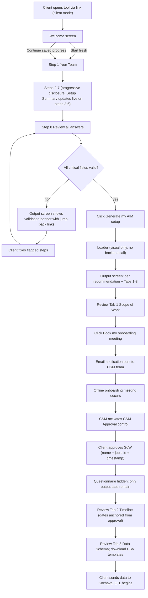
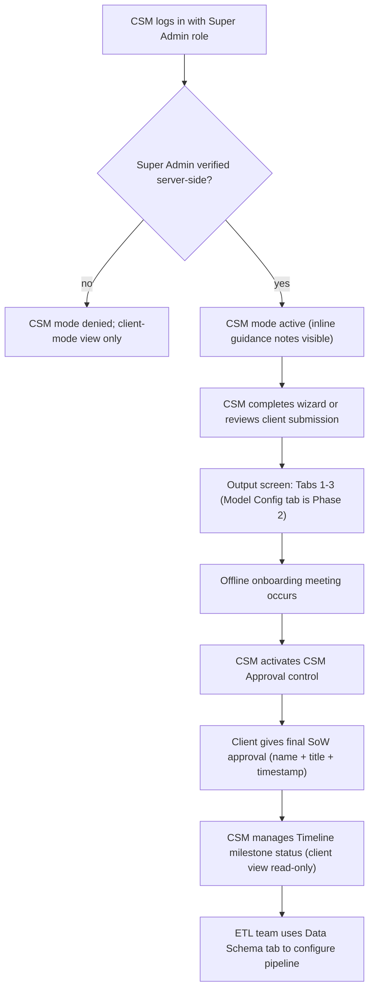
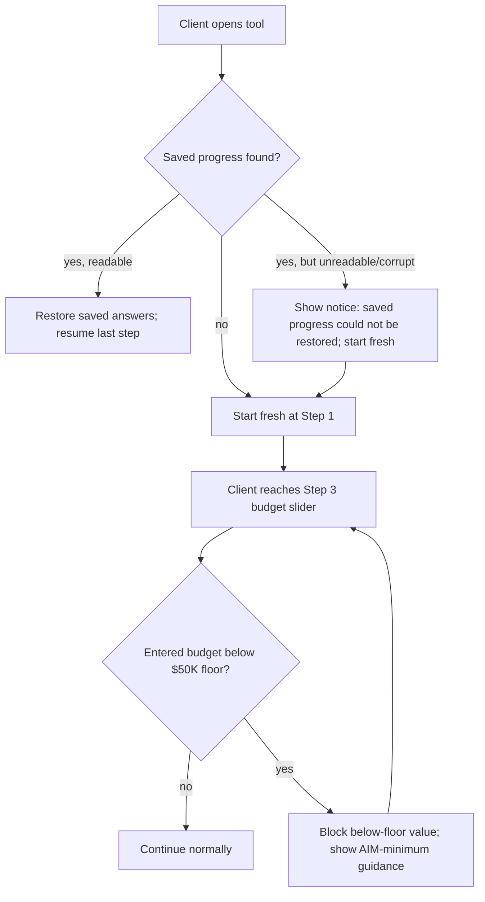

# Product Specification — AIM Onboarding Decision Tool (Part 1)

## 1. Business Logic & Context

### Problem

Kochava's current AIM (Advanced Incrementality Measurement) onboarding relies on an open-ended spreadsheet questionnaire. It is blind to the client's business model and has no decision logic: clients are asked what they want, they ask for everything, and the delivery team agrees to it. The result is chronic scope creep, delayed model builds, and over-engineered ETL pipelines — identified as the #1 internal pain point across every persona interviewed (CSM, Data Engineering, Data Science) during the April 2026 discovery exercise. The defining failure case (the "Klook incident") saw Kochava promise an unbuilt feature, forcing a data scientist to build a new framework from scratch, losing the client and damaging a partner relationship.

### Value

The AIM Onboarding Decision Tool is a constrained, progressive-disclosure wizard that replaces the open-ended spreadsheet. By collecting a bounded, structured set of answers (platforms, business model, KPI, funnel events, data sources, objectives) it produces four deterministic outputs — a draft Scope of Work, a delivery Timeline, a filtered Data Schema, and (Phase 2) an internal Model Config. This:

- **Eliminates scope creep at source** — a deterministic, agreed Scope of Work is produced before any engineering begins.
- **Enables AIM X zero-touch onboarding** — a self-serve path that needs no per-client CSM or engineering effort.
- **Collapses model configuration time** from hours/days of manual interpretation to under 10 minutes.
- **Gives clients exact data requirements** — a filtered schema showing only what their answers require, not the full master schema.
- **Reduces CSM discovery burden** — a structured wizard replaces the open-ended discovery call.

### Business Rules

**Product tiers**
- Two client-facing tiers exist: **AIM X** (zero-touch, self-serve) and **AIM Pro** (higher-touch, additional analysis).
- Every onboarding starts at **AIM X** and is upgraded to **AIM Pro** if ANY of the following hold:
  1. **Spend + history**: monthly spend ≥ $250K AND data history is in the 12–24 month band or longer.
  2. **Data sources**: two or more additional (non-MMP) data sources are connected.
  3. **UA/UE routing**: the UA/UE routing flag resolves to "AIM Pro eligible" — set when both User Acquisition and User Engagement campaign types are present, each at a mid share (between 10% and 90%).
- A client can always be **manually downgraded** from AIM Pro to AIM X. AIM X can only be **upgraded** to AIM Pro when the automatic recommendation is Pro (no manual upgrade of an AIM X auto-recommendation).

**Eligibility and budget floor**
- The monthly paid-media budget floor for AIM eligibility is **$50K**. The budget input range (monthly $50K → $10M; annual $5M → $200M+) is fixed and not configurable — it exists to estimate advertiser volume, and $50K is the hard minimum.
- Novel business models outside Subscription / E-commerce / Gaming route explicitly to the **AIM Enterprise** path (out of scope — see Part 2 Section 6).

**User modes**
- **Client mode**: the new AIM advertiser completes the wizard themselves. Access: Steps 1–8 and output Tabs 1–3. The internal Model Config tab is never visible.
- **CSM mode**: a Kochava CSM completes or reviews on behalf of a client. Access: Steps 1–8 and Tabs 1–3 (the Model Config tab is Phase 2). CSM mode additionally surfaces internal guidance notes inline per answer.
- The tool's **primary persona is the advertiser**. The CSM reviews the generated Scope of Work after the client submits; the CSM does not lead wizard completion by default.
- CSM mode is gated by the **existing K4A Super Admin role** — no new toggle or separate URL. Any user logged in with Super Admin permissions automatically gets CSM mode. This was resolved in the 2 June 2026 engineering sync.

**Approval and tier wording**
- The Scope of Work is approved in-tool by capturing an approver name, an approver job title, and an approval timestamp. Requiring an official job title is a deliberate design choice to formalise the signoff as a named, titled individual.
- Once approved, the questionnaire form is removed from view and only the output tabs remain. Core generated content locks; inline notes stay editable; an explicit "Unlock to edit" action resets the approval and re-surfaces the approval block.

**Submission / handoff**
- "Generate my AIM setup" does **not** send any notification — it is a visual/polish step only.
- A notification to the onboarding team fires only when the client clicks **"Book my onboarding meeting"**, which sends an email to the CSM team to initiate an offline meeting.
- A manual **"CSM Approval"** control becomes active only after the offline meeting has taken place, unlocking the final SoW approval stage.

**Delivery timeline anchoring**
- AIM X yields 7 milestones (~7 weeks minimum); AIM Pro yields 8 milestones including a Results Review (~9+ weeks).
- Milestone dates cascade from the approval timestamp if set, otherwise from today; every start date is normalised to the next Monday on or after its calculated date.

### Phasing note (Phase 1 vs Phase 2)

This specification covers **Phase 1 (MVP)** behaviour. The internal **Model Config** output tab, MongoDB `app_config` auto-population, backend persistence of Timeline state, multi-region model-count multiplier logic, and automated pipeline triggering are **Phase 2** and are reflected in the Out of Scope section (Part 2). Where a Phase 1 requirement below depends on a boundary that the source does not settle, it is flagged inline.

### Scope note — affected services (cross-check)

An independent codebase knowledge-graph cross-check was run against the systems this tool touches. Three services surfaced with high confidence (the portal UI, the portal backend, and the existing customer-onboarding initialization logic) and form a coherent UI → backend → onboarding-init spine. Three further services surfaced at low confidence as *possible* adjacencies only — a reference-data source, a workflow orchestrator, and a downstream consumer of decision outputs — none confirmed by evidence. These low-confidence services must not be built around until confirmed. The authoritative, labelled list of these services is appended as a separate grounding appendix at the end of this document (Part 2); it is grounding evidence, not a committed scope decision. The key integration risk this raises: the decision tool must slot into an **existing** onboarding initialization sequence, and whether it runs before, during, or after that sequence is not settled by the evidence.

[DECISION REQUIRED: DEC-001]

---

## 2. User Flows (Visuals)

### Flow A — Client Self-Serve (Happy Path, AIM X)



### Flow B — CSM-Assisted Onboarding



### Flow C — Error State: Saved Progress Restore Fails / Budget Below Floor



---

## 3. Functional Requirements

> All FRs below are **Phase 1 (MVP)** unless explicitly marked otherwise. Gherkin scenarios describe verifiable behaviour an implementation agent can build against. Engineering-only defaults (e.g. validation timing, persistence mechanism in Phase 1) are stated as plain requirements, not open questions.

### Feature Area A — Wizard Shell, Navigation & State

**FR-001 — Linear 8-step wizard with stepper navigation**
```gherkin
Given a user has opened the onboarding tool
When the wizard renders
Then an 8-step stepper/breadcrumb is shown with steps 1 through 8
And any step is directly accessible from the stepper at any time, regardless of completion order
And a completed step shows a completion indicator
And a step with a validation error (evaluated at output) shows an error indicator
```

**FR-002 — Non-blocking validation with hard blocks on empty critical fields**
```gherkin
Given a user is on any wizard step with incomplete answers
When the user clicks "Next"
Then the user is allowed to proceed if no critical required field on that step is empty
And the user is blocked only when a critical required field on the current step is empty
And when blocked, the empty critical field is identified to the user
```

**FR-003 — Full validation surfaced at output screen**
```gherkin
Given a user has reached the output screen with one or more unanswered required fields across any step
When the output screen renders
Then a validation banner is displayed
And the banner lists each offending step with a jump-back link that navigates directly to that step
```

**FR-004 — Automatic state persistence and restore (Phase 1)**
```gherkin
Given a user is completing the wizard in a browser session
When any answer changes
Then the full wizard state is saved locally in that browser session automatically
And when the user reloads the page, the saved state is restored and the user resumes where they left off
And the welcome screen offers a "continue saved progress" option when saved state exists
```

**FR-005 — Corrupt or unreadable saved state falls back to a fresh start**
```gherkin
Given saved wizard state exists in the browser but cannot be read or parsed
When the user opens the tool
Then the tool does not crash or render a broken state
And the user is shown a notice that saved progress could not be restored
And the user is started on a fresh Step 1
```

**FR-006 — Live Setup Summary panel (steps 2–6)**
```gherkin
Given a user is on any of steps 2 through 6
When the user changes any answer that affects the summary
Then the Setup Summary panel reflects the change in real time, including platform list, model count estimate, business model, KPI event, MMP, and data sources
And on Step 8 the Setup Summary panel is hidden and replaced by the full review layout
```

### Feature Area B — Step Content & Progressive Disclosure

**FR-007 — Step 1: Team identity and contacts**
```gherkin
Given a user is on Step 1 "Your Team"
When the user enters details
Then a required company name text input is present
And at least one project lead row (name + email) is required
And at least one data lead row (name + email) is required, unless a "Same as project lead" sync is active
And a "Same as project lead" checkbox syncs data-lead rows to project-lead rows in real time
And the user can add and remove additional lead rows
And a validation error is raised if company name is empty, if no project lead row has both name and email, or if no data lead row exists and no sync is active
```

**FR-008 — Step 2: Product, platforms, conversion split, model approach, market**
```gherkin
Given a user is on Step 2 "About Your Product"
When the user makes selections
Then an app/brand name is required
And at least one platform (iOS, Android, Web) must be selected
And selecting iOS reveals an ATT/SKAN informational callout
And when two or more platforms are selected, a conversion-share allocator appears whose per-platform shares must total 100 percent
And for two platforms, adjusting one auto-adjusts the other; for three platforms, the remainder redistributes proportionally
And a "spend separable?" question (Yes / No / Not sure) appears only when Web plus at least one mobile platform is selected, with "Not sure" revealing an optional free-text field
And a "cross-journey migration?" question appears after spend separability is answered and drives a unified-vs-separate model recommendation
And a recommended model structure (Unified / Separate) appears after both questions above are answered, with the system preference badged and user-overridable
And a required primary market selection (US, UK, Germany, France, Canada, Other) is locked until at least one platform is selected, with "Other" revealing a free-text field
```

**FR-009 — Step 3: Marketing budget, channels, attribution reliability, campaign split**
```gherkin
Given a user is on Step 3 "Marketing Setup"
When the user enters marketing details
Then a required total paid-media budget input is present with a Monthly/Annual toggle
And the Monthly range is $50K to $10M and the Annual range is $5M to $200M+, and the range is not user-configurable
And a value below the $50K monthly floor is blocked with AIM-minimum guidance shown
And an "Offline media" Yes/No answer is required, and selecting Yes reveals a digital/offline spend-split slider defaulting to 80/20
And at least one digital media type must be selected from the multi-select chips
And an attribution-data-reliability answer (Yes / No / Not sure) is required, with Yes or Not sure revealing a gap-category multi-select and "Not sure" showing a reassurance callout
And a coverage-confidence answer (Yes / No / Not sure) is required
And an organic/paid split slider per platform is present, defaulting to iOS 65%, Android 80%, Web 50%
And at least one campaign type (UA, UE, Brand) must be selected, with each selected type initialised at an equal split
And when one or more campaign types are selected, a budget-split control per active type is shown that is constrained to total 100 percent, with warning banners when a type is below 5 percent or above 90 percent
```

**FR-010 — Step 3: Routing flags computed live from campaign shares**
```gherkin
Given a user has selected campaign types and their budget shares on Step 3
When any campaign type or share value changes
Then the UA/UE routing flag and the brand routing flag are recomputed immediately
And the UA/UE routing flag resolves to "AIM Pro eligible" when both UA and UE are present, each at a mid share between 10 percent and 90 percent
And these flags are used as inputs to the tier recommendation
```

**FR-011 — Step 4: Business model and conversion funnel**
```gherkin
Given a user is on Step 4 "Business Model & Conversion Funnel"
When the user configures the funnel
Then a required business model must be chosen from Subscription, E-commerce, or Gaming
And selecting Gaming requires a revenue-type choice of IAP, Ads, or Both
And a funnel-events checklist is shown for the chosen business type, with required events locked on and optional events togglable, requiring a minimum of 3 events on
And each event has an editable name field and a "Set as Primary KPI" action, and exactly one KPI must be set
And Subscription defaults to Install (required) + Registration + Trial Start + Subscription Start (KPI Trial Start) + Revenue
And E-commerce defaults to Install (required) + Registration + First Purchase (required, KPI First Purchase) + Total Purchases + Revenue
And Gaming follows the E-commerce funnel pattern
And a web funnel section with a minimum of 2 events on appears only when the Web platform is selected
And an LTV section appears after the funnel is configured, offering "Include LTV model?" Yes/No, then "Cohort revenue data available?" Yes/No/Partial when Yes, with a partial-or-skip choice when Partial
```

**FR-012 — Step 4: Funnel resets when business model changes**
```gherkin
Given a user has configured a funnel for one business model
When the user changes the business model to a different value
Then the funnel is reset to the default event set for the newly selected business model
And no stale events from the prior business model remain selected
```

**FR-013 — Step 5: Data sources (history, MMP, web attribution, ad spend)**
```gherkin
Given a user is on Step 5 "Data Sources"
When the user configures data sources
Then a historical-data selection per selected platform is present (12–24 months / 24–36 months / 36 months+), with 12–24 months showing a seasonality warning and 24+ months showing a confirmation
And an MMP selection (AppsFlyer, Adjust, Singular, Branch, Kochava, Other/none) is required when a mobile platform is selected
And selecting "Other/none" injects a custom-connector "to be confirmed" milestone into the Timeline
And an MMP collection method (Direct API [recommended] / File / cloud) is shown after an MMP is selected, with File revealing storage-type chips
And an AppsFlyer cohort-access Yes/No sub-question appears only when AppsFlyer is selected
And web attribution sources are required and shown only when Web is selected, with "Other" revealing free text
And an ad-spend collection method and source selection is required, with "Other" revealing free text and injecting a Timeline "to be confirmed" milestone
```

**FR-014 — Step 6: External factors (optional)**
```gherkin
Given a user is on Step 6 "External Factors"
When the user reviews the step
Then no hard validation is applied on this step
And two read-only auto-included cards are shown: Seasonality (marked Partial if history is 12–24 months) and National holidays (showing the client's region)
And an additional-factors multi-select grid of exactly 6 factors is shown: Promotional activity, Competitor activity, Major product launch/rebrand, PR/earned media spike, Macro economic event, Other
And a warning callout states the client must be able to supply data for any flagged factor
And a free-text description field appears when any factor is selected
```

**FR-015 — Step 7: Objectives (optional)**
```gherkin
Given a user is on Step 7 "Objectives"
When the user reviews the step
Then three optional free-text fields are shown: goals for the AIM model, what success looks like, and marketing goals for the next 12 months
And no validation is applied on this step
And a hint states the answers are shared with the onboarding manager to frame the kickoff call
```

**FR-016 — Step 8: Full read-back review**
```gherkin
Given a user is on Step 8 "Review Your Answers"
When the review renders
Then no new input is collected on this step
And seven sections are shown (Your team, Product, Marketing, Business & funnel, Data sources, External factors, Objectives), each with an Edit action that jumps directly to the corresponding step
And each section renders key/value rows from the collected answers
And any unanswered field is shown with a placeholder dash at reduced opacity
And a "Generate my AIM setup" call-to-action is present
```

### Feature Area C — Output Generation & Tabs

**FR-017 — Generate action transitions to output screen without a notification**
```gherkin
Given a user is on Step 8
When the user clicks "Generate my AIM setup"
Then a loader is shown as visual feedback only, with no notification sent to any team
And the output screen is then displayed
And the output screen defaults to Tab 1 (Scope of Work)
```

**FR-018 — Tier recommendation displayed with rationale**
```gherkin
Given the output screen is displayed
When the tier recommendation is computed from the collected answers
Then the recommendation (AIM X or AIM Pro) is shown above the tab strip
And the recommendation defaults to AIM X and is upgraded to AIM Pro if monthly spend is at least $250K with history of 12–24 months or longer, OR two or more additional non-MMP data sources are connected, OR the UA/UE routing flag is "AIM Pro eligible"
And a rationale for the recommendation is shown to the user
And AIM Pro can be manually downgraded to AIM X, but an AIM X auto-recommendation cannot be manually upgraded
```

**FR-019 — Tab 1: Scope of Work content and inline notes**
```gherkin
Given the user is on Tab 1 "Scope of Work"
When the Scope of Work renders
Then it is pre-populated from all wizard answers with sections for engagement details, platform & region, campaign types, business model & KPI, funnel events, data sources, external factors, and model structure
And the Objectives answers from Step 7 appear in a dedicated Objectives section
And each section has an inline notes field that expands on click and remains editable
And where a brand campaign is present, the Scope of Work explicitly flags the ~30-day brand ad-stock requirement versus 7-day for UA/UE, and flags mixed-network campaign-level combination as unconfirmed
```

**FR-020 — Tab 1: Approval capture and post-approval lock**
```gherkin
Given the user is on Tab 1 and the CSM Approval control has been activated after the offline meeting
When the user completes the approval block
Then both an approver name and an approver job title are required before the Approve action is enabled
And approving captures the approver name, approver job title, and an approval timestamp
And after approval the questionnaire form is removed from view and only the output tabs remain
And core generated content (scope, tier, data schema) is locked while inline notes remain editable
And an "Unlock to edit" action resets the approval and re-surfaces the approval block
```

**FR-021 — Tab 1: Scope of Work PDF download (Phase 1)**
```gherkin
Given the user is on Tab 1 with a populated Scope of Work
When the user clicks "Download Scope of Work (PDF)"
Then a real PDF document of the Scope of Work is generated and downloaded
And the PDF reflects the current approved content including approver name, job title, and approval timestamp when present
```

**FR-022 — Tab 2: Timeline milestones and date anchoring**
```gherkin
Given the user is on Tab 2 "Timeline"
When the Timeline renders
Then milestones are shown for the recommended tier (AIM X: 7 milestones; AIM Pro: 8 including a Results Review)
And milestone start dates cascade from the approval timestamp if set, otherwise from today
And every start date is normalised to the next Monday on or after its calculated date
And a custom-connector row is injected for any "Other/none" selection made for MMP, web attribution, or ad spend
```

**FR-023 — Tab 2: Cascade delay logic**
```gherkin
Given the user is viewing the Timeline with defined milestones
When a milestone is marked "Delayed" and a new date is saved
Then all subsequent milestone dates shift by the corresponding number of weeks
And a delay banner shows the total accumulated delay
And each milestone supports a status selector (In progress / Complete / Delayed), a delay date picker, add/edit/delete notes, and expand/collapse
```

**FR-024 — Tab 2: Timeline change audit log**
```gherkin
Given the user performs a status change or a note action on any Timeline milestone
When the action is saved
Then an entry is written to an append-only Change Log at the bottom of the Timeline tab
And each entry records the action, the affected milestone, the acting user's authenticated session identity, and a timestamp
And the Change Log cannot be edited or deleted through any code path or by any role
```

**FR-025 — Tab 3: Filtered Data Schema with conditional rows**
```gherkin
Given the user is on Tab 3 "Data Schema"
When the schema renders
Then it is split into "Kochava collects automatically" and "You need to provide" sections built dynamically from the wizard answers
And offline-media schema rows appear only when offline media was indicated
And LTV cohort rows (7-day, 30-day, 90-day, 360-day revenue) appear only when an LTV model is wanted and cohort data is available
And web schema rows appear only when the Web platform is selected
And iOS SKAN fields appear only when iOS is selected
And MMP-specific column names reflect the selected MMP
And each client-supplied item shows a full schema table (field name, format, required/optional, notes)
And when all sources are direct, a green confirmation banner is shown instead of schema tables
```

**FR-026 — Tab 3: CSV template download per schema type (Phase 1)**
```gherkin
Given the user is on Tab 3 and one or more client-supplied schema tables are present
When the user clicks the "Download template" action for a schema type
Then a CSV/spreadsheet template is generated containing exactly the fields that schema type requires based on the user's answers
```

### Feature Area D — Modes & Access Control

**FR-027 — CSM mode gated server-side by Super Admin role**
```gherkin
Given a user is authenticated
When the tool determines the user's mode
Then CSM mode is granted only when the user holds the K4A Super Admin role, re-derived from the authoritative source on each request
And client mode is the default for all other authenticated users
And CSM-only behaviour is enforced server-side such that a request from a non-Super-Admin user for CSM-only data or actions is rejected regardless of what the UI shows
And if the authorization source cannot be reached, the request fails closed to client-mode access
```

**FR-028 — CSM inline guidance notes**
```gherkin
Given a user is in CSM mode
When the user views any wizard step
Then additional internal guidance notes are shown inline per answer
And these notes are never shown in client mode
And CSM additions are inline only and never presented as a separate screen
```

**FR-029 — Book onboarding meeting triggers CSM notification**
```gherkin
Given the user is on the output screen reviewing the Scope of Work
When the user clicks "Book my onboarding meeting"
Then an email notification is sent to the CSM onboarding team to initiate the offline meeting
And no notification is sent by the "Generate my AIM setup" action
```

**FR-030 — CSM Approval control gates final approval**
```gherkin
Given an offline onboarding meeting has taken place
When a CSM activates the "CSM Approval" control
Then the final Scope of Work approval stage becomes available
And before the CSM Approval control is activated, the final approval block cannot be completed
```

### Feature Area E — Multi-Region (Phase 1 scope)

**FR-031 — Add another region as a sequential onboarding session**
```gherkin
Given a user has completed or is completing an onboarding session for one region
When the user chooses "Add another region" at the end of the flow
Then a new independent onboarding session is initiated for the additional region
And regions are processed sequentially, each as its own onboarding instance (not in parallel)
And a dropdown allows switching between regions and apps mid-session, even when they are at different stages of approval
```

Now reporting the single business trade-off flagged in Sections 0–3.

## 4. Information Requirements

The system must track the following business information to support the functional requirements. Phase 1 persistence is per-browser-session (see FR-004); durable/account-scoped persistence is Phase 2.

**Collected from the user (wizard answers)**
- **Team identity** — company name, project lead(s) (name + email), data lead(s) (name + email). User-entered on Step 1. Populates the Scope of Work header and signoff block verbatim.
- **Product profile** — app/brand name, selected platforms, per-platform conversion shares, model structure (unified/separate), primary market. User-entered on Step 2. Drives model-count estimate, tier algorithm, and Scope of Work.
- **Marketing profile** — total paid-media budget and period, offline-media flag and spend split, digital media types, attribution-reliability answer and gap categories, coverage confidence, organic/paid split per platform, campaign types and their budget shares. User-entered on Step 3. Budget and campaign shares feed tier recommendation and routing flags.
- **Business model & funnel** — business model, gaming revenue type (if applicable), funnel events with the primary KPI designation, web funnel (if Web selected), LTV scope and cohort availability. User-entered on Step 4. KPI and funnel events feed the Scope of Work and (Phase 2) Model Config.
- **Data source configuration** — data history per platform, MMP and collection method, AppsFlyer cohort access, web attribution sources, ad-spend collection method and sources. User-entered on Step 5. Drives the filtered Data Schema and Timeline "to be confirmed" milestones.
- **External factors** — selected factors (from the fixed set of 6) and a free-text description. User-entered on Step 6 (optional). Appears in the Scope of Work.
- **Objectives** — goals, definition of success, 12-month marketing goals. User-entered on Step 7 (optional). Appears in the Step 8 review and the Scope of Work Objectives section.

**Derived by the system**
- **UA/UE routing flag** and **brand routing flag** — computed live from campaign types and shares (FR-010). Inputs to the tier recommendation.
- **Tier recommendation** (AIM X or AIM Pro) with rationale — computed from budget, history, data-source count, and the UA/UE routing flag (FR-018).
- **Model-count estimate** — derived from platform and region selections; surfaced in the live Setup Summary.
- **Filtered Data Schema / provision plan** — derived from the full set of answers (FR-025).
- **Timeline milestones and cascade state** — derived from tier, approval timestamp, and any delay entries (FR-022, FR-023).

**Approval and audit state**
- **Scope of Work approval record** — approver name, approver job title, approval timestamp (FR-020). Matters because it formalises the named, titled signoff and anchors the Timeline.
- **Timeline Change Log** — append-only record of each milestone status change and note action, carrying the acting user's authenticated session identity, the action, the affected milestone, and a timestamp (FR-024). Matters for later traceability of delivery-plan changes.

**Session / identity**
- **Authenticated user identity** (session email/ID and role) — supplied by the existing K4A authentication/session (external to this tool). Determines mode (FR-027), populates the Timeline Change Log author, and identifies the client for the onboarding handoff. Replaces the prototype's free-text author field.

**State keys referenced in output but not collected in the Phase 1 wizard UI**
- A set of fields (channels, campaign-merge selections, no-LTA channels, additional-region descriptors) are referenced by output tabs but have no Phase 1 wizard input. Whether these are collected in-tool later or sourced from another system (e.g. CRM) is unresolved. [DECISION REQUIRED: DEC-002]

---

## 5. Non-Functional Requirements & Guardrails

### Performance

**NFR-001 — Output generation latency**
Output-screen generation must complete in under 500ms for all client-side computation (tier recommendation, provision plan, timeline). In Phase 1 all computation is client-side; the Phase 1 loader is a visual element only and is not a performance measurement of any backend call.

**NFR-002 — Wizard responsiveness**
Wizard steps, progressive-disclosure reveals, and the live Setup Summary must update without perceptible lag on each state change. Live-computed values (routing flags, model-count estimate) recompute on every answer change without blocking input.

### Security & Access Control

**NFR-003 — Commercial-confidential handling of wizard data**
Wizard answers include company name, lead contact details, and budget figures and must be treated as commercial-confidential. Raw wizard data must not be written to client-side logs or exposed in browser developer tooling in production. Lead email addresses are personal data and must never be written to any application log in raw form.

**NFR-004 — Authenticated identity required in production**
Both CSM mode and client mode require an authenticated identity in production — the client must be identifiable for the onboarding handoff, and CSM actions must be attributable. The Timeline author must be the authenticated session user, never a free-text name.

**NFR-005 — Server-side role enforcement**
CSM-only visibility and actions must be enforced server-side. A direct request from a non-Super-Admin user for CSM-only data or actions must be rejected (standard authorization-denied response) regardless of UI state. Role/eligibility must be re-derived from the authoritative source on every request, never cached client-side or trusted from a client-supplied claim; if the authorization source is unreachable, the check fails closed to client-mode access. (This is the enforcement backing FR-027.)

**NFR-006 — Session isolation under concurrency**
The tool must support concurrent completion by multiple CSMs and clients without cross-session state conflict. Each session is isolated (per-browser-session in Phase 1; per-user-account in production). One user's answers must never leak into another's session.

**NFR-007 — Immutable Timeline audit record**
The Timeline Change Log (FR-024) must be append-only and immutable: no edit or delete path via any role or code path. Each entry records actor identity (authenticated session user), the affected milestone, the action, and a timestamp. An audit-write failure must not silently drop the record — it must surface an operational signal rather than fail silently. Minimum retention is 12 months. [DECISION REQUIRED: DEC-003]

### Accessibility, Compatibility & Availability

**NFR-008 — Accessibility**
The wizard must meet WCAG 2.1 AA: all form controls keyboard-navigable, error messages programmatically associated with their fields, and focus managed on step transitions.

**NFR-009 — Browser support**
Chrome, Safari, Firefox, and Edge (latest two major versions each) must be supported. Mobile browsers are not required for Phase 1 (the CSM-led flow is desktop).

**NFR-010 — Offline behaviour**
The Phase 1 client-side flow functions without connectivity; production submission and handoff actions (notification, approval persistence) require connectivity and must degrade gracefully with a clear message when offline rather than silently losing the action.

### Risk Mitigation

Each risk carried from the source is listed with the condition that must be true to consider it mitigated.

- **Scope creep (the core problem)** — mitigated when the wizard produces a deterministic, agreed Scope of Work that locks on approval (FR-019, FR-020) and the open-ended spreadsheet is retired for AIM onboarding.
- **AIM X zero-touch mandate breaking under manual effort** — mitigated when the AIM X self-serve path requires no per-client CSM or engineering effort; any manual step introduced into the AIM X path is a regression against this constraint.
- **Brand ad-stock / mixed-network ambiguity** — mitigated when the Scope of Work explicitly flags the ~30-day brand ad-stock requirement and marks mixed-network campaign-level combination as unconfirmed (FR-019), so no unbuildable promise is made.
- **Commercial-confidential data exposure** — mitigated when NFR-003 holds (no client-side logging of raw wizard data, no PII in logs).
- **Integration ordering risk with existing onboarding initialization** — mitigated once it is settled whether the decision tool runs before, during, or after the existing onboarding initialization sequence, and the tool integrates at the agreed point without changing when existing downstream steps fire. This is the trade-off already flagged in Section 1; see that decision.
- **Unconfirmed downstream consumer of decision outputs** — mitigated when, if a downstream consumer of decision outputs is confirmed, the output shape is treated as a shared contract before release; until confirmed, no low-confidence adjacency service is built around.

### Backward Compatibility

**NFR-011 — Integration with existing onboarding initialization**
Because the tool slots into an **existing** customer-onboarding initialization sequence, existing onboarding behaviour and any existing downstream steps it triggers must continue to function unchanged for onboardings that do not use the new decision tool. The point at which the decision tool integrates (before, during, or after existing initialization) is unresolved and is the trade-off flagged in Section 1. No new schema versioning is required for the Phase 1 client-side flow, which is additive and has no existing consumers of its locally-held state.

---

## 6. Out of Scope & Phasing

The following are explicitly **NOT** in Phase 1 (MVP), to prevent scope creep.

### Explicitly out of scope (all phases, unless noted)

| Item | Reason |
| --- | --- |
| Campaign-level attribution | AIM Pro only; not in AIM X scope |
| Offline media handling (ETL) | Separate ETL project; post-ingestion tagging only |
| In-form region assignment / routing | Onboarding notifications sent centrally; no regional routing in the form |
| Direct client access to Airbyte | AIM is the client-facing layer; Airbyte is internal infrastructure |
| Full/deep data quality validation | Schema/format validation is in scope; deep data-quality validation is not |
| AIM Enterprise bespoke configuration | Novel business models route explicitly to the Enterprise path |
| Look-back periods and weekly grouping | System/engineering config, not customer-facing |
| Offline / cross-platform network identification | Happens post-ingestion, not in the questionnaire |

### Deferred to Phase 2

| Item | Notes |
| --- | --- |
| Model Config output tab (Tab 4, CSM-only) | Excluded from Phase 1; agreed 2 June 2026 |
| MongoDB `app_config` auto-population (LLM layer) | Depends on finalised `app_config` schema; human review mandatory during pilot |
| Timeline backend persistence | Phase 1 Timeline state is session-local only |
| Automated pipeline triggering on wizard completion | No automated pipeline start in Phase 1 |
| Multi-region model-count multiplier logic | Phase 1 includes sequential multi-region sessions (FR-031); the model-count multiplier is Phase 2 |
| Backend schema API (filter master schema by answers) | Phase 1 Data Schema filtering is client-side |
| Auto-population of downstream ETL form fields | Wizard determines *what*; ETL handles *how* — Phase 2 |

### Items whose Phase 1 inclusion is undecided

- **Data Schema tab final shape** — whether Tab 3 delivers a dynamic downloadable schema, API-credential collection, or both is unresolved and blocks the full Data Schema tab implementation. [DECISION REQUIRED: DEC-004]
- **MMM Insights preview** — whether to surface the existing unused MMM Insights preview as a fifth output tab ("here's what you'll see") or omit it is undecided. [DECISION REQUIRED: DEC-005]
- **Uncollected state-shape fields** — see Section 4; whether the fields referenced in output but not collected in the wizard are gathered in-tool or sourced from CRM is undecided (same decision as flagged in Section 4).

---

## Appendix: Engineering Reference

_The sections below are derived automatically from the codebase knowledge graph, for the engineering team's reference during planning — not required reading for product/requirement review._

### Affected Services (grounded context, not implementation direction)

High-confidence touch points (coherent UI → backend → onboarding-init spine):
- **aim-portal-ui** (frontend) — hosts the onboarding decision tool UI.
- **aim-portal-api** (backend) — serves the onboarding tool backend.
- **aim-customers-onboarding-initialization** (backend) — existing customer-onboarding initialization logic the tool must integrate with; the key internal dependency and the highest-regression-risk service.

Low-confidence adjacencies (surfaced by the knowledge graph as *possible* only, not confirmed by evidence — do not build around until confirmed):
- **aim-reference-data-api** (backend) — may supply reference data (e.g. dropdown options/rules) to the decision tool; likely read-only if real.
- **aim-workflow-manager** (backend) — may orchestrate onboarding workflow steps; if involved, step-ordering ownership between this and the initialization service must be resolved.
- **aim-attribution-api** (backend) — may consume onboarding decision outputs downstream; if real, the output shape becomes a shared contract.

Reconciliation note: this independent cross-check re-found the same six services named in the Context Seed's technical analysis, at the same confidence levels — no discrepancy to flag.

---
## Open Questions & Decisions Register

_Durable, ID'd reference for HITL 2 (G1) and beyond — inline `[DECISION REQUIRED: DEC-00N]` tags in the sections above point back here. Reflects the latest round only._

### Decisions Required (business trade-offs — needs a human call)

_Each carries an **Owner** (accountable for supplying the answer) and a **Provisional Value** (the working assumption engineering may build against until the decision lands), so none of these fully block engineering — implementation proceeds on the provisional value and adjusts if the confirmed decision differs._

| ID | Decision | Owner | Provisional Value (build against until confirmed) |
|----|----------|-------|-----------------------------------------------------|
| **DEC-001** | Does the onboarding decision tool run before, during, or after the existing customer onboarding sequence that initializes a new client? | Product owner + Engineering (onboarding initialization) | Treat the decision tool as a step that runs BEFORE the existing onboarding initialization sequence: the wizard produces the agreed Scope of Work and configuration inputs first, and initialization is triggered only after SoW approval. This matches the stated goal of agreeing scope before any engineering begins and avoids inserting a decision gate into an already-running init sequence. |
| **DEC-002** | Should the Data Schema output tab deliver a dynamic downloadable schema, collect API credentials from the client, or do both? | Product owner (Gary) with Data Engineering (Satish, Anupam, Jaya) | Phase 1 ships the dynamic downloadable schema plus per-schema CSV templates (the behaviour already specified in FR-025/FR-026); API-credential collection is deferred to Phase 2 pending confirmation. |
| **DEC-003** | Should the unused MMM Insights preview be surfaced to clients as a fifth output tab showing what they will eventually see, or left out entirely for now? | Product owner (Gary) | Omit from Phase 1; keep the four output tabs (SoW, Timeline, Data Schema, and Phase-2 Model Config) and revisit the MMM Insights preview as a Phase 2 enhancement. |
| **DEC-004** | For the fields the output tabs reference but the wizard does not collect (channel detail, campaign-merge choices, no-LTA channels, additional-region descriptors), should the client enter them in the tool or should they be pulled from the CRM or another system? | Product owner (Gary) with Data Science (Robert) | For Phase 1, treat these as optional/absent (they currently populate only in demo mode) rather than adding new required wizard steps; defer the collect-in-tool-vs-pull-from-CRM decision to Phase 2 when the CRM handoff is built. |
| **DEC-005** | How long must the Timeline change-log audit records be retained? | Compliance/Security with Product owner (Gary) | Retain Timeline change-log entries for a minimum of 12 months (Kochava's low-end platform audit norm), extendable if a data-sharing or compliance agreement requires longer. |

### Open Questions (evidence gaps — needs more input)

- **OQ-001**: Is the onboarding decision tool a brand-new flow/screen, or an extension of an existing onboarding screen? This drives whether it's net-new UI surface or a modification.
- **OQ-002**: Where in the onboarding sequence does the decision tool run — before, during, or after customer initialization? This determines how invasively it has to integrate with existing init logic.
- **OQ-003**: Do decision outputs need to be persisted/durable and auditable, or are they transient within the flow? This decides whether a new datastore/schema is needed.
- **OQ-004**: Should onboarding decision outputs feed downstream services (e.g. attribution)? If so, the output format becomes a shared contract and needs to be agreed up front rather than changed later.
- **OQ-005**: Does the decision tool pull its options/rules from a reference-data source, or are the decision criteria self-contained in this tool?
- **OQ-006**: Who owns onboarding step ordering — a workflow orchestrator or the initialization logic — and should the decision tool gate any downstream steps?

---
> **Classification:** Type A
