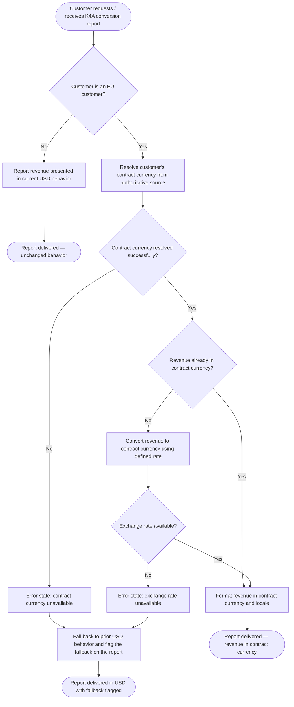

## 1. Business Logic & Context

### Problem

The K4A conversion report currently displays revenue in USD for customers whose commercial contract is denominated in another currency. For EU customers whose contract currency is EUR, this creates a mismatch between the revenue figures they see in the report and the currency they are actually billed and settled in. The immediate triggering case is **Lumen Retail** (Munich, Germany), whose main account sees revenue in USD when it should appear in EUR. Lumen Retail renews at the end of next month, making this a hard external deadline.

### Value

- **Billing/revenue accuracy from the customer's perspective:** EU customers see conversion-report revenue in the currency their contract is written in, eliminating a reconciliation gap between what they read in the report and what they are invoiced.
- **Renewal retention:** Resolving this before Lumen Retail's end-of-next-month renewal removes a concrete point of friction tied to a revenue-bearing contract.
- **Foundation for multi-currency EU reporting:** Establishes contract-currency as a first-class concept the conversion report honors, rather than assuming USD universally.

### Scope of This Change (as grounded by intake Q&A)

The requester (Mayank Ukey) grounded the scope through intake Q&A as follows, and these are the authoritative scope statements for this spec:

- The named customer is **Lumen Retail**, their **one main account**, based in Munich.
- The behavior change applies **only to EU customers**.
- The surface confirmed in Q&A is the **downloaded file / report** the customer receives.

> **Scope population — resolved.** The reviewer confirmed the scope is **Lumen Retail's main account only** for now — a single-account flag, not a full EU-customer contract-currency capability. Other EU customers come later; only Lumen Retail needs to be live before their renewal. This spec therefore treats Lumen Retail's main account as the sole in-scope account for Phase 1, with the broader EU-customer population deferred to a later phase.

> **On-screen vs. download-only surface — needs a human call.** Intake classified this as having **no** UI/frontend impact, but the Q&A reply ("yes, but only for EU customers") and the available engineering evidence both suggest a frontend display component may be involved. This spec scopes the **downloaded report** as the confirmed surface and treats on-screen display as a separate decision. Whether the on-screen K4A conversion report must also show contract currency is a business decision. [DECISION REQUIRED]

### Business Rules

- **BR-1 — Eligibility by EU status:** Contract-currency display applies only to EU customers. Non-EU customers continue to see revenue in the current (USD) behavior.
- **BR-2 — Contract currency is the display currency for eligible customers:** For an eligible EU customer, the conversion report's revenue figures are presented in that customer's contract currency rather than USD.
- **BR-3 — Lumen Retail is the first in-scope account:** Lumen Retail's main account (Munich) is an eligible EU customer and must display revenue in its contract currency (EUR).
- **BR-4 — Source of contract currency is authoritative, not inferred ad hoc:** The customer's contract currency is read from the stored currency field on the customer's account (in the billing settings), which is the authoritative source of truth. It must not be guessed or inferred per report.
- **BR-5 — Conversion must be traceable:** When a revenue figure is converted from its original currency to the contract currency, the conversion must be reproducible and reviewable, given this touches billing/revenue data under a HIGH risk tier.
- **BR-6 — Treatment of the original (USD) amount:** Whether the original USD amount is hidden, shown alongside the contract-currency amount, or configurable is a business decision. [DECISION REQUIRED]
- **BR-7 — Multi-account / multi-contract currency resolution:** How currency is resolved when an EU customer has multiple accounts or contracts in different currencies (per-account currency vs. a primary currency) is a business decision. [DECISION REQUIRED]

### Service-ownership note (engineering reference)

An independent knowledge-graph cross-check returned a **different, largely non-overlapping set of candidate services** than the Context Seed's named services — one list of generically-named reporting/revenue services and a second cluster of `sam-*`-named services, overlapping only on the frontend component. This is a material discrepancy: the two lists appear to describe the **same capability** (K4A conversion-report revenue and currency) under two naming schemes, and the authoritative codebase owner is unresolved. The detailed service evidence is appended separately for engineering; it is flagged here only so product review is aware that **which codebase owns this logic is itself an open question** that affects feasibility against the renewal deadline.

---

## 2. User Flows (Visuals)



---

## 3. Functional Requirements

> All FRs below are scoped to the **downloaded K4A conversion report** as the confirmed surface (see Section 1). If on-screen display is confirmed in scope ([DECISION REQUIRED], Section 1), an equivalent display-surface FR set must be added in revision.

### Feature Area: EU Customer Eligibility

**FR-001 — Eligible EU customer receives revenue in contract currency**
```gherkin
Given an EU customer whose contract currency is resolvable from the authoritative source
And a K4A conversion report is generated for that customer
When the report is produced for delivery/download
Then all revenue figures in the report are presented in the customer's contract currency
And no revenue figure in the report is presented in USD where contract currency differs from USD
```

**FR-002 — Lumen Retail main account shows EUR**
```gherkin
Given the Lumen Retail main account (Munich) classified as an EU customer
And its contract currency is EUR
When a K4A conversion report is generated for that account
Then all revenue figures in the report are presented in EUR
```

**FR-003 — Non-EU customer behavior is unchanged**
```gherkin
Given a customer that is not an EU customer
When a K4A conversion report is generated for that customer
Then revenue figures are presented in the current (USD) behavior
And no contract-currency conversion is applied
```

**FR-004 — EU eligibility is derived from an authoritative source, not a client-supplied claim**
```gherkin
Given a request to generate a K4A conversion report
When the system determines whether the customer is an EU customer
Then the EU-customer eligibility is re-derived from the authoritative account/customer source on that request
And a client-supplied eligibility value is not trusted to grant contract-currency behavior
```

### Feature Area: Contract Currency Resolution

**FR-005 — Resolve contract currency from the authoritative source**
```gherkin
Given an eligible EU customer
When a K4A conversion report is generated for that customer
Then the system resolves the customer's contract currency from the stored currency field on the customer's account (billing settings)
And the resolved contract currency is used as the report's display currency
```
> The authoritative source is the stored currency field on the customer's account in the billing settings (per Section 1 / BR-4). If that field is missing, the report falls back to USD and flags the missing contract currency on the report (see FR-006).

**FR-006 — Contract currency cannot be resolved (error state)**
```gherkin
Given an eligible EU customer
And the customer's contract currency cannot be resolved from the authoritative source
When a K4A conversion report is generated for that customer
Then the report generation falls back to the prior USD behavior and flags the unresolved contract currency on the report
And the failure is recorded as a distinct, named error condition (currency-unresolved), separate from other failure conditions
And the customer is not silently presented a revenue figure in an unverified currency
```
> Failure posture resolved: when the contract currency cannot be resolved, the report falls back to the prior USD behavior and flags the fallback on the report rather than blocking/withholding it. This is consistent with the FR-005 note (missing currency field → fall back to USD and flag).

**FR-007 — Multi-account / multi-contract currency resolution**
```gherkin
Given an eligible EU customer associated with more than one account or contract
And those accounts/contracts are denominated in more than one currency
When a K4A conversion report is generated
Then the system resolves which currency applies per the defined multi-currency resolution rule
```
> Whether resolution is per-account or via a single primary currency is [DECISION REQUIRED] per Section 1 / BR-7. Until decided, engineering may build against per-account resolution (each account displays its own contract currency).

### Feature Area: Revenue Currency Conversion

**FR-008 — Convert revenue when original currency differs from contract currency**
```gherkin
Given an eligible EU customer whose contract currency differs from the revenue's original currency
And an exchange rate is available for that currency pair
When revenue figures are prepared for the report
Then each revenue figure is converted from its original currency to the contract currency using the defined exchange rate
And the conversion produces a reproducible result for the same inputs
```
> Whether a conversion mechanism / exchange-rate source already exists or must be built, and the rate source and refresh frequency, is a business/discovery decision. [DECISION REQUIRED]

**FR-009 — Revenue already in contract currency is not re-converted**
```gherkin
Given an eligible EU customer whose revenue original currency equals the contract currency
When revenue figures are prepared for the report
Then the figures are presented in the contract currency without applying a conversion factor
```

**FR-010 — Exchange rate unavailable (error state)**
```gherkin
Given an eligible EU customer whose revenue requires conversion to the contract currency
And no exchange rate is available for the required currency pair
When revenue figures are prepared for the report
Then report generation falls back to the prior USD behavior and flags the unavailable exchange rate on the report
And the failure is recorded as a distinct, named error condition (rate-unavailable), separate from the currency-unresolved condition
And the customer is not presented an unconverted USD figure labeled as contract currency
```

**FR-011 — Conversion is reproducible and reviewable**
```gherkin
Given a revenue figure that was converted to a contract currency in a generated report
When the conversion needs to be reviewed or reproduced
Then the original amount, original currency, resolved contract currency, and the rate used to convert are retrievable for that figure
```
> This supports the HIGH risk tier (billing/revenue data). The persistence/retention model for this trace is for eng-plan; this FR states only that the information must be reproducible.

### Feature Area: Downloaded Report Content

**FR-012 — Downloaded report presents revenue in contract currency**
```gherkin
Given an eligible EU customer
When that customer downloads or is delivered a K4A conversion report
Then the revenue figures in the downloaded file are presented in the customer's contract currency
And the currency is formatted according to the contract currency's locale conventions
```

**FR-013 — Treatment of original (USD) amount in the downloaded report**
```gherkin
Given an eligible EU customer whose report revenue was converted to the contract currency
When the downloaded report is produced
Then the report presents the original amount, the converted amount, and/or conversion metadata according to the defined report-content rule
```
> Whether the download includes both original and converted amounts, conversion metadata, or only the contract-currency amount is a business decision. [DECISION REQUIRED] This is the same underlying trade-off as BR-6 (treatment of the original USD amount) applied to the downloaded file.

**FR-014 — Report regeneration for the same inputs is consistent**
```gherkin
Given a K4A conversion report previously generated for an eligible EU customer
When the same report is regenerated for the same reporting period and inputs
Then the presented contract-currency figures are consistent with the prior generation for that period
```
> Reporting consistency for multi-currency organizations (parent companies with EU subsidiary accounts) depends on the multi-account resolution decision (FR-007 / BR-7) and is governed by that same [DECISION REQUIRED].

Now reporting the decisions I flagged in Sections 0–3.

## 4. Information Requirements

The system must track the following business information to support the FRs in Section 3. These describe *what* information is needed and *why*; data types, field names, and storage models belong to eng-plan.

- **EU-customer eligibility status** — whether a given customer/account qualifies as an EU customer. Source: System-Derived or External (from the authoritative account/customer source). Matters because it is the gate for all contract-currency behavior (FR-001, FR-003, FR-004).
- **Contract currency (per eligible customer/account)** — the currency a customer's commercial contract is denominated in (e.g. EUR for Lumen Retail). Source: the stored currency field on the customer's account (billing settings), which is the authoritative source of truth (per BR-4). Matters because it is the display/target currency for the report (FR-005, FR-002).
- **Revenue figure original currency** — the currency each revenue figure is natively expressed in before any conversion (currently USD). Source: System-Derived (from the revenue/reporting data). Matters because it determines whether conversion is required (FR-008, FR-009).
- **Exchange rate (per currency pair)** — the rate used to convert a revenue figure from its original currency to the contract currency, with enough identifying context (pair, effective timing) to reproduce it. Source: System-Derived or External [DECISION REQUIRED — whether a rate mechanism exists or must be built, and the rate source and refresh frequency; same decision as FR-008]. Matters because conversion accuracy and reproducibility depend on it (FR-008, FR-011).
- **Conversion trace** — for each converted revenue figure: original amount, original currency, resolved contract currency, and the rate applied. Source: System-Derived. Matters because the HIGH risk tier (billing/revenue data) requires every conversion to be reproducible and reviewable (FR-011, BR-5).
- **Report content configuration (original-amount treatment)** — the rule governing whether a downloaded report shows the original amount, the converted amount, and/or conversion metadata. Source: System-Derived (configuration) [DECISION REQUIRED — same decision as BR-6/FR-013]. Matters because it controls what the eligible customer actually sees in the file (FR-013).
- **Multi-currency resolution rule** — the rule determining which currency applies when a customer has multiple accounts/contracts in different currencies (per-account vs. primary). Source: System-Derived (configuration/policy) [DECISION REQUIRED — same decision as BR-7/FR-007]. Matters because it governs correctness for parent/subsidiary organizations (FR-007, FR-014).
- **Failure condition (named error states)** — the distinct outcomes "contract-currency-unresolved" and "exchange-rate-unavailable" produced during report generation. Source: System-Derived. Matters because each must be handled and recorded separately rather than collapsed into a generic error (FR-006, FR-010).

---

## 5. Non-Functional Requirements & Guardrails

### Performance & Capacity

**NFR-001 — Report generation latency is not materially degraded**
Adding contract-currency resolution and conversion must not materially degrade K4A conversion-report generation latency relative to current behavior. Target: p95 report-generation time stays within the current baseline plus an agreed margin, measured under representative report-generation load. The current baseline and acceptable margin are not supplied by the input. [DECISION REQUIRED]

**NFR-002 — Currency-resolution and rate lookups are protected against added load**
Contract-currency resolution and exchange-rate lookups add new read paths against the authoritative currency source and the rate source. Where these share capacity with existing traffic, apply an explicit rate cap protecting the shared resource. Monitoring convention: alert when the error rate on currency-resolution or rate-lookup calls exceeds 1% for 5 minutes, sustained.

### Security & Access Control

**NFR-003 — Eligibility and currency enforced server-side**
EU-customer eligibility and contract-currency resolution must be enforced server-side on every report-generation request and re-derived from the authoritative source each time (FR-004). A client-supplied eligibility or currency claim must never grant contract-currency behavior; an ineligible or unauthorized request for another account's report data must be rejected regardless of any client-side state.

**NFR-004 — No sensitive revenue data leaked in logs or error paths**
Revenue figures and conversion details must not be written to logs in a form that exposes a customer's billing/revenue data beyond what operational diagnostics require. Error states (FR-006, FR-010) must not emit raw revenue amounts into general-purpose logs.

**NFR-005 — Secure delivery of downloaded reports**
Because the confirmed surface is a downloaded report containing billing/revenue data, the report must be delivered to the customer through the existing secure, access-controlled delivery path for K4A reports; it must not be made retrievable by an unauthorized party. Whether existing K4A report delivery already satisfies a time-limited secure-link standard is not stated in the input. [DECISION REQUIRED]

### Correctness & Auditability

**NFR-006 — Conversions are reproducible and auditable**
Every currency conversion applied to report revenue must be reproducible from its recorded inputs (original amount, original currency, resolved contract currency, rate applied) per FR-011. Given the HIGH risk tier and billing/revenue data, the conversion trace must be append-only (not editable or deletable through any application code path) so that a figure a customer was shown can always be reconstructed. Minimum retention for the conversion trace is not supplied by the input; Kochava's typical range is 12–24 months. [DECISION REQUIRED]

**NFR-007 — Named failure conditions are handled distinctly**
The two failure conditions — contract-currency-unresolved (FR-006) and exchange-rate-unavailable (FR-010) — must each have their own recorded status and must not be collapsed into a single generic error. The failure posture for both is graceful degradation to the prior USD behavior with the fallback flagged on the report (not fail-closed/withhold), applied consistently to both conditions.

### Resilience of External/Downstream Dependencies

**NFR-008 — Bounded retry and explicit failure posture for dependency calls**
Calls to the authoritative currency source and the exchange-rate source are downstream dependencies. On failure, apply bounded retry with exponential backoff (do not retry indefinitely; 3 attempts is the Kochava default) and honor any rate-limit/Retry-After response rather than retrying on a fixed schedule. If a dependency remains unavailable after retries, the request resolves into the applicable named failure condition (NFR-007) rather than a silent pass-through of an unverified currency.

### Risk Mitigation (Context Seed risks)

**NFR-009 — Hard renewal deadline (end of next month)**
The renewal deadline is mitigated only if the scope-population decision (single account vs. all EU customers; Section 1) and the service-ownership question (which codebase owns K4A conversion-report revenue logic; Section 1) are resolved early, because both change the size of the work. This spec provides a buildable default (EU population as boundary, Lumen Retail as first account) so engineering can begin, but the deadline is at risk until those are confirmed.

**NFR-010 — Billing/revenue data correctness**
Mitigated when: conversions are reproducible and auditable (NFR-006); revenue already in the contract currency is never double-converted (FR-009); and no unconverted USD figure is ever presented labeled as contract currency (FR-010). No customer may be shown a revenue figure in an unverified currency (FR-006).

**NFR-011 — Multi-service / high blast radius (6+ services, backend + frontend)**
Mitigated by a config-based kill-switch that disables contract-currency behavior and reverts eligible customers to the prior USD behavior without a code deploy. An on-call engineer must be able to disable it during an incident without separate approval. New requests pick up the flip within an established propagation window (5 minutes is the Kochava precedent); state explicitly whether reports already in-flight at flip time complete under the prior behavior. [DECISION REQUIRED]

**NFR-012 — Backward compatibility for existing report consumers**
Because this modifies an existing report that non-EU customers already receive, non-EU customer reports must remain byte-for-byte unchanged in behavior (FR-003), and any downstream consumer of the existing revenue/report output that assumes USD must not silently receive a different currency without the eligibility gate applying. Existing (non-EU) behavior is the compatibility contract that must remain unchanged.

### Rollback (HIGH-risk, explicit)

**NFR-013 — Rollback**
- **Trigger:** confirmed incorrect currency or conversion presented to a customer, or sustained elevated failure rate on currency-resolution/rate-lookup (NFR-002).
- **Owning authority:** on-call engineering, via the kill-switch (NFR-011), without separate escalation.
- **Timing target:** new report generations revert to prior USD behavior within the kill-switch propagation window (NFR-011).
- **In-flight / already-produced data:** reports already delivered are not retroactively regenerated; only new report generations are affected going forward.

---

## 6. Out of Scope & Phasing

The Context Seed did not define an explicit MVP/out-of-scope list; the following phasing is derived from the confirmed scope (Section 1) and the open discovery questions, to prevent scope creep against the renewal deadline. The population and surface boundaries themselves remain [DECISION REQUIRED] items in Section 1.

| Item | Status | Rationale |
|------|--------|-----------|
| Downloaded K4A conversion report in contract currency for eligible EU customers (Lumen Retail first) | **In scope — Phase 1** | The confirmed surface and confirmed triggering case; tied to the renewal deadline. |
| On-screen (in-K4A UI) display of contract currency | **Out of scope — Phase 1 (pending decision)** | Intake classified UI impact as "no"; Q&A and engineering evidence suggest otherwise. Governed by the on-screen-vs-download decision in Section 1 — if confirmed in scope, add an equivalent display-surface FR set in revision. |
| Non-EU customers displaying any non-USD currency | **Out of scope** | EU status is the eligibility boundary (BR-1). Non-EU behavior is unchanged (FR-003). |
| User/admin-configurable toggle for showing/hiding the original USD amount | **Out of scope — Phase 1** | Default report-content treatment (FR-013) is governed by a single defined rule in Phase 1; a configurable toggle is a later enhancement pending the BR-6 decision. |
| General multi-currency reporting across all currencies (beyond EUR for EU customers) | **Out of scope** | Phase 1 establishes contract-currency as a concept for EU customers; a general multi-currency capability is a future phase. |
| Building a new general-purpose exchange-rate platform | **Out of scope — Phase 1** | Phase 1 uses a defined rate source (FR-008). Whether that source exists or must be built is a discovery decision; building a reusable rate platform is beyond this requirement. |
| Primary-currency settings / currency roll-up for parent–subsidiary organizations | **Out of scope — Phase 1** | Phase 1 default is per-account resolution (FR-007). A primary-currency / roll-up capability is a future phase, pending the BR-7 decision. |
| Retroactive regeneration of already-delivered reports into contract currency | **Out of scope** | Change applies to new report generations going forward (NFR-013); historical reports are not reissued. |

## Appendix: Engineering Reference

_The sections below are derived automatically from the codebase knowledge graph, for the engineering team's reference during planning — not required reading for product/requirement review._

### Affected Services (grounded context, not implementation direction)

The codebase knowledge graph returned **two different, largely non-overlapping candidate service sets** for this capability, overlapping only on the frontend component. Both are recorded here as grounded fact; which set authoritatively owns K4A conversion-report revenue/currency logic is an open engineering question (see Section 1 service-ownership note and NFR-009).

**Set A — "Affected Services" list:**
- **reporting-api** (backend) — K4A conversion report generation and currency handling.
- **cost-revenue-workers** (backend) — revenue calculation and currency conversion for reports.
- **analytics-query** (backend) — query layer for report data retrieval and formatting (KG surfaced only filter-set CRUD endpoints, not report-data endpoints — treat the touch points as unconfirmed).
- **frontend-mos** (frontend) — K4A UI: conversion report display and currency localization.
- **accounts-api** (backend) — account currency settings and customer contract details (most likely home of the "how is contract currency determined" answer).
- **reporting-dispatcher** (backend) — report generation workflow and delivery to customers.

**Set B — independent KG cross-check (`sam-*` cluster):**
- **sam-performance-reporter** (backend) — SAM/K4A conversion report generation, revenue fields.
- **sam-api** (backend) — K4A/SAM API serving conversion report data.
- **k4a-sam-backend** (backend) — K4A SAM backend owning report revenue logic.
- **sam-report-scheduler** (backend) — schedules K4A reports consuming revenue data.
- **sam-campaign-data-sync** / **k4a-sam-campaign-data-sync** (backend) — sync campaign/currency data for reports (possible duplicate or monorepo-vs-service split).
- **sam-mono** (backend) — SAM monorepo may host report code.
- **sam-agent** (backend) — reads SAM revenue fields; flagged by the graph as needing currency-contract verification (a downstream reader that could break if revenue-field currency semantics change).
- **frontend-mos** (frontend) — console UI displaying conversion report revenue (the only service appearing in both sets).

Now reporting the decisions I flagged in Sections 4–6.

## Revision Summary

_Applied reviewer's request._

- Resolved BR-4: contract currency comes from the stored currency field on the customer's account billing settings (DEC-003 resolved).
- Resolved FR-005 source note to the stored account billing-settings currency field, with USD-fallback-and-flag on missing.
- Resolved the contract-currency Information Requirement source to the stored account billing-settings currency field.
- Resolved DEC-004 at FR-006: fall back to USD and flag on report instead of blocking.
- Resolved DEC-004 at FR-010: fall back to USD and flag on report instead of blocking.
- Updated flowchart failure-posture nodes to reflect USD fallback with flag.
- Resolved DEC-004 at NFR-007: posture is USD fallback with flag for both conditions.


---
## Open Questions & Decisions Register

_Durable, ID'd reference for HITL 2 (G1) and beyond — inline `[DECISION REQUIRED: DEC-00N]` tags in the sections above point back here. Reflects the latest round only._

### Decisions Required (business trade-offs — needs a human call)

_Each carries an **Owner** (accountable for supplying the answer) and a **Provisional Value** (the working assumption engineering may build against until the decision lands), so none of these fully block engineering — implementation proceeds on the provisional value and adjusts if the confirmed decision differs._

| ID | Decision | Owner | Provisional Value (build against until confirmed) |
|----|----------|-------|-----------------------------------------------------|
| **DEC-002** | On-screen vs. download-only surface: must the on-screen K4A conversion report also show contract currency, or is the downloaded file the only surface? Intake classified UI/frontend impact as 'no', but the Q&A reply and engineering evidence both suggest a frontend display component may be involved. This determines whether a whole frontend FR set and frontend service work are in scope before the deadline. | Product owner (Mayank Ukey) | Scope the downloaded report as the only confirmed surface for Phase 1; defer on-screen display to a fast follow. If a quick check with the requester confirms on-screen is expected, add the mirrored display-surface FR set before build. |
| **DEC-005** | Treatment of the original (USD) amount for eligible EU customers — hidden entirely, shown alongside the contract-currency amount, or configurable by user/admin? Applies both to the general display rule (BR-6) and to the downloaded report content (FR-013). | Product owner (Mayank Ukey) | Show the contract-currency amount as the primary revenue figure; omit the original USD amount from the customer-facing report body. Retain the original amount, currency, and rate internally for reproducibility/audit (FR-011) rather than exposing them to the customer by default. |
| **DEC-006** | Multi-account / multi-contract currency resolution: when an EU customer has multiple accounts or contracts in different currencies, should each account display its own contract currency or should a single primary currency apply? This also governs reporting consistency for parent companies with EU subsidiary accounts (FR-007, FR-014). | Product owner (Mayank Ukey) | Resolve contract currency per-account (each account displays its own contract currency). This matches the account-scoped behavior and the single-account starting point for Lumen Retail; revisit a parent-level primary-currency rollup only if a multi-subsidiary customer requires it. |
| **DEC-010** | Minimum retention period for the conversion trace (original amount, original currency, resolved contract currency, rate applied) required for billing/revenue auditability (NFR-006). | Compliance/Security + Product owner | Retain conversion trace for 24 months (upper end of Kochava's typical 12-24 month range, given billing/revenue sensitivity and an annual renewal cycle). |

### Decisions Resolved

- **DEC-001**: DEC-001 resolved: scope is Lumen Retail's main account only for Phase 1 (single-account flag), with the broader EU-customer contract-currency population deferred to a later phase; only Lumen Retail needs to be live before their renewal.
- **DEC-003**: DEC-003 resolved: contract currency is determined from a stored currency field on the customer's account (in the billing settings), used as the source of truth; if missing, fall back to USD and flag it on the report.
- **DEC-004**: DEC-004 resolved: when an eligible EU customer's contract currency (FR-006) or the required exchange rate (FR-010) cannot be resolved, the system falls back to the prior USD behavior and flags it on the report rather than blocking/withholding the report.
- **DEC-007**: Engineering decides: Assume an existing exchange-rate mechanism must be confirmed first; if none exists, build against a single authoritative daily-refreshed rate source applied at report-generation time, with the rate used recorded per figure (FR-011). Confirm the rate source and refresh cadence with Finance before finalizing.
- **DEC-008**: Engineering decides: p95 report-generation time stays within current baseline + 15%, measured under representative report-generation load; establish the current baseline from existing K4A conversion-report telemetry before coding.
- **DEC-009**: Engineering decides: Reuse the existing authenticated, access-controlled K4A report delivery path; if it is a raw attachment, upgrade to a time-limited secure link before GA.
- **DEC-011**: Engineering decides: New report generations pick up the flip within a 5-minute propagation window; reports already in-flight at flip time complete under the prior behavior (no mid-generation switch).

---
> **Classification:** Type A
