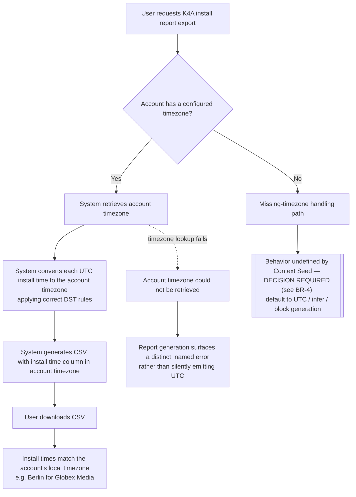

## 1. Business Logic & Context

### Problem

Globex Media downloads the K4A install report as a CSV. The install time column is currently rendered in UTC. Globex Media's account is configured for the Berlin timezone, so every install timestamp they read is offset from their local operating time, forcing manual conversion and creating room for error when they reconcile install activity against their own records.

### Value

Rendering install times in the account's configured timezone removes a manual, error-prone conversion step for the customer, makes the exported report directly usable without reinterpretation, and establishes account-timezone-aware timestamping as a reusable behavior for K4A reporting.

### Business Rules

- **BR-1 — Conversion source of truth:** Install time values are stored/produced in UTC and must be converted to the timezone configured on the customer's account for presentation in the report.
- **BR-2 — Account timezone is the reference:** The conversion target is the timezone set on the account (for the triggering customer, Globex Media, this is Berlin). The conversion must be timezone-correct — i.e. it must account for daylight saving transitions for the target zone, not apply a fixed numeric offset.
- **BR-3 — Delivery surface scope:** The behavior applies to the downloaded K4A install report CSV. Whether the same conversion must also apply to any on-screen display of install report times in K4A is not settled by the Context Seed and is called out as a decision below. [DECISION REQUIRED: DEC-001]
- **BR-4 — Missing account timezone:** The handling for an account that has no configured timezone (default to UTC, infer from another source, or block report generation until a timezone is configured) is not specified by the Context Seed. [DECISION REQUIRED: DEC-002]
- **BR-5 — Existing report behavior preserved:** Apart from the install time column's timezone presentation, the structure and content of the K4A install report must remain unchanged for existing consumers of the report.

### Service-ownership note (evidence discrepancy)

The intake evidence and an independent knowledge-graph cross-check disagree on which backend owns K4A install report generation and timezone formatting. One source attributes report CSV generation and timezone handling to a single report-generation backend plus an account-configuration backend that supplies the timezone; the independent lookup instead surfaces a separate reporting backend and a console frontend as possibly involved, with the account-configuration backend appearing in both. This discrepancy is unresolved and is relevant to BR-3 (whether on-screen display is in scope) — engineering must confirm the actual report-generation path and whether on-screen rendering is a separate surface before sizing the work.

## 2. User Flows (Visuals)



## 3. Functional Requirements

### Feature Area: Install time timezone conversion (CSV export)

**FR-001 — Install time column rendered in account timezone**
```gherkin
Given an account with a configured timezone
  And install time values stored in UTC
When the user exports the K4A install report CSV
Then every value in the install time column is converted from UTC to the account's configured timezone
  And no install time value in the exported CSV remains in UTC
```

**FR-002 — Berlin timezone for the triggering customer**
```gherkin
Given the Globex Media account configured with the Berlin timezone
  And an install recorded at a known UTC instant
When the user exports the K4A install report CSV
Then the install time column shows that instant expressed in Berlin local time
  And the displayed value matches Berlin local time for that instant
```

**FR-003 — Daylight-saving correctness**
```gherkin
Given an account whose configured timezone observes daylight saving time
  And two installs recorded at UTC instants that fall on opposite sides of a daylight-saving transition for that timezone
When the user exports the K4A install report CSV
Then each install time is converted using the daylight-saving offset in effect at that install's instant
  And the conversion does not apply a single fixed offset across both installs
```

**FR-004 — Existing report structure unchanged**
```gherkin
Given a K4A install report CSV produced before this change
When the user exports the K4A install report CSV after this change
Then the report contains the same columns in the same order as before
  And only the timezone in which the install time column is presented has changed
  And all other column values are unchanged
```

### Feature Area: Timezone retrieval

**FR-005 — Retrieve account timezone for conversion**
```gherkin
Given an account with a configured timezone
When the K4A install report CSV is generated
Then the system reads the timezone from the account's configuration as the conversion target
  And uses that value as the single reference for converting every install time in the export
```

**FR-006 — Account timezone retrieval failure is surfaced, not masked**
```gherkin
Given a request to export the K4A install report CSV
When the account's configured timezone cannot be retrieved
Then the system surfaces a distinct, named failure condition for the unavailable timezone
  And the report is not silently emitted with install times left in UTC
```

### Feature Area: Missing account timezone handling

**FR-007 — Account with no configured timezone**
```gherkin
Given an account that has no timezone configured
When the user exports the K4A install report CSV
Then the system applies the agreed missing-timezone behavior
  # The agreed behavior — default to UTC, infer from another source, or block generation
  # until a timezone is configured — is a pending product decision (see BR-4 / DECISION REQUIRED).
  And the behavior is deterministic and identical for every export from an account in this state
```

### Feature Area: On-screen display scope

**FR-008 — On-screen install time display (scope pending)**

## 4. Information Requirements

The system must track the following business information to support the functional requirements above:

- **Install time (UTC)** — System-Derived. The raw install timestamp as currently produced/stored in UTC. It is the input to every conversion in FR-001 through FR-003; it remains the source-of-truth instant from which the account-timezone presentation is derived.
- **Account timezone setting** — External (read from account configuration, per FR-005). The timezone configured on the customer's account (Berlin for Globex Media). It is the conversion target that determines how each UTC install time is presented in the export.
- **Account timezone presence/absence state** — System-Derived (evaluated at export time). Whether the account has a configured timezone at all. It drives the branch between the normal conversion path (FR-001) and the missing-timezone handling path (FR-007), and the retrieval-failure path (FR-006).
- **Converted install time (account timezone)** — System-Derived. Each UTC install time expressed in the account's configured timezone, with the daylight-saving offset in effect at that install's instant (FR-002, FR-003). This is the value rendered in the install time column of the exported CSV.
- **Report composition (columns and order)** — System-Derived. The existing set and ordering of the install report's columns, which must be preserved so only the install time column's timezone presentation changes (FR-004). It matters because existing consumers depend on the report's structure being stable.
- **Timezone retrieval outcome** — System-Derived. Whether the account timezone lookup succeeded or failed on a given export. It distinguishes the success path from the named retrieval-failure condition (FR-006) that must not be collapsed into a silent UTC fallback.

## 5. Non-Functional Requirements & Guardrails

### Performance

- **NFR-001 — Export latency not materially degraded.** Adding UTC-to-account-timezone conversion to the install time column must not materially degrade install report export generation time versus the current UTC-only path. The acceptable latency target and its measurement method (e.g. p95 generation time at a representative report row count) are not specified by the Context Seed. [DECISION REQUIRED: DEC-003]
- **NFR-002 — Conversion scales with report size.** The conversion must apply per-row across the full install report without disproportionate slowdown as row count grows; conversion cost must stay linear in the number of install rows exported.

### Security & Access Control

- **NFR-003 — No change to report access eligibility.** This change alters only the timezone presentation of the install time column. Who is permitted to export the K4A install report, and the account-scoping of which installs appear in it, must remain exactly as today — no install data becomes visible to any user or account that could not already export it.
- **NFR-004 — No sensitive data introduced into logs.** Any diagnostic logging added for timezone retrieval or conversion (e.g. for the FR-006 failure path) must not log raw account-identifying data beyond what is already permitted in existing report-generation logs. Timezone values and account identifiers used for diagnostics must follow existing logging conventions for this report path.

### Correctness & Data Handling

- **NFR-005 — UTC preserved as source of truth.** The conversion is a presentation-layer transformation for the exported report only. The underlying install time instants remain in UTC in storage; this change must not rewrite, re-store, or alter any stored timestamp. Any system, audit, or logging path that currently relies on UTC timestamps continues to receive UTC unchanged.
- **NFR-006 — Timezone-correct conversion.** Conversion must use a timezone database that resolves the correct offset — including daylight-saving transitions — for the account's zone at each install's instant (reinforces BR-2 / FR-003). A fixed numeric offset is not acceptable.
- **NFR-007 — Deterministic missing-timezone behavior.** Once the missing-timezone behavior is decided (BR-4), every export from an account in that state must behave identically and predictably; the outcome must never vary between two exports of the same account in the same timezone-configuration state.

### Backward Compatibility

- **NFR-008 — Existing report consumers unaffected in structure.** The install report's columns, their order, and all non-install-time values must remain unchanged (reinforces FR-004). The only observable change for existing consumers is the timezone in which the install time column is presented. This is a presentation change to an existing output with existing consumers, so the install time column's new timezone basis must be communicated to report consumers who may have assumed UTC. [DECISION REQUIRED: DEC-004]

### Risk Mitigation

The Context Seed classifies this work as MEDIUM risk (hard month-end deadline, multi-service blast radius, timezone/data-handling complexity). Each identified risk and its mitigation condition:

- **Risk: Delivery-surface ambiguity (CSV-only vs. also on-screen).** Mitigated when the scope decision in BR-3 / FR-008 is made and the owning report-generation path is confirmed. Until then, build the CSV export behavior (unambiguously in scope) and gate on-screen work behind the decision.
- **Risk: Multi-service blast radius / unresolved service ownership.** The intake evidence and the independent KG cross-check disagree on which backend owns report generation and timezone formatting (see Section 1). Mitigated when engineering confirms the actual report-generation path before implementation, so the conversion lands in the correct single location rather than being duplicated or missed across services.
- **Risk: Timezone/DST conversion correctness.** Mitigated when conversion uses a timezone database with DST resolution (NFR-006) and is verified against known Berlin instants on both sides of a daylight-saving transition (FR-002, FR-003).
- **Risk: Silent incorrect output on missing/unavailable timezone.** Mitigated when the missing-timezone behavior is decided (BR-4 / FR-007) and the retrieval-failure path surfaces a distinct, named error instead of silently emitting UTC (FR-006).
- **Risk: Hard month-end deadline.** Mitigated by keeping Phase 1 scoped to the CSV export for an account with a configured timezone, and deferring unconfirmed scope (on-screen display, cross-report rollout, historical re-generation) to later phases per Section 6.

## 6. Out of Scope & Phasing

The following are explicitly **NOT** included in Phase 1. They are recorded to prevent scope creep and are drawn from the Context Seed's open questions.

| Item | Status | Rationale |
|---|---|---|
| On-screen display of install report times in account timezone within K4A | Out of scope (Phase 1) — pending decision | The Context Seed does not confirm whether the change applies beyond the downloaded CSV; delivery surface is unsettled (BR-3 / FR-008). If confirmed in scope, it becomes its own phase. |
| Converting timestamps in other reports / data exports to account timezone | Out of scope (Phase 1) | The Context Seed raises cross-report consistency as an open question only; this work is scoped to the K4A install report CSV. |
| Re-generating / re-converting previously downloaded or historical reports when an account's timezone changes | Out of scope (Phase 1) | Historical re-generation behavior is an unanswered open question; Phase 1 converts at export time only. |
| User-facing toggle between UTC and account timezone when viewing/exporting | Out of scope (Phase 1) | Account timezone is treated as the single reference for the export; a toggle is an unconfirmed future capability. |
| Per-user timezone preference overriding the account timezone in multi-user accounts | Out of scope (Phase 1) | The Context Seed raises individual-vs-account timezone as an open question; Phase 1 uses the account timezone as the single reference. |
| Mandating UTC anywhere for audit/compliance despite customer-facing conversion | Out of scope (Phase 1) — no change | NFR-005 preserves UTC as source of truth; any explicit audit/compliance UTC mandate is not established by the Context Seed and is not addressed here. |

## Appendix: Engineering Reference

_The sections below are derived automatically from the codebase knowledge graph, for the engineering team's reference during planning — not required reading for product/requirement review._

### Affected Services (grounded context, not implementation direction)

The Context Seed's intake appendix and an independent knowledge-graph cross-check surfaced overlapping but non-identical service sets. Both are recorded as grounded context; the discrepancy itself is called out in Section 1 and is an open engineering confirmation, not a resolved implementation direction.

**From the Context Seed intake appendix (agent-derived from the codebase KG):**
- **k4a-mcp-server** (backend) — K4A install report CSV generation and timezone handling.
- **accounts-api** (backend) — Account timezone configuration consumed by report generation.

**From the independent KG cross-check (requirement-agent's own fresh lookup):**
- **reporting-api** (backend) — Serves K4A install report data / timezone formatting.
- **frontend-mos** (frontend) — Console UI displays install report times (relevant only if on-screen display is confirmed in scope).
- **accounts-api** (backend) — Provides the account timezone setting (corroborated across both lookups).

Now I'll report the decisions I flagged in Sections 4-6.

---
## Open Questions & Decisions Register

_Durable, ID'd reference for HITL 2 (G1) and beyond — inline `[DECISION REQUIRED: DEC-00N]` tags in the sections above point back here. Reflects the latest round only._

### Decisions Required (business trade-offs — needs a human call)

_Each carries an **Owner** (accountable for supplying the answer) and a **Provisional Value** (the working assumption engineering may build against until the decision lands), so none of these fully block engineering — implementation proceeds on the provisional value and adjusts if the confirmed decision differs._

| ID | Decision | Owner | Provisional Value (build against until confirmed) |
|----|----------|-------|-----------------------------------------------------|
| **DEC-001** | Does the timezone conversion apply only to the downloaded K4A install report CSV, or must it also apply to any on-screen display of install report times in K4A? The Context Seed explicitly leaves this unconfirmed and the requester provisionally assumed 'downloaded file only'. | Product owner (Mayank Ukey), with Engineering confirming where on-screen rendering lives | Scope limited to the downloaded CSV export only for Phase 1 (matching the requester's stated assumption); on-screen display is handled as a separate future phase if confirmed needed. |
| **DEC-002** | How should the system handle an account that has no configured timezone when generating the install report CSV — default to UTC, infer the timezone from another source (e.g. user browser), or block report generation until a timezone is explicitly configured? | Product owner (Mayank Ukey) | Default to UTC for accounts with no configured timezone, and label the column header to indicate the timezone applied, so the export never fails and the customer can see which zone was used. Globex Media has a timezone set, so this path does not block the triggering request. |
| **DEC-004** | How the new account-timezone basis of the install time column is communicated to existing report consumers who may have assumed UTC (NFR-008) is not specified by the Context Seed. | Product owner | Proactively notify known K4A install-report consumers (starting with Globex Media) ahead of release that the install time column now renders in account timezone, and note the change in the report's release/changelog documentation; keep column ordering and all other values unchanged so no parsing breaks. |

### Decisions Resolved

- **DEC-003**: Engineering decides: No material regression versus the current UTC-only export: p95 generation time within 10% of the current baseline at a representative report row count, measured over the existing export path.

---
> **Classification:** Type B — requirement-agent's independent re-check DISAGREES with intake's original Type A call. The desired behavior is clearly specified (convert the install-time column in the K4A install report CSV from UTC to the account's configured timezone), and the KG confirms real multi-service build (k4a-mcp-server report generation + accounts-api timezone config), so the remaining questions are engineering design details, not product discovery.
