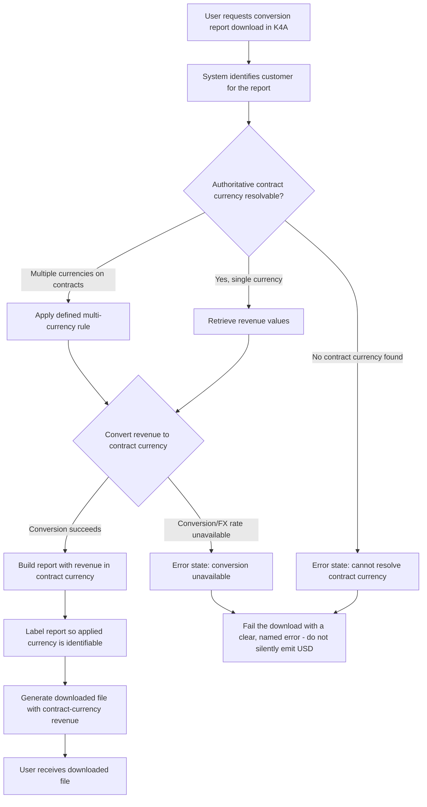

## 1. Business Logic & Context

### Problem

The K4A conversion report currently displays revenue values in USD in the downloaded file. Customers whose contracts are denominated in another currency (e.g. EUR) receive a report that does not match the currency of their contract terms. This forces manual reconciliation and undermines trust in the accuracy of the report against the signed agreement.

### Value

Displaying revenue in the customer's contract currency makes the downloaded conversion report directly reconcilable against the contract. It removes a manual conversion step for the customer, reduces reconciliation disputes, and ensures the report reflects the commercial reality of the relationship.

### Scope Summary

- **Product/channel:** K4A
- **Surface affected:** Downloaded file content **only**. There is no on-screen (console/UI) change — confirmed by the requester (Mayank Ukey): *"yes, in downloaded file only."*
- **Core change:** Revenue values in the downloaded conversion report are expressed in the customer's contract currency rather than a fixed USD value.

### Business Rules

- **BR-1 — Contract currency drives display.** Revenue in the downloaded conversion report is expressed in the currency of the customer's contract, not in a fixed USD value.
- **BR-2 — Accuracy against contract terms.** The converted revenue values must reflect the customer's contract terms accurately. The report is a revenue/billing artifact and is treated as HIGH-risk; correctness is a release gate, not a nice-to-have.
- **BR-3 — Download surface only.** The change applies exclusively to the content of the downloaded file. No on-screen view is in scope.
- **BR-4 — Target currency source of truth.** The contract currency applied to a given customer's report is taken from the authoritative contract-currency configuration for that customer, not inferred, defaulted, or hard-coded.
- **BR-5 — Conversion method and FX rate.** The report must apply a single, defined approach to currency conversion (which FX rate source, and the as-of date the rate is taken from — e.g. report-period date, contract date). The accuracy requirement in BR-2 cannot be met without this being pinned down. [DECISION REQUIRED: DEC-001]
- **BR-6 — Multiple contracts / multiple currencies.** When a single customer has more than one contract in differing currencies within the scope of one report, the report must follow a defined rule for which currency applies (single currency per report, or segmented). [DECISION REQUIRED: DEC-002]
- **BR-7 — Currency coverage.** EUR is the named near-term target. Whether other non-USD contract currencies are in scope for this phase affects the conversion coverage the report must support. [DECISION REQUIRED: DEC-003]
- **BR-8 — Metadata labeling.** The report must indicate which currency the revenue figures are in so a reader is not left to assume USD. Whether this extends to column labels, headers, or other metadata — versus only the revenue values — is a product call. [DECISION REQUIRED: DEC-004]

### Note on affected-system evidence

An independent knowledge-graph cross-check surfaced a meaningful discrepancy worth flagging for the engineering planning phase: the curated affected-service list and an independent fresh lookup point at **two different and partly contradictory clusters** of backend systems that could own the K4A conversion report. The two candidate ownership paths have materially different blast radii. Reconciling which codebase actually generates the K4A conversion report is a prerequisite to engineering estimation and is treated as an engineering-owned investigation in the planning phase. The supporting evidence is attached as a labeled appendix at the end of this document for the engineering team's reference.

### Known open input

- The specific customer requesting this change was not identified at intake ("Unknown, for engineering to confirm" — Mayank Ukey). This is recorded as an engineering/discovery follow-up and does not block specification of the behavior.

---

## 2. User Flows (Visuals)

The actor is a K4A user downloading a conversion report. The flow covers the happy path (contract currency resolved and applied) and error states (no resolvable contract currency; conversion unavailable).



**Flow notes:**
- The report must not silently fall back to USD when the contract currency cannot be resolved or the conversion cannot be performed. Silently emitting USD when EUR was expected is a correctness failure on a revenue artifact (BR-2), so these paths surface a distinct, named error rather than an unlabeled wrong-currency file.

---

## 3. Functional Requirements (The Core)

### Feature Area A — Contract Currency Resolution

**FR-001 — Resolve contract currency for the report's customer**
```gherkin
Given a K4A user requests a download of the conversion report for a customer
And that customer has an authoritative contract currency configured
When the system prepares the report
Then the system retrieves that contract currency from the authoritative contract-currency source
And uses it as the target currency for all revenue values in the report
```

**FR-002 — No contract currency resolvable**
```gherkin
Given a K4A user requests a download of the conversion report for a customer
And no authoritative contract currency can be resolved for that customer
When the system prepares the report
Then the system does not generate a report with USD values silently substituted
And the download fails with a distinct, named error indicating the contract currency could not be resolved
```

**FR-003 — Authoritative source only, resolved per request**
```gherkin
Given the system needs the contract currency for a report
When it determines which currency to apply
Then it derives the currency from the authoritative contract-currency source on that request
And it does not use a hard-coded, inferred, or client-supplied currency value
```

**FR-004 — Customer with multiple contracts in differing currencies**
```gherkin
Given a customer has more than one contract with differing currencies within the scope of a single conversion report
When the system prepares that report
Then the system applies the defined multi-currency handling rule (see BR-6)
And the report never mixes currencies within a single revenue figure without labeling which currency applies
```
> Depends on the multi-currency product decision flagged in BR-6.

### Feature Area B — Revenue Conversion

**FR-005 — Convert revenue values to contract currency**
```gherkin
Given the contract currency for the report's customer has been resolved
And the revenue values for the report have been retrieved
When the system builds the revenue figures for the report
Then each revenue value is expressed in the resolved contract currency
And the value reflects the applicable FX rate under the defined conversion method (see BR-5)
```

**FR-006 — Conversion applied consistently with aggregation**
```gherkin
Given revenue values are aggregated across multiple underlying records for the report
When those values are converted to the contract currency
Then the conversion and aggregation are applied in a defined, consistent order
So that the aggregated total equals the intended converted total and is not distorted by converting before or after summing inconsistently
```

**FR-007 — Conversion or FX rate unavailable**
```gherkin
Given the contract currency has been resolved
And the applicable FX rate or conversion result cannot be obtained
When the system attempts to build the revenue figures
Then the download fails with a distinct, named error indicating conversion is unavailable
And the system does not emit a report containing unconverted USD values labeled as the contract currency
```

**FR-008 — No double conversion**
```gherkin
Given a revenue value has already been converted to the contract currency upstream
When the report is assembled downstream
Then the system does not apply a second currency conversion to that value
And the final figure in the file reflects exactly one conversion to the contract currency
```

### Feature Area C — Downloaded File Output

**FR-009 — Revenue in contract currency appears in the downloaded file**
```gherkin
Given a report has been built with revenue converted to the contract currency
When the user downloads the file
Then the revenue values in the downloaded file are the contract-currency values
And they are not the fixed USD values previously produced
```

**FR-010 — File identifies the applied currency**
```gherkin
Given the downloaded file contains revenue in the contract currency
When the user opens the file
Then the file indicates which currency the revenue figures are expressed in
So that a reader is not left to assume the values are in USD
```
> The extent of currency labeling (values only vs. column labels/headers/metadata) depends on the product decision flagged in BR-8.

**FR-011 — Download surface only, no on-screen change**
```gherkin
Given this change applies to the downloaded file content only
When a K4A user views the conversion report on screen
Then the on-screen presentation is unchanged by this work
And only the downloaded file content reflects the contract-currency revenue
```

**FR-012 — File generation reads the converted value, not a cached USD value**
```gherkin
Given the file-generation path assembles the downloaded conversion report
When it writes revenue into the file
Then it reads the contract-currency-converted value
And it does not read a separately cached or pre-stored USD revenue value
```

I used four `[DECISION REQUIRED: DEC-005]` tags in Sections 0–3 (BR-5 conversion method/FX rate, BR-6 multi-currency handling, BR-7 currency coverage, BR-8 metadata labeling). Reporting them now.

## 4. Information Requirements

The system must track the following business information to satisfy the functional requirements above. This is a *what-must-be-known* list, not a schema.

- **Contract currency (per customer).** The authoritative currency denomination of a customer's contract. Source: External/System — the authoritative contract-currency configuration retrieved for the customer. This is the target currency every revenue value in the report is expressed in (FR-001, FR-003); without it the report cannot be built (FR-002).
- **Customer identity for the report.** The customer the requested report belongs to, used to look up the correct contract currency. Source: System-Derived from the report request context. Note the specific requesting customer was not identified at intake — see the known open input in Section 1.
- **Raw revenue values (as currently produced).** The revenue figures the report is built from today, in their current form/currency. Source: System-Derived from the revenue calculation/aggregation pipeline. These are the inputs to conversion (FR-005, FR-006).
- **Applicable FX rate and its as-of date.** The exchange rate used to convert raw revenue into the contract currency, and the date the rate is taken as-of. Source: External/System — the defined FX rate source (see BR-5). Directly governs accuracy (BR-2) and the correctness of every converted figure (FR-005, FR-007).
- **Converted revenue values.** The revenue figures after conversion into the contract currency. Source: System-Derived. These are what appears in the downloaded file (FR-009) and must reflect exactly one conversion (FR-008).
- **Applied-currency indicator.** The currency label/metadata carried into the file so a reader knows which currency the figures are in. Source: System-Derived from the resolved contract currency. Supports FR-010 and the labeling scope decision in BR-8.
- **Contract set per customer (for multi-currency cases).** The set of contracts and their currencies in scope for a single report, needed to apply the multi-currency rule. Source: External/System — contract-currency configuration. Supports FR-004 / BR-6.
- **Conversion/resolution outcome status.** Whether contract-currency resolution and conversion succeeded or failed, and which named failure occurred. Source: System-Derived. Drives the error paths (FR-002, FR-007) and the audit trail in Section 5.

---

## 5. Non-Functional Requirements & Guardrails

### Performance & Capacity

**NFR-001 — Report generation latency.** Adding currency resolution and conversion must not materially degrade conversion-report download time. Target: p95 report-generation time stays within the current baseline plus a small margin, measured under representative concurrent download load. The exact acceptable baseline and margin are an engineering performance call to pin against the measured current baseline.

**NFR-002 — Shared revenue/query path protection.** Currency resolution and conversion add read load against the revenue pipeline and the contract-currency source. If either is a shared resource, the report path must respect a rate cap protecting it so report generation cannot starve other consumers.

**NFR-003 — Conversion accuracy and rounding.** Converted revenue values must be computed to a defined decimal precision and rounding rule consistent with how a revenue/billing figure is expected to be presented, and aggregation must follow the defined convert-then-sum order established in FR-006 so totals reconcile. Precision/rounding convention is an engineering call aligned to existing revenue-reporting conventions.

### Security & Data Handling

**NFR-004 — Server-side enforcement of report access.** Eligibility to download a given customer's conversion report must be enforced server-side on every request from the authoritative source, never by UI-hiding alone. A direct request for a report a caller is not entitled to must be rejected (e.g. 403), and eligibility must be re-derived per request, failing closed if the authorizing system is unreachable.

**NFR-005 — No sensitive data in logs.** Revenue figures, contract terms, FX inputs, and customer-identifying data must not be written to logs in raw form. Operational logging records outcome and named error status, not the underlying revenue/contract values.

**NFR-006 — Secure delivery of the downloaded file.** Because the file contains customer revenue denominated against contract terms, it must be delivered through the product's existing authenticated download path and not exposed through any unauthenticated or shareable-by-default channel.

### Auditability

**NFR-007 — Audit trail for report generation.** Because this is a HIGH-risk revenue/billing artifact, each conversion-report generation must record an append-only, immutable audit entry: actor identity (user ID + account ID), the customer/report the request targeted, the resolved contract currency and FX-rate as-of date applied, the action, timestamp, and outcome/status (success or named failure). Audit writes occur asynchronously so they do not block report generation, but a failed audit write must raise an immediate operational alert rather than fail silently. Minimum retention: 12 months unless a contractual/compliance agreement requires longer. The 12-month floor is a provisional default pending compliance confirmation. [DECISION REQUIRED: DEC-006]

### Resilience & Error Handling

**NFR-008 — Failure posture is fail-closed.** On failure to resolve the contract currency or obtain a conversion (FR-002, FR-007), the report path fails closed — it must never emit a report with USD values silently substituted or mislabeled as the contract currency. On a revenue artifact a wrong-but-plausible value is worse than a clear failure.

**NFR-009 — Distinct named failure conditions.** Contract-currency-unresolvable, FX-rate/conversion-unavailable, and downstream-dependency-unavailable are distinct conditions, each with its own user-facing message and its own recorded error status; they must not collapse into one generic error.

**NFR-010 — Bounded retry on downstream dependencies.** Calls to downstream dependencies (contract-currency source, revenue/FX source) use bounded retry with exponential backoff — 3 attempts as the default, never indefinite — and honor a rate-limit Retry-After response rather than retrying on a fixed schedule.

### Safe Rollout & Change Management

**NFR-011 — Kill-switch.** Because this is HIGH-risk and multi-service, the contract-currency display behavior must be guarded by a config-based switch that disables it (reverting to the prior reporting behavior) without a code deploy. An on-call engineer can flip it during an incident without separate approval. New requests pick up the change within 5 minutes of a flip; in-flight report generations complete under the behavior in effect when they started.

**NFR-012 — Backward compatibility of the revenue pipeline.** This change extends an existing revenue/reporting pipeline with existing consumers. Any system that currently relies on the conversion report's revenue being in USD must continue to receive USD unless explicitly migrated. The display change must not alter the revenue values or currency delivered to other reports, integrations, or downstream consumers (accounting, billing, analytics). Which downstream consumers depend on USD specifically must be confirmed during engineering planning before cutover. [DECISION REQUIRED: DEC-007]

**NFR-013 — Rollback.** Trigger: any detected incorrect currency or converted-value discrepancy on a generated report. Authority: the on-call engineer via the NFR-011 kill-switch. Timing target: effective within 5 minutes for new report generations. Already-downloaded files are not retroactively revised; only reports generated after rollback revert to the prior behavior.

### Risk Mitigation (from the Context Seed Risk Tier: HIGH)

- **Multi-service blast radius.** Mitigated by NFR-012 (backward compatibility), NFR-011 (kill-switch), and by treating the service-ownership reconciliation (Section 1 note / Appendix) as a required engineering prerequisite before estimation.
- **Billing/revenue data handling.** Mitigated by BR-2, NFR-003 (accuracy/rounding), NFR-007 (audit trail), and NFR-008 (fail-closed — never emit a silently wrong currency).
- **Tight end-of-month deadline.** The deadline ("end of this month") is at risk given the unresolved service-ownership fork and unanswered conversion-method questions. The scope-control decisions in Section 6 and the open decisions flagged in this spec must be resolved early; the kill-switch (NFR-011) and staged rollout (NFR-014) de-risk shipping under time pressure.

**NFR-014 — Staged rollout.** Given HIGH risk, the behavior rolls out in percentage stages (e.g. 1% → 10% → 50% → 100%) with a minimum hold period per stage (24 hours precedent) before advancing, so an accuracy regression is caught on a small population before full exposure.

---

## 6. Out of Scope & Phasing

### Explicitly Out of Scope for Phase 1

| Item | Rationale |
|------|-----------|
| On-screen / console display of revenue in contract currency | Requester confirmed the change is downloaded-file content only ("yes, in downloaded file only" — Mayank Ukey). |
| Changing revenue currency in other reports or exports beyond the K4A conversion report | Scope is the K4A conversion report's downloaded file only; other artifacts stay unchanged (see NFR-012). |
| Re-denominating already-downloaded / historical report files | Rollback and change behavior apply going forward only (NFR-013); no retroactive reversion of produced files. |
| Migrating downstream consumers (accounting, billing, analytics) off USD | Those consumers continue to receive USD unless explicitly migrated (NFR-012); migration is a separate effort. |
| Broad multi-currency support beyond the named near-term target | EUR is the named near-term target; wider currency coverage depends on the coverage decision (BR-7) and is deferred unless confirmed in scope. |
| Customer-facing self-service choice of report currency | Not requested; the applied currency is derived from the authoritative contract configuration, not user-selected. |

### Phasing Notes

- **Phase 1 (this spec):** Downloaded K4A conversion report revenue expressed in the customer's contract currency (EUR as the named target), with fail-closed error handling, audit, kill-switch, and staged rollout.
- **Prerequisite investigation (engineering-owned, before build):** Reconcile which codebase actually generates the K4A conversion report (see Section 1 note and the Appendix), confirm the authoritative contract-currency field exists per customer/subscription, and confirm which downstream consumers depend on USD.
- **Potential later phases:** Additional non-USD currencies beyond the named target (BR-7); multi-currency-per-customer handling if that proves common (BR-6); on-screen parity if later requested.

---

## Appendix: Engineering Reference

_The sections below are derived automatically from the codebase knowledge graph, for the engineering team's reference during planning — not required reading for product/requirement review._

### Affected Services (grounded context, not implementation direction)

Two partly-contradictory clusters were surfaced by KG lookups. Both are recorded as given fact; reconciling which actually owns the K4A conversion report is an engineering prerequisite (see Section 1 note).

**Curated affected-service list:**
- `reporting-api` (backend) — K4A conversion report generation and data retrieval
- `cost-v2` (backend) — Revenue calculation and currency conversion logic
- `cost-revenue-workers` (backend) — Revenue processing and aggregation for reports
- `k4a-mcp-server` (backend) — K4A data export and downloaded file generation
- `accounts-api` (backend) — Customer contract currency configuration retrieval
- `champaign-api` (backend) — Campaign and customer metadata for currency context

**Independent fresh KG cross-check (SAM-family cluster, not in the curated list above):**
- `k4a-sam-backend` (backend) — likely owns conversion report data
- `sam-api` (backend) — may serve conversion report revenue fields
- `sam-performance-reporter` (backend) — generates SAM performance/conversion reports with revenue
- `sam-mono` (backend) — may own conversion report logic
- `sam-agent` (backend) — reads SAM revenue/currency fields; verify contract currency
- `sam-report-scheduler` (backend) — schedules SAM reports consuming revenue data
- `frontend-mos` (frontend) — console UI; PM confirmed no frontend change, likely out of scope, sanity-check the export isn't triggered through the console path

---
## Open Questions & Decisions Register

_Durable, ID'd reference for HITL 2 (G1) and beyond — inline `[DECISION REQUIRED: DEC-00N]` tags in the sections above point back here. Reflects the latest round only._

### Decisions Required (business trade-offs — needs a human call)

_Each carries an **Owner** (accountable for supplying the answer) and a **Provisional Value** (the working assumption engineering may build against until the decision lands), so none of these fully block engineering — implementation proceeds on the provisional value and adjusts if the confirmed decision differs._

| ID | Decision | Owner | Provisional Value (build against until confirmed) |
|----|----------|-------|-----------------------------------------------------|
| **DEC-001** | Which exchange rate should the report use to convert revenue into the contract currency, and as of what date should that rate be taken? | Product owner (with Finance/Billing) | Use the exchange rate in effect on the report period's end date, sourced from the same FX rate source Finance already uses for billing, so the report reconciles against invoices. |
| **DEC-002** | When a single customer has more than one contract in different currencies within one report, should the report show a single currency, or break revenue out by currency? | Product owner | One currency per report: use the currency of the customer's primary/active contract; if contracts genuinely conflict in scope, fail the download with a clear error rather than silently mixing currencies. |
| **DEC-003** | Besides EUR, are there other non-USD contract currencies customers will need in this phase, or is EUR the only target for now? | Product owner | Build the conversion to work for any contract currency on file, but only commit to validating and supporting EUR for this phase; treat other currencies as covered-but-unverified until a customer need is confirmed. |
| **DEC-004** | In the downloaded file, should only the revenue numbers change to the contract currency, or should column labels, headers, and other metadata also show the currency? | Product owner | Change the revenue values and add a clear currency indicator (a currency code in the revenue column label or a header line), so a reader never has to assume the currency; leave all other metadata as-is. |
| **DEC-005** | How long must we keep the audit records of conversion-report generation before they can be deleted? | Compliance/Security | 12 months minimum, extended to match any specific contractual or compliance agreement tied to the customer's data-sharing terms. |
| **DEC-006** | Which downstream systems such as accounting, billing or analytics still need the revenue figure to stay in US dollars, so we don't break them when we switch the report to contract currency? | Product owner + Engineering | Assume accounting, billing and analytics consumers continue to receive USD unchanged; only the K4A conversion report download switches to contract currency, pending confirmation of the actual USD-dependent consumers during engineering planning. |
| **DEC-007** | Conversion method and FX rate. The report must apply a single, defined approach to currency conversion (which FX rate source, and the as-of date the rate is taken from — e.g. report-period date, contract date). The accuracy requirement in this cannot be met without this being pinned down. | _(not yet assigned)_ | _(not yet specified)_ |

### Open Questions (evidence gaps — needs more input)

- **OQ-001**: cross-service: The knowledge graph surfaced two conflicting owners for the K4A conversion report — a cost/reporting-api cluster AND a SAM-family cluster (sam-api, sam-performance-reporter, k4a-sam-backend). Which codebase actually generates the K4A conversion report? This needs confirming before anyone can scope the work.
- **OQ-002**: accounts-api: Is there a reliable, single contract-currency field linked to each customer/subscription record today, or does contract currency need to be modeled/added?
- **OQ-003**: cost-v2 / cost-revenue-workers: If a customer has multiple contracts in different currencies, should one report use a single currency, or can it mix currencies? Evidence can't determine the intended rule.
- **OQ-004**: cost-v2: What FX rate and as-of date should drive USD→EUR conversion (contract date, report run date, a fixed contractual rate)? This affects accuracy and the 'reflects contract terms' success criterion.
- **OQ-005**: k4a-mcp-server: Besides the revenue values, should the downloaded file's column labels/header/currency indicator also change to reflect the contract currency, or only the numeric values?
- **OQ-006**: cost-v2: What other consumers read cost-v2's revenue output, and do any of them depend on revenue being in USD specifically (accounting/billing/analytics)? The blast radius of changing conversion is currently unmeasured.
- **OQ-007**: general: Beyond this one EUR customer, how many customers / which other non-USD currencies should this support? That decides whether we build a generic contract-currency path or a one-off.
- **OQ-008**: general: Which customer is actually requesting this (left as 'for engineering to confirm')? Needed to validate the contract-currency data path against a real account.

---
> **Classification:** Type A
