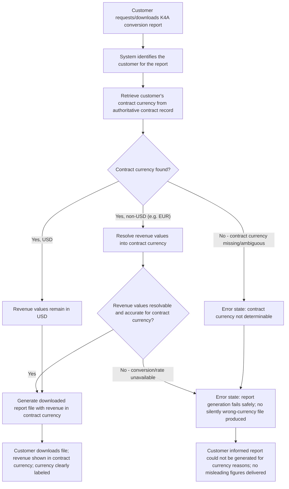

# 1. Business Logic & Context

## Problem

The K4A conversion report currently displays revenue values in USD. For a customer whose contract is denominated in a non-USD currency (the triggering case is EUR), the downloaded report does not match the currency the customer is billed and contracted in. This forces the customer to manually reconcile or convert figures, and makes the report an unreliable reference against their contract terms.

## Value

Displaying revenue in the customer's contract currency makes the downloaded K4A conversion report directly consistent with the customer's billing and contract terms, removing manual reconciliation and reducing the risk of the customer misreading their revenue. This is a correctness/trust improvement to an existing, in-use report.

## Scope Summary

- **Product/channel:** K4A
- **Surface affected:** The downloaded conversion report file only. There is no on-screen/UI change in K4A. (Confirmed by the requester: the customer sees this change in the downloaded file only.)
- **Primary change:** The revenue values in the downloaded conversion report are expressed in the customer's contract currency instead of USD.

## Business Rules

- **BR-1 — Contract currency is the display currency.** Revenue in the downloaded K4A conversion report is displayed in the currency of the customer's contract, not in USD, for any customer whose contract currency is a non-USD currency.
- **BR-2 — USD customers are unchanged.** For a customer whose contract currency is USD, the report continues to display revenue in USD. The behavior is effectively a swap from "always USD" to "whatever the contract currency is," so USD-contract customers see no change.
- **BR-3 — Source of truth for contract currency.** The contract currency applied to a report is derived from the customer's contract configuration as held in the authoritative customer-contract record, not entered by the user and not inferred from the report data itself.
- **BR-4 — Accuracy against contract terms.** The revenue figures shown must accurately reflect the customer's contract terms — i.e. the converted/displayed amounts must be correct for the contract currency, not an approximation that drifts from what the customer is actually billed.
- **BR-5 — Report metadata reflects the displayed currency.** Where the report currently identifies revenue as USD (for example a currency indication on a revenue column or in report metadata), that indication must reflect the actual currency displayed so the figures are not ambiguous or mislabeled. [DECISION REQUIRED]
- **BR-6 — Multiple contracts / mixed currencies.** If a single customer has more than one contract in different currencies within the same report's scope, the report must resolve to a defined, unambiguous currency behavior rather than silently mixing currencies in one revenue column. [DECISION REQUIRED]
- **BR-7 — Target currencies.** The triggering requirement is EUR. The feature must be built to handle the customer's contract currency generally (not EUR as a hardcoded special case), so additional non-USD contract currencies are supported without a code change per currency. [DECISION REQUIRED]

## Known Open Items Carried Into This Spec

- **Requesting customer identity:** The specific customer requesting this is not yet identified; the requester deferred this to engineering to confirm. This does not block defining the behavior, but it is required before the end-of-month deadline can be validated against that customer's actual contract data.
- **Service-map uncertainty (noted, not resolved here):** The automated codebase analysis that informed this spec returned two substantially different sets of backend services for "where the K4A conversion report revenue is generated." One set centers on a reporting/cost pipeline; an independent cross-check instead surfaced a largely separate SAM-centric reporting stack, plus one console-UI component. These two sets may be two names for the same pipeline or may indicate the real implementation location is unsettled. This is flagged here because it directly affects (a) whether the "download-only, no UI change" boundary holds — one cross-check surfaced an on-screen console view of the conversion report — and (b) confidence in meeting the deadline. Resolving which stack actually generates the K4A conversion report is an engineering reconciliation task and is left to the engineering context/planning phase. (Specific service names are recorded in the engineering appendix at the end of this document, not here.)

---

# 2. User Flows (Visuals)



**Happy path:** Customer downloads the K4A conversion report → system identifies the customer and looks up the contract currency → revenue is resolved into that contract currency (or stays USD if the contract is USD) → the file is generated with revenue in the correct currency, clearly labeled → customer downloads it.

**Error state (contract currency undeterminable or conversion unavailable):** If the contract currency cannot be determined (missing, or ambiguous because of multiple differing-currency contracts) or the revenue cannot be accurately resolved into the contract currency, the system must not produce a file containing wrong-currency or mislabeled revenue. It fails safely and signals that the report could not be generated for currency reasons.

---

# 3. Functional Requirements

> Convention for this section: "contract currency" means the currency on the customer's contract as held in the authoritative customer-contract record. "The report" means the downloaded K4A conversion report file. No on-screen K4A UI behavior is specified here, consistent with the confirmed download-only scope.

## Feature Area A — Contract Currency Resolution

### FR-001 — Resolve contract currency for a report
```gherkin
Scenario: Determine the display currency from the customer's contract
  Given a K4A conversion report is being generated for a specific customer
  And that customer has an authoritative contract record with a defined contract currency
  When the system prepares the report's revenue values
  Then the system retrieves the contract currency from the authoritative customer-contract record
  And uses that contract currency as the display currency for revenue in the report
```

### FR-002 — USD-contract customer is unchanged
```gherkin
Scenario: Customer on a USD contract sees no change
  Given a K4A conversion report is being generated for a customer whose contract currency is USD
  When the report's revenue values are prepared
  Then revenue is displayed in USD
  And the report output for this customer is unchanged from the pre-feature behavior
```

### FR-003 — Non-USD contract currency drives display (general, not EUR-only)
```gherkin
Scenario: Customer on a non-USD contract sees contract-currency revenue
  Given a K4A conversion report is being generated for a customer whose contract currency is a non-USD currency
  When the report's revenue values are prepared
  Then revenue is displayed in that contract currency
  And the behavior applies to any supported non-USD contract currency, not EUR exclusively
```

### FR-004 — Contract currency cannot be determined
```gherkin
Scenario: Contract currency is missing or not retrievable
  Given a K4A conversion report is being generated for a customer
  And the system cannot retrieve a defined contract currency from the authoritative contract record
  When the report's revenue values are prepared
  Then the system does not produce a report that silently labels or implies a currency it could not confirm
  And report generation fails safely for that customer with a distinct, recorded reason indicating the contract currency could not be determined
```

### FR-005 — Multiple contracts with differing currencies
```gherkin
Scenario: Customer has more than one contract in different currencies within the report scope
  Given a K4A conversion report is being generated for a customer
  And that customer has more than one contract covering the report's scope
  And those contracts are denominated in different currencies
  When the system attempts to resolve a single display currency for the report
  Then the system applies the defined mixed-currency resolution rule rather than mixing currencies within one revenue column
  And if no unambiguous currency can be resolved, report generation fails safely with a distinct, recorded reason indicating ambiguous contract currency
```
> Note: the concrete mixed-currency resolution rule referenced here is the business decision flagged in Section 1 (BR-6); this FR enforces that *some* defined, unambiguous rule is applied and that silent mixing is never allowed.

## Feature Area B — Revenue Value Conversion & Accuracy

### FR-006 — Revenue resolved accurately into contract currency
```gherkin
Scenario: Revenue values are expressed accurately in the contract currency
  Given a report whose display currency is a non-USD contract currency
  When revenue values are resolved into that contract currency
  Then each revenue value in the report reflects the contract currency accurately and consistently with the customer's contract terms
  And no revenue value in the report remains expressed in USD
```

### FR-007 — Conversion inputs unavailable
```gherkin
Scenario: Revenue cannot be accurately resolved into the contract currency
  Given a report whose display currency is a non-USD contract currency
  And the inputs required to express revenue accurately in that currency are unavailable or cannot be applied
  When the system attempts to resolve revenue values
  Then the system does not emit approximate or USD-labeled-as-contract-currency figures
  And report generation fails safely with a distinct, recorded reason indicating the revenue could not be resolved into the contract currency
```

### FR-008 — No regression for existing revenue figures
```gherkin
Scenario: Revenue totals remain internally consistent after the currency change
  Given a report generated with revenue in the contract currency
  When the revenue values and any totals/subtotals in the report are compared
  Then the totals and subtotals are internally consistent in the single displayed currency
  And no row mixes a USD value with contract-currency values in the same revenue column
```

## Feature Area C — Report Output & Labeling

### FR-009 — Currency labeling in the downloaded file
```gherkin
Scenario: The downloaded report unambiguously indicates the currency of revenue
  Given a downloaded K4A conversion report containing revenue values
  When the customer opens the file
  Then the revenue is unambiguously identified as being in the actual display currency used
  And any currency indication that previously stated USD reflects the actual display currency instead
```
> Note: the exact extent of metadata/label changes (column labels, header, other metadata) is the business decision flagged in Section 1 (BR-5); this FR requires at minimum that displayed figures are never mislabeled relative to their actual currency.

### FR-010 — Download-only scope boundary
```gherkin
Scenario: Change is confined to the downloaded file
  Given the confirmed scope is the downloaded conversion report file only
  When the feature is delivered
  Then the change affects the revenue currency in the downloaded report file
  And no on-screen K4A UI revenue display is introduced or modified as part of this work item
```

### FR-011 — Failed generation does not deliver a misleading file
```gherkin
Scenario: A currency-related failure never yields a wrong-currency download
  Given report generation has failed for a currency-related reason (FR-004, FR-005, or FR-007)
  When the customer's download attempt resolves
  Then no file containing wrong-currency or mislabeled revenue is delivered
  And the customer receives a clear indication that the report could not be generated, distinct from an empty or zero-revenue report
```

## Feature Area D — Backward Compatibility & Downstream Safety

### FR-012 — Existing USD consumers are not broken
```gherkin
Scenario: Downstream systems relying on USD revenue are not silently altered
  Given downstream or integrated systems may consume revenue values associated with the conversion report
  And some of those consumers may depend on revenue being in USD
  When the report's displayed currency changes to the contract currency
  Then the display-currency change in the downloaded file does not silently change the currency contract of any downstream consumer that depends on USD
  And any such dependency identified is handled explicitly rather than broken implicitly
```
> Note: whether specific downstream systems (accounting, billing, analytics) depend on USD is an open engineering reconciliation item recorded in Section 1; this FR requires that such dependencies, where they exist, are not broken silently.

### FR-013 — Feature can be disabled without a code deploy
```gherkin
Scenario: The currency-display behavior can be turned off during an incident
  Given this is a HIGH-risk, multi-service change affecting revenue data
  When an on-call engineer needs to disable the contract-currency display behavior
  Then the behavior can be reverted to the prior USD behavior via configuration without a code deploy
  And disabling it causes newly generated reports to fall back to the prior USD behavior
```
> Rationale: HIGH-risk, multi-service, revenue-handling change — a config-based kill-switch is warranted so the behavior can be pulled quickly in production without a release.

I'll now report the decisions I flagged in Sections 0–3.

## 4. Information Requirements

The system must track or reference the following business information to satisfy the functional requirements above. This is a product-level inventory of *what* information matters and *why* — not a schema, field list, or type definition (those belong in eng-plan).

- **Report-subject customer identity** — The customer a given K4A conversion report is generated for. Source: System-Derived (from the report request context). Matters because contract currency is resolved per customer (FR-001); without a reliable customer identity there is no way to pick the correct contract currency.
- **Contract currency** — The currency denomination of the customer's contract (e.g. USD, EUR). Source: External/authoritative customer-contract record (via the contract-configuration source of truth). Matters because it is the display currency for revenue (BR-1, BR-3, FR-001, FR-003) and the whole feature depends on it existing and being reliable per customer.
- **Contract coverage / scope mapping** — Which contract(s) apply to the scope of a given report, and whether a customer has more than one contract covering that scope. Source: System-Derived from the contract record(s). Matters because the multiple-contracts / mixed-currency resolution (BR-6, FR-005) cannot be evaluated without knowing how many contracts, in which currencies, fall within a report's scope.
- **Revenue values (pre-display)** — The revenue figures that populate the conversion report before display-currency resolution. Source: System-Derived (existing revenue calculation/aggregation pipeline). Matters because these are the values being expressed in the contract currency (FR-006) and whose internal consistency and totals must be preserved (FR-008).
- **Currency-resolution inputs** — Whatever inputs are required to express revenue accurately in the contract currency (e.g. a conversion rate or an already-contract-currency revenue source). Source: System-Derived or External. Matters because their availability is the precondition for FR-006 and their absence triggers the fail-safe path in FR-007. The nature and source of these inputs is itself an open engineering reconciliation item (see Section 1) — whether revenue is stored pre-converted, converted at query time, or converted at file-generation time.
- **Displayed-currency indicator / report metadata** — The currency label(s) shown in the downloaded file (column indication, header, or other metadata that currently states USD). Source: System-Derived from the resolved display currency. Matters because figures must never be mislabeled relative to their actual currency (BR-5, FR-009).
- **Report-generation outcome and failure reason** — Whether a report generated successfully, or failed for a specific currency-related reason (contract currency undeterminable, ambiguous contract currency, or revenue not resolvable). Source: System-Derived. Matters because the fail-safe behavior (FR-004, FR-005, FR-007, FR-011) requires distinct, recorded reasons rather than one generic failure, and because a failure must be distinguishable from an empty/zero-revenue report.
- **Kill-switch / feature-flag state** — Whether the contract-currency display behavior is currently enabled. Source: System configuration. Matters because the behavior must be revertible to prior USD behavior without a code deploy (FR-013, NFR-005).
- **Downstream USD-dependency inventory** — The set of downstream/integrated consumers (if any) that depend on conversion-report revenue being in USD. Source: External/engineering reconciliation. Matters because such dependencies must be handled explicitly rather than broken silently (FR-012); this remains an open reconciliation item recorded in Section 1.

---

## 5. Non-Functional Requirements & Guardrails

### Performance & Capacity

- **NFR-001 — No material regression in report generation time.** Generating a K4A conversion report with contract-currency revenue must not materially degrade report generation latency versus the current USD-only generation. Target: report generation p95 must stay within the current baseline plus an acceptable margin, measured over a representative set of report generations. The concrete baseline and acceptable-margin figure are not supplied by the input and must be confirmed against the current report's measured performance. [DECISION REQUIRED]
- **NFR-002 — Contract-currency lookup must not become a bottleneck.** Retrieving the contract currency from the authoritative contract record (FR-001) adds a dependency to the generation path. The lookup must be bounded and, where feasible, resolved once per report rather than repeatedly per revenue row. Alert when the contract-currency lookup error rate exceeds 1% for 5 minutes, sustained.

### Reliability & Error Handling

- **NFR-003 — Fail-closed on currency uncertainty.** For any currency-related uncertainty — contract currency undeterminable (FR-004), ambiguous multi-contract currency (FR-005), or revenue not resolvable into the contract currency (FR-007) — the system fails closed: it does not emit a report with wrong-currency, approximate, or mislabeled revenue. A false "no report" is safer than a false "wrong-currency report" for a revenue/billing document. Each distinct failure condition (currency undeterminable, ambiguous currency, revenue unresolvable) carries its own recorded reason and is never collapsed into a single generic error.
- **NFR-004 — Bounded, backoff retries on the contract-currency dependency.** When the contract-currency retrieval or any currency-resolution dependency is called, failures are retried with bounded exponential backoff (default: 3 attempts) rather than retried indefinitely; a rate-limited response honors the dependency's Retry-After guidance rather than a fixed schedule. On exhaustion, the fail-closed posture (NFR-003) applies.

### Rollout, Kill-Switch & Backward Compatibility

- **NFR-005 — Config-based kill-switch (realizes FR-013).** The contract-currency display behavior is controllable via configuration with no code deploy required to disable it. An on-call engineer can disable it during an incident without a separate approval or escalation step. New report generations pick up a flag change within 5 minutes; reports already generated before the flip are not retroactively altered.
- **NFR-006 — Staged rollout.** Given the HIGH risk tier and multi-service blast radius, the feature is rolled out in staged percentages (e.g. 1% → 10% → 50% → 100%) with a minimum hold period per stage (24 hours precedent) before advancing, so misbehavior is caught before broad exposure.
- **NFR-007 — Rollback.** Rollback is achieved by disabling the kill-switch (NFR-005), reverting newly generated reports to prior USD behavior. Trigger: a confirmed currency-correctness defect or elevated currency-related failure rate in production. Owning authority: on-call engineering, no separate escalation. Timing target: effective for new reports within the flag propagation time (5 minutes). Already-produced report files are not retroactively reverted — only new generations are affected going forward.
- **NFR-008 — Backward compatibility for existing consumers (realizes FR-012).** The change to the downloaded report's display currency must not silently change the currency contract of any downstream/integrated consumer that depends on conversion-report revenue being in USD. Any identified USD-dependent consumer is handled explicitly. Whether such consumers exist is an open engineering reconciliation item (Section 1); where none exist, that must be stated explicitly rather than assumed.

### Accuracy & Integrity

- **NFR-009 — Currency correctness is the primary quality bar.** Displayed revenue in the contract currency must accurately reflect the customer's contract terms (BR-4, FR-006). A visible figure that is wrong for the stated currency is a correctness defect of the highest severity for this feature and is a valid rollback trigger under NFR-007.
- **NFR-010 — Single-currency internal consistency.** Within any single generated report, all revenue values, subtotals, and totals are internally consistent in exactly one displayed currency; no row or total mixes USD with contract-currency values (FR-008).

### Security & Data Handling

- **NFR-011 — Server-side enforcement of currency resolution.** The contract currency applied to a report is derived server-side from the authoritative contract record on generation (BR-3, FR-001); it is never supplied or overridden by a client/caller-provided value. If the authoritative contract-currency source is unreachable, the system fails closed (NFR-003) rather than falling back to a caller-supplied or assumed currency.
- **NFR-012 — No sensitive data in logs.** Diagnostic and failure-reason logging for report generation must not log raw customer-identifying data, credentials, or secrets. Failure reasons are recorded at a granularity sufficient to distinguish the conditions in NFR-003 without exposing restricted data.
- **NFR-013 — Secure delivery of the downloaded report.** The conversion report is a revenue/billing document. Its download must be delivered to the requesting customer over the existing authenticated, access-controlled download path; the currency change introduces no new, less-restricted delivery surface.

### Risk Mitigation (explicit mapping to Context Seed risks)

- **Multi-service blast radius (HIGH).** Mitigated by: the fail-closed posture (NFR-003), the config-based kill-switch (NFR-005), staged rollout (NFR-006), and explicit backward-compatibility handling (NFR-008). The unresolved service-map (two conflicting KG-derived service sets, recorded in Section 1 and the Engineering Reference appendix) must be reconciled by engineering before implementation commitment — this is a prerequisite to trusting the blast-radius estimate.
- **Billing/revenue data handling (HIGH).** Mitigated by: correctness as the primary quality bar (NFR-009), single-currency internal consistency (NFR-010), server-side authoritative currency derivation (NFR-011), and the rule that a currency-related failure never yields a wrong-currency download (FR-011, NFR-003).
- **Tight end-of-month deadline (HIGH).** Mitigated at the product level by strict scope control (download-file-only; USD customers unchanged; see Section 6). The deadline cannot be validated until the requesting customer is identified (their actual contract data must be confirmable) and the service-map is reconciled — both recorded as open items in Section 1. Whether the end-of-month deadline holds given those unresolved items is a scheduling call the business must make. [DECISION REQUIRED]

---

## 6. Out of Scope & Phasing

### Explicitly Out of Scope for Phase 1

| Item | Rationale |
|---|---|
| Any on-screen / in-K4A-UI revenue display change | Scope confirmed by the requester as the downloaded file only; no UI/frontend change (FR-010). If a console view of the conversion report exists (surfaced by one KG cross-check), confirming it is a separate scope question, not Phase 1 work. |
| Backfill or re-generation of previously downloaded reports in the new currency | The change applies to newly generated reports going forward; already-produced files are not retroactively altered (NFR-007). Retroactive re-currency of historical reports is a distinct effort. |
| Changing the currency contract of downstream consumers (accounting, billing, analytics) | Phase 1 must not break USD-dependent downstream consumers (FR-012, NFR-008); actively migrating those consumers to contract currency is separate downstream work, not this work item. |
| Supporting user-selectable or on-the-fly report currency (letting a user pick a display currency) | The display currency is derived from the contract, not user-chosen (BR-3). A currency picker is a different feature. |
| Multi-currency / mixed-currency presentation within a single report | Phase 1 resolves to a single unambiguous currency or fails closed (FR-005, BR-6). Presenting multiple currencies side by side in one report is out of scope. |
| Per-currency custom formatting rules beyond unambiguous labeling | Phase 1 requires revenue be unambiguously labeled in its actual currency (FR-009); locale-specific or per-currency advanced formatting beyond that is not in scope. |

### Phasing Notes

- **Phase 1 (this work item):** Downloaded K4A conversion report revenue is displayed in the customer's contract currency (generally, not EUR-only), USD customers unchanged, fail-closed on any currency uncertainty, kill-switch and staged rollout in place.
- **Prerequisites that gate Phase 1 delivery (open items, not scope):** identifying the requesting customer and reconciling the conflicting service-map — both recorded in Section 1. These are not features to build; they are blockers that must clear before the Phase 1 build is committed against the deadline.
- **Candidate future phases (not committed):** retroactive re-generation of historical reports; migrating downstream consumers to contract currency; on-screen console display in the contract currency; additional per-currency formatting.

---

## Appendix: Engineering Reference

_The sections below are derived automatically from the codebase knowledge graph, for the engineering team's reference during planning — not required reading for product/requirement review._

### Affected Services (grounded context, not implementation direction)

Two substantially different KG-derived service sets were returned for "where the K4A conversion report revenue is generated." They may be two names for the same pipeline, or may indicate the real implementation location is unsettled. Reconciling which set actually generates the K4A conversion report is an engineering task (recorded as an open item in Section 1).

**Curated set (Context Seed "Affected Services"):**
- `reporting-api` (backend, high confidence) — K4A conversion report generation and data retrieval
- `cost-v2` (backend, high confidence) — Revenue calculation and currency conversion logic (highest blast-radius risk: shared revenue/billing math)
- `cost-revenue-workers` (backend, high confidence) — Revenue processing and aggregation for reports
- `k4a-mcp-server` (backend, medium confidence) — K4A data export and downloaded file generation (owns the deliverable surface)
- `accounts-api` (backend, medium confidence) — Customer contract currency configuration retrieval (presumed source of truth for contract currency)
- `champaign-api` (backend, low confidence) — Campaign and customer metadata for currency context

**Independent cross-check set (fresh requirement-agent KG lookup) — discrepancy to reconcile:**
- `k4a-sam-backend` (backend, medium confidence) — K4A backend likely serving conversion report revenue
- `sam-performance-reporter` (backend, medium confidence) — Generates performance/conversion reports with revenue
- `sam-api` (backend, low confidence) — May expose conversion report data
- `cost-revenue-workers` (backend, low confidence) — Also appears in the curated set (the one overlapping service)
- `frontend-mos` (frontend, low confidence) — Console UI displaying conversion report revenue; worth a sanity check against the confirmed "download-only, no UI change" scope
- `sam-agent` (backend, low confidence) — Reads revenue/currency fields
- `sam-report-scheduler` (backend, low confidence) — Schedules reports consuming revenue currency data; if reports are batch/scheduled, a currency change may need to apply to scheduled runs

**Reconciliation note:** `cost-revenue-workers` is the only service appearing in both sets. The curated set centers on a reporting/cost pipeline; the cross-check surfaces a largely separate SAM-centric reporting stack plus a console UI component. The appearance of `frontend-mos` (console UI) specifically warrants confirming whether the conversion report is also shown on screen, which would narrow the "download-only" scope boundary stated in Section 1.

---
## Open Questions & Decisions Register

_Durable, ID'd reference for HITL 2 (G1) and beyond — inline `[DECISION REQUIRED: DEC-00N]` tags in the sections above point back here. Reflects the latest round only._

### Decisions Required (business trade-offs — needs a human call)

_Each carries an **Owner** (accountable for supplying the answer) and a **Provisional Value** (the working assumption engineering may build against until the decision lands), so none of these fully block engineering — implementation proceeds on the provisional value and adjusts if the confirmed decision differs._

| ID | Decision | Owner | Provisional Value (build against until confirmed) |
|----|----------|-------|-----------------------------------------------------|
| **DEC-001** | When revenue is shown in a non-USD contract currency, should the report also update the currency label on the revenue column and any header or metadata, or just the revenue numbers themselves? | Product owner | Update both the revenue values and the currency label on the revenue column (and any report metadata that currently names USD) so figures are never mislabeled; leave all other report structure unchanged. |
| **DEC-002** | If one customer has multiple contracts in different currencies covered by the same report, what currency should that report show the revenue in? | Product owner | Produce one report per contract currency rather than mixing currencies in a single revenue column; if the report scope cannot be split cleanly, fail generation with a clear ambiguous-currency reason rather than guess. |
| **DEC-003** | Beyond EUR, which non-USD contract currencies do we need this report to support, and should it support any contract currency on file automatically? | Product owner, with input from Finance | Support any contract currency present on the customer's contract record generically (no per-currency code change), with EUR as the first validated case; confirm the full list of real contract currencies before launch. |
| **DEC-004** | When a customer has more than one contract in different currencies covering the same report, which single currency should the revenue appear in? | Product owner | Resolve to the currency of the single contract that covers the report scope; if more than one differing-currency contract applies, fail the report closed with an 'ambiguous contract currency' reason rather than mixing currencies, until a per-customer rule is defined. |
| **DEC-005** | Beyond the revenue values themselves, should the report header, column labels, or other metadata also be changed to reflect the contract currency? | Product owner | At minimum, any currency indication that previously said USD must reflect the actual displayed currency so figures are never mislabeled; apply the same currency indicator to the revenue column and report metadata, with no other label restructuring in Phase 1. |
| **DEC-006** | Besides EUR, which non-USD contract currencies should this feature be expected to support at launch? | Product owner | Build generically to display whatever the customer's contract currency is (no hardcoded per-currency logic); validate against EUR as the triggering case and treat any contract currency present in the authoritative contract records as in scope. |
| **DEC-008** | Can the end-of-month deadline still hold given the requesting customer is not yet identified and the affected-service map is unresolved? | Product owner | Treat customer identification and service-map reconciliation as hard prerequisites; plan delivery from the date both clear rather than committing to end-of-month until they are resolved. |

### Decisions Resolved

- **DEC-007**: Engineering decides: Keep report-generation p95 within the current USD-only baseline plus 10%, measured over a representative set of generations; resolve the contract currency once per report, not per row.

### Open Questions (evidence gaps — needs more input)

- **OQ-001**: Cross-service: The curated service list (reporting-api, cost-v2, accounts-api) and the raw KG evidence (k4a-sam-backend, sam-performance-reporter, sam-api) name almost entirely different services for the same feature — which stack actually generates the K4A conversion report? Eng needs to reconcile this before the end-of-month deadline is realistic.
- **OQ-002**: accounts-api: Does a reliable per-customer contract-currency field actually exist and is it populated today, or does this need to be built/backfilled? The whole feature depends on it and evidence only assumes it exists.
- **OQ-003**: cost-revenue-workers/cost-v2: Is report revenue stored already-converted (in USD) or computed on the fly? If stored in USD, is there an expectation to re-convert/backfill historical conversion reports, or only new ones going forward?
- **OQ-004**: cost-v2: cost-v2 is shared revenue/billing logic — are there downstream systems (billing, accounting, analytics) that depend on revenue being in USD specifically, such that we must NOT change the shared path and instead add a separate contract-currency output?
- **OQ-005**: accounts-api: If a customer has multiple contracts in different currencies, should a single report use one currency, split by currency, or filter? This determines the data model work.
- **OQ-006**: k4a-mcp-server: Beyond the revenue values, should the report header/column labels/metadata also show the contract currency (e.g. EUR symbol, 'Revenue (EUR)'), or only the numeric values?
- **OQ-007**: Scope/volume: Is this EUR-for-one-customer only, or should we build general multi-currency support (other non-USD currencies, multiple customers)? This changes it from a targeted swap to a platform feature.
- **OQ-008**: frontend-mos: The KG flags a console UI (frontend-mos) that displays conversion report revenue — does the on-screen report need to match, or is the 'download file only, no UI change' scope confirmed to exclude it?
- **OQ-009**: Customer identity: Which customer is requesting this? Still marked unknown/for-eng-to-confirm — needed to validate the contract-currency data actually exists for them.

---
> **Classification:** Type A
