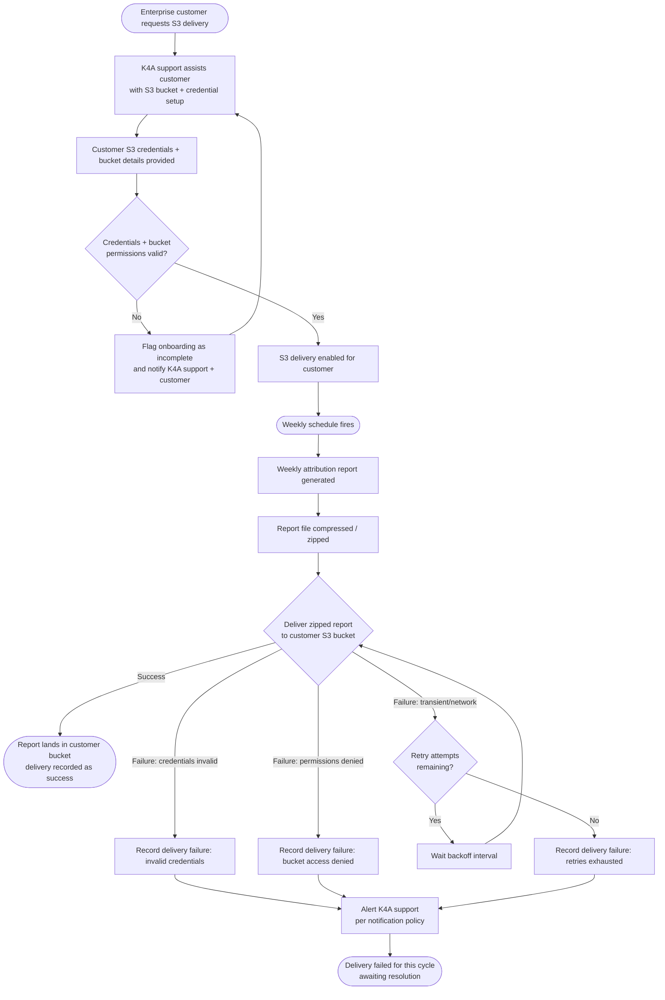

## 1. Business Logic & Context

### Problem

Northwind Media (an enterprise-plan K4A customer) currently receives their weekly attribution report by manually downloading a CSV from K4A. This manual step is repetitive, easy to miss, and does not integrate with the customer's own data pipeline. The customer wants the weekly report delivered automatically into their own Amazon S3 bucket so it lands in their environment without human intervention, ahead of a quarterly review approximately six weeks out.

### Value

- Removes a recurring manual step for the customer, reducing the risk of a missed or late report.
- Delivers the report directly into the customer's own infrastructure, enabling downstream automation on their side.
- Strengthens the enterprise relationship by meeting a concrete, deadline-bound customer need.

### Business Rules

- **BR-001 — Entitlement:** Automatic S3 delivery is scoped to this enterprise-plan customer. Whether S3 delivery is a formal enterprise-tier entitlement (gated by plan) or a per-customer configuration that happens to apply to an enterprise customer is a business decision. [DECISION REQUIRED: DEC-001]
- **BR-002 — Cadence:** Reports are delivered on the existing weekly attribution-report schedule. S3 delivery attaches to that existing cadence rather than introducing a new one.
- **BR-003 — Packaging:** Every report file is compressed (zipped) before it is delivered to the customer's bucket.
- **BR-004 — Report content unchanged:** The content of the weekly attribution report is not changed by this feature. Only the delivery destination and packaging change.
- **BR-005 — Assisted onboarding:** The customer does not yet have an S3 bucket or credentials. K4A support must assist the customer in setting up their bucket and providing credentials before automatic delivery can begin. Delivery for this customer cannot start until onboarding is complete and credentials are validated.
- **BR-006 — Credential model:** The customer's AWS credentials are the most sensitive element of this feature. The choice between the customer supplying a long-lived IAM access key/secret versus granting K4A a cross-account assumed-role (IAM role ARN) materially affects what the customer must do and what K4A stores. [DECISION REQUIRED: DEC-002]
- **BR-007 — Customer-visible surface:** Whether the customer configures and monitors this feature through a K4A UI, or whether setup is handled as an internal/assisted ops process with no customer-facing UI, is unresolved. The intake marked the customer-facing surface as "for engineering to confirm," and the original scope flagged no UI change while later analysis surfaced a possible credential-setup form. [DECISION REQUIRED: DEC-003]

### KG cross-check note

Two independent codebase knowledge-graph lookups were run against this requirement and did not fully agree. One lookup asserted the involvement of a customer-credential service and a plan-entitlement service that the second, fresh lookup did not re-surface; the second lookup surfaced several additional report-generation and subscription-delivery services at lower confidence that the first did not list. This disagreement is itself a signal that the affected-service scope is not yet settled and should be treated as discovery-required during engineering planning. The reconciled service inventory is recorded in the engineering appendix at the end of this document.

---

## 2. User Flows (Visuals)



---

## 3. Functional Requirements (The Core)

### Feature Area A — Customer S3 Onboarding & Credential Setup

**FR-001 — Capture customer S3 destination details**
```gherkin
Given an enterprise customer is being onboarded for automatic S3 report delivery
When K4A support captures the customer's S3 destination configuration
Then the system records the target bucket identifier, the bucket's region, and a destination path/prefix for report files
And the configuration is associated with that specific customer's account
And delivery remains disabled until the configuration has been validated (see FR-003)
```

**FR-002 — Store customer AWS credentials securely**
```gherkin
Given a customer's AWS credentials have been provided during onboarding
When the system stores those credentials
Then the credentials are persisted through K4A's secured credentials-handling path and are never written to application logs
And when any credential value is displayed back for identification, only the last 4 to 8 characters are shown and the remainder is masked
And the credentials are associated with the customer account to which they belong
```
> Note: the credential format (long-lived access key/secret vs. assumed-role ARN) is governed by BR-006 [DECISION REQUIRED: DEC-004].

**FR-003 — Validate bucket access before enabling delivery**
```gherkin
Given a customer's S3 destination and credentials have been captured
When onboarding validation runs against the customer's bucket
Then the system verifies it can authenticate with the supplied credentials and write to the configured bucket and path
And if validation succeeds, the system marks onboarding complete and eligible for scheduled delivery
And if validation fails, the system marks onboarding incomplete, does not enable scheduled delivery, and surfaces the failure to K4A support and the customer
```

**FR-004 — Revalidate on credential or permission change**
```gherkin
Given a customer already has S3 delivery enabled
When the customer's stored credentials are rotated or their bucket permissions are updated
Then the system revalidates bucket access using the current credentials
And if revalidation fails, the system records the destination as invalid and follows the invalid-credential failure handling in FR-010
```

### Feature Area B — Scheduled Generation & Packaging

**FR-005 — Attach S3 delivery to the existing weekly schedule**
```gherkin
Given a customer has completed and validated S3 onboarding
When the existing weekly attribution-report schedule fires for that customer
Then the system generates that customer's weekly attribution report as it does today
And the report is queued for S3 delivery to the customer's configured bucket
And no change is made to the report's content or the existing weekly cadence
```

**FR-006 — Compress the report before delivery**
```gherkin
Given a weekly attribution report has been generated for a customer with S3 delivery enabled
When the report is prepared for delivery
Then the report file is compressed into a zip archive before it is sent to the customer's bucket
And the delivered object is the zipped archive, not the raw uncompressed file
```

**FR-007 — Do not run overlapping delivery jobs for the same cycle**
```gherkin
Given a weekly delivery job for a given customer and week is already in progress
When the schedule or a retry would start another delivery for the same customer and the same report week
Then the system does not start a second concurrent delivery for that same customer and week
And only one delivery attempt for that customer and report week is active at a time
```

### Feature Area C — Delivery, Retry & Failure Handling

**FR-008 — Deliver the zipped report to the customer bucket (happy path)**
```gherkin
Given a zipped weekly report is queued for a validated customer destination
When the system delivers the report to the customer's S3 bucket
Then the zipped report file is written to the configured bucket at the configured path
And the system records the delivery as successful with a timestamp
And re-delivering the same report for the same customer and week overwrites the same target object rather than creating a duplicate, so a retried delivery produces the same end state
```

**FR-009 — Retry transient delivery failures with bounded backoff**
```gherkin
Given a report delivery to a customer's S3 bucket fails for a transient reason (for example a network error or a temporary S3 error)
When the delivery fails
Then the system retries delivery using exponential backoff, up to a maximum of 3 attempts
And the system does not retry indefinitely
And once attempts are exhausted, the system records the delivery as failed with reason "retries exhausted" and triggers the failure notification in FR-011
```
> Retry count and backoff above are the engineering default for this delivery path; customer-facing retry policy (how the customer is told, and whether they expect a specific SLA) is governed by FR-011.

**FR-010 — Distinguish and record permanent failure conditions separately**
```gherkin
Given a report delivery to a customer's S3 bucket fails
When the failure is a permanent condition rather than a transient one
Then the system records invalid/expired credentials, denied bucket permissions, and a missing/unreachable bucket as distinct named failure reasons
And a permanent-failure condition is not retried on the transient-retry schedule
And each distinct failure reason carries its own recorded status rather than a single generic error
```

**FR-011 — Notify on failed delivery**
```gherkin
Given a weekly report delivery has failed permanently or exhausted its retries for a customer
When the failure is recorded
Then the system raises a notification to K4A support identifying the customer, the report week, and the specific failure reason
And whether the customer themselves is also notified on failure, and through what channel, is a product decision
```
> The audience and channel for customer-facing delivery notifications is a business decision. [DECISION REQUIRED: DEC-005]

**FR-012 — Record an auditable trail of each delivery outcome**
```gherkin
Given this feature delivers customer data to an external customer-controlled destination and handles customer credentials
When a delivery attempt completes, or credentials are stored, updated, or validated
Then the system appends an immutable audit record capturing the acting identity, the customer account, the action, the target destination (bucket and path), a timestamp, and the outcome/status
And the audit record never contains raw credentials, secrets, or tokens
And the audit trail is append-only and cannot be edited or deleted through any code path
And if writing the audit record itself fails, the system raises an operational alert rather than failing silently
```

**FR-013 — Kill-switch to disable S3 delivery**

## 4. Information Requirements

- **Customer S3 destination configuration** — the target bucket identifier, bucket region, and destination path/prefix for delivered files. Source: User-Entered (captured by K4A support during onboarding). Matters because it tells the delivery path exactly where to write each report (FR-001, FR-008).
- **Customer AWS credentials** — the secret material the system uses to authenticate to the customer's bucket. Source: User-Entered (provided by the customer during assisted onboarding). This is the most sensitive data class in the feature; its format depends on the credential-model decision (BR-006). Matters because every delivery and every validation depends on it (FR-002, FR-003, FR-008).
- **Onboarding / delivery-eligibility state** — whether a customer has completed and passed validation and is eligible for scheduled delivery. Source: System-Derived (set by the validation outcome in FR-003/FR-004). Matters because scheduled delivery must not fire for an un-validated customer (FR-005).
- **Weekly attribution report artifact** — the generated report file, and its zipped archive form. Source: System-Derived (produced by the existing report-generation path, then compressed). Matters because the zipped artifact is the object actually delivered (FR-005, FR-006, FR-008).
- **Delivery attempt record** — per-cycle outcome of each delivery: customer, report week, attempt count, success/failure, failure reason, and timestamp. Source: System-Derived (recorded by the delivery path). Matters because it drives retry logic, overwrite/idempotency behavior, failure notification, and the audit trail (FR-008 through FR-012).
- **Failure reason classification** — the distinct named condition for a failed delivery (invalid credentials, denied permissions, missing/unreachable bucket, transient error, retries exhausted). Source: System-Derived. Matters because distinct reasons drive distinct handling and distinct notifications (FR-009, FR-010, FR-011).
- **Audit record** — immutable, append-only trail of credential and delivery events. Source: System-Derived. Matters for the HIGH risk tier: customer-data delivery and credential handling must be traceable (FR-012).
- **Customer plan tier / entitlement** — whether the customer is entitled to S3 delivery. Source: External/System-Derived (from the authoritative account/entitlement source). Matters because it may gate eligibility depending on the entitlement decision (BR-001).
- **Feature enablement (kill-switch) state** — whether S3 delivery is globally enabled or disabled. Source: System-Derived (operational configuration). Matters because an on-call engineer must be able to disable the feature during an incident (FR-013).

## 5. Non-Functional Requirements & Guardrails

### Performance & Capacity

- **NFR-001 — Delivery throughput bound to existing cadence:** S3 delivery runs on the existing weekly attribution-report schedule and introduces no new real-time traffic path. Delivery for an onboarded customer must complete within the batch window of the existing weekly run without delaying generation or delivery for other customers.
- **NFR-002 — Delivery latency target:** A single report delivery (including compression and upload) should complete well within the weekly batch window. Target: p95 end-to-end delivery time per customer under 10 minutes for a typical weekly report size, measured over scheduled runs. The concrete size assumption and ceiling are an engineering sizing detail to confirm against real report volumes.
- **NFR-003 — Delivery failure alerting:** Raise an operational alert when the delivery failure rate exceeds 1% of attempts for 5 minutes, sustained, or when any single enterprise customer's delivery fails for a full weekly cycle after retries are exhausted. Alerting routes to K4A support/on-call per FR-011.

### Security & Access Control

- **NFR-004 — Credential secrecy:** Raw customer AWS credentials, secrets, and tokens are never written to application logs, audit records, error traces, or notifications. Where a credential value is surfaced for identification, it is masked to the last 4–8 characters only (reinforces FR-002, FR-012).
- **NFR-005 — Credentials stored in the secured credential store:** Customer AWS credentials are persisted only through K4A's dedicated secured credentials-handling path, not inline in report-config or delivery records. They are referenced by the delivery path rather than copied into general-purpose stores.
- **NFR-006 — Server-side entitlement enforcement:** If S3 delivery is an entitlement-gated capability (BR-001), eligibility is enforced server-side on every configuration and delivery operation, re-derived from the authoritative account/entitlement source — never trusted from a client-supplied claim and never enforced by UI-hiding alone. If the entitlement source is unreachable, the check fails closed.
- **NFR-007 — Scoped credential access:** A customer's stored credentials are usable only for delivering that same customer's reports to that same customer's configured destination. Credentials are never reused across customers or destinations.
- **NFR-008 — Credential lifecycle on offboarding:** If the customer relationship or S3 delivery configuration is removed, the associated stored credentials are revoked/removed rather than left active, to avoid an orphaned credential silently retaining access to the customer's bucket.
- **NFR-009 — Secure delivery posture:** Delivery to the customer bucket uses encrypted transport. The feature writes only to the single configured customer destination and never to any other location.

### Reliability & Failure Posture

- **NFR-010 — Fail-closed on invalid destination:** If a customer's credentials or bucket permissions are invalid, delivery for that customer is not attempted (or is stopped) rather than retried blindly or routed elsewhere; the condition is recorded and alerted per FR-010/FR-011. Delivery for other customers is unaffected.
- **NFR-011 — Bounded retry:** Transient delivery failures retry with exponential backoff to a maximum of 3 attempts and never retry indefinitely (reinforces FR-009).
- **NFR-012 — Idempotent delivery:** Re-delivering the same report for the same customer and report week overwrites the same target object and never produces a duplicate object or double-counted delivery side effect (reinforces FR-008). The scheduled job additionally prevents overlapping concurrent runs for the same customer and week (reinforces FR-007).
- **NFR-013 — Audit durability:** The delivery/credential audit trail is immutable and append-only, retained for a minimum of 12 months to support enterprise traceability; a longer retention period applies if the customer's own compliance/audit agreement requires it. An audit-write failure raises an operational alert and is never dropped silently (reinforces FR-012). [DECISION REQUIRED: DEC-006]

### Risk Mitigation (from the Context Seed)

- **PII / customer-data delivery:** The feature delivers customer attribution data to a customer-controlled destination. Mitigated when delivery is scoped to the single validated destination (NFR-009), transport is encrypted (NFR-009), and every delivery is auditable (FR-012). Mitigated only when destination validation (FR-003) passes before any data leaves K4A.
- **Customer credential management:** The headline risk. Mitigated when credentials are stored only in the secured store (NFR-005), never logged (NFR-004), masked on display (NFR-004), scoped per-customer (NFR-007), revoked on offboarding (NFR-008), and revalidated on change (FR-004). The credential-model choice (BR-006) must be resolved before build, since it changes what is stored.
- **Multi-service integration:** Scope spans reporting, credentials, and scheduling services, and two KG lookups disagreed on the exact service set (see Section 1 cross-check). Mitigated when the affected-service inventory is confirmed in engineering discovery before build, and the config/execution split between report-config and dispatch is disambiguated so work is not duplicated or dropped.
- **Hard 6-week deadline with little slack:** Mitigated when the two decisions that collapse most uncertainty — the credential model (BR-006) and the customer-facing surface (BR-007) — are resolved early, and when any non-critical capability is pushed to a later phase (see Section 6). The kill-switch (FR-013) provides a safe fallback if the feature misbehaves in production near the deadline.

### Operational Control

- **NFR-014 — Kill-switch:** S3 delivery is controlled by a config-based switch that an on-call engineer can disable during an incident without a separate approval step and without a code deploy. New scheduled runs honor the disabled state within 5 minutes of the flip; a delivery already in flight completes under the prior behavior (reinforces FR-013).
- **NFR-015 — Backward compatibility:** This feature extends the existing weekly attribution-report path with an additional delivery destination and packaging step. The existing manual CSV-download behavior and the report's content remain unchanged for all customers, including this one; S3 delivery is additive and does not alter existing consumers of the weekly report.

## 6. Out of Scope & Phasing

### In Scope (Phase 1)

- Automatic weekly delivery of the existing attribution report, zipped, to a single enterprise customer's (Northwind Media) validated S3 bucket.
- Assisted onboarding of that customer's bucket and credentials, including destination validation before enablement.
- Secured storage of the customer's AWS credentials.
- Retry, distinct failure classification, failure alerting to K4A support, audit trail, and kill-switch for the delivery path.

### Out of Scope / Future Phases

| Item | Rationale | Phase |
|------|-----------|-------|
| Self-service customer UI for configuring S3 delivery | Original scope flagged no UI change; customer-facing surface is unresolved (BR-007). Phase 1 can onboard via assisted/internal process. | Future |
| Customer-facing delivery-status dashboard | A silent-delivery-plus-support-notification model satisfies Phase 1; customer self-serve visibility is an enhancement. | Future |
| Automated customer-facing failure notifications (customer channel/wording) | Phase 1 guarantees K4A-support alerting; whether/how the customer is notified is an open product decision (FR-011). | Future |
| Multi-customer / general availability rollout | Phase 1 targets Northwind Media specifically; generalizing to all enterprise customers (and formal entitlement gating) is a later phase (BR-001). | Future |
| Customer-customizable naming convention / folder structure | A standardized path/prefix satisfies Phase 1; per-customer customization is an enhancement. | Future |
| Delivery destinations other than S3 (e.g. GCS, SFTP) | The requirement is S3-only. | Future |
| Automated credential rotation on a schedule | Phase 1 supports revalidation on change (FR-004); scheduled automatic rotation is a later enhancement. | Future |
| Customer-configurable retry policy / delivery SLA | Phase 1 uses a fixed engineering retry default; customer-negotiated SLA is future. | Future |

## Appendix: Engineering Reference

_The sections below are derived automatically from the codebase knowledge graph, for the engineering team's reference during planning — not required reading for product/requirement review._

### Affected Services (grounded context, not implementation direction)

The two independent knowledge-graph lookups did not fully agree; the combined set below is recorded as grounded context for engineering discovery, with the disagreement itself noted as a scope-confirmation task.

**Curated affected services (first lookup):**

- **reporting-api** (backend) — attribution report generation and delivery API; plausible home for delivery-destination configuration.
- **reporting-dispatcher** (backend) — scheduled report distribution and S3 export handling; most load-bearing service for executing delivery and packaging.
- **credentials-api** (backend) — store and manage customer S3 bucket credentials; carries the headline credential-security risk.
- **frontend-mos** (frontend) — named as a possible S3 credential setup/configuration UI; conflicts with the "no UI change" scope flag (see BR-007).
- **sam-report-scheduler** (backend) — schedules weekly attribution report generation and delivery.
- **accounts-api** (backend) — tracks customer plan tier (enterprise) and feature entitlements; in scope only if delivery is entitlement-gated (BR-001).

**Additional services surfaced by the independent cross-check (lower confidence, verify before planning):**

- **sam-performance-reporter** (backend) — generates SAM/K4A performance reports; likely the report content source.
- **reporting-subscriptions-worker** (backend) — delivers scheduled report subscriptions; overlaps with scheduler/dispatcher and needs disambiguation.
- **k4a-sam-backend** (backend) — may own report logic.
- **distribute-api** (backend, low confidence) — file distribution/delivery to destinations.
- **sam-mono** (backend, low confidence) — may host reporting code.
- **sam-agent** (backend, low confidence) — consumes report data fields; verify S3 contract.

Note: `credentials-api` and `accounts-api` appeared only in the first lookup, not the independent cross-check; the lower-confidence services appeared only in the cross-check. Engineering discovery should confirm the true affected-service set before build.

---
## Open Questions & Decisions Register

_Durable, ID'd reference for HITL 2 (G1) and beyond — inline `[DECISION REQUIRED: DEC-00N]` tags in the sections above point back here. Reflects the latest round only._

### Decisions Required (business trade-offs — needs a human call)

_Each carries an **Owner** (accountable for supplying the answer) and a **Provisional Value** (the working assumption engineering may build against until the decision lands), so none of these fully block engineering — implementation proceeds on the provisional value and adjusts if the confirmed decision differs._

| ID | Decision | Owner | Provisional Value (build against until confirmed) |
|----|----------|-------|-----------------------------------------------------|
| **DEC-001** | Should the retention period for the delivery and credential audit trail match a specific compliance or data-retention agreement with this enterprise customer, or is our standard enterprise minimum enough? | Compliance/Security + Product owner | Retain the audit trail for a minimum of 12 months; extend only if Northwind Media's contract specifies a longer compliance/audit retention period. |
| **DEC-002** | Entitlement: Automatic S3 delivery is scoped to this enterprise-plan customer. Whether S3 delivery is a formal enterprise-tier entitlement (gated by plan) or a per-customer configuration that happens to apply to an enterprise customer is a business decision. | _(not yet assigned)_ | _(not yet specified)_ |
| **DEC-003** | Credential model: The customer's AWS credentials are the most sensitive element of this feature. The choice between the customer supplying a long-lived IAM access key/secret versus granting K4A a cross-account assumed-role (IAM role ARN) materially affects what the customer must do and what K4A stores. | _(not yet assigned)_ | _(not yet specified)_ |
| **DEC-004** | Customer-visible surface: Whether the customer configures and monitors this feature through a K4A UI, or whether setup is handled as an internal/assisted ops process with no customer-facing UI, is unresolved. The intake marked the customer-facing surface as "for engineering to confirm," and the original scope flagged no UI change while later analysis surfaced a possible credential-setup form. | _(not yet assigned)_ | _(not yet specified)_ |
| **DEC-005** | Note: the credential format (long-lived access key/secret vs. assumed-role ARN) is governed by this. | _(not yet assigned)_ | _(not yet specified)_ |
| **DEC-006** | The audience and channel for customer-facing delivery notifications is a business decision. | _(not yet assigned)_ | _(not yet specified)_ |

### Open Questions (evidence gaps — needs more input)

- **OQ-001**: The work item scope says 'no UI change,' but the codebase suggests a credential setup form; which is correct — should customers enter/manage their S3 credentials through a K4A UI, or is onboarding a manual process handled by K4A support?
- **OQ-002**: Is auto-delivery to S3 an enterprise-tier entitlement that should be gated by plan, or just a per-customer configuration that happens to apply to this enterprise customer?
- **OQ-003**: What AWS credential approach should we use — long-lived IAM access keys stored by us, or a cross-account assumed-role/ARN model — and how will customers rotate them?
- **OQ-004**: Should failed S3 deliveries retry automatically, and if so, what frequency, max attempts, and who gets notified (customer, K4A support, or both)?
- **OQ-005**: Does the customer need visibility into delivery status (success/failure logs, timestamps, proof of receipt), or is silent delivery acceptable?
- **OQ-006**: When a customer's bucket permissions or credentials become invalid, what behavior do we want — keep retrying, pause silently, or alert K4A support and the customer?
- **OQ-007**: What file naming convention and folder structure should delivered reports use in the customer bucket, and can the customer customize it or should it be standardized?
- **OQ-008**: Are there compliance/audit requirements for this enterprise customer (delivery logs, data retention, proof of receipt) that the delivery mechanism must satisfy?

---
> **Classification:** Type A
