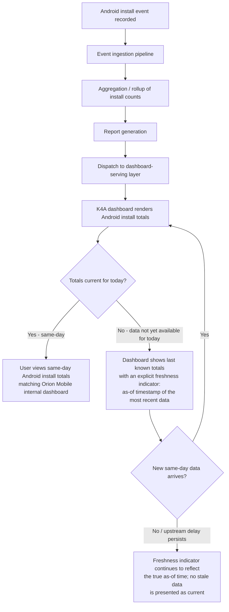

## 1. Business Logic & Context

### Problem

Android install numbers in the K4A dashboard are approximately 24 hours behind Orion Mobile's internal dashboard. The two dashboards show the **same totals** — the discrepancy is purely timing: K4A reports a day late. Users relying on K4A for current-day Android install performance are working from stale data, which undermines K4A's usefulness as a timely reporting surface.

### Value

Bringing K4A's Android install reporting into same-day sync with Orion Mobile's internal timeline restores trust in the dashboard as a current source of truth, removes the need for users to cross-reference a second system for up-to-date numbers, and aligns K4A's reporting timeline with the upstream source it mirrors.

### Important Context: Root Cause Is Unlocated

The ~24-hour lag's source has **not** been identified. The delay could originate at any hop in the reporting pipeline: event ingestion, aggregation/rollup, report generation, dispatch, data serving, or dashboard-side caching. An end-to-end pipeline trace — timing each hop from ingest through display — is a prerequisite discovery activity before implementation can be scoped. This spec defines the **target behavior** (same-day reporting) and the guardrails that must hold regardless of where the fix lands; it does not presuppose the fix location.

### KG Cross-Check Discrepancy (flagged for engineering)

An independent knowledge-graph lookup did not re-surface the services named in the Context Seed's own affected-services list, and instead surfaced a different cluster of lower-confidence services tied to inboarding ingest, rollup/aggregation, and report-generation cadence. The two lookups do not agree on which services sit on the install-reporting path. This discrepancy is unresolved and is noted here so the engineering discovery trace reconciles both sets rather than trusting either in isolation. (Specific service names are catalogued in the engineering reference appendix.)

### Business Rules

- **BR-1 — Same totals, timing only:** K4A must continue to display the *same* Android install totals as Orion Mobile's internal dashboard. This change addresses *when* the numbers appear, not *what* the numbers are. No divergence in the totals themselves is acceptable.
- **BR-2 — Same-day target:** Android install counts recorded on a given calendar day must appear in the K4A dashboard on that same calendar day, eliminating the ~24-hour lag. [DECISION REQUIRED: DEC-001]
- **BR-3 — Scope boundary:** This change applies to **Android install reporting only**. Other platforms, metrics, and report types are unaffected.
- **BR-4 — Accuracy is not sacrificed for speed:** If any current step in the pipeline deliberately waits for completeness (deduplication, reconciliation, late-arriving events), accelerating reporting must not reintroduce inaccuracy, double-counting, or divergence from Orion Mobile's totals (reinforces BR-1).
- **BR-5 — No collateral impact on shared reporting:** Where the install-reporting path shares aggregation or worker capacity with unrelated reporting (e.g. cost/revenue reporting), the change must not alter the timing or accuracy of those unrelated reports.

### Timezone / Day-Boundary Rule

"Same day" is defined relative to the reporting day boundary already used by Orion Mobile's internal dashboard, so that K4A and Orion Mobile agree on which calendar day a given install belongs to. The day-boundary/timezone definition follows Orion Mobile's existing convention rather than introducing a new one.

## 2. User Flows (Visuals)



**Happy path:** An Android install recorded today flows through ingestion, aggregation, report generation, and dispatch, and appears in the K4A dashboard the same day — matching Orion Mobile's internal dashboard without the ~24-hour lag.

**Error / degraded state:** When same-day data is not yet available (upstream delay, pipeline hop not yet complete), the dashboard must not misrepresent stale numbers as current. It displays the last known totals accompanied by an explicit freshness/"as-of" indicator reflecting the true recency of the data, so users are never misled into believing delayed numbers are same-day.

## 3. Functional Requirements

### Feature Area A — Same-Day Reporting Behavior

**FR-001 — Same-day appearance of Android install totals**
```gherkin
Given an Android install event is recorded on a given calendar day
  And the install-reporting pipeline is operating normally
When the reporting pipeline processes that day's install data
Then the corresponding install count is reflected in the K4A dashboard on that same calendar day
  And it is no longer delayed by approximately 24 hours
```

**FR-002 — Totals match Orion Mobile's internal dashboard**
```gherkin
Given the K4A dashboard displays Android install totals for a given calendar day
  And Orion Mobile's internal dashboard displays Android install totals for the same calendar day
When both dashboards are compared for that day
Then the totals are identical
  And the only prior difference (the ~24-hour timing lag) is eliminated
```

**FR-003 — Day-boundary alignment with Orion Mobile**
```gherkin
Given an Android install event occurs near a reporting day boundary
When the event is attributed to a reporting day in K4A
Then it is attributed to the same reporting day that Orion Mobile's internal dashboard attributes it to
  And no install is counted on a different calendar day between the two systems
```

**FR-004 — Accuracy preserved when reporting is accelerated**
```gherkin
Given the pipeline previously waited for completeness before publishing install totals (e.g. deduplication or reconciliation of late-arriving events)
When reporting is accelerated to same-day
Then published install totals contain no duplicate counts
  And late-arriving events for the day are reconciled such that the final same-day total matches Orion Mobile's total for that day
  And no install is double-counted as a result of earlier publication
```

### Feature Area B — Dashboard Freshness Transparency

**FR-005 — Freshness indicator reflects true data recency**
```gherkin
Given the K4A dashboard is displaying Android install totals
When a user views the Android install figures
Then the dashboard presents a freshness indicator (an "as-of" timestamp) reflecting the actual recency of the displayed data
  And the indicator accurately reflects the most recent point to which same-day data has been loaded
```

**FR-006 — Stale data is never presented as current**
```gherkin
Given same-day Android install data for the current day is not yet available in the dashboard
When a user views the Android install figures
Then the dashboard displays the last known totals together with their true "as-of" timestamp
  And it does not present delayed or prior-day totals as if they were same-day current totals
```

**FR-007 — Dashboard-layer caching does not reintroduce apparent staleness**
```gherkin
Given fresh same-day Android install data is available from the serving layer
When a user loads or refreshes the K4A dashboard Android install view
Then the dashboard reflects the available same-day data rather than serving a stale cached copy
  And any display-layer caching does not cause data already available upstream to appear delayed
```

### Feature Area C — No Collateral Impact

**FR-008 — Unrelated reporting is unaffected**
```gherkin
Given the install-reporting path shares aggregation or worker capacity with unrelated reporting (for example cost or revenue reporting)
When the change to accelerate Android install reporting is applied
Then the timing of unrelated reports is unchanged
  And the accuracy of unrelated reports is unchanged
```

**FR-009 — Non-Android reporting is unaffected**
```gherkin
Given platforms other than Android are reported in K4A
When the Android install reporting change is applied
Then reporting timing and totals for non-Android platforms remain unchanged
```

### Feature Area D — Safe Rollout for a HIGH-Risk, Multi-Service Change

**FR-010 — Config-based kill-switch for the accelerated path**
```gherkin
Given the accelerated same-day reporting path is enabled in production
  And it is observed to misbehave (incorrect totals, divergence from Orion Mobile, or downstream impact)
When an on-call engineer disables the feature via configuration without a code deploy and without a separate approval step
Then new reporting runs revert to the prior (pre-change) reporting behavior within 5 minutes of the configuration change
  And reporting runs already in flight at the moment of the flip complete under the prior behavior
```

**FR-011 — Rollback preserves already-published data**
```gherkin
Given the accelerated reporting path is rolled back
When the rollback takes effect
Then install totals already published remain intact and are not retroactively altered
  And only reporting runs going forward are affected by the reverted behavior
```

**FR-012 — Idempotent reporting runs**
```gherkin
Given a reporting run for a given Android install reporting day is retried or re-delivered
When the run is reprocessed for the same reporting day
Then the resulting install total for that day is the same end state as a single successful run
  And no install count is duplicated or double-counted as a result of the retry
```

I'll now report the single decision I flagged in Sections 0–3.

## 4. Information Requirements

The system must track the following business information to support the functional requirements. These are described at a business level; data types, schema, and storage belong to downstream engineering planning.

- **Android install count (per reporting day):** The total number of Android installs for a given calendar day. *System-derived* from the install-event pipeline. This is the core figure the dashboard reports and the one that must match Orion Mobile — the entire requirement centers on this appearing same-day (FR-001, FR-002).
- **Install event timing / recorded timestamp:** When each Android install event was recorded. *System-derived* (from event ingestion). Needed to attribute an install to the correct reporting day and to measure where latency accrues in the pipeline (FR-003).
- **Reporting day boundary (timezone convention):** The calendar-day boundary Orion Mobile's internal dashboard uses to bucket installs. *External* (Orion Mobile's existing convention). Both systems must agree on which day an install belongs to (FR-003, Timezone/Day-Boundary Rule).
- **Data freshness / "as-of" timestamp:** The most recent point in time to which same-day install data has been loaded into the dashboard view. *System-derived*. Drives the freshness indicator and prevents stale data being shown as current (FR-005, FR-006).
- **Orion Mobile internal install total (per reporting day):** The upstream totals K4A mirrors. *External* (Orion Mobile internal dashboard/source). The authoritative comparison baseline K4A's totals must match without delay (FR-002, FR-004).
- **Per-hop pipeline timing (discovery input):** The latency incurred at each pipeline hop (ingest → aggregation/rollup → report generation → dispatch → serve → display/cache). *System-derived* during the discovery trace. Required to locate the ~24-hour lag before implementation scope can be fixed.
- **Reporting-run identity / reporting-day key:** The identifier distinguishing one reporting run (for a given Android install day) from another. *System-derived*. Needed so a retried or re-delivered run converges to the same end state rather than double-counting (FR-012).
- **Accelerated-path feature-flag state:** Whether the accelerated same-day reporting path is enabled. *System-derived / config*. Supports the kill-switch and rollback behavior (FR-010, FR-011).
- **Reconciliation / late-arriving-event state (per reporting day):** Whether a day's totals have been reconciled for deduplication and late-arriving events. *System-derived*. Needed to guarantee accuracy is not sacrificed when reporting is accelerated (FR-004).

## 5. Non-Functional Requirements & Guardrails

### Performance & Freshness

- **NFR-001 — Same-day freshness target:** Android install totals for a given calendar day must be reflected in the K4A dashboard within the same calendar day. Whether "same-day" means continuous intraday updates or a single end-of-day refresh by the day boundary is a business decision — see the same-day definition decision flagged in Section 1 (BR-2). As a working default until that is settled, engineering should target intraday refresh at hourly aggregation granularity, which satisfies either interpretation.
- **NFR-002 — No regression to existing reporting latency:** The change must not increase the reporting latency of any existing report (Android or otherwise) beyond its current baseline. Non-Android and unrelated (cost/revenue) reporting latency must remain at or better than current measured values (supports FR-008, FR-009).
- **NFR-003 — Shared-resource protection:** Where the accelerated install-reporting path adds load to a shared aggregation/worker or query resource, an explicit rate cap must protect that resource so unrelated reporting is not starved. Alert when resource utilization on the shared resource exceeds 80% for 5 minutes, sustained.
- **NFR-004 — Dashboard read latency:** The dashboard Android install view must render within its current performance envelope; the freshness indicator must not add perceptible load time. Measure p95 render time under representative concurrent dashboard load; p95 must not regress beyond the current baseline.

### Accuracy & Correctness

- **NFR-005 — Total parity with Orion Mobile:** Published same-day Android install totals must match Orion Mobile's internal totals for the same reporting day with zero divergence attributable to this change (enforces BR-1, FR-002, FR-004). A parity check comparing K4A and Orion Mobile daily totals must be available during the cutover soak (see NFR-012).
- **NFR-006 — Idempotency of reporting runs:** A reporting run for a given Android install reporting day must be idempotent on the reporting-day key: a retry or re-delivery produces an overwrite/upsert to the same end state, never a duplicate or double-count (enforces FR-012). For any scheduled/batch reporting job, overlapping concurrent runs for the same reporting day must be prevented at the scheduler level as a complementary safeguard.

### Reliability & Dependency Handling

- **NFR-007 — Graceful degradation on upstream delay:** When same-day data is not yet available (an upstream hop is delayed or a dependency is unavailable), the dashboard must degrade gracefully — show the last known totals with a truthful "as-of" timestamp — rather than fail or present stale data as current (enforces FR-006). Fail-closed is not appropriate here because availability of the last-known view matters more than withholding it, and the "as-of" timestamp prevents the degraded view from misleading.
- **NFR-008 — Distinct, named failure conditions:** Upstream-delay, dependency-unavailable, and data-not-yet-loaded conditions must be distinguishable in operational monitoring (not collapsed into one generic error), so the discovery trace and ongoing operations can tell *where* a delay originates.
- **NFR-009 — Latency alerting:** Alert when the observed install-reporting end-to-end latency exceeds the same-day freshness target, or when the reporting error rate exceeds 1% for 5 minutes, sustained.

### Security & Access Control

- **NFR-010 — Preserve existing access control:** Visibility of K4A Android install reporting must remain governed by the same role/account-based access rules already in force. This change must not widen who can see install data. Any access check must be enforced server-side, re-derived from the authoritative source per request — UI-hiding alone is never sufficient, and a direct data request from an ineligible role/account must be rejected.
- **NFR-011 — No sensitive data in logs:** The discovery trace and new monitoring must not log raw user-identifying data, credentials, secrets, or tokens. Install data is aggregate-count in nature; if any identifier is handled during tracing, it must not be written to logs in raw form.

### Rollout, Rollback & Backward Compatibility

- **NFR-012 — Discovery-first, parallel-run cutover:** Because the root cause is unlocated and the deadline is hard, an end-to-end pipeline-timing trace must precede implementation. The cutover to the accelerated path must run in parallel with (or soak alongside) the existing path, with an explicit parity gate: K4A same-day totals must match Orion Mobile totals within an agreed variance before the old path is decommissioned. [DECISION REQUIRED: DEC-002]
- **NFR-013 — Kill-switch:** The accelerated path must be disableable via configuration with no code deploy, by an on-call engineer during an incident without separate approval. New reporting runs revert to prior behavior within 5 minutes of the flip; runs in flight at the moment of the flip complete under prior behavior (enforces FR-010).
- **NFR-014 — Rollback preserves published data:** A rollback must not retroactively alter install totals already published; only reporting runs going forward are affected (enforces FR-011). The rollback trigger is observed divergence from Orion Mobile totals, incorrect totals, or impact on unrelated reporting; the owning authority is the on-call engineer; target effect time is within 5 minutes of the configuration flip.
- **NFR-015 — Backward compatibility for existing consumers:** K4A Android install reporting is an existing data pipeline with existing consumers. Existing consumers of install-reporting data, the existing totals they read, and the existing output format must remain unchanged by this acceleration — only the *timing* of availability changes. No existing caller may break.

### Risk Mitigation (from the Context Seed Risk Tier: HIGH)

- **Hard month-end deadline + unlocated root cause:** Mitigated by NFR-012 (discovery trace precedes implementation) and the scope boundary (BR-3) that keeps the change to Android install reporting only. The discovery outcome determines whether the fix is a small cadence/config change or a larger re-architecture — this spread must be surfaced to the deadline owner once the trace completes.
- **Multi-service blast radius:** Mitigated by NFR-002, NFR-003, FR-008, FR-009 (no collateral timing/accuracy impact on unrelated or non-Android reporting) and by NFR-013/NFR-014 (kill-switch and safe rollback).
- **Unknown latency source:** Mitigated by NFR-008 (distinct named failure conditions) and NFR-012 (per-hop timing trace) so the fix is targeted at where the lag actually accrues rather than guessed.
- **KG cross-check discrepancy (two lookups disagree on affected services):** Mitigated by requiring the discovery trace to reconcile both service sets rather than trusting either in isolation (see Section 1 and the engineering reference appendix).

## 6. Out of Scope & Phasing

The following are explicitly **NOT** in Phase 1. Any item here must not be built as part of this requirement.

| Item | Status | Rationale |
|---|---|---|
| Non-Android platform install reporting | Out of Scope | BR-3 limits this change to Android install reporting only. |
| Metrics other than installs (e.g. cost, revenue, engagement) | Out of Scope | Change is install-reporting specific; unrelated reporting must stay unchanged (FR-008). |
| Changing the *values* of the totals | Out of Scope | BR-1: totals must continue to match Orion Mobile; only timing changes. |
| Introducing a new day-boundary/timezone convention | Out of Scope | K4A must follow Orion Mobile's existing convention, not define a new one. |
| Dashboard UI redesign beyond the freshness/"as-of" indicator | Out of Scope | UI/frontend impact is unconfirmed in intake; only the freshness indicator and cache-freshness behavior are in scope. |
| Continuous real-time (sub-minute) streaming updates | Phase 2 (pending decision) | Whether true real-time is required versus same-day end-of-day is an open business decision (BR-2); unless that decision requires it, Phase 1 targets same-day. |
| Re-architecting shared cost/revenue aggregation workers | Out of Scope | Only changes needed to accelerate Android install reporting are in scope; broader worker re-architecture is not. |
| Changes to upstream Android data providers / SDK contracts (Play Store, Firebase, etc.) | Out of Scope | Contractual/provider constraints are a discovery question, not a Phase 1 build item. |

## Appendix: Engineering Reference

_The sections below are derived automatically from the codebase knowledge graph, for the engineering team's reference during planning — not required reading for product/requirement review._

### Affected Services (grounded context, not implementation direction)

Context Seed's claimed affected services (agent-derived from the codebase KG):

- **k4a-sam-backend** (kind: unknown) — Syncs Android install data to K4A dashboard; flagged as the prime latency suspect, but with no internal symbol/endpoint evidence.
- **reporting-dispatcher** (backend) — Processes and dispatches reporting data for dashboard display; candidate location if dispatch is batched/scheduled.
- **cost-revenue-workers** (backend) — Workers that may delay or batch data aggregation before display; likely shared with unrelated cost/revenue reporting (blast-radius concern, see FR-008).
- **frontend-mos** (frontend) — K4A dashboard UI; needs to verify data-freshness display and caching (see FR-005, FR-007).
- **event-manager-api** (backend) — Event ingestion pipeline; validates timing of Android install events. Known endpoints: `DELETE /event/delete`, `DELETE /event/{id}`, `GET /event/{id}`, `GET /events/list`, `PATCH /event/{id}` (all single-event CRUD/lookup — no bulk ingestion/timing endpoint among them).

Independent KG cross-check (fresh lookup — did **not** re-surface the services above; surfaced a different, lower-confidence cluster instead). This discrepancy is unresolved; the discovery trace must reconcile both sets:

- **inboard-injector / inboard-sync-v2 / inboard-log-jammer** (backend, low confidence) — Inboarding ingest, sync, and log processing; `inboard-sync-v2` flagged as possibly gating install-reporting latency.
- **rollup-worker-cloud / rollup-active-apps** (backend, low confidence) — Rollup/aggregation of install counts; classic location for a daily-rollup lag.
- **krepsummworkerv13 / krepdetailworkerv14 / summary-report-cloud** (backend, low confidence) — Summary/detail report workers and summary-report generation; report-generation cadence could add delay.
- **reporting-api** (backend, low confidence) — Serves install-reporting data to downstream consumers; likely the read side.

The end-to-end trace spans: event ingest (event-manager-api / inboard-*) → aggregation/rollup (cost-revenue-workers / rollup-*) → report generation (krep* / summary-report-cloud) → dispatch (reporting-dispatcher) → serve (reporting-api) → display/cache (frontend-mos). The KG evidence describes the *shape* of the pipeline but does **not** locate the lag.

---
## Open Questions & Decisions Register

_Durable, ID'd reference for HITL 2 (G1) and beyond — inline `[DECISION REQUIRED: DEC-00N]` tags in the sections above point back here. Reflects the latest round only._

### Decisions Required (business trade-offs — needs a human call)

_Each carries an **Owner** (accountable for supplying the answer) and a **Provisional Value** (the working assumption engineering may build against until the decision lands), so none of these fully block engineering — implementation proceeds on the provisional value and adjusts if the confirmed decision differs._

| ID | Decision | Owner | Provisional Value (build against until confirmed) |
|----|----------|-------|-----------------------------------------------------|
| **DEC-001** | For the Android install numbers, do you need the dashboard to update continuously throughout the day in near real time, or is it enough that the current day's totals are fully loaded by the end of that same day? | Product owner (Mayank Ukey / K4A) | Same-day end-of-day sufficiency: the current day's totals must be complete and visible by the close of that calendar day (aligned to Orion Mobile's day boundary), rather than requiring continuous intraday real-time updates. This meets the stated goal of eliminating the ~24-hour lag while leaving room to tighten to intraday later if the business needs it. |
| **DEC-002** | Before we retire the current slower reporting path, how closely do the new same-day Android install totals need to match Orion Mobile's totals, and for how long should both run side by side, before we're comfortable switching over fully? | Product owner (Mayank Ukey) with Engineering | Run the new path alongside the existing one for a 1-week soak; require daily Android install totals to match Orion Mobile exactly (zero divergence) for every day in that window before decommissioning the old path. |

### Open Questions (evidence gaps — needs more input)

- **OQ-001**: Is same-day "updated by end of day / by midnight" sufficient, or does the dashboard need to update in near-real-time throughout the day? This materially changes whether we can keep batch aggregation or must move to streaming.
- **OQ-002**: Does Orion Mobile's internal dashboard report from a different/earlier source than K4A, and is K4A allowed to tap into that same source or data stream directly?
- **OQ-003**: Are any current steps intentionally waiting ~24 hours for data completeness (deduplication, reconciliation, late-event validation)? If so, is some accuracy/completeness trade-off acceptable to report sooner?
- **OQ-004**: Is a frontend/dashboard change in scope, or must the fix be backend-only? The dashboard may be showing stale data due to caching, which would need UI-side work to confirm or fix.
- **OQ-005**: Is this limited strictly to Android install counts, or should the same latency fix extend to other K4A metrics that may share the same aggregation/reporting pipeline?
- **OQ-006**: What install-event volume and frequency does the pipeline need to handle, so we can judge whether hourly/real-time aggregation is feasible within the month-end deadline?
- **OQ-007**: Are there contractual or technical constraints with the Android data providers (Play Store, Firebase, SDKs) that cap how fresh the upstream data can be, independent of our own pipeline?

---
> **Classification:** Type A
