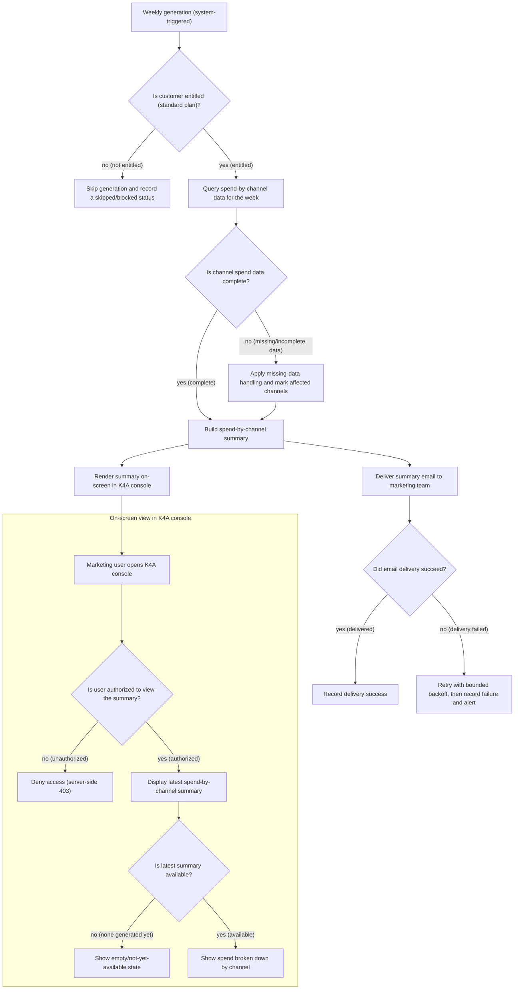

## 1. Business Logic & Context

### Problem

The marketing team at Meridian Travel currently pulls campaign spend data manually every Monday. This recurring manual effort is slow, error-prone, and does not scale ahead of their summer campaign launch. They need a reliable, automated weekly view of how much they are spending per marketing channel.

### Value

- **Eliminates recurring manual work:** replaces the weekly Monday data pull with an automated delivery.
- **Timely visibility:** marketing sees spend-by-channel on a predictable weekly cadence, supporting faster budget decisions ahead of the summer campaign.
- **In-product surface:** the summary is visible on screen inside the K4A console (confirmed by the requester), not only in an email, so the data is available in-context.

### Business Rules

- **BR-1 — Cadence:** The spend summary is generated and delivered on a weekly cadence. [DECISION REQUIRED: DEC-001]
- **BR-2 — Content:** Each summary breaks down campaign spend by marketing channel.
- **BR-3 — Recipient:** The summary is delivered to the marketing team at Meridian Travel. The requester confirmed the recipient is "the marketing team" as a group, not a single named individual. The resolution of that group to concrete recipients is an open business decision. [DECISION REQUIRED: DEC-002]
- **BR-4 — Plan entitlement:** The customer is on the standard plan. The feature is gated on standard-plan entitlement; the system must verify entitlement before producing or delivering a summary. Whether the standard plan already includes automated recurring email reports, or whether this is a new entitlement, must be confirmed. [DECISION REQUIRED: DEC-003]
- **BR-5 — Dual surface:** The same spend-by-channel summary is available both as a delivered email and as an on-screen view in the K4A console.
- **BR-6 — Channel set:** The set of channels included in the breakdown must be defined. [DECISION REQUIRED: DEC-004]
- **BR-7 — Detail level:** The summary content shows, at minimum, spend per channel. Any additional dimensions (impressions, conversions, budget comparison, prior-week comparison) are a content-scope decision. [DECISION REQUIRED: DEC-005]

### Knowledge-Graph Reconciliation Note

Two independent codebase knowledge-graph lookups were run against this requirement and they **do not fully agree** on which backend services are involved. One lookup surfaced a reporting/notifications/accounts-oriented cluster; a second independent lookup surfaced a separate SAM-oriented cluster, with only the email-notification service appearing in both. This is a genuine topology ambiguity, not a formatting discrepancy: K4A may be layered on a SAM backend, with logically-equivalent roles appearing under two naming conventions. **No service map should be treated as settled until an engineer who knows the K4A/SAM topology confirms the real repositories.** The full per-service evidence is retained for the engineering team as a labeled appendix at the end of this document.

---

## 2. User Flows (Visuals)



---

## 3. Functional Requirements (The Core)

### Feature Area A — Plan Entitlement Gating

#### FR-001 — Verify standard-plan entitlement before generating a summary
```gherkin
Given a customer is scheduled to receive the weekly spend-by-channel summary
When the weekly generation is triggered for that customer
Then the system verifies the customer's plan entitlement against the authoritative account source before any summary is generated
And generation proceeds only if the customer is entitled under their plan
```

#### FR-002 — Block generation for a non-entitled customer
```gherkin
Given a customer is not entitled to the weekly spend-by-channel summary under their plan
When the weekly generation is triggered for that customer
Then the system does not generate or deliver a summary
And the system records a skipped/blocked status identifying the customer and the reason (not entitled)
```

#### FR-003 — Fail closed when entitlement cannot be verified
```gherkin
Given the authoritative account/entitlement source is unreachable
When the weekly generation is triggered for a customer
Then the system does not generate or deliver the summary for that run
And the system records a failure status indicating entitlement could not be verified
And the system fires an operational alert for the failed verification
```

#### FR-004 — Enforce entitlement on the on-screen view server-side
```gherkin
Given a user requests the on-screen spend-by-channel summary in the K4A console
When the request reaches the backend
Then the backend re-derives the user's entitlement from the authoritative source on that request
And an ineligible user's request is rejected server-side with a 403, regardless of what the UI displays
```

### Feature Area B — Weekly Scheduling & Generation

#### FR-005 — Trigger weekly generation on the defined cadence
```gherkin
Given the weekly spend-by-channel summary feature is enabled for an entitled customer
When the defined weekly trigger time is reached
Then the system initiates generation of that customer's spend-by-channel summary for the covered week
```

#### FR-006 — Prevent overlapping concurrent runs for the same customer
```gherkin
Given a weekly generation run is already in progress for a customer
When another weekly generation trigger fires for the same customer before the first completes
Then the system does not start a second concurrent run for that customer
And the duplicate trigger is rejected rather than queued or duplicated
```

#### FR-007 — Idempotent generation for a re-run of the same week
```gherkin
Given a weekly summary has already been generated for a customer for a specific covered week
When generation is re-run or retried for that same customer and the same covered week
Then the system produces the same end state for that week rather than a duplicate summary
And no spend figures are double-counted as a result of the re-run
```

### Feature Area C — Spend-by-Channel Content

#### FR-008 — Summarize spend broken down by channel
```gherkin
Given spend data exists for a customer for the covered week
When the summary is generated
Then the summary presents campaign spend aggregated and broken down by each channel in the defined channel set
And a per-channel spend value is shown for each channel in that set
```

#### FR-009 — Handle a channel with missing or incomplete data
```gherkin
Given one or more channels have missing or incomplete spend data for the covered week
When the summary is generated
Then the summary is still produced for the channels with available data
And each channel with missing or incomplete data is explicitly marked as such rather than shown as zero spend
```

#### FR-010 — Handle a week with no spend data at all
```gherkin
Given no spend data is available for any channel for a customer for the covered week
When the summary is generated
Then the system produces a summary that clearly indicates no spend data is available for the week
And the summary is not silently suppressed
```

### Feature Area D — Email Delivery

#### FR-011 — Deliver the weekly summary email to the marketing team
```gherkin
Given a spend-by-channel summary has been successfully generated for an entitled customer
When delivery is initiated
Then the summary email is sent to the configured marketing-team recipients for that customer
And a delivery success status is recorded identifying the customer and the covered week
```

#### FR-012 — Retry a failed email delivery with bounded backoff
```gherkin
Given email delivery of a generated summary fails due to a downstream delivery error
When the system handles the failure
Then the system retries delivery with exponential backoff up to 3 attempts
And if all attempts fail, the system records a delivery-failed status and fires an operational alert
And the system never retries indefinitely
```

#### FR-013 — Distinct handling for named delivery failure conditions
```gherkin
Given email delivery fails
When the failure is a timeout, a delivery-service-unavailable error, or a rate-limited response
Then the system records a distinct named status for each of those conditions rather than a single generic error
And a rate-limited response's Retry-After header is honored rather than retrying on a fixed schedule
```

### Feature Area E — On-Screen View in K4A Console

#### FR-014 — Display the latest summary on screen
```gherkin
Given an authorized marketing user opens the spend-by-channel summary view in the K4A console
When a summary has been generated for the customer
Then the console displays the latest spend-by-channel summary with a per-channel spend breakdown
And the view indicates the week the summary covers
```

#### FR-015 — Show a not-yet-available state when no summary exists
```gherkin
Given an authorized marketing user opens the spend-by-channel summary view in the K4A console
When no summary has yet been generated for the customer
Then the console displays a clear "not yet available" empty state
And the console does not display stale or placeholder spend figures
```

#### FR-016 — Reflect missing-channel marking in the on-screen view
```gherkin
Given a generated summary has one or more channels marked as missing or incomplete
When an authorized user views that summary on screen in the K4A console
Then the on-screen view marks those channels as missing or incomplete consistently with the delivered email
```

Now reporting the decisions I flagged in Sections 0–3.

## 4. Information Requirements

The system must track the following business information to support the Functional Requirements above. Attribute-level definitions, types, and storage are intentionally deferred to eng-plan.

- **Weekly spend-by-channel summary** — the generated artifact for a given customer and covered week, containing per-channel spend. System-derived, built by aggregating spend data. This is the core content delivered by email (FR-008, FR-011) and shown on-screen (FR-014).
- **Per-channel spend figure** — the spend amount attributed to each channel in the defined channel set for the covered week. System-derived from the underlying campaign spend data. Drives the breakdown in FR-008.
- **Channel set** — the defined list of marketing channels included in the breakdown. Source depends on the open channel-set decision (see Section 1, BR-6); until resolved, treat as customer/product configuration. Determines which channels appear in every summary.
- **Channel data-completeness state** — per channel, whether spend data for the covered week is complete, incomplete, or missing. System-derived. Drives the missing-data marking in FR-009, FR-010, and FR-016.
- **Covered week** — the time window a given summary represents. System-derived from the generation trigger. Needed to label summaries (FR-014) and to key idempotent re-runs (FR-007).
- **Customer plan entitlement** — whether the customer's plan permits the weekly summary feature. External, verified against the authoritative account source. Gates generation and the on-screen view (FR-001–FR-004).
- **Marketing-team recipient list** — the concrete addresses/identities the email is delivered to for a customer. Source is the open recipient-resolution decision (see Section 1, BR-3); until resolved, treat as customer configuration. Used in FR-011.
- **Viewer authorization state** — whether a given user requesting the on-screen view is authorized to see the summary. External/system-derived from the authoritative auth source on each request. Gates FR-004 and FR-014/FR-015.
- **Generation run status** — per customer and covered week, the outcome of a generation run (succeeded, skipped/blocked, entitlement-unverifiable, failed). System-derived. Supports FR-002, FR-003, and operational visibility.
- **Email delivery status** — per customer and covered week, the outcome of delivery (delivered, retrying, timed-out, service-unavailable, rate-limited, failed). System-derived. Supports FR-011–FR-013.
- **Audit record of generation and delivery events** — an append-only trail of who/what triggered each run, the entitlement decision, and the delivery outcome. System-derived. Supports the audit guardrail in Section 5.

---

## 5. Non-Functional Requirements & Guardrails

### Performance & Capacity

- **NFR-001 — On-screen view latency:** The K4A console on-screen summary view must return within a p95 latency target measured under representative concurrent load (e.g. N concurrent requests, p95 ≤ X ms). The concrete p95 target and concurrency level are an engineering decision to be set in eng-plan based on the chosen aggregation path.
- **NFR-002 — Spend-query rate cap:** The spend-by-channel aggregation runs against a shared data/query resource. Both the generation (batch) query path and the on-screen (read) query path must have their own separate rate caps rather than a single shared value, to protect the shared resource. Concrete caps are an engineering decision for eng-plan.
- **NFR-003 — Weekly delivery timeliness:** Each entitled customer's weekly summary must be generated and delivered within a bounded window after its weekly trigger time, so the marketing team receives it on a predictable cadence replacing the Monday manual pull. The exact delivery-window target and the day/time of the weekly trigger are a product decision. [DECISION REQUIRED: DEC-006]
- **NFR-004 — Generation & delivery monitoring:** The system must alert when the generation-failure rate or delivery-failure rate exceeds 1% for 5 minutes, sustained, and when any single customer's weekly summary fails to deliver after all retries. This directly protects the customer-facing email reliability called out in the HIGH risk tier.

### Reliability & Idempotency

- **NFR-005 — Bounded retry on delivery:** Email delivery failures retry with exponential backoff, capped at 3 attempts, never indefinitely (reinforces FR-012). A 429/rate-limited response honors the Retry-After header (FR-013).
- **NFR-006 — Idempotent weekly generation:** Generation is idempotent on the (customer + covered week) key: a retried or re-run generation for the same key overwrites/updates the existing summary rather than producing a duplicate or double-counting spend (reinforces FR-007).
- **NFR-007 — No overlapping scheduled runs:** The weekly scheduler must not start an overlapping run for the same customer while one is in progress; concurrent re-runs are disabled at the scheduler level as a complement to idempotency (reinforces FR-006).

### Security & Access Control

- **NFR-008 — Server-side entitlement/authorization enforcement:** Entitlement and viewer authorization must be enforced server-side and re-derived from the authoritative source on every request. A direct API call from an ineligible plan or unauthorized user must be rejected (403) regardless of UI state; the gate must fail closed if the auth/account source is unreachable (reinforces FR-003, FR-004).
- **NFR-009 — No sensitive data in logs:** The system must never log raw recipient email addresses, credentials, secrets, or tokens. Where a recipient identity must appear for operational diagnosis, it must be masked.
- **NFR-010 — Audit trail for generation and delivery:** Each generation run and delivery attempt must write an append-only, immutable audit record capturing actor/trigger identity, customer/account identity, action (generate / deliver / skip), covered week, timestamp, and outcome/status. Records must not be editable or deletable by any role or code path. Audit writes must be asynchronous so they never block generation or delivery, but an audit-write failure must fire an immediate operational alert rather than fail silently. Minimum retention: 12 months. [DECISION REQUIRED: DEC-007]

### Risk Mitigation

The Context Seed classifies this work as **HIGH risk** (hard 5-week deadline, multi-service blast radius, customer-facing email reliability, new UI/UX). Each listed risk and its mitigation condition:

- **NFR-011 — Kill-switch for the feature:** Because this is HIGH risk and spans multiple services, the weekly summary feature (generation + delivery) must be disableable via configuration without a code deploy. An on-call engineer must be able to disable it during an incident without separate approval. New-request propagation target: 5 minutes; a run already in flight at the time of the flip completes under prior behavior. *Mitigates: multi-service blast radius / customer-facing reliability.*
- **NFR-012 — Email reliability mitigation:** Mitigated when FR-011–FR-013, NFR-004, and NFR-005 are all in place: delivery is retried with bounded backoff, each named failure condition is distinctly recorded, and sustained failure triggers an alert. *Mitigates: customer-facing email reliability.*
- **NFR-013 — Service-topology mitigation:** The two knowledge-graph lookups disagree on the real service map (see Section 1 reconciliation note). This risk is mitigated only when an engineer who knows the K4A/SAM topology confirms the actual repositories before implementation begins. No build work should proceed against an unconfirmed service map. *Mitigates: multi-service blast radius / unclear technical design.*
- **NFR-014 — Deadline mitigation:** The hard 5-week deadline (before the summer campaign launch) is mitigated only if the open scope decisions in Section 1 (channel set, recipient resolution, detail level, plan entitlement, cadence) are resolved early, since each materially affects scope. The out-of-scope phasing in Section 6 protects the deadline by deferring non-critical-path content.
- **NFR-015 — Rollback:** On a decision to roll back, the feature owner (Product owner, operationally the on-call engineer during an incident) triggers the kill-switch in NFR-011. Rollback disables future generation and delivery only; already-delivered emails and already-generated on-screen summaries are not retroactively reverted. Timing target follows the 5-minute kill-switch propagation.

### Backward Compatibility

- **NFR-016 — Extend existing reporting/notification paths without breaking existing consumers:** This feature extends existing reporting, scheduling, and notification capabilities (per the engineering reference below) that may already serve other reports/customers. Any existing scheduled-report or notification behavior, and any existing consumers of the spend-aggregation data, must remain unchanged. If the work turns out to be genuinely additive with no existing consumers at risk, that must be stated explicitly rather than assumed.

---

## 6. Out of Scope & Phasing

### Phase 1 (In Scope — Critical Path)

- Weekly, scheduled generation of a spend-by-channel summary for the entitled customer.
- Standard-plan entitlement gating (server-side).
- Email delivery of the summary to the marketing-team recipients, with bounded retry and failure handling.
- On-screen display of the latest summary in the K4A console, with a not-yet-available empty state.
- Missing/incomplete channel-data handling and marking.

### Out of Scope / Future Phases

| Item | Rationale | Phase |
|------|-----------|-------|
| Additional content dimensions (impressions, conversions, budget comparison, prior-week comparison) | Not required for the core spend-by-channel objective; a content-scope decision (BR-7) | Future |
| Filtering/segmentation of the summary (by campaign, region, product line, intra-week period) | Named as an open question, not critical path to the weekly spend-by-channel objective | Future |
| Self-service scheduling/subscription management UI (users configuring cadence or recipients themselves) | Cadence and recipients are fixed configuration in Phase 1; self-service management is net-new UX beyond the confirmed display surface | Future |
| Rollout to customers beyond Meridian Travel / plans beyond standard | Requirement is scoped to one customer on the standard plan | Future |
| Configurable per-recipient or role-based access controls over who gets the data | Raised as an open question; Phase 1 delivers to the configured marketing-team recipients | Future |
| Secure time-limited download/export of the summary | Not requested; email + on-screen view satisfy the stated objective | Future |
| Staged percentage-based rollout tooling | Single-customer Phase 1 does not require staged rollout; kill-switch (NFR-011) covers incident response | Future |

---

## Appendix: Engineering Reference

_The sections below are derived automatically from the codebase knowledge graph, for the engineering team's reference during planning — not required reading for product/requirement review._

### Affected Services (grounded context, not implementation direction)

Two independent knowledge-graph lookups produced **two different service maps** with only the email-notification service in common. Both are recorded here as given fact; the real repositories must be confirmed by an engineer who knows the K4A/SAM topology (see NFR-013) before scoping.

**Lookup 1 — reporting/notifications cluster (Context Seed "Affected Services"):**

- **reporting-api** (backend) — queries and aggregates spend-by-channel data.
- **reporting-dispatcher** (backend) — schedules and delivers the weekly email summaries.
- **frontend-mos** (frontend) — displays the summary on-screen in the K4A console.
- **notifications-api** (backend) — sends the email notification to the marketing team. *(Appears in both lookups.)*
- **accounts-api** (backend) — verifies customer plan entitlement (standard-plan check).
- **k4a-mcp-server** (backend) — K4A API backend layer; needs an integration point.

**Lookup 2 — SAM-oriented cluster (independent cross-check):**

- **k4a-sam-backend** (backend, medium) — may own the campaign spend email logic.
- **sam-report-scheduler** (backend, medium) — schedules/sends periodic SAM reports like weekly emails.
- **sam-performance-reporter** (backend, medium) — generates SAM performance/spend reports by channel.
- **sam-campaign-data-sync / k4a-sam-campaign-data-sync** (backend, low) — sync campaign spend data consumed by the report; a potential upstream data-freshness dependency.
- **sam-api** (backend, low) — exposes campaign spend fields by channel.
- **notifications-api** (backend, low) — may deliver the weekly email notification. *(Appears in both lookups.)*
- **reporting-subscriptions-worker** (backend, low) — processes scheduled report email subscriptions; overlaps reporting-dispatcher's role.

**Reconciliation:** There appear to be ~6 logical roles (aggregate spend data, sync data, schedule, send email, verify entitlement, display on-screen) spread across two naming conventions. No evidence block cites a concrete symbol, endpoint, file, or table — all evidence is role-level. Collapse these to actual repositories before scoping.

---
## Open Questions & Decisions Register

_Durable, ID'd reference for HITL 2 (G1) and beyond — inline `[DECISION REQUIRED: DEC-00N]` tags in the sections above point back here. Reflects the latest round only._

### Decisions Required (business trade-offs — needs a human call)

_Each carries an **Owner** (accountable for supplying the answer) and a **Provisional Value** (the working assumption engineering may build against until the decision lands), so none of these fully block engineering — implementation proceeds on the provisional value and adjusts if the confirmed decision differs._

| ID | Decision | Owner | Provisional Value (build against until confirmed) |
|----|----------|-------|-----------------------------------------------------|
| **DEC-001** | What day and time each week should the spend summary be generated and delivered? | Product owner (with Meridian Travel marketing team) | Generate and deliver every Monday morning in the customer's local time zone, since the team currently pulls this data manually every Monday. |
| **DEC-002** | Who exactly on the Meridian Travel marketing team should receive the email, and should access to the data be limited by role or permission? | Product owner (with Meridian Travel account contact) | Deliver to a customer-managed marketing distribution list configured per account, and restrict the on-screen view to users with a marketing or reporting role on the account; the account admin maintains the recipient list. |
| **DEC-003** | Does the standard plan already include automated recurring email reports, or does this feature need to be added to what the standard plan offers? | Product owner (with Commercial/Pricing) | Treat automated recurring spend-by-channel email as included in the standard plan for this customer, and gate it behind a standard-plan entitlement check so it can be adjusted later if pricing decides otherwise. |
| **DEC-004** | Which marketing channels should the spend breakdown include, and is that channel list the same every week or can it change by campaign? | Product owner (with Meridian Travel marketing team) | Include the customer's active channels, defaulting to paid search, social media, email, display, and affiliate, derived dynamically each week from the channels that have campaign activity. |
| **DEC-005** | What level of detail should the summary show beyond spend per channel, such as impressions, conversions, budget comparison, or a comparison to the prior week? | Product owner (with Meridian Travel marketing team) | Ship the first version with spend per channel plus a total, and a week-over-week change versus the prior week's spend; defer impressions and conversions to a later phase. |
| **DEC-006** | What day and time should the weekly summary be sent, and how soon after that trigger must it arrive? | Product owner (Mayank Ukey) with Meridian Travel marketing team | Generate and deliver every Monday at 08:00 in the customer's local timezone, delivered within 2 hours of the trigger, since the manual pull it replaces is done every Monday. |
| **DEC-007** | How long must we retain the audit records of when each weekly summary was generated and delivered? | Compliance/Security with Product owner | Retain generation and delivery audit records for a minimum of 12 months, matching Kochava's standard platform audit retention, unless a Meridian Travel agreement requires longer. |

### Open Questions (evidence gaps — needs more input)

- **OQ-001**: What specific channels must appear in the spend breakdown (e.g. paid search, social, email, display, affiliate), and is that set fixed week-to-week or does it vary by campaign?
- **OQ-002**: What level of detail does each email need — total spend only, or spend plus impressions/conversions/budget/prior-week comparison?
- **OQ-003**: Does the 'marketing team' recipient resolve to specific named addresses, a distribution list, or a role/permission group — and who controls who's on it?
- **OQ-004**: Does the standard plan tier already permit automated recurring email reports, or does enabling scheduled delivery for this customer require new entitlement/feature work?
- **OQ-005**: On-screen in K4A, what exactly is the customer seeing — a preview of the email, a screen to manage/subscribe to the weekly schedule, or a live spend-by-channel dashboard? These are very different UI builds.
- **OQ-006**: How should the email behave when a channel's spend data is missing or incomplete for the week, and what data latency is acceptable before send?
- **OQ-007**: Are there filtering/segmentation needs (by campaign, region, product line, or sub-period within the week), or is it one flat weekly total per channel?
- **OQ-008**: Is there an existing spend-by-channel aggregation and an existing per-customer recurring-email capability we can reuse, or should we budget for building both from scratch within the 5-week window?

---
> **Classification:** Type A
