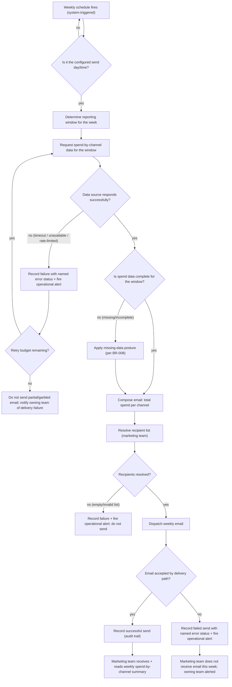

# Product Specification — K4A: Weekly Spend-by-Channel Email Summaries

## 1. Business Logic & Context

### Problem

Meridian Travel's marketing team manually pulls a spend report every Monday to see how much they have spent per channel. This manual effort is repetitive, error-prone, and scales poorly. With a summer campaign launch imminent, the team needs a reliable, automated view of channel spend without having to log in and generate the report themselves.

### Value

Automating the weekly spend-by-channel summary as an email eliminates the recurring manual report pull, gives the marketing team a consistent, predictable view of channel spend, and frees their time ahead of a high-activity campaign period. Success means the email is generated and sent automatically every week, it shows total spend by channel, and the team no longer pulls the report manually.

### Business Rules

- **BR-001 — Delivery cadence:** The summary is delivered on a weekly schedule, automatically, with no manual trigger required.
- **BR-002 — Content scope:** The email content is limited to total spend per channel. Per the intake Q&A, the requester (Mayank Ukey) confirmed "Total spend per channel is enough." Trend comparisons, performance metrics, budget comparisons, and spend-deviation alerts are explicitly out of scope for Phase 1 (see Section 6).
- **BR-003 — Customer / plan context:** The initial recipient is Meridian Travel, who is on the standard plan. Whether automated scheduled email summaries are gated by plan tier is unverified and must be confirmed. [DECISION REQUIRED: DEC-001]
- **BR-004 — Data period:** Each weekly email reports spend for a defined reporting window (e.g. the previous completed week vs. a rolling period). The window is not yet specified in the request. [DECISION REQUIRED: DEC-002]
- **BR-005 — Channel scope:** The breakdown includes the set of marketing channels the team tracks. Which specific channels are included — and whether all of them are available in the underlying spend data source — is not yet confirmed. [DECISION REQUIRED: DEC-003]
- **BR-006 — Recipients:** The email is sent to the marketing team. The specific recipient addresses or distribution list are not yet confirmed. [DECISION REQUIRED: DEC-004]
- **BR-007 — Delivery day/time:** The specific day of week and time of day for delivery are not yet specified. The provisional default is Monday morning, aligning with the team's existing Monday report-pull habit. [DECISION REQUIRED: DEC-005]
- **BR-008 — Missing/incomplete data posture:** When the reporting window has missing or incomplete spend data, the system takes a defined posture (send with a clear indication of the gap, skip and notify, or delay). The chosen posture must be explicit. [DECISION REQUIRED: DEC-006]
- **BR-009 — Purpose:** The summary is informational only. No in-email approval, budget adjustment, or other state-changing action is in scope for Phase 1.

### Service-ownership note (for downstream engineering)

An independent knowledge-graph cross-check surfaced candidate backend services for the data-source, scheduling, rendering, and delivery responsibilities that only partially overlap with those named in the original intake analysis — the two lookups disagree on which services own the data-source role and on how scheduling, rendering, and delivery are split across services. This discrepancy is not resolved at the product level; confirming which services actually exist and own each responsibility is early engineering work and must happen before build estimates are trustworthy. The full service-level evidence is recorded in a separate engineering appendix at the end of this document.

## 2. User Flows (Visuals)

The primary flow is system-triggered (scheduled), not user-initiated. The recipient's only interaction is receiving and reading the email.



## 3. Functional Requirements

### Feature Area A — Scheduled Generation & Dispatch

**FR-001 — Automatic weekly generation**
```gherkin
Given the weekly spend summary feature is enabled for a customer account
  And a send day and time are configured for that account
When the configured send day and time are reached
Then the system automatically begins generating the weekly spend-by-channel summary
  And no manual trigger or human action is required to start it
```

**FR-002 — Delivery day and time honored**
```gherkin
Given a send day and time are configured for a customer account
When the scheduled job evaluates whether to run
Then the summary is generated and dispatched only at the configured day and time
  And the default send schedule, until configured otherwise, is Monday morning
```

**FR-003 — No concurrent duplicate runs for the same week**
```gherkin
Given a weekly summary job is already in progress for a given account and reporting window
When the scheduler attempts to start another run for the same account and the same reporting window
Then the second run is not started
  And only one summary is produced and sent for that account and reporting window
```

**FR-004 — Idempotent generation per week**
```gherkin
Given a weekly summary has already been successfully generated and sent for a given account and reporting window
When the generation job is retried or re-run for that same account and reporting window
Then the system does not send a second, duplicate email for that window
  And no spend figures are double-counted as a result of the re-run
```

### Feature Area B — Spend-by-Channel Data

**FR-005 — Reporting window selection**
```gherkin
Given a weekly summary is being generated for a customer account
When the system determines which spend data to include
Then it selects spend only within the configured reporting window
  And the default reporting window, until configured otherwise, is the previous completed calendar week
```

**FR-006 — Total spend per channel**
```gherkin
Given spend data is available for the reporting window
When the summary content is composed
Then the email shows total spend for each tracked channel within the window
  And it shows only total spend per channel, with no trend, budget, or performance metrics added
```

**FR-007 — Channel coverage**
```gherkin
Given the customer account tracks a defined set of marketing channels
When the spend-by-channel breakdown is composed
Then every tracked channel that has spend data in the window appears in the breakdown
  And a channel with zero spend in the window is shown with a zero value rather than omitted silently
```

**FR-008 — Data-source retrieval failure handling**
```gherkin
Given the system requests spend-by-channel data from the underlying data source
When the data source returns a timeout, is unavailable, or returns a rate-limit response
Then the system retries using bounded retry with exponential backoff, capped at 3 attempts
  And it honors a rate-limit Retry-After response rather than retrying on a fixed interval
  And each distinct failure condition (timeout, unavailable, rate-limited) is recorded under its own named error status
```

**FR-009 — Fail-closed on unrecoverable data retrieval failure**
```gherkin
Given all retry attempts to retrieve spend data have been exhausted
When no complete spend data could be retrieved for the reporting window
Then the system does not send a partial, empty, or garbled email
  And it records the failure and fires an operational alert to the owning team
```

**FR-010 — Missing or incomplete data posture**
```gherkin
Given spend data for the reporting window is retrieved but is missing or incomplete for one or more channels
When the summary is composed
Then the system applies the configured missing-data posture for the account
  And the posture (send with the data gap clearly indicated, skip and notify, or delay) is applied consistently and recorded
```

### Feature Area C — Email Composition & Delivery

**FR-011 — Recipient resolution**
```gherkin
Given a weekly summary has been composed for a customer account
When the system prepares to send the email
Then it resolves the configured recipient list (the marketing team addresses or distribution list) for that account
  And if the recipient list is empty or invalid, the system does not send
  And it records the failure and fires an operational alert to the owning team
```

**FR-012 — Email content presentation**
```gherkin
Given a weekly summary email is composed with total spend per channel
When the recipient opens the email
Then the email presents each channel with its total spend for the reporting window
  And it states the reporting window covered so the recipient knows which period the figures represent
```

**FR-013 — Successful send recorded**
```gherkin
Given the email is accepted by the delivery path
When the send completes successfully
Then the system records a successful-send entry capturing the account, recipients, reporting window, and timestamp
```

**FR-014 — Send-failure handling**
```gherkin
Given the email was composed and recipients were resolved
When the delivery path rejects or fails to accept the email
Then the system records the failed send under a named error status
  And it fires an operational alert to the owning team
  And the marketing team does not receive a malformed or partial email for that week
```

### Feature Area D — Operational Controls (HIGH-risk, multi-service)

**FR-015 — Kill-switch**
```gherkin
Given the weekly spend summary feature is live in production
When an on-call engineer disables the feature via configuration during an incident
Then the feature is disabled without a code deploy and without a separate approval or escalation step
  And the disable propagates to new scheduled runs within 5 minutes
  And a run already in flight at the time of the flip completes under the prior behavior
```

**FR-016 — Audit trail of send activity**
```gherkin
Given a weekly summary generation or send event occurs (success or failure)
When the event completes
Then the system writes an append-only audit record capturing actor/initiator identity, account identity, action, reporting window, recipients, timestamp, and outcome status
  And the audit record cannot be edited or deleted via any code path or by any role
  And the audit write is performed asynchronously so it does not block the send
  And if the audit write itself fails, an immediate operational alert is fired rather than failing silently
```

I used the following assumptions as stated, working defaults in the requirements above (not flagged as decisions, since they are engineering or internally-consistent product defaults): the bounded-retry count (3 attempts), the kill-switch propagation time (5 minutes), the audit field set, and the zero-spend-channel display behavior. The genuine business trade-offs that require a human call are reported below.

---
## Open Questions & Decisions Register

_Durable, ID'd reference for HITL 2 (G1) and beyond — inline `[DECISION REQUIRED: DEC-00N]` tags in the sections above point back here. Reflects the latest round only._

### Decisions Required (business trade-offs — needs a human call)

_Each carries an **Owner** (accountable for supplying the answer) and a **Provisional Value** (the working assumption engineering may build against until the decision lands), so none of these fully block engineering — implementation proceeds on the provisional value and adjusts if the confirmed decision differs._

| ID | Decision | Owner | Provisional Value (build against until confirmed) |
|----|----------|-------|-----------------------------------------------------|
| **DEC-001** | Are automated weekly scheduled email summaries available on the standard plan, or does this feature need to be gated to a higher plan tier? | Product owner (with input from Billing/Entitlements) | Treat the feature as available on the standard plan for Meridian Travel, since the requester named them as the initial customer; confirm entitlement rules before rollout to other accounts. |
| **DEC-002** | Should each weekly email report spend for just the previous completed week, or for a rolling period such as the trailing several weeks? | Product owner (with Meridian Travel marketing team) | Previous completed calendar week (Monday-Sunday), matching the team's existing Monday report-pull habit. |
| **DEC-003** | Which marketing channels should appear in the spend breakdown, and are all of them available in our spend data? | Product owner (with Meridian Travel marketing team) | Include all channels the account currently tracks that have spend data available; confirm the specific channel list with the marketing team and verify coverage against the data source. |
| **DEC-004** | Who exactly should receive the weekly email, and should it go to individual addresses or a shared distribution list? | Product owner (with Meridian Travel marketing team) | Send to a single configurable marketing-team distribution list supplied by Meridian Travel, rather than maintaining individual addresses. |
| **DEC-005** | What day and time should the weekly email be sent? | Product owner (with Meridian Travel marketing team) | Monday morning (e.g. 8:00 AM in the account's local timezone), aligning with the team's existing Monday report-pull habit. |
| **DEC-006** | When a week has missing or incomplete spend data, should the email still send with the gap clearly indicated, skip that week and notify the team, or delay until the data is complete? | Product owner (with Meridian Travel marketing team) | Send the email with the incomplete data clearly flagged so the team is never left without a weekly summary, and notify the owning team of the gap. |

### Open Questions (evidence gaps — needs more input)

- **OQ-001**: Which day and time should the weekly email send?
- **OQ-002**: What is the recipient list — specific email addresses or a distribution list for the marketing team?
- **OQ-003**: Which channels should be included in the spend breakdown, and are all of them present in the current data model?
- **OQ-004**: Should the report cover the previous week only, or a rolling period?
- **OQ-005**: Should the email be raw spend totals only, or also include trend comparisons / budget comparisons / performance metrics / deviation alerts?
- **OQ-006**: What visual format is expected — plain text table, charts, or comparison-to-budget layout?
- **OQ-007**: When a week has missing or incomplete data, should the email still send, delay, or notify the team of the gap?
- **OQ-008**: Is this summary purely informational, or does the marketing team need to act on it (e.g. approve spend, adjust budgets)?
- **OQ-009**: Should recipients/schedule be configurable by the customer via a console UI, or is config-managed/internal-only acceptable? (Determines whether there's frontend scope.)
- **OQ-010**: Are there data-access or permissions restrictions that should limit which team members receive the full spend-by-channel breakdown?
- **OQ-011**: Is scheduled email reporting available on the standard plan Meridian Travel is on, or is it gated to a higher tier?

---
> **Classification:** Type A
