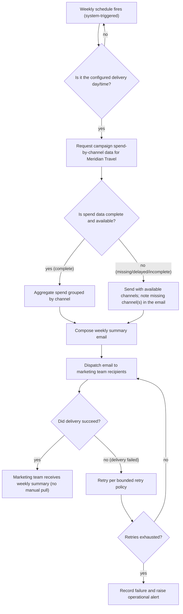

## 1. Business Logic & Context

### Problem

Meridian Travel's marketing team manually pulls a campaign-spend-by-channel report every Monday. This costs one analyst approximately two hours per week and is error-prone — the numbers sometimes come out wrong, forcing a second round of manual verification. With a summer campaign launch approaching, the team needs reliable, hands-off spend visibility.

### Value

- Eliminates ~2 hours/week of manual analyst effort.
- Removes the recurring secondary-verification step by delivering consistently accurate numbers.
- Delivers the automated summary before the summer campaign launch so the team has dependable spend visibility going into their highest-activity period.

### What the System Must Do

Automatically generate a weekly summary of campaign spend grouped by channel for Meridian Travel and deliver it to the marketing team by email, with no manual report pull required.

### Business Rules

- **BR-1 — Cadence:** The summary is generated and delivered once per week on a fixed, recurring schedule: every Monday at 8:00 AM Eastern Time.
- **BR-2 — Grouping:** Spend is grouped by channel. The channel set is fixed: paid search, paid social, display, email, and affiliate — the same set every week. All channels are reported in USD; no other per-channel calculation or transformation is required before display.
- **BR-3 — Accuracy (business-critical):** The automated numbers must reconcile against the figures the analyst currently produces by hand before launch. Accuracy is the core success criterion — a wrong number in the automated email is worse than the manual process it replaces.
- **BR-4 — Scope of recipients:** The summary is delivered to the Meridian Travel marketing team's distribution list. The marketing ops lead owns membership of this list; adding or removing recipients must be possible without engineering involvement (i.e. the recipient list is configurable by the marketing team, not hard-coded in a developer-owned job).
- **BR-5 — Report content & format:** The email shows total spend per channel. A prior-week comparison is included if it is straightforward to add; per-campaign breakdowns within each channel are not included, and no impressions or conversions are shown.
- **BR-6 — Partial / missing data handling:** When upstream spend data is missing, delayed, or incomplete at send time, the email is still sent on schedule with the channels that are available; it must not be held back or delayed. The email explicitly notes which channel(s) are missing so partial data is never mistaken for a complete summary.
- **BR-7 — Customer tier:** Meridian Travel is a Standard plan customer; the feature must operate within whatever entitlements that tier allows.

### Known Scope Ambiguity (for downstream engineering, not product review)

An independent knowledge-graph cross-check surfaced candidate backend services beyond those named in the originating analysis — including additional SAM-side data/scheduling candidates and a possible existing report-subscription path that could reduce build scope — as well as a possible frontend configuration surface. These discrepancies are unresolved and are documented in the engineering appendix for the planning phase; they do not change the product behavior defined here.

---

## 2. User Flows (Visuals)



---

## 3. Functional Requirements (The Core)

### Feature Area A — Scheduled Generation

**FR-001 — Weekly automated trigger**
```gherkin
Given the weekly spend summary feature is enabled for Meridian Travel
And a fixed recurring delivery schedule is configured
When the scheduled delivery day and time is reached
Then the system automatically initiates generation of the weekly campaign spend summary
And no manual action is required to start the process
```

**FR-002 — No duplicate concurrent runs**
```gherkin
Given a weekly summary generation run is already in progress for Meridian Travel for the current period
When the scheduler fires again for the same period before the first run completes
Then the system does not start a second overlapping run
And only one run executes for that period
```

**FR-003 — Idempotent re-run for the same period**
```gherkin
Given a weekly summary for a given week has already been generated
When the generation job is retried or re-run for that same week
Then the system produces the same end result for that week
And the marketing team is not sent a duplicate conflicting summary for that period
```

### Feature Area B — Spend Data Retrieval & Aggregation

**FR-004 — Retrieve campaign spend by channel**
```gherkin
Given a weekly summary generation run has started for Meridian Travel
When the system requests campaign spend data
Then it retrieves spend figures attributable to Meridian Travel broken down by channel for the reporting period
```

**FR-005 — Group spend by channel**
```gherkin
Given campaign spend data for the reporting period has been retrieved
When the system aggregates the data
Then spend is grouped by channel
And each channel in the confirmed channel set appears with its aggregated spend total for the period
```

**FR-006 — Accuracy reconciliation against the manual process**
```gherkin
Given the analyst's manual Monday pull of channel spend totals from the performance reporter produces the authoritative weekly spend-by-channel figures
When the automated summary is generated for the same period during pre-launch validation
Then the automated per-channel totals match the manual figures within an agreed tolerance
And any discrepancy is surfaced for review rather than silently delivered
```

**FR-007 — Channel with no spend in the period**
```gherkin
Given a channel in the confirmed channel set has no recorded spend for the reporting period
When the system aggregates spend by channel
Then that channel is represented with a zero spend value
And it is not silently omitted in a way that could be mistaken for missing data
```

### Feature Area C — Partial / Missing Data Handling

**FR-008 — Detect incomplete upstream data**
```gherkin
Given a weekly summary generation run has started
When the system cannot retrieve complete spend data for one or more channels
Then the run flags the data as incomplete
And proceeds to send the summary with the channels that are available, noting the missing channel(s) in the email, rather than treating incomplete data as complete or holding delivery back
```

**FR-009 — Distinct handling of upstream failure conditions**
```gherkin
Given the system is retrieving spend data from an upstream source
When the source times out, is unavailable, or returns a rate-limit response
Then each condition is handled and recorded distinctly rather than collapsed into one generic failure
And retries against the upstream source use bounded retry with exponential backoff, honoring any rate-limit Retry-After response, and never retry indefinitely
```

**FR-010 — Partial-data notification**
```gherkin
Given spend data for the reporting period is missing, delayed, or incomplete at delivery time
When the summary is composed and sent with the channels that are available
Then the email explicitly notes which channel(s) are missing
And the recipient can distinguish a partial summary from a normal complete summary
```

### Feature Area D — Email Composition & Delivery

**FR-011 — Compose weekly summary email**
```gherkin
Given spend has been aggregated by channel for the reporting period
When the system composes the weekly summary email
Then the email presents the spend-by-channel summary in the confirmed content and format
And it clearly identifies the reporting period it covers
```

**FR-012 — Deliver to the marketing team**
```gherkin
Given a weekly summary email has been composed
When the system dispatches it
Then it is delivered to the Meridian Travel marketing team distribution list
And delivery occurs without any manual send step
```

**FR-012a — Recipient list configurable without engineering**
```gherkin
Given the marketing ops lead owns membership of the recipient distribution list
When a recipient is added to or removed from the list
Then the change takes effect for subsequent sends without any code change or engineering deployment
```

**FR-013 — Delivery failure retry and alerting**
```gherkin
Given the system attempts to deliver the weekly summary email
When delivery fails
Then the system retries using a bounded retry policy with exponential backoff
And if all retries are exhausted the failure is recorded and an operational alert is raised
And the failure is not allowed to pass silently
```

**FR-014 — Successful delivery replaces the manual pull**
```gherkin
Given the weekly summary email is delivered successfully
When the marketing team receives it on the scheduled day
Then they have the spend-by-channel summary without performing any manual report pull
```

### Feature Area E — Operational Safeguards

**FR-015 — Kill-switch**
```gherkin
Given the weekly summary feature is live and business-critical across multiple backend services
When an on-call engineer disables the feature via configuration during an incident
Then no new weekly summary runs are initiated after the change propagates
And disabling requires no code deployment and no separate approval step
And new runs stop within 5 minutes of the configuration change
```

**FR-016 — Operational audit trail of each run**
```gherkin
Given a weekly summary run executes or an email is dispatched
When the run completes, fails, or is skipped
Then the system records an append-only operational record capturing the run outcome, timestamp, reporting period, and delivery status
And this record cannot be edited or deleted through any code path
And a failure to write this record raises an operational alert rather than failing silently
```

Now I'll report the decisions I flagged in Sections 0–3.

## 4. Information Requirements

The system must track the following business information to support the functional requirements above. These describe *what* is tracked and *why* — not storage structure, which belongs in eng-plan.

- **Campaign spend by channel** — The per-channel spend figures attributable to Meridian Travel for the reporting period. Source: the performance reporter — the same channel spend totals the analyst currently pulls by hand from the performance reporter every Monday are the authoritative figures the automated numbers must match. This is the core payload of the summary and the subject of the accuracy reconciliation (FR-004, FR-005, FR-006).
- **Confirmed channel set** — The definitive list of channels to include in the grouping: paid search, paid social, display, email, and affiliate — the same set every week, all reported in USD with no further per-channel calculation or transformation. Source: Product owner decision (BR-2). Needed so FR-005 and FR-007 produce a complete, stable set of rows every week.
- **Reporting period** — The week each summary covers (start and end boundaries). Source: System-derived from the delivery schedule. Needed so each email clearly states its coverage (FR-011) and so idempotency can key on the period (FR-003).
- **Delivery schedule** — The fixed recurring day and time the summary is generated and sent: every Monday at 8:00 AM Eastern Time. Source: Product owner decision (BR-1). Drives the trigger in FR-001.
- **Recipient list** — The Meridian Travel marketing team's distribution list — the members who receive the email. Membership is owned by the marketing ops lead and must be editable without engineering involvement. Source: marketing ops lead / customer (BR-4). Drives delivery in FR-012 and FR-012a.
- **Report content & format profile** — Total spend per channel, plus a prior-week comparison if it is straightforward to add; no per-campaign breakdowns and no impressions or conversions. Source: Product owner decision (BR-5). Shapes composition in FR-011.
- **Data completeness status** — Per-run indication of whether spend data was complete, partial, delayed, or missing, per channel. Source: System-derived during retrieval (FR-008). Drives partial-data handling and notification (FR-010).
- **Partial-data policy** — The confirmed business behavior when data is incomplete: send the email on schedule with the channels that are available and note which channel(s) are missing; never delay or hold back delivery (BR-6). Source: Product owner decision (BR-6). Governs FR-008 and FR-010.
- **Reconciliation result** — The comparison between automated per-channel totals and the analyst's manual figures during pre-launch validation, including any discrepancies flagged. Source: System-derived during validation (FR-006). Gates launch readiness.
- **Run outcome record** — Per-run operational record: outcome (completed/failed/skipped), timestamp, reporting period, and delivery status. Source: System-derived (FR-016). Supports traceability and the audit trail.
- **Upstream failure condition** — The distinct failure type encountered when retrieving data (timeout, unavailable, rate-limited) and delivery failures. Source: System-derived (FR-009, FR-013). Needed for distinct handling and alerting.
- **Feature flag state** — Whether the feature is enabled/disabled for Meridian Travel. Source: System configuration (FR-015). Controls the kill-switch.
- **Customer tier / entitlement** — Meridian Travel's Standard plan status and the entitlements that govern whether this feature is available to them. Source: System-derived from account data (BR-7). Needed to enforce eligibility server-side.

---

## 5. Non-Functional Requirements & Guardrails

### Performance & Capacity

- **NFR-001 — Generation latency.** The end-to-end weekly summary run (data retrieval → aggregation → compose → dispatch) completes well within its delivery window so the email arrives on the configured day/time. Target: the full run completes within 15 minutes of the scheduled trigger under normal data volume, measured p95 across runs. Because this is a weekly single-tenant batch job rather than a high-concurrency path, this is an engineering default and not a customer-facing commitment.
- **NFR-002 — Shared-resource protection.** The spend-data retrieval adds query load to shared upstream SAM/reporting data sources. Retrieval must respect an explicit rate cap against those sources so the weekly run cannot degrade other traffic. Because the job runs once weekly for one tenant, a conservative cap (serialized or low-concurrency queries) is sufficient; exact value is an engineering default set in eng-plan.
- **NFR-003 — Monitoring & alerting.** Operational monitoring must raise an alert when run failures or upstream error rate exceeds 1% over the trailing set of runs, and when any individual run fails to complete or deliver. Delivery-failure and data-incomplete conditions each raise their own distinct alert (per FR-009, FR-010, FR-013).

### Reliability & Idempotency

- **NFR-004 — Single execution per period.** The scheduled job must not run concurrently with itself for the same period; overlapping automatic re-runs are disabled at the scheduler level (complementing the idempotency in FR-003). A retry of a failed run produces the same end state and never a duplicate or conflicting email for the same week.
- **NFR-005 — Bounded dependency handling.** All calls to upstream data sources and the email delivery mechanism use bounded retry with exponential backoff (never indefinite), honoring any rate-limit Retry-After response. The default retry posture is **graceful degradation with notification** rather than fail-closed: when data cannot be fully retrieved, the run follows the confirmed partial-data policy (BR-6) — sending on schedule with the channels that are available and noting the missing channel(s) in the email — rather than silently blocking or delaying delivery.

### Security & Access Control

- **NFR-006 — Server-side eligibility enforcement.** Access to this feature (including any configuration surface, if one is in scope) is gated to Meridian Travel and authorized marketing-team roles, enforced server-side on every request. A direct request from an ineligible account or role is rejected (typically 403) regardless of any UI state. Eligibility is re-derived from the authoritative account/entitlement source on each request and never trusted from a client-supplied claim.
- **NFR-007 — No sensitive data in logs.** Operational logs and the audit trail must never contain credentials, secrets, tokens, or recipient PII in raw form. The summary email's spend figures are business data delivered only to the confirmed recipient list; they must not be written into general-purpose application logs.
- **NFR-008 — Delivery confined to confirmed recipients.** The weekly summary is delivered only to the Meridian Travel marketing distribution list (BR-4). No broadcast or default-to-all-account-users behavior is permitted; an unresolved or empty recipient list halts delivery and raises an alert rather than sending to an unintended audience.

### Audit & Traceability

- **NFR-009 — Immutable run audit record.** Each run (completed, failed, or skipped) and each dispatch outcome is written to an append-only operational record capturing actor/trigger identity, account identity (Meridian Travel), action, reporting period, outcome/status, and timestamp (per FR-016). Records cannot be edited or deleted through any code path or by any role. The record is written asynchronously so it does not block the run, but a failed audit write raises an immediate operational alert. Minimum retention: 12 months.

### Risk Mitigation

Addressing each risk from the Context Seed:

- **Hard 5-week deadline before live campaign (HIGH).** Mitigated when: a short discovery spike resolves service-ownership ambiguity (scheduling, email send, and spend-data source) early, and the accuracy reconciliation (FR-006) is scheduled with enough buffer before the summer launch. The reuse-vs-build question for existing report-subscription paths is an engineering scoping call that directly affects whether the deadline is achievable.
- **Affects 5 backend services (HIGH).** Mitigated when: a single owner is chosen for scheduling and a single owner for email dispatch, avoiding duplicate/conflicting logic across the overlapping candidate services; the kill-switch (FR-015) is in place so the multi-service feature can be disabled quickly if it misbehaves.
- **Data accuracy is business-critical (HIGH).** Mitigated when: the authoritative spend-by-channel source is confirmed (the performance reporter — the channel spend totals the analyst pulls by hand each Monday), the automated totals reconcile against the current manual figures within the agreed tolerance before launch (FR-006, BR-3), and discrepancies are surfaced rather than silently delivered. Any missing/partial data follows the confirmed partial-data policy (BR-6) — the email is sent with the available channels and the missing channel(s) are noted — instead of being presented as complete or held back.

### Rollout & Rollback (HIGH-risk, multi-service)

- **NFR-010 — Parallel-run / soak before cutover.** Before the manual Monday pull is retired, the automated summary runs in parallel with the manual process for a soak period, with per-channel variance between automated and manual figures as the explicit exit gate. [DECISION REQUIRED: DEC-006]
- **NFR-011 — Rollback.** Trigger: automated figures fail reconciliation in production, repeated delivery failures, or any incident on an affected service. Authority: on-call engineering, via the FR-015 kill-switch, with no separate approval step. Timing: new runs stop within 5 minutes of the config change. Already-delivered emails are not retroactively recalled; only future runs are affected, and the team falls back to the manual pull until the issue is resolved.
- **NFR-012 — Backward compatibility.** This feature extends existing reporting/scheduling/dispatch services that have other consumers. Existing report, scheduling, and email-delivery behavior for all other customers and report types must remain unchanged; the weekly Meridian Travel summary is additive and must not alter or regress any existing job, output, or consumer.

---

## 6. Out of Scope & Phasing

The following are explicitly **NOT** in Phase 1, to prevent scope creep:

| Item | Status | Rationale |
|------|--------|-----------|
| Interactive email elements (drill-down links into channel detail) | Out of scope | Confirmed: no drill-down links are needed; a static summary table is sufficient and satisfies the core "no manual pull" goal. |
| Per-campaign breakdowns within each channel | Out of scope | Confirmed under BR-5: Phase 1 shows channel-level totals only; per-campaign breakdowns are not included. |
| Budget comparison figures, impressions, or conversions | Out of scope | Confirmed under BR-5: the summary shows total spend per channel (plus a prior-week comparison if easy to add); no budget comparisons, impressions, or conversions. |
| Self-service UI for day/time send-schedule configuration | Out of scope (future phase) | The schedule can launch fixed (BR-1); any console/MCP schedule-config surface is deferred. Recipient-list membership is NOT deferred — it must be editable by the marketing ops lead without engineering (BR-4, FR-012a), though the mechanism (managed distribution list, config entry, or UI) is for eng-plan to determine. |
| Self-service onboarding for other customers / other products | Out of scope | Phase 1 targets Meridian Travel on K4A only. |
| Approval/review step before each send | Out of scope | Phase 1 is fully automated once validated; a human review gate contradicts the "no manual intervention" objective. Governed by the partial-data policy (BR-6) for the exception case only. |
| Additional report channels beyond email (e.g. Slack, in-app) | Out of scope | Request specifies email delivery only. |
| General-purpose data-warehouse / reporting-tool integration beyond what's needed to source spend-by-channel | Out of scope | Phase 1 sources only the data required for this summary; broader integration is a separate initiative. |

## Appendix: Engineering Reference

_The sections below are derived automatically from the codebase knowledge graph, for the engineering team's reference during planning — not required reading for product/requirement review._

### Affected Services (grounded context, not implementation direction)

From the Context Seed's named affected services:

- **reporting-api** (backend) — Query campaign spend by channel data.
- **reporting-dispatcher** (backend) — Schedule and dispatch weekly email summary reports.
- **k4a-mcp-server** (backend) — Expose scheduled report feature to K4A MCP/client (relevant only if a config surface is in scope).
- **sam-api** (backend) — Provide campaign channel-level spend data for Meridian Travel (candidate spend source of truth).
- **sam-report-scheduler** (backend) — Schedule and manage recurring K4A report delivery jobs (confidence: medium).

An independent KG cross-check surfaced additional candidate services not in the Context Seed's list, to reconcile during planning rather than silently adopt or discard:

- **k4a-sam-backend**, **sam-performance-reporter**, **k4a-sam-campaign-data-sync**, **sam-campaign-data-sync**, **sam-mono** — additional SAM-side candidates for owning spend-by-channel data or report generation; `sam-performance-reporter` may already generate spend reports (potential reuse).
- **notifications-api** — possible actual email-delivery mechanism (overlaps with reporting-dispatcher's send role).
- **reporting-subscriptions-worker** — possible existing scheduled-report-email-subscription path; investigating early could materially reduce build scope.
- **frontend-mos** — possible console UI for configuring the report (relevant only if config/UI is in scope).

Unresolved boundaries for planning: which service owns scheduling (3 candidates), which owns email send (2 candidates), and which holds authoritative spend-by-channel data (4–5 candidates). A short discovery spike to settle ownership is the highest-leverage de-risking step for the deadline.

## Revision Summary

_Applied reviewer's request._

- Resolved DEC-007/OQ-007: marked interactive drill-down email elements out of scope, confirming a static table is sufficient and removing the DECISION REQUIRED tag.


---
## Open Questions & Decisions Register

_Durable, ID'd reference for HITL 2 (G1) and beyond — inline `[DECISION REQUIRED: DEC-00N]` tags in the sections above point back here. Reflects the latest round only._

### Decisions Required (business trade-offs — needs a human call)

_Each carries an **Owner** (accountable for supplying the answer) and a **Provisional Value** (the working assumption engineering may build against until the decision lands), so none of these fully block engineering — implementation proceeds on the provisional value and adjusts if the confirmed decision differs._

| ID | Decision | Owner | Provisional Value (build against until confirmed) |
|----|----------|-------|-----------------------------------------------------|
| **DEC-001** | What day and time each week should the spend summary email be sent? | Product owner (Mayank Ukey / Meridian Travel marketing) | Monday 08:00 in the marketing team's local timezone, matching the existing manual Monday pull it replaces. |
| **DEC-003** | Who exactly should receive the weekly summary email? | Product owner (Meridian Travel marketing) | The same marketing team distribution list or individuals who receive the manual Monday report today; a single team distribution address if one exists. |
| **DEC-006** | Before we switch off the manual Monday report, how long should the automated email run side by side with the manual one, and how close do the numbers need to match before we trust the automation and stop the manual pull? | Product owner (Mayank Ukey) with marketing analyst input | Run in parallel for 3 consecutive weeks; retire the manual pull once automated per-channel totals match the manual figures exactly (zero variance) for all 3 weeks. |
| **DEC-007** | For the first version, is a simple static table of spend by channel in the email enough, or does the marketing team need clickable links to drill into each channel's detail? | Product owner with Meridian Travel marketing team | Static summary table only for Phase 1; drill-down links deferred to a future phase. |

### Decisions Resolved

- **DEC-002**: Resolved — channels to include are paid search, paid social, display, email and affiliate, the same set every week, all reported in USD with no special per-channel calculation or transformation required.
- **DEC-004**: Resolved DEC-004/OQ-006: the email shows total spend per channel, plus a prior-week comparison if it is straightforward to add; no per-campaign breakdowns, impressions, or conversions.
- **DEC-005**: Duplicate of OQ-005; settled by the same answer — send with available channels and note the missing one, do not hold it back.

### Open Questions (evidence gaps — needs more input)

- **OQ-006**: What level of detail should the numbers show — totals only, totals with prior-week/budget comparisons, or per-campaign breakdowns within each channel?
- **OQ-008**: Is any human review or approval required before each weekly send, or is it fully automated once deployed?
- **OQ-009**: Is there an existing scheduled-report / email-subscription capability the team already uses that this should build on, rather than a net-new pipeline?

### Questions Resolved

- **OQ-001**: OQ-001 resolved: the authoritative source is the performance reporter — specifically the channel spend totals the analyst pulls by hand from the performance reporter every Monday, and the automated numbers must reconcile against those figures.
- **OQ-002**: Resolved OQ-002/DEC-002: the weekly summary includes a fixed set of five channels every week — paid search, paid social, display, email, and affiliate — all reported in USD, with no other special calculation or transformation required.
- **OQ-003**: Resolved DEC-001/OQ-003 — the weekly email is sent every Monday at 8:00 AM Eastern Time.
- **OQ-004**: OQ-004 resolved: recipients are the marketing team's distribution list, with the marketing ops lead deciding membership, and the list must be configurable (add/remove people) without developer involvement.
- **OQ-005**: Resolved — when upstream spend data is missing, delayed, or incomplete, the email is still sent on schedule with the channels that are available, explicitly noting which channel(s) are missing; delivery is never held back or delayed. Settles both DEC-005 and OQ-005.
- **OQ-007**: Resolved DEC-007/OQ-007: the email needs no interactive drill-down links; a static summary table is sufficient for Phase 1.

---
> **Classification:** Type A
