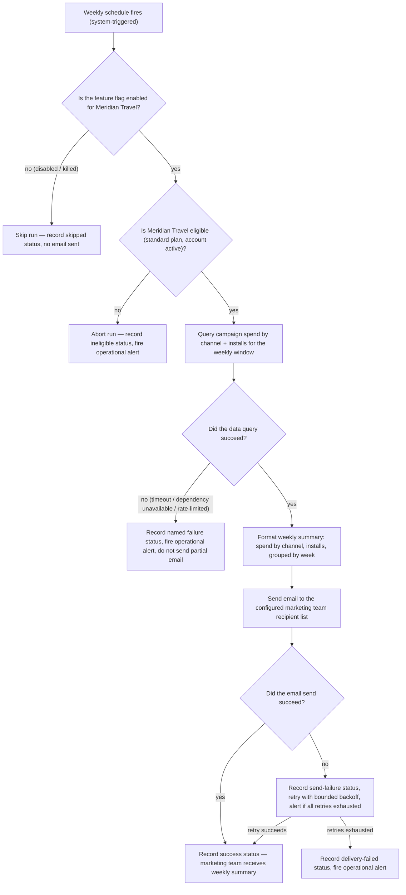
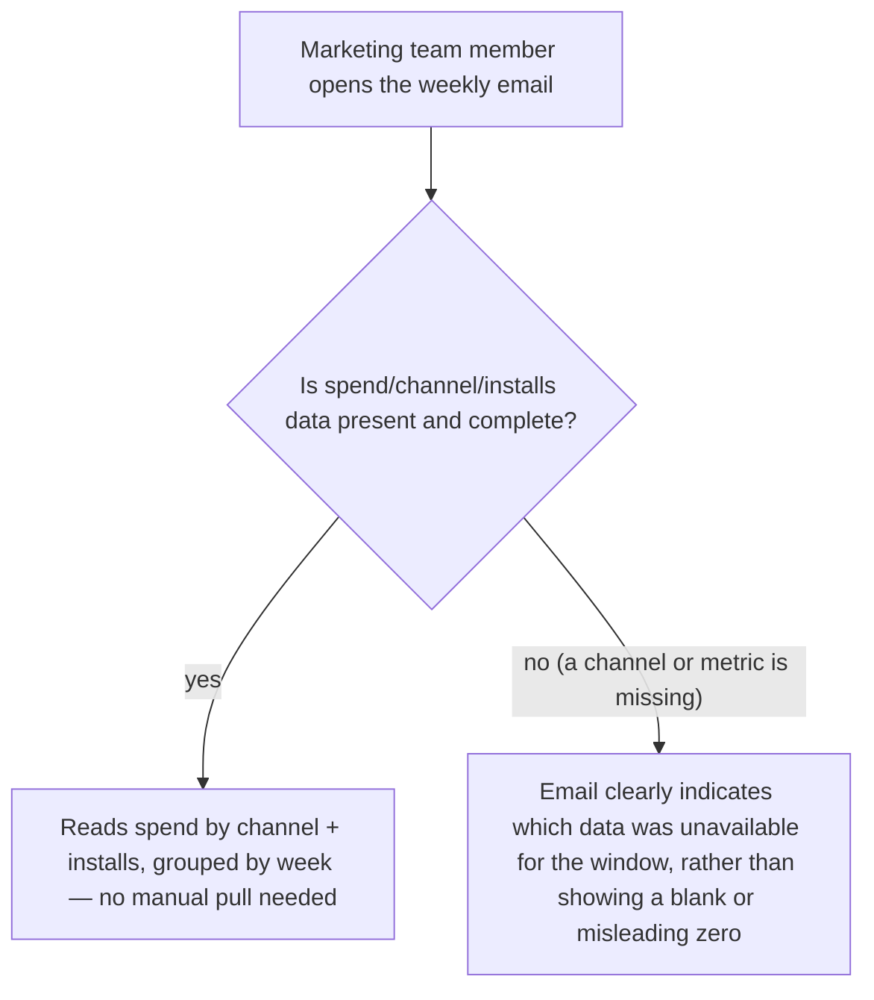

## 1. Business Logic & Context

### Problem

Meridian Travel's marketing team currently pulls campaign spend data by hand every Monday to understand how their marketing channels performed the prior week. This manual reporting is recurring, time-consuming, and error-prone, and it blocks the team from starting the week with reliable numbers. With their summer campaign launch approaching, the need for timely, automatic weekly reporting is time-bound.

### Value

Automating a weekly campaign spend summary email eliminates the manual Monday data pull, gives the marketing team a consistent, trustworthy view of spend by channel at the start of each week, and frees the team to act on the data rather than assemble it. Success means the weekly email is sent automatically, displays spend by channel with the installs metric grouped by week, and fully replaces the manual process.

### Scope of Applicability

- This feature applies to **Meridian Travel only**, a **standard plan** customer, in the **K4A** product/channel.
- Delivery is a **weekly email** containing campaign spend metrics **grouped by marketing channel**, including the **installs** metric, **grouped by week**.

### Business Rules

- **BR-1 — Account scoping:** The weekly summary includes campaign spend and channel data for the Meridian Travel account only. Data from any other account must never appear in the email.
- **BR-2 — Plan eligibility:** The feature is enabled for Meridian Travel (standard plan). No other account receives this email in Phase 1. Eligibility is enforced server-side at generation time, not merely by hiding a UI control.
- **BR-3 — Metric set:** The email reports campaign **spend** broken down **by marketing channel**, and the **installs** metric, with data **grouped by week**. No other conversion metrics (signups, bookings, revenue) are in Phase 1.
- **BR-4 — Cadence:** The email is generated and sent **once per week**, automatically, with no manual trigger required for the standard weekly run.
- **BR-5 — Billing-sensitive content:** Campaign spend is billing-adjacent/compliance-sensitive data. The email and its underlying queries must be treated as sensitive: delivered only to authorized recipients and scoped strictly to Meridian Travel.

### Open Scoping Decisions

Several business rules below the metric set are not settled by the Context Seed and are flagged for a human product decision at the point they first appear in the Functional Requirements (Section 3): the **marketing channel list and how channels are defined**, the **precise definition of "installs,"** the **recipient list and how recipients are managed**, the **send day/time and timezone**, the **weekly window definition**, and the **data-cutoff/latency expectation**. These are enumerated once, in context, in Section 3 rather than repeated here.

### Note on Affected Services (reconciliation)

Two independent knowledge-graph lookups of the backend services for this feature returned **overlapping but not identical** service sets. Only two services appeared in **both** lookups, while each lookup named several services the other did not. Notably, the second lookup surfaced the possibility that a **scheduled report-subscription path may already exist**, which — if confirmed by engineering — could change this from building a new multi-service pipeline to configuring/extending an existing one. This discrepancy is a genuine finding for the engineering planning phase to resolve; it is recorded here so it is not lost, and the full service evidence is attached as an appendix to this document. It does not change the product behavior specified below.

## 2. User Flows (Visuals)





## 3. Functional Requirements (The Core)

### Feature Area A — Weekly Generation & Scheduling

**FR-001 — Automatic weekly generation**
```gherkin
Given the weekly campaign spend summary feature is enabled for Meridian Travel
  And the configured weekly send day/time has arrived
When the weekly schedule fires
Then the system generates a campaign spend summary for Meridian Travel for the defined weekly window
  And the generation runs automatically without any manual trigger
```

**FR-002 — Send day, time, and timezone**
```gherkin
Given the weekly summary is scheduled to be sent
When the system determines when to run the weekly job
Then it uses the configured send day, send time, and timezone for Meridian Travel
```
[DECISION REQUIRED: DEC-001]

**FR-003 — Weekly window definition**
```gherkin
Given a weekly summary is being generated
When the system selects the range of data to include
Then it includes campaign data for exactly one defined weekly window
  And the window boundaries (start day, end day) are applied consistently every week
```
The precise window definition (calendar week, Monday–Sunday, or rolling 7 days) is the same unresolved business decision flagged at FR-002 — see that decision; it governs both the send timing and the window boundaries.

**FR-004 — Data cutoff / freshness for the window**
```gherkin
Given the weekly window has closed
When the system queries spend and installs data for that window
Then it only sends the email once the data for the full window meets the agreed data-cutoff expectation
  And if the data for the window is not yet complete at send time, the run is deferred or flagged rather than sending known-incomplete data silently
```
[DECISION REQUIRED: DEC-002]

**FR-005 — No duplicate concurrent runs**
```gherkin
Given a weekly generation run for Meridian Travel is already in progress
When the scheduler attempts to start another run for the same weekly window
Then the second run is not started
  And the attempt is recorded
```

**FR-006 — Idempotent re-run for the same window**
```gherkin
Given a weekly summary for a given weekly window has already been generated
When the generation job is retried or re-delivered for that same window
Then the system produces the same end result for that window without sending a duplicate email and without double-counting spend or installs
```

### Feature Area B — Data Query & Aggregation

**FR-007 — Spend grouped by marketing channel**
```gherkin
Given a weekly summary is being generated for Meridian Travel
When the system aggregates campaign data for the weekly window
Then it groups total campaign spend by marketing channel
  And each included marketing channel appears as its own line in the breakdown
```

**FR-008 — Channel list and channel definitions**
```gherkin
Given spend is grouped by marketing channel
When the system determines which channels to include and how to name them
Then it uses the agreed set of marketing channels and channel naming for Meridian Travel
```
[DECISION REQUIRED: DEC-003]

**FR-009 — Installs metric, grouped by week**
```gherkin
Given a weekly summary is being generated for Meridian Travel
When the system aggregates campaign performance for the weekly window
Then it includes the installs metric
  And the installs metric is grouped by week consistent with the metric definition for "installs"
```
[DECISION REQUIRED: DEC-004]

**FR-010 — Account scoping enforced at query time**
```gherkin
Given the system queries spend, channel, and installs data for the weekly summary
When the data query executes
Then it returns data for the Meridian Travel account only
  And data belonging to any other account is never included in the summary
```

**FR-011 — Missing or partial data is represented honestly**
```gherkin
Given data for one or more channels or the installs metric is unavailable for the weekly window
When the summary is generated
Then the email indicates that the specific data was unavailable for the window
  And it does not present an unavailable value as a misleading zero or a blank
```

### Feature Area C — Email Formatting & Delivery

**FR-012 — Email content and layout**
```gherkin
Given a weekly summary has been successfully generated for Meridian Travel
When the email is formatted
Then it displays campaign spend broken down by marketing channel
  And it displays the installs metric grouped by week
  And it identifies the weekly window the data covers
```

**FR-013 — Delivery to the marketing team recipient list**
```gherkin
Given a weekly summary email has been formatted for Meridian Travel
When the system sends the email
Then it is delivered to the configured marketing team recipient list for Meridian Travel
  And it is delivered only to that authorized recipient list
```
[DECISION REQUIRED: DEC-005]

**FR-014 — Recipient management**
```gherkin
Given Meridian Travel's marketing team membership changes over time
When a recipient needs to be added to or removed from the weekly email
Then there is a defined process to update the recipient list
  And subsequent weekly emails reflect the updated list
```
The mechanism and ownership of recipient management is part of the same recipient-list decision flagged at FR-013 — see that decision.

**FR-015 — Bounded retry on delivery failure**
```gherkin
Given an attempt to send the weekly summary email fails due to a transient delivery error
When the system handles the failure
Then it retries delivery with bounded exponential backoff, up to 3 attempts total
  And it honors any rate-limit Retry-After response from the delivery dependency
  And if all retries are exhausted, it records a delivery-failed status and fires an operational alert rather than failing silently
```

**FR-016 — Named failure conditions for data retrieval**
```gherkin
Given the system queries spend, channel, or installs data from a downstream dependency
When the query fails
Then each distinct failure condition (timeout, dependency unavailable, rate-limited) is recorded as its own named status
  And no known-incomplete or partial email is sent as a result of a data-retrieval failure
```

### Feature Area D — Eligibility, Control & Traceability

**FR-017 — Server-side eligibility enforcement**
```gherkin
Given the weekly summary feature is enabled only for Meridian Travel on the standard plan
When a weekly run is triggered for any account
Then the system re-derives eligibility from the authoritative source on that run
  And it generates and sends the summary only for an eligible account
  And a run for an ineligible account is aborted and recorded
```

**FR-018 — Kill-switch / feature flag**
```gherkin
Given the weekly summary feature is live and HIGH risk with multi-service blast radius
When an on-call engineer disables the feature flag during an incident
Then no code deploy is required to disable it
  And no separate approval or escalation step is required
  And new weekly runs stop being started within 5 minutes of the flag change
  And any run already in flight at the time of the flip completes under the prior behavior
```

**FR-019 — Audit/compliance record of each run**
```gherkin
Given the weekly summary involves billing-adjacent spend data for a specific account
When a weekly run reaches a terminal state (sent, skipped, ineligible, or failed)
Then the system writes an append-only audit record capturing the account identity, the resource (weekly summary for a given window), the action, the timestamp, and the outcome/status
  And the audit record cannot be edited or deleted via any code path or role
  And the audit record is written asynchronously so it does not block the run
  And a failure to write the audit record fires an immediate operational alert rather than failing silently
```

**FR-020 — No sensitive data in logs**
```gherkin
Given the weekly summary handles billing-adjacent spend data and recipient email addresses
When the system logs activity for a weekly run
Then it never writes raw spend figures tied to identifiable recipients, recipient email addresses, credentials, or tokens into application logs
```

Now reporting the business trade-offs flagged in Sections 0–3.

## 4. Information Requirements

The system must track the following business information to support the Functional Requirements. Types, schema, and storage are intentionally left to engineering planning.

- **Campaign spend (by channel):** The core reported value — total campaign spend for the weekly window, broken down per marketing channel. Source: External/derived from the SAM campaign-spend data services. Billing-adjacent and compliance-sensitive (BR-5). Matters to FR-007, FR-012.
- **Marketing channel set:** The list of marketing channels to break spend down by, plus how each channel is named/categorized for Meridian Travel. Source: External (campaign data) and/or product-configured. Matters to FR-008.
- **Installs metric:** The installs count for the weekly window, grouped by week, per the agreed definition of "installs." Source: External/derived from the SAM campaign-performance data services. Matters to FR-009, FR-012.
- **Weekly window:** The start and end boundaries of the reporting window that each summary covers, and which window a given summary belongs to. Source: System-derived from the configured window definition. Matters to FR-003, FR-004, FR-006, FR-012.
- **Account scope (Meridian Travel):** The identity of the single account this feature applies to, used to scope every query. Source: System/account records. Matters to BR-1, FR-010, FR-017.
- **Plan eligibility:** Whether the account is eligible (standard plan, active) at generation time, re-derived from the authoritative source each run. Source: System-derived from account/plan records. Matters to BR-2, FR-017.
- **Recipient list:** The marketing team email addresses the summary is delivered to, and the current membership of that list over time. Source: Product-configured/user-managed (mechanism unresolved — see recipient-list decision at FR-013). PII — treat per NFR data-handling rules. Matters to FR-013, FR-014.
- **Send schedule configuration:** The configured send day, send time, and timezone for the weekly job. Source: Product-configured. Matters to FR-001, FR-002.
- **Data-cutoff expectation:** The agreed freshness/latency rule that determines when a window's data is considered complete enough to send. Source: Product-configured (value unresolved — see data-cutoff decision at FR-004). Matters to FR-004.
- **Run status / outcome:** The terminal state of each weekly run (sent, skipped, ineligible, data-retrieval failure by named condition, delivery-failed). Source: System-derived. Matters to FR-005, FR-015, FR-016, FR-019.
- **Audit record:** The append-only compliance record of each run: account identity, resource (weekly summary for a given window), action, timestamp, outcome/status. Source: System-derived. Matters to FR-019.
- **Feature flag state:** Whether the feature is currently enabled for Meridian Travel. Source: Config/operational control. Matters to BR-2, FR-018.

## 5. Non-Functional Requirements & Guardrails

### Performance & Capacity

- **NFR-001 — Reporting query performance:** The spend-by-channel and installs aggregation query for the weekly window must complete within a p95 latency target measured under representative single-account weekly load. Default target: p95 ≤ 5 seconds for a single Meridian Travel weekly run. Because this is a scheduled, single-account, once-weekly job rather than interactive traffic, this is a soft operational target, not a user-facing SLA.
- **NFR-002 — Shared data-resource protection:** The weekly aggregation query runs against shared SAM campaign-data resources. The query must be rate-capped so a weekly run (including retries) cannot degrade shared query capacity. Default: cap the feature's concurrent queries against the shared resource to 1 in-flight run at a time (reinforced by FR-005).
- **NFR-003 — Delivery reliability target:** The weekly email must be successfully delivered to the configured recipient list for the covered window within the delivery SLA. Default: email sent within 2 hours of the window's data-cutoff being met, accounting for bounded retries (FR-015). A missed weekly send must raise an operational alert.

### Monitoring & Alerting

- **NFR-004 — Run-health alerting:** Alert when the weekly run error rate (data-retrieval failures + delivery failures across runs) exceeds 1% for 5 minutes, sustained, or when any single weekly run reaches a terminal failure state (ineligible, data-retrieval failure, delivery-failed). Because the job runs weekly, a single failed run is operationally significant and must alert immediately rather than waiting for a sustained window.
- **NFR-005 — Audit-write failure alerting:** A failure to write the audit record (FR-019) fires an immediate operational alert; a dropped audit record is treated as a compliance violation, not a logging gap.

### Security & Access Control

- **NFR-006 — Server-side eligibility enforcement:** Account/plan eligibility (BR-2) is enforced server-side at generation time and re-derived from the authoritative source on every run; it must not be bypassable by any client-supplied input. If the authoritative eligibility source is unreachable, the run fails closed (no email sent) and alerts (FR-016, FR-017).
- **NFR-007 — Account-scoped data access:** Every query that feeds the summary is scoped to the Meridian Travel account only; cross-account data must never be returned or included, regardless of query path (BR-1, FR-010).
- **NFR-008 — Authorized recipients only:** The email is delivered only to the configured, authorized marketing-team recipient list for Meridian Travel (FR-013). Delivery to any address outside that list is a failure condition.

### Data Sensitivity & PII

- **NFR-009 — No sensitive data in logs:** Raw spend figures tied to identifiable recipients, recipient email addresses, credentials, and tokens must never be written to application logs (FR-020).
- **NFR-010 — Billing-sensitive content handling:** Campaign spend is billing-adjacent/compliance-sensitive (BR-5). It must be handled and transmitted only to authorized recipients and kept scoped to Meridian Travel end-to-end. If historical summaries become retrievable in a later phase, retrieval must be via a time-limited secure mechanism rather than an unprotected store (historical access itself is out of scope — see Section 6).

### Reliability & Correctness

- **NFR-011 — Idempotent, non-overlapping runs:** A retried or re-delivered run for the same weekly window produces the same end state without a duplicate email or double-counted metrics (FR-006), and concurrent runs for the same window are prevented at the scheduler level (FR-005).
- **NFR-012 — Fail-closed on incomplete data:** The feature degrades by withholding a known-incomplete email rather than sending misleading data. A data-retrieval failure results in no email plus an alert (FR-011, FR-016), never a partial or zero-filled send presented as complete.
- **NFR-013 — Downstream dependency error handling:** Calls to downstream/shared dependencies (SAM data services, delivery service) use bounded retry (max 3 attempts) with exponential backoff and honor any 429 Retry-After; distinct failure conditions (timeout, dependency unavailable, rate-limited) are recorded as separate named statuses (FR-015, FR-016).

### Audit & Compliance

- **NFR-014 — Immutable audit trail:** Each weekly run writes an append-only, non-editable, non-deletable audit record (FR-019). Minimum retention: 24 months, given the billing/compliance sensitivity of spend data. [DECISION REQUIRED: DEC-006]

### Rollout, Kill-Switch & Rollback

- **NFR-015 — Config-based kill-switch:** The feature is disableable via config without a code deploy, by on-call during an incident, with no separate approval step; new runs stop within 5 minutes of the flip, and in-flight runs complete under prior behavior (FR-018).
- **NFR-016 — Rollback posture:** Trigger — the feature produces incorrect spend/installs data or delivers to unintended recipients. Owning authority — on-call engineering, via the kill-switch (NFR-015). Timing target — disabled within 5 minutes of a confirmed incident. Already-sent emails are not retroactively recalled; rollback only prevents future runs from sending. No retroactive reversion of already-produced summaries.
- **NFR-017 — Backward compatibility:** If engineering confirms an existing scheduled report-subscription path is extended (per the reconciliation note in Section 1) rather than a new pipeline built, existing report subscriptions and their delivery behavior for all other accounts must remain unchanged. If instead this is a net-new, additive pipeline with no existing consumers, no backward-compatibility constraint applies — state which explicitly during engineering planning.

### Risk Mitigation (from the Context Seed risk tier: HIGH)

- **Hard external deadline (~5 weeks, before summer campaign launch):** Mitigated by strict MVP scope (Section 6) and by engineering first verifying whether an existing report-subscription path can be extended rather than building a 5-service pipeline from scratch. Mitigated when the weekly email is live and sending correctly before the summer campaign launch.
- **Multi-service blast radius:** Mitigated by the config-based kill-switch (NFR-015/FR-018), single-in-flight-run constraint (NFR-002/FR-005), and immediate run-failure alerting (NFR-004). Mitigated when the feature can be disabled within 5 minutes without a deploy and every terminal failure alerts.
- **Customer-facing reporting pipeline with billing/compliance data exposure:** Mitigated by account-scoping (NFR-007), server-side eligibility (NFR-006), authorized-recipient-only delivery (NFR-008), no-sensitive-data-in-logs (NFR-009), and the immutable audit trail (NFR-014). Mitigated when no cross-account data can appear, the email reaches only the authorized list, and every run is auditable.

## 6. Out of Scope & Phasing

### Explicitly Out of Scope for Phase 1

| # | Item | Rationale |
|---|------|-----------|
| 1 | **Rollout to any account other than Meridian Travel** | The requirement is scoped to Meridian Travel (standard plan) only (BR-2). Generalizing to other accounts/plans is a future phase. |
| 2 | **Historical summary retrieval (archive, dashboard view, downloadable exports)** | The MVP delivers the weekly email only. Retrieving past weeks' reports via any mechanism is deferred (open discovery question). |
| 3 | **Conversion metrics beyond spend and installs (signups, bookings, revenue)** | Metric set is fixed to spend-by-channel and installs for Phase 1 (BR-3). |
| 4 | **Self-serve UI to configure or manage the email feature** | UI/frontend impact is unconfirmed. Phase 1 uses configured values (schedule, recipients, channels) rather than a customer-facing configuration UI. See the UI decision below. |
| 5 | **Customer-configurable channel definitions** | Phase 1 uses an agreed, predetermined channel set for Meridian Travel; customer-editable channel taxonomy is deferred. |
| 6 | **Self-serve recipient management UI** | Phase 1 uses a defined operational process to update recipients (FR-014); a self-serve recipient-management UI is deferred (tied to the recipient-list decision at FR-013). |
| 7 | **Ad-hoc / on-demand report generation** | Phase 1 delivers the automatic weekly cadence only (BR-4); on-demand generation is not included. |

### UI Decision for Phase 1

The Context Seed marks UI/frontend impact as "unclear — requires confirmation whether a UI component is needed." Phase 1 is specified as a backend-only, configuration-driven feature (schedule, recipients, and channel set are set operationally, not via a customer-facing UI). Whether any customer-facing UI is required at all for this feature is a product decision. [DECISION REQUIRED: DEC-007]

### Phasing Notes

- **Phase 1 (this spec):** Automatic weekly spend-by-channel + installs email for Meridian Travel, delivered to a configured recipient list, with kill-switch, account-scoping, eligibility enforcement, and audit trail.
- **Future candidates (not committed):** historical retrieval/archive, self-serve configuration UI, additional metrics, multi-account/multi-plan rollout, customer-configurable channels and recipients, on-demand generation.

---
## Open Questions & Decisions Register

_Durable, ID'd reference for HITL 2 (G1) and beyond — inline `[DECISION REQUIRED: DEC-00N]` tags in the sections above point back here. Reflects the latest round only._

### Decisions Required (business trade-offs — needs a human call)

_Each carries an **Owner** (accountable for supplying the answer) and a **Provisional Value** (the working assumption engineering may build against until the decision lands), so none of these fully block engineering — implementation proceeds on the provisional value and adjusts if the confirmed decision differs._

| ID | Decision | Owner | Provisional Value (build against until confirmed) |
|----|----------|-------|-----------------------------------------------------|
| **DEC-001** | What day of the week, what time, and in which timezone should the weekly spend email go out, and how should the weekly window be defined? | Product owner (with Meridian Travel marketing team) | Send Monday 07:00 in Meridian Travel's primary business timezone, covering the prior Monday–Sunday calendar week. This directly replaces the manual Monday pull. |
| **DEC-002** | What is the acceptable data freshness for the email — should it wait until the full week's spend and installs data is finalized before sending, and what delay is acceptable? | Product owner (with Engineering on data availability) | Send once the full prior-week window's data is finalized; if data is not complete at the scheduled Monday 07:00 send, defer the run to later Monday rather than send incomplete data. Target same-day (Monday) delivery. |
| **DEC-003** | Which marketing channels should appear in the spend breakdown, how should they be named, and is this list fixed or configurable by the customer? | Product owner (with Meridian Travel marketing team) | Include all marketing channels that have spend for Meridian Travel in the window, using the channel names already used in the SAM campaign data, as a fixed (non-customer-configurable) list in Phase 1. |
| **DEC-004** | What exactly counts as an install for this email, and should any other conversion metrics beyond spend and installs be included? | Product owner (with Meridian Travel marketing team) | Use the existing platform definition of installs from the SAM campaign data; include only spend and installs in Phase 1 (no signups, bookings, or revenue). |
| **DEC-005** | Who should be on the recipient list for the weekly email, and how should Meridian Travel add or remove recipients as their team changes? | Product owner (with Meridian Travel marketing team) | Start with a fixed recipient list supplied by Meridian Travel at onboarding; changes are handled by a request to the Kochava account team in Phase 1, with no self-serve UI unless prioritized later. |
| **DEC-006** | How long must we retain the audit records of each weekly run, given these contain billing-sensitive spend data? | Compliance/Security | 24 months minimum retention, append-only and immutable, matching the typical range for billing/compliance-sensitive data. |
| **DEC-007** | Does this feature need any customer-facing screen at all, or is it acceptable for Phase 1 to be fully backend-driven with the schedule, recipients, and channels set up operationally by us? | Product owner | No customer-facing UI in Phase 1 — schedule, recipient list, and channel set are configured operationally on Meridian Travel's behalf. |

### Open Questions (evidence gaps — needs more input)

- **OQ-001**: What is the exact definition of "installs" for this email, and should the summary include any other metrics (spend amount, signups, bookings, revenue) beyond installs — the intake answer named only 'installs grouped by week', which is narrow for a 'campaign spend summary'?
- **OQ-002**: Which marketing channels should appear in the breakdown, and are channel names/categories a fixed predetermined list or configurable per customer?
- **OQ-003**: Who are the exact email recipients (names/addresses, how many), and does Meridian need a self-serve way to add/remove recipients — this determines whether a configuration UI is in scope?
- **OQ-004**: What timezone and day/time should the email send, and how is the weekly window defined (calendar week, Mon–Sun, rolling 7 days)?
- **OQ-005**: What data latency is acceptable — must the email reflect spend through end-of-day Friday, or is a delay (e.g. data ready Tuesday) acceptable?
- **OQ-006**: Do recipients need access to historical/past weeks' summaries, and if so via what mechanism (email archive, dashboard, downloadable export)?
- **OQ-007**: Is this intended as a one-off for Meridian Travel only, or should it be built as a reusable feature other standard-plan customers could get later? (This affects whether we hardcode vs. build configurable, and interacts with whether an existing report-subscription pipeline can be reused.)
- **OQ-008**: Given the email exposes billing/spend data, are there compliance or data-handling requirements on email delivery (e.g. restricted recipient domains, encryption, opt-in) we must meet?

---
> **Classification:** Type A
