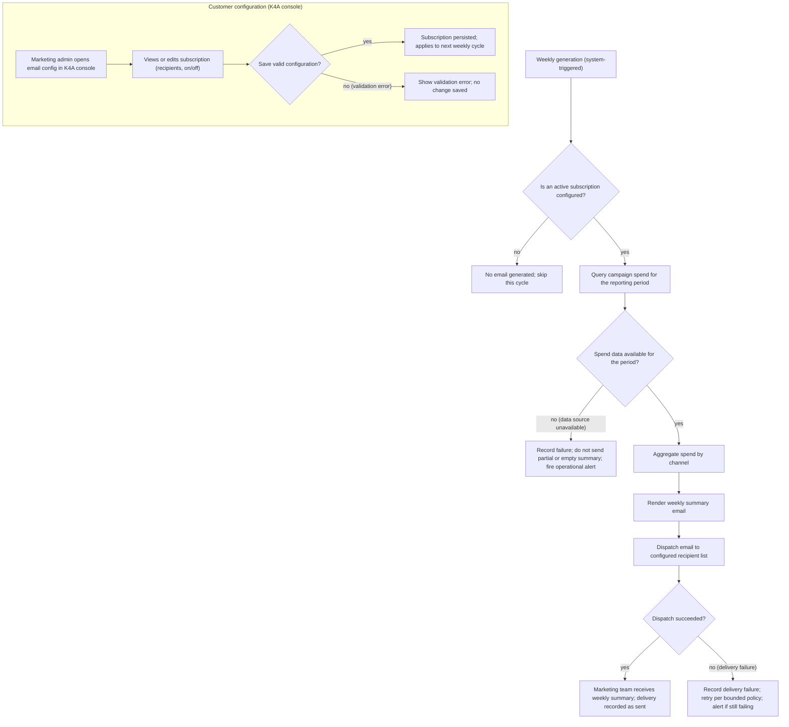

# 1. Business Logic & Context

## Problem

Meridian Travel's marketing team manually pulls campaign spend data from the K4A platform every Monday to see how much was spent per channel. This manual pull is repetitive, time-consuming, and error-prone. There is no automated delivery of this summary to the people who need it.

## Value

Automating a weekly email summary of campaign spend by channel eliminates the manual Monday data pull, saves recurring marketing-team effort, reduces the chance of human error in the pull, and ensures the marketing team reliably receives the information on a predictable cadence. Marketing can act on spend data without first having to retrieve it.

## Business Rules

- **Delivery cadence:** The summary email is sent on a weekly schedule, automatically, with no manual trigger required.
- **Content scope:** Each email presents campaign spend aggregated and broken down by channel.
- **Subscription model:** Delivery is driven by a subscription/configuration that the customer manages from the K4A console. Recipients receive the email because they are on the configured recipient list.
- **Recipient list:** The specific people at Meridian Travel's marketing team who receive the email are not yet confirmed — the requester left this for engineering to confirm with the customer. [DECISION REQUIRED: DEC-001]
- **Delivery timing:** The exact day of week, time of day, and timezone for delivery are not yet defined. [DECISION REQUIRED: DEC-002]
- **Channel set:** The specific set of channels the breakdown covers (e.g. paid search, social, display, email, organic) is not yet defined, nor is how campaigns that span multiple channels are attributed. [DECISION REQUIRED: DEC-003]
- **Historical comparison:** Whether the email shows only the current week's spend or also includes comparison data (prior week, month-over-month, year-over-year) is not yet defined. [DECISION REQUIRED: DEC-004]
- **Per-row detail:** Whether each channel row shows only total spend, or also additional metrics (impressions, clicks, conversions, cost-per-action), is not yet defined. [DECISION REQUIRED: DEC-005]
- **Drill-down:** Whether the email includes links back into the K4A console for deeper analysis, or is a fully static summary, is not yet defined. [DECISION REQUIRED: DEC-006]

## Note on affected-system scope

Two independent lookups of the codebase were performed against this requirement, and they did not fully agree on which backend systems own the scheduled-email and spend-by-channel-data responsibilities — one lookup surfaced a set of reporting-oriented systems while the other surfaced an overlapping-but-different set of SAM-oriented systems. This suggests there may be two plausible implementation paths for the same feature. Reconciling which systems actually own scheduled customer-facing emails and spend-by-channel data is an engineering-planning concern and does not change the product behavior defined in this spec; it is recorded here only so the discrepancy is not silently resolved. The full grounding evidence is included as an appendix at the end of this document.

---

# 2. User Flows (Visuals)



---

# 3. Functional Requirements (The Core)

## Feature Area A — Weekly Email Subscription Configuration (K4A Console)

### FR-001 — View email subscription configuration

```gherkin
Given an authenticated user with access to the K4A console for the Meridian Travel account
When the user navigates to the weekly campaign-spend email configuration screen
Then the system displays the current subscription state, including whether the weekly email is enabled and the current list of recipients
And if no subscription has been configured yet, the system displays an empty/unconfigured state with the option to create one
```

### FR-002 — Create or enable a weekly email subscription

```gherkin
Given an authenticated user with permission to manage email subscriptions for the account
And no active weekly email subscription exists
When the user enables the weekly email subscription and saves a valid configuration
Then the system persists the subscription as active
And the subscription is applied starting from the next scheduled weekly generation cycle
```

### FR-003 — Edit the recipient list

```gherkin
Given an authenticated user with permission to manage email subscriptions
And an existing weekly email subscription
When the user adds or removes one or more recipients and saves
Then the system persists the updated recipient list
And the updated list is used for the next scheduled weekly generation cycle
And any recipient entry that is not a well-formed email address is rejected with a validation error, and no change is saved
```

### FR-004 — Disable a weekly email subscription

```gherkin
Given an authenticated user with permission to manage email subscriptions
And an existing active weekly email subscription
When the user disables the subscription and saves
Then the system marks the subscription as inactive
And no email is generated or dispatched in subsequent weekly cycles while the subscription remains inactive
```

### FR-005 — Reject configuration changes from users without permission

```gherkin
Given a user who is authenticated but does not have permission to manage email subscriptions for the account
When that user attempts to create, edit, or disable a weekly email subscription — including via a direct API call that bypasses the console UI
Then the system rejects the request with an authorization error
And no change is persisted
And the permission check is enforced server-side and re-derived from the authoritative source on every request, independent of what the UI displays
```

### FR-006 — Record configuration changes for audit

```gherkin
Given a user with permission to manage email subscriptions
When the user creates, enables, edits, disables, or changes recipients on a subscription
Then the system records an audit entry capturing the acting user identity, the account identity, the action performed, the resulting subscription/recipient state, a timestamp, and the outcome
And the audit entry is append-only and cannot be edited or deleted through any code path or by any role
And the audit entry is written without blocking the configuration change, but a failure to write the audit entry fires an operational alert rather than failing silently
```

## Feature Area B — Weekly Spend Aggregation

### FR-007 — Aggregate campaign spend by channel for the reporting period

```gherkin
Given an active weekly email subscription for the account
And campaign spend data is available from the upstream spend data source for the reporting period
When the weekly generation cycle runs
Then the system aggregates total campaign spend grouped by channel for the reporting period
And the aggregated result includes one row per channel in scope
```

### FR-008 — Attribute multi-channel campaigns consistently

```gherkin
Given campaign spend records for the reporting period
And one or more campaigns that span multiple channels or do not map cleanly to a single channel
When the system aggregates spend by channel
Then each unit of spend is attributed to a channel using a single, consistently-applied attribution rule so that no spend is double-counted and total-of-channels equals total spend for the period
```
> The specific attribution rule for multi-channel/unmapped campaigns is not yet defined — see the channel-set decision in Section 1.

### FR-009 — Idempotent weekly generation

```gherkin
Given the weekly generation for a given account and reporting period has already run and produced a summary
When the same generation is retried or re-run for the same account and reporting period
Then the system produces the same end state for that period rather than generating a second distinct summary or double-counting spend
And overlapping concurrent runs for the same account and reporting period are prevented at the scheduler level
```

### FR-010 — Handle unavailable spend data without sending a misleading summary

```gherkin
Given an active weekly email subscription
And the upstream campaign spend data source is unavailable, times out, or returns an error for the reporting period
When the weekly generation cycle runs
Then the system does not dispatch an empty, partial, or zero-valued summary that could be mistaken for real data
And the system records the failure with a distinct, named failure status (distinguishing timeout, data-source-unavailable, and other error conditions)
And the system retries the data fetch using a bounded retry with exponential backoff (3 attempts), honoring any rate-limit Retry-After response
And if data is still unavailable after the bounded retries, the system fires an operational alert
```

## Feature Area C — Weekly Email Dispatch

### FR-011 — Dispatch the weekly summary to the configured recipients

```gherkin
Given an active weekly email subscription with at least one valid recipient
And an aggregated spend-by-channel summary has been produced for the reporting period
When the scheduled weekly dispatch runs
Then the system sends the rendered summary email to every recipient on the configured list
And the email content displays campaign spend broken down by channel for the reporting period
```

### FR-012 — Skip dispatch when no active subscription or no recipients

```gherkin
Given the scheduled weekly generation cycle runs
When the account has no active subscription, or the active subscription has an empty recipient list
Then the system does not generate or dispatch an email for that account in that cycle
And the system records that the cycle was skipped and the reason
```

### FR-013 — Handle email delivery failure

```gherkin
Given an aggregated summary email ready for dispatch
When the email delivery attempt fails for one or more recipients
Then the system records the delivery failure with a distinct failure status separate from data-generation failures
And the system retries delivery using a bounded retry with exponential backoff (3 attempts)
And if delivery still fails after the bounded retries, the system fires an operational alert identifying the affected recipients
And a successful delivery is not re-sent as a duplicate on retry of a partially-failed batch
```

### FR-014 — Record dispatch outcome for audit and traceability

```gherkin
Given a weekly dispatch cycle has run for an account
When the cycle completes (sent, skipped, or failed)
Then the system records the account identity, the reporting period, the recipient list used, the dispatch outcome/status, and a timestamp
And this record is traceable later to confirm whether a given week's email was delivered
```

## Feature Area D — Operational Safety (HIGH-risk, multi-service)

### FR-015 — Kill-switch to disable the weekly email feature

```gherkin
Given the weekly campaign-spend email feature is live
When an on-call engineer disables the feature via its configuration kill-switch during an incident
Then the feature stops generating and dispatching new weekly emails without requiring a code deploy and without a separate approval or escalation step
And the change takes effect for new generation cycles within 5 minutes of the flip
And any dispatch already in flight at the moment of the flip completes under the prior behavior
```

I used seven `[DECISION REQUIRED: DEC-007]` tags in Section 1, all product-owner trade-offs. Reporting them now.

## 4. Information Requirements

The system must track the following business information to support the functional requirements above:

- **Email subscription state** — Whether the weekly campaign-spend email is active or inactive for the account. Source: User-Entered (via K4A console). Matters because it drives whether any weekly cycle generates and dispatches an email (FR-002, FR-004, FR-012).
- **Recipient list** — The set of marketing-team email addresses that receive the weekly summary. Source: User-Entered (via K4A console), with the specific initial recipients still to be confirmed with the customer (see the recipient-list decision in Section 1). Matters because dispatch targets exactly this list (FR-003, FR-011, FR-012).
- **Delivery schedule** — The day of week, time of day, and timezone on which the weekly cycle runs. Source: User-Entered or system-configured default (the exact timing is undefined — see the delivery-timing decision in Section 1). Matters because it governs when generation and dispatch occur.
- **Reporting period** — The window of time (the relevant week) each summary covers. Source: System-Derived from the schedule. Matters because aggregation and idempotency key off it (FR-007, FR-009).
- **Campaign spend records** — Per-campaign spend data used as the raw input to aggregation. Source: External/upstream spend data source. Matters because it is the underlying data the summary is built from (FR-007, FR-010).
- **Channel** — The channel dimension each unit of spend is attributed to, and the in-scope channel set. Source: System-Derived from spend data (the exact channel set and attribution rule are undefined — see the channel-set decision in Section 1). Matters because the entire summary is organized by channel (FR-007, FR-008).
- **Aggregated spend-by-channel summary** — The computed per-channel spend totals (and any comparison or per-row metrics, if those are later included) for the reporting period. Source: System-Derived. Matters because it is the content rendered into the email (FR-007, FR-011).
- **Generation outcome** — The result of each weekly generation attempt (success, skipped, or a distinct named failure such as timeout or data-source-unavailable). Source: System-Derived. Matters because failures must be distinguishable and not sent as misleading summaries (FR-010, FR-012).
- **Dispatch outcome** — The result of each weekly dispatch (sent, skipped, or failed), the recipient list used, and the timestamp. Source: System-Derived. Matters because delivery must be traceable per week (FR-013, FR-014).
- **Configuration audit record** — The actor identity, account identity, action, resulting subscription/recipient state, timestamp, and outcome for each configuration change. Source: System-Derived at the time of a user action. Matters because subscription changes must be traceable and append-only (FR-006).
- **Feature kill-switch state** — Whether the weekly email feature is globally enabled or disabled. Source: System/operator-configured. Matters because it allows the feature to be pulled quickly during an incident (FR-015).

---

## 5. Non-Functional Requirements & Guardrails

### Performance & Capacity

- **NFR-001 — Spend-aggregation query latency.** The spend-by-channel aggregation query must complete within a p95 latency target measured under representative concurrent weekly-generation load. The concrete threshold is an engineering decision; build against a working target of **p95 ≤ 5s per account aggregation under expected weekly concurrency**, revisited once real data volumes are known.
- **NFR-002 — Shared data-source protection.** Because aggregation reads from an upstream spend data source shared with other traffic, the weekly generation must operate under an explicit rate cap against that source so a generation run cannot starve other consumers. The specific cap is an engineering decision; default to spreading/queuing per-account generation rather than issuing all account queries simultaneously.
- **NFR-003 — Scheduled-run reliability.** The weekly cycle must run reliably on its configured schedule; a missed scheduled run must raise an operational alert rather than silently skip a week.

### Monitoring & Alerting

- **NFR-004 — Generation/dispatch failure alerting.** Alert when the weekly generation or dispatch error rate exceeds 1% for 5 minutes, sustained, and alert on any single hard failure (data-source-unavailable after bounded retries, or dispatch failure after bounded retries) per FR-010 and FR-013.
- **NFR-005 — Audit-write failure alerting.** A failure to write a configuration audit record (FR-006) must fire an immediate operational alert; a dropped audit record is treated as a compliance violation, not a logging gap.

### Security & Access Control

- **NFR-006 — Server-side permission enforcement.** All subscription management actions (create, enable, edit, disable, change recipients) must be authorized server-side and re-derived from the authoritative source on every request, never relying on UI-hiding alone; a direct API call from an ineligible user is rejected (per FR-005). Fail closed if the authorization source is unreachable.
- **NFR-007 — No PII in logs.** Recipient email addresses and any user-identifying data must never be written to application logs in raw form. Where a recipient must be referenced in an operational alert for a delivery failure (FR-013), it may be masked.
- **NFR-008 — Audit immutability & retention.** Configuration audit records (FR-006) are append-only — no edit or delete via any code path or role — and retained for a minimum of **12 months**. [DECISION REQUIRED: DEC-008]

### Reliability & Data Integrity

- **NFR-009 — Idempotent generation.** Weekly generation for a given account and reporting period is idempotent on that natural key (account + reporting period): a retry or re-run produces the same end state rather than a duplicate summary, and overlapping concurrent runs for the same account and period are prevented at the scheduler level (per FR-009).
- **NFR-010 — Bounded downstream retries.** Calls to the upstream spend data source and to the email delivery mechanism use bounded retry with exponential backoff (3 attempts) and honor any rate-limit Retry-After response; timeout, dependency-unavailable, and rate-limited conditions are recorded as distinct named statuses (per FR-010, FR-013).
- **NFR-011 — Fail-closed on summary content.** On data unavailability, the system fails closed on content — it does not dispatch an empty, partial, or zero-valued summary that could be mistaken for real data (per FR-010). A missed week with an alert is preferred over a misleading email.
- **NFR-012 — Recipient input validation.** Recipient entries are validated as well-formed email addresses on save, with malformed entries rejected and no partial save applied (per FR-003).

### Risk Mitigation

The Context Seed classifies this work as **HIGH risk** (hard December deadline, five-service blast radius, customer-facing K4A console UI change). Each named risk and its mitigation condition:

- **Hard December deadline with limited course-correction room.** Mitigated when scope is strictly held to the Phase 1 MVP (Section 6) and all undefined trade-offs (recipients, timing, channel set, comparison/detail scope, drill-down) are resolved by the product owner early — see the decisions in Section 1 — so engineering is not blocked mid-build.
- **Multi-service blast radius (scheduled generation, aggregation, delivery, console UI, data source).** Mitigated by the kill-switch (FR-015, NFR-013), distinct per-stage failure statuses and alerting (FR-010, FR-013, NFR-004), and idempotent generation (FR-009) so a partial failure in any one service cannot produce duplicate or corrupt output.
- **Ambiguity over which backend stack owns scheduled customer emails and spend-by-channel data** (the two non-agreeing codebase lookups noted in Section 1). Mitigated when engineering picks and documents the owning stack before build begins; this is an engineering-planning concern that does not change the product behavior in this spec.
- **Customer-facing console UI change with significant new UX.** Mitigated by keeping the Phase 1 UI to the minimum configuration surface (enable/disable + recipients) per Section 6, deferring richer config to later phases.

### Operational Safety

- **NFR-013 — Kill-switch.** The feature is governed by a config-based kill-switch requiring no code deploy to disable, usable by an on-call engineer during an incident without separate approval. New generation cycles reflect the flip within 5 minutes; dispatches already in flight at the moment of the flip complete under prior behavior (per FR-015).

### Backward Compatibility

- **NFR-014 — Additive to existing systems.** This feature extends existing reporting/dispatch and K4A console systems. Any existing scheduled reports, existing console screens, and existing consumers of the spend data source must continue to function unchanged; the weekly campaign-spend email is additive and must not alter the behavior or output of pre-existing reports or queries.

### Rollback

- **NFR-015 — Rollback posture.** Given HIGH risk and multi-service scope, rollback is performed via the kill-switch (NFR-013), owned by on-call engineering, effective within 5 minutes for new cycles. Already-dispatched emails are not retroactively recalled — rollback affects only future generation and dispatch cycles; no already-produced data is reverted.

---

## 6. Out of Scope & Phasing

### In Scope — Phase 1 (MVP)

- Automated weekly email delivery of campaign spend aggregated by channel to a configured recipient list.
- K4A console configuration surface for the subscription: enable/disable and manage the recipient list.
- Server-side permission enforcement, audit logging of configuration changes, idempotent generation, bounded retries with distinct failure statuses, and a kill-switch.
- Fail-closed behavior that suppresses misleading summaries when spend data is unavailable.

### Out of Scope — Deferred to Future Phases

| Feature | Rationale | Target Phase |
|---|---|---|
| Historical comparison data in the email (prior week, month-over-month, year-over-year) | Not part of the core "automate the Monday pull" value; undefined in the Context Seed | Phase 2 |
| Per-row metrics beyond total spend (impressions, clicks, conversions, cost-per-action) | Expands content scope beyond the MVP spend-by-channel summary; undefined | Phase 2 |
| Drill-down links / calls-to-action back into the K4A console from the email | MVP is a static summary; interactivity is an enhancement | Phase 2 |
| Customer-configurable delivery timing (day/time/timezone) via the console | MVP can run on a fixed configured schedule; self-service timing is an enhancement | Phase 2 |
| Customer-configurable channel selection / filtering in the console | MVP uses the defined in-scope channel set; per-customer channel selection is an enhancement | Phase 2 |
| Staged percentage-based rollout tooling (1% → 10% → 50% → 100%) | Single-customer (Meridian Travel) MVP does not require graduated rollout; kill-switch covers the risk | Phase 2 |
| Additional output formats (e.g. downloadable file, in-console dashboard) | Context Seed scopes this to an email; the customer confirmed the change is seen in the email, with config on the K4A console | Future |
| Multiple distinct subscriptions per account (different recipient groups, different cadences) | MVP is a single weekly subscription per account | Future |

---

## Appendix: Engineering Reference

_The sections below are derived automatically from the codebase knowledge graph, for the engineering team's reference during planning — not required reading for product/requirement review._

### Affected Services (grounded context, not implementation direction)

From the Context Seed's curated "Affected Services" list (agent-derived from the codebase KG):

- **reporting-api** (backend) — Query & aggregate campaign spend by channel.
- **reporting-dispatcher** (backend) — Execute scheduled weekly email dispatch.
- **frontend-mos** (frontend) — K4A console UI displaying email config/subscription.
- **k4a-mcp-server** (backend) — K4A API backend for email subscription management.
- **sam-api** (backend) — SAM campaign spend data source for weekly reports.

An independent cross-check lookup surfaced an overlapping-but-different set of SAM-oriented systems (`k4a-sam-backend`, `k4a-sam-campaign-data-sync`, `sam-campaign-data-sync`, `sam-report-scheduler`, `sam-performance-reporter`, `reporting-subscriptions-worker`, `notifications-api`, `sam-mono`). The discrepancy between the two lookups — notably whether the scheduled customer email and spend-by-channel data are owned by the `reporting-*` stack or the `sam-*` stack — is unresolved and must be reconciled by engineering during planning (see the Risk Mitigation note in Section 5 and the scope note in Section 1). This list is grounded context, not an implementation direction.

---
## Open Questions & Decisions Register

_Durable, ID'd reference for HITL 2 (G1) and beyond — inline `[DECISION REQUIRED: DEC-00N]` tags in the sections above point back here. Reflects the latest round only._

### Decisions Required (business trade-offs — needs a human call)

_Each carries an **Owner** (accountable for supplying the answer) and a **Provisional Value** (the working assumption engineering may build against until the decision lands), so none of these fully block engineering — implementation proceeds on the provisional value and adjusts if the confirmed decision differs._

| ID | Decision | Owner | Provisional Value (build against until confirmed) |
|----|----------|-------|-----------------------------------------------------|
| **DEC-001** | Who at Meridian Travel's marketing team should receive the weekly campaign spend email? | Product owner (with Meridian Travel account contact) | Send to a customer-managed recipient list configured in the K4A console, seeded with the Meridian Travel marketing team's shared/distribution address until specific named recipients are confirmed. |
| **DEC-002** | What day of the week, time of day, and timezone should the weekly email be sent? | Product owner (with Meridian Travel account contact) | Send Monday morning at 07:00 in Meridian Travel's primary business timezone, so the summary replaces the existing manual Monday pull. |
| **DEC-003** | Which specific channels should the spend breakdown include, and how should campaigns that span multiple channels or don't map to one channel be attributed? | Product owner (with Meridian Travel marketing team) | Include all channels present in the account's campaign spend data for the period, one row each; attribute each spend record to its primary/recorded channel and show unmapped spend in an explicit 'Other/Unattributed' row so totals reconcile. |
| **DEC-004** | Should the email show only the current week's spend, or also include comparison data such as prior week, month-over-month, or year-over-year? | Product owner (with Meridian Travel marketing team) | Current-week spend by channel only for Phase 1, with prior-week comparison treated as a fast-follow if requested. |
| **DEC-005** | Should each channel row show only total spend, or also additional metrics such as impressions, clicks, conversions, or cost-per-action? | Product owner (with Meridian Travel marketing team) | Show total spend per channel only for Phase 1, matching the stated objective; additional metrics deferred. |
| **DEC-006** | Should the email include drill-down links back into the K4A console for deeper analysis, or should it be a fully static summary? | Product owner | Include a single link back to the relevant K4A console view for deeper analysis; keep the email itself a static summary otherwise. |
| **DEC-007** | How long must we keep the audit records of who changed the weekly email subscription and its recipient list? | Compliance/Security with Product owner | Retain configuration audit records for a minimum of 12 months, append-only, matching Kochava's typical platform audit retention; extend only if a data-sharing agreement with Meridian Travel requires longer. |
| **DEC-008** | Recipient list: The specific people at Meridian Travel's marketing team who receive the email are not yet confirmed — the requester left this for engineering to confirm with the customer. | _(not yet assigned)_ | _(not yet specified)_ |

### Open Questions (evidence gaps — needs more input)

- **OQ-001**: Who at Meridian Travel's marketing team should receive this email (specific addresses or a role/distribution list), and should the recipient list be editable by the customer in the console or managed by us?
- **OQ-002**: What exact day, time, and timezone should the weekly email go out, and are there blackout periods (holidays/shutdowns) to skip?
- **OQ-003**: Which channels should the spend breakdown include (e.g. Google Ads, Facebook, display, organic), and is that list fixed or expected to change over time?
- **OQ-004**: Should the email show only current-week spend, or also comparisons (prior week, month-over-month, year-over-year)?
- **OQ-005**: Per-channel, is total spend enough, or do marketers also need metrics like impressions, clicks, conversions, or cost-per-action?
- **OQ-006**: How should campaigns that span multiple channels (or don't map to a single channel) be handled in the breakdown?
- **OQ-007**: Should the email include drill-down links/CTAs back into the K4A console, or is a static summary sufficient?
- **OQ-008**: How much configuration should the K4A console UI expose — just a subscribe/recipients toggle, or also delivery timing and channel selection? (This materially affects the December deadline.)

---
> **Classification:** Type A
