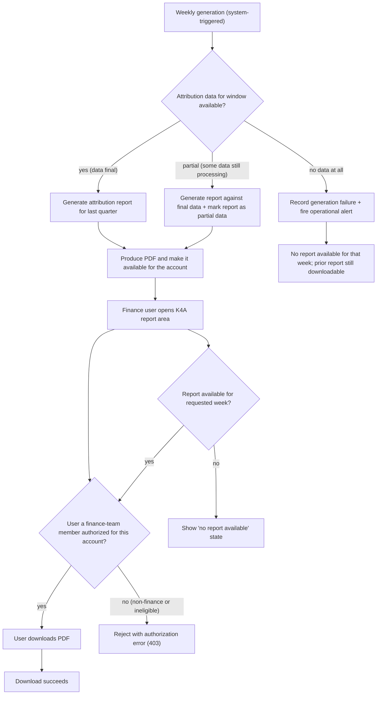

## 1. Business Logic & Context

### Problem

Brightway Retail's finance team cannot currently obtain attribution results in a portable, shareable form suitable for their year-end financial close. Attribution data exists in the K4A product, but there is no way for the finance team to pull a periodic, self-contained snapshot of it. With a hard year-end close deadline approaching, the finance team needs an attribution report they can retrieve on their own, on a regular cadence, without engineering involvement each week.

### Value

- The finance team can self-serve a weekly attribution report as a downloadable PDF, removing manual pull requests and ad-hoc data exports.
- The report is available in time for Brightway Retail's year-end close — the primary success condition for this work.
- Delivers a repeatable weekly reporting capability in K4A. For now this is built account-specific to Brightway Retail (standard plan) and is not a generalized multi-customer capability; generalization to other customers and plans is a possible later extension, not in scope now (resolves OQ-008).

### Business Rules

- **BR-1 — Cadence:** The report is generated and made available on a weekly cadence.
- **BR-2 — Format:** The report is delivered as a PDF.
- **BR-3 — Reporting window:** The report covers the last quarter only, meaning the most recent completed quarter relative to the generation date, recalculated every week.
- **BR-4 — Customer scope:** This capability applies to Brightway Retail, a standard-plan customer. Whether the feature is gated to Brightway Retail specifically, to all standard-plan accounts, or to all K4A accounts is not settled by the input. [DECISION REQUIRED: DEC-002]
- **BR-5 — Access:** Access is restricted to the finance team: only finance-team users on the Brightway Retail account may download the report, not any user on the account (resolves OQ-006, DEC-003). The exact mechanism for identifying finance-team membership (role/group) is an engineering default to set during `eng-plan`.
- **BR-6 — Delivery mechanism:** The finance team triggers the report themselves from the K4A console (manual on-demand trigger from the console). The report is not automatically emailed and is not generated without a user-initiated trigger in the console.
- **BR-7 — Data readiness:** When attribution data for a reporting window is incomplete or still processing, the report must still generate against the data that is final, and must clearly mark the report as containing partial data (indicating that some data was incomplete at generation time), rather than blocking or delaying generation. Confirmed by the reviewer (resolves OQ-005) — see FR-013.
- **BR-8 — Retention:** Historical weekly reports remain downloadable for two years, after which they may be archived or removed (resolves OQ-007, DEC-005).

### Content of the report

The report must contain total attributed revenue and conversions by channel, plus the change from the prior week. A single simple table layout is sufficient.

### Service-map note (from independent KG cross-check)

Two independent knowledge-graph lookups of the affected codebase disagree on the set of services involved: one lookup surfaced a K4A-specific backend request handler that the other did not re-find, and the second lookup surfaced two additional reporting-backend candidates (an attribution-as-a-service reporting backend and a summary-report data producer) that the first did not list. The reporting-generation pipeline ownership is therefore not yet settled. This discrepancy must be reconciled by engineering during the `eng-context`/`eng-plan` phase before scope is locked; it does not change the product behavior defined in this spec.

## 2. User Flows (Visuals)



## 3. Functional Requirements

> Grouped by feature area. Several requirements below depend on product decisions flagged in Section 1 (cadence target day, delivery mechanism, access scope, reporting-window semantics, retention). Where a requirement names a default, it is a working default engineering can build against until the corresponding decision lands.

### 3.1 Report Generation

**FR-001 — Weekly report generation**
```gherkin
Given attribution data exists for a Brightway Retail reporting window
When the weekly generation cycle runs
Then the system generates one attribution report covering the last quarter for the Brightway Retail account
And the generated report is produced in PDF format
```

**FR-002 — Weekly cadence trigger**
```gherkin
Given the weekly report generation is enabled for the account
When the scheduled weekly generation time is reached
Then the system triggers generation of a new attribution report for that account
And the generation runs without any manual engineering action
```
> The specific day/time of the weekly cycle is an operational default for engineering to set (recommended: generation early on a fixed weekday so a fresh report is available at the start of each business week). If the finance team requires a specific delivery day relative to their close, that is captured under BR-6.

**FR-003 — Reporting window scoping**
```gherkin
Given a report is being generated
When the system determines the reporting window
Then the report includes only attribution data for the last quarter
And data outside the last-quarter window is excluded from the report
```
> Per BR-3 (see Section 1), "last quarter" is the most recent completed quarter relative to the generation date, recalculated every week.

**FR-019 — Brightway logo on the report PDF**
```gherkin
Given a weekly attribution report is being generated for the Brightway Retail account
When the system produces the PDF
Then the generated report PDF includes the Brightway logo
```
> Finance requested the Brightway logo on the report PDF. The source, placement, and resolution of the logo asset are an engineering/design default to set during `eng-plan`.

**FR-004 — Single report per cycle (idempotency)**
```gherkin
Given a weekly generation cycle has already produced a report for a given account and reporting window
When the same generation cycle is retried or re-delivered for that same account and window
Then the system produces the same end state for that account and window
And no duplicate report is created and no data is double-counted for that window
```

**FR-005 — No overlapping generation runs**
```gherkin
Given a weekly generation run for an account is already in progress
When another generation run for the same account and window is triggered before the first completes
Then the second run does not start concurrently
And the in-progress run is allowed to complete
```

### 3.2 Attribution Data Sourcing & Readiness

**FR-006 — Source attribution data for the window**
```gherkin
Given the system is generating a report for the last-quarter window
When it assembles the report contents
Then it reads attribution data scoped to that window from the authoritative attribution data source
And it does not modify the source attribution data
And the assembled report presents total attributed revenue and conversions by channel, plus the change from the prior week, in a single table
```

**FR-007 — Downstream dependency failure handling**
```gherkin
Given the system requests attribution data from the attribution data source
When the data source is unavailable or returns an error
Then the system retries with bounded exponential backoff up to 3 attempts
And if a response signals rate limiting, the system honors the response's retry-after timing rather than retrying on a fixed schedule
And if all attempts fail, the generation run is recorded as failed with a distinct, named failure status
```

**FR-008 — Distinct failure conditions are recorded distinctly**
```gherkin
Given a generation run encounters a dependency failure
When the failure is recorded
Then a timeout, a dependency-unavailable condition, and a rate-limited condition are each recorded under their own named status
And these conditions are not collapsed into a single generic failure
```

### 3.3 Data Readiness Handling

**FR-013 — Incomplete attribution data at generation time**
```gherkin
Given some attribution data for the reporting window is still processing or incomplete when generation runs
When the report is generated
Then the system generates the report against the data that is final for the window
And the report is clearly marked as containing partial data, indicating that some data was incomplete at generation time
And generation is not blocked or delayed waiting for all data to finalize
```
> This encodes the confirmed BR-7 posture (resolves OQ-005): generate against final data and mark the report as partial; generation is never blocked or delayed waiting for data to finalize.

**FR-014 — No attribution data available**
```gherkin
Given no attribution data at all is available for the reporting window
When the weekly generation cycle runs
Then the system does not produce an empty or misleading report for that cycle
And the generation run is recorded as failed with a named "no data" status
And an operational alert is fired
And any previously generated report for the account remains available for download
```

### 3.4 Report Availability & Download (K4A UI)

**FR-009 — Report availability to the account**
```gherkin
Given a weekly report has been successfully generated for the account
When generation completes
Then the report is made available to the Brightway Retail account through the K4A console
```
> Whether availability also includes automated email delivery or manual trigger is governed by BR-6 (Section 1). Working default: reports are continuously available for download in the K4A console.

**FR-010 — Download the report as PDF**
```gherkin
Given a report is available for the account and the user is authorized
When the user selects the download action for that report in the K4A console
Then the system delivers the report to the user as a PDF file
```

**FR-011 — No report available state**
```gherkin
Given no report is available for a requested week for the account
When the user opens the report area in the K4A console
Then the UI presents a clear "no report available" state for that week
And no broken or empty download action is offered for that week
```

**FR-015 — Secure download delivery**
```gherkin
Given a user triggers a report download
When the system serves the PDF
Then the report is delivered via a time-limited secure link rather than a permanently public URL
And the link is no longer usable after it expires
```

### 3.5 Access Control

**FR-012 — Server-side authorization on download**
```gherkin
Given a user requests to download a report for an account
When the request reaches the backend
Then the backend re-derives the user's eligibility from the authoritative source on that request
And a request from a user not authorized for that account is rejected with a 403
And authorization is enforced server-side regardless of whether the UI showed or hid the download action
```
> The authorized set is governed by BR-5 (Section 1): only finance-team users on the Brightway Retail account may download, enforced server-side. A request from a non-finance user on the account is rejected with a 403.

**FR-016 — Account/plan eligibility gating**
```gherkin
Given the feature is scoped to specific accounts or plans
When a download or generation request is made for an account
Then the backend verifies the account is eligible for this feature on every request
And a request for an ineligible account is rejected server-side with a 403
```
> The eligibility scope (Brightway Retail only, all standard-plan accounts, or all K4A accounts) is governed by BR-4 (Section 1). Working default: gated to the Brightway Retail account only.

### 3.6 Safety & Operability

**FR-017 — Feature kill-switch**
```gherkin
Given this is a HIGH-risk, multi-service change
When an on-call engineer needs to disable the feature during an incident
Then the feature can be disabled via configuration without a code deploy
And disabling it does not require a separate approval or escalation step
And new requests reflect the disabled state within 5 minutes
And requests already in flight before the flip complete under the prior behavior
```

**FR-018 — No sensitive data in logs**
```gherkin
Given the system logs generation and download activity
When a log record is written
Then no raw user-identifying data, credentials, secrets, or tokens are written to logs
```

Now reporting the decisions I flagged in Sections 1–3.

## 4. Information Requirements

The system must track the following business information to support the functional requirements above. This is a product-level inventory of concepts, not a schema — field names, types, and storage decisions belong to `eng-plan`.

- **Weekly Report instance** — a single generated attribution report for an account and reporting window. System-derived (produced by the weekly generation cycle). Needed to make reports available for download (FR-009), list past reports (FR-011), and enforce idempotency so a retry doesn't create a duplicate (FR-004).
- **Reporting window** — the last-quarter date range a given report covers, i.e. the most recent completed quarter relative to the generation date, recalculated every week (BR-3). System-derived from the generation date. Needed to scope report contents (FR-003) and to key a report instance uniquely per account+window (FR-004).
- **Generation run status** — the outcome of each weekly generation attempt, including the distinct named failure conditions (timeout, dependency-unavailable, rate-limited, no-data). System-derived. Needed for FR-007, FR-008, FR-014, and for operational alerting.
- **Data-completeness indicator** — whether the attribution data for the window was fully final or partially still-processing at generation time. System-derived from the attribution data source. Needed to mark the report as partial data when some data was incomplete at generation time (FR-013).
- **Attribution data for the window** — the source metrics/data points the report renders: total attributed revenue and conversions by channel, plus the change from the prior week, presented in a single simple table. External to this feature (read from the authoritative attribution data source, read-only). Needed for FR-006.
- **Account / plan eligibility** — whether a requesting account is in scope for this feature. System-derived from the authoritative account source on each request. Needed for eligibility gating (FR-016); the scope itself is governed by BR-4.
- **User download authorization** — whether a requesting user may download reports for the account, i.e. whether the user is a finance-team member on the account (BR-5). System-derived from the authoritative auth source on each request, never cached client-side. Needed for FR-012; the authorized set is finance-team users only per BR-5.
- **Secure download link** — a time-limited reference used to serve a PDF. System-derived at download time. Needed for FR-015.
- **Report retention record** — how long a generated report remains available for download. System-derived; per BR-8, reports remain downloadable for two years before they may be archived or removed.
- **Operational/audit trail of generation and download activity** — actor identity (user ID + account ID), the report/window identity, the action (generate / download), timestamp, and outcome/status. System-derived. Needed to trace who downloaded which report when, and to support the alerting and audit guardrails in Section 5.

## 5. Non-Functional Requirements & Guardrails

### Performance & Capacity

- **NFR-001 — Download responsiveness.** The download action in the K4A console must serve the PDF (or begin streaming it) with p95 latency ≤ 3 seconds, measured under expected concurrent finance-user load for a single account. Generation itself is an asynchronous background job and is not bound by this interactive target.
- **NFR-002 — Attribution source query cap.** Report generation must apply an explicit rate cap on its reads against the shared attribution data source so that weekly generation cannot starve existing attribution traffic. Working default: generation reads are throttled to a bounded concurrency against the source; the exact cap is an engineering default set during `eng-plan`.
- **NFR-003 — Generation monitoring.** The system must alert when the weekly generation failure rate exceeds 1% for 5 minutes, sustained, and when attribution-source read error rate exceeds 1% for 5 minutes, sustained.

### Reliability & Idempotency

- **NFR-004 — Idempotent generation.** Weekly generation is idempotent on the account + reporting-window key: a retried or re-delivered generation event for the same account and window overwrites/upserts the existing report rather than producing a duplicate instance or double-counting data (supports FR-004).
- **NFR-005 — Overlap prevention.** The scheduled generation job must prevent overlapping concurrent runs for the same account and window at the scheduler level, as a complement to idempotency (supports FR-005).
- **NFR-006 — Bounded dependency retry.** Calls to the attribution data source and any downstream reporting dependency must use bounded retry (max 3 attempts) with exponential backoff, honoring any rate-limit retry-after signal, never retrying indefinitely (supports FR-007).
- **NFR-007 — Failure posture.** On unrecoverable failure of a generation run, the system fails gracefully: it does not produce an empty or misleading report, it records a distinct named failure status, and it leaves any previously generated report available for download (graceful degradation — chosen because report availability matters more than forcing a fresh run, and the fallback — the prior report — leaks nothing new). The download path, by contrast, fails closed on an authorization failure (see NFR-010).

### Security & Access Control

- **NFR-008 — Server-side authorization.** All access control for download and generation requests is enforced server-side on every request; UI hiding of the download action is never the sole gate. A direct request from an ineligible user or account is rejected with a 403 (supports FR-012, FR-016).
- **NFR-009 — Re-derive eligibility per request.** User authorization and account/plan eligibility are re-derived from the authoritative source on every request, never cached client-side and never trusted from a client-supplied claim.
- **NFR-010 — Fail closed on auth-system unavailability.** If the authorization/eligibility source is unreachable, the request is denied rather than allowed.
- **NFR-011 — Secure, expiring downloads.** Reports are delivered via a time-limited secure link, not a permanently public URL; the link is unusable after expiry (supports FR-015). Working default link lifetime: 15 minutes.
- **NFR-012 — No sensitive data in logs.** Raw user-identifying data, credentials, secrets, and tokens are never written to logs (supports FR-018).

> The report PDF contains attribution business data for a single customer account. Whether any of that content is a contractually restricted data class requiring a separate store is not indicated by the input; if it is, the separate-store and masking handling from Kochava's data-sensitivity convention applies. [DECISION REQUIRED: DEC-007]

### Audit / Compliance Logging

- **NFR-013 — Audit trail for generation and download.** Each report generation and each report download is recorded in an append-only, immutable audit trail capturing actor identity (user ID + account ID), report + reporting-window identity, action (generate/download), timestamp, and outcome/status. The audit write is asynchronous so it never blocks the primary operation, but an audit-write failure fires an immediate operational alert rather than failing silently.
- **NFR-014 — Audit retention.** Audit records are retained for a minimum of 12 months. Because this report supports a customer's financial year-end close, a longer retention aligned to that financial cycle may be required. [DECISION REQUIRED: DEC-008]

### Operability

- **NFR-015 — Kill-switch.** The feature is disableable via configuration with no code deploy, usable by on-call without separate approval, with new requests reflecting the disabled state within 5 minutes and in-flight requests completing under prior behavior (supports FR-017).

### Risk Mitigation

Explicit treatment of each risk from the Context Seed:

- **Hard 5-week year-end deadline.** Mitigated only if the unsettled product decisions in Section 1 (delivery mechanism, access/eligibility scope) are answered early, since each gates a buildable requirement. The working defaults in Section 3 let engineering proceed in parallel, but final content and scope must be confirmed before the report is considered acceptance-ready. The service-map reconciliation (below) is also on the critical path.
- **Multi-service blast radius (6 services, with disagreement across KG passes).** Mitigated by (a) reconciling the actual service map during `eng-context`/`eng-plan` before scope is locked — see the Section 1 service-map note — and (b) the kill-switch (NFR-015) so the feature can be pulled without a deploy if any participating service misbehaves.
- **UX scope (confirmed: simple download button).** The PM has confirmed finance wants only a simple download button, not a full report management/listing interface. Phase 1 is therefore constrained to the minimum viable surface (see Section 6): a download action plus a basic availability/"no report" state, with any richer management interface explicitly deferred.
- **Attribution data incompleteness / mid-processing reads.** Mitigated by FR-013/FR-014 and the confirmed BR-7 posture (generate against final data, mark the report as partial, never block — resolves OQ-005), and by NFR-006 bounded retries against the source.

### Rollback

- **NFR-016 — Rollback.** Trigger: sustained generation failure above the NFR-003 threshold, an authorization defect, or any incorrect report content reaching a customer. Authority: on-call engineer via the NFR-015 kill-switch, no separate approval. Timing target: feature disabled within 5 minutes of decision. Already-produced reports are not retroactively withdrawn or reverted; only new generation and download operations are affected going forward.

### Backward Compatibility

- **NFR-017 — Backward compatibility.** This feature extends an existing reporting pipeline with existing consumers. Any existing report-generation, scheduling, or attribution-read behavior relied upon by current consumers must remain unchanged; the weekly K4A attribution report is additive. Engineering must confirm during `eng-plan` that no existing scheduled job, report output, or attribution-source query path is altered in a way that affects current callers.

## 6. Out of Scope & Phasing

### Phase 1 (this work — MVP)

- Weekly generation of an attribution report covering the last quarter for the Brightway Retail account.
- PDF output of that report.
- A download action and a basic availability / "no report available" state in the K4A console.
- Server-side access control and account/plan eligibility gating.
- Incomplete-data handling (generate against final data, flag incomplete) and failure/alerting behavior.
- Kill-switch, audit logging, and secure time-limited download links.

### Out of Scope / Future Phases

| Item | Rationale | Phase |
|------|-----------|-------|
| Full "report management interface" (rich listing, filtering, search, bulk actions) | PM confirmed finance wants only a simple download button; Phase 1 constrained to minimum viable download surface | Future |
| Automated email delivery of the weekly report | Delivery mechanism unsettled (BR-6); console download is the working default | Future, pending decision |
| Manual on-demand report triggering by the finance team | Delivery mechanism unsettled (BR-6); weekly scheduled generation is the Phase 1 path | Future, pending decision |
| Rollout to all standard-plan accounts or all K4A accounts | Phase 1 scoped to Brightway Retail (BR-4); broader eligibility is a later expansion | Future, pending decision |
| Reports for windows other than the last quarter (e.g. arbitrary date ranges, full-year) | Context Seed scopes this to last quarter only | Future |
| Long-term report archival / retention tooling beyond basic availability (archival/removal of reports older than the 2-year retention window per BR-8) | Reports stay downloadable for two years (BR-8); tooling to archive/remove reports past that window is deferred | Future |
| Configurable report content/templates chosen by the customer | Phase 1 ships one defined report (revenue + conversions by channel with week-over-week change, single table); customer-configurable content is deferred | Future |
| Non-PDF export formats (CSV, XLSX, etc.) | Context Seed specifies PDF only | Future |

## Appendix: Engineering Reference

_The sections below are derived automatically from the codebase knowledge graph, for the engineering team's reference during planning — not required reading for product/requirement review._

### Affected Services (grounded context, not implementation direction)

Per the Context Seed's technical analysis, the following services are named as affected (KG-derived fact, not an implementation choice made here). Note the two KG passes disagree — see the Section 1 service-map note; reconciliation is an `eng-context`/`eng-plan` task.

- **reporting-api** (backend) — generates and delivers weekly attribution reports; likely owns PDF export.
- **reporting-dispatcher** (backend) — schedules and routes weekly report delivery/generation jobs.
- **reporting-subscriptions-worker** (backend) — manages scheduled weekly report delivery subscriptions.
- **frontend-mos** (frontend) — K4A console UI: PDF download button / report management interface.
- **k4a-mcp-server** (backend) — K4A backend service handling report requests (present in the summary pass only; absent from the independent cross-check — confirm involvement).
- **pubsuite-attribution** (backend) — attribution data source consumed by the report.
- **aaas-reporting** (backend) — attribution-as-a-service reporting backend (appeared in the independent cross-check only, low confidence — reconcile against reporting-api).
- **summary-report-cloud** (backend) — produces summary attribution report data (appeared in the independent cross-check only, low confidence — reconcile against reporting-api).

## Revision Summary

_Applied reviewer's request._

- Updated Value bullet to record OQ-008 resolution: build account-specific for Brightway Retail now, not generalized.


---
## Open Questions & Decisions Register

_Durable, ID'd reference for HITL 2 (G1) and beyond — inline `[DECISION REQUIRED: DEC-00N]` tags in the sections above point back here. Reflects the latest round only._

### Decisions Required (business trade-offs — needs a human call)

_Each carries an **Owner** (accountable for supplying the answer) and a **Provisional Value** (the working assumption engineering may build against until the decision lands), so none of these fully block engineering — implementation proceeds on the provisional value and adjusts if the confirmed decision differs._

| ID | Decision | Owner | Provisional Value (build against until confirmed) |
|----|----------|-------|-----------------------------------------------------|
| **DEC-002** | Should this weekly report capability be available only to the Brightway Retail account, to every standard-plan account, or to all K4A accounts? | Product owner | Gated to the Brightway Retail account only for this phase, enforced server-side. |
| **DEC-003** | Which users within the Brightway Retail account are allowed to download these reports, or can any user on the account download them? | Product owner (with Brightway Retail finance team) | Any user with access to the Brightway Retail K4A account may download, enforced server-side. |
| **DEC-004** | Should the finance team get the report by manually triggering it each week, by automated email delivery, or simply by it being continuously available for download in the K4A console? | Product owner (with Brightway Retail finance team) | Reports are continuously available for download in the K4A console, no email delivery in this phase. |
| **DEC-005** | How long should historical weekly reports stay downloadable before they are archived or removed? | Product owner (with Compliance input) | Keep weekly reports downloadable for 12 months, then archive. |
| **DEC-007** | Does the report PDF contain any contractually or legally restricted customer data that must be kept in a separate store and masked, rather than handled like ordinary account reporting data? | Compliance/Security + Product owner | Treat report content as ordinary single-account business data (no separate restricted store, no masking) until Compliance confirms otherwise. |
| **DEC-008** | How long must the audit trail of who generated and downloaded these reports be retained, given this supports a customer's financial year-end close? | Compliance/Security | Retain audit records for a minimum of 24 months to cover a full financial year-end cycle plus a prior-year comparison. |

### Decisions Resolved

- **DEC-001**: Duplicate of OQ-004; settled by the same answer — report covers the most recent completed quarter, recalculated each week.
- **DEC-006**: Resolved — the report must contain total attributed revenue and conversions by channel, plus the change from last week, presented as one simple table. Same answer as OQ-001.

### Questions Resolved

- **OQ-001**: Resolved OQ-001 and DEC-006: the weekly report must contain total attributed revenue and conversions by channel, plus the change from last week, in a single simple table layout.
- **OQ-002**: Resolved OQ-002 — PM confirmed the UI is just a simple download button, not a full report management/listing interface.
- **OQ-003**: OQ-003 resolved: finance triggers the report themselves from the K4A console (manually triggered from the console).
- **OQ-004**: Resolved OQ-004 (and DEC-001, the same question): "last quarter only" means the most recent completed quarter relative to the generation date, recalculated every week.
- **OQ-005**: Resolved OQ-005: when attribution data is still processing or incomplete, the report is generated anyway but marked as partial data (confirming the existing BR-7/FR-013 posture).
- **OQ-006**: Resolved OQ-006 — access controls are needed: only the finance team (finance-only) may download these reports, not any user on the Brightway Retail account.
- **OQ-007**: Resolved OQ-007 (and DEC-005/BR-8): historical weekly reports are retained and downloadable for two years.
- **OQ-008**: Resolved OQ-008: this is a one-off for Brightway Retail (standard plan) for now, not a generalized capability — build account-specific rather than generalized.

---
> **Classification:** Type A
