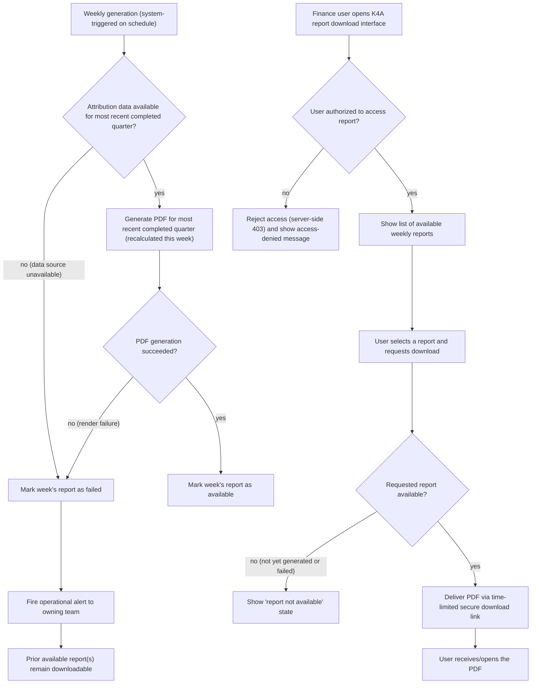

# Product Specification — K4A Weekly Attribution Report PDF Download

## 1. Business Logic & Context

### Problem

Brightway Retail's finance team needs attribution reporting data in a consumable, portable format (PDF) on a recurring weekly basis. Today there is no mechanism for the finance team to self-serve a weekly attribution report as a downloadable PDF in K4A. Without this, the finance team cannot reliably reconcile attribution data ahead of their year-end close, which is a hard, time-bound business event.

### Value

- Gives Brightway Retail's finance team a predictable, recurring (weekly) attribution report they can download as a PDF.
- Directly unblocks their year-end close, which is the time-critical driver for this work.
- Establishes a repeatable weekly PDF reporting capability in K4A that can serve future finance/reporting needs.

### Business Rules

- **Report cadence:** The attribution report is generated on a weekly schedule and becomes available for download each week.
- **Data scope:** Each report contains attribution data for the **most recent completed quarter**, recalculated every week (so each week's report reflects the same completed-quarter window re-run against the latest data). Metrics are assumed standard for K4A attribution reports.
- **Output format:** The report is delivered as a downloadable **PDF**.
- **Plan eligibility:** Brightway Retail is on the **standard plan**; this capability must be available to them under that plan.
- **Audience:** The report is intended for the Brightway Retail **finance team**.
- **Financial data sensitivity:** This is finance-facing reporting data feeding a year-end close. Correctness and integrity of the attribution figures are treated as a first-class requirement, not an afterthought.

### Delivery Mechanism

The Context Seed states a download capability is required but does not resolve whether the PDF should also be **automatically emailed** to the finance team each week or whether a **self-service download portal** alone is sufficient. [DECISION REQUIRED]

### Access Scope

The Context Seed does not resolve who within the finance team may view or download the report, or whether role-based restrictions apply. [DECISION REQUIRED]

### Report Content & Layout

The specific attribution metrics the PDF must contain and the layout Brightway Retail expects (summary table, per-channel breakdowns, charts) are not fully resolved in the Context Seed. Per reviewer decision, the report is **generated anyway using the standard K4A attribution report metric set and marked as partial data** until the full metric/layout specification is confirmed, so finance is not blocked ahead of year-end close. Finance has confirmed one concrete layout requirement: the PDF must display the **Brightway Retail logo** (see FR-003a).

### Historical Retention

Historical weekly report PDFs are retained and remain downloadable for **two years** (per reviewer decision, resolving DEC-004 / OQ-007). The download interface lists every weekly report within this two-year window.

### Knowledge-Graph Cross-Check Note

Two independent codebase knowledge-graph lookups disagree on the attribution **data source** for this report: one identifies a dedicated attribution-computation backend, the other identifies two different query/attribution-data backends and does not re-find the first. This discrepancy is unresolved at spec time and must be settled during engineering design review before build; it does not change the product behavior defined here but does affect scoping confidence. (Full service-level grounding evidence is provided in a separate engineering appendix.)

---

## 2. User Flows (Visuals)



---

## 3. Functional Requirements

### Feature Area A — Weekly Report Generation & Scheduling

#### FR-001 — Weekly report generation on schedule
```gherkin
Given a weekly report schedule is configured for a K4A account eligible for attribution reports
And the account is on the standard plan
When the scheduled weekly generation time is reached
Then the system generates an attribution report covering the last quarter for that account
And the generated report is produced in PDF format
And the report is marked as available for download for that week
```

#### FR-002 — Most-recent-completed-quarter data scope
```gherkin
Given a weekly attribution report is being generated
When the system assembles the report content
Then the report includes attribution data scoped to the most recent completed quarter only
And the completed-quarter window is recalculated on each weekly run against the latest available data
And data outside the most-recent-completed-quarter window is excluded from the report
```

#### FR-003 — Report content uses the standard K4A attribution metric set
```gherkin
Given a weekly attribution report is being generated
When the system assembles the report content
Then the report contains the standard K4A attribution report metric set
And the generated report is marked as partial data until the full metric/layout specification is confirmed
And the metric set and layout remain consistent from week to week
```
> Note: Per reviewer decision, the report is generated using the standard K4A attribution report metric set and marked as partial data until the full metric/layout specification is confirmed; this does not block weekly generation.

#### FR-003a — Report PDF displays the Brightway Retail logo
```gherkin
Given a weekly attribution report PDF is being generated for Brightway Retail
When the system renders the report
Then the generated PDF displays the Brightway Retail logo
And the logo appears consistently on each weekly report
```
> Note: Added per finance's request. The source/placement of the Brightway Retail logo asset (e.g. account branding record vs. a supplied asset) is an engineering detail to settle during design; the exact layout remains subject to the Report Content & Layout decision in Section 1.

#### FR-004 — Generation failure is recorded and does not silently skip
```gherkin
Given a weekly report generation run is in progress
When report generation fails because the attribution data cannot be retrieved or the PDF cannot be rendered
Then the system records the week's report with a failed status
And the system fires an operational alert to the owning team identifying the account and the failed week
And previously generated available reports remain downloadable
And no partial or corrupt PDF is marked as available
```

#### FR-005 — Distinct failure conditions are recorded distinctly
```gherkin
Given a weekly report generation run fails
When the failure cause is determined
Then the recorded failure status distinguishes between attribution-data-unavailable and PDF-render-failure
And each distinct failure condition is reported with its own operational alert detail
```

#### FR-006 — Weekly generation is idempotent per account per week
```gherkin
Given a weekly report for a given account and a given week has already been generated
When the generation job is retried or re-run for that same account and that same week
Then the system produces the same end state by overwriting the existing week's report
And no duplicate report record is created for that account and week
And the finance team is never shown two reports for the same week
```

#### FR-007 — Overlapping generation runs for the same week do not double-execute
```gherkin
Given a weekly generation run for a given account and week is already in progress
When the scheduler attempts to start another run for the same account and the same week before the first completes
Then the system does not start a second concurrent run for that account and week
And only one run completes and determines that week's report
```

### Feature Area B — Report Download Interface (K4A UI)

#### FR-008 — Authorized finance user sees available reports
```gherkin
Given a finance user authorized to access the attribution report for a K4A account
When the user opens the report download interface in K4A
Then the interface lists the weekly attribution reports currently available for download
And each listed report identifies the week it covers and its availability status
```

#### FR-009 — Download a selected available report as PDF
```gherkin
Given an authorized finance user is viewing the list of available weekly reports
And a report for the selected week has an available status
When the user requests to download that report
Then the system delivers the report as a PDF file via a time-limited secure download link
And the downloaded file contents match the report generated for that week
```

#### FR-010 — Unavailable report cannot be downloaded
```gherkin
Given an authorized finance user is viewing the report download interface
And a report for a given week has not yet been generated or has a failed status
When the user attempts to access that week's report
Then the system does not deliver a PDF
And the interface shows a clear "report not available" state for that week
```

#### FR-011 — Server-side access enforcement for the report
```gherkin
Given a user or direct API caller who is not authorized to access the attribution report for a K4A account
When the caller requests the list of reports or requests to download a report
Then the system rejects the request server-side with an access-denied response
And the rejection occurs regardless of whether the UI would have shown the download control
And authorization is re-derived from the authoritative source on each request rather than trusted from a client-supplied claim
```
> Note: The precise set of roles permitted to download is subject to the Access Scope decision in Section 1; until resolved, engineering gates download to finance-team members of the owning account and enforces it server-side.

#### FR-012 — Access check fails closed when the authorization source is unreachable
```gherkin
Given the authorization source cannot be reached when a report access or download request is made
When the system cannot confirm the caller is authorized
Then the system denies the request
And the system does not deliver any report content
```

### Feature Area C — Secure Delivery

#### FR-013 — Time-limited secure download link
```gherkin
Given an authorized finance user has requested a report download
When the system provides access to the PDF
Then the PDF is delivered via a time-limited secure link
And the link ceases to grant access after its validity window expires
```

#### FR-014 — Automatic weekly email delivery (conditional)
```gherkin
Given automatic weekly email delivery of the PDF to the finance team is in scope for this feature
And a weekly report has been successfully generated and marked available
When the weekly generation completes
Then the system delivers the PDF to the designated finance-team recipients via a secure, time-limited link rather than as a raw attachment
```
> Note: Whether FR-014 is in scope depends on the Delivery Mechanism decision in Section 1 (see Section 1). Until resolved, engineering builds the self-service download path (FR-008 through FR-013) as the primary mechanism and treats weekly email as additive.

I have written Sections 0–3. Now reporting the business trade-offs I flagged.

## 4. Information Requirements

The system must track the following business information to support the Functional Requirements:

- **Weekly Report Record** — represents one generated (or attempted) weekly attribution report for an account. *System-derived.* Needed by FR-001, FR-006, FR-008, and FR-010 to list, de-duplicate, and serve reports and to reflect per-week availability.
- **Report Covered Period** — the most-recent-completed-quarter window the report's data represents, re-derived on each weekly run. *System-derived* from the generation run date. Needed by FR-002 and FR-008 so finance users know exactly which period each report reflects.
- **Report Availability Status** — whether a given week's report is available, failed, or not-yet-generated. *System-derived.* Needed by FR-004, FR-008, FR-009, and FR-010 to drive what the download interface shows and permits.
- **Report Failure Reason** — the distinct cause when a week's report fails (attribution-data-unavailable vs. PDF-render-failure). *System-derived.* Needed by FR-004 and FR-005 to drive distinct operational alerts.
- **Attribution Data (last quarter)** — the standard K4A attribution metric set that populates the report body. *System-derived* from the attribution data source (unresolved between the two KG candidate sources — see Section 1). Needed by FR-002 and FR-003 as the report's content.
- **Report Content Definition** — the standard K4A attribution metric set and layout applied to each weekly report, including the Brightway Retail logo displayed on the PDF. *System-derived* (standard K4A definition); per reviewer decision the report is generated with this set and marked as partial data until the full metric/layout specification is confirmed. Needed by FR-003 for week-to-week consistency and FR-003a for the logo.
- **Brightway Retail Logo Asset** — the Brightway Retail logo image rendered on each weekly report PDF per finance's request. *System-derived* from account branding / supplied asset (source to be settled in engineering design). Needed by FR-003a.
- **Account & Plan Eligibility** — which account the report belongs to and that it is on the standard plan. *System-derived* from account records. Needed by FR-001 to determine eligibility for generation.
- **Report Access Entitlement** — which users/roles may view and download a given account's report. *System-derived* from the authoritative authorization source, re-derived per request. Needed by FR-008, FR-011, and FR-012 to gate access server-side. The exact entitled roles are pending the Access Scope decision in Section 1.
- **Secure Download Link / Validity Window** — the time-limited means by which a PDF is delivered. *System-derived.* Needed by FR-009 and FR-013 to deliver content securely and expire access.
- **Email Delivery Recipient List (conditional)** — the designated finance-team recipients, if automatic weekly email delivery is in scope. *User-/product-configured.* Needed by FR-014; conditional on the Delivery Mechanism decision in Section 1.
- **Audit Record of Report Access/Download** — actor identity (user + account), report identity (account + covered week), action (list/download), timestamp, and outcome. *System-derived.* Needed by NFR-009 given the finance-facing, year-end-close sensitivity of this data.
- **Report Retention Horizon** — how many prior weekly reports remain listed and downloadable: a **two-year** window per reviewer decision (see Section 1). *Product-configured.* Needed by FR-008 to determine what the interface lists.

---

## 5. Non-Functional Requirements & Guardrails

### Performance & Capacity

- **NFR-001 — Download responsiveness.** When an authorized finance user requests an available report, the download link is served with p95 ≤ 2s, measured under expected concurrent finance-user load. The underlying PDF is pre-generated on the weekly schedule, so download must not trigger on-demand generation.
- **NFR-002 — Interface listing responsiveness.** The report download interface lists available weekly reports with p95 ≤ 2s under expected concurrent finance-user load.
- **NFR-003 — Attribution query protection.** Because the weekly generation reads from a shared attribution/query backend, generation runs must honor an explicit rate cap against that backend so weekly generation does not degrade other consumers of that resource. The specific cap is an engineering decision to be set during design against the confirmed data source.
- **NFR-004 — Generation monitoring.** Alert when the weekly report generation failure rate exceeds 1% for 5 minutes, sustained, and alert on any single generation failure for an account's weekly run (per FR-004). Generation is a scheduled, finance-critical run; a silent miss before year-end close is not acceptable.

### Reliability & Idempotency

- **NFR-005 — Bounded retry on data/render failure.** On a transient attribution-data or render failure, generation retries with exponential backoff, bounded to 3 attempts, before recording the week's report as failed (FR-004). Retries honor any downstream Retry-After / rate-limit signal rather than retrying on a fixed schedule.
- **NFR-006 — Graceful degradation on data unavailability.** If the attribution data source is unavailable at generation time, the weekly run fails closed for that week (records failed status, alerts) while previously generated reports remain downloadable (FR-004). The feature never serves a partial or stale PDF as if it were that week's report.
- **NFR-007 — Idempotent, non-overlapping generation.** Weekly generation is idempotent on the account + covered-week key (FR-006), and concurrent re-runs for the same account and week are prevented at the scheduler level (FR-007) as a complementary safeguard.

### Security & Access Control

- **NFR-008 — Server-side access enforcement.** Access to list and download reports is enforced server-side on every request, re-derived from the authoritative authorization source, and fails closed if that source is unreachable (FR-011, FR-012). UI-hiding is never the sole gate; a direct API call from an ineligible caller is rejected (typically 403).
- **NFR-009 — Audit logging of report access.** Every list and download of a report is recorded to an immutable, append-only audit log capturing actor identity (user ID + account ID), report identity (account + covered week), action, timestamp, and outcome. Audit writes are asynchronous and must not block the primary operation; an audit-write failure fires an immediate operational alert rather than failing silently. Minimum retention: 12 months. [DECISION REQUIRED]
- **NFR-010 — Financial data handling.** Raw PII, credentials, secrets, and tokens are never written to logs. The report PDF is finance-restricted content and is delivered only via a time-limited secure link (FR-013), never as an unsecured public URL or persistent open attachment.
- **NFR-011 — Financial correctness integrity.** Because the report feeds a year-end close, the attribution figures in the PDF must exactly match the values computed by the confirmed attribution data source for the covered quarter. No rounding, truncation, or aggregation transformation is introduced in the PDF layer beyond what the standard K4A attribution report defines.

### Risk Mitigation

The Context Seed classifies this work as **HIGH risk** (hard 5-week deadline before year-end close, 6-service backend+frontend blast radius, financial-reporting data sensitivity). Each driver is addressed below.

- **NFR-012 — Kill-switch for the feature.** Because this is HIGH-risk, multi-service, and touches finance-sensitive data, the weekly report generation and download capability is controlled by a config-based feature flag that an on-call engineer can disable without a code deploy and without separate approval during an incident. New requests reflect the disabled state within 5 minutes of the flip; requests already in flight at flip time complete under the prior behavior.
- **NFR-013 — Deadline/blast-radius risk.** The 6-service blast radius and unresolved scheduling-ownership and data-source ambiguity (see Section 1 and the engineering appendix) are the primary delivery risks against the 5-week deadline. Mitigation: scheduling ownership (across the dispatch, subscriptions, and scheduler services) and the authoritative attribution data source must be settled at engineering design review before build, so scope is not discovered mid-build.
- **NFR-014 — Rollback.** *Trigger:* incorrect attribution figures, a PDF-integrity defect, or a security/access-control defect in production. *Authority:* on-call engineer for the owning team may invoke the NFR-012 kill-switch immediately; a broader rollback of the capability is owned by the feature's owning engineering team. *Timing target:* kill-switch effective within 5 minutes. *Data treatment:* already-generated reports are not retroactively altered by a rollback; only new generation and new downloads are suspended going forward.
- **NFR-015 — Backward compatibility.** This feature extends existing reporting and scheduling services with existing consumers (including shared SAM/K4A scheduling infrastructure). Existing SAM and K4A report behavior, schedules, and outputs must remain unchanged; the new weekly K4A PDF job must not alter, delay, or double-fire any existing scheduled report.

---

## 6. Out of Scope & Phasing

The following are explicitly **NOT** included in Phase 1 to prevent scope creep. Items are drawn from the Context Seed's open questions and behavior boundaries.

| Item | Status | Rationale |
|------|--------|-----------|
| In-browser PDF preview | Out of scope (Phase 1) — confirmed | Resolved (reviewer): in-browser PDF preview is not required. Delivery is a plain download button only, with no in-browser preview, to avoid increasing frontend scope on the tight deadline. |
| Report content/metric customization per customer | Out of scope (Phase 1) | Phase 1 generates the report using the standard K4A attribution metric set and marks it as partial data until the full metric/layout specification is confirmed. Brightway-specific layouts/metrics are not a Phase 1 commitment. |
| Automatic weekly email delivery | Conditional / deferred | Pending the Delivery Mechanism decision (Section 1). Self-service download is the Phase 1 primary path; email is additive (FR-014) and built only if confirmed in scope. |
| Historical report archive beyond the confirmed retention horizon | Out of scope (Phase 1) | Retention horizon is confirmed at two years (Section 1); Phase 1 serves weekly reports for the two-year window, not an open-ended archive. |
| Reports for products other than K4A | Out of scope (Phase 1) | This work item is scoped to K4A only. |
| Plans other than standard | Out of scope (Phase 1) | Brightway Retail is on the standard plan; cross-plan eligibility is not in scope. |
| Date ranges other than the most recent completed quarter (e.g. custom ranges, full year) | Out of scope (Phase 1) | Each report is scoped to the most recent completed quarter, recalculated weekly. |
| Compliance/audit archival requirements specific to Brightway Retail | Out of scope (Phase 1) pending input | The Context Seed raised but did not confirm Brightway-specific audit/retention obligations; absent that input, Phase 1 applies the standard audit/retention guardrails in Section 5 only. |

---

## Appendix: Engineering Reference

_The sections below are derived automatically from the codebase knowledge graph, for the engineering team's reference during planning — not required reading for product/requirement review._

### Affected Services (grounded context, not implementation direction)

- **reporting-api** (backend): Attribution report generation and delivery API.
- **reporting-dispatcher** (backend): Scheduled weekly report dispatch and PDF export.
- **reporting-subscriptions-worker** (backend): Manages scheduled report subscriptions and delivery.
- **frontend-mos** (frontend): K4A UI — report download interface (plain download button; in-browser PDF preview is confirmed out of scope — see Section 6).
- **pubsuite-attribution** (backend): Attribution data computation for weekly reports.
- **sam-report-scheduler** (backend): Schedules and triggers weekly SAM/K4A report generation.

> **Reconciliation note:** An independent KG cross-check did not re-find `pubsuite-attribution` or `sam-report-scheduler` and instead named `koch-query-api` and `aaas-reporting` as candidate attribution data sources. The authoritative attribution data source, and the scheduling ownership split across `reporting-dispatcher`, `reporting-subscriptions-worker`, and `sam-report-scheduler`, are unresolved and must be settled during engineering design review (see NFR-013). This appendix states grounded context only and is not an implementation direction.

## Revision Summary

_Applied reviewer's request._

- Resolved Historical Retention in Section 1 to a two-year retention/downloadability window per reviewer decision.
- Updated Report Retention Horizon in Information Requirements to the confirmed two-year window.
- Updated Out-of-Scope rationale for historical archive to reflect the confirmed two-year retention horizon.


---
## Open Questions & Decisions Register

_Durable, ID'd reference for HITL 2 (G1) and beyond — inline `[DECISION REQUIRED: DEC-00N]` tags in the sections above point back here. Reflects the latest round only._

### Decisions Required (business trade-offs — needs a human call)

_Each carries an **Owner** (accountable for supplying the answer) and a **Provisional Value** (the working assumption engineering may build against until the decision lands), so none of these fully block engineering — implementation proceeds on the provisional value and adjusts if the confirmed decision differs._

| ID | Decision | Owner | Provisional Value (build against until confirmed) |
|----|----------|-------|-----------------------------------------------------|
| **DEC-001** | Should the weekly attribution report be automatically emailed to the finance team each week, or is a self-service download in K4A enough to meet their year-end close deadline? | Product owner (with Brightway Retail finance stakeholder) | Self-service download in K4A is the primary mechanism for Phase 1; automatic weekly email is treated as additive and only built if confirmed needed before year-end close. |
| **DEC-002** | Who in Brightway Retail's finance team is allowed to view and download this report, and are there role-based restrictions on access? | Product owner with Compliance/Security | Restrict access to finance-team members of the owning Brightway Retail account, enforced server-side, until a specific role or named-user list is confirmed. |
| **DEC-004** | How far back should past weekly reports stay downloadable - current week only, the full quarter, or a rolling twelve months? | Product owner (with Brightway Retail finance stakeholder) | Keep the full last quarter of weekly reports downloadable, which aligns with the last-quarter data scope, until a specific retention period is confirmed. |
| **DEC-005** | How long should audit records of who viewed or downloaded these finance reports be retained? | Compliance/Security (with Product owner) | Retain report-access audit records for 12 months, extended to match any Brightway-specific audit agreement if one exists. |
| **DEC-006** | The Context Seed states a download capability is required but does not resolve whether the PDF should also be automatically emailed to the finance team each week or whether a self-service download portal alone is sufficient. | _(not yet assigned)_ | _(not yet specified)_ |
| **DEC-007** | The Context Seed states a download capability is required but does not resolve whether the PDF should also be automatically emailed to the finance team each week or whether a self-service download portal alone is sufficient. | _(not yet assigned)_ | _(not yet specified)_ |
| **DEC-008** | The Context Seed states a download capability is required but does not resolve whether the PDF should also be automatically emailed to the finance team each week or whether a self-service download portal alone is sufficient. | _(not yet assigned)_ | _(not yet specified)_ |

### Decisions Resolved

- **DEC-003**: Resolved DEC-003/OQ-005 (same question on required PDF attribution metrics and layout): generate the report anyway using the standard K4A attribution report metric set but mark it as partial data until the full metric/layout specification is confirmed.

### Open Questions (evidence gaps — needs more input)

- **OQ-002**: Should delivery be a self-service download portal, an automatic weekly email of the PDF, or both? This decides which backend services (subscriptions/dispatch vs. just download endpoint) are actually in scope.
- **OQ-004**: Who on the finance team needs access, and does this report need role/permission gating distinct from existing K4A console access? There's no evidence of how report access is currently restricted.
- **OQ-006**: What should happen on a failed weekly generation — alert, auto-retry, or skip? This drives whether we build monitoring/retry into the scheduler and dispatcher.

### Questions Resolved

- **OQ-001**: Resolved OQ-001: in-browser PDF preview is not required — delivery is a plain download button only, with no preview, to avoid increasing frontend scope on the tight deadline.
- **OQ-003**: Resolved OQ-003: 'last quarter only' means the most recent completed quarter, recalculated every week.
- **OQ-005**: Resolved OQ-005 (and its duplicate DEC-003): generate the report anyway using the standard K4A attribution metric set and mark it as partial data until the full metric/layout specification is confirmed.
- **OQ-007**: OQ-007 resolved — historical weekly financial report PDFs must be retained and remain downloadable for two years.

---
> **Classification:** Type B — requirement-agent's independent re-check DISAGREES with intake's original Type A call. The requirement is clearly specified (weekly PDF attribution report, last-quarter data, finance-team download) and the open questions are standard engineering/design decisions (metrics layout, retention, failure handling) rather than genuine product ambiguity — so this is engineering-led design across 6 backend+frontend services, not discovery.
