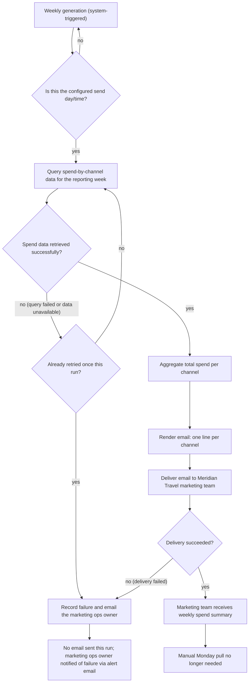

## 1. Business Logic & Context

### Problem

Meridian Travel's marketing team manually pulls spend-by-channel data every Monday and copies it into a spreadsheet. This manual process is time-consuming, error-prone, and does not scale — particularly with a summer campaign launch approaching, when spend monitoring cadence matters most. There is no automated delivery of weekly spend totals to the team.

### Value

Automating a weekly email summary of total spend per channel eliminates the recurring manual data pull, gives the marketing team a reliable, consistent weekly artifact, and frees their time during a high-stakes campaign period. Success is measured by the marketing team receiving the email and ceasing their manual Monday pull entirely.

### Business Rules

- **BR-1 — Cadence:** The summary is generated and sent on a weekly cadence. The exact day and time of delivery is a product decision not yet settled. [DECISION REQUIRED: DEC-001]
- **BR-2 — Content scope:** The email contains total spend per channel for the reporting week, rendered as one line per channel. Per the requester (Mayank Ukey), total spend per channel is sufficient — this is exactly what the team copies into a spreadsheet today. Totals-only is locked as the version-one scope (resolving OQ-005); comparison metrics (week-over-week change, budget variance, performance indicators) are explicitly out of scope for Phase 1.
- **BR-3 — Reporting week:** Each email covers one reporting week. The reporting week runs Monday through Sunday, bounded in Eastern time (per the requester, answering DEC-002).
- **BR-4 — Recipients:** The email is sent to the Meridian Travel marketing team. The specific recipient address or distribution list is a product decision not yet settled. [DECISION REQUIRED: DEC-003]
- **BR-5 — Account eligibility:** Meridian Travel is on the standard plan. This feature must function for a standard-plan K4A account.
- **BR-6 — Channels displayed:** Meridian Travel tracks four channels — email, paid search, paid social, and display. All four run through K4A today, so all have spend data available within the product; none require manual aggregation from external sources (per the requester, answering OQ-003/DEC-004).
- **BR-7 — Zero / missing data handling:** How the email treats a channel with zero spend or missing data for the reporting week (omit the line, or show the channel with a zero/placeholder value) is a product decision not yet settled. [DECISION REQUIRED: DEC-005]
- **BR-8 — Delivery failure notification:** If weekly generation or delivery fails, the team must not be left silently without their expected email. The system retries the failed run once; if the retry also fails, it records the failure and sends an alert email to the marketing ops owner so a human is aware the email did not go out (per the requester, answering OQ-008; see Section 5).

### Knowledge-Graph Cross-Check Note

An independent codebase knowledge-graph lookup performed for this spec surfaced a meaningful discrepancy from the service set named in the Context Seed's engineering reference. The two lookups do not fully agree on which backend services schedule the job, aggregate spend by channel, render the email, and deliver it — including disagreement over which service actually sends the mail and which owns spend-summary logic (some summary logic may already exist and could reduce build scope). This is flagged here as an unresolved integration-path question for the engineering planning phase to settle against the actual code (see OQ-001); it is not a product decision and does not change the behavior this spec requires. Per the requester (answering OQ-002), engineering should reuse any existing spend report if one is close enough rather than building new — the team needs only total spend per channel, so a near-match can be extended rather than rebuilt. A fresh knowledge-graph cross-check continues to surface k4a-sam-backend (likely owns spend-summary logic) and sam-performance-reporter (generates SAM performance/spend reports) as the strongest reuse candidates; engineering should confirm against the code which, if either, is close enough before committing to the 5-week estimate. The requester has confirmed the service choice is an engineering call and advised that scheduling should be owned by whichever service already schedules weekly/recurring reports rather than a new scheduler; the concrete service names still need engineering confirmation against the code. The grounding detail is attached as a separate appendix at the end of this document.

## 2. User Flows (Visuals)



## 3. Functional Requirements (The Core)

### Feature Area A — Weekly Generation & Scheduling

**FR-001 — Weekly trigger fires on cadence**
```gherkin
Given a standard-plan K4A account configured to receive the weekly spend summary
And the system clock reaches the configured send day and time
When the weekly generation job runs
Then the system begins generating the spend-by-channel summary for the completed reporting week
```

**FR-002 — No trigger outside configured cadence**
```gherkin
Given a standard-plan K4A account configured to receive the weekly spend summary
And the current day and time do not match the configured send day and time
When the scheduler evaluates whether to run
Then the weekly generation job does not run
And no email is produced for that evaluation
```

**FR-003 — Reporting week scope is well-defined per run**
```gherkin
Given the weekly generation job has started for a given run
When it determines the reporting week to summarize
Then it selects exactly one reporting week using the configured week-boundary definition
And it includes only spend attributable to that reporting week in the summary
```

**FR-004 — No overlapping concurrent runs**
```gherkin
Given a weekly generation job for an account is already in progress
When the scheduler attempts to start another run for the same account and reporting week
Then the system does not start a second concurrent run
And the already-running job is allowed to complete
```

**FR-005 — Idempotent re-run for the same reporting week**
```gherkin
Given a weekly generation job for an account and reporting week has already completed and sent an email
When the same account and reporting week is processed again due to a retry or re-run
Then the system does not produce a duplicate email for that account and reporting week
And no spend totals are double-counted
```

### Feature Area B — Spend Data Retrieval & Aggregation

**FR-006 — Retrieve spend data for the reporting week**
```gherkin
Given the weekly generation job is running for a defined reporting week
When it requests spend data for the account
Then it retrieves spend records scoped to that account and that reporting week only
And it retrieves the channel attribution associated with each spend record
```

**FR-007 — Aggregate total spend per channel**
```gherkin
Given spend records for the reporting week have been retrieved
When the system aggregates the data
Then it produces exactly one total spend amount per channel for the reporting week
And each channel's total equals the sum of its spend records for that reporting week
```

**FR-008 — Handle a channel with zero or missing spend**
```gherkin
Given the reporting week has a channel with zero spend or no spend data available
When the system aggregates total spend per channel
Then it applies the configured zero/missing-data handling rule for that channel
And it applies that rule consistently for every channel in the same state
```
> Note: The specific handling rule (omit the channel line versus show the channel with a zero or placeholder value) is a product decision not yet settled; see BR-7 in Section 1.

**FR-009 — Spend data retrieval failure stops the run safely**
```gherkin
Given the weekly generation job is running
When the spend data retrieval fails or no spend data can be obtained for the reporting week
Then the system does not send an email containing incomplete or empty spend data
And it retries the run once
And if the retry also fails it records the failure with a distinct failure reason
And it sends an alert email to the marketing ops owner that the summary could not be generated
```

### Feature Area C — Email Rendering

**FR-010 — Render one line per channel**
```gherkin
Given aggregated total spend per channel is available for the reporting week
When the system renders the email body
Then the email contains one line per channel included in the summary
And each line shows the channel and its total spend for the reporting week
```

**FR-011 — Email identifies the reporting week**
```gherkin
Given the email body is being rendered
When the summary is composed
Then the email clearly identifies the reporting week the totals cover
```

### Feature Area D — Email Delivery

**FR-012 — Deliver to the configured recipients**
```gherkin
Given a rendered weekly spend summary email for the account
And the account has configured recipients for the weekly summary
When the system sends the email
Then it delivers the email to all configured recipients for that account
```

**FR-013 — Delivery failure is recorded and alerted**
```gherkin
Given a rendered weekly spend summary email is ready to send
When delivery to the configured recipients fails
Then the system records the delivery failure with a distinct failure reason separate from a data-retrieval failure
And it retries delivery once
And if the retry also fails it sends an alert email to the marketing ops owner that the email was not delivered
And the marketing team is not left to assume the email was sent
```

**FR-014 — Bounded retry on transient delivery failure**
```gherkin
Given email delivery fails for a transient reason
When the system attempts recovery
Then it retries delivery exactly once
And it does not retry further after that single retry
And if the retry is also exhausted it records the failure and sends an alert email to the marketing ops owner
```

I have completed Sections 0–3. Reporting the decisions I tagged.

## 4. Information Requirements

The system must track the following business information to support the functional requirements:

- **Account eligibility / plan state** — Whether a K4A account (e.g. Meridian Travel) is on a plan tier that qualifies for the weekly summary, and whether the account is subscribed to receive it. *Source: System-Derived (from account/plan records).* *Why it matters: BR-5 and FR-001 gate the feature on standard-plan eligibility.*

- **Weekly summary configuration** — The per-account setup for the summary: send day, send time, reporting-week boundary definition (Monday–Sunday), and timezone used to bound the week (Eastern time). *Source: System-Derived / configured (defaults set during design per BR-1 and BR-3).* *Why it matters: drives FR-001, FR-002, and FR-003.*

- **Recipient list** — The address or distribution list for the Meridian Travel marketing team that should receive the email. *Source: User-Entered / configured.* *Why it matters: FR-012 delivers to configured recipients; BR-4.*

- **Marketing ops owner (failure-alert recipient)** — The address of the marketing ops owner who receives the failure alert email when a run fails after its single retry. *Source: User-Entered / configured.* *Why it matters: BR-8, FR-009, FR-013, FR-014 send the failure alert to this owner.*

- **Channel set** — The four channels tracked for the account — email, paid search, paid social, and display — all of which have in-product spend data flowing through K4A today; none require external aggregation. *Source: System-Derived (from spend/channel data), confirmed by the requester.* *Why it matters: FR-006, FR-007, FR-010; BR-6.*

- **Spend records (scoped to account + reporting week)** — Individual spend amounts with their channel attribution for the reporting week. *Source: System-Derived (queried from the spend/channel data source).* *Why it matters: FR-006 and FR-007 depend on retrieving and summing these.*

- **Aggregated total spend per channel** — Exactly one total spend amount per channel for the reporting week. *Source: System-Derived (computed from spend records).* *Why it matters: the core payload of the email; FR-007, FR-010.*

- **Reporting-week identity** — The specific reporting week each run covers (start, end, timezone). *Source: System-Derived.* *Why it matters: FR-003, FR-005 (idempotency key), FR-011 (shown in email).*

- **Zero / missing-data state per channel** — Whether a channel had zero spend or no available data for the reporting week. *Source: System-Derived.* *Why it matters: FR-008 applies the configured handling rule; BR-7.*

- **Run / delivery status and failure reason** — The outcome of each weekly run (generated, sent, retried, failed) with a distinct, named failure reason (data-retrieval failure vs. delivery failure), including whether the single permitted retry was used. *Source: System-Derived.* *Why it matters: FR-009, FR-013, FR-014, BR-8, and the failure alert email to the marketing ops owner in Section 5.*

- **Idempotency key** — The account + reporting-week identity used to detect a repeat run. *Source: System-Derived.* *Why it matters: FR-005 prevents duplicate emails and double-counted totals.*

## 5. Non-Functional Requirements & Guardrails

### Performance & Capacity

- **NFR-001 — Shared query-resource protection:** The spend-by-channel retrieval adds a new query path against a shared spend/channel data source. The weekly job must not degrade interactive traffic on that source. Cap the summary's query load and schedule generation to avoid peak windows. *Measurement:* spend-retrieval query p95 ≤ 5s per account under the expected weekly run volume.

- **NFR-002 — Scheduler timeliness:** The weekly email must be delivered within a bounded window of its configured send time so the marketing team can rely on it arriving on a predictable schedule. *Measurement:* ≥ 99% of scheduled runs deliver (or raise a failure alert) within 60 minutes of the configured send time.

- **NFR-003 — Operational alerting convention:** When any single account's expected weekly email fails after its single permitted retry, send a failure alert email to the configured marketing ops owner (per the requester, answering OQ-008). Additionally, raise a standard operational alert when the weekly job's failure rate exceeds 1% of scheduled runs over a 15-minute window, sustained. This applies to both data-retrieval failures (FR-009) and delivery failures (FR-013).

### Reliability & Failure Handling

- **NFR-004 — Bounded retry with backoff:** Transient failures (spend-data retrieval or email delivery) retry exactly once before the run is treated as failed, never indefinitely (supports FR-014; per the requester, answering OQ-008). Honor any downstream rate-limit `Retry-After` response on that retry rather than retrying on a fixed schedule.

- **NFR-005 — Fail-closed on incomplete data:** On an unrecoverable data-retrieval failure, the system must not send a partial or empty summary. It records the failure with a distinct reason and alerts (supports FR-009, BR-8). Availability of the email is secondary to correctness of the spend totals the marketing team relies on.

- **NFR-006 — Distinct, named failure conditions:** Data-retrieval failure, delivery failure, and retry-exhausted must each carry their own recorded status and their own alert — not collapsed into one generic error (supports FR-009, FR-013, FR-014).

- **NFR-007 — Idempotency on re-run:** The weekly job is idempotent on the account + reporting-week key: a retry or re-run produces the same end state — one email, no double-counted spend — never a duplicate send (supports FR-005). As a complementary safeguard, the scheduler must prevent overlapping concurrent runs for the same account and reporting week (supports FR-004).

### Security & Data Handling

- **NFR-008 — Account-scoped data access:** Spend data retrieval must be scoped strictly to the target account's own data; a run for one account must never read or include another account's spend. Enforce this server-side on every query, re-derived from the authoritative account record — never trusting a scope value carried in from the job payload alone.

- **NFR-009 — Recipient integrity:** The email sends only to the recipients configured for that specific account. The system must not deliver one account's spend summary to any address outside that account's configured recipient list.

- **NFR-010 — No sensitive data in logs:** Recipient addresses and any account-identifying data must not be written to operational logs in raw form beyond what is needed to diagnose a failure. The spend totals themselves are business-reporting data delivered to the account's own team, not a restricted external data class.

### Risk Mitigation

The Context Seed classifies this as **HIGH risk** (hard ~5-week external deadline, multi-service blast radius, email-delivery dependencies). Each risk and its mitigation condition:

- **NFR-011 — Hard deadline / schedule risk:** The feature must be live before Meridian Travel's summer campaign launch (~5 weeks). *Mitigated when:* the integration path (which service schedules, aggregates, renders, and sends — see the knowledge-graph cross-check note in Section 1) is resolved early in engineering planning, and scope stays locked to the Phase 1 definition in Section 6. The requester has confirmed (resolving OQ-002) that an existing close-match spend report should be reused rather than built new — since only totals per channel are required, reusing k4a-sam-backend or sam-performance-reporter spend-summary logic (if confirmed close enough against the code) can materially reduce build scope and de-risk the estimate. Per the requester, the specific service assignment is an engineering call: scheduling should be owned by whichever service already schedules weekly/recurring reports today, rather than standing up a new scheduler (see OQ-001). The requester confirmed (resolving DEC-006) that Meridian Travel's summer campaign launches in approximately five weeks and that the weekly email must go live one week before that launch — i.e. approximately four weeks from now.

- **NFR-012 — Multi-service blast radius / kill-switch:** Because this spans multiple backend services and is HIGH risk, delivery of the weekly email must be controllable by a config-based kill-switch that an on-call engineer can disable during an incident without a separate approval step, with no code deploy. *Mitigated when:* the switch exists, disables new weekly runs within 5 minutes of being flipped, and in-flight runs already started complete under prior behavior.

- **NFR-013 — Email-delivery dependency failure:** Delivery depends on a downstream email path. *Mitigated when:* delivery failures are retried within bounds (NFR-004), recorded with a distinct reason, and alerted so the team is never silently left without their expected email (FR-013, FR-014, BR-8).

- **NFR-014 — Silent non-delivery:** The core user-facing risk is the team assuming the email arrived when it did not. *Mitigated when:* every generation or delivery failure that persists after the single permitted retry sends a failure alert email to the marketing ops owner (NFR-003) so a human can intervene before the marketing team is blocked.

### Rollback

- **NFR-015 — Rollback:** *Trigger:* repeated generation/delivery failures, incorrect spend totals, or wrong-recipient delivery observed in production. *Authority:* on-call engineering, via the NFR-012 kill-switch. *Timing:* disable new weekly runs within 5 minutes. *Data:* already-sent emails are not retracted — rollback only prevents future runs; no retroactive reversion.

### Backward Compatibility

- **NFR-016 — Additive to existing reporting/scheduling paths:** This feature extends existing scheduling, reporting, and email-delivery services with a new weekly spend-by-channel job. Existing scheduled reports, their cadences, and their recipients must remain unchanged; the new job must not alter outputs or behavior for any existing consumer of those shared services.

## 6. Out of Scope & Phasing

### Explicitly Out of Scope for Phase 1

| Item | Rationale |
|------|-----------|
| Week-over-week change, budget variance, or performance indicators in the email | Requester confirmed total spend per channel alone is sufficient (BR-2); comparison metrics are a future enhancement. |
| Customizable channel names, ordering, email branding, or template design | Not required for the Phase 1 "one line per channel" summary; the requester confirmed a plain one-line-per-channel layout with no branding is acceptable (resolving OQ-007), so customization is deferred to a later phase. |
| Self-service UI for configuring the summary (schedule, recipients, channels) | UI/frontend impact is unconfirmed in the Context Seed; Phase 1 can rely on configured defaults set during design. [DECISION REQUIRED: DEC-007] |
| Manual aggregation of spend from external sources not available in-product | Meridian Travel's four channels (email, paid search, paid social, display) all run through K4A today (BR-6), so no external-source aggregation is needed for Phase 1. |
| On-demand / ad-hoc generation of the summary outside the weekly cadence | The requirement is a weekly scheduled email; ad-hoc runs are not part of Phase 1. |
| Recipient-managed subscription / unsubscribe self-service | Phase 1 delivers to a configured recipient list; subscription management is a future enhancement. |
| Rollout beyond the Meridian Travel standard-plan use case to other accounts/plan tiers | Phase 1 targets the specific Meridian Travel requirement; broader rollout is a future phase. |

### Phasing Notes

- **Phase 1 (this spec):** Automated weekly email of total spend per channel, one line per channel, delivered to Meridian Travel's marketing team on a configured cadence, with failure recording, alerting, retry, idempotency, and a kill-switch — live before the summer campaign launch.
- **Future phases:** Comparison metrics, email customization/branding, self-service configuration UI, external-source channel aggregation, on-demand generation, and broader account rollout.

## Appendix: Engineering Reference

_The sections below are derived automatically from the codebase knowledge graph, for the engineering team's reference during planning — not required reading for product/requirement review._

### Affected Services (grounded context, not implementation direction)

Context Seed's curated list:
- **reporting-api** (backend) — Query campaign spend data by channel.
- **reporting-dispatcher** (backend) — Execute scheduled weekly email job.
- **k4a-mcp-server** (backend) — K4A MCP server interface for email delivery.
- **sam-api** (backend) — Provide spend and channel data for K4A accounts.

Independent knowledge-graph cross-check surfaced additional/alternate candidates that do not fully agree with the curated list (see the cross-check note in Section 1). Engineering should reconcile these against the actual code before locking the integration path:
- **k4a-sam-backend** — may own spend-summary logic (possible pre-existing capability that could reduce build scope).
- **sam-performance-reporter** — generates SAM performance/spend reports.
- **sam-report-scheduler** / **reporting-subscriptions-worker** — alternate owners of scheduled/recurring report cadence (vs. reporting-dispatcher).
- **notifications-api** — alternate owner of actual email delivery (vs. k4a-mcp-server).
- **sam-campaign-data-sync** / **k4a-sam-campaign-data-sync** — upstream spend/channel data sync feeding the summary.
- **cost-v2** — alternate spend/cost-by-channel data source.
- **sam-agent** — reads SAM spend fields ("verify field shape").

## Revision Summary

_Applied reviewer's request._

- Resolved DEC-006 in NFR-011: go-live set to one week before the summer launch (~4 weeks out), removing the decision tag.


---
## Open Questions & Decisions Register

_Durable, ID'd reference for HITL 2 (G1) and beyond — inline `[DECISION REQUIRED: DEC-00N]` tags in the sections above point back here. Reflects the latest round only._

### Decisions Required (business trade-offs — needs a human call)

_Each carries an **Owner** (accountable for supplying the answer) and a **Provisional Value** (the working assumption engineering may build against until the decision lands), so none of these fully block engineering — implementation proceeds on the provisional value and adjusts if the confirmed decision differs._

| ID | Decision | Owner | Provisional Value (build against until confirmed) |
|----|----------|-------|-----------------------------------------------------|
| **DEC-001** | What day of the week and what time should the weekly spend summary email be sent to the marketing team? | Product owner (with Meridian Travel marketing team) | Send every Monday at 08:00 in the marketing team's local timezone, matching their existing Monday manual-pull habit. |
| **DEC-003** | What is the exact recipient address or distribution list for the Meridian Travel marketing team? | Product owner (with Meridian Travel) | Send to a single Meridian Travel marketing distribution list address supplied during onboarding, configurable per account rather than hard-coded to individuals. |
| **DEC-004** | Which channels does Meridian Travel track spend across, and are all of them available in the product or do some require manual aggregation from external sources? | Product owner (with Meridian Travel) | Include only the channels for which spend data is already available in the product for the account; channels requiring external manual aggregation are excluded from Phase 1 and noted as a known limitation. |
| **DEC-005** | For a week where a channel has zero spend or missing data, should that channel still appear in the email, and if so what value should it show? | Product owner (with Meridian Travel marketing team) | Show every tracked channel every week for consistency, displaying a zero-spend channel as 0 in the account's currency so the team can see the full channel set at a glance. |
| **DEC-007** | For Phase 1, should the marketing team be able to configure the summary themselves through a UI, or is it acceptable to set the schedule, recipients, and channels as fixed defaults during design? | Product owner | No self-service UI in Phase 1; configure schedule, recipients, and channels as account-level defaults set during design, with changes made by request. |

### Decisions Resolved

- **DEC-002**: DEC-002 resolved: the reporting week runs Monday to Sunday, bounded in Eastern time.
- **DEC-006**: DEC-006 resolved: the summer campaign launch is ~5 weeks out, and this email must go live one week before it (~4 weeks out); the DECISION REQUIRED tag in NFR-011 is removed and the go-live target folded into the prose as a stated fact.

### Open Questions (evidence gaps — needs more input)

- **OQ-001**: Requester deferred OQ-001 to engineering as a technical call, advising that scheduling be owned by whichever service already schedules weekly/recurring reports rather than a new scheduler; the exact scheduling and delivery service names still require engineering confirmation against the code.
- **OQ-004**: What day and time should the email go out, and what is the exact recipient email address or distribution list?
- **OQ-006**: How should the email handle weeks with zero spend or missing data for a channel — omit the line, show zero, or something else?

### Questions Resolved

- **OQ-002**: Resolved OQ-002: reuse any existing spend report if it is a close match rather than building new, since only total spend per channel is required.
- **OQ-003**: Resolved OQ-003/DEC-004 — Meridian Travel's channels are email, paid search, paid social, and display, all flowing through K4A today with no external-source aggregation required.
- **OQ-005**: Resolved OQ-005 — totals-only (total spend per channel) is locked as the version-one scope; no comparison metrics (week-over-week, budget variance, performance).
- **OQ-007**: OQ-007 resolved — requester confirmed a plain one-line-per-channel layout is acceptable with no branding/template requirements.
- **OQ-008**: OQ-008 resolved — on a weekly data-pull or send failure, the system retries once, then emails the marketing ops owner.

---
> **Classification:** Type B — requirement-agent's independent re-check DISAGREES with intake's original Type A call. The desired behavior is clearly specified (weekly email with one-line-per-channel spend totals, confirmed by requester), and the remaining open questions are routine design details (send time, recipient list, zero-spend handling) rather than genuine product ambiguity; the work is multi-service backend integration across query/scheduler/dispatch/data services, which is engineering-led design, not discovery.
