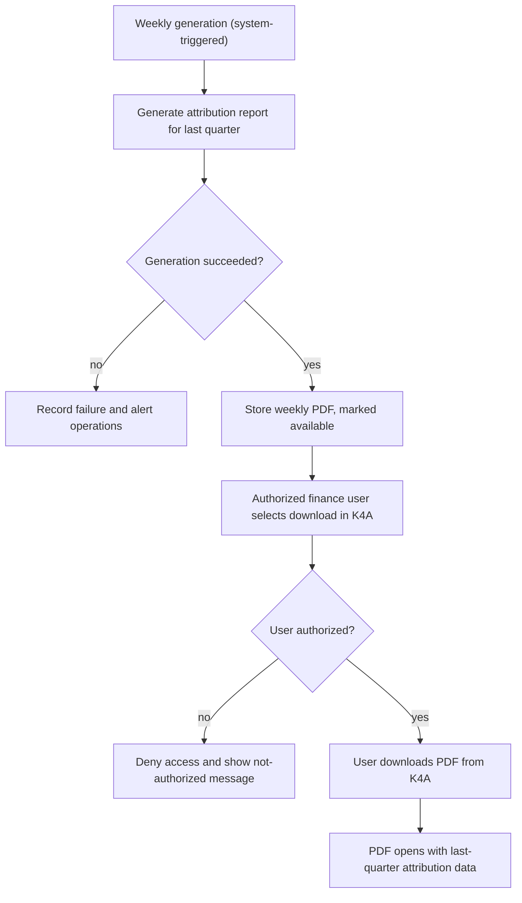

# 1. Business Logic & Context

## Problem

Brightway Retail's finance team currently has no self-service way to obtain attribution reporting from K4A in a format suited to finance workflows. They need a recurring, finance-consumable attribution report — specifically scoped to last quarter data — to support their reporting and reconciliation work ahead of year-end close. Today this does not exist as a deliverable they can pull or receive on their own.

## Value

- Gives the finance team direct, self-service access to attribution data in a portable, finance-friendly format (PDF).
- Delivers on a recurring (weekly) cadence so the report is reliably available without manual intervention.
- Scopes the data to last quarter only, matching the finance team's stated reporting boundary.
- Removes ad-hoc, manual report-pulling effort and the associated turnaround delay.

## Business Rules

- **Cadence:** The report is produced on a weekly cadence.
- **Format:** The report is delivered as a PDF.
- **Data scope:** The report contains last quarter data only. The precise semantics of "last quarter" — whether it is a fixed calendar quarter that resets on quarter boundaries, or a rolling 90-day window — is a product rule that materially changes the numbers finance sees. [DECISION REQUIRED: DEC-001]
- **Plan eligibility:** This capability is scoped to the standard plan (Brightway Retail is on the standard plan).
- **Audience:** The intended consumers are the finance team at Brightway Retail.
- **Delivery model:** The report is obtained by the finance team via self-service download from K4A — finance downloads the report themselves when they need it (DEC-002 resolved). A scheduled push/email of the report is not the delivery mechanism for Phase 1. Because the pull model is chosen, the scheduled-distribution and subscription-worker roles are not required for Phase 1 delivery.
- **Download consistency:** If the report is downloaded more than once within the same week, every download returns identical data — the week's report is a frozen weekly snapshot, not refreshed to the most current available data on each download. This is a working assumption, not a confirmed decision — the reviewer declined to decide it (see DEC-003).
- **Access control:** All finance-team members on the account may obtain the report. Access is not narrowed to specific roles or a single designated finance manager, and it does not tie into any existing subscription concept.
- **Attribution content:** The report contains total attributed revenue and total conversions, broken out by channel, presented as one simple table. A static report of this content satisfies finance's need — no filtering or drill-down is required.
- **Retention / compliance:** The weekly PDFs are retained for two years for audit purposes (DEC-006 resolved).

## Note on affected-services evidence

An independent knowledge-graph cross-check against the originally identified backend and frontend services broadly re-found the core report-generation and download-interface roles, but surfaced lower confidence on the scheduled-distribution and subscription-worker roles, and additionally flagged two services not in the original list — one that may assemble report content and one that may supply the underlying attribution query data. These discrepancies are recorded here so engineering planning reconciles them during discovery rather than treating the original list as settled. Because the self-service pull delivery model is now the chosen one (DEC-002 resolved), the scheduled-distribution and subscription-worker services are not required for Phase 1 delivery.

**Data-source / assembly decision (resolved):** Report content is to be produced by reusing the existing summary-report component (surfaced as **summary-report-cloud**) if one exists, rather than re-assembling the content in the main reporting path. Engineering should confirm during discovery that summary-report-cloud produces the required attribution content; if it does, the main reporting path consumes that output rather than duplicating assembly. A repeated fresh knowledge-graph cross-check re-found summary-report-cloud (building summary/attribution report output) and koch-query-api (supplying attribution query data), consistent with the earlier check.

# 2. User Flows (Visuals)

The diagram below covers the chosen self-service pull model as the primary happy path — an authorized finance user downloads the report from K4A on demand — and error states for user authorization and generation failure. The scheduled push/email branch is not built for Phase 1 (see Section 1 delivery-model rule).



# 3. Functional Requirements

> Scope note: Several requirements below reference business rules that are not yet settled (last-quarter semantics, retention). Each such requirement states a working provisional behavior so an implementation agent can proceed, and references the corresponding decision. These provisional values are defaults, not confirmations. The delivery model is settled: finance obtains the report via self-service download from K4A (DEC-002 resolved; see Section 1).

## 3.1 Report Generation

### FR-001 — Weekly report generation
```gherkin
Given the feature is enabled for an account on the standard plan
And a weekly generation cycle is due
When the system runs the weekly generation
Then an attribution report is generated for that account covering last-quarter data only
And the generated report is produced in PDF format
And the report is marked available for that week
```

### FR-002 — Last-quarter data scope
```gherkin
Given a weekly report generation is triggered for an account
When the system assembles the report data
Then only attribution data falling within the "last quarter" window is included
And no data outside that window appears in the report
# Provisional rule (pending the last-quarter-semantics decision): "last quarter" means
# the most recently completed calendar quarter, fixed until the next quarter boundary.
```

### FR-003 — Generation failure is recorded and alerted
```gherkin
Given a weekly report generation is in progress for an account
When report generation fails
Then the failure is recorded with the account identity, the target week, and a named failure reason
And an operational alert is fired for the failure
And no partial or empty report is marked available for that week
```

### FR-004 — Idempotent weekly generation
```gherkin
Given a weekly report for a given account and a given week has already been generated
When the weekly generation runs again for that same account and week
Then the existing weekly report is overwritten in place rather than producing a duplicate
And no duplicate report record is created for that account and week
# A scheduled generation run must not overlap with another run for the same account and week;
# a concurrent re-run for the same key is prevented at the scheduler level.
```

### FR-005 — Download consistency within a week
```gherkin
Given a weekly report for an account and week has been generated and marked available
When an authorized user obtains that report more than once within the same week
Then each retrieval returns the same report content for that week
# Working assumption (download-consistency decision NOT settled — see DEC-003): a given
# week's report is a fixed snapshot — repeated downloads in the same week return identical data.
```

## 3.2 Delivery & Download

### FR-006 — Self-service download (pull model)
```gherkin
Given an authorized finance user is signed in to K4A on a standard-plan account
And a weekly attribution report is available for that account
When the user selects the download action for the report in K4A
Then the current week's attribution report PDF is downloaded to the user
# Delivery model resolved (DEC-002): the self-service pull model is the build target —
# finance downloads the report themselves from K4A. This requirement is in scope for Phase 1.
```

### FR-007 — Report-not-available handling
```gherkin
Given an authorized finance user is signed in to K4A on a standard-plan account
And no weekly attribution report is available for the current week
When the user opens the report download area
Then the user is shown a clear "report not available" message
And no download is initiated
And the message is distinct from an access-denied message
```

### FR-008 — Scheduled delivery (push model)
```gherkin
Given the push delivery model is NOT the chosen delivery mechanism
And finance obtains the report via self-service download from K4A (FR-006)
When Phase 1 is delivered
Then no scheduled push/email delivery is built
# Delivery model resolved (DEC-002): the self-service pull model is chosen — finance
# downloads the report themselves from K4A. Scheduled push/email delivery and the
# scheduled-distribution behavior are out of scope for Phase 1.
```

### FR-009 — Secure, time-limited delivery for any pushed or linked report
```gherkin
Given a weekly report PDF is to be delivered outside an authenticated in-session download
When the report is made available to a recipient
Then it is delivered via a time-limited secure link
And the link expires after its validity window of seven days
And an expired link does not return the report
```

## 3.3 Access Control

### FR-010 — Authorized access to the report
```gherkin
Given a user is signed in to K4A
When the user attempts to view or download the weekly attribution report
Then the system re-derives the user's eligibility from the authoritative source on that request
And access is granted only if the user is authorized to obtain the report
# Rule (access-control decision resolved): all finance-team members on the account may
# download the report. Access is not narrowed to specific roles or a designated manager,
# and does not tie into any existing subscription concept.
```

### FR-011 — Server-side enforcement of access
```gherkin
Given a user is not authorized to obtain the weekly attribution report
When the user issues a direct request for the report, bypassing the UI
Then the request is rejected with an authorization error
And the rejection does not depend on the UI hiding the download affordance
```

### FR-012 — Download affordance visibility
```gherkin
Given a signed-in K4A user viewing the report area
When the page renders
Then the download affordance is shown only to users authorized to obtain the report
And unauthorized users do not see the download affordance
And this UI gating is in addition to, not a replacement for, server-side enforcement (FR-011)
```

### FR-013 — Plan eligibility gating
```gherkin
Given an account is not on an eligible plan for this feature
When a user on that account attempts to view or download the weekly attribution report
Then the request is rejected on eligibility grounds
And the eligibility check is enforced server-side on every request
# Provisional rule: the feature is enabled for standard-plan accounts (Brightway Retail's plan).
```

### FR-014 — Fail-closed on authorization-source unavailability
```gherkin
Given the authoritative authorization source cannot be reached
When a user attempts to obtain the weekly attribution report
Then the request is denied rather than allowed
And the denial is recorded as a distinct, named failure condition
```

## 3.4 Report Content

### FR-015 — Attribution content present in the PDF
```gherkin
Given a weekly attribution report PDF is generated
When the PDF is opened
Then it presents total attributed revenue and total conversions, broken out by channel, for the last-quarter window
And these metrics are presented as one simple table
# Report content (resolved): total attributed revenue and total conversions by channel,
# for the last-quarter window, as a single simple static table. Filtering, date-range
# customization, and drill-down are out of scope for Phase 1.
```

### FR-016 — Static, pre-formatted report
```gherkin
Given a finance user obtains the weekly attribution report PDF
When the user opens the report
Then the report is a static, pre-formatted document with no interactive filtering or drill-down
# Rule (resolved): a static report satisfies finance's need; no filtering or drill-down is required.
```

### FR-019 — Brightway logo on the report PDF
```gherkin
Given a weekly attribution report PDF is generated
When the PDF is opened
Then the Brightway logo is displayed on the report
# Rule: finance requested the Brightway logo appear on the weekly attribution report PDF.
```

## 3.5 Auditability

### FR-017 — Record of report access
```gherkin
Given access to the weekly attribution report is a traceable, access-controlled operation
When a user obtains (or is denied) the report
Then an append-only audit record is written capturing actor identity (user and account),
    the report and target week, the action, timestamp, and outcome
And the audit record cannot be edited or deleted by any role or code path
And the audit write occurs without blocking the user's download
And a failure to write the audit record fires an operational alert rather than failing silently
# Weekly PDFs are retained for two years for audit (DEC-006 resolved; see Section 1).
# Minimum retention for the audit records themselves follows the same audit-retention basis.
```

### FR-018 — No PII in logs

## 4. Information Requirements

- **Weekly attribution report (PDF):** The core deliverable. System-derived — generated by assembling attribution data for the last-quarter window into a PDF on a weekly cadence. Matters because it is what the finance team obtains and consumes.
- **Last-quarter data window:** The time boundary applied to report content. System-derived from the calendar and the agreed last-quarter semantics (fixed calendar quarter vs. rolling window — see the last-quarter-semantics decision in Section 1). Matters because it defines exactly which attribution records appear in the report.
- **Attribution metrics and dimensions:** The substantive content of the report — total attributed revenue and total conversions, broken out by channel, presented as one simple table. Sourced by reusing the existing summary-report component (summary-report-cloud) if one exists, which in turn draws on the underlying attribution query data (koch-query-api, external to the report layer) — rather than re-assembling the content in the main reporting path (resolved; see Section 1 data-source/assembly decision). Matters because this is the information finance actually reconciles against.
- **Brightway branding asset (logo):** The Brightway logo displayed on the report PDF (FR-019). Matters because finance requested the report carry Brightway branding.
- **Report availability state (per account, per week):** Whether a given week's report exists and is ready to obtain. System-derived during generation. Matters because the download and not-available flows (FR-006, FR-007) branch on it.
- **Report snapshot identity (account + week):** The key that identifies one weekly report instance for an account. System-derived. Matters because it drives idempotent generation (FR-004) and download consistency (FR-005).
- **User and account identity:** Who is requesting the report and under which account. Sourced from the authenticated K4A session. Matters because access control (FR-010–FR-014) and audit records (FR-017) depend on it.
- **User eligibility / role for this report:** Whether the requesting user is authorized to obtain the report — resolved as: all finance-team members on the account are authorized, with no narrower role restriction. System-derived on each request from the authoritative authorization source. Matters because it gates access server-side and determines UI affordance visibility.
- **Account plan eligibility:** Whether the account is on an eligible (standard) plan. System-derived from account/plan data. Matters because the feature is plan-gated (FR-013).
- **Delivery model configuration:** The report is obtained via self-service pull — finance downloads it from K4A on demand (DEC-002 resolved; see the delivery-model rule in Section 1). System/configuration-derived. Matters because it activates the self-service download path (FR-006) rather than any scheduled push/email path.
- **Secure link and its validity window:** For any report delivered outside an authenticated in-session download, the time-limited link and its expiry — the link stays valid for seven days (DEC-007 resolved). System-derived. Matters because secure delivery (FR-008, FR-009) depends on it.
- **Generation outcome / failure reason:** The result of each weekly generation attempt, including a named failure reason on failure. System-derived. Matters because failure recording and alerting (FR-003) depend on it.
- **Audit record of report access:** Append-only record of who obtained or was denied the report, when, and with what outcome. System-derived. Matters because access to the report is a traceable, access-controlled operation (FR-017).
- **Retention configuration:** Weekly PDFs are retained for two years for audit (DEC-006 resolved; see Section 1). Matters because it governs how long reports and audit records must remain available.

## 5. Non-Functional Requirements & Guardrails

### Performance & Capacity

- **NFR-001 — Download latency:** The in-session download action (pull model, FR-006) returns the PDF — or begins streaming it — with a p95 latency target of 3 seconds for an already-generated report, measured under expected concurrent finance-user load. This target applies to serving a pre-generated report, not to generation itself.
- **NFR-002 — Generation window:** Weekly report generation for an account completes within a bounded generation window such that the report is marked available before the finance team's expected weekly access time. Generation runs asynchronously and does not block any user-facing download.
- **NFR-003 — Shared query-resource protection:** Because report generation reads from the underlying attribution query data source (shared capacity), generation imposes an explicit rate cap on that source to avoid contending with existing traffic. Generation is scheduled/throttled rather than issuing unbounded concurrent queries.
- **NFR-004 — Generation-failure alerting:** Alert when the weekly generation error rate exceeds 1% of attempted account-reports for 5 minutes sustained, and alert on any individual generation failure for an account whose report is expected that week (ties to FR-003).

### Reliability & Error Handling

- **NFR-005 — Bounded retry on downstream failure:** When report generation depends on a downstream/shared service (e.g. the attribution query data source) and that dependency fails transiently, generation retries with bounded exponential backoff — 3 attempts maximum, never indefinite — and honors a rate-limit `Retry-After` response rather than retrying on a fixed schedule.
- **NFR-006 — Named, distinct failure conditions:** Timeout, dependency-unavailable, rate-limited, and authorization-source-unreachable are treated as distinct, separately-named failure conditions, each with its own recorded status and (where user-facing) its own message — not collapsed into one generic error (ties to FR-003, FR-007, FR-014).
- **NFR-007 — Fail-closed on access/eligibility checks:** Access-control, plan-eligibility, and authorization-source-unreachable checks fail closed — on failure or unavailability the report is denied, never served (ties to FR-013, FR-014). This is the deliberate posture because serving a report to an ineligible or unauthorized party is worse than a temporary denial.
- **NFR-008 — Idempotent, non-overlapping generation:** Weekly generation is idempotent on the account-plus-week key — a retried or re-delivered generation event overwrites the existing weekly report in place and never produces a duplicate or double-counted result. Concurrent re-runs for the same key are prevented at the scheduler level in addition to idempotency (ties to FR-004).

### Security & Access Control

- **NFR-009 — Server-side enforcement:** All access, role/eligibility, and plan-gating decisions are enforced server-side and re-derived from the authoritative source on every request; a direct request from an ineligible or unauthorized party is rejected (typically 403) regardless of what the UI shows (ties to FR-011, FR-013). Eligibility is never cached client-side or trusted from a client-supplied claim.
- **NFR-010 — Secure, time-limited delivery:** Any report delivered outside an authenticated in-session download is delivered via a time-limited secure link, never a raw attachment; the link stays valid for seven days and an expired link does not return the report (ties to FR-008, FR-009).
- **NFR-011 — No PII or secrets in logs:** Raw PII, credentials, secrets, and tokens are never written to application logs. Where an identifier must appear for troubleshooting, it is minimized to what is operationally necessary (ties to FR-018).
- **NFR-012 — Immutable audit trail:** Report-access audit records are append-only and immutable — no edit or delete via any role or code path — and are written asynchronously so they never block the download, while an audit-write failure fires an operational alert rather than failing silently (ties to FR-017).
- **NFR-013 — Audit and report retention:** Weekly PDFs are retained for two years for audit (DEC-006 resolved; see Section 1). Audit records are retained for at least this same two-year audit period.

### Operability & Rollout

- **NFR-014 — Kill-switch:** The feature is governed by a config-based kill-switch that disables it without a code deploy, operable by an on-call engineer during an incident without separate approval. New requests reflect the disabled state within 5 minutes of the flip; a report download already in flight at the moment of the flip completes under the prior behavior. This guardrail is warranted because the work is HIGH risk and spans multiple services.

#### Rollback

- **NFR-015 — Rollback:** If the feature misbehaves in production, rollback is triggered by the on-call engineer (or the designated service owner) via the kill-switch, with a target of disabling new report generation and download within the kill-switch propagation window. Rollback affects only new operations going forward: already-generated weekly PDFs and already-written audit records are not retroactively reverted or deleted.

#### Backward Compatibility

- **NFR-016 — Backward compatibility:** This feature extends the existing reporting services. Any existing report-generation, distribution, or download behavior and its current consumers must remain unchanged by this work; the weekly attribution PDF is additive. Where this feature extends an existing shared endpoint or data path rather than adding a net-new one, the existing callers' behavior and outputs must remain unchanged.

## 6. Out of Scope & Phasing

The following are explicitly **not** included in Phase 1. Any item here must not be built unless and until it is promoted into scope.

| Item | Status | Notes |
|------|--------|-------|
| In-PDF filtering, date-range customization, or drill-down | Out of scope (Phase 1) | Phase 1 delivers a static, pre-formatted report (FR-016); finance confirmed no filtering or drill-down is required. Interactive/customizable reporting is a future phase. |
| Data scopes other than last quarter | Out of scope (Phase 1) | Phase 1 is strictly last-quarter data only. Other ranges (MTD, YTD, custom) are not included. |
| Formats other than PDF | Out of scope (Phase 1) | PDF is the only delivery format for Phase 1. CSV/XLSX/other exports are not included. |
| Cadences other than weekly | Out of scope (Phase 1) | Weekly is the only cadence. Daily/monthly/on-demand regeneration schedules are not included. |
| Scheduled push / weekly email delivery of the report | Out of scope (Phase 1) | The self-service pull model is the chosen delivery model (DEC-002 resolved; see Section 1). Finance downloads the report themselves from K4A. Scheduled push/email delivery is not built for Phase 1. |
| Plans other than standard | Out of scope (Phase 1) | The feature is gated to the standard plan. Extension to other plan tiers is a future consideration. |
| Accounts/customers beyond Brightway Retail finance | Out of scope (Phase 1) | Phase 1 targets Brightway Retail's finance team. General availability to other accounts is a future phase. |
| Self-serve subscription management (recipients choosing their own schedule) | Out of scope (Phase 1) | Managing subscriptions/recipients as a user-facing feature is not in Phase 1. |
| Long-term PDF archival/signing/timestamping as a product feature | Out of scope (Phase 1) | Beyond the two-year audit retention (DEC-006 resolved), archival/signing as a customer-facing capability is a future phase. |

## Appendix: Engineering Reference

_The sections below are derived automatically from the codebase knowledge graph, for the engineering team's reference during planning — not required reading for product/requirement review._

### Affected Services (grounded context, not implementation direction)

- **reporting-api** (backend): Attribution report generation and delivery.
- **reporting-dispatcher** (backend): Scheduled distribution of weekly attribution reports (relevant primarily under a push delivery model).
- **frontend-mos** (frontend): PDF download interface for the weekly attribution report in the K4A console.
- **reporting-subscriptions-worker** (backend): Consumes subscription/scheduling data to trigger weekly report generation (relevant primarily under a push delivery model).

Additional services surfaced at lower confidence during an independent knowledge-graph cross-check, flagged for engineering to verify during discovery (not asserted as in-scope): **summary-report-cloud** (may assemble report content output) and **koch-query-api** (may supply the underlying attribution query data, and may be where the last-quarter filter must be applied).

## Revision Summary

_Applied reviewer's request._

- Resolved DEC-006 in Section 1 business rules: weekly PDFs retained two years for audit.
- Updated FR-017 comment to state the two-year PDF retention (DEC-006 resolved).
- Updated retention configuration info requirement to state two-year PDF retention (DEC-006 resolved).
- Updated NFR-013 to state two-year PDF retention and align audit-record retention (DEC-006 resolved).
- Updated Section 6 out-of-scope note to reflect resolved two-year retention (DEC-006).


---
## Open Questions & Decisions Register

_Durable, ID'd reference for HITL 2 (G1) and beyond — inline `[DECISION REQUIRED: DEC-00N]` tags in the sections above point back here. Reflects the latest round only._

### Decisions Required (business trade-offs — needs a human call)

_Each carries an **Owner** (accountable for supplying the answer) and a **Provisional Value** (the working assumption engineering may build against until the decision lands), so none of these fully block engineering — implementation proceeds on the provisional value and adjusts if the confirmed decision differs._

| ID | Decision | Owner | Provisional Value (build against until confirmed) |
|----|----------|-------|-----------------------------------------------------|
| **DEC-001** | Should the weekly report always show the same rolling ninety days of data, or should it show a fixed calendar quarter that only resets on quarter boundaries? | Product owner (with finance stakeholder at Brightway Retail) | Fixed calendar quarter: the report covers the most recently completed calendar quarter and stays fixed until the next quarter boundary. |

### Decisions Resolved

- **DEC-002**: DEC-002 resolved: finance downloads the report themselves from K4A on demand (self-service pull), rather than the system pushing it on a weekly schedule.
- **DEC-003**: Assumed: Fixed weekly snapshot: every download within the same week returns identical data for that week.
- **DEC-004**: Access control resolved: all finance-team members on the account may obtain the report, with no narrower role/manager restriction and no tie to any existing subscription concept.
- **DEC-005**: Resolved OQ-004/DEC-005: the PDF contains total attributed revenue and conversions by channel, presented as one simple static table.
- **DEC-006**: DEC-006 / OQ-007 resolved: weekly report PDFs are retained for two years for audit.
- **DEC-007**: DEC-007 resolved — the secure download link for reports delivered outside an in-app download stays valid for seven days before expiring.

### Open Questions (evidence gaps — needs more input)

- **OQ-002**: For 'last quarter only,' should the report always show a rolling 90 days, or snap to fixed calendar-quarter boundaries that reset on specific dates? This changes the data-scoping logic.
- **OQ-006**: Does the report need in-PDF filtering, date-range customization, or drill-down, or is a static pre-formatted PDF sufficient?

### Questions Resolved

- **OQ-001**: Resolved DEC-002/OQ-001: delivery model is push — the report is emailed to the finance team every Monday, not self-service download; scheduled-distribution and subscription-worker services are therefore in scope.
- **OQ-003**: OQ-003 resolved: a given week's report is a frozen weekly snapshot — every download within the same week returns identical data, not the most current numbers.
- **OQ-004**: Resolved OQ-004/DEC-005: the PDF contains total attributed revenue and conversions by channel, presented as one simple static table.
- **OQ-005**: Access control resolved: all finance-team members on the account may obtain the report, with no narrower role/manager restriction and no tie to any existing subscription concept.
- **OQ-007**: DEC-006 / OQ-007 resolved: weekly report PDFs are retained for two years for audit.
- **OQ-008**: Resolved OQ-008 — report content is produced by reusing the existing summary-report component (summary-report-cloud) if one exists, rather than assembling it in the main reporting path.

---
> **Classification:** Type A
