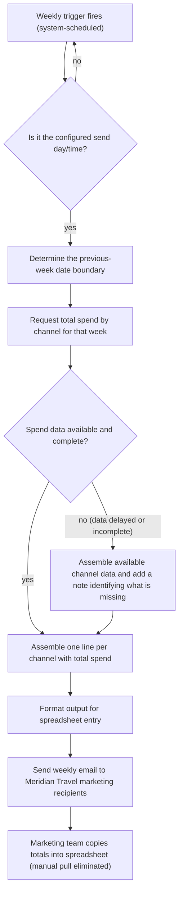

# 1. Business Logic & Context

## Problem

Meridian Travel's marketing team manually pulls spend-by-channel data every Monday to copy it into a spreadsheet. This recurring manual task consumes time, is error-prone, and does not scale. With a summer campaign launch approaching, the team needs an automated weekly view of channel spend without the manual data pull.

## Value

- Eliminates the recurring manual Monday data pull for Meridian Travel's marketing team.
- Delivers spend-by-channel totals in a format the team can drop straight into their existing spreadsheet workflow.
- Removes a known error-prone manual step ahead of a high-visibility summer campaign.

## Business Rules

- **BR-1 — One line per channel:** The weekly email contains exactly one line per channel, each showing that channel's total spend for the covered week. No breakdown by campaign, geography, or date range is included — the intake confirmed total spend per channel is sufficient (answered by Mayank Ukey).
- **BR-2 — Weekly cadence:** The email is generated and sent once per week, covering the previous week's spend.
- **BR-3 — Previous-week coverage:** Each email covers the spend data for the week immediately preceding the send. The week boundary is defined as a calendar week, Monday through Sunday, anchored to Eastern time. How long we wait after the week ends for complete ad-platform data before sending remains a business decision. [DECISION REQUIRED: DEC-001]
- **BR-3a — Partial data is sent with a caveat:** If spend data for the covered week is delayed or incomplete at send time, the email is still sent with whatever data is available, accompanied by a note identifying what is missing — the report does not wait for complete data. The target delivery is roughly one day after the covered week ends.
- **BR-4 — Spreadsheet-ready output:** The spend totals must be presented as a plain table inside the body of the email (no attachment), laid out so the marketing team can copy it directly into their spreadsheet.
- **BR-5 — Account eligibility:** Meridian Travel is on the standard plan; the feature must be deliverable to a standard-plan account.
- **BR-6 — Channel set:** The breakdown covers a fixed set of four channels — Email, paid search, paid social, and display. One row per channel, every week; the set does not vary seasonally or by campaign.
- **BR-7 — Recipients:** The specific recipient(s) on Meridian Travel's marketing team who receive the email is a business decision. [DECISION REQUIRED: DEC-004]
- **BR-8 — Send day/time/timezone:** The weekly email is sent every Monday at 8:00 AM Eastern time.

## Source-of-truth / service note

The automated codebase knowledge-graph lookups produced two overlapping, partially-conflicting sets of candidate backend services for this work (two passes over the same system appear to use different naming for the same four roles — spend/channel data source, scheduler, report builder, and email delivery). These candidate names are not yet reconciled and require engineering confirmation during planning; they do not affect the product behavior defined in this spec. The reconciled evidence is preserved in a separate engineering appendix.

---

# 2. User Flows (Visuals)



---

# 3. Functional Requirements (The Core)

## Feature Area A — Weekly Scheduling & Trigger

### FR-001 — Weekly generation is triggered on a fixed schedule
```gherkin
Given the weekly spend-summary feature is enabled for Meridian Travel
And a configured send day, time, and timezone exist for the account
When the scheduled trigger evaluates the current time against the configured send day and time
Then the system starts exactly one spend-summary generation run for the account for that week
```

### FR-002 — No duplicate or overlapping runs for the same week
```gherkin
Given a spend-summary generation run for a given week is already in progress for Meridian Travel
When the scheduled trigger fires again for that same account and same covered week
Then the system does not start a second concurrent run
And the already-in-progress run is allowed to complete
```

### FR-003 — Re-running for an already-produced week is idempotent
```gherkin
Given a spend-summary for a given week has already been generated for Meridian Travel
When a generation run executes again for that same account and same covered week
Then the result overwrites the prior generation for that week rather than producing a duplicate email record
And no channel's spend is double-counted
```

## Feature Area B — Previous-Week Boundary Resolution

### FR-004 — Resolve the previous-week date range
```gherkin
Given a generation run has started for Meridian Travel
When the run determines which period to cover
Then it resolves the "previous week" to a single, unambiguous start date and end date as the preceding calendar week (Monday through Sunday) anchored to Eastern time
And only spend falling within that resolved range is included
```

### FR-005 — Week boundary is applied consistently across runs
```gherkin
Given two consecutive weekly runs for Meridian Travel
When each run resolves its previous-week range
Then the two ranges are contiguous and non-overlapping
And no day of spend is included in two different weekly emails
```

## Feature Area C — Spend-by-Channel Retrieval & Assembly

### FR-006 — Retrieve total spend grouped by channel
```gherkin
Given a resolved previous-week date range for Meridian Travel
When the run requests spend data for that range
Then it receives total spend aggregated by channel for the account
And each returned channel carries exactly one total spend figure for the week
```

### FR-007 — Assemble one line per channel
```gherkin
Given total spend by channel has been retrieved for the covered week
When the email content is assembled
Then the content contains exactly one line per channel in the fixed channel set (Email, paid search, paid social, and display)
And each line shows the channel name and that channel's total spend for the week
```

### FR-008 — Channel with zero spend for the week
```gherkin
Given a channel in the fixed channel set (Email, paid search, paid social, or display) has no spend recorded for the covered week
When the email content is assembled
Then that channel is represented with a total spend of zero rather than omitted
```
*Note: because the channel set is fixed at four channels (BR-6), every email always contains exactly those four rows; a channel with no spend appears as a zero line rather than being omitted.*

### FR-009 — Spreadsheet-ready formatting
```gherkin
Given the one-line-per-channel content has been assembled
When the email is formatted for delivery
Then channel name and total spend are presented as a plain table within the email body (no attachment), laid out so the marketing team can copy them directly into their existing spreadsheet without manual reformatting
```

## Feature Area D — Delivery

### FR-010 — Deliver the weekly email to configured recipients
```gherkin
Given a formatted spend-summary for the covered week exists for Meridian Travel
And one or more marketing-team recipients are configured for the account
When the email is sent
Then every configured recipient receives the weekly spend-by-channel email
And the email covers the previous week's spend
```

### FR-011 — Successful delivery eliminates the manual pull
```gherkin
Given the weekly email has been delivered successfully to the configured recipients
When the marketing team receives it on the expected day
Then the email contains all channel spend totals required for their spreadsheet
And no manual data pull is required to obtain those totals
```

## Feature Area E — Error & Data-Delay Handling

### FR-012 — Data delayed or incomplete at send time
```gherkin
Given a generation run has started for the covered week
When the spend data for that week is delayed or incomplete at the time of the run
Then the system does not send an email containing partial or incomplete spend totals
And the condition is recorded as a distinct "data-not-ready" failure
And an operational alert is raised
```

### FR-013 — Retry within the acceptable lag window
```gherkin
Given a run detected that spend data was not ready for the covered week
And the acceptable lag window between week-end and delivery has not been exceeded
When the system retries the generation after a delay
Then it re-requests the spend-by-channel data for the same covered week
And proceeds to send once the data is available and complete
```
*Note: the acceptable lag time between week-end and delivery is an engineering/operational default unless the business specifies one; see the data-delay decision under BR-3 resolution.*

### FR-014 — Lag window exceeded without ready data
```gherkin
Given a run detected that spend data was not ready for the covered week
And the acceptable lag window has been exceeded
When the system stops retrying
Then it does not send a partial-data email for that week
And it records a missed-send condition for that week
And it notifies the responsible owner that the weekly email was not sent
```

### FR-015 — Delivery failure is distinct from data failure
```gherkin
Given a formatted spend-summary email is ready to send
When the delivery attempt fails for reasons unrelated to data readiness
Then the failure is recorded as a distinct "delivery-failure" condition separate from the data-not-ready condition
And an operational alert is raised
And a bounded retry is attempted before the send is treated as failed for that week
```

Now reporting the business trade-offs I flagged in Sections 0–3.

## 4. Information Requirements

The system must track the following business information to support the Functional Requirements. Field names, types, and storage shapes are deliberately left to eng-plan.

- **Account / customer identity** — Which account the weekly summary belongs to (e.g., Meridian Travel) and its plan tier (standard). Source: System-derived from existing account records. Matters because eligibility (BR-5) and recipient/configuration scoping are per-account.
- **Covered-week date range** — The resolved start and end dates for the "previous week" a given email covers, derived as the preceding calendar week (Monday through Sunday) in Eastern time. Source: System-derived from the week-boundary definition (BR-3). Matters for FR-004/FR-005 (unambiguous, contiguous, non-overlapping coverage) and for idempotency keying in FR-003.
- **Channel set** — The fixed list of channels that appear as rows for the account: Email, paid search, paid social, and display. The set does not vary seasonally or by campaign. Source: Business-defined (BR-6). Matters for FR-007/FR-008 (one line per channel; zero-spend handling).
- **Total spend by channel** — The aggregated spend figure per channel for the covered week. Source: System-derived from the spend/channel data source. Matters as the core payload of every FR in Feature Area C.
- **Channel name** — The human-readable label shown on each line. Source: System-derived from the spend/channel dimension data. Matters for FR-007 (each line shows the channel name).
- **Recipient list** — The marketing-team email recipient(s) for the account. Source: Business-defined configuration (BR-7). Matters for FR-010 delivery.
- **Send schedule configuration** — The fixed send day, time, and timezone for the account. Source: Business-defined configuration (BR-8). Matters for FR-001 trigger evaluation.
- **Week-boundary definition** — "Previous week" is defined as a calendar week, Monday through Sunday, anchored to Eastern time (BR-3). Source: Business-defined. Matters for FR-004/FR-005.
- **Generation run state** — The status of each weekly run (in-progress, succeeded, missed, failed) keyed to account + covered week. Source: System-derived. Matters for FR-002 (no overlap), FR-003 (idempotent overwrite), FR-012/FR-014 (recorded failure/missed-send conditions).
- **Acceptable lag window** — The maximum tolerated delay between week-end and delivery before a send is abandoned. Source: Operational default unless the business specifies one (see BR-3 data-delay resolution). Matters for FR-013/FR-014 retry vs. missed-send decision.
- **Data-readiness / completeness signal** — Whether the spend data for the covered week is complete at run time. Source: System-derived from the spend data source. Matters for FR-012/FR-013 (don't send partial data).
- **Failure / delivery outcome record** — The distinct outcome of each run: data-not-ready, delivery-failure, missed-send, or success. Source: System-derived. Matters for FR-012/FR-014/FR-015 (distinct, named failure conditions) and for audit traceability.
- **Audit record of each send** — Actor (the scheduled system job), account identity, covered week, outcome/status, and timestamp for each generation/send attempt. Source: System-derived. Matters for traceability of a state-changing, automated delivery to an external customer.

---

## 5. Non-Functional Requirements & Guardrails

### Performance & Capacity

- **NFR-001 — Query load on shared spend data:** The weekly spend-by-channel retrieval (FR-006) adds a new read path against the shared spend data source. The retrieval query for one account's weekly summary must complete at p95 ≤ 5s measured over the account's generation run. Because this is a once-per-week, per-account batch read rather than interactive traffic, this is an engineering-owned default; adjust during planning if the account population grows materially.
- **NFR-002 — Rate cap on the shared data source:** Weekly generation runs must not overwhelm the shared spend data source. Runs for multiple accounts must be rate-limited/staggered so concurrent weekly runs stay within the data source's safe query capacity. The concrete cap is an engineering decision made in planning with knowledge of the data source's limits.
- **NFR-003 — Generation-to-delivery timeliness:** On a normal week with complete data, the email must be generated and delivered within the acceptable lag window of the configured send time, so recipients receive it on the expected day (supports FR-011).

### Reliability & Monitoring

- **NFR-004 — Operational alerting:** Raise an operational alert when weekly-send failures (data-not-ready, delivery-failure, or missed-send) exceed 1% of scheduled sends over a 15-minute window, sustained, and additionally alert on any single missed-send for an account because the population is small and each miss is customer-visible.
- **NFR-005 — Bounded retry on dependency failure:** Calls to the spend data source and the email delivery path use bounded retry with exponential backoff (default 3 attempts), never indefinite retry. A rate-limit/429 response honors the Retry-After header rather than retrying on a fixed schedule. This is distinct from the week-level data-readiness retry in FR-013.
- **NFR-006 — Scheduler overlap guard:** The weekly job must be configured so an automatic concurrent re-run of the same account+week cannot start while a prior run is in flight (complements the idempotency requirement in FR-003 and the no-overlap requirement in FR-002).
- **NFR-007 — Failure posture (graceful degradation vs. fail-closed):** On data-not-ready, the system fails closed on content correctness — it never sends partial/incomplete spend totals (FR-012) — but degrades gracefully on timeliness by retrying within the lag window (FR-013) and recording a missed-send rather than sending wrong numbers if the window is exceeded (FR-014). Each named failure condition records its own distinct status.

### Security & Access Control

- **NFR-008 — Server-side eligibility enforcement:** Delivery of the weekly summary is restricted to eligible accounts (standard plan and above, per BR-5) and to the configured recipients for that account. Eligibility and recipient membership are re-derived from the authoritative source at run time, never trusted from cached/client-supplied state, and fail closed if the authorization source is unreachable.
- **NFR-009 — No raw sensitive data in logs:** Recipient email addresses must never be written to logs in raw form; mask to a non-identifying form where a recipient must be referenced in operational logging. Spend figures are business-restricted data and must not leak beyond the configured recipient list.
- **NFR-010 — Delivery confined to configured recipients:** Spend data (business-sensitive) is delivered only to the configured recipient list for the owning account. A change to the recipient list takes effect for subsequent runs and is itself an auditable change.

### Audit & Traceability

- **NFR-011 — Audit log of each send:** Each generation/send attempt writes an immutable, append-only audit record capturing the scheduled actor, account identity, covered week, outcome/status, and timestamp (per the Information Requirements). Audit writes are asynchronous so they never block delivery, but an audit-write failure fires an immediate operational alert rather than failing silently. Audit records of each weekly spend email are retained for one year.

### Feature Flag / Kill-Switch

- **NFR-012 — Config-based kill-switch:** Because this is HIGH-risk, multi-service work with automated external email delivery, the weekly send must be disableable via configuration with no code deploy. An on-call engineer can disable it during an incident without separate approval. New-request propagation target: 5 minutes; a run already in flight at the time of the flip completes under the prior behavior.

### Risk Mitigation

Addressing each risk from the Context Seed:

- **Hard external deadline (5 weeks, before summer campaign):** Mitigated by strict MVP scope (Section 6) — only total spend per channel, one line per channel, as confirmed at intake. The direction is to reuse whatever existing scheduled-report/subscription + email pipeline already exists if it fits the requirement, rather than building new scheduler/email orchestration; engineering confirms during planning whether the existing pipeline fits and only builds net-new orchestration where it genuinely does not. That fit assessment is an engineering planning task tied to the service-name reconciliation flagged in Section 1's service note.
- **Multi-service blast radius (4 candidate services, two conflicting name sets):** Mitigated by the kill-switch (NFR-012), bounded retries with distinct failure conditions (NFR-005, NFR-007), and by requiring engineering to reconcile the candidate service names before build. Product behavior in this spec does not depend on which names are real.
- **Email delivery system integration:** Mitigated by treating delivery failure as a distinct, retried, alerted condition (FR-015, NFR-004/NFR-005), confining delivery to configured recipients (NFR-010), and not logging raw recipient addresses (NFR-009).
- **Data freshness / sync-timing risk (spend may be synced from ad platforms):** Mitigated by the data-not-ready detection and lag-window handling (FR-012–FR-014, NFR-007) — the system never sends partial numbers and records a missed-send rather than deliver wrong data.

---

## 6. Out of Scope & Phasing

This spec covers **Phase 1 (MVP) only**: an automated weekly email showing total spend by channel for the previous week, delivered to Meridian Travel's marketing team in a spreadsheet-ready format.

| Item | Status | Rationale |
|------|--------|-----------|
| Breakdown by campaign, geography, or date range | Out of scope | Intake confirmed total spend per channel is sufficient (answered by Mayank Ukey). |
| Additional metrics (spend vs. budget, week-over-week change, clicks, impressions) | Out of scope / Future phase | Not part of the confirmed MVP requirement; candidate for a future phase if the team still needs manual pulls for these. |
| Self-serve UI for configuring the report (channels, schedule, recipients) | Out of scope | Intake confirmed no UI/frontend change needed for Phase 1; configuration is handled operationally. |
| Generalizing the feature to accounts beyond Meridian Travel | Out of scope | Phase 1 targets the requesting account on the standard plan; broader rollout is a future phase. |
| Seasonal / per-campaign variation of the channel set as an automated rule | Out of scope | The channel set is fixed at four channels (BR-6: Email, paid search, paid social, display); any future variation is deferred. |
| Interactive dashboard or on-demand ("pull now") generation | Out of scope | Phase 1 is a scheduled weekly push only. |
| Historical backfill of prior weeks' emails | Out of scope | Phase 1 begins sending from go-live forward. |

### Rollback (HIGH-risk / multi-service)

- **Trigger:** Repeated send failures, incorrect spend totals reaching recipients, or data-freshness incidents.
- **Owning authority:** On-call engineering, via the NFR-012 kill-switch, with no separate approval needed during an incident.
- **Timing target:** New-request propagation within 5 minutes of the flip.
- **Data reversion:** No retroactive reversion — already-sent emails cannot be unsent; only future scheduled runs are suppressed while disabled.

### Backward Compatibility

If engineering reconciliation (Section 1 service note) determines this feature extends an existing scheduled-report/subscription or email-delivery pipeline with existing consumers, those existing report subscriptions and their delivery behavior must remain unchanged. If the feature is built as an additive-only path with no existing consumers at risk, that should be stated explicitly during planning. No change to existing spend-data query consumers is intended by this spec.

---

## Appendix: Engineering Reference

_The sections below are derived automatically from the codebase knowledge graph, for the engineering team's reference during planning — not required reading for product/requirement review._

### Affected Services (grounded context, not implementation direction)

Two automated knowledge-graph passes produced overlapping, partially-conflicting candidate names for the same four roles. They are recorded here as grounding context, not as a confirmed implementation choice; engineering must reconcile which names are real during planning.

**Context Seed "Affected Services" pass:**
- `reporting-api` (backend) — Query and fetch campaign spend by channel data
- `reporting-dispatcher` (backend) — Schedule and dispatch weekly email jobs
- `k4a-mcp-server` (backend) — K4A platform orchestration for scheduled tasks
- `sam-api` (backend) — Provide spend and channel dimension data

**Independent cross-check pass (candidate overlaps / discrepancies to reconcile):**
- `k4a-sam-backend` (medium) — may own spend/channel data (overlaps `sam-api`)
- `sam-report-scheduler` (medium) — schedules SAM reports / weekly cadence (overlaps `reporting-dispatcher`)
- `sam-performance-reporter` (medium) — generates SAM spend/performance reports (report-builder role not named in the Seed's pass)
- `reporting-subscriptions-worker` (medium) — delivers scheduled report subscriptions/email (email-delivery role not named in the Seed's pass)
- `summary-report-cloud` (low) — builds summary reports / weekly summary
- `notifications-api` (low) — may send the email notification
- `k4a-mcp-server` (low here vs. high in the Seed's pass) — role genuinely ambiguous between orchestrator and K4A entry point
- `sam-campaign-data-sync` (low) — may supply synced spend-by-channel data (relevant to the data-freshness risk)

**Reconciliation notes for planning:** The two passes agree on four underlying roles — spend/channel data source, scheduler, report builder, and email delivery — but disagree on service names. The report-builder and email-delivery roles appear only in the cross-check pass. The presence of a data-sync component (`sam-campaign-data-sync`) is the grounding for the data-freshness risk in Section 5. No product behavior in this spec depends on which names are real.

## Revision Summary

_Applied reviewer's request._

- Resolved DEC-006 in NFR-011: audit send records retained for one year, removing the inline decision tag.


---
## Open Questions & Decisions Register

_Durable, ID'd reference for HITL 2 (G1) and beyond — inline `[DECISION REQUIRED: DEC-00N]` tags in the sections above point back here. Reflects the latest round only._

### Decisions Required (business trade-offs — needs a human call)

_Each carries an **Owner** (accountable for supplying the answer) and a **Provisional Value** (the working assumption engineering may build against until the decision lands), so none of these fully block engineering — implementation proceeds on the provisional value and adjusts if the confirmed decision differs._

| ID | Decision | Owner | Provisional Value (build against until confirmed) |
|----|----------|-------|-----------------------------------------------------|
| **DEC-001** | How should "the previous week" be defined for Meridian Travel's report, and how long after the week ends are we willing to wait for complete ad-platform data before sending? | Product owner (with input from Meridian Travel) | Previous week = calendar week Monday through Sunday, in Meridian Travel's local timezone. Accept up to 24 hours of lag for data completeness before sending; if still incomplete after that window, skip the send and notify rather than send partial data. |
| **DEC-002** | What format should the spend totals arrive in so the team can drop them straight into their spreadsheet? | Product owner (with input from Meridian Travel) | An inline plain-text table in the email body with two columns (channel name, total spend), tab/column aligned for direct copy-paste into a spreadsheet. Revisit a CSV attachment only if copy-paste proves unreliable. |
| **DEC-004** | Who exactly on Meridian Travel's marketing team should receive this weekly email? | Product owner (with input from Meridian Travel) | A single configurable recipient list for the Meridian Travel account, seeded with the marketing-team contact(s) the requester provides at launch; supports multiple addresses. |

### Decisions Resolved

- **DEC-003**: Channel set is a fixed list of four channels — Email, paid search, paid social, and display — that does not vary by season or campaign; this also settles DEC-003, which asks the same question.
- **DEC-005**: Send schedule resolved: the weekly email goes out every Monday at 8:00 AM Eastern time; settles OQ-003 and the equivalent DEC-005.
- **DEC-006**: DEC-006 resolved — audit records of each weekly spend email are retained for one year.

### Open Questions (evidence gaps — needs more input)

- **OQ-006**: Who are the exact recipients, and does recipient management or spend-data visibility need any permission/access control?

### Questions Resolved

- **OQ-001**: OQ-001 resolved: send whatever spend data is available about one day after the week ends, including a note flagging any channels/data that are missing or incomplete, rather than waiting for complete data.
- **OQ-002**: 'Previous week' is defined as a calendar week, Monday to Sunday, anchored to Eastern time, which is also the timezone for the week boundary and send time.
- **OQ-003**: Send schedule resolved: the weekly email goes out every Monday at 8:00 AM Eastern time; settles OQ-003 and the equivalent DEC-005.
- **OQ-004**: Resolved OQ-004/DEC-002: the email presents spend totals as a plain table inside the email body, with no attachment (no CSV or separate file).
- **OQ-005**: Channel set is a fixed list of four channels — Email, paid search, paid social, and display — that does not vary by season or campaign; this also settles DEC-003, which asks the same question.
- **OQ-007**: OQ-007 resolved: reuse the existing scheduled-report / report-subscription + email pipeline if it fits, rather than building new scheduler/email orchestration for this deadline.

---
> **Classification:** Type B — requirement-agent's independent re-check DISAGREES with intake's original Type A call. The requirement is clearly specified (weekly email, one line per channel, previous week's total spend, spreadsheet-ready) with intake's own clarity marked "clear"; the open questions are routine implementation parameters (week definition, send time, recipients) that engineering can reasonably spec, not genuine product ambiguity—so this is engineering-led multi-service design across the reporting/scheduler/email stack, not Type A discovery.
