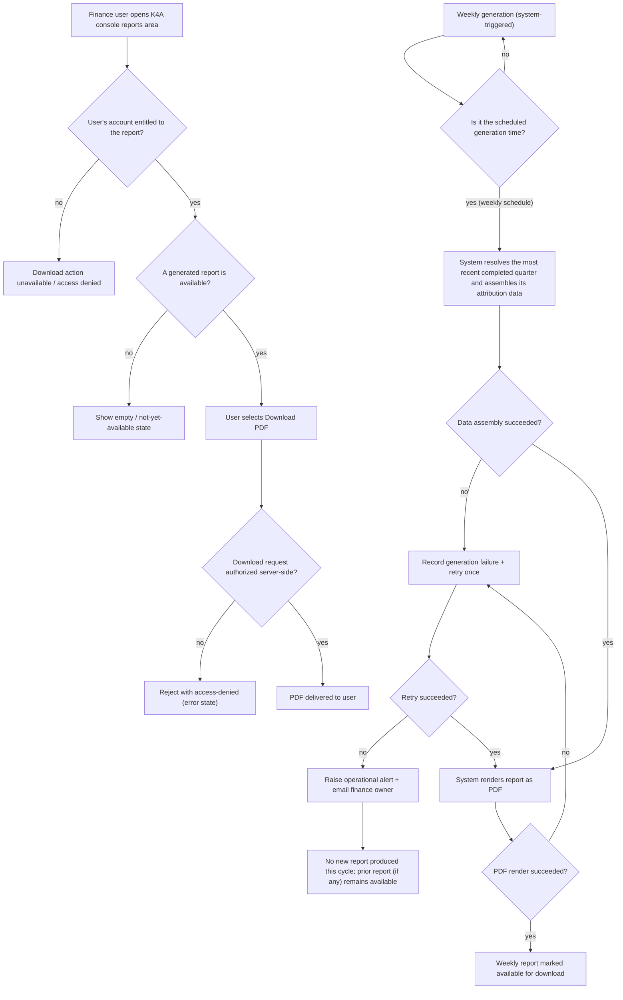

## 1. Business Logic & Context

### Problem

Brightway Retail's finance team currently has no self-serve way to obtain a formatted attribution report for their year-end close. They need a weekly attribution report, covering the most recent completed quarter (recalculated every week so the window shifts with each weekly run, not fixed to a single calendar quarter), delivered as a downloadable PDF, and it must be available before their year-end close (approximately 5 weeks from the request date).

### Value

- Gives the finance team a reliable, repeatable artifact to support year-end close reconciliation.
- Removes ad-hoc, manual report pulls by making the report available on a recurring weekly schedule.
- Delivers a portable, shareable, archive-friendly format (PDF) suited to finance workflows and audit trails.

### Business Rules

- **BR-1 — Audience:** The report is produced for Brightway Retail, a standard-plan customer. The report is part of the standard plan: no gating, upgrade, or special entitlement is required, and a standard-plan account is entitled to it by default. Brightway can use it without any entitlement change.
- **BR-2 — Cadence:** The report is generated on a weekly schedule only through Brightway Retail's year-end close, not a permanently recurring report (resolved: weekly cadence is needed through year-end close and then stops, not every week indefinitely). It is not a one-time year-end export, but the weekly cadence is time-bounded to the year-end-close period — a lighter-weight interim scheduling solution is in scope rather than durable, indefinitely-recurring scheduling.
- **BR-3 — Report period:** Each report covers the most recent completed quarter only, recalculated on every weekly run so the window shifts to whichever quarter most recently closed as of that run (confirmed by the requester). The reporting window is a rolling trailing-quarter window, not a fixed calendar quarter and not a configurable range in this phase.
- **BR-4 — Format:** The report is delivered as a downloadable PDF. The Brightway Retail logo must appear on the PDF (confirmed by the finance team). Other aspects of the visual appearance and the generation method are engineering decisions, deferred to downstream planning.
- **BR-5 — Availability gate:** The report must be generated and available for download before Brightway Retail's year-end close date. The exact year-end close date is not supplied in the input. **Working assumption (not confirmed):** target the first successful weekly report to be available no later than 4 weeks from kickoff, leaving a 1-week buffer before the stated ~5-week deadline; the exact calendar close date must still be confirmed with the customer.
- **BR-6 — Report content:** The report contains total attributed revenue and conversions broken down by channel, presented as one simple table (confirmed by the finance team). No additional metrics, groupings, or supplementary tables are in scope for this phase.
- **BR-7 — Delivery model:** Whether the finance team needs active delivery (e.g. an email or in-app notification when a new weekly report is ready) or whether on-demand download in the console is sufficient is not specified in the input. [DECISION REQUIRED]
- **BR-8 — Benchmarking:** Whether the report includes only Brightway Retail's own data or must compare against other customers / industry benchmarks is not specified in the input. [DECISION REQUIRED]

> **Service-ownership note (information requirement, not an implementation choice):** An independent knowledge-graph cross-check against the Context Seed's claimed service set did not fully agree on which backend owns the attribution report-content data: one view names a dedicated attribution-data source while the fresh lookup surfaced a separate attribution-summary builder (and a lower-confidence query layer) not in the original list. The data source for report content is therefore not settled by the available evidence and must be resolved during engineering planning. This spec does not pick a side.

## 2. User Flows (Visuals)



## 3. Functional Requirements

### Feature Area: Weekly Report Generation

**FR-001 — Weekly scheduled generation**
```gherkin
Given the weekly attribution report feature is enabled for an entitled account
And the scheduled weekly generation time is reached
When the generation cycle runs
Then the system assembles an attribution report covering the most recent completed quarter (recalculated for this run) for that account
And the resulting report is rendered as a PDF
And the report is marked available for download
```

**FR-002 — Report period is the most recent completed quarter, recalculated weekly**
```gherkin
Given a weekly report generation cycle runs
When the system selects the data window for the report
Then the system resolves the most recent completed quarter as of that run
And the report includes attribution data for that most-recent-completed-quarter window only
And the window is recalculated on each weekly run so it shifts as quarters close
And data outside that window is excluded from the report
```

**FR-003 — Generation failure is recorded and alerted, prior report preserved**
```gherkin
Given a weekly report generation cycle is running
When data assembly or PDF rendering fails for that cycle
Then the system records the failure as a named failure condition distinct from a successful run
And the system retries the generation once
And if the retry also fails an operational alert is raised and the finance owner is emailed
And no partial or corrupt report is marked available for that cycle
And any previously generated report that was already available remains available for download
```

**FR-004 — No duplicate or overlapping generation for the same cycle**
```gherkin
Given a weekly report generation cycle for an account is already in progress
When another generation run for the same account and same weekly cycle is triggered
Then the system does not start a second overlapping generation
And the in-progress run is allowed to complete
```

**FR-005 — Re-running a generation produces a consistent single result**
```gherkin
Given a weekly report generation for an account and a given weekly cycle has already completed
When the same cycle's generation is re-run (for example after a retried job)
Then the system produces or retains a single report for that account and cycle
And it does not create a duplicate report for the same account and cycle
```

### Feature Area: PDF Download (K4A Console)

**FR-006 — Download action visible to entitled users**
```gherkin
Given a finance user whose account is entitled to the weekly attribution report
And a generated report is available for that account
When the user opens the reports area in the K4A console
Then a Download PDF action is presented for the available report
```

**FR-007 — Empty state when no report is available yet**
```gherkin
Given a finance user whose account is entitled to the weekly attribution report
And no report has been generated yet for that account
When the user opens the reports area in the K4A console
Then the system shows a clear not-yet-available / empty state
And no Download PDF action is presented
```

**FR-008a — Brightway logo on the generated PDF**
```gherkin
Given a weekly attribution report is being rendered as a PDF
When the system generates the PDF document
Then the Brightway Retail logo is included on the PDF
```

**FR-008 — Successful PDF download**
```gherkin
Given a finance user whose account is entitled to the weekly attribution report
And a generated report is available for that account
When the user selects Download PDF
And the download request passes the server-side authorization check
Then the system delivers the most-recent-completed-quarter attribution report as a PDF file
```

**FR-009 — Server-side authorization enforced on download, independent of UI**
```gherkin
Given a user or account that is not entitled to the weekly attribution report
When a download request for the report is made directly, regardless of what the UI displays
Then the system rejects the request server-side with an access-denied response
And no report content is returned
```

**FR-010 — Download-time failure is surfaced distinctly**
```gherkin
Given a finance user whose account is entitled to the weekly attribution report
And the user selects Download PDF
When the download cannot be fulfilled because the report content is unavailable or the retrieval fails
Then the system presents a distinct, named error state to the user rather than a generic failure
And the user is able to retry the download
```

I have written Sections 0–3. Reporting the business trade-offs I flagged in these sections.

## 4. Information Requirements

The system must track the following business information to support the Functional Requirements above. These are business concepts, not schema definitions — field names, types, and storage are deferred to engineering planning.

- **Report generation record** — tracks each weekly generation cycle for an account: the account it belongs to, the trailing-quarter window covered, the cycle it corresponds to, and whether the cycle succeeded or failed. *System-derived.* Supports FR-001, FR-003, FR-004, FR-005, and distinguishes an available report from a failed cycle.
- **Report availability state** — whether a generated report currently exists and is downloadable for an account, including which one is the latest available. *System-derived.* Supports FR-006, FR-007, FR-008, and the "prior report remains available" guarantee in FR-003.
- **Generated PDF artifact** — the rendered most-recent-completed-quarter attribution report delivered to the finance user, including the Brightway Retail logo. *System-derived* (built from attribution data; logo asset is a provided brand asset). Supports FR-008, FR-008a.
- **Attribution report content** — the underlying attribution metrics and data points that populate the report for the most-recent-completed-quarter window (resolved and recalculated on each weekly run). *External/upstream* (sourced from the attribution data service, which backend owns this is unresolved per the Section 1 service-ownership note). Supports FR-001, FR-002. The exact metrics, data points, and grouping are unspecified (see BR-6, already flagged in Section 1).
- **Account entitlement state** — whether a given account is entitled to the weekly attribution report feature. *System-derived / external* (from the authoritative entitlement source). Supports FR-006, FR-009. Standard-plan accounts are entitled to the report by default (see BR-1); entitlement is still re-derived and enforced server-side on every download request (NFR-004).
- **Requesting user and account identity** — the user and account making a download request, used to authorize the request server-side on every call. *System-derived* (from the authenticated session). Supports FR-008, FR-009.
- **Generation failure condition** — the named, distinct failure state for a cycle (e.g. data assembly failure vs. render failure), feeding the operational alert. *System-derived.* Supports FR-003, FR-010.
- **Schedule configuration** — the weekly cadence and generation time for the recurring job. *System-derived / configured.* Supports FR-001. The specific time of day the report is generated is an engineering/operational default (see NFR-009); the cadence itself is weekly and confirmed (BR-2).

## 5. Non-Functional Requirements & Guardrails

### Performance & Capacity

- **NFR-001 — Download responsiveness:** The PDF download request, once authorized and the report is available, must return within a p95 latency target measured under expected concurrent finance-user load (p95 ≤ 5s for serving an already-generated report). Report *generation* itself is an asynchronous scheduled job and is not bound by this interactive target.
- **NFR-002 — Attribution query rate cap:** Weekly generation adds a new read path against the attribution data source, a shared resource. The generation job must operate under an explicit rate cap protecting that shared query resource so the weekly run does not degrade existing traffic. The specific cap is an engineering default to be set during planning.
- **NFR-003 — Generation monitoring:** Alert when the weekly generation error rate exceeds 1% for 5 minutes sustained, or when a scheduled cycle fails to produce an available report by its expected completion time. This complements the per-cycle operational alert in FR-003.

### Security & Access Control

- **NFR-004 — Server-side access enforcement:** Entitlement to the report must be enforced server-side on every download request and re-derived from the authoritative entitlement source on each request — never cached client-side, never trusted from a client-supplied claim, and never relying on UI-hiding alone. An ineligible account calling the download path directly must be rejected (typically 403). Fail closed if the entitlement source is unreachable. (Implements the gate behind FR-009.)
- **NFR-005 — Secure, time-limited delivery:** The attribution report is a sensitive finance export and must be delivered via a time-limited secure link rather than a permanently public URL or raw attachment. The link validity window is an engineering default to be set during planning.
- **NFR-006 — No sensitive data in logs:** The system must never log raw report content, user-identifying data, credentials, or tokens. Download and generation logs record identifiers and outcome/status only.
- **NFR-007 — Audit trail for report access and generation:** Record an append-only, immutable audit entry for each report generation outcome and each download request, capturing actor identity (user ID + account ID), resource identity (report type + ID + period), action, timestamp, and outcome/status. Audit writes are asynchronous and must never block the primary operation, but an audit-write failure must raise an immediate operational alert rather than fail silently. Both the report and its access (audit) records must be retained for two years (confirmed by the reviewer). No specific format mandate applies to this report.

### Reliability & Risk Mitigation

- **NFR-008 — Generation failure handling and fallback:** On a failed weekly cycle, the system records a named failure condition (distinguishing data-assembly failure, render failure, and dependency-unavailable), raises an operational alert, and preserves the prior available report (FR-003). When a weekly report generation fails, the system retries once; if that retry also fails, the system emails the finance owner. The finance owner is accountable for being notified of a failed weekly run. Bounded retry with exponential backoff still applies to transient failures in calling the attribution data source; retries are never indefinite, and a 429/rate-limit response honors its Retry-After.
- **NFR-009 — Idempotent, non-overlapping scheduled generation:** Weekly generation is idempotent on the natural key of account + weekly cycle + most-recent-completed-quarter window: a retried or re-delivered run overwrites/retains the single report for that key and never produces a duplicate or double-counted result (FR-005). Concurrent re-runs of the same cycle are disabled at the scheduler level so an overlapping run cannot start (FR-004). The generation time of day is an engineering/operational default, chosen to complete before the finance team's typical workday.
- **NFR-010 — Kill-switch:** Because this is HIGH-risk, multi-service work, the feature must be disableable via configuration without a code deploy, by an on-call engineer during an incident without separate approval. New requests reflect the disabled state within 5 minutes of the flip; generation cycles already in flight at the time of the flip complete under the prior behavior.

### Risk Mitigation (explicit, per Context Seed risks)

| Risk (from Context Seed) | What must be true to mitigate |
| --- | --- |
| Hard external deadline (5 weeks, year-end close) | Scope held strictly to MVP (Section 6); BR-5 year-end close date and BR-6 report content resolved early so build is not blocked (both flagged in Section 1). Kill-switch (NFR-010) limits blast radius if a late issue appears. |
| Multi-service blast radius (5+ services) | Server-side enforcement (NFR-004), kill-switch (NFR-010), bounded retries (NFR-008), and idempotent non-overlapping generation (NFR-009) contain cross-service failure. Service-ownership ambiguity for report-content data is called out in Section 1 for planning to resolve. |
| Unconfirmed UX scope | Resolved: the finance team confirmed no filtering, column customization, or custom date-range regeneration is needed — just the PDF. MVP UX limited to a download action, empty state, and error state (FR-006–FR-010). Any report-management view (filtering, custom columns, date-range regeneration) is explicitly Out of Scope (Section 6). |
| Unclear recurring vs. one-time requirement | Resolved: weekly cadence only through year-end close, not permanently recurring and not one-time (BR-2). A time-bounded interim weekly schedule is built, not durable indefinite scheduling. |

### Rollback

- **NFR-011 — Rollback:** Trigger — a generation defect, incorrect report content, or an access/entitlement enforcement failure observed in production. Authority — on-call engineering, via the kill-switch (NFR-010), without separate escalation. Timing target — disabled state in effect for new requests within 5 minutes. Already-produced reports are not retroactively withdrawn or regenerated by a rollback; only new generation and download behavior is affected going forward.

### Backward Compatibility

- **NFR-012 — Backward compatibility:** This feature extends an existing reporting/download surface with existing consumers. Any extension of the existing report-generation or download path must leave current report types, existing download behavior, and existing consumers unchanged. Whether PDF output and trailing-quarter windowing already exist on the current path or are net-new is unresolved by available evidence and must be confirmed in engineering planning; either way, existing outputs must not regress.

## 6. Out of Scope & Phasing

The following are explicitly **NOT** included in Phase 1 (MVP). Phase 1 delivers a weekly-generated most-recent-completed-quarter (recalculated weekly) attribution report downloadable as a PDF from the K4A console by entitled finance users, before Brightway Retail's year-end close.

| Item | Status | Rationale |
| --- | --- | --- |
| Active delivery (email / in-app notification when a new report is ready) | Out of scope (future phase) | Delivery model unresolved (BR-7); MVP is on-demand download. Revisit if finance team confirms a delivery need. |
| Benchmarking / comparison against other customers or industry standards | Out of scope (future phase) | Benchmarking requirement unresolved (BR-8); MVP covers Brightway Retail's own data only. |
| User-configurable date ranges within the quarter | Out of scope (future phase) | MVP window is the most recent completed quarter, recalculated weekly, only (BR-3). |
| Filtering, custom column selection, or report customization in the UI | Out of scope (future phase) | Confirmed by the finance team: no filtering or column customization is needed — just the PDF. MVP UX is a single download action; controls scope creep against the deadline. |
| On-demand regeneration for arbitrary date ranges | Out of scope (future phase) | Confirmed by the finance team: no custom date-range regeneration is needed — just the PDF. MVP generation is the recurring weekly cycle only. |
| Rollout to customers/plans beyond Brightway Retail | Out of scope (future phase) | MVP targets Brightway Retail specifically; broader entitlement rollout is a later decision. |
| Report formats other than PDF (e.g. CSV, XLSX) | Out of scope (future phase) | MVP format is PDF only (BR-4). |

## Appendix: Engineering Reference

_The sections below are derived automatically from the codebase knowledge graph, for the engineering team's reference during planning — not required reading for product/requirement review._

### Affected Services (grounded context, not implementation direction)

- **reporting-api** (backend) — Generate and serve weekly attribution reports; owns report generation and download endpoints.
- **reporting-dispatcher** (backend) — Schedule and dispatch recurring weekly report generation jobs.
- **reporting-subscriptions-worker** (backend) — Manage scheduled report delivery and subscription workflows; overlaps with reporting-dispatcher on who owns the weekly cadence (to be disambiguated in planning).
- **frontend-mos** (frontend) — K4A console UI: add the PDF download button/flow for attribution reports.
- **pubsuite-attribution** (backend) — Provide attribution data for the K4A weekly report content.

> **Cross-check discrepancy (for planning):** An independent KG lookup additionally surfaced **summary-report-cloud** (builds attribution summary report data), **koch-query-api** (queries attribution data, low confidence), and **entitlements-api** (gates access to the report feature, low confidence), none of which appear in the primary affected-services list; and did not re-find **pubsuite-attribution**. Which backend owns report-content data (pubsuite-attribution vs. summary-report-cloud vs. koch-query-api) is not settled by the evidence and must be resolved during planning. entitlements-api remains relevant only for server-side enforcement (NFR-004): the report is part of the standard plan and is not plan-gated (see BR-1), so no gating change is needed for Brightway, but entitlement is still verified server-side on each download.

## Revision Summary

_Applied reviewer's request._

- Replaced the [DECISION REQUIRED] tag on BR-5 with the reviewer's stated working assumption for the availability-gate target, marked as an unconfirmed assumption.


---
## Open Questions & Decisions Register

_Durable, ID'd reference for HITL 2 (G1) and beyond — inline `[DECISION REQUIRED: DEC-00N]` tags in the sections above point back here. Reflects the latest round only._

### Decisions Required (business trade-offs — needs a human call)

_Each carries an **Owner** (accountable for supplying the answer) and a **Provisional Value** (the working assumption engineering may build against until the decision lands), so none of these fully block engineering — implementation proceeds on the provisional value and adjusts if the confirmed decision differs._

| ID | Decision | Owner | Provisional Value (build against until confirmed) |
|----|----------|-------|-----------------------------------------------------|
| **DEC-004** | Does the finance team need to be actively notified (for example by email or an in-app alert) when each week's report is ready, or is on-demand download from the console enough? | Product owner | Ship on-demand download in the console for Phase 1 with no active delivery/notification, and revisit email delivery as a fast-follow if finance asks for it. |
| **DEC-005** | Should the report show only Brightway Retail's own data, or does it need to compare against other customers or industry benchmarks? | Product owner | Scope the report to Brightway Retail's own data only, with no cross-customer or industry benchmarking in Phase 1. |
| **DEC-006** | Does this report need to be delivered to the finance team automatically each week — for example by email or an in-app alert when a new one is ready — or is it enough for them to download it on demand from the console? | Product owner | On-demand download in the console only for Phase 1; add active delivery (email/in-app notification) in a later phase if the finance team confirms they need it. |
| **DEC-009** | Audience: The report is produced for Brightway Retail, a standard-plan customer. Whether this report is a standard-plan entitlement or a gated/premium feature that a standard-plan customer cannot access by default is unresolved and materially affects whether Brightway can use it without an entitlement change. | _(not yet assigned)_ | _(not yet specified)_ |
| **DEC-021** | Delivery model: Whether the finance team needs active delivery (e.g. an email or in-app notification when a new weekly report is ready) or whether on-demand download in the console is sufficient is not specified in the input. | _(not yet assigned)_ | _(not yet specified)_ |

### Decisions Resolved

- **DEC-001**: Report is part of the standard plan — no gating or special entitlement needed; this also resolves the duplicate question DEC-001.
- **DEC-002**: Assumed: Target the first successful weekly report to be available no later than 4 weeks from kickoff, leaving a 1-week buffer before the stated ~5-week deadline, and confirm the exact calendar date with the customer.
- **DEC-003**: Report content resolved: total attributed revenue and conversions by channel, presented as one simple table.
- **DEC-007**: Resolved DEC-007: the finance report and its access records must be retained for two years; no specific format mandate applies.
- **DEC-008**: On a failed weekly report generation, retry once, then email the finance owner (who is both notified and the fallback the finance team sees); this same answer resolves DEC-008 on who is alerted/accountable.
- **DEC-010**: Assumed: Target the first successful weekly report to be available no later than 4 weeks from kickoff, leaving a 1-week buffer before the stated ~5-week deadline, and confirm the exact calendar date with the customer.
- **DEC-011**: Report content resolved: total attributed revenue and conversions by channel, presented as one simple table.
- **DEC-012**: Assumed: Target the first successful weekly report to be available no later than 4 weeks from kickoff, leaving a 1-week buffer before the stated ~5-week deadline, and confirm the exact calendar date with the customer.
- **DEC-013**: Assumed: Target the first successful weekly report to be available no later than 4 weeks from kickoff, leaving a 1-week buffer before the stated ~5-week deadline, and confirm the exact calendar date with the customer.
- **DEC-014**: Assumed: Target the first successful weekly report to be available no later than 4 weeks from kickoff, leaving a 1-week buffer before the stated ~5-week deadline, and confirm the exact calendar date with the customer.
- **DEC-015**: Report content resolved: total attributed revenue and conversions by channel, presented as one simple table.
- **DEC-016**: Assumed: Target the first successful weekly report to be available no later than 4 weeks from kickoff, leaving a 1-week buffer before the stated ~5-week deadline, and confirm the exact calendar date with the customer.
- **DEC-017**: Report content resolved: total attributed revenue and conversions by channel, presented as one simple table.
- **DEC-018**: Assumed: Target the first successful weekly report to be available no later than 4 weeks from kickoff, leaving a 1-week buffer before the stated ~5-week deadline, and confirm the exact calendar date with the customer.
- **DEC-019**: Assumed: Target the first successful weekly report to be available no later than 4 weeks from kickoff, leaving a 1-week buffer before the stated ~5-week deadline, and confirm the exact calendar date with the customer.
- **DEC-020**: Assumed: Target the first successful weekly report to be available no later than 4 weeks from kickoff, leaving a 1-week buffer before the stated ~5-week deadline, and confirm the exact calendar date with the customer.

### Open Questions (evidence gaps — needs more input)

- **OQ-002**: Does the finance team need the report actively delivered (email/notification when ready) or only on-demand download from the console? This decides whether the subscriptions/delivery workflow is in scope.
- **OQ-008**: Does the report need to be Brightway-only, or include any benchmarking/comparison against other customers or industry standards?

### Questions Resolved

- **OQ-001**: Resolved OQ-001 — the weekly report is needed only through year-end close, not permanently recurring, so a lighter-weight interim solution is in scope rather than durable scheduling.
- **OQ-003**: Report is part of the standard plan — no gating or special entitlement needed; this also resolves the duplicate question DEC-001.
- **OQ-004**: Resolved OQ-004: "last quarter" resolves to the most recent completed quarter, recalculated every week (a rolling trailing-quarter window, not a fixed Q4).
- **OQ-005**: On a failed weekly report generation, retry once, then email the finance owner (who is both notified and the fallback the finance team sees); this same answer resolves DEC-008 on who is alerted/accountable.
- **OQ-006**: Report content resolved: total attributed revenue and conversions by channel, presented as one simple table.
- **OQ-007**: Resolved OQ-007: the finance team confirmed no filtering, column customization, or custom date-range regeneration is needed — just the PDF download.

---
> **Classification:** Type A
