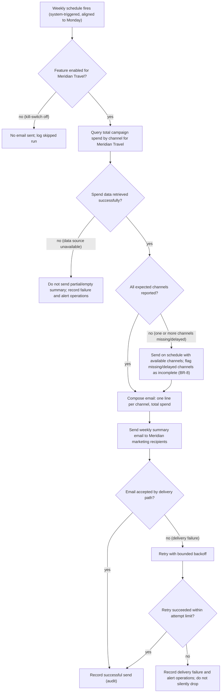

## 1. Business Logic & Context

### Problem

Meridian Travel's marketing team manually compiles total campaign spend by channel every Monday. They copy per-channel spend totals into a spreadsheet and send it up to their VP. This is recurring, manual, and error-prone work that must happen before each week begins, and it competes for time ahead of their summer campaign launch.

### Value

Automating this into a weekly email summary removes the recurring manual pull and spreadsheet compilation. The marketing team receives the data without intervention, in a format they can forward to their VP or paste into a spreadsheet — freeing their Monday workflow and eliminating a source of manual copy errors.

### Scope at a glance

- **Delivery channel:** Email only. No on-screen K4A interface changes are required for this requirement.
- **Content:** Total spend per channel, one line per channel. Nothing beyond per-channel totals is in scope for Phase 1.
- **Cadence:** Once per week, every Monday at 8:00 AM Eastern Time, aligned to the team's existing Monday process.
- **Data population:** All campaigns for Meridian Travel (a single advertiser on the standard plan).

### Business Rules

- **BR-1 — Weekly cadence.** The summary is generated and sent exactly once per calendar week.
- **BR-2 — Monday alignment.** The send aligns to the team's existing manual-Monday process. The email is sent every Monday at 8:00 AM Eastern Time.
- **BR-3 — Content is per-channel totals only.** Each email contains one line per channel showing that channel's total campaign spend for the reporting period. No period-over-period comparison, campaign counts, or performance notes are included in Phase 1.
- **BR-4 — Advertiser scope.** The data covers all campaigns belonging to Meridian Travel only. No other advertiser's data appears in this email.
- **BR-5 — Channel set.** The email lists every channel K4A tracks for Meridian Travel: email, paid search, paid social, and display.
- **BR-6 — Recipients.** The summary is delivered to the Meridian Travel marketing team list, `marketing-team@meridiantravel.example`. All recipients receive the same summary; there is no differentiation by team or geography.
- **BR-7 — Reporting period.** Each email covers the previous calendar week, Monday to Sunday. This window determines what "total spend" means for each run.
- **BR-8 — Partial-data handling.** When one or more channels have missing or delayed data at send time, the email is sent on schedule with the available channels' data, and the channels with missing or delayed data are clearly flagged as incomplete rather than held. The email does not wait for all channels to report.
- **BR-9 — Self-service configuration is out of scope for Phase 1.** The requester confirmed a fixed static setup is acceptable and no self-service UI is needed for now. Recipients, channel selection, and schedule are configured as a fixed setup for Meridian Travel; the team cannot self-edit them in Phase 1 (see Section 6).

### A note on affected-system evidence

The system attribution for this requirement is derived from a codebase knowledge graph, and the automatically-derived service list is uncertain. A fresh, independent lookup surfaced an overlapping-but-different set of candidate systems than the original intake analysis, and the two do not fully agree — in particular, ownership of (a) where the authoritative spend-by-channel data lives and (b) which system actually sends the email is unresolved across multiple candidate services. An architecture spike to resolve ownership is expected during engineering planning. The full derived service evidence is reproduced in a clearly-labelled appendix at the end of this document for the engineering team's reference; it is not required reading for product/requirement review.

---

## 2. User Flows (Visuals)

The primary actor is the **system** (the weekly scheduled job); the marketing team is a passive recipient. The flow below covers the happy path and the partial-data / delivery-failure error states.



---

## 3. Functional Requirements (The Core)

> All requirements apply to the single advertiser Meridian Travel on the standard plan. Where a value is a business decision, it is tagged in Section 1 and must be resolved before that requirement is testable; engineering defaults stated inline are safe to build against in the interim.

### Feature Area A — Weekly Scheduling & Trigger

**FR-001 — Weekly generation fires on schedule**
```gherkin
Given the weekly summary feature is enabled for Meridian Travel
And the configured weekly send time and timezone have been set
When the scheduled send time is reached
Then the system triggers exactly one spend-summary generation run for Meridian Travel for that week
```

**FR-002 — Exactly one send per week (no duplicate runs)**
```gherkin
Given a weekly summary generation run has already completed for Meridian Travel for the current reporting week
When the scheduler attempts to start another run for the same advertiser and the same reporting week
Then the system does not start a second run and does not send a duplicate email
And the attempted duplicate run is recorded
```

**FR-003 — Overlapping run guard**
```gherkin
Given a weekly summary generation run for Meridian Travel is currently in progress
When the scheduler fires again for the same advertiser before the in-progress run has finished
Then the system does not start a concurrent overlapping run for that advertiser
```

**FR-004 — Idempotent generation on retry**
```gherkin
Given a weekly summary run for Meridian Travel for a given reporting week is retried after a transient failure
When the run executes again for the same advertiser and the same reporting week
Then the end result is a single summary for that advertiser and week with no double-counted spend and no duplicate email
```

### Feature Area B — Spend Data Retrieval & Aggregation

**FR-005 — Retrieve spend for all Meridian campaigns**
```gherkin
Given the weekly generation run has started for Meridian Travel
When the system queries campaign spend data
Then it retrieves spend for all campaigns belonging to Meridian Travel
And it excludes campaigns belonging to any other advertiser
```

**FR-006 — Aggregate spend by channel**
```gherkin
Given spend data for all of Meridian Travel's campaigns has been retrieved for the reporting period
When the system aggregates the data
Then it produces exactly one total-spend figure per channel for that reporting period
And each channel appears at most once in the result
```

**FR-007 — Reporting period boundary**
```gherkin
Given a reporting period window has been defined for the weekly summary
When the system aggregates spend for a given run
Then only spend falling within that reporting period window is included in each channel total
And spend outside the window is excluded
```

**FR-008 — Channel set selection**
```gherkin
Given all channels K4A tracks for Meridian Travel are included (email, paid search, paid social, and display)
When the system composes the per-channel list
Then every tracked channel for Meridian Travel appears in the list
And no channel tracked for Meridian Travel is omitted
```

**FR-009 — Spend-data retrieval failure does not produce a misleading email**
```gherkin
Given the system attempts to retrieve spend data for the weekly run
When the data source is unavailable or returns an error
Then the system does not send an empty or partial summary that would misrepresent spend as zero
And the failure is recorded with a distinct failure reason
And an operational alert is raised
```

**FR-010 — Partial channel data handling**
```gherkin
Given spend data was retrieved but one or more expected channels have missing or delayed data at generation time
When the system composes the summary
Then it sends the email on schedule with the available channels' spend totals
And the email clearly flags which channels have incomplete or unavailable data rather than silently showing them as zero spend or holding the send
```

### Feature Area C — Email Composition

**FR-011 — One line per channel**
```gherkin
Given per-channel spend totals have been aggregated for the reporting period
When the email body is composed
Then the email contains one line per included channel
And each line shows the channel name and that channel's total spend for the reporting period
```

**FR-012 — Forward-and-paste-friendly format**
```gherkin
Given the email body has been composed
When a recipient opens the email
Then the per-channel spend content is structured so it can be forwarded as-is or copied into a spreadsheet without manual reformatting
```

**FR-013 — Reporting period is stated in the email**
```gherkin
Given the email body is composed for a given reporting period
When a recipient reads the email
Then the email clearly states the reporting period the spend totals cover
```

**FR-014 — No campaign-level or extraneous content in Phase 1**
```gherkin
Given the email is composed for Phase 1
When the email body is generated
Then it contains only per-channel total spend (plus reporting period and any partial-data flag)
And it does not include period-over-period comparisons, campaign counts, or performance notes
```

### Feature Area D — Delivery

**FR-015 — Send to configured Meridian recipients**
```gherkin
Given the summary email has been composed for Meridian Travel
And the recipient list for Meridian Travel has been configured
When the system sends the email
Then the email is delivered to exactly the configured recipients for Meridian Travel
And no recipient outside that configured list receives it
```

**FR-016 — Bounded retry on delivery failure**
```gherkin
Given the system attempts to send the weekly summary email
When the delivery attempt fails with a transient error
Then the system retries using bounded exponential backoff up to 3 attempts
And it does not retry indefinitely
```

**FR-017 — Delivery failure is recorded and alerted, never silently dropped**
```gherkin
Given all delivery attempts for a weekly summary have been exhausted without success
When the final attempt fails
Then the failure is recorded with a distinct delivery-failure reason
And an operational alert is raised
And the email is not silently dropped
```

**FR-018 — Successful send is recorded**
```gherkin
Given the weekly summary email was accepted by the delivery path for Meridian Travel
When the send completes
Then the system records the successful send including the advertiser, reporting week, recipients, and timestamp
```

### Feature Area E — Operational Controls

**FR-019 — Kill-switch disables the feature without a deploy**
```gherkin
Given the weekly summary feature is controlled by a configuration-based flag
When an on-call engineer disables the flag during an incident
Then no new weekly generation runs start for Meridian Travel while the flag is off
And disabling requires no code deploy and no separate approval step
And the change propagates to new runs within 5 minutes
```

**FR-020 — Skipped run when disabled is recorded**
```gherkin
Given the weekly summary feature flag is disabled when the schedule fires
When the scheduled time is reached
Then no email is sent
And the system records that the run was skipped because the feature was disabled
```

I used `[DECISION REQUIRED]` tags across unique trade-offs in Sections 1–3 (send time/timezone, recipients, reporting period, and partial-data handling). The channel-set question has been resolved: the email lists every channel K4A tracks for Meridian Travel (email, paid search, paid social, and display). Reporting them now.

## 4. Information Requirements

The system must track the following business information to support the functional requirements above:

- **Advertiser scope identity** — identifies that a given run and summary belong to Meridian Travel. System-derived from the advertiser the run is configured for. Matters because every email must contain only Meridian Travel's campaigns (BR-4, FR-005) and no other advertiser's data may leak into it.
- **Campaign spend records** — the per-campaign spend that rolls up into channel totals. Sourced from the authoritative spend-by-channel data system (external to this feature; exact owner unresolved — see Section 1 and the appendix). Matters because it is the raw input to the aggregation in FR-006.
- **Channel attribution** — the channel each spend amount belongs to. External/system-derived from the spend data source. Matters because the entire email is organized as one total per channel (FR-006, FR-011).
- **Per-channel spend totals (for a reporting period)** — the aggregated figure shown on each line of the email. System-derived from the campaign spend records within the reporting-period window. Matters because this is the core content the recipient consumes (FR-006, FR-011).
- **Reporting period window** — the start/end boundary that defines which spend is counted: the previous calendar week, Monday to Sunday (BR-7). Matters because it determines what "total spend" means for each run and is stated in the email (FR-007, FR-013).
- **Channel-inclusion rule** — all channels K4A tracks for Meridian Travel (email, paid search, paid social, and display) are listed; no curated subset applies (BR-5). Matters because it governs which channels are listed (FR-008).
- **Recipient list** — the addresses the summary is delivered to: the Meridian Travel marketing team list, `marketing-team@meridiantravel.example`, with all recipients receiving the same summary (BR-6). User/business-provided configuration for Meridian Travel. Matters because delivery must go to exactly these recipients and no one else (FR-015).
- **Send schedule (time + timezone)** — when the weekly run fires: every Monday at 8:00 AM Eastern Time. User/business-defined configuration (BR-2). Matters because it drives FR-001 and aligns delivery to the team's Monday workflow.
- **Feature-enabled state (kill-switch)** — whether the feature is active for Meridian Travel. System/operations-controlled configuration. Matters because it gates whether a run starts at all (FR-019, FR-020).
- **Run record (per advertiser, per reporting week)** — tracks that a run for a given advertiser and reporting week has started/completed, and its outcome. System-derived. Matters because it enforces exactly-once sending, the overlap guard, and idempotency (FR-002, FR-003, FR-004).
- **Partial-data / channel-availability status** — which channels reported complete data and which were missing or delayed at generation time. System-derived during retrieval. Matters because the email is sent on schedule with available channels while the missing or delayed channels are flagged as incomplete (FR-010, BR-8).
- **Delivery outcome and failure reason** — whether the email was accepted, and a distinct reason if not (data-retrieval failure, delivery failure, skipped-because-disabled). System-derived. Matters because failures must be recorded distinctly and alerted, never silently dropped (FR-009, FR-017, FR-018, FR-020).
- **Audit trail of each run** — actor/trigger, advertiser, reporting week, recipients, timestamp, and outcome for each send or skip. System-derived. Matters because this is a recurring, recipient-facing, state-producing operation whose history a stakeholder must be able to trace (see NFR-005).

---

## 5. Non-Functional Requirements & Guardrails

### Performance & Capacity

- **NFR-001 — Generation and send completion window.** A single weekly run for Meridian Travel (query, aggregate, compose, send) must complete well within its weekly cadence so the email reliably lands within the team's Monday workflow window. Because this is a once-per-week, single-advertiser batch job rather than an interactive path, there is no sub-second latency target; the operational requirement is that a run completes and delivers before the intended Monday delivery time, with margin for the bounded retries in FR-016.
- **NFR-002 — Shared query-resource protection.** The spend-by-channel query adds load to a shared reporting/data system whose authoritative owner is unresolved (see Section 1). The generation run must not issue unbounded or concurrent-heavy queries against that shared resource; a single sequential aggregation query path per run is sufficient for one advertiser and is the safe default to build against until the authoritative data owner is confirmed.
- **NFR-003 — Run-outcome monitoring.** Alert when a weekly run fails to produce and deliver a summary for Meridian Travel for a scheduled week (data-retrieval failure, delivery failure after exhausted retries, or an unexpectedly skipped run). Following Kochava's alerting convention, alert when run failures or delivery failures exceed the expected baseline for the run — for a single weekly send, any failed scheduled run is itself alert-worthy and must raise an operational alert rather than pass silently.

### Security & Access Control

- **NFR-004 — Advertiser-scoped data isolation (server-side).** The run must retrieve and include only Meridian Travel's campaign spend. Advertiser/tenant scoping must be enforced at the data-retrieval layer, not by post-filtering a broader result set, so that no other advertiser's spend can ever appear in the email (supports BR-4, FR-005). If the account/tenant scoping path cannot be confirmed in the data source, the run must fail closed rather than send an unscoped summary.
- **NFR-005 — Audit trail for each run (append-only).** Each weekly run records an immutable, append-only audit entry capturing the trigger/actor, advertiser identity, reporting week, recipient list, outcome/status, and timestamp. No code path or role may edit or delete these records. The audit write is asynchronous so it never blocks the send, but an audit-write failure must raise an immediate operational alert rather than fail silently. Retain audit records for a minimum of 12 months.
- **NFR-006 — Recipient-address handling.** Recipient email addresses are the only user-identifying data this feature handles. Raw recipient addresses must not be written to application logs; where a recipient must be referenced in logs or audit for troubleshooting, mask to a partial form rather than logging the full address. Recipient addresses are stored only as configuration needed for delivery and are not copied into any general-purpose analytics store.
- **NFR-007 — No self-service surface in Phase 1.** Because recipients, channel set, and schedule are a fixed operational setup in Phase 1 (BR-9), no end-user-facing configuration endpoint or UI is exposed for them. Any change to these values is an operational/configuration action, not a user action. (If self-service is later brought into scope — see Section 6 — role-based, server-side access control becomes required at that point.)

### Reliability & Idempotency

- **NFR-008 — Idempotent weekly run.** A run is idempotent on the natural key of advertiser + reporting week: a retry or re-trigger for the same advertiser and reporting week produces a single summary and a single delivered email, never duplicated spend and never a second email (supports FR-002, FR-004). A scheduler-level overlap guard additionally prevents a concurrent run for the same advertiser from starting while one is in progress (supports FR-003).
- **NFR-009 — Downstream dependency failure posture.** For the spend-data retrieval dependency, the feature is **fail-closed**: on retrieval error or unavailability, no email is sent for that run rather than sending a misleading zero/partial summary (supports FR-009). For the email-delivery dependency, use bounded exponential backoff of up to 3 attempts and honor any rate-limit `Retry-After` response rather than retrying on a fixed schedule (supports FR-016). Distinct failure conditions — data-retrieval failure, delivery failure, and skipped-because-disabled — each get their own recorded failure reason and are not collapsed into one generic error (supports FR-009, FR-017, FR-020).

### Operational Controls, Rollback & Compatibility

- **NFR-010 — Kill-switch.** The feature is governed by a configuration-based flag that an on-call engineer can disable during an incident with no code deploy and no separate approval step; the change applies to new runs within 5 minutes (supports FR-019). Because the run is a discrete weekly batch, a run already in progress at the moment of the flip may complete under prior behavior; no new run starts while the flag is off.
- **NFR-011 — Rollback.** *Trigger:* repeated failed or incorrect weekly sends, or any incident attributed to this feature. *Owning authority:* the on-call engineer, via the NFR-010 kill-switch, without separate escalation. *Timing target:* effective within the 5-minute flag-propagation window. *Data treatment:* there is no retroactive reversion — emails already delivered cannot be unsent; rollback only prevents future runs. No produced data is rewritten on rollback.
- **NFR-012 — Backward compatibility with existing systems.** This feature consumes an existing spend-by-channel data source and may reuse an existing scheduled-report dispatch path (ownership unresolved — see Section 1). It must not alter the behavior, outputs, or performance contract of any existing consumer of those systems; the weekly summary is additive and existing reporting/dispatch callers must remain unchanged. The engineering architecture spike must confirm this additive-only property for whichever systems are selected.

### Risk Mitigation (from the Context Seed risk tier: HIGH)

- **Hard 5-week deadline.** Mitigated by the strict MVP scope (per-channel totals only, single advertiser, no self-service — Section 6), which removes the highest-effort optional capabilities from Phase 1. Mitigated-when: the Section 1 `[DECISION REQUIRED]` items are answered early so engineering is not blocked on product input during the build window.
- **Multi-service blast radius.** Mitigated by NFR-002 (bounded query load), NFR-004 (server-side advertiser isolation), NFR-012 (backward compatibility), and the architecture spike that resolves which systems authoritatively own spend data and email delivery before build. Mitigated-when: the ownership ambiguity flagged in Section 1 is resolved and the additive-only property is confirmed.
- **Scheduled email delivery complexity / integration risk.** Mitigated by NFR-008 (idempotency + overlap guard), NFR-009 (fail-closed on data, bounded retry on delivery, distinct failure reasons), NFR-003 (every failed run alerts), and NFR-010/NFR-011 (kill-switch and rollback). Mitigated-when: a failed or delayed run can never silently drop or send a misleading summary, and the feature can be pulled within 5 minutes without a deploy.

---

## 6. Out of Scope & Phasing

The following are explicitly **NOT** included in Phase 1, to prevent scope creep:

| Item | Status | Rationale |
|------|--------|-----------|
| Any on-screen K4A interface change | Out of scope | Requester confirmed the deliverable is email only; nothing renders on screen in K4A. |
| Self-service configuration (recipients, channel set, or schedule edited by the marketing team) | Future phase | Phase 1 is a fixed operational setup for Meridian Travel (BR-9). Would introduce a UI and role-based access-control surface not required now. |
| Content beyond per-channel totals (period-over-period comparison, campaign counts, performance notes) | Future phase | Requester confirmed total spend per channel, one line per channel, is sufficient for Phase 1 (FR-014). |
| Differentiated summaries by team or geography | Future phase | Phase 1 delivers one identical summary to the Meridian Travel marketing team list (BR-6); differentiation by team or geography is not needed in Phase 1. |
| Additional advertisers beyond Meridian Travel | Future phase | This requirement is scoped to the single advertiser Meridian Travel on the standard plan. The requester confirmed the email is built just for Meridian Travel for now, not as a reusable per-advertiser summary for other clients; generalizing to other advertisers is a later effort. |
| Secure time-limited download link / attachment delivery of the summary | Out of scope | Phase 1 delivers in-email per-channel totals only; no file export is requested. |

---

## Appendix: Engineering Reference

_The sections below are derived automatically from the codebase knowledge graph, for the engineering team's reference during planning — not required reading for product/requirement review._

### Affected Services (grounded context, not implementation direction)

The intake analysis and an independent fresh knowledge-graph lookup surfaced overlapping-but-different candidate services. Both are reproduced as given evidence; ownership is unresolved and is expected to be settled by an architecture spike during engineering planning (see Section 1).

**From the intake analysis:**

- **reporting-api** (backend) — Query campaign spend data by channel.
- **reporting-dispatcher** (backend) — Schedule & dispatch the weekly email summary job.
- **k4a-mcp-server** (backend) — K4A platform backend: integrate scheduled reporting.
- **sam-api** (backend) — SAM campaign data source for spend-by-channel.

**From the independent fresh knowledge-graph lookup (overlapping-but-different; confidence as noted):**

- **k4a-sam-backend** (backend, medium) — K4A SAM backend likely owns weekly summary logic.
- **sam-report-scheduler** (backend, medium) — Schedules SAM reports; fits a weekly email summary.
- **sam-performance-reporter** (backend, medium) — Generates SAM performance/spend reports.
- **sam-campaign-data-sync** (backend, low) — Syncs campaign spend data by channel.
- **k4a-sam-campaign-data-sync** (backend, low) — Provides K4A campaign spend data consumed by the summary.
- **reporting-subscriptions-worker** (backend, low) — Dispatches scheduled/subscription report emails.
- **reporting-dispatcher** (backend, low) — Dispatches scheduled reports, possibly weekly emails.
- **notifications-api** (backend, low) — May send the weekly email notification.
- **cost-v2** (backend, low) — Owns campaign spend/cost data by channel.
- **frontend-mos** (frontend, low) — Console UI may configure an email summary.

**Key discrepancies for the spike to resolve:**

- **Authoritative spend-by-channel data owner** is unresolved across `reporting-api`, `sam-performance-reporter`, and `cost-v2`.
- **Email-sending path owner** is unresolved across `reporting-dispatcher`, `reporting-subscriptions-worker`, and `notifications-api`.
- **K4A integration owner** differs between the two lookups (`k4a-mcp-server` vs. `k4a-sam-backend`).
- **`frontend-mos`** appears only in the fresh lookup (low confidence) and conflicts with the intake's confirmed "no UI change" scope; it is relevant only if self-service configuration is ever brought into scope (Section 6).

All Section 5 guardrails are stated against the capability (query load, isolation, backward compatibility) rather than any one of these named services, so they remain valid regardless of which candidates the spike selects.

The `[DECISION REQUIRED]` trade-offs in Sections 4–6 were already tagged and reported in Sections 1–3 (send time/timezone, channel set, recipients, reporting period, and partial-data handling). I introduced no new decisions in Sections 4–6; every business trade-off these sections depend on was already flagged upstream. Reporting an empty array accordingly.

## Revision Summary

_Applied reviewer's request._

- Resolved BR-7: reporting period is the previous calendar week, Monday to Sunday (DEC-004).
- Updated Information Requirements reporting-period window to state the Monday-to-Sunday previous-week boundary.


---
## Open Questions & Decisions Register

_Durable, ID'd reference for HITL 2 (G1) and beyond — inline `[DECISION REQUIRED: DEC-00N]` tags in the sections above point back here. Reflects the latest round only._

### Decisions Required (business trade-offs — needs a human call)

_Each carries an **Owner** (accountable for supplying the answer) and a **Provisional Value** (the working assumption engineering may build against until the decision lands), so none of these fully block engineering — implementation proceeds on the provisional value and adjusts if the confirmed decision differs._

| ID | Decision | Owner | Provisional Value (build against until confirmed) |
|----|----------|-------|-----------------------------------------------------|
| **DEC-001** | What time of day and in which timezone should the weekly summary email be sent on Monday? | Product owner (with Meridian Travel marketing team) | Send at 07:00 in Meridian Travel's primary business timezone on Monday, so the summary is waiting in inboxes before the team starts their week. |
| **DEC-006** | Monday alignment. The send aligns to the team's existing manual-Monday process. The exact send time and timezone is a business decision. | _(not yet assigned)_ | _(not yet specified)_ |
| **DEC-007** | Channel set. Whether the email lists every channel K4A tracks for Meridian Travel, or only a curated subset Meridian defines, is a business decision. | _(not yet assigned)_ | _(not yet specified)_ |
| **DEC-008** | Recipients. The specific recipients (names/roles) and whether all recipients receive the same summary or differentiated summaries by team/geography is a business decision. | _(not yet assigned)_ | _(not yet specified)_ |

### Decisions Resolved

- **DEC-002**: Resolved OQ-001 (and the duplicate DEC-002): the email includes all channels K4A tracks for Meridian Travel — email, paid search, paid social, and display — not a curated subset.
- **DEC-003**: Recipients resolved: the summary goes to the Meridian Travel marketing team list, marketing-team@meridiantravel.example, and all recipients receive the same summary with no differentiation by team or geography; this settles OQ-002 and the duplicate DEC-003.
- **DEC-004**: Resolved DEC-004 (BR-7 reporting period): each weekly email covers the previous calendar week, Monday to Sunday.
- **DEC-005**: Resolved OQ-005 (and the duplicate DEC-005): when one or more channels have missing or delayed data at send time, the email sends on schedule with the available channels included and the missing/delayed channels flagged as incomplete, rather than holding until all channels report.

### Questions Resolved

- **OQ-001**: Resolved OQ-001 (and the duplicate DEC-002): the email includes all channels K4A tracks for Meridian Travel — email, paid search, paid social, and display — not a curated subset.
- **OQ-002**: Recipients resolved: the summary goes to the Meridian Travel marketing team list, marketing-team@meridiantravel.example, and all recipients receive the same summary with no differentiation by team or geography; this settles OQ-002 and the duplicate DEC-003.
- **OQ-003**: OQ-003 resolved: the weekly summary email sends every Monday at 8:00 AM Eastern Time.
- **OQ-004**: OQ-004 resolved — the email is strictly one spend line per channel with nothing else (no period-over-period change, campaign counts, or performance notes); this matches the position already stated in BR-3, FR-014, and the Section 6 out-of-scope table.
- **OQ-005**: Resolved OQ-005 (and the duplicate DEC-005): when one or more channels have missing or delayed data at send time, the email sends on schedule with the available channels included and the missing/delayed channels flagged as incomplete, rather than holding until all channels report.
- **OQ-006**: OQ-006 resolved — requester confirmed a fixed static setup with no self-service UI is acceptable for Phase 1; no config UI is needed and the 'no frontend change' assumption holds.
- **OQ-007**: Resolved OQ-007 — the weekly summary email is built just for Meridian Travel for now, not as a reusable per-advertiser summary for other clients.

---
> **Classification:** Type B — requirement-agent's independent re-check DISAGREES with intake's original Type A call. Requirement and behavior are fully specified (weekly Monday email, total spend per channel, defined recipients and data scope), with the open questions being minor config details resolvable in design—this is clearly-specified multi-service backend integration work (reporting-api, reporting-dispatcher, k4a-mcp-server, sam-api), which is engineering-led design, not product discovery.
