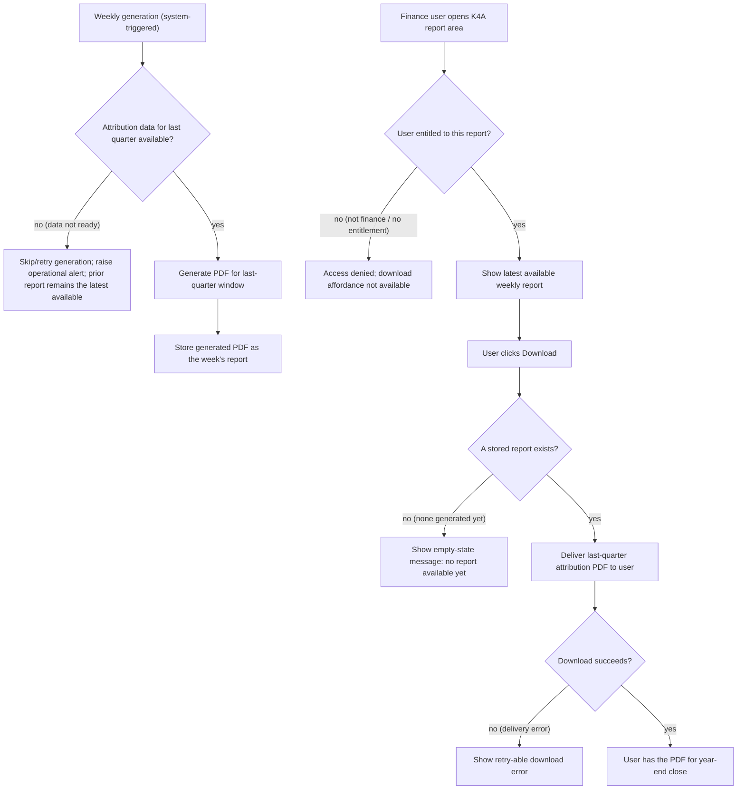

## 1. Business Logic & Context

### Problem

Brightway Retail's finance team needs an attribution report covering the last quarter to support their year-end close process. Today there is no way for them to obtain this report as a PDF from K4A on a recurring basis. Without it, the finance team cannot reliably pull the attribution figures they need in a format suited to their close workflow, and they are blocked ahead of a hard year-end deadline.

### Value

- **For the customer (Brightway Retail finance team):** A self-service, downloadable PDF of last-quarter attribution data, refreshed weekly, available in time for year-end close.
- **For Kochava:** Satisfies a time-boxed commitment to a standard-plan customer, and establishes a reusable weekly-PDF-report capability within K4A.

### Business Rules

- **BR-01 — Report cadence:** The attribution report is generated on a weekly schedule, every Monday.
- **BR-02 — Report format:** The report is delivered as a PDF.
- **BR-03 — Data scope:** Each report covers the last quarter of attribution data only.
- **BR-04 — Access:** The report is downloadable from K4A by Brightway Retail's finance team members only. Access is restricted to that audience; no other roles or accounts may download or see the report, and users without the entitlement must not be able to retrieve it.
- **BR-05 — Deadline:** The capability must be live and producing a downloadable report before Brightway Retail's year-end close (approximately five weeks from the request date).
- **BR-06 — Plan:** Brightway Retail is on the standard plan. Whether weekly PDF generation and storage is included at the standard plan tier, or requires an upgrade / phased delivery, is unresolved. [DECISION REQUIRED]
- **BR-07 — "Last quarter" definition:** "Last quarter" must resolve to a concrete window. Whether it is the most recent *completed* calendar quarter held fixed, or a window that rolls as new data completes, changes what the finance team sees each week. [DECISION REQUIRED]
- **BR-08 — Generation model:** Each weekly report is **pre-generated every Monday on the schedule and stored for later retrieval** (not generated on-demand at click time), so that a download is fast and the "weekly" artifact is a stable, reproducible document.
- **BR-09 — Finance-grade correctness:** Because these figures feed a year-end close, the attribution numbers in the PDF must match the authoritative attribution data for the same window shown elsewhere in the product. Any discrepancy is treated as a defect.

### Report Contents

The report contains **total attributed revenue and conversions by channel, presented as one simple table**. This is the resolved analytical content for the finance team's year-end close (resolves DEC-005). No additional attribution dimensions or summary sections are required for Phase 1. The PDF must display the Brightway logo (per finance's request); see FR-014.

### Knowledge-Graph Cross-Check Note

An independent cross-check of the codebase knowledge graph surfaced a broader set of potentially-involved backend services than the original analysis (which named three). The fresh lookup additionally surfaced a recurring-subscription worker, a summary-report data source, an attribution-query service, and an access-entitlement service, none of which the original three-service analysis named. This discrepancy is noted here for the engineering planning phase to reconcile; it does not change the product behavior defined in this spec. Service-level detail is captured in a separate engineering appendix.

---

## 2. User Flows (Visuals)



---

## 3. Functional Requirements (The Core)

### Feature Area A — Weekly Report Generation

#### FR-001 — Weekly scheduled generation
```gherkin
Given the weekly report generation schedule is active
  And attribution data for the last-quarter window is available
When the scheduled weekly generation time is reached
Then the system generates a PDF attribution report covering the last-quarter window
  And the system stores that PDF as the latest available weekly report for the customer
```

#### FR-002 — Last-quarter data scope
```gherkin
Given a weekly report generation run begins
When the system assembles the report data
Then the report includes only attribution data within the resolved "last quarter" window
  And data outside that window is excluded from the report
```

#### FR-003 — Generation when underlying data is not yet ready
```gherkin
Given a scheduled weekly generation run begins
  And the attribution data for the last-quarter window has not finished processing
When the system attempts to generate the report
Then the system does not produce a report from incomplete data
  And the system raises an operational alert that the run could not complete
  And the most recent previously generated report remains the latest available report
```

#### FR-004 — No overlapping or duplicate generation runs
```gherkin
Given a weekly generation run for a customer is already in progress
When another generation run for the same customer and same weekly window is triggered
Then the system does not start a second concurrent run
  And the in-progress run is allowed to complete
```

#### FR-005 — Idempotent regeneration for the same window
```gherkin
Given a weekly report has already been generated and stored for a given weekly window
When generation runs again for that same window
Then the system overwrites the existing stored report for that window
  And the system does not create a duplicate report entry for that window
```

#### FR-014 — Brightway logo on the report PDF
```gherkin
Given a weekly report PDF is generated
When the system renders the PDF
Then the Brightway logo is displayed on the report
  And the logo renders correctly in the stored and downloaded PDF
```
*The source, exact placement, and sizing of the logo asset are an engineering/design detail; the business requirement is that the Brightway logo appears on the PDF.*

#### FR-006 — Generation failure does not corrupt the latest available report
```gherkin
Given a stored weekly report already exists as the latest available report
When a subsequent generation run fails partway through
Then the previously stored report remains intact and downloadable
  And the failed run does not replace the latest available report with a partial file
  And the failure raises an operational alert
```

### Feature Area B — Report Access & Download (K4A UI)

#### FR-007 — Entitled user sees the report in K4A
```gherkin
Given a user is authenticated in K4A
  And the user is entitled to the Brightway Retail attribution report
When the user navigates to the report area
Then the system shows the latest available weekly attribution report as downloadable
```

#### FR-008 — Download the last-quarter attribution PDF
```gherkin
Given an entitled finance user is viewing the report area in K4A
  And a stored weekly report exists
When the user triggers the download
Then the system delivers the last-quarter attribution report as a PDF file
```

#### FR-009 — Empty state when no report has been generated yet
```gherkin
Given an entitled finance user is viewing the report area in K4A
  And no weekly report has been generated and stored yet
When the user views the report area
Then the system shows an empty-state message indicating no report is available yet
  And no download is offered
```

#### FR-010 — Server-side access enforcement
```gherkin
Given a user is not entitled to the Brightway Retail attribution report
When that user attempts to retrieve the report, including by a direct request that bypasses the K4A UI
Then the system rejects the request with an access-denied response
  And the system does not return the report file or its contents
```
*The entitlement is re-derived from the authoritative access source on every request and is never trusted from a client-supplied claim. If the authorization source is unreachable, the request is denied (fail closed).*

#### FR-011 — Download delivery failure is recoverable
```gherkin
Given an entitled finance user triggers a report download
  And the file delivery fails before completing
When the failure is detected
Then the system presents a download error that allows the user to retry
  And no partial file is presented as a successful download
```

### Feature Area C — Access Audit

#### FR-012 — Record report download events
```gherkin
Given an entitled finance user successfully downloads the attribution report
When the download completes
Then the system records an audit entry capturing the acting user and account, the report identity and its covered quarter window, the action, the timestamp, and the outcome
  And that audit entry cannot be edited or deleted through any code path or by any role
```
*The audit record is written asynchronously so it does not block the download; a failure to write the audit record raises an immediate operational alert rather than failing silently.*

### Feature Area D — Operational Safeguard

#### FR-013 — Feature kill-switch
```gherkin
Given the weekly attribution report feature is live
When an on-call engineer disables the feature via configuration
Then new generation runs and new download requests stop honoring the feature without a code deploy
  And the change takes effect for new requests within an established propagation window
  And any report already generated and stored before the switch remains unaffected
```

I'll now report the business trade-offs I flagged in Sections 0–3.

## 4. Information Requirements

The system must track the following business information to support the functional requirements above. Types, schemas, and storage mechanisms are deliberately left to engineering planning.

- **Brightway logo asset:** The Brightway logo image displayed on the report PDF (per finance's request, FR-014). *Source: Provided brand asset.* Matters because the PDF must carry the Brightway logo for the finance team.
- **Attribution report data (last quarter):** The analytical content of the report — total attributed revenue and conversions by channel, covering the last-quarter window, presented as one simple table. *Source: System-derived from the authoritative attribution data pipeline.* Matters because it is the substance the finance team consumes for year-end close. The required metrics and dimension are resolved (total attributed revenue and conversions, broken out by channel; see the Report Contents section in Section 1).
- **Resolved "last quarter" window:** The concrete start/end boundary that "last quarter" resolves to for a given generation run. *Source: System-derived.* Matters because it defines FR-002's data scope and because the finance team must know exactly which period a given report covers. Depends on the rolling-vs-fixed decision flagged in Section 1 (BR-07).
- **Generated weekly report artifact (PDF):** The produced PDF file for a given weekly window, plus enough identity to know which window it covers and that it is the latest available. *Source: System-derived.* Matters because it is the downloadable deliverable (FR-001, FR-008) and the stable "weekly" artifact under the pre-generated model (BR-08).
- **Latest-available-report pointer:** Which stored report is currently the latest available for the customer. *Source: System-derived.* Matters because FR-003 and FR-006 require the prior report to remain the served one when a run is skipped or fails.
- **Generation run status:** The outcome of each weekly generation run (succeeded, skipped due to data-not-ready, failed). *Source: System-derived.* Matters because FR-003 and FR-006 branch on this and because failed/skipped runs must raise operational alerts.
- **Report entitlement:** Whether a given user/account is entitled to retrieve the Brightway Retail attribution report. *Source: External — the authoritative access/entitlement source, re-derived per request.* Matters because it gates access in FR-007 and FR-010 (BR-04).
- **Download audit entry:** A record of each successful download — acting user and account, report identity and covered quarter window, action, timestamp, and outcome. *Source: System-derived at download time.* Matters because FR-012 requires an immutable, traceable record of who retrieved finance-close data.

---

## 5. Non-Functional Requirements & Guardrails

### Performance & Capacity

- **NFR-001 — Download latency:** Retrieving a stored weekly report (from the entitled user clicking download to delivery start) must meet a p95 latency target measured under expected concurrent K4A finance-user load. Because the generation model (BR-08) serves a pre-generated stored artifact rather than generating on demand, the target should reflect file retrieval, not generation. Target value: p95 ≤ 3 seconds under expected concurrent download load, pending confirmation; this is an engineering-tunable default.
- **NFR-002 — Shared query-resource protection:** Weekly generation queries the underlying attribution data, which is a shared resource. Generation must run under an explicit rate/concurrency cap so that a generation run does not degrade interactive query traffic. The concrete cap is an engineering decision; generation should be scheduled off-peak where feasible.
- **NFR-003 — Generation monitoring:** The system must alert when the weekly generation error rate exceeds 1% for 5 minutes sustained, and when any individual generation run fails or is skipped (per FR-003, FR-006). Alerting phrasing follows the "exceeds N% for M minutes, sustained" convention.

### Security & Access Control

- **NFR-004 — Server-side entitlement enforcement:** Access to the report must be enforced server-side on every retrieval, independent of UI hiding. A direct request from an unentitled user or account must be rejected (access-denied, typically 403). This governs FR-010 and applies regardless of what the K4A UI presents.
- **NFR-005 — Authoritative, non-cached entitlement:** Entitlement must be re-derived from the authoritative access source on every request and must never be trusted from a client-supplied claim. If the authorization source is unreachable, the request fails closed (denied).
- **NFR-006 — Secure, time-limited delivery:** The PDF contains finance-adjacent attribution data and must be delivered through a secure, time-limited link rather than a persistently public URL or raw open attachment. Link lifetime is an engineering-tunable default; a working value is a single-use or short-lived (e.g. 15-minute) link.
- **NFR-007 — No sensitive data in logs:** Report contents and any user-identifying data must never be written to application logs in raw form.
- **NFR-008 — Immutable audit trail:** Download audit entries (FR-012) must be append-only — no edit or delete path by any role — and retained for a defined minimum period. Working default: 24 months, consistent with Kochava's audit-retention norm for finance-adjacent operations; confirm against any Brightway data-retention agreement.

### Reliability & Idempotency

- **NFR-009 — Idempotent weekly generation:** Generation for a given weekly window must be idempotent on an explicit window key: a repeat run overwrites the existing report for that window and never produces a duplicate artifact or double-counted figures (FR-005).
- **NFR-010 — No overlapping scheduled runs:** The scheduler must prevent concurrent runs for the same customer and window (FR-004), complementing idempotency rather than replacing it.
- **NFR-011 — Finance-grade correctness:** The attribution figures in the PDF must match the authoritative attribution data for the same window shown elsewhere in the product (BR-09). A reconciling check or shared source-of-truth for the figures must exist so discrepancies are caught before a report is served.

### Risk Mitigation

The Context Seed classifies this as HIGH risk (hard 5-week deadline, multi-service blast radius, PDF generation/delivery scheduling, finance/billing-adjacent reporting data). Each driver and its mitigation:

- **NFR-012 — Multi-service blast radius / kill-switch:** Because the feature spans multiple services and is HIGH risk, it must sit behind a config-based kill-switch (FR-013) that an on-call engineer can disable without a code deploy or separate approval. New requests stop honoring the feature within an established propagation window (working default: 5 minutes); in-flight runs submitted before the flip complete under prior behavior.
- **NFR-013 — Rollback:** On a defined failure trigger (e.g. incorrect figures surfaced, sustained generation failures), the feature owner (on-call engineering, escalating to the product owner for customer-facing comms) may roll the feature back via the kill-switch. Already-generated stored reports are not retroactively altered by a rollback; only new generation and download behavior is affected going forward.
- **NFR-014 — Finance-close correctness (data trust):** The biggest finance-adjacent risk is a PDF whose numbers disagree with the authoritative attribution data. Mitigation: a single authoritative source for the figures and the reconciliation check in NFR-011; a report must not be served if it cannot be reconciled to that source.
- **NFR-015 — Deadline risk:** The 5-week, before-year-end-close deadline is hard. Mitigation depends on scoping the minimum viable deliverable (a downloadable, correct, last-quarter PDF for the entitled finance team) and deferring everything non-critical to Section 6. Whether the standard plan tier supports weekly generation and storage within the timeline, or requires an upgrade / phased delivery, is unresolved and gates the deadline commitment. [DECISION REQUIRED]
- **NFR-016 — Data-not-ready handling:** The weekly cadence can collide with incomplete upstream data. Mitigation: generation never produces a report from incomplete data; it skips/retries, alerts, and leaves the prior report as latest available (FR-003, FR-006).

---

## 6. Out of Scope & Phasing

### Phase 1 (this spec) — In Scope

- Weekly generation of a last-quarter attribution report as a PDF.
- Pre-generation (every Monday) and storage of the weekly report for retrieval (per BR-08).
- Download of the latest available report from K4A by the entitled Brightway Retail finance audience.
- Server-side entitlement enforcement, download audit logging, and a feature kill-switch.

### Explicitly Out of Scope (Phase 1)

| Item | Rationale |
|---|---|
| Push/scheduled delivery of the report (email, notification) to the finance team | The reviewer confirmed in-console download from K4A is sufficient and no email or notification delivery is needed (resolves OQ-003). Push delivery is a separate capability. |
| On-demand (click-time) generation of the report | The confirmed model is pre-generated-and-stored every Monday (BR-08). On-demand generation is an alternative model, not an addition; it is excluded. |
| A historical archive / multi-week report list with browsable history | Phase 1 serves the *latest available* weekly report only. A dated history view is a larger UI component and not required for year-end close. |
| Report customization by the user (metric selection, date-range picker, custom branding beyond the standard layout and the Brightway logo) | The Phase 1 report contents are fixed (total attributed revenue and conversions by channel, one simple table, carrying the Brightway logo per FR-014); user-configurable reporting is future work. |
| Generalizing the capability to other customers, products, or report types beyond the Brightway Retail attribution report | Phase 1 is scoped to this one customer requirement under a hard deadline. |
| Formats other than PDF (CSV, XLSX, etc.) | The requirement specifies PDF only. |
| Self-service entitlement management (finance team members granting themselves or peers access) | Entitlement is assumed to be assigned through existing access mechanisms; a self-service grant flow is out of scope. |

### Deferred / Pending Decisions

The following are unresolved and tracked in the Decisions register (flagged in Sections 1 and 5). They do not expand Phase 1 scope but must be answered before build can finalize: the "last quarter" definition (fixed vs. rolling), and the standard-plan capacity/timeline question. The report's exact contents are now settled — total attributed revenue and conversions by channel, presented as one simple table (resolves DEC-005). The entitlement audience is now settled — download access is restricted to Brightway Retail finance team members only (no other roles or accounts).

## Appendix: Engineering Reference

_The sections below are derived automatically from the codebase knowledge graph, for the engineering team's reference during planning — not required reading for product/requirement review._

### Affected Services (grounded context, not implementation direction)

Two knowledge-graph lookups were run; the services below combine both, flagged by agreement. The original three-service analysis and an independent cross-check agree on the first three; the cross-check additionally surfaced four more. Engineering should reconcile the two lists during planning.

- **reporting-api** (backend) — Provides attribution report data and the PDF export path. *Agreed by both lookups; high confidence.*
- **reporting-dispatcher** (backend) — Schedules the weekly report generation job. Note: "delivery" here means producing and storing the weekly artifact for in-console download only — the reviewer confirmed no email/notification push delivery is in scope (OQ-003). *Agreed by both lookups.*
- **frontend-mos** (frontend) — K4A UI: the download link and report delivery interface. *Agreed by both lookups.*
- **reporting-subscriptions-worker** (backend) — Processes recurring weekly report subscriptions; may overlap with reporting-dispatcher as the owner of the "weekly" trigger. *Cross-check only; medium confidence — reconcile against reporting-dispatcher.*
- **summary-report-cloud** (backend) — Generates summary report data feeding the PDF. *Cross-check only; medium confidence.*
- **koch-query-api** (backend) — Queries the underlying attribution data for the report. *Cross-check only; medium confidence.*
- **entitlements-api** (backend) — Gates access to the PDF download feature. *Cross-check only; low confidence — but if finance-only access is a hard requirement (FR-010), its importance exceeds its confidence label.*

## Revision Summary

_Applied reviewer's request._

- Noted Brightway logo requirement in the Report Contents section with a pointer to FR-014.
- Added FR-014 requiring the Brightway logo to appear on the generated report PDF.
- Added the Brightway logo asset to the Information Requirements list.
- Clarified the out-of-scope branding row so it excludes the Brightway logo (which is now in scope per FR-014).


---
## Open Questions & Decisions Register

_Durable, ID'd reference for HITL 2 (G1) and beyond — inline `[DECISION REQUIRED: DEC-00N]` tags in the sections above point back here. Reflects the latest round only._

### Decisions Required (business trade-offs — needs a human call)

_Each carries an **Owner** (accountable for supplying the answer) and a **Provisional Value** (the working assumption engineering may build against until the decision lands), so none of these fully block engineering — implementation proceeds on the provisional value and adjusts if the confirmed decision differs._

| ID | Decision | Owner | Provisional Value (build against until confirmed) |
|----|----------|-------|-----------------------------------------------------|
| **DEC-002** | Does Brightway's standard plan include weekly PDF report generation and storage, or does this feature require a plan upgrade or a phased rollout to fit the five-week window? | Product owner / Commercial | Deliver it to Brightway under the standard plan for this engagement to meet the year-end deadline, and flag the entitlement/packaging question separately for the commercial team to resolve before offering it more broadly. |
| **DEC-003** | Should the report always show the same most recent completed calendar quarter held fixed, or should the window roll forward as newer data completes week to week? | Product owner (with Brightway finance) | Use the most recent completed calendar quarter, held fixed until the next quarter completes, so finance sees a stable close-ready figure that only changes at quarter boundaries. |
| **DEC-004** | Should each weekly report be generated ahead of time on the schedule and saved for the finance team to pick up, or generated fresh only when they click download? | Product owner | Pre-generate on the weekly schedule and store the report for retrieval, so downloads are fast and each week's document is stable and reproducible. |
| **DEC-006** | Access: The report is downloadable from K4A by Brightway Retail's finance team. Access is restricted to that audience; users without the entitlement must not be able to retrieve the report. | _(not yet assigned)_ | _(not yet specified)_ |

### Decisions Resolved

- **DEC-001**: Download access is restricted to Brightway Retail finance team members only; no other roles or accounts may see or download the report — resolves OQ-004 and settles DEC-001.
- **DEC-005**: Resolved DEC-005 / OQ-005 — the PDF contains total attributed revenue and conversions by channel, presented as one simple table.

### Open Questions (evidence gaps — needs more input)

- **OQ-002**: Does "last quarter" mean a fixed set of three calendar months, or a rolling most-recently-completed quarter that shifts each week? This changes the date-filtering logic in the report pipeline.
- **OQ-006**: Does the standard plan cover weekly PDF generation/storage within the 5-week window, or does the scope need to be phased (e.g. download-first, automated weekly cadence later) to hit the deadline?
- **OQ-007**: Where in the K4A UI should the download live, and does finance need a history/list of past weekly reports or just the latest one?

### Questions Resolved

- **OQ-001**: Resolved DEC-004/OQ-001 — the weekly PDF is pre-generated on a schedule every Monday and stored for download (not generated on-demand).
- **OQ-003**: Resolved OQ-003 — in-console download from K4A is sufficient; no email or notification delivery is needed.
- **OQ-004**: Download access is restricted to Brightway Retail finance team members only; no other roles or accounts may see or download the report — resolves OQ-004 and settles DEC-001.
- **OQ-005**: Resolved DEC-005 / OQ-005 — the PDF contains total attributed revenue and conversions by channel, presented as one simple table.

---
> **Classification:** Type B — requirement-agent's independent re-check DISAGREES with intake's original Type A call. The behavior is clearly specified (weekly PDF of last-quarter attribution data, downloadable from K4A), and existing services already provide the exact capabilities (reporting-api has a PDF export API, reporting-dispatcher schedules weekly reports, frontend-mos has the download UI), so this is engineering-led design/build across multiple services rather than open-ended product discovery.
