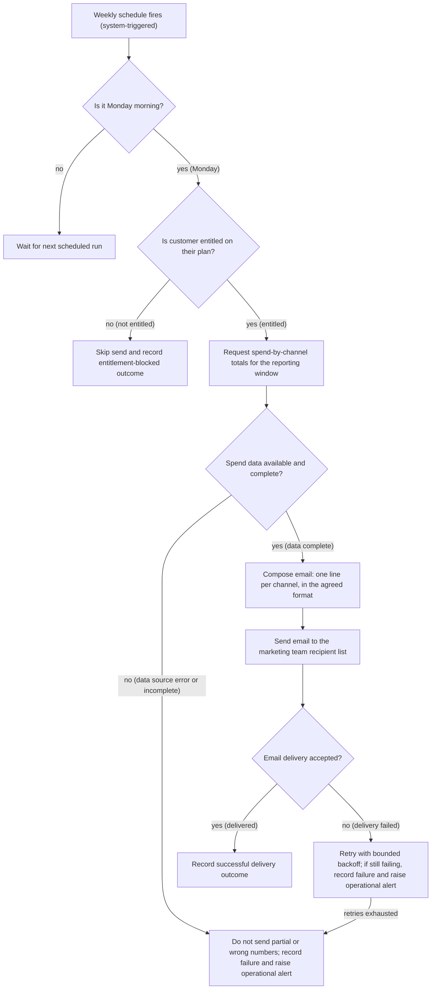

# Product Specification — K4A: Weekly Spend-by-Channel Email Summary

## 1. Business Logic & Context

### Problem

Meridian Travel's marketing team pulls campaign spend data manually every week, copying total spend per channel into a spreadsheet by hand. This is repetitive, error-prone, and does not scale into their upcoming summer campaign period when spend activity and the cost of a mistake both increase.

### Value

An automated weekly email delivered every Monday morning removes the manual data pull entirely. The marketing team receives total campaign spend broken down by channel — one line per channel — in the same format they produce manually today. This saves recurring manual effort, reduces transcription error on customer-facing spend figures, and must be live before the summer campaign launch (hard external deadline, approximately 5 weeks).

### Business Rules

- **BR-1 — Cadence:** The summary is generated and delivered on a weekly cadence, every Monday at 8am US Eastern time ("Monday morning").
- **BR-2 — Content shape:** The email body shows total campaign spend aggregated per channel, one line per channel, matching the layout the marketing team currently reproduces manually in their spreadsheet. The spreadsheet has exactly two columns: channel name and total spend, with spend shown in US dollars to two decimal places.
- **BR-3 — Reporting period:** Each Monday email covers the immediately preceding Monday-through-Sunday calendar week (the 7 days ending the day before send). This is a working assumption adopted in the absence of a confirmed window from the customer, not a customer-confirmed value.
- **BR-4 — Channel scope:** The breakdown lists spend per marketing channel across a fixed set of four channels: Email, Paid Search, Paid Social, and Display — the same four the marketing team tracks in their spreadsheet today. This list does not vary by season or campaign type.
- **BR-5 — Recipients:** The email is sent to the Meridian Travel marketing team via the `marketing-team@meridiantravel.example` distribution list. There are no per-recipient permission restrictions on viewing spend data — everyone on that list sees the full spend figures.
- **BR-6 — Plan entitlement:** Meridian Travel is on the standard plan, and automated weekly report emails are included in the standard plan — no plan change, add-on, or upsell is required before building. The run-time entitlement check (FR-014) is retained as a defensive safeguard that re-derives entitlement on each run, but the business answer is settled: the standard plan entitles this feature.
- **BR-7 — Delivery channel:** Delivery is email only. There is no on-screen view or in-product UI for this feature (PM-confirmed in intake).
- **BR-8 — Spend data integrity:** The spend figures are customer-facing billing/spend numbers. The per-channel totals in the email must match the authoritative spend figures the customer sees elsewhere; shipping numbers that disagree with the customer's other spend views is a defect, not a cosmetic issue.

### Engineering grounding caveat (service ownership)

Two independent codebase knowledge-graph lookups disagree on which backend services own this feature. One lookup points at a generic reporting-and-cost stack; a second, independent lookup points at a product-specific reporting stack. The two lookups firmly agree only on the scheduled-email-delivery service and the spend/cost data service. This discrepancy means the authoritative spend data source and report-generation path are not yet confirmed and must be resolved by engineering during planning before build begins. The specific service names are recorded in the engineering appendix appended to this document; they are not reproduced here because service-ownership vetting is an engineering-planning task, not a product-review one.

---

## 2. User Flows (Visuals)



---

## 3. Functional Requirements (The Core)

### Feature Area A — Scheduling & Trigger

**FR-001 — Weekly Monday trigger**
```gherkin
Given the weekly spend-summary feature is enabled for the customer
When the scheduled weekly run fires on Monday morning
Then the system begins generating the spend-by-channel summary for that customer's defined reporting window
And a run that fires on any day other than Monday morning does not generate or send the summary.
```

**FR-002 — Single run per week (no duplicate sends)**
```gherkin
Given a Monday summary run for a customer has already started or completed for the current week
When the scheduler attempts to start another run for the same customer and the same weekly reporting window
Then the system does not start a second concurrent run and does not send a duplicate email
And the attempt is recorded as a rejected/skipped duplicate rather than producing a second email.
```

**FR-003 — Idempotent generation per reporting window**
```gherkin
Given a summary for a specific customer and a specific weekly reporting window has already been produced
When generation is retried or re-delivered for that same customer and same reporting window
Then the system produces the same end state (the existing summary for that window) rather than a new, additional summary
And the marketing team does not receive two emails for the same reporting window as a result of a retry.
```

### Feature Area B — Spend Data Retrieval & Accuracy

**FR-004 — Retrieve spend totals per channel**
```gherkin
Given a summary run has started for a customer's reporting window
When the system requests campaign spend for that window
Then it retrieves total spend aggregated per marketing channel from the authoritative spend data source
And each channel in the agreed channel scope is represented exactly once.
```

**FR-005 — Spend figures must match authoritative source**
```gherkin
Given per-channel spend totals have been retrieved for the reporting window
When the summary is composed
Then each channel's total in the email equals the authoritative spend figure for that channel and window
And no channel total is rounded, re-bucketed, or transformed in a way that causes it to disagree with the spend figure the customer sees in their other spend views.
```

**FR-006 — Incomplete or unavailable spend data blocks the send**
```gherkin
Given a summary run has started for a customer's reporting window
When the spend data source is unavailable, returns an error, or returns data flagged as incomplete for the window
Then the system does not send an email containing partial or placeholder figures
And the run is recorded as failed with the specific failure condition (data-source-unavailable vs data-incomplete recorded distinctly)
And an operational alert is raised so the issue can be investigated before the customer notices a missing or wrong email.
```

**FR-007 — Bounded retry on data-source dependency failure**
```gherkin
Given a request to the spend data source fails with a transient error
When the system attempts to recover
Then it retries with bounded exponential backoff up to a maximum of 3 attempts
And on a rate-limit (429) response it waits for the duration indicated by the Retry-After header rather than retrying on a fixed schedule
And if all attempts are exhausted the run is handled per FR-006 (no email sent, failure recorded, alert raised).
```

### Feature Area C — Email Composition

**FR-008 — One line per channel in the agreed format**
```gherkin
Given per-channel spend totals have been retrieved and are complete
When the email body is composed
Then the body contains exactly one line per channel showing that channel's total spend
And the layout reproduces the two-column format the marketing team currently uses in their manual spreadsheet: a channel-name column and a total-spend column, with spend shown in US dollars to two decimal places.
```

**FR-009b — Plain-text alternative version of the email**
```gherkin
Given a summary email is being composed for a customer
When the email is prepared for delivery
Then the email includes a plain-text version alongside the HTML version (a multipart message), so recipients whose clients do not render HTML still receive the spend-by-channel content
And the plain-text version contains the same per-channel spend totals, reporting window, and two-column layout (channel name and total spend in US dollars to two decimal places) as the HTML version.
```

**FR-009a — Meridian logo at the top of the email**
```gherkin
Given a summary email is being composed for a customer
When the email body is rendered
Then the Meridian Travel logo appears at the top of the email, above the spend-by-channel content
And the logo renders correctly in the recipients' email clients (e.g. a hosted image with appropriate alt text) without breaking the two-column spend layout below it.
```

**FR-009 — Reporting window is stated in the email**
```gherkin
Given the email body is being composed for a reporting window
When the summary is rendered
Then the email clearly states the reporting window it covers (the dates the spend totals represent)
So that a recipient can tell which week's spend the figures represent without cross-referencing another system.
```

**FR-010 — Zero-spend channel handling**
```gherkin
Given a channel in the agreed channel scope had zero spend during the reporting window
When the email body is composed
Then that channel is shown with a zero total rather than being silently omitted, so the recipient can distinguish "no spend" from "channel missing from the report".
```

### Feature Area D — Delivery & Recipients

**FR-011 — Deliver to the marketing team recipient list**
```gherkin
Given a complete summary email has been composed for a customer
When the system sends the email
Then it is delivered to the configured Meridian Travel marketing team recipient list
And delivery targets only the configured recipients for that customer.
```

**FR-011a — CC the VP on the first send only**
```gherkin
Given this is the first weekly summary email ever sent to the Meridian Travel marketing team recipient list (no prior successful delivery has been recorded for this customer)
When the summary email is sent
Then the Meridian Travel marketing VP is added as a CC recipient on that first send only
And every subsequent weekly send goes to the configured marketing team recipient list without the VP CC
And the VP's email address is sourced from configuration [DECISION REQUIRED] rather than inferred.
```

**FR-012 — Delivery failure is retried then alerted**
```gherkin
Given a composed summary email is handed off for delivery
When the delivery attempt fails
Then the system retries delivery with bounded exponential backoff up to a maximum of 3 attempts
And if delivery still fails after retries, the failure is recorded and an operational alert is raised rather than failing silently.
```

**FR-013 — Successful delivery is recorded**
```gherkin
Given a summary email has been accepted for delivery to the recipient list
When the delivery succeeds
Then the system records the successful outcome, the customer, the reporting window, and the send timestamp
So that an operator can later verify the marketing team received the Monday email.
```

### Feature Area E — Entitlement & Access Control

**FR-014 — Plan entitlement checked before send**
```gherkin
Given a weekly summary run is about to generate or send an email for a customer
When the system evaluates whether the customer's plan entitles them to automated weekly report emails
Then the entitlement is re-derived from the authoritative subscription/entitlement source on that run rather than from a cached or client-supplied value
And if the customer is not entitled, no email is sent and the run is recorded as entitlement-blocked
And if the entitlement source itself is unreachable, the run fails closed (no email sent) rather than sending without a confirmed entitlement.
```

**FR-015 — Spend figures treated as restricted, access enforced server-side**
```gherkin
Given per-channel spend figures are customer-facing financial data
When the summary is generated and delivered
Then access to a customer's spend data is enforced at the service level using the requesting context's authoritative identity, not by relying on recipient-list configuration alone
And one customer's spend figures are never generated into or delivered within another customer's summary.
```

### Feature Area F — Operability Safeguards

**FR-016 — Feature kill-switch**
```gherkin
Given this is a HIGH-risk, multi-service feature handling customer-facing spend data
When an on-call engineer needs to stop the weekly summary during an incident
Then the feature can be disabled via configuration without a code deploy and without a separate approval step
And new scheduled runs stop starting within 5 minutes of the flag being flipped
And a run already in flight at the moment of the flip completes under the prior behavior.
```

**FR-017 — Audit trail of each run's outcome**
```gherkin
Given each weekly summary run produces an outcome (delivered, entitlement-blocked, or failed)
When a run reaches a terminal outcome
Then an append-only record is written capturing the customer identity, the reporting window, the action, the timestamp, and the outcome/status
And this record cannot be edited or deleted through any code path or by any role
And the audit record is written asynchronously so it does not block the send, but a failure to write the audit record raises an immediate operational alert rather than being dropped silently.
```

Now reporting the decisions I flagged in Sections 0–3.

## 4. Information Requirements

- **Reporting window definition** — the start/end dates each Monday email covers. System-derived from the configured weekly cadence. Matters because every spend total is scoped to this window and the window is stated in the email (FR-004, FR-009).
- **Per-channel spend totals** — total campaign spend aggregated for each marketing channel over the reporting window. System-derived from the authoritative spend/cost data source. The figures reflect the latest available aggregate at run time, not the prior full week's completed totals (see NFR-016). The email presents these as raw totals only: no validation, anomaly detection, or spend-spike flagging is performed on the figures (e.g. a channel whose spend spiked versus usual is not flagged). This is the core payload of the email; it must match the customer's other spend views (FR-004, FR-005).
- **Channel scope list** — the fixed set of four marketing channels to include: Email, Paid Search, Paid Social, and Display (the same four the marketing team tracks today). This list does not vary by season or campaign type (see BR-4). Matters because it determines which lines appear and distinguishes a zero-spend channel from a missing one (FR-010).
- **Spreadsheet format definition** — the marketing team's existing spreadsheet has exactly two columns: channel name and total spend, with spend in US dollars to two decimal places. User/customer-supplied (from Meridian Travel's existing spreadsheet). Matters because the email must reproduce this layout (FR-008, BR-2).
- **Recipient list** — the Meridian Travel marketing team, addressed via the `marketing-team@meridiantravel.example` distribution list. User/customer-supplied configuration. All recipients on the list have equal permission to view the spend figures (no restrictions). Matters for delivery targeting and for scoping who may view spend data (FR-011, BR-5).
- **Marketing VP CC address** — the email address of the Meridian Travel marketing VP, CC'd on the first send only (FR-011a). User/customer-supplied configuration; not yet provided ([DECISION REQUIRED]). Matters because the VP sees the full spend figures on that first send, so the same restricted-data treatment applies.
- **Plan entitlement status** — the customer's standard plan includes automated weekly report emails (settled; no upsell required). The value is still re-derived at run time from the authoritative subscription/entitlement source as a defensive safeguard that gates every send (FR-014).
- **Run outcome record** — the terminal result of each weekly run (delivered / entitlement-blocked / failed, with the distinct failure condition). System-derived during execution. Matters for operability, audit, and verifying the team received the Monday email (FR-013, FR-017).
- **Delivery timestamp** — when a summary was accepted for delivery. System-derived. Matters for the success record and operator verification (FR-013).

---

## 5. Non-Functional Requirements & Guardrails

### Performance & Capacity

- **NFR-001 — Delivery timeliness.** Each Monday email must be generated and dispatched by the expected send time of 08:00 (8am) US Eastern time on Monday. "Monday morning" is defined as Monday 8am Eastern, and the delivery window is calculated in the US Eastern timezone (observing daylight-saving transitions).
- **NFR-016 — Spend data freshness.** Monday's email reflects the latest available aggregate of spend at run time; the figures retrieved must be the most recent aggregated totals the spend data source can provide when the run composes the email, rather than being held back to the completed totals of the prior full week. The run does not wait for a full preceding week to be finalized before composing the email.
- **NFR-002 — Spend data query latency.** Retrieval of per-channel spend totals for a reporting window must complete with a p95 latency target measured as a defined number of concurrent summary runs executing together. This is a low-frequency weekly batch path, not interactive traffic; engineering sets the concrete p95 target and concurrency count during planning. The query must respect any rate cap protecting the shared spend/cost data source so the weekly run does not degrade other consumers of that source.
- **NFR-003 — Monitoring & alerting.** Operational monitoring must alert when the run failure rate exceeds 1% for 5 minutes sustained, and when any single customer's weekly run fails to produce a delivered email by the end of the Monday delivery window. Alerts route to the owning on-call rotation.

### Security, Access & Data Sensitivity

- **NFR-004 — Server-side access enforcement.** Access to a customer's spend figures is enforced at the service level against the authoritative requesting identity, re-derived on every run and never trusted from a cached or client-supplied value. A request for one customer's spend data from a context not entitled to it is rejected; one customer's figures are never composed into or delivered within another customer's summary (reinforces FR-015).
- **NFR-005 — Fail-closed entitlement.** If the subscription/entitlement source is unreachable, the run fails closed — no email is sent without a confirmed entitlement (reinforces FR-014).
- **NFR-006 — Spend data is restricted; no PII/figure leakage in logs.** Spend figures are customer-facing financial data. Raw spend totals, recipient email addresses, and any credentials or tokens used to reach the data source must never be written to application logs. Where a data-source identifier or key must appear for diagnostics, mask it to the last 4–8 characters only.
- **NFR-007 — Recipient confidentiality.** The email is delivered only to the configured marketing-team recipient list for that customer. No cross-customer recipient exposure; the recipient list is not inferred from any shared/global source (reinforces FR-011).

### Reliability & Correctness

- **NFR-008 — Idempotent weekly runs.** A weekly run is idempotent on the key (customer + reporting window): a retry or re-delivered trigger for the same key yields the same end state and never a second email or double-counted send (reinforces FR-003).
- **NFR-009 — Scheduler overlap guard.** The scheduled job must prevent automatic concurrent re-runs for the same customer and reporting window at the scheduler level, as a complementary safeguard alongside NFR-008 (reinforces FR-002).
- **NFR-010 — Bounded dependency retries.** Calls to the spend data source and the email-delivery path retry with bounded exponential backoff to a maximum of 3 attempts, honoring a 429 Retry-After header, and never retry indefinitely. Distinct failure conditions (data-source-unavailable, data-incomplete, delivery-failure) are recorded distinctly, not collapsed into one generic error (reinforces FR-006, FR-007, FR-012).
- **NFR-011 — Correctness of customer-facing figures.** Per-channel totals in the email must equal the authoritative spend figures for the same window. A discrepancy with the customer's other spend views is a defect, not a cosmetic issue; no email containing partial, placeholder, or re-bucketed figures is sent (reinforces FR-005, FR-006).

### Auditability

- **NFR-012 — Immutable run audit.** Each run's terminal outcome is written to an append-only audit record (customer identity, reporting window, action, timestamp, outcome/status) that no role or code path can edit or delete. The write is asynchronous and must not block the send, but a failed audit write raises an immediate operational alert rather than being dropped silently (reinforces FR-017). Retention: run audit records are retained for 12 months unless a billing/spend-data handling agreement with the customer requires longer. This 12-month figure is a working assumption adopted in the absence of a confirmed retention requirement, not a customer-confirmed value.

### Operability & Rollout

- **NFR-013 — Kill-switch.** The feature is disable-able via configuration with no code deploy and no separate approval step; new runs stop starting within 5 minutes of the flip, and a run already in flight completes under prior behavior (reinforces FR-016).

### Risk Mitigation (Context Seed Risks)

- **Hard external deadline (5 weeks, summer campaign):** Mitigated only if the contested data-source/report-generation path (see §1 engineering grounding caveat) is resolved by engineering before build begins. Scope is held to the MVP in Section 6 to protect the deadline.
- **Multi-service blast radius:** Mitigated by the kill-switch (NFR-013), distinct per-dependency failure handling (NFR-010), and monitoring/alerting (NFR-003) so a misbehaving run can be stopped and diagnosed quickly.
- **Billing/spend data handling:** Mitigated by figure-correctness enforcement (NFR-011), no-send-on-incomplete-data (FR-006), restricted-data log hygiene (NFR-006), server-side access enforcement (NFR-004), and the immutable audit trail (NFR-012). The send is blocked rather than shipping wrong customer-facing numbers.

### Rollback

- **NFR-014 — Rollback.** Trigger: the figure-correctness defect condition in NFR-011 is observed in production, or the failure-rate alert in NFR-003 fires and cannot be cleared. Owning authority: the on-call engineer for the owning service, via the kill-switch (NFR-013), with no separate approval. Timing target: new runs halted within 5 minutes of the flip. No retroactive reversion of already-delivered emails is possible; rollback affects only runs not yet sent.

### Backward Compatibility

- **NFR-015 — Backward compatibility.** This feature adds a new report type/subscription on top of the existing scheduled-email-delivery path. Existing scheduled reports, their recipients, their cadence, and their output must remain unchanged by this addition. If this feature reuses an existing report-generation path rather than adding a new one, existing callers and outputs of that path must be unaffected. Engineering confirms during planning which existing consumers, if any, are at risk.

---

## 6. Out of Scope & Phasing

### In Scope (Phase 1 / MVP)

- Automated weekly email, every Monday morning, to the Meridian Travel marketing team.
- Total campaign spend per channel, one line per channel, in the format matching the team's current manual spreadsheet.
- Plan-entitlement check, bounded dependency retries, block-on-incomplete-data, kill-switch, run audit, and monitoring/alerting as specified in Sections 3 and 5.

### Out of Scope (Future Phases)

| Item | Why out of scope | Phase |
|---|---|---|
| On-screen / in-product view of the summary in K4A | PM-confirmed email-only; no UI (BR-7) | Future |
| In-product UI to self-configure the weekly summary (cadence, recipients, channels) | No UI in Phase 1; configuration is set up operationally | Future |
| Anomaly detection / spend-spike flagging (e.g. alert when a channel is 3× its usual spend) | Confirmed raw totals only — no validation or anomaly flagging in MVP | Future |
| Derived metrics beyond raw channel spend (ROI, CPA, week-over-week deltas) | MVP reproduces the current manual spreadsheet, which is raw channel spend | Future |
| Downloadable file / attachment version of the summary | Intake confirmed delivery is an in-inbox email, not a downloadable file | Future |
| Reconciliation of multiple spend data sources into one view | MVP assumes a single authoritative source; multi-source reconciliation is a separate effort | Future |
| Self-service, per-recipient permission tiers for viewing spend data | No per-recipient permission tiers required (all recipients see full spend, per BR-5); MVP uses a single configured recipient list | Future |
| Rollout to customers beyond Meridian Travel / plans beyond standard | This work item is scoped to one customer on the standard plan | Future |

---

## Appendix: Engineering Reference

_The sections below are derived automatically from the codebase knowledge graph, for the engineering team's reference during planning — not required reading for product/requirement review._

### Affected Services (grounded context, not implementation direction)

Two independent knowledge-graph lookups were run and they do not fully agree. They firmly agree only on **reporting-subscriptions-worker** (scheduled email delivery) and **cost-v2** (spend/cost data). Engineering must confirm the authoritative data-source and report-generation path before build begins.

**Lookup A — generic reporting/cost stack:**
- `reporting-subscriptions-worker` (backend) — scheduled email delivery of reports.
- `reporting-api` (backend) — fetches campaign spend data by channel for report generation.
- `cost-v2` (backend) — spend aggregation and channel-level cost data.
- `accounts-api` (backend) — customer subscription plan validation and entitlements.

**Lookup B — product-specific SAM stack (independent cross-check):**
- `k4a-sam-backend` (backend) — likely owns spend summary logic.
- `sam-report-scheduler` (backend) — schedules recurring SAM reports (e.g. weekly emails).
- `sam-performance-reporter` (backend) — builds SAM spend/performance report data.
- `reporting-subscriptions-worker` (backend) — delivers scheduled/subscription report emails.
- `notifications-api` (backend, low confidence) — may send the summary email notification.
- `sam-campaign-data-sync` (backend, low confidence) — syncs spend-by-channel data consumed for the summary.
- `cost-v2` (backend, low confidence) — reads spend/cost data feeding the summary.

**Discrepancy to resolve:** `reporting-api` appears in Lookup A but not Lookup B; the entire SAM-specific stack appears in Lookup B but not Lookup A. These represent two competing report-generation paths. `frontend-mos` surfaced at low confidence but is dropped — PM confirmed no UI.

## Revision Summary

_Applied reviewer's request._

- Added FR-011a: CC the marketing VP on the first send only, with VP address from configuration.
- Added Information Requirement for the marketing VP CC address used on the first send.


---
## Open Questions & Decisions Register

_Durable, ID'd reference for HITL 2 (G1) and beyond — inline `[DECISION REQUIRED: DEC-00N]` tags in the sections above point back here. Reflects the latest round only._

### Decisions Required (business trade-offs — needs a human call)

_Each carries an **Owner** (accountable for supplying the answer) and a **Provisional Value** (the working assumption engineering may build against until the decision lands), so none of these fully block engineering — implementation proceeds on the provisional value and adjusts if the confirmed decision differs._

| ID | Decision | Owner | Provisional Value (build against until confirmed) |
|----|----------|-------|-----------------------------------------------------|
| **DEC-008** | What is the Meridian Travel marketing VP's email address to CC on the first send, and is "the first send" defined as the first-ever successful delivery for this customer? | Product owner | CC the VP's address (to be supplied by the customer) on the first successful delivery only, defined as the first send with no prior delivered-outcome audit record for this customer; drop the CC on all subsequent weekly sends. |

### Decisions Resolved

- **DEC-001**: OQ-003 and DEC-001 both resolved: the manual spreadsheet / email format is exactly two columns — channel name and total spend — with spend shown in US dollars to two decimal places; no derived/calculated columns.
- **DEC-002**: Assumed: Each Monday email covers the immediately preceding Monday-through-Sunday calendar week (the 7 days ending the day before send).
- **DEC-003**: Channel scope is the fixed four channels — Email, Paid Search, Paid Social, and Display — matching what marketing tracks today, with no seasonal/campaign variation; the same answer resolves DEC-003 via OQ-002.
- **DEC-004**: Resolved OQ-006 and the equivalent DEC-004: the email goes to the marketing-team@meridiantravel.example distribution list with no per-recipient permission restrictions on viewing spend data.
- **DEC-005**: OQ-001/DEC-005 resolved: automated weekly report emails are included in the customer's standard plan — no plan change, add-on, or upsell required before building.
- **DEC-006**: Delivery is defined as Monday 8am US Eastern; this settles both OQ-005 and DEC-006 (the same question in other words).
- **DEC-007**: Assumed: Retain run audit records for 12 months unless a billing/spend-data agreement with the customer requires longer.

### Questions Resolved

- **OQ-001**: OQ-001/DEC-005 resolved: automated weekly report emails are included in the customer's standard plan — no plan change, add-on, or upsell required before building.
- **OQ-002**: Channel scope is the fixed four channels — Email, Paid Search, Paid Social, and Display — matching what marketing tracks today, with no seasonal/campaign variation; the same answer resolves DEC-003 via OQ-002.
- **OQ-003**: OQ-003 and DEC-001 both resolved: the manual spreadsheet / email format is exactly two columns — channel name and total spend — with spend shown in US dollars to two decimal places; no derived/calculated columns.
- **OQ-004**: Re-resolved OQ-004 — Monday's email uses the latest available aggregate of spend at run time, not the prior full week's completed totals.
- **OQ-005**: Delivery is defined as Monday 8am US Eastern; this settles both OQ-005 and DEC-006 (the same question in other words).
- **OQ-006**: Resolved OQ-006 and the equivalent DEC-004: the email goes to the marketing-team@meridiantravel.example distribution list with no per-recipient permission restrictions on viewing spend data.
- **OQ-007**: Resolved OQ-007: spend numbers are raw totals only — no validation or anomaly/spend-spike flagging is performed.

---
> **Classification:** Type B — requirement-agent's independent re-check DISAGREES with intake's original Type A call. The behavior is fully specified (Monday email, total spend per channel, one line each, matching the existing spreadsheet format, no UI) and the KG shows well-understood existing services (reporting-subscriptions-worker, reporting-api, cost-v2, accounts-api) that already do scheduled report emails and channel-level spend aggregation — this is engineering-led multi-service build, not product discovery; the "4 services" trigger reflects scope, not genuine ambiguity.
