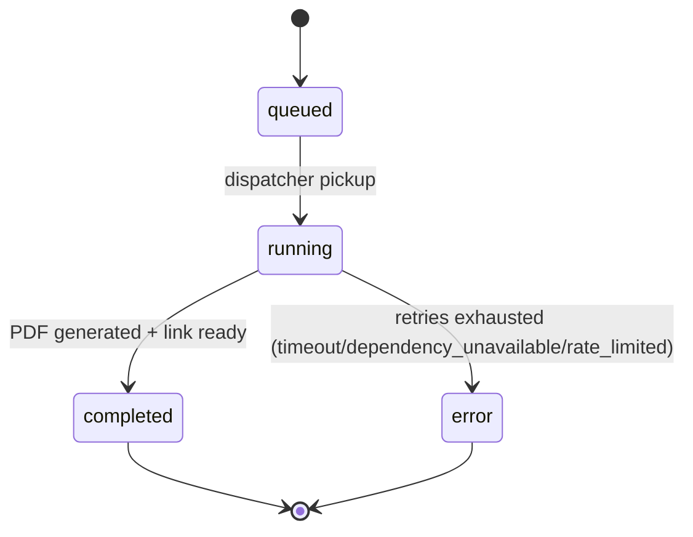

# Data Model: Weekly Last-Quarter Attribution PDF

**Feature**: Weekly Last-Quarter Attribution PDF
**Date**: 2026-11-22
**Source**: [product-spec.md](./product-spec.md)

## Overview

This feature introduces **no new persisted database entities or DDL** — investigation confirmed report parameters ride in existing JSON blobs (`req_request`) and report state uses existing columns (`req_status`, `req_report_link`, `req_progress`, `req_file_size`). The "entities" below are the logical/in-memory data shapes the generation worker produces and consumes. They are modeled here for clarity of the report content and generation lifecycle, not as schema migrations.

---

## Entities

### AttributionReportRow (report content, in-memory)

**Purpose**: One row of the Phase-1 report table — one per channel.

**Fields**:

| Field | Type | Required | Description | Validation |
|-------|------|----------|-------------|------------|
| channel | string | Yes | The channel dimension (resolved field: `partner` / `network` — [DECISION REQUIRED]) | Non-empty; one row per distinct value |
| total_attributed_revenue | decimal | Yes | SUM of attributed revenue over the quarter window | ≥ 0; currency normalization per decision |
| total_conversions | integer | Yes | COUNT of conversions over the quarter window | ≥ 0 |
| data_quality_warning | string | No | Per-week incomplete/still-processing warning (FR-006, if in Phase-1 scope) | Present only for affected weeks |

**Relationships**: Derived from BigQuery attribution conversions data, grouped by the resolved channel field, scoped to the quarter window.

**JSON Schema**:

```json
{
  "$schema": "http://json-schema.org/draft-07/schema#",
  "type": "object",
  "properties": {
    "channel": { "type": "string" },
    "total_attributed_revenue": { "type": "number", "minimum": 0 },
    "total_conversions": { "type": "integer", "minimum": 0 },
    "data_quality_warning": { "type": "string" }
  },
  "required": ["channel", "total_attributed_revenue", "total_conversions"]
}
```

---

### QuarterWindow (computed, in-memory)

**Purpose**: The most-recent-completed-calendar-quarter boundaries, computed at generation time, injected as request epochs.

**Fields**:

| Field | Type | Required | Description | Validation |
|-------|------|----------|-------------|------------|
| time_start | int64 (unix epoch) | Yes | Inclusive start of the most recent completed calendar quarter (UTC) | Calendar-quarter aligned |
| time_end | int64 (unix epoch) | Yes | Exclusive/inclusive end of that quarter (UTC) | time_end > time_start; quarter must be complete |

**Relationships**: Rides existing `time_start`/`time_end` fields in `ReportStruct` / `reportStruct` / `ReportRequest`.

---

### GenerationOutcome (report state, existing columns)

**Purpose**: The named result of a generation run (FR-007).

**Fields**:

| Field | Type | Required | Description | Validation |
|-------|------|----------|-------------|------------|
| status | enum | Yes | `queued` / `running` / `completed` / `error` plus distinct named failure sub-statuses | One of allowed set |
| failure_reason | enum | No | `timeout` / `dependency_unavailable` / `rate_limited` (NFR-004) | Set only on failure |
| report_link | string (URL) | No | Signed, time-limited download URL (~15min TTL) | Present only on `completed` |
| file_size | integer | No | PDF size in bytes | ≥ 0 |

**State Transitions**:



**State Definitions**:

| State | Description | Allowed Transitions |
|-------|-------------|---------------------|
| queued | Request row inserted | running |
| running | Worker generating | completed, error |
| completed | PDF available via signed URL | (terminal) |
| error | Failed; prior successful report preserved unchanged | (terminal) |

---

## Validation Rules

### Business Rules

| Rule ID | Entity | Rule | Error Message |
|---------|--------|------|---------------|
| BR-1 | AttributionReportRow | One row per distinct channel value | — |
| BR-2 | QuarterWindow | Must be the most recent *completed* calendar quarter | — |
| BR-5 | GenerationOutcome | Must function for standard-plan account (no tier gate blocks it) | Access denied (server-side) if restricted gate added |
| FR-007 | GenerationOutcome | On failure, prior successful report link is NOT overwritten | — |

---

## Migration Notes

**No schema migrations required.** Report parameters serialize into the existing `kochava_reports.requested.req_request` JSON `text` column; report state uses existing columns. A revenue DDL change in `pubsuite-attribution` (`auditlog.go:337`) is only required under the (dis-preferred) validated-column path — and would not backfill last quarter.

---

## References

- [product-spec.md](./product-spec.md)
- [eng-research.md](./eng-research.md)