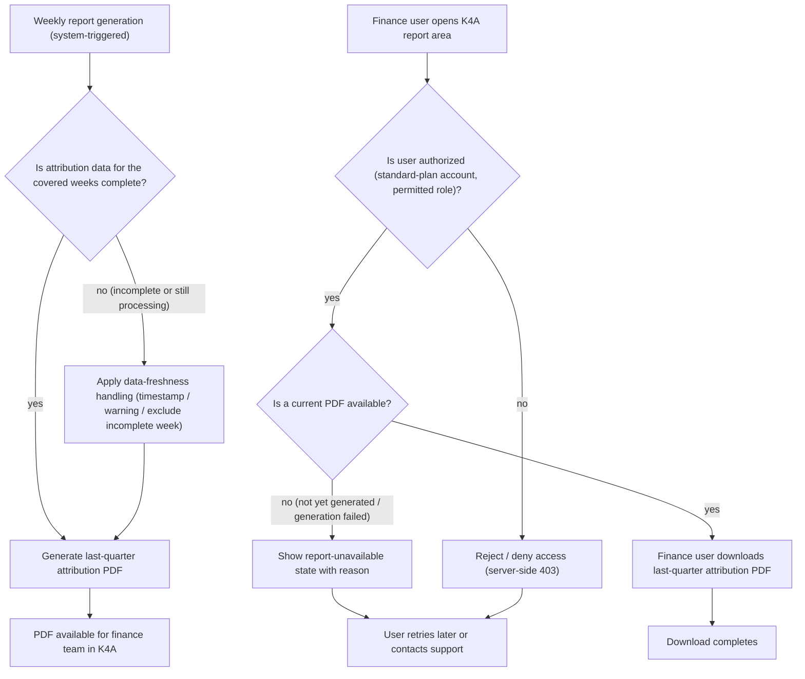

# 1. Business Logic & Context

## Problem

Brightway Retail's finance team currently has no self-service way to obtain a weekly attribution report from K4A. As they approach their year-end close, they need a dependable, downloadable record of last-quarter attribution data. Without it, finance has to request or reconstruct attribution numbers manually, which is slow and error-prone during a time-critical close window.

## Value

- Finance gains a self-service, on-demand way to pull a weekly attribution report as a PDF from K4A.
- The report is scoped to last-quarter data only, matching the close-period need.
- Delivering before year-end close (~5 weeks from request) directly supports Brightway Retail's close process.

## Business Rules

- **BR-1:** The report is generated on a weekly cadence.
- **BR-2:** The report content covers the last quarter only.
- **BR-3:** The report is delivered as a downloadable PDF file.
- **BR-4:** The finance team accesses the report on-demand from K4A.
- **BR-5:** Brightway Retail is on the standard plan; the feature must function for a standard-plan account.
- **BR-6:** The report must be available before year-end close (~5 weeks from the request date).

### Delivery model

The PDF is produced on a fixed weekly schedule — generated every Monday — and stored so the finance team can download the current stored report on-demand from K4A. This is a scheduled-generation model (not generated at the moment of download); the download serves the most recently generated Monday report.

### Quarter window definition

"Last quarter only" means the most recent completed calendar quarter, recalculated every week so the window always reflects the latest completed quarter at generation time.

### Report contents

The report presents total attributed revenue and conversions by channel, laid out as one simple table (one row per channel, with total attributed revenue and total conversions as columns). This is the fixed Phase-1 content set.

### Branding / compliance in the PDF

The PDF must display the Brightway logo (confirmed by finance). Whether the PDF requires any further branding, disclaimers, or audit-oriented formatting for year-end close purposes beyond the Brightway logo is not yet specified. [DECISION REQUIRED: DEC-004]

## KG cross-check note

An independent knowledge-graph lookup for this work item surfaced a meaningful discrepancy against the services the Context Seed named. The fresh lookup did not re-confirm one data-source backend the Context Seed listed, and it additionally surfaced three services the Context Seed did not name (a scheduled-subscription worker, a summary-report generation path, and an attribution-as-a-service reporting output), all at low confidence. The scheduled-subscription worker is notable because it may already provide a weekly-cadence scheduling mechanism that this feature could reuse rather than build new. This discrepancy should be reconciled by engineering during design; the detailed service grounding is recorded in the engineering reference appendix.

## Scope reconciliation note

Intake recorded "UI/Frontend change needed: No", but an on-demand download initiated by the finance team from K4A inherently implies a user-facing download affordance in the K4A console. This spec treats a K4A download action as in-scope, since "finance team accesses the report on-demand from K4A" cannot be satisfied without it. Whether a report preview and a delivery-status indicator are also wanted (beyond a bare download action) is treated as out of scope for Phase 1 unless confirmed. Whether finance needs any user-facing download surface at all, versus delivery through a non-UI path, is a customer-facing scope question. [DECISION REQUIRED]

---

# 2. User Flows (Visuals)



---

# 3. Functional Requirements (The Core)

## Feature Area: Report Generation

### FR-001 — Weekly generation cadence
```gherkin
Given Brightway Retail is a standard-plan account enabled for the weekly attribution report
When the weekly generation cycle runs
Then a new attribution report is produced covering the last-quarter window
And the newly produced report becomes the current report available for download in K4A
```

### FR-002 — Last-quarter data scope
```gherkin
Given a weekly attribution report is being generated
When the report content is assembled
Then the report includes attribution data for the last quarter only
And data outside the last-quarter window is excluded from the report
```
> Note: "last quarter" is defined as the most recent completed calendar quarter, recalculated every week (see Section 1, Quarter window definition).

### FR-003 — PDF output format
```gherkin
Given a weekly attribution report has been generated
When the report is made available to the finance team
Then the report is produced as a single downloadable PDF file
And the PDF content reflects the last-quarter attribution data for that generation cycle
And the PDF displays the Brightway logo
```

### FR-004 — Idempotent generation per cycle
```gherkin
Given a weekly generation cycle has already produced the report for a given week and window
When the same generation cycle is retried or re-delivered for the same week and window
Then the existing report for that week is overwritten in place rather than duplicated
And no duplicate report entry is created for the same week and window
```

### FR-005 — No overlapping generation runs
```gherkin
Given a weekly report generation run for a given cycle is already in progress
When another run for the same cycle is triggered before the first completes
Then the second run does not execute concurrently with the first
And only one report is produced for that cycle
```

## Feature Area: Data Freshness & Completeness

### FR-006 — Incomplete-data handling
```gherkin
Given attribution data for one or more weeks in the last-quarter window is incomplete or still processing at generation time
When the weekly report is generated
Then the report applies the defined data-freshness handling for affected weeks
And the user can distinguish complete data from incomplete or still-processing data in the report
```
> Note: whether incomplete weeks are excluded, flagged with a data-quality warning, or stamped with a freshness timestamp is a separate data-freshness decision (see OQ-005). Engineering should default to including a data-freshness timestamp and a visible warning for affected weeks until the product decision lands.

### FR-007 — Attribution data source dependency failure
```gherkin
Given the attribution data source is unavailable or returns an error during report generation
When the weekly report generation attempts to read attribution data
Then generation retries with bounded exponential backoff up to 3 attempts
And if all attempts fail, the generation is recorded as failed with a distinct, named failure status
And the prior successfully generated report (if any) remains available for download unchanged
```

## Feature Area: On-Demand Access & Download

### FR-008 — On-demand download from K4A
```gherkin
Given a finance user is authenticated in K4A on a standard-plan account with permission to access the report
And a current weekly attribution PDF has been generated
When the user initiates the download of the attribution report from K4A
Then the current last-quarter attribution PDF is delivered to the user
And the downloaded file is a valid PDF containing the last-quarter attribution data
```

### FR-009 — No report available yet
```gherkin
Given a finance user is authorized to access the report in K4A
And no weekly attribution PDF has been generated yet, or the most recent generation failed
When the user opens the report area in K4A
Then the user is shown a report-unavailable state
And the state communicates why the report is not available (not yet generated or generation failed)
And no broken or empty file is offered for download
```

### FR-010 — Server-side access enforcement
```gherkin
Given a user or request is not authorized to access the attribution report (wrong role, or not a permitted account)
When the request to download or retrieve the report reaches the backend, regardless of what the K4A UI presents
Then the request is rejected server-side with an access-denied response
And no report content is returned in the response
```
> Note: authorization is re-derived from the authoritative source on every request and is never trusted from a client-supplied claim. If the auth system is unreachable, the request fails closed (denied).

### FR-011 — Secure, time-limited delivery of the download
```gherkin
Given an authorized finance user requests the attribution report PDF
When the download is served
Then the PDF is delivered via a time-limited secure link rather than a permanently public URL
And the link is no longer usable after its validity window expires
```

I'll report the decisions I flagged in Section 1.

## 4. Information Requirements

The system must track the following business information to support the Functional Requirements. These are business concepts, not schema definitions — types and storage belong in eng-plan.

- **Attribution report (generated artifact):** The weekly PDF itself, scoped to the last-quarter window. System-derived (produced by the generation cycle from attribution data). Matters to FR-001, FR-003, FR-008 — this is the deliverable the finance team downloads.
- **Last-quarter window definition:** The period boundaries that scope the report content — the most recent completed calendar quarter, recalculated every week (see Section 1, Quarter window definition). System-derived. Matters to FR-002 — determines exactly which data appears in each report.
- **Generation cycle / cadence marker:** The weekly trigger and the identity of the week each generated report belongs to. System-derived. Matters to FR-001, FR-004, FR-005 — identifies the current report and provides the idempotency key for a given week and window.
- **Report availability state:** Whether a current report exists, is pending generation, or last generation failed. System-derived. Matters to FR-008, FR-009 — drives whether a download is offered or an unavailable state is shown.
- **Generation outcome / failure status:** The distinct, named result of each generation run (succeeded, data-source unavailable, etc.). System-derived. Matters to FR-007 — distinguishes failure conditions and preserves the prior successful report.
- **Attribution data (source input):** The underlying attribution metrics and dimensions pulled from the attribution data source. External to the generation service (read dependency). Matters to FR-001, FR-002, FR-006, FR-007 — the raw material the report is built from. The Phase-1 report presents total attributed revenue and conversions by channel (see Section 1, Report contents).
- **Data freshness / completeness state per week:** Whether each week's attribution data is complete or still processing at generation time. System-derived (from the data source's reported state). Matters to FR-006 — drives incomplete-data handling in the report.
- **Requesting user identity and authorization context:** The user's identity, role, and account (standard-plan eligibility). Re-derived from the authoritative source on each request. Matters to FR-008, FR-010 — determines whether the download is permitted.
- **Secure download link / validity window:** The time-limited link through which the PDF is served and its expiry. System-derived. Matters to FR-011 — governs secure delivery and link expiry.
- **Audit record of report access and generation:** Who downloaded/retrieved a report and when, plus generation outcomes. System-derived. Matters to NFR-005 — supports traceability for a year-end-close-relevant financial artifact.

---

## 5. Non-Functional Requirements & Guardrails

### Performance & Capacity

- **NFR-001 — Download responsiveness:** When an authorized finance user initiates a download of an already-generated PDF, the request to begin serving the file completes with a p95 latency ≤ 3 seconds, measured under expected concurrent K4A finance-user load. Serving a pre-generated file must not trigger synchronous report generation on the download path.
- **NFR-002 — Generation data-source rate protection:** Report generation reads from the shared attribution data source (see Section 1 KG cross-check). Generation must cap its read load against that source so it does not degrade other consumers; apply an explicit read-rate cap during generation. The concrete cap value is an engineering decision and should be set to a conservative default that engineering can tune against observed data-source capacity.
- **NFR-003 — Generation monitoring:** Emit an operational alert when the report-generation error rate exceeds 1% for 5 minutes, sustained, and when attribution-data-source read-utilization attributable to generation exceeds 80% for 5 minutes, sustained.

### Reliability & Idempotency

- **NFR-004 — Downstream dependency failure posture:** On attribution-data-source failure during generation, retry with bounded exponential backoff (3 attempts), honoring any rate-limit Retry-After response. The feature degrades gracefully: generation fails for the current cycle with a distinct named failure status, and the prior successfully generated report remains available for download unchanged (see FR-007). Timeout, dependency-unavailable, and rate-limited conditions are recorded as distinct failure statuses rather than one generic error.
- **NFR-011 — Idempotent, non-overlapping generation:** Each weekly generation is idempotent on the (week + window) key — a retry or re-delivery overwrites the existing report in place and never produces a duplicate (see FR-004). Automatic concurrent re-runs of the same cycle are prevented at the scheduler level in addition to the idempotency guarantee (see FR-005).

### Security & Access Control

- **NFR-005 — Server-side access enforcement:** Access to the report is enforced server-side on every download/retrieval request and is never satisfied by UI-hiding alone; an ineligible role or account is rejected with a 403 regardless of what the K4A UI presents (see FR-010). Role and account eligibility are re-derived from the authoritative source on every request, never cached client-side or trusted from a client-supplied claim; if the auth system is unreachable, the request fails closed.
- **NFR-006 — Secure, time-limited delivery:** The PDF is delivered via a time-limited secure link rather than a permanently public URL or raw attachment; the link is unusable after its validity window expires (see FR-011). The concrete link lifetime is an engineering decision; default to a short validity window (e.g. 15 minutes) sufficient to complete a download, tunable by engineering.
- **NFR-007 — No sensitive data in logs:** Raw attribution report content and any user-identifying data must never be written to application logs. Attribution data is finance-relevant business data; log identifiers and status, not report payloads.
- **NFR-008 — Audit trail for access and generation:** Record an immutable, append-only audit entry for each report download/retrieval and each generation outcome, capturing actor identity (user ID + account ID), resource identity (report week/window), action, timestamp, and outcome/status. Audit writes are asynchronous and must not block the primary operation, but an audit-write failure must fire an immediate operational alert rather than fail silently. Minimum retention: 12 months. Because this report is produced specifically to support year-end financial close, a longer retention tied to Brightway Retail's audit cycle may be required. [DECISION REQUIRED]

### Operability & Rollout

- **NFR-009 — Kill-switch:** The feature is governed by a config-based kill-switch that disables report generation and the K4A download affordance without a code deploy. An on-call engineer can disable it during an incident without separate approval. New requests reflect the flip within 5 minutes; requests already in flight at the time of the flip complete under the prior behavior.
- **NFR-010 — Backward compatibility:** This feature extends existing report-generation and delivery services that have existing consumers (see Section 1 KG cross-check and the Engineering Reference appendix). Existing report outputs, callers, and scheduled behaviors of those services must remain unchanged; the weekly attribution PDF is additive and must not alter or regress any current report type.

### Rollback (HIGH-risk, multi-service)

- **Trigger:** Sustained generation failure (per NFR-003 alert), incorrect report content reported by finance, or any access-control regression.
- **Owning authority:** On-call engineering, via the NFR-009 kill-switch, without separate escalation.
- **Timing target:** New requests stop within the 5-minute propagation window of the kill-switch flip.
- **Data treatment:** No retroactive reversion. Already-generated PDFs are not retracted or altered; only new generation and new download requests are affected going forward.

### Risk Mitigation

| Context Seed Risk | Mitigation — what must be true |
|---|---|
| Hard 5-week deadline (year-end close) | Scope is held to the Phase-1 MVP in Section 6; open delivery-architecture and content decisions are flagged as `[DECISION REQUIRED]` with working defaults so engineering is never blocked waiting on them. |
| Multi-service backend + frontend blast radius | Backward compatibility (NFR-010) protects existing consumers of the shared report services; kill-switch (NFR-009) and rollback plan bound production exposure. |
| Unresolved delivery architecture (on-demand vs fixed weekly schedule) | The delivery-model decision is surfaced in Section 1 for a product call; FR-001–FR-003 are written to hold for either model, and the possibility of reusing an existing weekly-cadence scheduling mechanism (per KG cross-check) is routed to engineering design to avoid building new scheduling. |
| Ambiguous "last quarter" window | Resolved: the report covers the most recent completed calendar quarter, recalculated every week (see Section 1 Quarter window definition). |
| Data freshness / completeness uncertainty | FR-006 mandates explicit incomplete-data handling with a default (freshness timestamp + visible warning) until the content decision lands. |

---

## 6. Out of Scope & Phasing

### In scope — Phase 1 (MVP)

- Weekly generation of a last-quarter attribution report as a downloadable PDF (FR-001–FR-003).
- On-demand download of the current report from K4A by an authorized finance user (FR-008, FR-011).
- Server-side access enforcement and secure, time-limited delivery (FR-010, FR-011).
- Data-freshness handling for incomplete weeks (FR-006), idempotent non-overlapping generation (FR-004, FR-005), and bounded dependency-failure handling (FR-007).

### Out of scope — Phase 1 (deferred / future phases)

| Item | Why deferred | Phase |
|---|---|---|
| Report preview within K4A (beyond a download action) | Not critical-path to "download the PDF on-demand"; UI surface beyond a download action is unconfirmed (see Section 1 Scope reconciliation note). | Future |
| Delivery-status indicator in K4A | Same as above — not required to satisfy on-demand download. | Future |
| Historical access to prior weeks' PDFs | Confirmed with finance: they need the current week's report only, with no access to prior weeks' PDFs; multi-week retention/browsing is out of scope for Phase 1. | Future |
| Automatic push/email delivery on a fixed day | Deadline-scoped MVP is on-demand download from K4A; a fixed-schedule push depends on the unresolved delivery-model decision. | Future |
| Configurable/custom metrics, dimensions, and report layout | Phase 1 ships a fixed content set — total attributed revenue and conversions by channel as one simple table (see Section 1 Report contents); configurable/custom metrics, dimensions, and layout are deferred. | Future |
| Custom branding, disclaimers, or audit formatting in the PDF beyond the Brightway logo | The Brightway logo is confirmed in scope for Phase 1 (see Section 1 Branding / compliance); any further disclaimers or audit formatting are unconfirmed for year-end close. | Future |
| Non–standard-plan or multi-account rollout beyond Brightway Retail | Requirement is scoped to Brightway Retail on the standard plan. | Future |

---

## Appendix: Engineering Reference

_The sections below are derived automatically from the codebase knowledge graph, for the engineering team's reference during planning — not required reading for product/requirement review._

### Affected Services (grounded context, not implementation direction)

Context Seed–named services (KG-derived):

- **reporting-api** (backend) — Attribution report generation and PDF export.
- **reporting-dispatcher** (backend) — Report scheduling and delivery workflow.
- **frontend-mos** (frontend) — K4A UI: download link, report preview, delivery status.
- **pubsuite-attribution** (backend) — Attribution data source for weekly reports.

Additional services surfaced by an independent KG cross-check (reconcile during design; see Section 1 KG cross-check note):

- **reporting-subscriptions-worker** (backend, low confidence) — Scheduled report subscriptions, weekly cadence; may already provide a weekly-cadence mechanism to reuse instead of building new scheduling.
- **summary-report-cloud** (backend, low confidence) — Summary report generation for attribution data; possible overlap with reporting-api's generation role.
- **aaas-reporting** (backend, low confidence) — Attribution-as-a-service reporting output; relevance unconfirmed.

Note: the cross-check did not re-confirm **pubsuite-attribution** as a data source at the Context Seed's stated confidence; engineering should verify the authoritative attribution data source during design.

## Revision Summary

_Applied reviewer's request._

- Recorded the confirmed Brightway logo requirement on the PDF and narrowed the remaining branding/compliance decision to DEC-004.
- Added a Brightway-logo acceptance criterion to FR-003 (PDF output format).
- Updated the out-of-scope branding row to carve the confirmed Brightway logo into Phase 1 while keeping further branding deferred.


---
## Open Questions & Decisions Register

_Durable, ID'd reference for HITL 2 (G1) and beyond — inline `[DECISION REQUIRED: DEC-00N]` tags in the sections above point back here. Reflects the latest round only._

### Decisions Required (business trade-offs — needs a human call)

_Each carries an **Owner** (accountable for supplying the answer) and a **Provisional Value** (the working assumption engineering may build against until the decision lands), so none of these fully block engineering — implementation proceeds on the provisional value and adjusts if the confirmed decision differs._

| ID | Decision | Owner | Provisional Value (build against until confirmed) |
|----|----------|-------|-----------------------------------------------------|
| **DEC-003** | What attribution metrics and dimensions does the finance team need in the report, in what order, and do they need row-level detail or summaries for year-end close? | Product owner (with Brightway Retail finance) | Revenue by channel, conversions by campaign, and ROI by touchpoint, shown as summary tables with the option of row-level detail, ordered revenue-first. |
| **DEC-004** | Does the PDF need any specific branding, disclaimers, or audit-oriented formatting to be acceptable for the finance team's year-end close? | Product owner (with Compliance and Brightway Retail finance) | Include the Kochava/K4A logo, the account name, a generation timestamp, and the covered-period range, with no additional legal disclaimers until finance specifies otherwise. |
| **DEC-005** | Does the finance team need a user-facing download affordance inside the K4A console, or should the report reach them through a non-console path such as a link or email? | Product owner (with requester Mayank Ukey) | Provide a download action in the K4A console UI; treat report preview and a delivery-status indicator as out of scope for Phase 1 unless finance asks for them. |
| **DEC-006** | For a financial report produced to support Brightway Retail's year-end close, how long must we keep the record of who generated and downloaded each report before we're allowed to delete it? | Compliance/Security, with Product owner | Retain audit records for 12 months minimum; extend to match Brightway Retail's own audit/close cycle (commonly 24 months for financial-close-relevant records) if their agreement requires it. |

### Decisions Resolved

- **DEC-001**: Resolved OQ-001/DEC-001/DEC-007: the PDF is generated on a fixed weekly schedule every Monday and stored for on-demand download from K4A.
- **DEC-002**: Resolved OQ-004/DEC-002: "last quarter" is the most recent completed calendar quarter, recalculated every week.
- **DEC-007**: Resolved OQ-001/DEC-001/DEC-007: the PDF is generated on a fixed weekly schedule every Monday and stored for on-demand download from K4A.

### Open Questions (evidence gaps — needs more input)

- **OQ-002**: The intake classifies this as no frontend change, but the delivery is described as an on-demand download 'from K4A' — can you confirm whether there IS a user-facing download link/preview in the K4A console, or is delivery meant to happen some other way (e.g. email, API)?
- **OQ-005**: How should weeks with incomplete or still-processing attribution data be handled — include with a freshness timestamp, exclude, or show a data-quality warning?
- **OQ-007**: Are there branding, compliance, or audit requirements for the PDF (logos, disclaimers, row-level detail vs. summary) needed for year-end close?
- **OQ-008**: If generated on-demand, what's the acceptable latency between data collection and the PDF being downloadable, and how should users know fresh data is available?

### Questions Resolved

- **OQ-001**: Resolved OQ-001/DEC-001/DEC-007: the PDF is generated on a fixed weekly schedule every Monday and stored for on-demand download from K4A.
- **OQ-003**: Resolved DEC-003 / OQ-003 — the report presents total attributed revenue and conversions by channel as one simple table.
- **OQ-004**: Resolved OQ-004/DEC-002: "last quarter" is the most recent completed calendar quarter, recalculated every week.
- **OQ-006**: OQ-006 resolved: finance needs only the current week's report, no access to previous weeks' PDF history.

---
> **Classification:** Type B — requirement-agent's independent re-check DISAGREES with intake's original Type A call. Requirement clarity is "clear" and UX need is "none" — the desired behavior (weekly attribution PDF, last-quarter data, on-demand download from K4A) is confirmed; the open questions are routine engineering/design decisions (schedule vs. on-demand, metrics layout, data freshness) rather than genuine product ambiguity, so the multi-service (4-6 services, backend+frontend) build is engineering-led design, not discovery.
