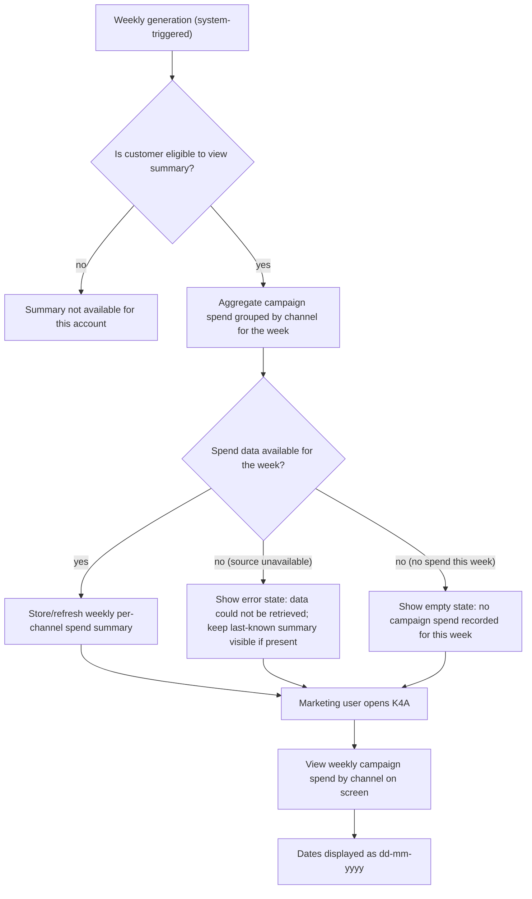

## 1. Business Logic & Context

### Problem

Meridian Travel's marketing team manually extracts campaign spend data every Monday to understand how spend is distributed across their advertising channels. This "Monday pull" is a recurring, manual, time-consuming process that is error-prone and delays the team's ability to react to spend patterns — a particular concern ahead of their summer campaign launch.

### Value

Delivering a weekly, on-screen summary of campaign spend grouped by channel inside the K4A interface eliminates the manual extraction process. The marketing team gets a reliable, repeatable weekly view with no manual effort, freeing time and reducing the risk of errors in spend reporting during a high-stakes campaign period.

### Business Rules

- **Aggregation dimension:** Campaign spend is grouped by channel. Spend from campaigns belonging to the same channel is summed into a single per-channel total.
- **Cadence:** The summary is produced on a weekly basis.
- **Date display format:** All dates shown in the summary use the `dd-mm-yyyy` format. This is a hard requirement from the requester and must be honored in the display layer regardless of locale defaults.
- **Delivery surface:** The summary is displayed on screen within the K4A interface. It is not emailed, pushed, or delivered as a downloadable file. The weekly cadence refers to the data being refreshed/regenerated on a weekly basis and then shown on screen — not to a push-delivery mechanism.
- **Customer context:** Meridian Travel is on the "standard" plan. [DECISION REQUIRED: DEC-001]
- **Channel scope:** The specific set of channels to aggregate across (e.g. Google Ads, Facebook, email, social, display networks), and whether any channel needs sub-grouping or exclusion, is not yet settled. [DECISION REQUIRED: DEC-002]
- **Metrics scope:** The summary shows spend totals per channel. Whether additional performance metrics (clicks, conversions, ROI, impressions) are shown alongside spend is not yet settled. [DECISION REQUIRED: DEC-003]
- **Refresh timing:** The exact moment the weekly summary refreshes and becomes ready to view, and the timezone that applies, is not yet settled. [DECISION REQUIRED: DEC-004]
- **Historical retention:** Whether the team needs to compare spend week-over-week or year-over-year, or only sees the current week's snapshot, is not yet settled. [DECISION REQUIRED: DEC-005]

### Service-ownership note (for downstream engineering awareness)

Two independent knowledge-graph lookups of the affected codebase disagree on which backend stack owns K4A spend reporting. One lookup attributes the query, scheduling, and cost-aggregation roles to a reporting-oriented stack; an independent cross-check instead attributes the same roles to a parallel cluster of campaign-data/reporting services, and additionally surfaces a backend candidate for owning the K4A spend-summary logic that the first lookup did not mention. Conversely, the plan-verification backend named by the first lookup did not re-appear in the cross-check. This discrepancy is unresolved and must be reconciled by engineering before scope is locked; it is a known contributor to the HIGH risk tier and the ~5-week deadline risk. (Specific service names are recorded in the engineering appendix, not here.)

## 2. User Flows (Visuals)



## 3. Functional Requirements (The Core)

### Feature Area: Weekly Spend Aggregation

**FR-001 — Aggregate campaign spend grouped by channel**
```gherkin
Given campaign spend data exists for the current week
When the weekly summary is generated
Then each campaign's spend is grouped by its channel
And spend from all campaigns sharing the same channel is summed into a single per-channel total
And the result contains one spend total per channel for the week
```

**FR-002 — Weekly generation cadence**
```gherkin
Given the weekly summary generation is scheduled to run on a weekly basis
When the scheduled generation time for the week is reached
Then a new weekly summary is generated for that week
And the generated summary reflects campaign spend for that week only
```

**FR-003 — Idempotent weekly generation**
```gherkin
Given a weekly summary has already been generated for a given week
When the generation runs again for that same week (for example, due to a retry or re-run)
Then the existing summary for that week is overwritten in place
And no duplicate summary record is created for that week
And no channel total is double-counted
```

**FR-004 — No overlapping generation runs**
```gherkin
Given a weekly summary generation run for a given period is already in progress
When another generation run for the same period is triggered before the first completes
Then the second run does not start concurrently
And the in-progress run is allowed to complete
```

### Feature Area: On-Screen Display in K4A

**FR-005 — Display weekly spend summary on screen**
```gherkin
Given a weekly spend summary has been generated for the current week
And the user is viewing the K4A interface
When the user navigates to the weekly campaign spend summary view
Then the summary is displayed on screen within K4A
And each channel is shown with its total spend for the week
```

**FR-006 — Date format enforcement**
```gherkin
Given the weekly spend summary is displayed on screen
When any date is rendered in the summary (for example, the week the summary covers)
Then the date is formatted as dd-mm-yyyy
And this format is applied regardless of the user's browser or system locale
```

**FR-007 — Empty state when no spend recorded**
```gherkin
Given no campaign spend was recorded for the current week
When the user navigates to the weekly campaign spend summary view
Then an empty state is shown indicating no campaign spend was recorded for this week
And no per-channel totals are displayed
```

**FR-008 — Error state when spend data cannot be retrieved**
```gherkin
Given the underlying spend data source is unavailable at generation time
When the weekly summary generation runs
Then the system records that the data could not be retrieved for that week
And when the user navigates to the summary view, an error state is shown indicating the data could not be retrieved
And if a prior week's summary exists, it remains viewable rather than being discarded
```

### Feature Area: Access Eligibility

**FR-009 — Server-side eligibility enforcement**
```gherkin
Given a user requests the weekly campaign spend summary
When the request is served
Then eligibility to view the summary is verified server-side on every request
And a request from an ineligible account is rejected with a forbidden response
And eligibility is not enforced by UI-hiding alone
```

**FR-010 — Eligibility re-derived from authoritative source**

## 4. Information Requirements

- **Campaign spend record** — the per-campaign spend figures that feed the summary. Source: System-Derived (from the authoritative campaign cost/spend data). Why it matters: this is the raw input FR-001 aggregates by channel; without it there is no summary.
- **Channel** — the grouping dimension each campaign's spend is attributed to. Source: System-Derived (attached to campaign/spend data upstream). Why it matters: it is the axis of aggregation for the entire feature; whether channel is a first-class attribute end-to-end is an open engineering unknown that must be confirmed before scope locks.
- **Per-channel weekly spend total** — the summed spend for each channel over the week. Source: System-Derived (computed by FR-001). Why it matters: this is the primary value the marketing team views on screen.
- **Week identifier / covered period** — the specific week each summary represents, including its start/end dates. Source: System-Derived. Why it matters: it scopes each summary to one week (FR-002), drives the dd-mm-yyyy date display (FR-006), and is the key used for idempotent regeneration (FR-003).
- **Summary generation status** — whether a given week's summary generated successfully, produced an empty result, or failed because the data source was unavailable. Source: System-Derived. Why it matters: it drives the empty state (FR-007) and error state (FR-008) shown on screen.
- **Account / customer identity** — the account requesting the summary and its plan level. Source: External (authoritative account service) for plan level; System-Derived for the requesting account context. Why it matters: it drives the server-side eligibility check (FR-009, FR-010). Whether eligibility is actually gated on plan level or any other attribute is unsettled — see the eligibility decision raised in Section 5.
- **Requesting user identity and role** — who is viewing the summary. Source: External (authoritative auth/account source). Why it matters: it supports server-side eligibility enforcement and any role-based visibility rule that applies to spend-by-channel data.
- **Last-known summary** — the most recent successfully generated weekly summary. Source: System-Derived. Why it matters: FR-008 keeps a prior summary viewable when the current week's generation fails.

## 5. Non-Functional Requirements & Guardrails

### Performance & Capacity

**NFR-001 — Read/display latency**
The on-screen summary view returns within a p95 target measured under expected concurrent K4A load (p95 ≤ 2000 ms at the view's expected peak concurrency). The weekly summary is pre-generated, so the read path serves stored results rather than computing aggregation on demand.

**NFR-002 — Shared cost-data query protection**
Aggregation reads campaign cost data from a shared data source with other consumers. The weekly generation must not degrade those consumers: state an explicit rate cap on the aggregation query path and run generation off the interactive request path. Before adding any new aggregation query path, its blast radius on existing cost-data consumers must be assessed.

**NFR-003 — Generation monitoring**
Alert when weekly-generation failures exceed 1% of runs over a 5-minute sustained window, and when aggregation-query error rate exceeds 1% for 5 minutes, sustained. A generation run that fails to produce a weekly summary must raise an operational alert rather than fail silently.

### Security & Access Control

**NFR-004 — Server-side eligibility enforcement**
Any eligibility or visibility difference for the spend-by-channel summary is enforced server-side (FR-009). A direct request from an ineligible account or role is rejected (typically 403) regardless of what the UI renders. Eligibility is re-derived from the authoritative source on every request (FR-010); it is never cached client-side nor trusted from a client-supplied claim.

**NFR-005 — Fail-closed on auth/eligibility uncertainty**
If the authoritative account/auth source needed to verify eligibility is unreachable, the summary request fails closed (access denied) rather than defaulting to visible. A false deny is safer here than exposing spend data to an ineligible viewer.

**NFR-006 — Spend-data sensitivity**
Campaign spend by channel is commercially sensitive. Raw spend figures, account identifiers, and auth tokens must never be written to application logs. Who within the marketing team may view spend by channel, and whether any data-sensitivity rule restricts it, is unsettled. [DECISION REQUIRED: DEC-006]

### Reliability & Data Integrity

**NFR-007 — Idempotent, non-overlapping generation**
Weekly generation is idempotent on the week identifier (FR-003): a retry or re-run overwrites that week's summary in place and never double-counts a channel total or creates a duplicate record. Concurrent re-runs for the same period are prevented at the scheduler level (FR-004) as a complementary safeguard, not a replacement for idempotency.

**NFR-008 — Downstream dependency failure posture**
Aggregation depends on a downstream cost-data source. On failure, generation uses bounded retry with exponential backoff (3 attempts is the default) and honors a rate-limit response's Retry-After rather than retrying on a fixed schedule. Distinct failures — source unavailable vs. timeout vs. rate-limited — are recorded as distinct statuses rather than collapsed into one generic error, and the current week surfaces the error state of FR-008 (graceful degradation: the last-known summary stays viewable, which cannot leak anything the viewer was not already eligible to see).

### Risk Mitigation

**NFR-009 — Feature kill-switch**
Because this is HIGH risk and spans multiple services, the summary is gated behind a config-based flag that disables it without a code deploy. An on-call engineer can disable it during an incident without separate approval. New requests reflect a flip within 5 minutes; requests already in flight at flip time complete under the prior behavior.

**NFR-010 — Service-ownership reconciliation (schedule risk)**
*Risk: multi-service blast radius / unclear technical design.* The two knowledge-graph lookups disagree on which backend stack owns K4A spend reporting (see Section 1). Mitigated only when engineering confirms the authoritative owning stack for the query, scheduling, and cost-aggregation roles before scope is locked.

**NFR-011 — Channel-data availability (scope risk)**
*Risk: core data dimension may not exist end-to-end.* The feature assumes spend is attributable by channel through the whole data path. Mitigated only when engineering confirms channel is a first-class dimension in the source cost data; if it is not, scope expands materially and the deadline is at risk.

**NFR-012 — Hard external deadline (schedule risk)**
*Risk: ~5-week fixed deadline before summer campaign launch.* Mitigated by resolving the open decisions (channel scope, metrics scope, refresh timing, eligibility) early, locking MVP scope, and treating anything non–critical-path as out of scope (Section 6).

**NFR-013 — New UI surface dependent on design (schedule risk)**
*Risk: net-new K4A screen with significant UX need and no existing component to anchor on.* Mitigated when UX/design for the summary view is delivered early enough to unblock frontend work within the deadline; the date-format requirement (dd-mm-yyyy) must be honored in the display layer regardless of locale.

### Rollback

**NFR-014 — Rollback**
*Trigger:* the kill-switch (NFR-009) is flipped off, or sustained generation failures breach NFR-003 alerting. *Owning authority:* on-call engineering, no separate escalation required to disable. *Timing target:* new requests reflect the disable within 5 minutes. *Data treatment:* no retroactive reversion — already-generated weekly summaries are unaffected; only new generation and new read requests stop. A disabled feature shows the summary view as unavailable rather than erroring.

### Backward Compatibility

**NFR-015 — Backward compatibility**
Aggregation reads from an existing shared cost-data source with existing consumers. Any new query or aggregation path added there must leave existing consumers' behavior and outputs unchanged. If eligibility verification reuses an existing account/plan-check path, that existing behavior must remain unchanged for current callers. New read/display and generation surfaces introduced for this feature are additive.

## 6. Out of Scope & Phasing

The following are explicitly **NOT** in Phase 1. Anything not on the critical path to "marketing team views weekly campaign spend by channel on screen in K4A" is deferred.

| Item | Status | Rationale |
|------|--------|-----------|
| Performance metrics alongside spend (clicks, conversions, ROI, impressions) | Out of scope (Phase 1) | Pending the metrics-scope decision (Section 1); critical path is spend totals only. |
| Email / push / downloadable delivery of the summary | Out of scope (Phase 1) | Intake confirmed on-screen in K4A only; no other delivery channel requested. |
| Week-over-week / year-over-year trend comparison and historical browsing | Out of scope (Phase 1) | Pending the historical-retention decision (Section 1); Phase 1 serves the current week's snapshot. |
| Channel sub-grouping or per-channel exclusion rules | Out of scope (Phase 1) | Pending the channel-scope decision (Section 1); Phase 1 aggregates the agreed flat channel set. |
| Plan-based or role-based gating beyond a basic server-side eligibility check | Out of scope (Phase 1) | No gating requirement was stated; eligibility model is an open decision (Section 5). Build no plan gate until product asks for one. |
| Secure time-limited export links | Out of scope (Phase 1) | No export/download is in scope for Phase 1. |
| User-configurable refresh time / timezone selection | Out of scope (Phase 1) | Refresh timing is an open decision (Section 1); Phase 1 uses a single fixed cadence. |

## Appendix: Engineering Reference

_The sections below are derived automatically from the codebase knowledge graph, for the engineering team's reference during planning — not required reading for product/requirement review._

### Affected Services (grounded context, not implementation direction)

The two independent knowledge-graph lookups did not fully agree; both sets are recorded as grounded context for engineering to reconcile (see Section 1 and NFR-010).

**Curated affected-services list (first lookup):**
- **frontend-mos** (frontend) — K4A UI: display weekly spend summary on screen.
- **reporting-api** (backend) — query and return campaign spend by channel data.
- **reporting-subscriptions-worker** (backend) — execute weekly scheduled summary generation and delivery.
- **cost-v2** (backend) — provide spend/cost data aggregated by channel.
- **accounts-api** (backend) — verify customer plan level (standard plan check).

**Independent cross-check lookup (reconcile against the above):**
- **k4a-sam-backend** (backend) — K4A backend may own spend-summary logic.
- **sam-campaign-data-sync** / **k4a-sam-campaign-data-sync** (backend) — sync campaign spend data by channel; possible origin of channel tagging.
- **sam-performance-reporter** (backend) — generates performance/spend reports.
- **sam-report-scheduler** (backend) — schedules weekly report generation.
- **sam-api** (backend) — may expose a spend-summary endpoint.
- **sam-agent** (backend) — reads spend/channel fields; contract to verify, no changes expected.
- **frontend-mos** (frontend) — console UI may display the spend summary.
- **cost-v2** (backend) — owns campaign cost data by channel.

**Discrepancy to reconcile before scope lock:** the first lookup routes the query/schedule/cost roles through `reporting-api` / `reporting-subscriptions-worker` / `cost-v2`; the cross-check routes the same roles through the `sam-*` cluster and surfaces `k4a-sam-backend` as a spend-summary owner not named by the first lookup. Conversely, `accounts-api` (plan check) appeared only in the first lookup. `sam-agent` is read-only (verify contract, no changes). Which stack authoritatively owns K4A spend reporting is unresolved — see NFR-010.

Now reporting my own decisions flagged in Sections 4–6.

---
## Open Questions & Decisions Register

_Durable, ID'd reference for HITL 2 (G1) and beyond — inline `[DECISION REQUIRED: DEC-00N]` tags in the sections above point back here. Reflects the latest round only._

### Decisions Required (business trade-offs — needs a human call)

_Each carries an **Owner** (accountable for supplying the answer) and a **Provisional Value** (the working assumption engineering may build against until the decision lands), so none of these fully block engineering — implementation proceeds on the provisional value and adjusts if the confirmed decision differs._

| ID | Decision | Owner | Provisional Value (build against until confirmed) |
|----|----------|-------|-----------------------------------------------------|
| **DEC-001** | Should viewing the weekly campaign spend summary be restricted to certain accounts or plan levels, and if so which ones? | Product owner | No plan gate for Phase 1 — any user who can access K4A for the account can view the summary; revisit if a plan-based restriction is actually desired. |
| **DEC-002** | Which advertising channels should the weekly summary aggregate spend across, and do any channels need sub-grouping or exclusion? | Product owner (with Meridian Travel) | Aggregate across all channels present in the customer's campaign spend data, each as a flat top-level group with no sub-grouping or exclusion, until Meridian confirms a specific channel list. |
| **DEC-003** | Should the summary show spend totals only, or also performance metrics like clicks, conversions, ROI, and impressions alongside spend? | Product owner (with Meridian Travel) | Spend totals per channel only for Phase 1; performance metrics are out of scope and tracked as a future phase. |
| **DEC-004** | What day, time, and timezone should the weekly summary refresh and be ready to view? | Product owner (with Meridian Travel) | Refresh every Monday at 09:00 in Meridian Travel's local/account timezone, matching their existing Monday pull routine. |
| **DEC-005** | Does the team need to view past weeks and compare spend over time, or only ever see the current week's snapshot? | Product owner (with Meridian Travel) | Current week snapshot only for Phase 1; week-over-week and year-over-year comparison tracked as a future phase. |
| **DEC-006** | Who within Meridian Travel's marketing team is allowed to view campaign spend by channel, and are there any data-sensitivity rules that should restrict who can see it? | Product owner (with input from Compliance/Security) | Any authenticated user on Meridian Travel's account can view the summary in Phase 1 (basic server-side account eligibility only, no finer role gating), with spend figures kept out of logs and the view enforced server-side. |

---
> **Classification:** Type B — requirement-agent's independent re-check DISAGREES with intake's original Type A call. The behavior and success criteria are clearly specified (weekly spend aggregated by channel, dd-mm-yyyy, shown on screen in K4A), so the remaining work is engineering-led design across 5+ services (frontend-mos, reporting-api, subscriptions-worker, cost-v2, accounts-api) rather than genuine product discovery; the open questions are refinable implementation details, not ambiguity blocking design.
