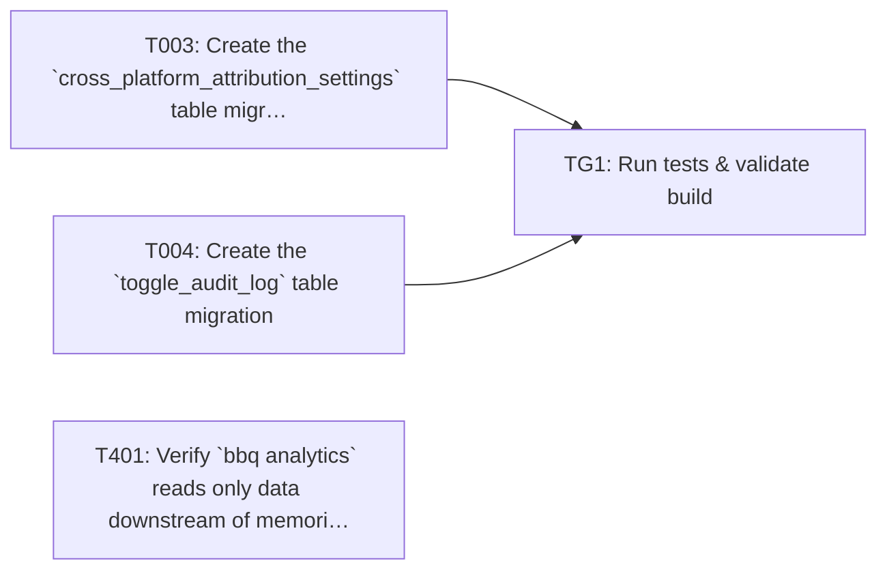

Approving locks the requirements and your decisions. Tasks are a guide; code questions go to the coding agent.

> Plan of record, not execution order: the coding agent works one repo at a time from the requirements and the approved decisions, and links its PR on the repo epic.

---
id: implementation-task-matrix
title: Implementation Task Matrix
---

## Implementation Task Matrix — wi_prd082_580e3c

**Matrix ID:** `wi_prd082_580e3c-r1` · **Generated:** 2026-11-27T20:43:42.897710+00:00 · **Source:** `tasks` · **Verdict:** **READY with 3 warnings**

### Summary

| Metric | Value |
| :--- | :--- |
| Tasks total | 4 |
| AI-allocated | 3 |
| Manual-allocated | 1 |
| Waves | 2 |
| Conflicts | 0 |
| Requirements uncovered | 0 |
| Low-confidence allocations (<0.6) | 1 |

### Wave 0

| Task | Title | Repo | Owner | Allocation | Confidence | Status |
| :--- | :--- | :--- | :--- | :--- | :--- | :--- |
| T003 | Create the `cross_platform_attribution_settings` table migration | Kochava/links-api | coding-agent | ai | 0.80 | planned |
| T004 | Create the `toggle_audit_log` table migration | Kochava/links-api | coding-agent | ai | 0.80 | planned |
| T401 | Verify `bbq analytics` reads only data downstream of memorialization | UNKNOWN | manual-developer | manual | 0.30 | planned |

### Wave 1

| Task | Title | Repo | Owner | Allocation | Confidence | Status |
| :--- | :--- | :--- | :--- | :--- | :--- | :--- |
| TG1 | Run tests & validate build | Kochava/links-api | test-change-gate | ai | 0.90 | planned |

### Dependency Graph

### Open Questions

- `T401` — Owner allocation for T401 has low confidence (0.30); confirm manual-developer manually before dispatch. (Couldn't tell the repo's language — please confirm the owner)
- Couldn't tell the language of UNKNOWN — please confirm the owner for its tasks (repo-stack-unknown)

### Warnings

- T003: `docker/mysql` is a folder, not a file; dropped from the task's files
- T004: `docker/mysql` is a folder, not a file; dropped from the task's files
- grounding unavailable for Kochava/UNKNOWN: GitHub tree for Kochava/UNKNOWN failed: HTTPStatusError

---
> Generated by: taskmatrix 0.1.0
