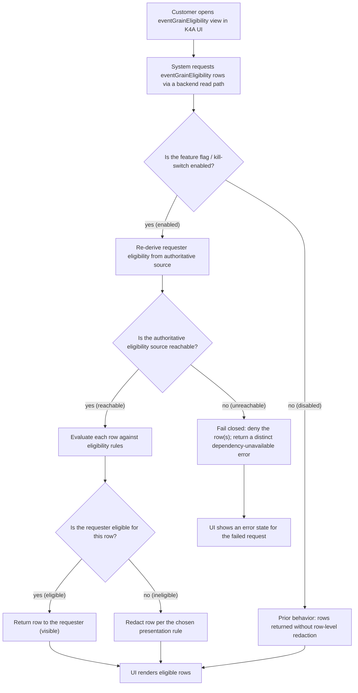
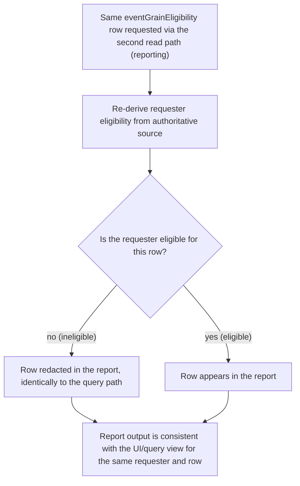

# 1. Business Logic & Context

## Problem

Amazon Ads `eventGrainEligibility` data is currently surfaced to K4A customers with no row-level redaction. What a customer sees today when accessing this data is **not yet established** — the intake left this open ("Unknown, for engineering to confirm") and it must be traced end-to-end before redaction rules can be finalized. Without row-level redaction, rows that should be restricted (by eligibility, permission, advertiser status, or sensitivity) can be exposed to customers who are not entitled to see them. Because this data crosses multiple read paths and a customer-facing UI, any inconsistency produces a direct, visible compliance and PII exposure risk.

## Value

Enforcing row-level redaction on `eventGrainEligibility` ensures customers only see the rows they are entitled to, closing a data-visibility gap that carries compliance and PII sensitivity. Consistent enforcement across every consumer surface (query path, reporting path, and UI) removes the "second door" leak risk where one path redacts and another does not.

## Scope context (read paths)

This feature affects data that flows through **two independent backend read paths** plus a customer-facing UI. Redaction must be enforced consistently across all of them — ideally at a single enforcement chokepoint rather than reimplemented per consumer, to avoid one path leaking rows another path hides. The authoritative eligibility signal that drives redaction originates upstream at the data-ingestion/field-definition layer.

## Business Rules

- **BR-001 — Row-level, not field-level:** Redaction operates at the granularity of an individual `eventGrainEligibility` row. A row is either eligible (visible) or redacted for a given requester. This is a stricter requirement than column/field masking and must be verified against whatever masking currently exists.
- **BR-002 — Consistency across all consumers:** The same redaction decision must apply to a given row regardless of which consumer surface requests it (query path, reporting path, or UI). A row redacted on one path must be redacted on every path.
- **BR-003 — Eligibility is the determinant of visibility:** A row is shown only when the requester is eligible to see it per the eligibility rules. The specific eligibility criteria that make a row redactable (e.g. user permissions, advertiser status, data freshness, campaign state) are **not yet defined** and must be established before implementation. [DECISION REQUIRED: DEC-001]
- **BR-004 — Server-enforced, not UI-hidden:** Redaction is enforced on the backend read path. A direct request from an ineligible requester must not return the redacted row, regardless of what any UI does or does not display.
- **BR-005 — Authoritative, per-request evaluation:** Eligibility is re-derived from the authoritative source on each request rather than trusted from a client-supplied value. If eligibility can vary per row independently of the requester's role, the per-row check is applied in addition to any role/account-level check, not instead of it.
- **BR-006 — Presentation of redacted rows:** How a redacted row is presented to the customer — omitted entirely, shown with placeholder text, or shown labeled as "redacted" with an explanation — is **not yet decided** and materially changes UI scope. [DECISION REQUIRED: DEC-002]
- **BR-007 — Access-request / escalation workflow:** Whether a customer can request access to a redacted row, and any approval/escalation workflow if so, is **not yet decided**. [DECISION REQUIRED: DEC-003]

## Note on affected services (KG reconciliation)

An independent knowledge-graph cross-check did not re-confirm the primary service list and instead surfaced a different candidate owner for `eventGrainEligibility` logic at medium confidence, plus several low-confidence leads. The two lists do not fully agree on where the core logic lives. This discrepancy — specifically whether the core eligibility/redaction logic lives in the services named in the primary list or in the alternate candidate surfaced by the cross-check — must be resolved by engineering during detailed design and is an engineering ownership question, not a product decision.

---

# 2. User Flows (Visuals)





---

# 3. Functional Requirements (The Core)

> **Note on undefined rules:** Several FRs below reference the eligibility criteria and the redacted-row presentation, both of which are flagged as open decisions in Section 1. The FRs are written so they remain verifiable once those decisions land — QA verifies the *mechanism* (server-side enforcement, consistency across paths, fail-closed behavior, audit) independently of the specific rule values, and verifies the rule values themselves once defined.

## Feature Area A — Row-Level Redaction Enforcement

### FR-001 — Redaction applied at the row level
```gherkin
Given eventGrainEligibility data containing a mix of rows the requester is eligible and ineligible to see
When the requester reads eventGrainEligibility data through a backend read path with the redaction feature enabled
Then each row is evaluated individually
And only the rows the requester is eligible to see are returned as visible
And each ineligible row is redacted
And eligible and ineligible rows within the same result set are handled independently of one another
```

### FR-002 — Eligibility drives per-row visibility
```gherkin
Given a defined set of eligibility rules that determine whether an individual eventGrainEligibility row is visible to a requester
When the system evaluates a row for a requester
Then the row is returned as visible only if the requester satisfies the eligibility rules for that row
And the row is redacted otherwise
```

### FR-003 — Eligibility is re-derived from the authoritative source on every request
```gherkin
Given a requester reading eventGrainEligibility data
When the system determines which rows to redact
Then the requester's eligibility is re-derived from the authoritative source on that request
And a client-supplied eligibility value is never trusted to decide visibility
```

### FR-004 — Per-row eligibility is an additional check on top of any role/account gate
```gherkin
Given a requester whose role or account type permits access to eventGrainEligibility data in general
And an individual row that carries its own eligibility restriction independent of the requester's role
When the system evaluates that row for the requester
Then the per-row eligibility check is applied in addition to the role/account check
And the row is redacted if the per-row check fails even though the role/account check passed
```

## Feature Area B — Server-Side Enforcement

### FR-005 — Redaction enforced server-side regardless of UI
```gherkin
Given a requester who is ineligible for a specific eventGrainEligibility row
When the row is requested directly from a backend read path, bypassing the K4A UI
Then the redacted row is not returned in the response
And the enforcement does not depend on any UI-level hiding
```

### FR-006 — Direct request from an ineligible requester is rejected at the row level
```gherkin
Given a requester who is not eligible for a given eventGrainEligibility row
When that requester requests that specific row directly from a backend read path
Then the response does not disclose the contents of the redacted row
```

## Feature Area C — Consistency Across Consumer Paths

### FR-007 — Same redaction decision on the query path and the reporting path
```gherkin
Given a specific eventGrainEligibility row and a specific requester
And the requester is ineligible to see that row
When the requester accesses the row through the analytics/query read path
And the requester accesses the same row through the customer-facing reporting path
Then the row is redacted identically on both paths
And neither path returns the row the other path redacts
```

### FR-008 — UI reflects the backend redaction decision
```gherkin
Given a requester viewing eventGrainEligibility data in the K4A UI
When the backend read path redacts one or more rows for that requester
Then the K4A UI does not display the contents of any redacted row
And the UI presents redacted rows according to the chosen presentation rule
```

## Feature Area D — Redacted-Row Presentation

### FR-009 — Redacted rows are presented per the agreed presentation rule
```gherkin
Given one or more eventGrainEligibility rows that are redacted for the requester
When the K4A UI renders the result set
Then redacted rows are presented in exactly one agreed manner — omitted entirely, shown with placeholder text, or labeled "redacted" with an explanation
And the same presentation rule is used consistently across every view that displays eventGrainEligibility data
```

> The specific presentation rule in FR-009 is the open decision flagged as BR-006 in Section 1.

### FR-010 — Access-request handling for redacted rows (conditional on decision)
```gherkin
Given a customer who encounters a redacted eventGrainEligibility row
When the access-request capability is in scope and enabled
Then the customer can initiate an access request for that row through the agreed workflow
And the request follows the agreed approval or escalation path before any previously-redacted row becomes visible
```

> Whether FR-010 is in scope at all depends on the open decision flagged as BR-007 in Section 1.

## Feature Area E — Dependency Failure Handling

### FR-011 — Fail closed when the authoritative eligibility source is unreachable
```gherkin
Given a request to read eventGrainEligibility data
When the authoritative eligibility source needed to evaluate redaction is unreachable
Then the system fails closed and does not return rows it cannot confirm the requester is eligible to see
And the requester receives a distinct dependency-unavailable error rather than unredacted data
```

### FR-012 — Distinct, named failure conditions
```gherkin
Given the redaction evaluation depends on a downstream/authoritative source
When that dependency times out, is unavailable, or rate-limits the request
Then each failure condition produces its own distinct, named error status
And the conditions are not collapsed into a single generic error
```

## Feature Area F — Kill-Switch / Feature Flag

### FR-013 — Redaction is governed by a config-based kill-switch
```gherkin
Given the row-level redaction feature is live
When an on-call engineer disables the redaction feature via configuration
Then no code deploy is required to disable it
And the change takes effect for new requests within the stated propagation time
And in-flight requests submitted before the change complete under the prior behavior
```

### FR-014 — Disabled-state behavior is explicit
```gherkin
Given the row-level redaction feature flag is disabled
When a requester reads eventGrainEligibility data
Then the system returns data under the prior (pre-redaction) behavior
And no partial or inconsistent redaction is applied while the flag is disabled
```

## Feature Area G — Audit Logging

### FR-015 — Redaction decisions are auditable
```gherkin
Given a request that triggers row-level redaction evaluation on eventGrainEligibility data
When the system decides to redact or expose rows for the requester
Then an append-only audit record is written capturing actor identity (user ID and account ID), the resource (eventGrainEligibility and the relevant row/query identifier), the redaction outcome, and a timestamp
And the audit record is written asynchronously so it does not block the read
And a failure to write the audit record raises an operational alert rather than failing silently
```

### FR-016 — Audit records are immutable
```gherkin
Given an audit record has been written for a redaction decision
When any role or code path attempts to edit or delete that record
Then the attempt does not succeed
And the record remains append-only
```

### FR-017 — No raw sensitive data in logs
```gherkin
Given redaction evaluation and audit logging occur
When any log or audit record is written
Then the contents of a redacted row, raw PII, credentials, secrets, or tokens are never written to logs
```

I used four `[DECISION REQUIRED: DEC-004]` tags in Sections 0–3 (BR-003 eligibility criteria, BR-006 presentation of redacted rows, BR-007 access-request workflow). Note BR-003, BR-006, and BR-007 are the three distinct decisions — reporting them now.

## 4. Information Requirements

The system must track the following business information to support the functional requirements above. Attribute-level definitions, types, and schema constraints are deliberately left to eng-plan.

- **eventGrainEligibility row** — the unit of data subject to redaction. Source: External (Amazon Ads data ingested upstream at the data-ingestion/field-definition layer). Why it matters: it is the entity each redaction decision is made against (FR-001, FR-002).
- **Per-row eligibility signal** — the authoritative signal that determines whether a given row is visible or redacted for a requester. Source: System-Derived upstream (originates at the ingestion/field-definition layer; whether this signal already exists as an ingested field or must be newly defined is an engineering determination). Why it matters: it is the determinant of visibility (BR-003, FR-002, FR-004). The specific criteria that make a row redactable are an open product decision (see BR-003 in Section 1).
- **Requester identity** — the user ID and account ID of whoever is reading the data. Source: System-Derived (authenticated session/request context). Why it matters: eligibility is re-derived per request from the authoritative source against this identity (FR-003); it is also a required field in the audit record (FR-015).
- **Requester role / account type** — the general access level the requester holds for eventGrainEligibility data. Source: System-Derived (authoritative auth source). Why it matters: it is the first-level gate on top of which the per-row eligibility check is additionally applied (FR-004).
- **Redaction decision (per row, per request)** — the resolved outcome (visible or redacted) for each evaluated row. Source: System-Derived. Why it matters: it is what must be enforced consistently across every consumer path (BR-002, FR-007) and what is recorded in the audit trail (FR-015).
- **Audit record** — the append-only trace of each redaction decision: actor identity, resource identity (eventGrainEligibility and the row/query identifier), outcome, and timestamp. Source: System-Derived. Why it matters: redaction touches restricted/sensitive data, so each decision must be traceable later (FR-015, FR-016).
- **Feature-flag / kill-switch state** — whether row-level redaction is currently enabled. Source: System-Derived (configuration). Why it matters: governs whether the current vs. prior read behavior applies (FR-013, FR-014).
- **Redacted-row presentation state** — how a redacted row is rendered to the customer (omitted, placeholder, or labeled "redacted"). Source: User-facing / System-Derived once the presentation rule is decided (see BR-006). Why it matters: it drives what the K4A UI displays for redacted rows (FR-008, FR-009).
- **Current customer-visible state (baseline)** — what a customer sees today when accessing eventGrainEligibility in K4A, before redaction. Source: External/Unknown — not yet established; must be traced end-to-end by engineering before rules are finalized. Why it matters: redaction rules and the "prior behavior" referenced by the kill-switch (FR-014) cannot be fully specified until this baseline is known.

---

## 5. Non-Functional Requirements & Guardrails

### Performance & Capacity

- **NFR-001 — Read-path latency:** Row-level redaction evaluation must not materially degrade the eventGrainEligibility read path. Target p95 added latency from redaction evaluation under representative concurrent load, measured as "N concurrent read calls, p95 added latency ≤ X ms." The concrete N and X values are an engineering determination and must be set against the current read-path baseline once that baseline is traced; as a working default, target p95 added latency ≤ 50 ms at the service's existing peak concurrency.
- **NFR-002 — Shared-resource protection:** If redaction evaluation adds load to a shared query resource, a rate cap must protect that resource from the redaction evaluation path. The specific cap is an engineering determination sized against existing capacity.
- **NFR-003 — Read-path error-rate alerting:** Alert when the redaction-evaluation error rate exceeds 1% for 5 minutes, sustained, and when the dependency used for eligibility re-derivation returns errors exceeding 1% for 5 minutes, sustained.

### Security & Access Control

- **NFR-004 — Server-side enforcement:** Redaction is enforced server-side on every backend read path. A direct request from an ineligible requester must be denied at the row level regardless of UI behavior (FR-005, FR-006); a direct API call that would return a redacted row must not return that row's contents.
- **NFR-005 — Authoritative per-request derivation:** Eligibility is re-derived from the authoritative source on every request and never cached client-side or trusted from a client-supplied claim. If the auth/eligibility source is unreachable, the system fails closed (NFR tie-in with FR-011).
- **NFR-006 — Layered gating:** Where per-row eligibility can vary independently of the requester's role/account, the per-row check is a separate, additional gate applied on top of the role/account gate — never a replacement for it (FR-004).
- **NFR-007 — No raw sensitive data in logs:** Redacted row contents, raw PII, credentials, secrets, and tokens are never written to any log or audit record (FR-017). Where any identifier must be shown for identification, mask to the last 4–8 characters only.
- **NFR-008 — Restricted-data handling:** eventGrainEligibility is treated as a restricted data class for the purposes of this feature. Its row-level contents must not be copied into general-purpose logs, debug output, or non-redacting caches that would re-expose redacted rows.

### Audit & Compliance

- **NFR-009 — Audit coverage:** Every redaction decision is recorded in an append-only, immutable audit trail capturing actor identity (user ID + account ID), resource identity (eventGrainEligibility + row/query identifier), outcome, and timestamp (FR-015, FR-016). No code path or role may edit or delete an audit record.
- **NFR-010 — Audit-write reliability:** Audit records are written asynchronously so they never block the read; a failed audit write fires an immediate operational alert and is never dropped silently.
- **NFR-011 — Audit retention:** Audit records are retained for a minimum of 12 months. A longer retention period may be required if eventGrainEligibility is governed by a third-party data-sharing agreement with its own compliance cycle. [DECISION REQUIRED: DEC-005]

### Reliability & Failure Posture

- **NFR-012 — Fail-closed posture:** The redaction evaluation path uses a fail-closed posture: on failure of the authoritative eligibility source, rows that cannot be confirmed eligible are withheld and a distinct dependency-unavailable error is returned (FR-011). This posture is chosen because, for an eligibility/access check, a false positive (leaking a restricted row) is worse than a false negative (temporarily withholding a row).
- **NFR-013 — Bounded retry with backoff:** Where redaction evaluation calls a downstream/authoritative dependency, use bounded retry with exponential backoff (default 3 attempts, no indefinite retry), and honor a 429/rate-limit `Retry-After` response rather than retrying on a fixed schedule.
- **NFR-014 — Distinct failure conditions:** Timeout, dependency-unavailable, and rate-limited conditions each get their own named error/audit status and are not collapsed into one generic error (FR-012).

### Kill-Switch & Rollout

- **NFR-015 — Config-based kill-switch:** Redaction is governed by a config-based kill-switch requiring no code deploy to disable; an on-call engineer may disable it during an incident with no separate approval step. New requests pick up the change within 5 minutes; in-flight requests submitted before the flip complete under the prior behavior (FR-013, FR-014).
- **NFR-016 — Staged rollout:** Because this is HIGH-risk, multi-service work touching restricted data, enable redaction via a percentage-based staged rollout (1% → 10% → 50% → 100%) with a minimum 24-hour hold per stage before advancing.

### Rollback

- **NFR-017 — Rollback:** Disabling redaction via the kill-switch (NFR-015) is the primary rollback mechanism. Trigger: redaction misbehaving in production (over-redaction, under-redaction/leak, or read-path degradation beyond NFR-001/NFR-003 thresholds). Owning authority: on-call engineer, no separate escalation required to disable. Timing target: new requests revert to prior behavior within 5 minutes of the flip. No retroactive reversion of already-produced results is attempted — only requests served after the flip are affected.

### Backward Compatibility

- **NFR-018 — Existing read-path compatibility:** This feature modifies two existing read paths (query and reporting) and the K4A UI that already have consumers. When the kill-switch is disabled, existing callers must see the prior behavior unchanged (FR-014). When enabled, the only intended change to existing callers is that rows they are ineligible to see become redacted; no other output shape of the existing read paths may change except as required by the chosen redacted-row presentation rule (BR-006). Whether redacted-row removal changes result counts/pagination in a way visible to existing programmatic consumers must be verified during design against the chosen presentation rule.

### Consistency

- **NFR-019 — Single-chokepoint consistency:** Redaction must produce an identical decision for the same row and requester across the query path, the reporting path, and the UI (BR-002, FR-007, FR-008). To avoid divergent reimplementation, the redaction decision should be enforced at a single chokepoint shared by all consumers rather than duplicated per consumer. The specific enforcement location is an engineering design decision.

---

## 6. Out of Scope & Phasing

### Phase 1 (this spec)

- Row-level redaction of eventGrainEligibility, enforced server-side across both backend read paths and reflected in the K4A UI, governed by a kill-switch, with audit logging and fail-closed dependency handling.

### Explicitly Out of Scope for Phase 1

| Item | Rationale |
|---|---|
| Final definition of the eligibility criteria that make a row redactable | Deferred to design; an open product decision (BR-003). The mechanism is built in Phase 1; the rule values land before implementation. |
| Final redacted-row presentation design (hidden / placeholder / labeled "redacted") | Deferred; an open product decision (BR-006). Materially changes frontend scope. |
| Customer access-request / escalation workflow for redacted rows | Deferred; an open product decision (BR-007). Only pursued if a later phase confirms it is in scope. |
| Redaction of eventGrainEligibility in downstream systems, reports, or dashboards beyond K4A's two named read paths and UI | Out of scope unless a downstream consumer is confirmed to expose the same data; the open question of other consumers is deferred to design. |
| Real-time re-evaluation cadence for eligibility status changes | Whether redaction must re-evaluate in real time or can be computed periodically is deferred to design; Phase 1 re-derives eligibility per request at read time. |
| Resolution of KG service-ownership discrepancy (where the core logic lives) | An engineering ownership question to settle in detailed design, not product scope. |
| Establishing the current customer-visible baseline ("what customers see today") | A discovery/engineering task that must complete before rules are finalized, not a Phase 1 deliverable in itself. |

### Note on dependencies

Phase 1 implementation of the redaction *mechanism* can proceed in parallel with design work, but the eligibility criteria (BR-003) and the redacted-row presentation rule (BR-006) must be resolved before the mechanism can be fully exercised end-to-end.

---
## Open Questions & Decisions Register

_Durable, ID'd reference for HITL 2 (G1) and beyond — inline `[DECISION REQUIRED: DEC-00N]` tags in the sections above point back here. Reflects the latest round only._

### Decisions Required (business trade-offs — needs a human call)

_Each carries an **Owner** (accountable for supplying the answer) and a **Provisional Value** (the working assumption engineering may build against until the decision lands), so none of these fully block engineering — implementation proceeds on the provisional value and adjusts if the confirmed decision differs._

| ID | Decision | Owner | Provisional Value (build against until confirmed) |
|----|----------|-------|-----------------------------------------------------|
| **DEC-001** | Which conditions should make an individual eventGrainEligibility row redacted for a customer — for example the customer's permissions, the advertiser's status, how fresh the data is, or the campaign's state? | Product owner (Mayank Ukey) with Compliance | Redact a row when the requesting account is not the advertiser that owns the row, and additionally when a per-row sensitivity/eligibility flag marks it restricted; one consistent rule for all customers until role-specific rules are defined. |
| **DEC-002** | When a row is redacted, what should the customer see — the row removed entirely, a placeholder in its place, or the row clearly labeled as redacted with a short explanation? | Product owner with Design | Show the row labeled as "redacted" with a short explanation of why, so the customer knows data exists but is restricted rather than silently missing. |
| **DEC-003** | Should a customer be able to request access to a row that was redacted from them, and if so what approval or escalation steps should that request go through? | Product owner with Compliance | No self-service access request in Phase 1; redacted rows stay redacted and any access change happens through the existing manual support/escalation channel, with an in-product request flow deferred to a later phase. |
| **DEC-004** | If this Amazon Ads data is covered by a data-sharing agreement with its own compliance cycle, how long do we need to keep the redaction audit records? | Compliance/Security, with Product owner | Retain audit records for a minimum of 12 months; extend to match any governing third-party data-sharing agreement's required period if one applies. |
| **DEC-005** | Eligibility is the determinant of visibility: A row is shown only when the requester is eligible to see it per the eligibility rules. The specific eligibility criteria that make a row redactable (e.g. user permissions, advertiser status, data freshness, campaign state) are not yet defined and must be established before implementation. | _(not yet assigned)_ | _(not yet specified)_ |

### Open Questions (evidence gaps — needs more input)

- **OQ-001**: What specific signal should drive redaction (user permissions, advertiser status, data freshness, campaign state, or a dedicated eligibility flag)? This determines whether a new field has to be defined/ingested upstream.
- **OQ-002**: How should redacted rows appear to customers — omitted entirely, shown with placeholder text, or shown labeled as 'redacted' with an explanation? This is the main driver of whether there's real frontend work.
- **OQ-003**: Is one redaction rule applied uniformly, or do rules differ by user role / advertiser type? (This affects whether per-account/per-app scoping is needed on the read paths.)
- **OQ-004**: Does redaction need to be enforced on every consumer surface — both analytics queries and customer-facing reports and any downstream dashboards — or only the K4A UI path?
- **OQ-005**: Should customers be able to request access to redacted rows, and if so, what approval/escalation workflow is expected?
- **OQ-006**: Do redaction decisions need to be real-time, or can eligibility be computed periodically / cached? (Affects whether masking is on the hot read path vs. precomputed.)
- **OQ-007**: Is the intended mechanism masking at the data layer, or server-enforced filtering per account/app? The codebase hints at both and they imply very different designs — which does the product expect?
- **OQ-008**: Can someone confirm what a customer currently sees when accessing eventGrainEligibility in K4A? This is still marked Unknown and blocks scoping the redaction delta.

---
> **Classification:** Type A
