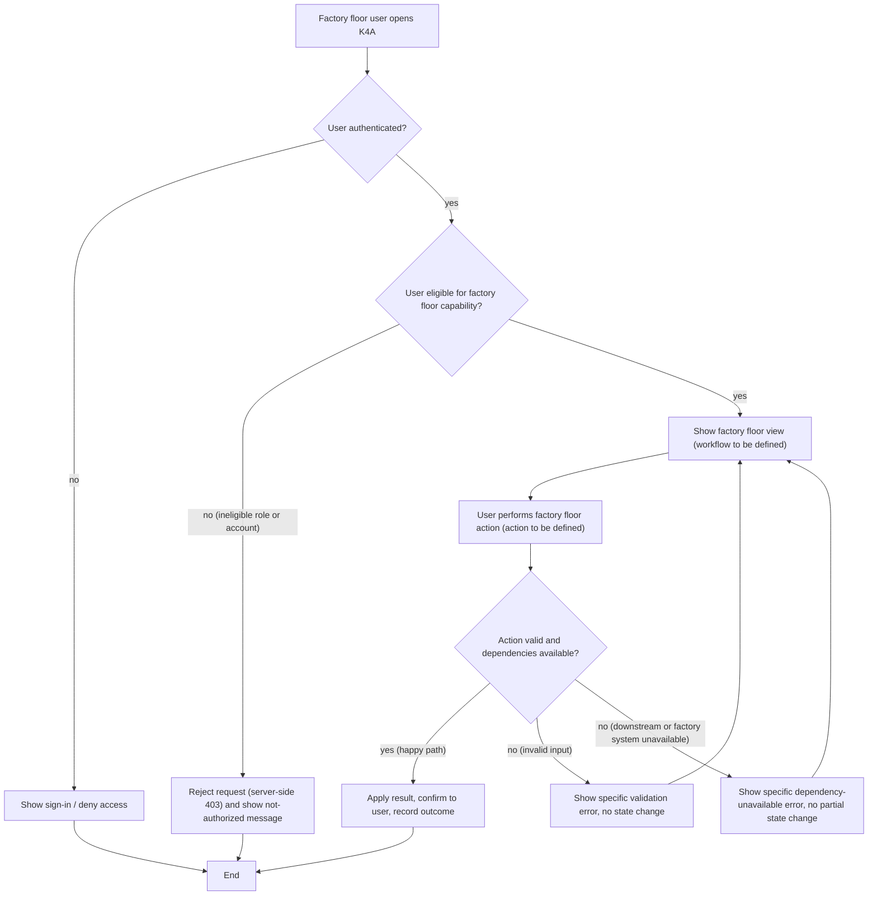

# Product Specification — K4A: Factory Floor Operations Support

## 1. Business Logic & Context

### Problem

K4A does not currently support factory floor operations. A request has been raised to extend K4A so that it can serve a factory floor use case. Beyond that single fact, the problem is undefined: the intake process established only that the use case is "factory floor" (requester: Mayank Ukey). The current product does not define what task, workflow, record, or pain point on the factory floor K4A is meant to address.

This specification is therefore written as a **discovery-gated spec**. It captures the structural requirements K4A must satisfy to support a factory floor use case, and it isolates — as explicit, human-owned decisions — every substantive product question that must be answered before the functional behavior can be built. The functional requirements below are deliberately framed so that an implementation agent can scaffold the capability, but the concrete factory-floor behavior cannot be finalized until the decisions in this document are resolved.

### Value

- Extend K4A into the factory floor domain, enabling factory floor users to perform their work within K4A rather than outside it.
- The specific measurable value (throughput, defect rate, response time, labor hours, or another metric) is **not yet defined**. The success metric is itself a decision the business must make. [DECISION REQUIRED: DEC-001]

### Business Rules

No business rules were supplied in the Context Seed. The behavior, records, workflows, and logic for the factory floor use case are all unspecified. The following rules are therefore structural placeholders that depend on the product decisions below:

- **BR-01 — Scope of supported workflows:** K4A supports the specific factory floor task(s) defined by the product owner. Until defined, no workflow behavior can be built. [DECISION REQUIRED: DEC-002]
- **BR-02 — User population:** Access to the factory floor capability is limited to the designated factory floor user population. The identity, role, and technical skill level of these users is undefined. [DECISION REQUIRED: DEC-003]
- **BR-03 — Source-of-truth records:** The records K4A captures, displays, or acts upon for the factory floor (for example production logs, equipment status, work orders, or quality metrics) are defined by the product owner. Until defined, no record handling can be built. [DECISION REQUIRED: DEC-004]
- **BR-04 — External system integration:** Where the factory floor use case requires data from existing factory systems (for example an ERP, MES, or IoT sensors), K4A integrates with those systems. Whether any such integration is in scope, and what real-time or latency expectation applies, is undefined. [DECISION REQUIRED: DEC-005]

### Service grounding note (codebase cross-check)

Two independent knowledge-graph lookups were reconciled for this requirement. The Context Seed's claimed affected services named a single service matched by the words "factory floor." An independent fresh lookup re-found that same name-matched service and additionally surfaced a second, similarly name-matched module. **Discrepancy to flag:** both lookups matched on the *name* "factory floor" rather than on evidence that the code performs the requested behavior — no endpoints, data stores, or symbols were surfaced for either. It is not confirmed that the named service is the correct or only codebase for this work, versus a scaffold or a shallow name match. Additionally, the risk rationale cites a "multi-service blast radius," yet the evidence identifies effectively one named target; this mismatch is unresolved. Confirming which codebase actually owns the factory floor capability is a prerequisite engineering discovery step. (Service names and their KG evidence are carried in a separate engineering-reference appendix at the end of this document.)

---

## 2. User Flows (Visuals)

Because the concrete workflow is undefined, the flow below models the *structural* journey of a factory floor user interacting with the factory floor capability in K4A: entry, eligibility gate, the (to-be-defined) factory floor action, and both a happy-path outcome and an error state. The specific action node is a placeholder pending the workflow decision.



---

## 3. Functional Requirements (The Core)

> **Discovery gate:** The factory floor *behavior* is unspecified in the Context Seed. The requirements below are written at the level the input actually supports: they establish access control, input validation, error handling, and the structural shape of the capability. Each requirement that depends on an undefined product decision names that dependency explicitly. Behavior-level Gherkin for the specific factory floor workflow cannot be authored until the decisions in this document are resolved; writing concrete workflow steps now would be inventing requirements the business has not stated.

### Feature Area A — Capability Entry & Access Control

Access control applies because the capability is scoped to a factory floor user population (BR-02), which is a role/account-based visibility difference.

**FR-001 — Authenticated entry to the factory floor capability**
```gherkin
Given a user who is not authenticated in K4A
When the user attempts to open the factory floor capability
Then K4A does not render the factory floor view
And the user is routed to sign-in or shown an access-denied response
```

**FR-002 — Server-side eligibility enforcement for the factory floor capability**
```gherkin
Given an authenticated user whose role or account is not eligible for the factory floor capability
When the user requests the factory floor view or invokes any factory floor action, whether through the UI or by a direct API call
Then K4A rejects the request server-side with a not-authorized response (typically 403)
And eligibility is re-derived from the authoritative source on that request rather than trusted from a client-supplied claim
And no factory floor data is returned in the response
```

**FR-003 — Eligible user sees the factory floor view**
```gherkin
Given an authenticated user whose role or account is eligible for the factory floor capability
When the user opens the factory floor capability
Then K4A renders the factory floor view for that user
```

> **Dependency:** The concrete eligibility rule — which roles or account types qualify as factory floor users — is undefined and must be supplied before FR-002 and FR-003 can be finalized (see BR-02). The structural enforcement (server-side, re-derived per request, fail-closed if auth is unreachable) holds regardless of the specific rule.

**FR-004 — Fail-closed on auth-source unavailability**
```gherkin
Given the authoritative source used to determine factory floor eligibility is unreachable
When an authenticated user requests the factory floor view or any factory floor action
Then K4A denies the request rather than granting access on an unverified assumption
And the user is shown a try-again-later message distinct from the not-authorized message
```

### Feature Area B — Factory Floor Workflow (Structure-Only, Pending Decision)

**FR-005 — Factory floor action is performed within the defined workflow**
```gherkin
Given an eligible factory floor user viewing the factory floor capability
And the factory floor workflow has been defined by the product owner
When the user performs the defined factory floor action with valid input
Then K4A applies the defined result
And K4A confirms the outcome to the user
```

> **Dependency:** The action, the records it reads or writes, and the result it produces are all undefined (see BR-01 and BR-03). This requirement is a structural placeholder: it cannot be implemented as concrete behavior until the workflow decision is resolved. An implementation agent should treat this FR as not-yet-buildable and block on the workflow decision rather than inferring a behavior.

**FR-006 — Invalid input is rejected without state change**
```gherkin
Given an eligible factory floor user performing a factory floor action
When the submitted input is malformed or fails validation for its field
Then K4A rejects the action with a field-specific validation message
And K4A makes no partial change to any factory floor record
```

> **Dependency:** The concrete fields and their validation rules depend on the record definition (BR-03). The structural guarantee — field-specific rejection, no partial write — holds regardless.

### Feature Area C — Dependency & Error Handling

This area applies conditionally: only if the resolved workflow requires calling an external factory system (BR-04). It is written now so the behavior is specified in advance rather than discovered late.

**FR-007 — Distinct, specific errors for distinct failure conditions**
```gherkin
Given a factory floor action that depends on an external or downstream system
When that dependency times out, is unavailable, or returns a rate-limit response
Then K4A shows a distinct user-facing message for each of those failure conditions
And K4A does not collapse timeout, unavailable, and rate-limited into one generic error
And K4A does not leave the factory floor record in a partial state
```

**FR-008 — Bounded retry with backoff on a transient dependency failure**
```gherkin
Given a factory floor action calls an external or downstream system
And that call fails transiently
When K4A retries the call
Then K4A retries a bounded number of times with exponential backoff rather than retrying indefinitely
And when the response is a rate-limit response carrying a Retry-After value, K4A honors that value rather than retrying on a fixed schedule
```

> **Engineering default (not a product decision):** retry bound of 3 attempts with exponential backoff; honor `Retry-After` on 429. These apply only if FR-007/FR-008 are in scope, which depends on whether external factory-system integration is required (BR-04).

> **Conditional applicability:** Feature Area C is required only if the resolved factory floor workflow integrates with an external factory system. Whether such integration is in scope is itself an open decision (see BR-04, tagged in Section 1). It is referenced here rather than re-tagged.

Now I'll report the decisions I tagged in Sections 0-3.

## 4. Information Requirements

The following are the business concepts K4A must track to support the factory floor capability. Because the concrete workflow is undefined, each item is scoped to what the structural requirements in Section 3 actually need; the specific records the factory floor workflow operates on remain a product decision (BR-03).

- **Factory floor user identity** — The authenticated identity (user and account) of the person using the capability. Source: System-Derived (from K4A's existing authentication). Matters because FR-001 through FR-004 gate the capability on who the user is.
- **Factory floor eligibility** — Whether a given user's role or account qualifies them for the factory floor capability. Source: System-Derived from the authoritative access-control source, re-derived per request (FR-002). Matters because it is the server-side gate for the entire capability. The concrete rule that defines eligibility is undefined (BR-02) and must be supplied before this can be populated.
- **Factory floor record(s)** — The operational record(s) the workflow captures, displays, or acts upon (for example production logs, equipment status, work orders, or quality metrics). Source: User-Entered and/or External API, depending on the resolved workflow. Matters because it is the subject of FR-005 and FR-006. The record set is undefined (BR-03) and is a prerequisite for implementing the workflow FRs.
- **Factory floor action outcome** — The result and confirmation produced when a user completes a factory floor action (FR-005), and the specific validation or dependency failure recorded when one does not (FR-006, FR-007). Source: System-Derived. Matters because the user must receive a verifiable outcome and failures must be distinguishable.
- **External factory system data** — Any data pulled from or pushed to an existing factory system (ERP, MES, IoT sensors). Source: External API. Matters only if the resolved workflow requires such integration (BR-04); it is conditional on that undefined decision.
- **Audit trail of factory floor actions** — A record of who performed which state-changing factory floor action, against which record, when, and with what outcome. Source: System-Derived. Matters because the capability is role-gated and (once defined) will perform state-changing operations a stakeholder may need to trace (see NFR-005).

> Because the records in BR-03 are undefined, the attribute-level content of these concepts cannot be specified here and belongs in a later phase once the workflow decision lands.

## 5. Non-Functional Requirements & Guardrails

### Access Control & Security

- **NFR-001 — Server-side access enforcement.** Factory floor eligibility is enforced on the server for every request. A direct API call from an ineligible role or account is rejected (typically 403) regardless of what the UI renders. UI-hiding alone is never the access control mechanism.
- **NFR-002 — Per-request eligibility re-derivation, fail-closed.** Eligibility is re-derived from the authoritative source on every request and never cached client-side or trusted from a client-supplied claim. If the authoritative auth source is unreachable, K4A fails closed and denies access (supports FR-004).
- **NFR-003 — No sensitive data in logs.** K4A never logs raw credentials, secrets, tokens, or user-identifying data. Where a secret or key must be shown for identification, it is masked to the last 4–8 characters only. Whether the factory floor records themselves contain a restricted data class (requiring separate storage or masking) depends on the undefined record set (BR-03) and must be revisited once records are defined. [DECISION REQUIRED: DEC-006]

### Error Handling & Dependencies

> Applies only if the resolved workflow integrates with an external factory system (BR-04, tagged in Section 1 — referenced, not re-tagged).

- **NFR-004 — Bounded, distinct dependency failure handling.** Calls to external or downstream factory systems use bounded retry with exponential backoff (engineering default: 3 attempts), honor a `Retry-After` value on a rate-limit response, and surface timeout, unavailable, and rate-limited as distinct named conditions each with its own user-facing message and recorded status (supports FR-007, FR-008). The failure posture is **graceful degradation** for read/display paths (show a safe reduced view that leaks nothing sensitive) and **fail-closed** for any eligibility or state-changing path (deny rather than proceed on unverified state). Which specific paths are reads versus state changes depends on the resolved workflow (BR-01).

### Audit & Traceability

- **NFR-005 — Audit logging of state-changing factory floor actions.** Once the workflow is defined, every create/update/delete/state-change factory floor action is recorded to an immutable, append-only audit trail capturing actor identity (user and account), resource identity (type, ID, name), action, timestamp, and outcome. The audit write is asynchronous so it never blocks the primary action, but an audit-write failure fires an immediate operational alert and never fails silently. Minimum retention is 12 months. [DECISION REQUIRED: DEC-007]

### Performance & Capacity

- **NFR-006 — Latency and monitoring targets.** A concrete latency target (stated as p95 with an explicit measurement method) cannot be set until the workflow and its data volumes are defined (BR-01, BR-03). The engineering default monitoring convention applies once a measurable path exists: alert when error rate exceeds 1% for 5 minutes sustained, or when resource utilization exceeds 80% for 5 minutes sustained. The specific numeric latency and throughput targets a factory floor user requires are a product/operational decision tied to the undefined success metric (see Section 1). This is the same undefined success-metric decision already flagged in Section 1 — referenced here, not re-tagged.
- **NFR-007 — Input validation and operational limits.** If the resolved workflow exposes an ingestion or query path that accepts externally submitted data, that path enforces field-level format/numeric validation with distinct rejection errors (not only valid-range checks), and read and write paths each carry their own separate rate limit rather than one shared value. The concrete limits depend on the undefined workflow and volumes (BR-01, BR-03) and are an engineering default to be set during planning.

### Risk Mitigation

Addressing each risk implied by the Context Seed's MEDIUM risk tier:

- **Undefined requirement (primary risk).** The requirement supplies no behavior, rules, or success criteria. **Mitigated when** the product decisions registered in this document (BR-01 through BR-04, the success metric, and the record set) are answered and the behavior-level FRs are authored. Until then, FR-005 is explicitly not-yet-buildable and an implementation agent must block rather than infer behavior.
- **Wrong or shallow codebase match (blast-radius mismatch).** The named service(s) were matched by name, not by evidence, and the "multi-service blast radius" rationale is not backed by the KG evidence. **Mitigated when** an engineering discovery step confirms which codebase actually owns the factory floor capability and whether it is existing code or a scaffold (see the service grounding note in Section 1).
- **Domain complexity on the factory floor.** Factory environments can carry regulatory, safety, or compliance constraints. **Mitigated when** it is confirmed whether any such constraints apply to this use case and, if so, what they require. [DECISION REQUIRED: DEC-008]

## 6. Out of Scope & Phasing

The Context Seed defines no features, so nothing is yet "in scope" at the behavior level beyond the structural capability shell. To prevent scope creep while the workflow is undefined, the following are explicitly **out of scope for Phase 1**:

| Item | Status | Rationale |
|------|--------|-----------|
| Concrete factory floor workflow behavior | Blocked, not out of scope | Depends on BR-01; cannot be built until the workflow decision lands. Tracked as the primary discovery gate, not deferred to a future phase. |
| External factory system integration (ERP, MES, IoT) | Out of scope for Phase 1 unless a decision brings it in | Depends on BR-04; no integration is confirmed in scope. |
| Real-time / streaming data from factory systems | Out of scope for Phase 1 | No real-time or latency requirement has been stated. |
| Specific record handling (production logs, equipment status, work orders, quality metrics) | Out of scope until defined | Depends on BR-03; the record set is undefined. |
| Success-metric instrumentation / reporting | Out of scope for Phase 1 | The success metric itself is undefined (Section 1). |
| Multi-service orchestration | Out of scope for Phase 1 | KG evidence identifies effectively one name-matched service; multi-service work is unsubstantiated. |

### Phasing

- **Phase 0 (prerequisite — discovery):** Resolve the product decisions in this document (workflow, user population, record set, integration need, success metric, compliance constraints) and confirm the owning codebase.
- **Phase 1 (structural capability):** Implement the access-control shell and error-handling structure (FR-001–FR-004, FR-006–FR-008) that hold regardless of the specific workflow.
- **Phase 2 (behavior):** Implement the concrete factory floor workflow (FR-005) once Phase 0 decisions land, including audit logging (NFR-005) and any confirmed integration (Feature Area C).

## Appendix: Engineering Reference

_The sections below are derived automatically from the codebase knowledge graph, for the engineering team's reference during planning — not required reading for product/requirement review._

### Affected Services (grounded context, not implementation direction)

- **kochava-factory-floor** (Context Seed, kind reported inconsistently as "unknown" and "backend") — role per KG: "Factory floor system for K4A spec support" / "Named 'factory floor' module in requirement." Matched by name against the requirement text; no endpoints, data stores, or symbols were surfaced.
- **factory-floor** (independent fresh KG lookup only, kind: backend) — role per KG: "Named 'factory floor' module in requirement." Surfaced by the fresh cross-check but not listed in the Context Seed's affected services; also a name-based match.

Both entries are name matches, not behavior-confirmed. Confirming which (if either) actually owns the factory floor capability — and reconciling the single-service evidence against the Context Seed's stated multi-service blast radius — is a prerequisite engineering discovery step (see Section 1 service grounding note).

---
## Open Questions & Decisions Register

_Durable, ID'd reference for HITL 2 (G1) and beyond — inline `[DECISION REQUIRED: DEC-00N]` tags in the sections above point back here. Reflects the latest round only._

### Decisions Required (business trade-offs — needs a human call)

_Each carries an **Owner** (accountable for supplying the answer) and a **Provisional Value** (the working assumption engineering may build against until the decision lands), so none of these fully block engineering — implementation proceeds on the provisional value and adjusts if the confirmed decision differs._

| ID | Decision | Owner | Provisional Value (build against until confirmed) |
|----|----------|-------|-----------------------------------------------------|
| **DEC-001** | What measurable outcome should this factory floor work improve, so we know whether it succeeded? | Product owner (Mayank Ukey) | Treat reduced time-on-task for the targeted factory floor workflow as the primary success metric, with a baseline captured from the current process before launch; replace once the real target metric is chosen. |
| **DEC-002** | What specific factory floor task or workflow should K4A support, and what is the step-by-step behavior a user goes through today versus what you want instead? | Product owner (Mayank Ukey) | Scope the first release to a single read-first workflow: let an eligible factory floor user view the status of in-progress work orders in K4A, deferring any create/edit action to a later phase until the primary task is confirmed. |
| **DEC-003** | Who are the factory floor users allowed to use this, and should access be limited by their job role, their account, or both? | Product owner (Mayank Ukey) | Limit access to users holding an explicit factory floor operator or supervisor role on an account that has the factory floor capability enabled, enforced server-side; refine the exact role list once the user population is confirmed. |
| **DEC-004** | What factory operations records should K4A show or act on, for example production logs, equipment status, work orders, or quality metrics? | Product owner (Mayank Ukey) | Start with work orders as the single record type the first release reads and displays, and add equipment status, production logs, and quality metrics in later phases once the primary record is validated. |
| **DEC-005** | Does K4A need to pull from or write back to existing factory systems such as an ERP, MES, or IoT sensors, and if so does the data need to be real-time or is periodic refresh acceptable? | Product owner (Mayank Ukey), with Engineering on feasibility | Assume a one-way, read-only pull from the existing factory system of record on a periodic refresh (near-real-time, not streaming) for the first release, with no write-back; revisit if the chosen workflow requires live data or updates back to the source. |
| **DEC-006** | Does this factory floor use case fall under any regulatory, safety, or compliance requirements we have to satisfy, and if so which ones? | Product owner + Compliance/Security | Assume standard internal compliance only (no factory-specific safety/regulatory regime) until the factory floor team confirms otherwise; revisit before any state-changing workflow ships. |
| **DEC-007** | Do the factory floor records this capability handles contain any restricted or sensitive data class that needs separate storage or masking? | Product owner + Compliance/Security | Assume records are operational (non-PII, non-restricted) and stored in K4A's general store; apply standard no-raw-secrets-in-logs masking. Re-evaluate once the record set (BR-03) is defined. |
| **DEC-008** | How long do we need to retain the audit trail of factory floor actions? | Product owner + Compliance/Security | 12 months minimum, matching Kochava's typical audit retention floor; extend only if a factory compliance cycle or data-sharing agreement requires longer. |

### Open Questions (evidence gaps — needs more input)

- **OQ-001**: What specific tasks or workflows on the factory floor should the product support, and what is the current process or pain point today?
- **OQ-002**: Who are the primary users on the factory floor, what is their technical skill level, and how often would they use it?
- **OQ-003**: What factory data or records (production logs, equipment status, work orders, quality metrics, etc.) must the product capture, display, or act on?
- **OQ-004**: Does the product need to integrate with existing factory systems (ERP, MES, IoT sensors), and if so which ones, with what real-time/latency expectations?
- **OQ-005**: What does success look like here — which measurable outcome should improve (throughput, defect rate, response time, labor hours)?
- **OQ-006**: Are there regulatory, safety, or compliance requirements in the factory environment that must be satisfied?
- **OQ-007**: Is a UI/frontend change in scope, or is this backend-only? The intake left UI impact marked 'unclear'.
- **OQ-008**: Can you confirm whether the factory-floor work is expected to live in the existing 'kochava-factory-floor' service, or is this a brand-new build — and is more than one service really in scope (the risk note says multi-service but only one was identified)?

---
> **Classification:** Type A
