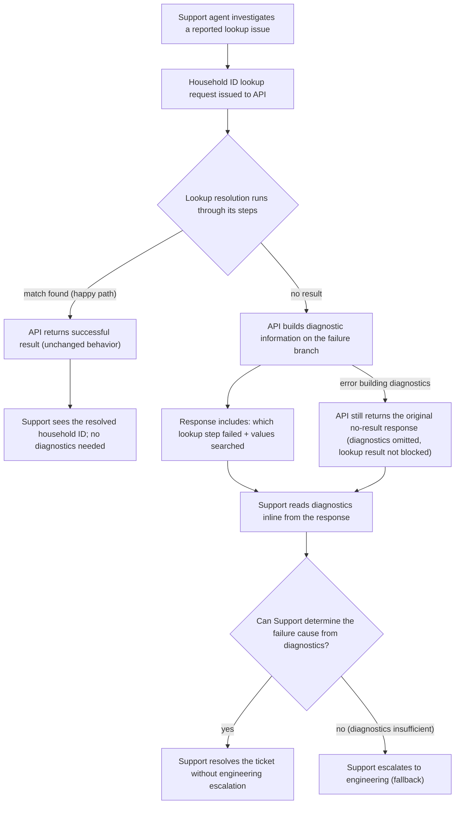

## 1. Business Logic & Context

### Problem

Support personnel cannot currently determine *why* a household ID lookup returned no results. When the `household-id-adornment-api` responds with an empty lookup, the response is opaque: Support sees only that nothing matched, with no visibility into which part of the resolution process failed or what values were actually searched. This forces slow, manual, escalation-heavy investigation for every "no results" ticket.

### Value

Enriching the API's "no result" response path with diagnostic information lets Support self-diagnose lookup failures directly from the response, reducing escalations to engineering and shortening the time to resolve customer-reported lookup issues. This is a purely internal diagnostic improvement — no customer-facing surface, no new data class, no auth/payments/compliance surface.

### Business Rules

- **BR-1 — Diagnostics are emitted only on the failure path.** Diagnostic information is attached to the response **only** when a household ID lookup returns no result. A successful lookup's response behavior is unchanged.
- **BR-2 — Additive, non-breaking change.** The enhancement adds information to the existing response. Existing consumers that do not read the new diagnostic information must continue to function exactly as before. The diagnostic content is supplemental, not a replacement of any current field.
- **BR-3 — Consumer audience is internal Support.** The diagnostic information exists to serve the Support function diagnosing failures, not end customers.
- **BR-4 — Specific diagnostic content is deferred to engineering, but must satisfy the Support use case.** The requester deferred the exact diagnostic fields to engineering. The product steer is that **Support needs to see the reason the lookup returned no result** — the minimum useful content is whatever conveys that reason. Whatever set is chosen, it must let Support determine (a) which lookup step/stage failed and (b) what values were searched — the two diagnostic categories the requester affirmed as useful and which together convey the failure reason. The requester did not call for match scores or any other diagnostic category.
- **BR-5 — Delivery channel for the diagnostics.** The diagnostic information is returned inline in the API response that reports the "no result" outcome, rather than via a separate debugging endpoint or an external dashboard/ticketing integration. This was confirmed by the requester: Support receives the diagnostics in the response itself. This keeps the change additive and single-service.

### Service Scope Note (KG cross-check)

The Context Seed names a single affected backend service that owns the lookup and must expose step/value diagnostics. An independent knowledge-graph cross-check re-confirmed that service and additionally surfaced its associated **proto/contract definition** (medium confidence) as a likely touch point, since adding a failure field or status to the response is a contract change. This spec treats the change as scoped to that one service and its response contract. If a proto/contract change is required, it must be additive and optional (see BR-2). No other services, datastores, or cross-service fan-out were surfaced by either analysis.

---

## 2. User Flows (Visuals)

The primary actor is a **Support agent** diagnosing a reported household ID lookup failure. The diagnostic enrichment is produced by the API on the "no result" branch and consumed by the agent from the response.



---

## 3. Functional Requirements

> Gherkin scenarios below. Where the exact diagnostic field set is engineering's call (see BR-4/BR-5 and the Decisions Register), the requirement specifies the **verifiable behavior and the minimum information categories** that must be present, not the concrete field names/types — those belong to downstream engineering phases.

### Feature Area A — Diagnostic Enrichment on Lookup Failure

**FR-001 — Diagnostics attached only on the no-result path**
```gherkin
Given a household ID lookup request is received
When the lookup resolution completes with no matching result
Then the API response includes diagnostic information describing the failure
And the diagnostic information identifies which lookup step/stage did not produce a result
And the diagnostic information includes the values that were searched during the lookup
```

**FR-002 — Successful lookups are unchanged**
```gherkin
Given a household ID lookup request is received
When the lookup resolution completes with a matching result
Then the API response contains the household ID result exactly as it did before this change
And no diagnostic failure information is attached to the response
```

**FR-003 — Which step failed is identifiable**
```gherkin
Given a household ID lookup has returned no result
And the lookup resolution proceeds through one or more discrete, nameable steps
When Support reads the response diagnostic information
Then Support can identify which specific step/stage of the resolution process failed to produce a match
```

**FR-004 — Searched values are reported**
```gherkin
Given a household ID lookup has returned no result
When Support reads the response diagnostic information
Then Support can see the input values that were used/searched during the lookup
So that Support can correlate the failure with the customer-reported input
```

**FR-005 — Support can determine the failure cause unaided**
```gherkin
Given a household ID lookup has returned no result
And the response contains the diagnostic information from FR-001
When a Support agent reviews the response
Then the agent can see the reason the lookup returned no result
And the agent can determine why the lookup returned nothing without escalating to engineering for the common failure cases
```

### Feature Area B — Additive, Non-Breaking Behavior

**FR-006 — Existing consumers unaffected**
```gherkin
Given an existing consumer of the household ID lookup response that does not read the new diagnostic information
When that consumer receives a no-result response carrying the new diagnostic information
Then the consumer continues to operate correctly using only the fields it previously consumed
And no previously-present field is removed, renamed, or changed in meaning
```

**FR-007 — Contract change, if any, is additive and optional**
```gherkin
Given the response contract is extended to carry diagnostic information
When the extended contract is published to consumers
Then the diagnostic information is represented as a new optional element on the response
And consumers built against the prior contract continue to deserialize responses without error
```

### Feature Area C — Diagnostic Generation Resilience

**FR-008 — Diagnostic generation never blocks the lookup outcome**
```gherkin
Given a household ID lookup has returned no result
When the API fails to build the diagnostic information for that failure
Then the API still returns the original no-result response
And the inability to produce diagnostics does not convert a no-result outcome into an error outcome
```

**FR-009 — Delivery is inline in the lookup response**
```gherkin
Given a household ID lookup has returned no result
When the API responds
Then the diagnostic information is delivered inline within that same lookup response
And no separate call to a distinct debugging endpoint is required to retrieve it
```

**FR-010 — Diagnostics provide both a human-readable summary and the raw lookup data**
```gherkin
Given a household ID lookup has returned no result
And the response carries the diagnostic information from FR-001
When a Support agent reads the diagnostic information
Then the diagnostic information includes a human-readable summary of the failure
And the diagnostic information includes the raw lookup data underlying that summary
So that Support can both quickly read what happened and inspect the underlying values
```

Now reporting the decisions I flagged in Sections 0–3.

## 4. Information Requirements

The system must track the following business information to support the Functional Requirements. The exact field names, types, and contract representation are deferred to engineering (see BR-4/BR-5); the items below are the business concepts, not schema.

- **Lookup outcome (match / no-result):** System-derived during lookup resolution. Determines whether diagnostic information is attached at all (FR-001, FR-002).
- **Failed lookup step/stage identifier:** System-derived from the resolution process. Identifies which discrete step of the household ID resolution did not produce a match. Required for FR-003. Depends on the lookup being genuinely multi-stage with nameable steps — if resolution is a single opaque match rather than discrete stages, this item must be reconsidered. [DECISION REQUIRED]
- **Searched input values:** Derived from the original lookup request's inputs (e.g. the address/name/identifier values the lookup used). Echoed back on the failure path so Support can correlate the failure with customer-reported input (FR-004). The product steer for this round is that Support needs to see the **reason** for the no-result outcome; the failed step/stage and the searched values together are what convey that reason — match scores or other categories were not called for.
- **Diagnostic representation (human-readable summary + raw lookup data):** The diagnostic information is carried in two forms — a human-readable summary of the failure and the raw lookup data underlying it — so Support can both quickly read what happened and inspect the underlying values (FR-010).
- **Diagnostic-generation outcome (produced / omitted):** System-derived. Captures whether diagnostics were successfully built or had to be omitted on the failure branch, so an omitted-diagnostics case is distinguishable from a lookup that genuinely had nothing to report (FR-008).
- **Response contract version / diagnostic presence flag:** System-derived. Supports the additive, optional nature of the diagnostic element so prior-contract consumers continue to deserialize (FR-006, FR-007).

---

## 5. Non-Functional Requirements & Guardrails

**NFR-001 — Backward compatibility (dedicated).** The change is additive-only. No existing response field may be removed, renamed, or have its meaning changed. Any contract/proto extension must be a new optional element so consumers built against the prior contract continue to deserialize responses without error. Because this change touches an existing response contract with existing consumers, backward compatibility is called out explicitly here rather than left implicit.

**NFR-002 — Diagnostic generation must not degrade the lookup path.** Building diagnostic information on the no-result branch must not add material latency to the lookup response and must not block or alter the lookup outcome. If diagnostic generation fails, the original no-result response is returned unchanged (per FR-008). Working default latency guardrail for engineering: the added diagnostic work introduces no more than a p95 +10ms overhead on the no-result path, measured under representative concurrent load; adjust during eng-plan once the diagnostic content is known.

**NFR-003 — Failure posture: graceful degradation.** On any internal error while assembling diagnostics, the API degrades gracefully — it returns the plain no-result response rather than failing the request. Availability of the core lookup outcome takes priority over diagnostic completeness; the degraded path must not leak partial or malformed diagnostic data.

**NFR-004 — Diagnostics scoped to internal Support consumption.** The diagnostic content exists for internal Support diagnosing failures (BR-3). It is returned inline in the lookup response (BR-5). This spec does not introduce a new external-facing surface, dashboard, or ticketing integration; any such consumption channel is out of scope (see Section 6).

**NFR-005 — No raw sensitive data in diagnostics or logs.** The "searched values" echoed into diagnostics may include customer-supplied identifiers or address fields. Even though this is a LOW-risk internal feature with no classified PII/auth surface, the diagnostic payload and any associated logging must not introduce raw credentials, secrets, or tokens, and must not broaden exposure of customer input beyond what the lookup request already handled. Whether any searched-value field warrants masking before it appears in the diagnostic response is a content decision tied to BR-4. [DECISION REQUIRED]

**NFR-006 — No feature flag / kill-switch required.** Per Kochava convention, kill-switches are reserved for HIGH-risk, multi-service, or sensitive-data changes. This is a LOW-risk, single-service, additive diagnostic change on an error-only branch; no feature flag or kill-switch is required. Standard deploy/rollback (revert the additive change) is sufficient.

### Risk Mitigation

The Context Seed carries a LOW risk tier and no itemized risk list. The residual risks surfaced during analysis and their mitigations:

- **Risk: Proto/contract change ripples to unknown consumers.** Mitigated by NFR-001 and FR-006/FR-007 — the extension must be additive and optional, and prior-contract consumers must continue to deserialize. Mitigation is satisfied when a consumer built against the old contract is verified to operate unchanged against a no-result response carrying diagnostics.
- **Risk: The lookup may not have discrete, nameable steps.** The "which step failed" requirement (FR-003) assumes a multi-stage resolution. Mitigated by confirming the actual resolution structure in engineering before committing to step-level reporting; if steps aren't discrete, the diagnostic content reverts to the "searched values" category alone until the structure is confirmed.
- **Risk: Diagnostic generation failure degrades the core lookup.** Mitigated by NFR-002/NFR-003 and FR-008 — diagnostics are non-blocking and degrade gracefully. Satisfied when a forced diagnostic-build failure still returns the original no-result response.
- **Risk: Over-broad diagnostic payload.** Mitigated by NFR-005 and BR-4 scoping — the diagnostic set is bounded to what Support needs (which step failed, what was searched), with sensitive-value handling flagged for a content decision.

---

## 6. Out of Scope & Phasing

The following are explicitly **NOT** part of this phase, to prevent scope creep:

| Item | Status | Rationale |
|------|--------|-----------|
| Diagnostics on the **successful** lookup path | Out of scope | Enhancement applies only to the no-result branch (BR-1, FR-002). |
| A separate debugging/diagnostics endpoint | Out of scope | Diagnostics are delivered inline in the existing response (BR-5, FR-009). |
| Integration into a Support dashboard or ticketing system | Out of scope | No UI/frontend work confirmed; diagnostics consumed from the API response. Candidate for a future phase. |
| Human-readable summary of the diagnostics | In scope | Support needs both a human-readable summary and the raw lookup data; the summary is required alongside the raw data (FR-010). |
| A *numeric* quantified success target (e.g. "resolve 90% of no-result cases unaided" or a specific resolution-time reduction) | Out of scope | Success is defined qualitatively as fewer Support escalations to engineering, with no numeric target set; a measurable number can be defined later once the feature is in use if needed. |
| Changes to the lookup/resolution logic itself | Out of scope | This feature reports on failures; it does not change how household IDs are resolved or matched. |
| New data stores, cross-service changes, or auth/PII handling | Out of scope | No evidence of such surfaces; change is single-service and additive. |

## Appendix: Engineering Reference

_The sections below are derived automatically from the codebase knowledge graph, for the engineering team's reference during planning — not required reading for product/requirement review._

### Affected Services (grounded context, not implementation direction)

- **household-id-adornment-api** (backend) — Owns the household ID lookup and reporting path; must expose the step/value diagnostics on the no-result branch. Primary site of this change.
- **household-id-adornment-proto** (backend, medium confidence) — The response contract/proto definition; likely needs a new optional failure field or status to carry the diagnostic information. Any change here must be additive and optional (NFR-001).

## Revision Summary

_Applied reviewer's request._

- Resolved BR-5: removed [DECISION REQUIRED] and folded in the confirmed inline-response delivery channel.


---
## Open Questions & Decisions Register

_Durable, ID'd reference for HITL 2 (G1) and beyond — inline `[DECISION REQUIRED: DEC-00N]` tags in the sections above point back here. Reflects the latest round only._

### Decisions Required (business trade-offs — needs a human call)

_Each carries an **Owner** (accountable for supplying the answer) and a **Provisional Value** (the working assumption engineering may build against until the decision lands), so none of these fully block engineering — implementation proceeds on the provisional value and adjusts if the confirmed decision differs._

| ID | Decision | Owner | Provisional Value (build against until confirmed) |
|----|----------|-------|-----------------------------------------------------|
| **DEC-001** | When a household ID lookup returns nothing, what information does Support actually need to see to diagnose it on their own? | Product owner (Mayank Ukey) with Support input | Return, at minimum, which lookup step/stage failed and the values that were searched — the two categories the requester affirmed as useful — in a form a Support agent can read without engineering help. |
| **DEC-003** | Should the diagnostic response mask or omit any of the customer-supplied searched values (such as address or identifier fields) before Support sees them, or is echoing the raw searched input acceptable for this internal use? | Product owner, with Compliance/Security input | Echo the searched input values as-is for this internal Support-only feature (no masking), since they are the same values the lookup request already handled and there is no new external surface; revisit only if a specific field is later classified as restricted. |
| **DEC-004** | Specific diagnostic content is deferred to engineering, but must satisfy the Support use case. The requester deferred the exact diagnostic fields to engineering. Whatever set is chosen, it must let Support determine (a) which lookup step/stage failed and (b) what values were searched — the two diagnostic categories the requester did affirm as useful. | _(not yet assigned)_ | _(not yet specified)_ |

### Decisions Resolved

- **DEC-002**: Resolved — diagnostics are delivered inline in the lookup response itself (not a separate debug endpoint or dashboard/ticketing tool); OQ-002 and DEC-002 settle together on the same answer.

### Open Questions (evidence gaps — needs more input)

- **OQ-001**: OQ-001 steered: Support just needs to see the reason the lookup returned no result; the failed step/stage plus searched values convey that reason, and match scores or other categories were not requested. The exact field set remains deferred to engineering.
- **OQ-004**: Are there privacy or data-retention limits on echoing customer identifiers, searched address/name values, or matching scores into a response Support can see?
- **OQ-005**: Who are the current consumers of the household-id-adornment response, and is adding a new optional failure field/status to the proto acceptable to all of them?

### Questions Resolved

- **OQ-002**: Resolved — diagnostics are delivered inline in the lookup response itself (not a separate debug endpoint or dashboard/ticketing tool); OQ-002 and DEC-002 settle together on the same answer.
- **OQ-003**: Resolved OQ-003 — Support users need both a human-readable summary and the raw lookup data; added FR-010 and an Information Requirements item, and moved the summary into scope in Section 6.
- **OQ-006**: Success is defined qualitatively as fewer escalations to engineering, with no numeric target.

---
> **Classification:** Type B — requirement-agent's independent re-check DISAGREES with intake's original Type A call. The behavior is actually clear (enrich the no-results lookup response with diagnostic details like which step failed and what values were searched—confirmed by the intake Q&A option and KG role "must expose step/value diagnostics"), and it spans two services (household-id-adornment-api + household-id-adornment-proto proto/schema change), making this engineering-led design rather than genuine product discovery.
