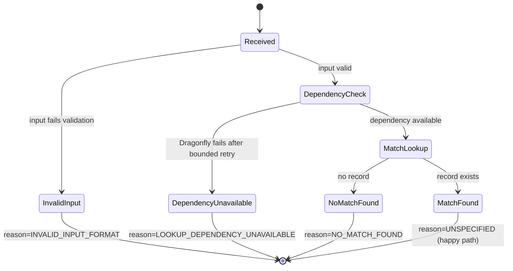

# Data Model: K4A — Enhanced Error Reporting for Household ID Adornment Lookups

**Feature**: K4A / Enhanced No-Results Diagnostics
**Date**: 2026-11-26
**Source**: [product-spec.md](./product-spec.md)

## Overview

There is **no persistent-store change** for K4A. The only outbound datastore is Dragonfly (Redis-protocol KV), and the diagnostic reason is computed from control flow at request time — never stored or read back (investigation-verified: api repo CA-P1, avro-dragonfly-loader CA-1–CA-3). The "data model" here is therefore the **wire contract (proto) schema only**: a net-new enumerated reason concept added to the existing `KeyedHousehold` message.

---

## Entities

### NoResultReason (new proto enum)

**Purpose**: The distinct, named reason classifying why an empty lookup result occurred. This is the repo's first enum (`NumEnums` 0→1, investigation-verified proto CA-5).

**Values**:

| Value | Ordinal | Required | Description | Validation |
|-------|---------|----------|-------------|------------|
| NO_RESULT_REASON_UNSPECIFIED | 0 | Yes | Default/unset; carried by happy-path and legacy responses | Proto3 zero-value; doubles as backward-compat signal (BR-5/FR-010) |
| NO_MATCH_FOUND | 1 | No | Well-formed valid input, dependency available, no matching record (`redis.Nil`) | Definitive; FR-002 |
| LOOKUP_DEPENDENCY_UNAVAILABLE | 2 | No | Dragonfly failed/timed out after bounded retry | Transient, not a definitive no-match; FR-004 |
| INVALID_INPUT_FORMAT | 3 | No | Input malformed / fails format validation | Must not echo offending value; FR-003/FR-007 |

**Business rules**: Exactly one of the three non-zero values is set on any empty result (FR-005/NFR-010); never collapsed to a generic indication. No reason value or any companion message may contain raw customer-identifying data (BR-4/FR-007/NFR-004).

---

### KeyedHousehold (existing message — modified, additive)

**Purpose**: The per-key lookup result returned by both `GetHousehold` and `GetHouseholds`. Gains a reason field; all existing fields unchanged.

**Fields**:

| Field | Tag | Type | Required | Description | Validation |
|-------|-----|------|----------|-------------|------------|
| household | 1 | Household | No | The matched household (empty on no-result) | Existing, unchanged |
| device_id | 2 | DeviceId | No | The device id (one of device_id/ip populated) | Existing, unchanged |
| ip | 3 | IP | No | The ip address | Existing, unchanged |
| reason | 4 | NoResultReason | No | **NEW** — the distinct reason when the result is empty | Tag 4 confirmed free (investigation proto CA-2); additive/backward-compatible |

**Relationships**:
- `reason` classifies the empty state of this `KeyedHousehold` instance.

---

### GetHouseholdsResponse (existing envelope — conditionally modified)

**Purpose**: Batch response wrapping a list of `KeyedHousehold`. May gain an envelope-level reason for request-wide failures (e.g. dependency-unavailable applying to the whole batch).

**Fields**:

| Field | Tag | Type | Required | Description | Validation |
|-------|-----|------|----------|-------------|------------|
| keyed_households | 1 | repeated KeyedHousehold | No | Existing result list | Existing, unchanged |
| reason | 2 | NoResultReason | No | **NEW (conditional)** — request-wide reason; tag 2 confirmed free | Added only if batch-granularity decision requires it (investigation proto CA-3) |

---

## State Transitions

### Lookup outcome (per request)



---

## Validation Rules

### Business Rules

| Rule ID | Entity | Rule | Error Message (category only — no PII) |
|---------|--------|------|-----------------------------------------|
| BR-1 | KeyedHousehold | Every empty result carries exactly one non-zero reason | n/a (field-level) |
| BR-3 | NoResultReason | Reason must be actionable; "no match found" accounts for TTL expiry / not-recently-seen, not only "never existed" (avro-dragonfly-loader CA-3: 8-day row TTL) | "No matching household record" |
| BR-4 | NoResultReason | Reason/message describes category only; never echoes query values | "Invalid input format" (never the offending value) |
| FR-005 | KeyedHousehold | Never substitute a single generic empty/error indication | n/a |

### Data Constraints

| Constraint | Entity.Field | Type | Value |
|------------|--------------|------|-------|
| Backward-compat | KeyedHousehold.reason | proto3 field | Tag 4, unset = UNSPECIFIED; old clients ignore |
| Privacy | NoResultReason (+ any companion message) | enum (+ optional string) | Enum-only preferred — cannot carry PII by construction |

---

## Migration Notes

**No SQL / persistent-store migration applies.** The Dragonfly KV schema is untouched (investigation-verified). The only schema change is the proto wire contract, delivered as a `semantic-release` minor version (v1.0.3 → v1.1.0) and consumed by the api repo after regen.

---

## Go Struct Definitions

```go
// NoResultReason classifies why an empty lookup result occurred.
// Generated from the proto enum — never hand-edited.
type NoResultReason int32

const (
    NoResultReason_NO_RESULT_REASON_UNSPECIFIED  NoResultReason = 0
    NoResultReason_NO_MATCH_FOUND                NoResultReason = 1
    NoResultReason_LOOKUP_DEPENDENCY_UNAVAILABLE NoResultReason = 2
    NoResultReason_INVALID_INPUT_FORMAT          NoResultReason = 3
)

// KeyedHousehold gains a generated Reason field (tag 4) + GetReason() getter.
// Service-side population lives in internal/householdserver/household.go.
```

---

## References

- [product-spec.md](./product-spec.md)
- [eng-research.md](./eng-research.md)
- Investigation findings: `household-id-adornment-proto` (CA-2/CA-3/CA-5), `household-id-adornment-api` (CA-P1/CA-P3), `avro-dragonfly-loader` (CA-3 TTL semantics)