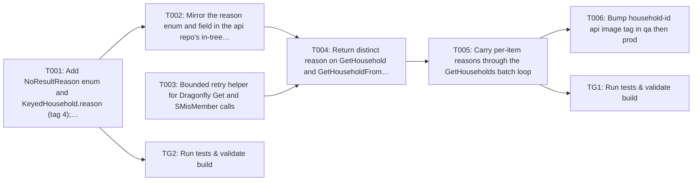

Approving locks the requirements and your decisions. Tasks are a guide; code questions go to the coding agent.

> Plan of record, not execution order: the coding agent works one repo at a time from the requirements and the approved decisions, and links its PR on the repo epic.

---
id: implementation-task-matrix
title: Implementation Task Matrix
---

## Implementation Task Matrix — wi_0dbb892fb474bfe2caaa

**Matrix ID:** `wi_0dbb892fb474bfe2caaa-r1` · **Generated:** 2026-11-26T11:46:24.749043+00:00 · **Source:** `tasks` · **Verdict:** **READY with 1 warnings**

### Summary

| Metric | Value |
| :--- | :--- |
| Tasks total | 8 |
| AI-allocated | 7 |
| Manual-allocated | 1 |
| Waves | 5 |
| Conflicts | 0 |
| Requirements uncovered | 0 |
| Low-confidence allocations (<0.6) | 0 |

### Wave 0

| Task | Title | Repo | Owner | Allocation | Confidence | Status |
| :--- | :--- | :--- | :--- | :--- | :--- | :--- |
| T001 | Add NoResultReason enum and KeyedHousehold.reason (tag 4); regenerate Go and Py… | Kochava/household-id-adornment-proto | coding-agent | ai | 0.70 | planned |
| T003 | Bounded retry helper for Dragonfly Get and SMisMember calls | Kochava/household-id-adornment-api | coding-agent | ai | 0.80 | planned |

### Wave 1

| Task | Title | Repo | Owner | Allocation | Confidence | Status |
| :--- | :--- | :--- | :--- | :--- | :--- | :--- |
| T002 | Mirror the reason enum and field in the api repo's in-tree proto and regenerate… | Kochava/household-id-adornment-api | coding-agent | ai | 0.80 | planned |
| TG2 | Run tests & validate build | Kochava/household-id-adornment-proto | test-change-gate | ai | 0.90 | planned |

### Wave 2

| Task | Title | Repo | Owner | Allocation | Confidence | Status |
| :--- | :--- | :--- | :--- | :--- | :--- | :--- |
| T004 | Return distinct reason on GetHousehold and GetHouseholdFromIP empty results (no… | Kochava/household-id-adornment-api | coding-agent | ai | 0.80 | planned |

### Wave 3

| Task | Title | Repo | Owner | Allocation | Confidence | Status |
| :--- | :--- | :--- | :--- | :--- | :--- | :--- |
| T005 | Carry per-item reasons through the GetHouseholds batch loop | Kochava/household-id-adornment-api | coding-agent | ai | 0.80 | planned |

### Wave 4

| Task | Title | Repo | Owner | Allocation | Confidence | Status |
| :--- | :--- | :--- | :--- | :--- | :--- | :--- |
| T006 | Bump household-id api image tag in qa then prod | Kochava/ko-k8s-apps | manual-developer | manual | 0.90 | planned |
| TG1 | Run tests & validate build | Kochava/household-id-adornment-api | test-change-gate | ai | 0.90 | planned |

### Dependency Graph

### Open Questions

None.

### Warnings

- T001: task too large (7 files (max 5)); consider splitting

---
> Generated by: taskmatrix 0.1.0
