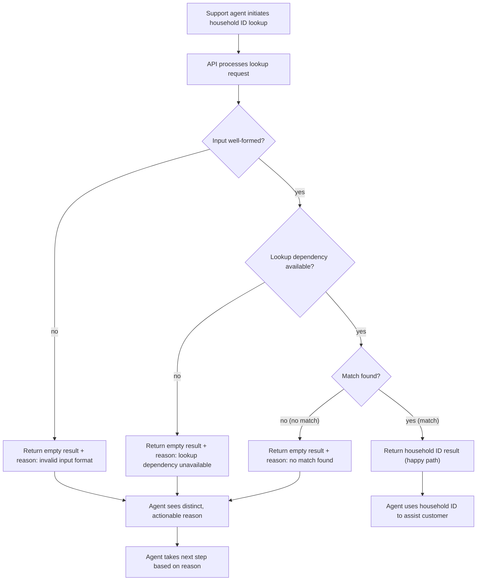

# Product Specification — K4A: Enhanced Error Reporting for Household ID Adornment Lookups

## 1. Business Logic & Context

### Problem

When a household ID lookup returns no results, the current `household-id-adornment-api` does not explain *why*. Support agents investigating a failed lookup have no actionable diagnostic information, which slows customer support resolution — agents cannot distinguish a genuine no-match from a transient service problem from a malformed input, so they cannot tell the customer anything useful or take the right next step.

### Value

Enhancing the API's no-results response with clear, structured, actionable diagnostic information lets support agents understand the cause of a failed lookup immediately. This reduces investigation time, shortens customer support resolution cycles, and reduces escalations to engineering for routine lookup failures.

### Business Rules

- **BR-1 — Enhanced response on empty result:** Whenever a household ID lookup yields no results, the API response must include diagnostic information explaining the reason for the empty result, in addition to the existing empty-result indication.
- **BR-2 — Distinguish failure causes:** A "no results" outcome has multiple distinct underlying causes that must not be collapsed into a single generic response. At minimum the system must distinguish: (a) a genuine *no match found* for well-formed, valid input; (b) a *downstream/lookup dependency unavailable* condition; and (c) an *invalid input format* condition. Each cause must carry its own distinct, named reason so support agents can tell them apart. [DECISION REQUIRED]
- **BR-3 — Actionability:** The diagnostic information must be actionable by a support agent — it must explain the cause in terms an agent can act on, not merely restate that the result was empty.
- **BR-4 — Privacy boundary:** Diagnostic detail about a household/customer lookup must not expose, log, or hint at raw customer-identifying data. Reason information must describe the *category* of failure, not echo back customer data contained in the query. [DECISION REQUIRED]
- **BR-5 — Backward compatibility:** The enhancement extends the existing lookup response consumed by existing callers. Existing callers that do not read the new diagnostic information must continue to function unchanged; the enhancement is additive to the existing response contract.

### Discovery Note — Undefined Diagnostic Content

The exact diagnostic content support agents need was not defined at intake ("Unknown, for engineering to confirm"). This specification defines the *structure and behavior* of enhanced error reporting (distinct, named reasons per failure cause; actionable, privacy-safe content) and flags the content-definition and consumption-surface choices as decisions requiring a human owner. The requirements below are written against the behavioral contract, not against a specific pre-decided payload.

### KG Cross-Check Note

An independent codebase knowledge-graph cross-check reconciled against the originally identified services. The core backend lookup service and its proto/contract surface are confirmed as the affected area. A possible front-end display surface for support agents was identified only at **low confidence** and could not be confirmed as the surface agents actually use to view lookup results. Whether support agents consume the diagnostic information through a front-end display, a raw API response, a support tool, or logs is therefore unconfirmed and is flagged as a decision below. [DECISION REQUIRED]

---

## 2. User Flows (Visuals)



---

## 3. Functional Requirements (The Core)

### Feature Area A — Enhanced No-Results Diagnostics

#### FR-001 — Successful lookup returns household ID (happy path, unchanged)

```gherkin
Given a support agent submits a well-formed household ID lookup request
  And the lookup dependency is available
  And a matching household record exists
When the API processes the lookup
Then the API returns the matching household ID result
  And the existing successful-response behavior is unchanged
```

#### FR-002 — No match found returns a distinct, named reason

```gherkin
Given a support agent submits a well-formed, valid household ID lookup request
  And the lookup dependency is available
  And no matching household record exists
When the API processes the lookup
Then the API returns an empty result
  And the response includes a diagnostic reason identifying the outcome as "no match found"
  And the reason is distinct from the reasons used for dependency-unavailable and invalid-input conditions
  And the reason contains no raw customer-identifying data from the query
```

#### FR-003 — Invalid input format returns a distinct, named reason

```gherkin
Given a support agent submits a household ID lookup request whose input is malformed or fails input-format validation
When the API processes the lookup
Then the API returns an empty result
  And the response includes a diagnostic reason identifying the outcome as "invalid input format"
  And the reason is distinct from the reasons used for no-match-found and dependency-unavailable conditions
  And the reason describes the input-format problem without echoing raw customer-identifying data
```

#### FR-004 — Lookup dependency unavailable returns a distinct, named reason

```gherkin
Given a support agent submits a well-formed household ID lookup request
  And the lookup dependency is unavailable or fails to respond within its bounded retry attempts
When the API processes the lookup
Then the API returns an empty result
  And the response includes a diagnostic reason identifying the outcome as "lookup dependency unavailable"
  And the reason is distinct from the reasons used for no-match-found and invalid-input conditions
  And the response indicates the condition is transient rather than a definitive no-match
```

#### FR-005 — Failure causes are never collapsed into a single generic reason

```gherkin
Given any household ID lookup that yields an empty result
When the API constructs the no-results response
Then the response carries exactly one of the distinct named reasons (no match found, invalid input format, or lookup dependency unavailable)
  And the response never substitutes a single generic empty/error indication that hides which of these causes applied
```

#### FR-006 — Diagnostic reason is actionable for the support agent

```gherkin
Given a household ID lookup returns an empty result with a diagnostic reason
When a support agent reads the response
Then the reason explains the cause of the empty result in terms the agent can act on
  And the reason enables the agent to determine an appropriate next step for the given cause
```

### Feature Area B — Privacy & Safety of Diagnostic Content

#### FR-007 — Diagnostic content excludes raw customer data

```gherkin
Given any household ID lookup that returns an empty result with a diagnostic reason
When the diagnostic reason is generated
Then the reason describes the category of failure rather than the customer-identifying values submitted in the query
  And no raw customer-identifying data is included in the returned diagnostic content
```

#### FR-008 — No raw customer data or query identifiers are logged in the clear

```gherkin
Given the API records diagnostic information about a no-results lookup for operational purposes
When a diagnostic log or telemetry entry is written
Then no raw customer-identifying data from the query is written in the clear
  And any identifier needed for troubleshooting is recorded in a privacy-safe (non-identifying or masked) form
```

### Feature Area C — Bounded Downstream Error Handling

#### FR-009 — Dependency calls use bounded retry before reporting unavailable

```gherkin
Given a household ID lookup requires a call to a downstream lookup dependency
  And that dependency fails or times out
When the API attempts the dependency call
Then the API retries using bounded retry with exponential backoff (default: up to 3 attempts), never retrying indefinitely
  And if a rate-limit response is received, the API honors the response's Retry-After indication rather than retrying on a fixed schedule
  And only after the bounded attempts are exhausted does the API return the "lookup dependency unavailable" reason per FR-004
```

### Feature Area D — Backward Compatibility

#### FR-010 — Enhancement is additive to the existing response contract

```gherkin
Given an existing caller that consumes the current household ID lookup response and does not read the new diagnostic information
When the enhanced API returns a response (success or empty result)
Then the existing caller continues to function unchanged
  And the existing empty-result indication remains present alongside the new diagnostic information
  And no existing field of the response contract is repurposed or removed
```

Now reporting the decisions I flagged in Sections 0–3.

## 4. Information Requirements

The system must track the following business information to support the Functional Requirements above:

- **Lookup Request Input** — The household ID lookup parameters submitted by the support agent. Source: User-Entered (via support agent). Matters because it is the subject of input-format validation (FR-003) and the trigger for every lookup outcome. Must be treated as potentially customer-identifying and handled per the privacy boundary (FR-007, FR-008).
- **Lookup Outcome** — The resolved result of a lookup: match found, or empty result. Source: System-Derived. Matters because it drives whether the happy-path response (FR-001) or an enhanced no-results response (FR-002–FR-005) is returned.
- **Failure Reason / Cause Category** — The distinct, named reason classifying why an empty result occurred (no match found, invalid input format, lookup dependency unavailable). Source: System-Derived. Matters because it is the core of the enhancement — it must be distinct per cause (FR-005) and actionable for the agent (FR-006). The full enumerated set of reason categories beyond the three minimum causes is a product decision (see the reason-set decision raised in Section 1). [DECISION REQUIRED]
- **Dependency Call Status** — The availability and response status of the downstream lookup dependency, including retry attempts consumed and any rate-limit response received. Source: System-Derived (with External API signal from the dependency). Matters because it determines the "lookup dependency unavailable" reason (FR-004) and governs bounded-retry behavior (FR-009).
- **Agent-Facing Next Step / Suggested Action** — Whether the diagnostic response carries a recommended next step for the agent in addition to the reason. Source: System-Derived. Matters because actionability (FR-006) may require more than a bare reason; whether the response includes explicit suggested next steps versus only the reason is a product decision. [DECISION REQUIRED]
- **Diagnostic Telemetry Record** — The privacy-safe operational record of a no-results lookup written for troubleshooting. Source: System-Derived. Matters because it supports operational investigation while enforcing the no-raw-PII logging rule (FR-008).
- **Consumption Surface** — The surface through which support agents actually read the diagnostic information (raw API response, support tool, front-end display, or logs). Source: System-Derived / External context. Matters because it determines whether any display/parsing work is in scope and whether the content must be customer-friendly or agent-internal; this surface is unconfirmed (see the consumption-surface decision raised in Section 1).

---

## 5. Non-Functional Requirements & Guardrails

### Performance

- **NFR-001 — No added latency on the success path.** Enhanced diagnostic reporting applies only to the no-results path and must not measurably degrade successful-lookup latency. Target: the happy-path response latency (FR-001) remains within its current p95, measured under representative concurrent load. The current baseline p95 target is not supplied in the input. [DECISION REQUIRED]
- **NFR-002 — Bounded dependency wait.** When the lookup dependency is slow or failing, the API must return the "lookup dependency unavailable" reason within the time bounded by the retry policy in FR-009 (up to 3 attempts with exponential backoff), rather than blocking indefinitely.
- **NFR-003 — Dependency health alerting.** The system must alert when the downstream lookup dependency's error rate exceeds 1% for 5 minutes, sustained, so operations can distinguish a dependency outage from a rise in genuine no-match results.

### Security & Privacy

- **NFR-004 — No raw PII in responses.** Diagnostic reason content returned to callers must never include raw customer-identifying data, credentials, or query values; it describes the category of failure only (enforces FR-007).
- **NFR-005 — No raw PII in logs or telemetry.** No raw customer-identifying data from the query is written in the clear to any diagnostic log, trace, or telemetry sink; any identifier needed for troubleshooting is recorded in a non-identifying or masked form (enforces FR-008).
- **NFR-006 — Access control preserved.** The enhancement must not widen who can call the lookup API or read its responses. Any role/account-based access controls that gate the existing lookup API must continue to apply unchanged to the enhanced response, enforced server-side; a direct call from an ineligible caller is rejected regardless of what any display surface shows.

### Backward Compatibility

- **NFR-007 — Additive contract only.** The enhancement is additive to the existing lookup response contract (enforces FR-010). No existing field is removed or repurposed. If the diagnostic information is carried in a structured contract (e.g. the proto contract), new fields must be added in a backward-compatible way so that existing consumers of the contract continue to deserialize and function without change. Whether the diagnostic information is a single enriched free-text field or a structured reason code plus message is an engineering shape decision to be made in eng-plan, consistent with the reason-set product decision raised in Section 4.

### Risk Mitigation

The Context Seed flags this work at **MEDIUM** risk, driven by multi-service blast radius and undefined support requirements. Each risk and its mitigation condition:

- **NFR-008 — Risk: Response shape designed before agent needs are known.** Mitigated when the diagnostic-content decision (what agents need) and the consumption-surface decision (where agents read it) have named human owners and resolved answers before the response shape is finalized. Until then, requirements are written against the behavioral contract (distinct named reasons, actionable, privacy-safe), not a fixed payload. See the content and surface decisions raised in Sections 1 and 4.
- **NFR-009 — Risk: Proto/contract change ripples to unknown consumers.** The full consumer list of the household-id-adornment-proto contract is not enumerated in available evidence. Mitigated when the complete set of contract consumers is enumerated and each is confirmed unaffected by the additive change (per NFR-007) before rollout.
- **NFR-010 — Risk: Collapsing distinct failure causes.** Mitigated by FR-005 — the no-results response must always carry exactly one distinct named reason and must never fall back to a single generic indication that hides the cause.
- **NFR-011 — Risk: Privacy leakage via diagnostic detail.** Mitigated when NFR-004 and NFR-005 are verified: no returned reason or logged telemetry contains raw customer-identifying data. A deliberate privacy review of the diagnostic content is a release gate.
- **NFR-012 — Risk: Undefined front-end involvement.** The front-end display surface (frontend-mos) was identified only at low confidence. Mitigated when the consumption-surface decision resolves whether any front-end work is in scope; until resolved, front-end display work is out of scope for Phase 1 (see Section 6).

---

## 6. Out of Scope & Phasing

### Explicitly Out of Scope for Phase 1

| Item | Rationale |
|------|-----------|
| Front-end display / parsing of diagnostic information in frontend-mos or any support tool | The consumption surface is unconfirmed (low-confidence KG link). Phase 1 delivers the backend API/contract behavior; any display work is gated on the consumption-surface decision. |
| Customer-friendly rewording of reasons for end-customer-facing display | Phase 1 targets support-agent-facing diagnostics. Whether reasons must be customer-safe depends on the unresolved consumption-surface decision. |
| Explicit suggested next-steps / remediation guidance embedded in the response (e.g. "try searching by phone number instead") | Beyond the minimum actionable-reason contract (FR-006); inclusion of prescriptive next steps is an unresolved product decision raised in Section 4. |
| Changes to the underlying lookup/matching logic itself | The requirement targets error reporting and diagnostics on the no-results path, not how matches are computed. |
| Expanding the reason taxonomy beyond the three minimum named causes | The minimum distinct causes are fixed (no match / invalid input / dependency unavailable); any richer taxonomy depends on the reason-set decision raised in Section 4. |
| Historical reporting, dashboards, or analytics on lookup-failure frequency | Not part of the per-request diagnostic enhancement; no such requirement in the Context Seed. |

### Phasing

- **Phase 1 (this spec):** Backend enhancement to the `household-id-adornment-api` no-results path — distinct, named, actionable, privacy-safe diagnostic reasons; bounded downstream error handling; additive, backward-compatible contract change.
- **Future Phases (gated on decisions):** Front-end display of diagnostics, customer-facing reason wording, prescriptive next-step guidance, and any expanded reason taxonomy — each contingent on the respective product decision resolving.

---

## Appendix: Engineering Reference

_The sections below are derived automatically from the codebase knowledge graph, for the engineering team's reference during planning — not required reading for product/requirement review._

### Affected Services (grounded context, not implementation direction)

- **household-id-adornment-api** (backend) — Owns the household ID lookup API and error reporting; the primary service changed by this requirement.
- **household-id-adornment-proto** (backend / contract) — Proto contract for the household-id adornment API; the surface where any structured diagnostic fields land first, and a backward-compatibility surface for all contract consumers.
- **frontend-mos** (frontend) — May display household ID lookup results to support agents; identified at **low confidence** and not confirmed as the surface agents use. In scope only if the consumption-surface decision confirms it.

---
## Open Questions & Decisions Register

_Durable, ID'd reference for HITL 2 (G1) and beyond — inline `[DECISION REQUIRED: DEC-00N]` tags in the sections above point back here. Reflects the latest round only._

### Decisions Required (business trade-offs — needs a human call)

_Each carries an **Owner** (accountable for supplying the answer) and a **Provisional Value** (the working assumption engineering may build against until the decision lands), so none of these fully block engineering — implementation proceeds on the provisional value and adjusts if the confirmed decision differs._

| ID | Decision | Owner | Provisional Value (build against until confirmed) |
|----|----------|-------|-----------------------------------------------------|
| **DEC-001** | When a household ID lookup returns nothing, should support agents see the specific reason it failed — such as no match found versus the lookup service being temporarily down versus a badly formatted input — as separate distinct reasons, and are those three the right set of causes to distinguish for them? | Product owner (Mayank Ukey, K4A) | Return three distinct named reasons: 'no match found', 'lookup dependency unavailable', and 'invalid input format'. Each carries its own actionable message for the agent. |
| **DEC-002** | How much detail about why a lookup failed is safe to show support agents, given the reason relates to a household or customer lookup — should it stay a plain category explanation only, or may it include more specific diagnostic detail that could hint at customer data? | Compliance/Security with Product owner (K4A) | Diagnostic content describes only the category of failure (e.g. 'no match found') and never echoes or hints at the customer-identifying values submitted in the query. |
| **DEC-003** | Where do support agents actually view the result of a household ID lookup today — through a support-facing screen, a raw API response, a support tool, or logs — so we know whether this work needs any screen changes or is purely an API change? | Product owner (Mayank Ukey, K4A) | Treat this as a backend/API-only change delivering structured diagnostic reasons in the response; assume no front-end display work until the agents' consumption surface is confirmed. |
| **DEC-004** | When a household ID lookup finds no match, should agents also get a suggested next step to try (like searching by phone number), or just the reason it failed? | Product owner (Mayank Ukey) with Support operations | Phase 1 returns the reason only; prescriptive next-step suggestions are out of scope until support operations confirm which next steps are actually useful per cause. |
| **DEC-006** | Distinguish failure causes: A "no results" outcome has multiple distinct underlying causes that must not be collapsed into a single generic response. At minimum the system must distinguish: (a) a genuine no match found for well-formed, valid input; (b) a downstream/lookup dependency unavailable condition; and (c) an invalid input format condition. Each cause must carry its own distinct, named reason so support agents can tell them apart. | _(not yet assigned)_ | _(not yet specified)_ |
| **DEC-007** | Privacy boundary: Diagnostic detail about a household/customer lookup must not expose, log, or hint at raw customer-identifying data. Reason information must describe the category of failure, not echo back customer data contained in the query. | _(not yet assigned)_ | _(not yet specified)_ |

### Decisions Resolved

- **DEC-005**: Engineering decides: Hold the current production p95 for the success path as the baseline (no measurable regression), measured under representative concurrent load; confirm the actual baseline number from existing monitoring.

### Open Questions (evidence gaps — needs more input)

- **OQ-001**: What are the top 3-5 reasons a household ID lookup returns no results in production today, and roughly how often does each happen? This drives what diagnostics are even worth building.
- **OQ-002**: Should the API distinguish between different failure causes (genuine no-match vs. lookup service unavailable vs. invalid input format) with different responses, or is a single enhanced error response enough?
- **OQ-003**: Do support agents need internal diagnostic detail (which data sources were queried, which filters applied) or only customer-friendly explanations of why nothing matched?
- **OQ-004**: Should the error response include suggested next steps for the agent (e.g. 'try searching by phone number'), or just the reason the lookup failed?
- **OQ-005**: Where do support agents actually consume this information — raw API response, a support tool, or a frontend UI (frontend-mos)? This determines whether any frontend work is in scope at all.
- **OQ-006**: Are there privacy or compliance limits on what diagnostic detail we can expose in an error response, given the lookup concerns households/customers and the payload could hint at customer data?
- **OQ-007**: Is it acceptable to change the response contract by adding structured error/reason fields (which ripples to all proto consumers), or must the improvement stay within the existing response shape?

---
> **Classification:** Type A
