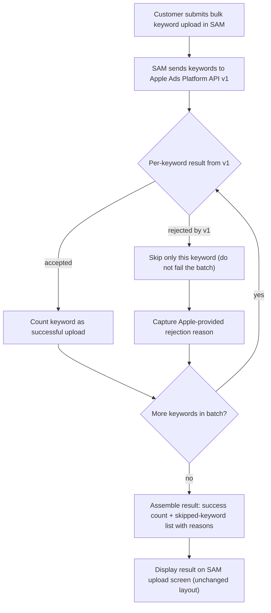
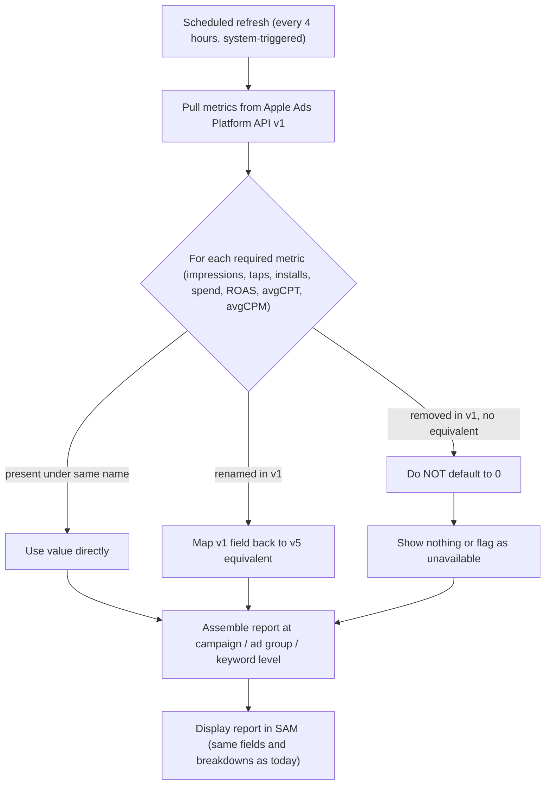
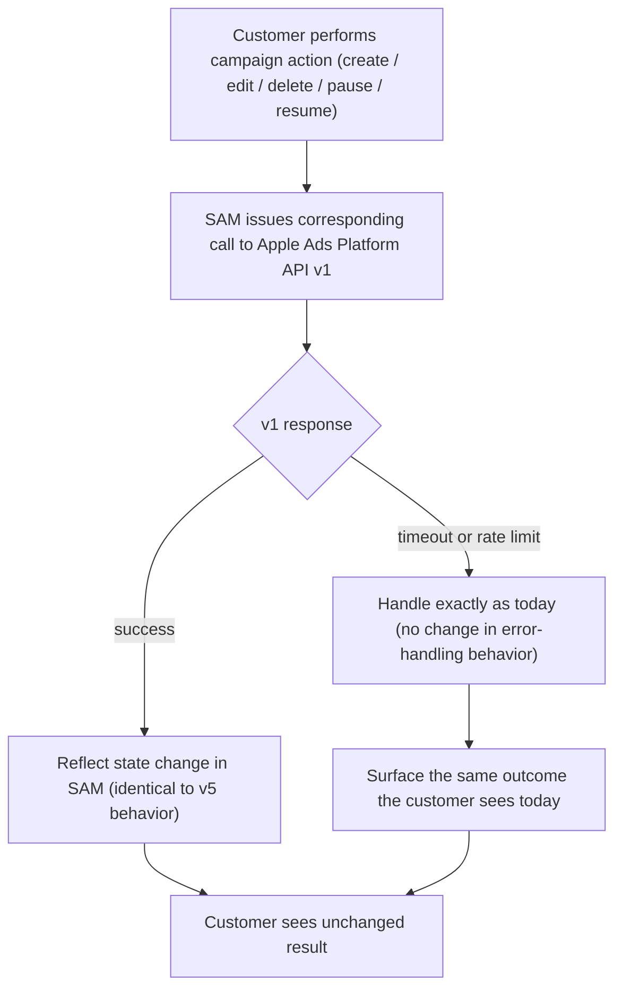

# 1. Business Logic & Context

## Problem

Search Ads Maven (SAM) currently manages Apple Search Ads on behalf of its customers through the Apple Ads **Campaign Management API v5**. Apple is moving to the **Platform API v1**. SAM must migrate its integration from v5 to v1 — updating endpoints, headers, request/response handling, and data models for campaign, ad group, and keyword management — before the external contract change takes effect.

This is an **internal migration with no customer behind it**. Customers do not call the Apple API themselves; SAM talks to Apple for them. The migration is therefore invisible by design: everything customers do today — campaign management, bulk operations, bid/budget adjustments, and performance reporting — must continue to behave and display identically after cutover.

## Value

- **Continuity:** All existing SAM functionality continues to operate without interruption once v5 is retired by Apple.
- **No customer disruption:** Customers experience no visible change to screens, workflows, or data.
- **Correctness protection:** The migration explicitly closes a known latent defect — SAM's metric object defaults missing values to `0`, which would surface *fake zeros* if v1 renames or drops a metric field. The migration must prevent false zeros, not inherit them.

## Business Rules

| # | Rule |
|---|------|
| BR-1 | Customers do not interact with the Apple API directly; SAM is the sole intermediary. The migration must be transparent to them. |
| BR-2 | Customer-facing screens for campaign management and reporting must remain **visually and functionally identical** to today. No UI or workflow change. |
| BR-3 | Campaign lifecycle operations — create, edit, delete, pause, resume — must function identically to v5 behavior from the customer's perspective. |
| BR-4 | Bulk keyword upload uses **partial-success** semantics: a keyword rejected by v1 is skipped individually; the remaining keywords still proceed. The upload is never failed wholesale because of individual rejections. |
| BR-5 | A bulk upload result must present **both** a count of successful uploads **and** a list of each skipped keyword with the reason Apple provided. A bare count is insufficient — customers need to know which keywords to fix. |
| BR-6 | Manual and automated bid and budget adjustments must continue to work with the same handling as today. |
| BR-7 | Timeout and rate-limit error handling must remain unchanged from today's behavior. |
| BR-8 | Performance reports refresh every 4 hours and pull the same metrics as today: impressions, taps (clicks), installs, spend, ROAS, avgCPT, avgCPM — at campaign, ad group, and keyword level, with the same fields and breakdowns as today. |
| BR-9 | When v1 **renames** a metric field, map it back to its v5 equivalent so the value still displays correctly. |
| BR-10 | When v1 **removes** a metric with no equivalent, SAM must **never display 0**. It must show nothing or flag the metric as unavailable. The exact presentation is an engineering design decision to be proposed downstream. |

## Known Scope Note — Affected Services

An independent knowledge-graph cross-check surfaced candidate services beyond those originally identified for this migration. The two lookups disagree, and the discrepancy is material to blast radius, so it is flagged here rather than resolved silently:

- Services the original analysis identified that the independent lookup did **not** re-find: the dedicated consumer/agent service and the frontend display layer.
- Services the independent lookup surfaced that the original analysis did **not** list: a core SAM monorepo possibly owning the Apple Ads calls, a pair of "K4A" campaign-sync/backend variants (suggesting a possible second, parallel sync path), a metrics-ingestion service that may touch Apple Ads API fields, and a keyword-optimization service.

The exact set of services in scope — in particular whether the K4A variants and the ingestion service widen the blast radius — is an engineering discovery item for the downstream planning phase, not a product decision. It is recorded here only so the product scope accounts for the uncertainty.

---

# 2. User Flows (Visuals)

> These flows describe system behavior post-migration. Customer-visible steps are unchanged from today; the migration swaps the underlying Apple API from v5 to v1.

## 2.1 Bulk Keyword Upload — Partial Success (Happy Path + Rejection Error State)



## 2.2 Performance Reporting — 4-Hour Refresh with Metric Mapping (Happy Path + Missing-Metric Error State)



## 2.3 Campaign Lifecycle Operation (Happy Path + Transient Error State)



---

# 3. Functional Requirements (The Core)

## Feature Area A — Campaign Lifecycle Management

### FR-001 — Campaign creation via v1
```gherkin
Given a customer is managing campaigns in SAM
When the customer creates a campaign through the same SAM screen and workflow used today
Then SAM issues the creation request to the Apple Ads Platform API v1
And the campaign is created with the same inputs, validation, and outcome the customer experiences under v5
And no UI or workflow change is visible to the customer
```

### FR-002 — Campaign editing via v1
```gherkin
Given an existing campaign managed in SAM
When the customer edits the campaign through the same SAM workflow used today
Then SAM issues the edit request to the Apple Ads Platform API v1
And the resulting campaign state matches the behavior the customer experiences under v5
And no UI or workflow change is visible to the customer
```

### FR-003 — Campaign deletion via v1
```gherkin
Given an existing campaign managed in SAM
When the customer deletes the campaign through the same SAM workflow used today
Then SAM issues the deletion request to the Apple Ads Platform API v1
And the campaign is removed with the same outcome the customer experiences under v5
And no UI or workflow change is visible to the customer
```

### FR-004 — Campaign pause via v1
```gherkin
Given an active campaign managed in SAM
When the customer pauses the campaign through the same SAM workflow used today
Then SAM issues the pause request to the Apple Ads Platform API v1
And the campaign transitions to paused with the same outcome the customer experiences under v5
And no UI or workflow change is visible to the customer
```

### FR-005 — Campaign resume via v1
```gherkin
Given a paused campaign managed in SAM
When the customer resumes the campaign through the same SAM workflow used today
Then SAM issues the resume request to the Apple Ads Platform API v1
And the campaign transitions to active with the same outcome the customer experiences under v5
And no UI or workflow change is visible to the customer
```

### FR-006 — Lifecycle operations apply at ad group and keyword levels
```gherkin
Given a customer manages ad groups and keywords within a campaign in SAM
When the customer performs any supported lifecycle operation (create, edit, delete, pause, resume) at the ad group or keyword level through the same SAM workflow used today
Then SAM issues the corresponding request to the Apple Ads Platform API v1
And the resulting state at each entity level matches the behavior the customer experiences under v5
And no UI or workflow change is visible to the customer
```

### FR-007 — Hierarchy/relationship integrity preserved across the migration
```gherkin
Given v1 may structure campaign, ad group, and keyword hierarchies or nesting differently than v5
When SAM reads or writes these entities through v1
Then the campaign → ad group → keyword relationships presented to the customer remain identical to today
And any v1 structural difference is absorbed internally by SAM without altering what the customer sees
```

## Feature Area B — Bulk Keyword Upload (Partial Success)

### FR-008 — Partial-success skip-and-continue on rejection
```gherkin
Given a customer submits a bulk keyword upload in SAM
And the Apple Ads Platform API v1 rejects one or more individual keywords in the batch
When SAM processes the batch result
Then only the rejected keyword(s) are skipped
And all non-rejected keywords in the batch still proceed to upload
And the batch is not failed as a whole because of individual rejections
```

### FR-009 — Capture Apple-provided rejection reason per skipped keyword
```gherkin
Given the Apple Ads Platform API v1 rejects a keyword during a bulk upload
When SAM records that rejection
Then SAM captures the reason Apple provided for that keyword's rejection
And associates the reason with the specific keyword that was skipped
```

### FR-010 — Upload result shows success count and skipped list with reasons
```gherkin
Given a bulk keyword upload has completed with at least one skipped keyword
When SAM displays the upload result on the same result screen used today
Then the result shows a count of successfully uploaded keywords
And the result shows a list of each skipped keyword together with its Apple-provided rejection reason
And a count alone is never shown without the accompanying list of skipped keywords and reasons
```

### FR-011 — Fully successful bulk upload
```gherkin
Given a customer submits a bulk keyword upload in SAM
And the Apple Ads Platform API v1 accepts every keyword in the batch
When SAM displays the upload result
Then the result shows a count of successfully uploaded keywords
And no skipped-keyword list is shown
And the result matches the behavior the customer experiences under v5 for a fully successful upload
```

[DECISION REQUIRED]

> Note: Apple's v1 rejection reasons may use error codes or wording that differ from what customers see today. Whether those raw reasons are shown verbatim or translated into the customer-facing wording used today is flagged above. Parsing/transforming the raw v1 error format into a presentable string is an engineering concern and is assumed by default.

### FR-012 — Rejection reason rendering is customer-presentable
```gherkin
Given the Apple Ads Platform API v1 returns a rejection reason in its own error format
When SAM surfaces that reason to the customer on the upload result screen
Then the reason is rendered in a customer-presentable form consistent with how reject reasons are shown today
And raw internal error codes are not shown without a presentable description
```

## Feature Area C — Bid & Budget Adjustments

### FR-013 — Manual bid and budget adjustments via v1
```gherkin
Given a customer makes a manual bid or budget adjustment in SAM
When SAM applies the adjustment through the Apple Ads Platform API v1
Then the adjustment is applied with the same handling and outcome the customer experiences under v5
And no change in behavior is visible to the customer
```

### FR-014 — Automated bid and budget adjustments via v1
```gherkin
Given SAM performs an automated bid or budget adjustment
When SAM applies the adjustment through the Apple Ads Platform API v1
Then the adjustment is applied with the same handling and outcome as under v5
And no change in behavior is visible to the customer
```

### FR-015 — Timeout and rate-limit handling unchanged
```gherkin
Given a bid adjustment, budget adjustment, or any other SAM operation calling the Apple Ads Platform API v1
When the operation encounters a timeout or a rate-limit response
Then SAM handles the condition exactly as it does today
And the error-handling behavior the customer experiences is unchanged from v5
```

## Feature Area D — Performance Reporting

### FR-016 — 4-hour refresh cadence preserved
```gherkin
Given performance reporting is active in SAM
When the scheduled refresh runs
Then it refreshes every 4 hours as it does today
And it pulls data from the Apple Ads Platform API v1
```

### FR-017 — Same metric set pulled
```gherkin
Given a performance report refresh runs against the Apple Ads Platform API v1
When SAM pulls metrics
Then it retrieves impressions, taps (clicks), installs, spend, ROAS, avgCPT, and avgCPM
And these are the same metrics pulled today under v5
```

### FR-018 — Same levels, fields, and breakdowns preserved
```gherkin
Given a performance report is displayed in SAM
When the customer views the report
Then data is shown at campaign, ad group, and keyword level
And the fields and breakdowns shown are the same as those shown today under v5
```

### FR-019 — Renamed v1 metric mapped back to v5 equivalent
```gherkin
Given the Apple Ads Platform API v1 renames a metric field relative to v5
When SAM ingests that metric during a report refresh
Then SAM maps the renamed v1 field back to its v5 equivalent
And the correct value is displayed under the field the customer already sees today
```

### FR-020 — No false zero for a removed or renamed metric
```gherkin
Given the Apple Ads Platform API v1 removes a metric that has no v5 equivalent, or returns a metric SAM cannot map
When SAM prepares the report for display
Then SAM does not default the value to 0
And SAM shows nothing for that metric or flags it as unavailable
And a fabricated zero is never displayed for a missing, removed, or unmapped metric
```

### FR-021 — Presentation of an unavailable metric
```gherkin
Given a metric must be shown as unavailable rather than as a value
When SAM renders the report
Then the unavailable metric is surfaced using the presentation approach proposed by engineering
And that presentation clearly distinguishes "unavailable" from a real value of zero
```

> Note: The exact presentation of an unavailable metric ("show nothing" vs. an explicit "unavailable" flag, and its visual treatment) is an engineering design decision per the requester. FR-020's hard constraint — never a false zero — holds regardless of the chosen presentation.

## Feature Area E — Migration Transparency (Cross-Cutting)

### FR-022 — No visible customer change across all migrated workflows
```gherkin
Given any SAM workflow affected by the migration (campaign management, bulk upload, bid/budget adjustments, performance reporting)
When the workflow runs against the Apple Ads Platform API v1 after cutover
Then the customer-facing screens remain visually and functionally identical to today
And no customer-visible behavior changes except the elimination of false zeros for missing metrics
```

### FR-023 — Downstream metric consumers remain consistent after field changes
```gherkin
Given internal SAM consumers read metric fields (for example avgCPT and avgCPM) produced from the Apple Ads integration
When v1 renames or restructures those fields and SAM maps them back to v5 equivalents
Then downstream consumers continue to read consistent, correctly-named field values
And no consumer silently reads a missing or renamed field as zero or null
```

Now reporting the single business trade-off I flagged in Sections 0–3.

## 4. Information Requirements

The system must track the following business information to support the functional requirements. All of these concepts exist today under v5; the migration changes where they come from (Apple Ads Platform API v1), not what SAM must know.

- **Campaign / Ad Group / Keyword entity** — the managed advertising entities and their current lifecycle state (active, paused, deleted). Source: System-Derived, synced from the Apple Ads Platform API v1. Matters because every lifecycle operation (FR-001–FR-006) reads and writes this state, and it must remain identical to v5 from the customer's view.
- **Entity hierarchy / relationships** — the campaign → ad group → keyword parent/child relationships. Source: System-Derived from v1, normalized to match today's structure. Matters because v1 may nest or relate entities differently (FR-007); SAM must preserve the relationships the customer sees today regardless of v1's internal structure.
- **Bulk upload submission** — the batch of keywords a customer submits for upload. Source: User-Entered. Matters because it is the input to the partial-success flow (FR-008–FR-012).
- **Per-keyword upload outcome** — for each keyword in a batch, whether it was accepted or skipped. Source: System-Derived from the v1 per-keyword response. Matters because it drives the skip-and-continue logic and the success count (FR-008, FR-010, FR-011).
- **Rejection reason** — the reason Apple provided for a skipped keyword. Source: External API (Apple Ads Platform API v1 error response), rendered into a customer-presentable form. Matters because customers must know which keywords to fix and why (FR-009, FR-010, FR-012).
- **Bid and budget adjustment** — manual or automated changes to bids and budgets. Source: User-Entered (manual) or System-Derived (automated). Matters because these adjustments must apply with unchanged handling under v1 (FR-013–FR-015).
- **Performance metrics** — impressions, taps (clicks), installs, spend, ROAS, avgCPT, avgCPM, at campaign/ad group/keyword level. Source: External API (Apple Ads Platform API v1). Matters because they populate the 4-hour-refresh reports with the same fields and breakdowns as today (FR-016–FR-019).
- **Metric field mapping (v1 → v5)** — the correspondence between v1 metric field names and the v5 equivalents SAM already displays. Source: System-Derived (a mapping SAM maintains). Matters because it prevents renamed fields from displaying incorrectly or as false zeros (FR-019, FR-020, FR-023).
- **Metric availability state** — for each metric, whether a real value is present or the metric is unavailable (removed/unmappable in v1). Source: System-Derived. Matters because it must be distinguishable from a real value of zero so SAM never shows a false zero (FR-020, FR-021).
- **Report refresh cadence / schedule state** — the state of the recurring 4-hour report refresh. Source: System-Derived. Matters because the cadence must remain every 4 hours (FR-016).
- **v1 API connection context** — the endpoint, header, and auth context SAM uses to call the Apple Ads Platform API v1. Source: System-Derived / External API. Matters because the migration re-points all SAM↔Apple traffic to v1 while remaining invisible to customers (FR-022).

---

## 5. Non-Functional Requirements & Guardrails

### Performance

- **NFR-001 — Report refresh cadence.** Performance reports must continue to refresh every 4 hours, unchanged from today. The migration must not degrade the cadence or the completeness of a refresh cycle.
- **NFR-002 — v1 rate-limit and quota compliance.** SAM's call patterns against v1 (bulk uploads, lifecycle operations, and the 4-hour report refresh) must stay within v1's rate limits, pagination, and batch-size constraints. v1's exact quotas differ from v5 and are an engineering discovery item; where v1 quotas are tighter than v5, SAM must re-chunk bulk uploads and/or stagger report pulls so the cadence and partial-success behavior still hold. The default posture is to adapt SAM's call pattern to v1's limits rather than relax any customer-facing requirement.
- **NFR-003 — No customer-visible latency regression.** Customer-facing operations (campaign actions, bulk upload results, report loads) must perform no worse than today from the customer's perspective. Measurement default: p95 latency of each migrated customer-facing operation must be no greater than the current v5 baseline, measured under comparable production load. Establishing the v5 baseline is an engineering task.

### Error Handling for the External Dependency (Apple Ads Platform API v1)

- **NFR-004 — Unchanged timeout and rate-limit handling.** Timeout and rate-limit (e.g. 429) error handling must remain behaviorally identical to today from the customer's perspective (FR-015). Where v1 returns a `Retry-After` on a rate-limit response, SAM should honor it rather than retry on a fixed schedule. Retries must be bounded (default: 3 attempts with exponential backoff), never indefinite.
- **NFR-005 — Distinct, named failure conditions.** Timeout, dependency-unavailable, and rate-limited conditions must each retain their own distinct handling and customer-facing outcome as they exist today; the migration must not collapse them into one generic error.
- **NFR-006 — Bulk-upload failure posture is graceful degradation.** A per-keyword rejection must never fail the whole batch (FR-008); the batch degrades gracefully to a partial success. This is the explicit failure posture for bulk uploads.
- **NFR-007 — Idempotency of the report-refresh job.** The recurring 4-hour report refresh must be safe to retry or re-run for the same refresh window without duplicating or double-counting metric data — a re-run overwrites/replaces the window's data rather than appending it. Automatic concurrent re-runs of the same refresh job must be prevented at the scheduler level so two refreshes for the same window cannot overlap.

### Security & Data Handling

- **NFR-008 — No secrets or credentials in logs.** v1 authentication credentials, tokens, and headers must never be written to logs in raw form. Where a key must appear for identification, mask to the last 4–8 characters only.
- **NFR-009 — Access control unchanged.** The migration must not weaken existing authorization. Whatever role/account gating governs campaign management, bulk upload, and reporting today must continue to be enforced server-side after cutover; a request from an ineligible role/account must be rejected regardless of UI state. The migration is not a vehicle for changing who can do what.
- **NFR-010 — No new PII exposure.** The migration must not introduce new logging or storage of customer-identifying data beyond what exists today. Apple-provided rejection reasons surfaced to customers (FR-012) must be sanitized so no internal identifiers, credentials, or unintended data leak through the reason string.

### Risk Mitigation

Each risk from the Context Seed and its mitigation condition:

- **NFR-011 — False-zero defect (correctness risk).** SAM's metric object defaults missing values to 0. *Mitigated when:* a removed/unmappable v1 metric never renders as 0 (FR-020), renamed fields are mapped back to v5 equivalents (FR-019), and downstream consumers never read a missing/renamed field as 0 or null (FR-023). Verification requires an inventory of which v1 metrics are renamed or removed — an engineering discovery item that blocks the mapping table.
- **NFR-012 — Multi-service blast radius (6+ services).** The migration spans multiple backend services, and an independent KG cross-check surfaced additional candidate services (K4A sync variants, an ingestion service) that may widen the blast radius (see Section 1). *Mitigated when:* the authoritative set of affected services is confirmed during engineering planning, every service that reads Apple Ads fields is verified against the v1 field shapes (including test fixtures), and no consumer is left silently reading a stale field name.
- **NFR-013 — External API contract change.** Endpoints, headers, and request/response shapes all change at once. *Mitigated when:* every migrated workflow is validated against v1 to produce customer-facing behavior identical to v5 (FR-022), and a cutover/rollback plan (NFR-016) is in place before production cutover.
- **NFR-014 — Hard Dec 28 deadline against unresolved unknowns.** Several unknowns (v1 field mapping, v1 error formats, v1 rate limits) are unresolved and block parts of the work. *Mitigated when:* these discovery items are resolved early in engineering planning; if they cannot all be resolved in time, the rollout strategy ([DECISION REQUIRED]) must accommodate it. Whether all customers cut over at once on Dec 28, a phased pilot runs, or v5 and v1 run in parallel is a business/product trade-off with direct impact on testing, monitoring, and rollback.

### Backward Compatibility

- **NFR-015 — Internal field consistency preserved.** The v1→v5 field mapping (FR-019, FR-023) is an explicit backward-compatibility layer: existing internal consumers (e.g. sam-agent reading avgCPT/avgCPM) must continue to read the same field names and value shapes they read today. The customer-facing contract — screens, fields, breakdowns, workflows — must remain unchanged (FR-022). The only intended customer-visible difference is the elimination of false zeros.

### Rollout & Rollback

- **NFR-016 — Kill-switch / rollback capability.** Because this is HIGH-risk, multi-service, external-contract work, there must be a config-based way to revert from v1 to v5 behavior (where Apple still permits v5 calls) without a code deploy, usable by an on-call engineer during an incident without separate approval. Rollback affects only new operations going forward; already-produced reports and completed campaign actions are not retroactively reverted. The rollout approach itself — all-at-once on Dec 28, phased pilot, or parallel run with a soak/variance gate — depends on the rollout-strategy decision flagged in NFR-014. The trigger, owning authority, and timing target for rollback must be fixed as part of that rollout plan.

---

## 6. Out of Scope & Phasing

### Explicitly Out of Scope for Phase 1

| # | Item | Rationale |
|---|------|-----------|
| OOS-1 | Any visible change to SAM customer-facing screens, workflows, or layouts | Migration is invisible by design (BR-2, FR-022); the only intended visible change is the removal of false zeros. |
| OOS-2 | New product features, metrics, or reporting breakdowns beyond today's set | Scope is a like-for-like migration; "same as today" is the requirement (BR-8, FR-018). |
| OOS-3 | Changing bid/budget adjustment logic or timeout/rate-limit error-handling behavior | Must remain unchanged from today (BR-6, BR-7, FR-013–FR-015). |
| OOS-4 | Designing the final visual treatment of an "unavailable" metric as a product/UX deliverable | Presentation is an engineering design proposal; the product constraint is only "never a false zero" (BR-10, FR-020, FR-021). |
| OOS-5 | Syncing SAM data to external/third-party tools | Requester was unsure any such sync exists and deferred it to engineering to spot; not a confirmed Phase 1 requirement. |
| OOS-6 | Supporting or maintaining v5 long-term | Goal is to migrate off v5; any parallel-run of v5 is a transitional rollout mechanism (NFR-016), not a maintained capability. |

### Phasing / Open Engineering Discovery Items (inform planning, not Phase 1 scope decisions)

These are unresolved unknowns from the Context Seed that engineering must resolve during planning. They are not product scope items but are recorded so they are not lost:

- The exact v1 campaign/ad group/keyword hierarchy and any nesting changes requiring data-model/state adjustment (FR-007).
- Which specific v1 metrics are renamed or removed, and Apple's recommended mapping/fallback (FR-019, FR-020, NFR-011).
- v1 rate limits, pagination, and batch-size constraints vs. v5, and required adjustments to bulk upload and report-refresh logic (NFR-002).
- v1 error codes/formats for rejected keywords and any parsing/transformation needed before display (FR-012).
- Handling of any campaigns/keywords existing only in v5 or partially synced at cutover — whether a one-time sync or reconciliation is needed before full cutover.
- Confirmation of the authoritative affected-service set, including whether the K4A sync variants and the ingestion service are in scope (Section 1, NFR-012).

### Rollout Strategy (requires product/business decision)

The cutover approach — migrate all customers at once on Dec 28, run a phased pilot, or run v5 and v1 in parallel for a soak period — is an open decision flagged in Section 5 (NFR-014/NFR-016). Each option carries different testing, monitoring, and rollback implications and must be decided before cutover.

---
## Open Questions & Decisions Register

_Durable, ID'd reference for HITL 2 (G1) and beyond — inline `[DECISION REQUIRED: DEC-00N]` tags in the sections above point back here. Reflects the latest round only._

### Decisions Required (business trade-offs — needs a human call)

_Each carries an **Owner** (accountable for supplying the answer) and a **Provisional Value** (the working assumption engineering may build against until the decision lands), so none of these fully block engineering — implementation proceeds on the provisional value and adjusts if the confirmed decision differs._

| ID | Decision | Owner | Provisional Value (build against until confirmed) |
|----|----------|-------|-----------------------------------------------------|
| **DEC-001** | When Apple's new API rejects a keyword during a bulk upload, should customers see Apple's own rejection wording passed through as-is, or should we keep showing the same rejection messages customers see today? | Product owner | Translate Apple's v1 rejection reasons into the same customer-facing wording shown today wherever a known equivalent exists, and fall back to Apple's own presentable text only for reasons that have no existing equivalent. This preserves the 'no visible change' goal for the common cases while still giving customers an actionable reason for new ones. |
| **DEC-002** | When a keyword is rejected during a bulk upload, should customers see Apple's raw rejection reason as-is, or should we translate it into the same customer-facing wording the upload screen shows today? | Product owner | Translate Apple's v1 rejection reasons into the customer-facing wording used today where a known equivalent exists; fall back to a cleaned-up, human-readable version of Apple's reason (never a raw internal error code) when no equivalent mapping exists. |
| **DEC-003** | For the Dec 28 cutover, should we switch all customers over at once on the deadline, run a phased pilot first, or run the old and new Apple integrations in parallel for a soak period before fully switching? | Product owner / Engineering | Run v5 and v1 in parallel for a short soak period with a config-based switch per customer segment, advancing in stages (pilot group first, then full population) only after each stage holds clean for a defined period; keep all-at-once on Dec 28 as the fallback only if parallel-run proves infeasible before the deadline. |

### Open Questions (evidence gaps — needs more input)

- **OQ-001**: Do we cut all customers over to v1 on Dec 28 at once, run a phased pilot, or support v5 and v1 in parallel for a transition period? This drives testing, monitoring, and rollback effort and the feasibility of the deadline.
- **OQ-002**: If any campaigns/keywords exist only in v5 or are partially synced at cutover, is a one-time reconciliation/sync in scope, or do we assume everything is fully synced before we switch?
- **OQ-003**: When a metric has no v1 equivalent, is a new 'unavailable' UI state acceptable even though the directive is 'no visible change'? Engineering is asked to propose the presentation, but it needs product sign-off that introducing this state is OK.
- **OQ-004**: For bulk keyword upload today, does the current flow already skip rejected keywords and show a per-keyword reason list, or is it all-or-nothing? This tells us whether skip-and-continue is a port or new behavior.
- **OQ-005**: Is K4A SAM (k4a-sam-backend / k4a-sam-campaign-data-sync) in scope for this migration, or is it a separate/legacy path we should leave alone?
- **OQ-006**: Can product confirm the authoritative list of report breakdowns that must stay identical, since 'same as today' was stated with uncertainty and we need a definitive baseline to test against?

---
> **Classification:** Type B — requirement-agent's independent re-check DISAGREES with intake's original Type A call. The behavior and success criteria are fully specified (requester confirmed no UI/workflow change, exact metrics, partial-success bulk logic, and no-false-zero mapping rules), so the remaining uncertainty is engineering-led design across 6+ backend services and an external API contract change — classic Type B, not product discovery; the "open questions" are API/implementation details for engineering to resolve, not ambiguous product behavior.
