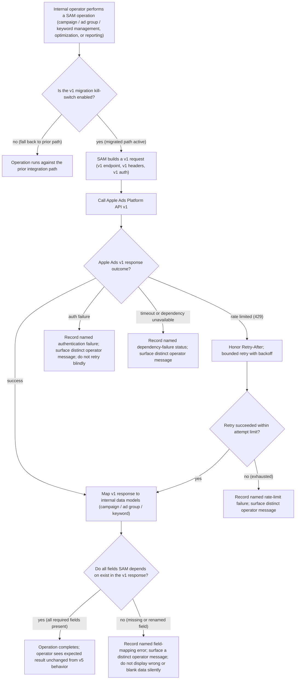

## 1. Business Logic & Context

### Problem

Apple is retiring its Apple Ads Campaign Management API v5 in favor of the Apple Ads Platform API v1. Search Ads Maven (SAM) currently integrates against v5 for all campaign, ad group, and keyword operations. Nothing is broken today — this is a **preventive migration** to avoid service loss when v5 is decommissioned. The work is internal-facing (SAM's own users are internal); no external customer is affected.

The deadline is **December 28, 2026**, driven by Apple's retirement of v5. Missing it means SAM loses the ability to manage, optimize, and report on Apple Search Ads campaigns once v5 is switched off.

### Value

- Continuity of all SAM campaign management, optimization, and reporting workflows past the v5 sunset.
- Elimination of all dependency on deprecated v5 endpoints before Apple forces the cutoff.
- No user-facing disruption — existing functionality must behave identically on v1.

### Business Rules

- **Parity is the baseline.** The migration is a 1:1 functional-parity effort: every campaign, ad group, and keyword operation that works against v5 today must work against v1 after migration. Whether to adopt any new v1-only capabilities (new fields, endpoints, analytics) beyond parity is a product decision, not assumed in scope. [DECISION REQUIRED: DEC-001]
- **No deprecated dependency.** After cutover, no code path may call a v5 endpoint.
- **No user-facing disruption.** Campaign management, optimization, and reporting must continue to function without observable change to internal users.
- **Internal users only.** There is no external customer surface for this change; "no user-facing disruption" refers to SAM's internal operators.
- **Whether a UI/frontend change is required is unconfirmed.** The intake flagged UI/frontend impact as unclear. If v1 data-model changes (field renames, enum changes, structural differences) surface values that internal operators see or act on, the operator-facing surface may need updates. Whether this migration is permitted to change anything an operator sees, or must preserve the current operator-facing presentation exactly, is a product decision. [DECISION REQUIRED: DEC-002]

### Scope Note — Affected Services Reconciliation

The Context Seed's affected-services list and an independent knowledge-graph cross-check broadly agree on the core touch points but diverge on a few entries. Both agree on a backend service that implements the migration, a campaign-data-sync service, a performance-reporter, a bulk-actions path, and a consuming agent. The independent cross-check additionally surfaced:

- A **SAM monorepo** that may own the Apple Ads integration — it is unclear whether this is the same codebase as the migration-implementing backend under a different name.
- A possible **duplicate campaign-data-sync** entry under a second name — unclear whether this is one service, two services, or a naming artifact.
- A **report-scheduler** and a **keyword-search-optimization** consumer (both low confidence) not named in the Context Seed's headline list.
- The Context Seed names a **shared utility/helper layer** that did not re-appear in the independent cross-check.

These discrepancies are flagged for engineering to resolve during planning (e.g. by locating actual Apple Ads call sites across repos); they do not change the product intent, which is full v5→v1 parity across every service that touches the Apple Ads API.

---

## 2. User Flows (Visuals)

Because this is a backend API migration with unconfirmed UI impact, the "user flow" below models an internal operator performing a representative Apple Ads operation (e.g. managing a campaign, running a report) against the migrated v1 integration, including the error/cutover states that must be handled.



---

## 3. Functional Requirements (The Core)

### Feature Area A — Endpoint, Header & Auth Migration

**FR-001 — All Apple Ads calls target v1 endpoints**
```gherkin
Given a SAM operation that previously called an Apple Ads Campaign Management API v5 endpoint
When the operation executes after migration
Then the request is sent to the equivalent Apple Ads Platform API v1 endpoint as defined in the Apple Ads Platform API v1 specification
And no request is sent to any v5 endpoint
```

**FR-002 — No residual v5 dependency after cutover**
```gherkin
Given the migration is complete and the kill-switch is set to the migrated path
When any campaign, ad group, keyword, optimization, or reporting operation runs
Then no code path invokes a deprecated v5 endpoint
And a scan of outbound Apple Ads traffic shows only v1 endpoint usage
```

**FR-003 — Requests use v1 header formats**
```gherkin
Given SAM is constructing a request to the Apple Ads Platform API v1
When the request headers are assembled
Then the headers conform to the v1 specification's required header formats
And any v5-specific header no longer required by v1 is removed
```

**FR-004 — Requests use v1 authentication**
```gherkin
Given SAM must authenticate to the Apple Ads Platform API v1
When an authenticated request is made
Then authentication is performed using the v1-required mechanism (token format, refresh behavior, and permission scopes per the v1 specification)
And a successful v1 authentication allows the operation to proceed
```

**FR-005 — Authentication failures are handled as a distinct, named condition**
```gherkin
Given SAM attempts an authenticated call to Apple Ads Platform API v1
When the API returns an authentication failure
Then SAM records a named authentication-failure status distinct from other error types
And the operator sees an authentication-specific message, not a generic error
And SAM does not blindly retry the request as if it were a transient failure
```

**FR-006 — Credentials and tokens are never logged in the clear**
```gherkin
Given SAM constructs or logs any detail of an Apple Ads v1 request
When authentication credentials, tokens, or secrets are involved
Then no raw credential, token, or secret is written to any log
And if a key must be shown for identification it is masked to the last 4-8 characters only
```

> **Transition-period authentication note:** Whether SAM must support both v5 and v1 authentication simultaneously during a transition window, or cut over in a single step, is unresolved. See the parallel-run decision referenced in FR-021.

### Feature Area B — Data Model Mapping (Campaigns, Ad Groups, Keywords)

**FR-007 — v1 campaign responses map to internal campaign models**
```gherkin
Given SAM receives a campaign response from Apple Ads Platform API v1
When the response is processed
Then each field SAM depends on is mapped from the v1 schema into SAM's internal campaign model
And the mapped values are equivalent in meaning to those previously obtained from v5
```

**FR-008 — v1 ad group responses map to internal ad group models**
```gherkin
Given SAM receives an ad group response from Apple Ads Platform API v1
When the response is processed
Then each ad group field SAM depends on is mapped from the v1 schema into SAM's internal ad group model
And the mapped values are equivalent in meaning to those previously obtained from v5
```

**FR-009 — v1 keyword responses map to internal keyword models**
```gherkin
Given SAM receives a keyword response from Apple Ads Platform API v1
When the response is processed
Then each keyword field SAM depends on is mapped from the v1 schema into SAM's internal keyword model
And the mapped values are equivalent in meaning to those previously obtained from v5
```

**FR-010 — Missing or renamed v1 fields are detected, not silently dropped**
```gherkin
Given SAM maps a v1 response to an internal model
When a field SAM currently depends on is absent or renamed in the v1 schema
Then SAM records a named field-mapping error identifying the affected entity and field
And SAM does not display blank, zero, or stale data in place of the missing value without surfacing the condition
And the operator sees a distinct message indicating a data-mapping problem
```

**FR-011 — v1 enum and structural differences are translated to internal equivalents**
```gherkin
Given a v1 field uses an enum value or structure that differs from the v5 equivalent
When SAM maps that field into its internal model
Then SAM translates the v1 enum value or structure to the correct internal representation
And no unrecognized v1 enum value is passed through untranslated into internal data or displays
```

### Feature Area C — Functional Parity (Management, Optimization, Reporting)

**FR-012 — Campaign, ad group, and keyword management operations retain parity**
```gherkin
Given an internal operator performs a campaign, ad group, or keyword management operation (create, read, update, or state change) that worked against v5
When the operation runs against Apple Ads Platform API v1
Then the operation produces the same functional outcome it produced under v5
And the operator observes no change in available actions or results beyond the underlying API version
```

**FR-013 — Optimization workflows retain parity**
```gherkin
Given SAM's optimization engine consumes Apple Ads metric data to drive optimization
When it runs against Apple Ads Platform API v1 data
Then the optimization logic receives the metric fields it depends on from the v1 responses
And optimization behavior matches its v5-based behavior for equivalent inputs
```

**FR-014 — Reporting workflows retain parity**
```gherkin
Given SAM generates campaign performance reports from Apple Ads data
When reports are generated from Apple Ads Platform API v1 data
Then the reported metrics match the values that equivalent v5 data would have produced
And no reported metric is silently wrong due to a dropped, renamed, or restructured v1 field
```

**FR-015 — Reporting field-level validation against current usage**
```gherkin
Given the set of metric fields SAM's reporting and optimization features currently consume
When the v1 integration is validated before cutover
Then each currently-consumed metric field is confirmed present and correctly mapped in the corresponding v1 response
And any field that cannot be sourced from v1 is flagged for an explicit product decision rather than assumed equivalent
```

### Feature Area D — Bulk Operations

**FR-016 — Bulk operations run against v1 with per-item outcome tracking**
```gherkin
Given an internal operator submits a bulk campaign or keyword operation
When the operation executes against Apple Ads Platform API v1
Then each item in the batch produces an individual success or failure outcome
And a partial failure of some items does not silently mark the whole batch as successful
And failed items are reported distinctly so they can be retried or corrected
```

**FR-017 — Duplicate in-flight bulk submission is rejected**
```gherkin
Given a bulk operation is already in flight for a given set of entities from the same session
When a duplicate bulk submission for the same operation is received before the first completes
Then SAM rejects the duplicate rather than queuing or duplicating it
```

**FR-018 — Retried or re-delivered operations are idempotent**
```gherkin
Given a campaign, ad group, keyword, or bulk write operation is retried or re-delivered for the same input
When the retry executes against Apple Ads Platform API v1
Then the end state is the same as a single successful execution
And no duplicate record is created and no side effect is double-counted
```

### Feature Area E — External API Resilience (Rate Limits, Retries, Pagination)

**FR-019 — Rate-limit responses are honored with bounded backoff**
```gherkin
Given a call to Apple Ads Platform API v1 returns a rate-limit (429) response
When SAM handles the response
Then SAM honors the response's Retry-After header rather than retrying on a fixed schedule
And SAM retries with exponential backoff up to a bounded attempt limit (default: 3 attempts) and never retries indefinitely
And if the attempt limit is exhausted SAM records a named rate-limit-failure status and surfaces a distinct operator message
```

**FR-020 — Pagination differences are handled completely**
```gherkin
Given an Apple Ads Platform API v1 endpoint returns results across multiple pages
When SAM retrieves a multi-page result set
Then SAM follows v1's pagination mechanism until all pages are retrieved
And no records are dropped or duplicated due to pagination differences between v5 and v1
```

**FR-021 — Transient dependency failures are a distinct, named condition**
```gherkin
Given a call to Apple Ads Platform API v1 times out or the dependency is unavailable
When SAM handles the failure
Then SAM records a dependency-failure status distinct from authentication and rate-limit failures
And the operator sees a dependency-specific message rather than a generic error
```

> **Parallel-run / cutover note:** Whether SAM runs the v1 integration in parallel with v5 for a soak/validation period before decommissioning v5 — and what variance gate must be met to cut over — is a product-and-risk decision, not a parity requirement. Whether to maintain dual-API support for a grace period and the rollback strategy are tied to this same decision. [DECISION REQUIRED: DEC-003]

### Feature Area F — Controlled Rollout

**FR-022 — Migration is controllable via a kill-switch**
```gherkin
Given the v1 migration is deployed
When an on-call engineer needs to disable the migrated path during an incident
Then the migrated path can be switched off via configuration without a code deploy and without a separate approval step
And new requests honor the switched value within an established propagation window (default: 5 minutes)
And requests already in flight at the moment of the flip complete under the behavior in effect when they started
```

I've written Sections 0–3. Now reporting the decisions I flagged.

## 4. Information Requirements

The system must track the following business information to support the functional requirements above. All items concern the Apple Ads v5→v1 migration and the data SAM derives from it.

- **Apple Ads v1 endpoint set** — The complete list of v1 endpoints SAM calls, mapped against the v5 endpoints they replace. Source: External API (Apple Ads Platform API v1 specification). Matters because FR-001/FR-002 require every v5 call to have a confirmed v1 equivalent and zero residual v5 usage.
- **v1 authentication state** — The credentials, token, token-refresh status, and permission scopes required to authenticate to v1. Source: External API (Apple) plus system-managed credential store. Matters for FR-004/FR-005 and for the transition-period decision referenced in FR-021.
- **Field-mapping table (v5 → v1 → internal model)** — For campaigns, ad groups, and keywords: which v1 field (and enum/structure) maps to which internal model field, and which currently-consumed fields exist in v1 at all. Source: System-Derived from the v1 spec plus SAM's current field usage. Matters for FR-007 through FR-011 and FR-015.
- **Currently-consumed metric/reporting field inventory** — The set of metric and reporting fields SAM's optimization engine and reporting features depend on today. Source: System-Derived (audit of current SAM usage). Matters for FR-013, FR-014, and FR-015, where a dropped or renamed v1 field would silently corrupt reports.
- **Field-mapping error records** — Named records of any v1 field that is absent, renamed, or structurally changed relative to what SAM depends on. Source: System-Derived at mapping time. Matters for FR-010 and FR-015.
- **Per-item bulk operation outcomes** — For each item in a bulk submission, an individual success/failure result and failure reason. Source: System-Derived from v1 responses. Matters for FR-016 and FR-017.
- **Idempotency key per write/retry operation** — The key (natural/composite or explicit token) that identifies a given campaign/ad-group/keyword/bulk write so a retry resolves to the same end state. Source: System-Derived. Matters for FR-018.
- **External-call failure classification** — The distinct failure status per call: authentication failure, rate-limit (429) exhaustion, timeout/dependency-unavailable, or field-mapping error. Source: System-Derived from v1 responses. Matters for FR-005, FR-010, FR-019, FR-021.
- **Rate-limit / retry state** — Retry-After values, attempt counts, and backoff state per call. Source: External API (Apple response headers) plus system-derived counters. Matters for FR-019.
- **Pagination cursor/state** — The v1 pagination position for multi-page result retrieval. Source: External API (Apple v1 responses). Matters for FR-020.
- **Migration kill-switch / rollout state** — The current configuration value directing traffic to the migrated or prior path. Source: System configuration. Matters for FR-002 and FR-022.
- **Migration audit trail** — A record of migration-relevant state-changing operations (campaign/ad-group/keyword create, update, state change, bulk mutation) executed against v1: actor identity, resource identity, action, timestamp, and outcome. Source: System-Derived at operation time. Matters for NFR-004 below.

---

## 5. Non-Functional Requirements & Guardrails

### Performance & Capacity

- **NFR-001 — Parity latency.** The migrated v1 integration must not materially degrade operator-perceived latency for campaign, ad group, keyword, optimization, and reporting operations relative to the v5 baseline. Target: p95 operation latency no worse than the current v5 p95, measured under representative concurrent load for each operation class. The acceptable degradation tolerance (if any) over the v5 baseline is a product/engineering call. [DECISION REQUIRED: DEC-004]
- **NFR-002 — Bounded retry behavior.** All external calls to Apple Ads v1 use bounded retry with exponential backoff (default 3 attempts), honoring the Retry-After header on 429 responses, and never retry indefinitely (per FR-019). Timeout, dependency-unavailable, rate-limited, and authentication failures are each recorded as distinct named statuses, never collapsed into one generic error.
- **NFR-003 — Monitoring and alerting.** Outbound v1 call health is monitored and alerts fire when the v1 error rate exceeds 1% for 5 minutes sustained, and when rate-limit (429) responses exceed a threshold sustained over the same window. Alerting on a spike in field-mapping errors must be included, since those indicate a silent-data-corruption risk rather than an outright failure.

### Security & Access Control

- **NFR-004 — Migration audit logging.** State-changing operations executed against Apple Ads v1 (campaign/ad-group/keyword create, update, state change, and bulk mutations) are recorded in an append-only, immutable audit trail capturing actor identity, resource identity, action, timestamp, and outcome. Audit writes occur asynchronously so they never block the primary operation; an audit-write failure fires an immediate operational alert rather than failing silently. Minimum retention: 12 months.
- **NFR-005 — Credential and secret protection.** No raw credential, token, or secret is ever written to any log (per FR-006). Where a key must be surfaced for identification, it is masked to the last 4–8 characters. v1 credentials are held in a managed secret store, not in source or general-purpose logs.
- **NFR-006 — Server-side enforcement of operator permissions.** Any operator-permission difference governing who may run campaign/ad-group/keyword/bulk operations must be enforced server-side on every request; a direct API call from an ineligible operator is rejected (typically 403) regardless of UI state. Eligibility is re-derived from the authoritative source on each request and fails closed if the auth system is unreachable. (This preserves existing SAM access behavior; the migration must not weaken it.)

### Risk Mitigation

Each risk from the Context Seed is addressed below.

- **NFR-007 — Hard Dec 28 2026 deadline.** The deadline is driven by Apple's v5 retirement and is non-negotiable. Mitigation: full field-level parity validation (FR-015) must complete ahead of cutover, and scope is held to 1:1 parity (adopting v1-only capabilities is explicitly deferred — see the parity-scope decision referenced in Section 1 / FR-015). Missing the date means loss of all Apple Search Ads management, optimization, and reporting capability. The latest safe cutover date that still leaves soak/rollback margin before Dec 28 is a product/engineering call. [DECISION REQUIRED: DEC-005]
- **NFR-008 — Multi-service blast radius.** The migration touches multiple SAM services (backend, data-sync, performance-reporter, bulk-actions, consuming agent, shared util, and the services flagged in the Section 1 reconciliation). Mitigation: a config-based kill-switch (FR-022) allows an on-call engineer to disable the migrated path without a code deploy or separate approval, propagating to new requests within 5 minutes while in-flight requests complete under their original behavior. Before any decommissioning of the prior path, the service-naming/duplication ambiguities flagged in Section 1 must be resolved so no Apple Ads call site is missed.
- **NFR-009 — Authentication / external API surface.** v1 changes the authentication and external-call surface (FR-004, FR-005). Mitigation: authentication failures are a distinct named condition with no blind retry; credentials are never logged (FR-006); and the external-call failure classification distinguishes auth, rate-limit, timeout/unavailable, and mapping errors.
- **NFR-010 — Silent reporting/optimization corruption.** The highest-severity non-obvious risk is a v1 field being dropped, renamed, or restructured such that reports or optimization produce wrong numbers rather than errors. Mitigation: FR-010 forbids silently substituting blank/zero/stale data; FR-014 and FR-015 require field-level validation of every currently-consumed metric field against v1 before cutover.

### Rollback & Cutover (HIGH-risk, multi-service)

- **NFR-011 — Rollback.** Because this is HIGH-risk, multi-service work, rollback has an explicit mechanism: the kill-switch (FR-022) reverts new operations to the prior integration path. Trigger: sustained v1 error-rate or field-mapping-error alert (NFR-003), or a detected reporting/optimization data discrepancy. Owning authority: the on-call engineer, who may flip the switch without separate approval. Timing target: new requests honor the revert within 5 minutes. Already-produced data is not retroactively reverted — only operations after the flip are affected.
- **NFR-012 — Parallel-run / soak before decommission.** Whether to run v1 in parallel with v5 for a soak/validation period (with a defined variance gate) before decommissioning v5 — and whether to maintain dual-API support during a grace period — is tied to the parallel-run decision referenced in FR-021; no additional tag is raised here. Engineering default pending that decision: run a parallel soak with a field-level variance check against v5 for a bounded period before disabling the prior path, rather than a single hard cutover.

### Backward Compatibility

- **NFR-013 — Preserve existing internal contracts.** Services that consume Apple-Ads-shaped fields (the consuming agent, performance-reporter, data-sync, and any others surfaced in Section 1) depend on current field names and shapes. The migration must keep SAM's internal data-model contract stable for these consumers, or update every consumer in lockstep; a v1-driven field change must not silently break a downstream consumer. Where a change is additive-only with no consumer at risk, that may be stated explicitly rather than treated as a compatibility concern.

---

## 6. Out of Scope & Phasing

The following are explicitly **NOT** in scope for this migration (Phase 1), to prevent scope creep:

| Item | Status | Rationale |
|------|--------|-----------|
| Adoption of v1-only features (new fields, endpoints, analytics) beyond parity | Out of Scope (future phase) | Phase 1 is strictly 1:1 functional parity; adopting new v1 capabilities is a separate product decision (see parity-scope decision in Section 1). |
| External-customer-facing changes | Out of Scope | SAM users are internal only; there is no external customer surface for this change. |
| UI/frontend redesign | Out of Scope unless forced by v1 data-model changes | UI/frontend impact is unconfirmed; any operator-facing change is limited to what v1 data-model differences strictly require (see operator-facing-presentation decision in Section 1). |
| Database schema redesign beyond what v1 mapping requires | Out of Scope | Only field-mapping/schema changes strictly necessary to consume v1 data are in scope; broader datastore redesign is not. |
| Changes to SAM optimization/reporting logic beyond preserving parity | Out of Scope | The migration preserves existing behavior; functional changes to optimization or reporting are separate work. |
| Resolving service-naming/duplication ambiguities as product work | Out of Scope (engineering planning task) | The Section 1 reconciliation items are resolved during engineering planning, not as product scope. |
| Indefinite dual-API (v5 + v1) support | Out of Scope beyond any agreed grace period | Any transition-period dual support is bounded and tied to the parallel-run decision referenced in FR-021; permanent dual support is not in scope. |

---

## Appendix: Engineering Reference

_The sections below are derived automatically from the codebase knowledge graph, for the engineering team's reference during planning — not required reading for product/requirement review._

### Affected Services (grounded context, not implementation direction)

- **k4a-sam-backend** — implements the Apple Search Ads v5→v1 API migration (high confidence; likely the core lift — Apple Ads client, endpoint definitions, header/auth construction, and v1 request/response model mapping).
- **sam-campaign-data-sync** — syncs campaign/ad-group/keyword data from the migrated Apple API (high confidence; tightly coupled to v1 field names/shapes). A second entry, **k4a-sam-campaign-data-sync**, appears in the KG — unclear whether it is the same service under a different name.
- **sam-api** — consumes Apple Ads responses after migration, and may itself call the Apple Ads API directly (medium/high confidence; direct-vs-indirect caller status is unresolved and materially affects scope).
- **sam-performance-reporter** — reports on campaign performance using migrated API data (medium confidence). **sam-report-scheduler** (low confidence) may schedule reports consuming that data.
- **sam-bulk-actions** — executes bulk campaign/keyword operations; may hit the Apple Ads API directly (low/medium confidence).
- **sam-agent** — reads Apple-Search-Ads-shaped fields; its contract needs verifying against the v1 shape (low/medium confidence; risk of a silent contract break).
- **sam-util** — utility/helper layer for the migration (medium confidence per summary; no supporting KG detail — plausibly shared Apple Ads helpers imported by multiple services, unconfirmed).
- **sam-mono** — SAM monorepo that may own the Apple Ads integration (high confidence in cross-check); unclear whether it is the same codebase as k4a-sam-backend.
- **sam-keyword-search-optimization** — keyword optimization consumes Apple Ads metrics (low confidence); the intake flags possible rate-limit tuning needs here.

_Direct-vs-indirect caller status and the service-naming duplications (k4a-sam-backend vs sam-mono; sam-campaign-data-sync vs k4a-sam-campaign-data-sync) are unresolved in the KG evidence and should be settled early in planning (e.g. by locating actual Apple Ads call sites across repos)._

---
## Open Questions & Decisions Register

_Durable, ID'd reference for HITL 2 (G1) and beyond — inline `[DECISION REQUIRED: DEC-00N]` tags in the sections above point back here. Reflects the latest round only._

### Decisions Required (business trade-offs — needs a human call)

_Each carries an **Owner** (accountable for supplying the answer) and a **Provisional Value** (the working assumption engineering may build against until the decision lands), so none of these fully block engineering — implementation proceeds on the provisional value and adjusts if the confirmed decision differs._

| ID | Decision | Owner | Provisional Value (build against until confirmed) |
|----|----------|-------|-----------------------------------------------------|
| **DEC-001** | For this Apple Ads migration, do we want to adopt any new capabilities that version 1 of the API offers, such as new fields or analytics, or should it stay a strict like-for-like parity migration with no new features? | Product owner (Mayank Ukey / SAM) | Strict 1:1 parity — no new v1-only capabilities adopted in this migration; any new capability is deferred to a future phase. |
| **DEC-002** | Is this migration allowed to change anything an internal operator sees or interacts with, or must the current operator-facing experience be preserved exactly even if the underlying data model changes? | Product owner (SAM) | Preserve the current operator-facing experience exactly; any operator-visible change caused by a v1 data-model difference is treated as a defect unless explicitly approved. |
| **DEC-003** | Do we want to run the new integration alongside the old one for a soak and validation period before fully switching over and keeping a grace-period fallback, or cut over in a single step on the deadline? | Product owner + Engineering (jointly, risk-tier HIGH) | Run a parallel/soak period before Dec 28 2026 with a kill-switch fallback to the prior path; cut over only after confirming field-level parity for reporting and optimization metrics, and keep the fallback available for a short grace period post-cutover. |
| **DEC-004** | For this migration, do we want to acceptably degrade operation speed at all compared to today, or must everything stay at least as fast as it is now on the current Apple Ads version? | Product owner + Engineering | No degradation allowed: p95 latency for each operation class must be at or below the current baseline, measured under representative concurrent load. |
| **DEC-005** | What is the latest date we can safely switch over to the new Apple Ads version and still leave enough room to test and roll back before Apple's December 28 cutoff? | Product owner + Engineering | Target cutover by December 14, 2026, leaving a two-week soak-and-rollback margin before the Dec 28 Apple retirement. |

---
> **Classification:** Type B — requirement-agent's independent re-check DISAGREES with intake's original Type A call. The behavior and success criteria are clearly specified (1:1 v5→v1 endpoint/header/model migration maintaining existing functionality against a documented API spec), so this is not product discovery but engineering-led design across 7-10 backend services with authentication and schema work — the "unclear" items (auth transition, rollback, pagination) are engineering design decisions, not product ambiguity.
