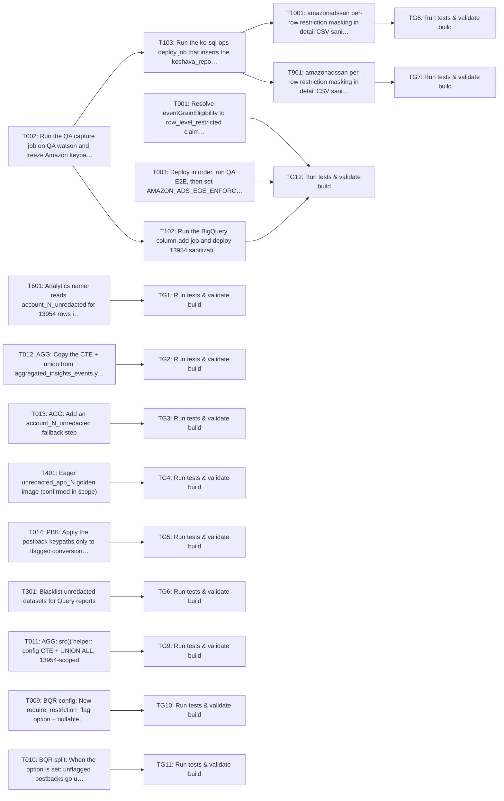

Approving locks the requirements and your decisions. Tasks are a guide; code questions go to the coding agent.

> Plan of record, not execution order: the coding agent works one repo at a time from the requirements and the approved decisions, and links its PR on the repo epic.

---
id: implementation-task-matrix
title: Implementation Task Matrix
---

## Implementation Task Matrix — wi_a8a2f1cb9bf4c32e30c5

**Matrix ID:** `wi_a8a2f1cb9bf4c32e30c5-r2` · **Generated:** 2026-11-04T09:06:35.821929+00:00 · **Source:** `tasks` · **Verdict:** **READY with 2 warnings**

### Summary

| Metric | Value |
| :--- | :--- |
| Tasks total | 28 |
| AI-allocated | 24 |
| Manual-allocated | 4 |
| Waves | 4 |
| Conflicts | 0 |
| Requirements uncovered | 1 |
| Low-confidence allocations (<0.6) | 0 |

### Wave 0

| Task | Title | Repo | Owner | Allocation | Confidence | Status |
| :--- | :--- | :--- | :--- | :--- | :--- | :--- |
| T001 | Resolve eventGrainEligibility to row_level_restricted claim flag (fail-closed,… | Kochava/watson | coding-agent | ai | 0.80 | planned |
| T002 | Run the QA capture job on QA watson and freeze Amazon keypath/report_filtering… | Kochava/watson | manual-developer | manual | 0.80 | planned |
| T003 | Deploy in order, run QA E2E, then set AMAZON_ADS_EGE_ENFORCE_FROM on prod watson | Kochava/watson | manual-developer | manual | 0.80 | planned |
| T009 | BQR config: New require_restriction_flag option + nullable BOOL column on netwo… | Kochava/sanitization-api | coding-agent | ai | 0.80 | planned |
| T010 | BQR split: When the option is set: unflagged postbacks go unchanged to postback… | Kochava/soccer-v2 | coding-agent | ai | 0.90 | planned |
| T011 | AGG: src() helper: config CTE + UNION ALL, 13954-scoped | Kochava/rollup-worker-cloud | coding-agent | ai | 0.90 | planned |
| T012 | AGG: Copy the CTE + union from aggregated_insights_events.yaml | Kochava/apache-superset-dashboards | coding-agent | ai | 0.90 | planned |
| T013 | AGG: Add an account_N_unredacted fallback step | Kochava/app-match-api | coding-agent | ai | 0.80 | planned |
| T014 | PBK: Apply the postback keypaths only to flagged conversions when the option is… | Kochava/control | coding-agent | ai | 0.80 | planned |
| T301 | Blacklist unredacted datasets for Query reports | Kochava/koch-query-api | coding-agent | ai | 0.80 | planned |
| T401 | Eager unredacted_app_N golden image (confirmed in scope) | Kochava/bqgolden | coding-agent | ai | 0.80 | planned |
| T601 | Analytics namer reads account_N_unredacted for 13954 rows in config window | Kochava/analytics-query | coding-agent | ai | 0.80 | planned |

### Wave 1

| Task | Title | Repo | Owner | Allocation | Confidence | Status |
| :--- | :--- | :--- | :--- | :--- | :--- | :--- |
| T102 | Run the BigQuery column-add job and deploy 13954 sanitization configuration and… | Kochava/watson | manual-developer | manual | 0.80 | planned |
| T103 | Run the ko-sql-ops deploy job that inserts the kochava_reports.report_filtering… | Kochava/krepdetailworkerv14 | manual-developer | manual | 0.80 | planned |
| TG1 | Run tests & validate build | Kochava/analytics-query | test-change-gate | ai | 0.90 | planned |
| TG10 | Run tests & validate build | Kochava/sanitization-api | test-change-gate | ai | 0.90 | planned |
| TG11 | Run tests & validate build | Kochava/soccer-v2 | test-change-gate | ai | 0.90 | planned |
| TG2 | Run tests & validate build | Kochava/apache-superset-dashboards | test-change-gate | ai | 0.90 | planned |
| TG3 | Run tests & validate build | Kochava/app-match-api | test-change-gate | ai | 0.90 | planned |
| TG4 | Run tests & validate build | Kochava/bqgolden | test-change-gate | ai | 0.90 | planned |
| TG5 | Run tests & validate build | Kochava/control | test-change-gate | ai | 0.90 | planned |
| TG6 | Run tests & validate build | Kochava/koch-query-api | test-change-gate | ai | 0.90 | planned |
| TG9 | Run tests & validate build | Kochava/rollup-worker-cloud | test-change-gate | ai | 0.90 | planned |

### Wave 2

| Task | Title | Repo | Owner | Allocation | Confidence | Status |
| :--- | :--- | :--- | :--- | :--- | :--- | :--- |
| T1001 | amazonadssan per-row restriction masking in detail CSV sanitizers (v14, mysql b… | Kochava/krepdetailworkerv14 | coding-agent | ai | 0.80 | planned |
| T901 | amazonadssan per-row restriction masking in detail CSV sanitizers (v13) | Kochava/krepdetailworkerv13 | coding-agent | ai | 0.80 | planned |
| TG12 | Run tests & validate build | Kochava/watson | test-change-gate | ai | 0.90 | planned |

### Wave 3

| Task | Title | Repo | Owner | Allocation | Confidence | Status |
| :--- | :--- | :--- | :--- | :--- | :--- | :--- |
| TG7 | Run tests & validate build | Kochava/krepdetailworkerv13 | test-change-gate | ai | 0.90 | planned |
| TG8 | Run tests & validate build | Kochava/krepdetailworkerv14 | test-change-gate | ai | 0.90 | planned |

### Dependency Graph

### Open Questions

None.

### Uncovered Requirements

`BR-10`

### Warnings

- T401: `app_golden_image_unredacted_test.go` has no folder in the repo; check where it belongs
- grounding pinned to mysql; knowledge graph skipped for Kochava/krepdetailworkerv14

---
> Generated by: taskmatrix 0.1.0
