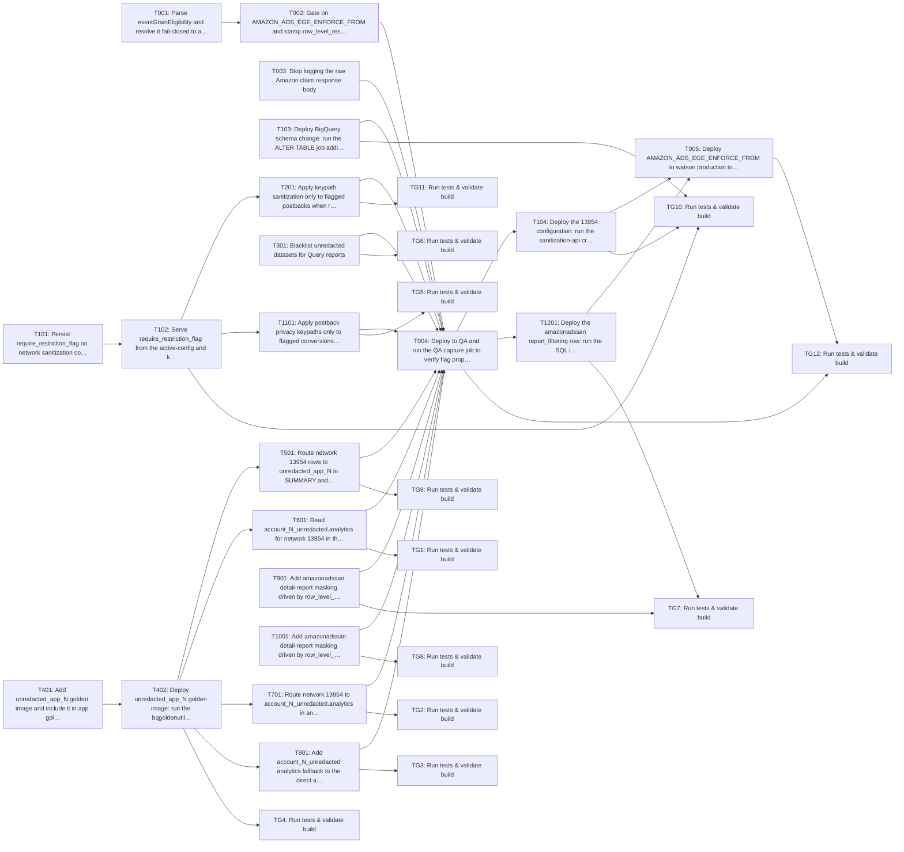

Approving locks the requirements and your decisions. Tasks are a guide; code questions go to the coding agent.

> Plan of record, not execution order: the coding agent works one repo at a time from the requirements and the approved decisions, and links its PR on the repo epic.

---
id: implementation-task-matrix
title: Implementation Task Matrix
---

## Implementation Task Matrix — wi_dry088_a2

**Matrix ID:** `wi_dry088_a2-r1` · **Generated:** 2026-11-04T07:19:03.024095+00:00 · **Source:** `tasks` · **Verdict:** **READY with 4 warnings**

### Summary

| Metric | Value |
| :--- | :--- |
| Tasks total | 33 |
| AI-allocated | 28 |
| Manual-allocated | 5 |
| Waves | 7 |
| Conflicts | 0 |
| Requirements uncovered | 11 |
| Low-confidence allocations (<0.6) | 0 |

### Wave 0

| Task | Title | Repo | Owner | Allocation | Confidence | Status |
| :--- | :--- | :--- | :--- | :--- | :--- | :--- |
| T001 | Parse eventGrainEligibility and resolve it fail-closed to a restriction decision | Kochava/watson | coding-agent | ai | 0.80 | planned |
| T003 | Stop logging the raw Amazon claim response body | Kochava/watson | coding-agent | ai | 0.80 | planned |
| T1001 | Add amazonadssan detail-report masking driven by row_level_restricted (non-even… | Kochava/krepdetailworkerv14 | coding-agent | ai | 0.80 | planned |
| T101 | Persist require_restriction_flag on network sanitization configuration (BQ DAO,… | Kochava/sanitization-api | coding-agent | ai | 0.80 | planned |
| T103 | Deploy BigQuery schema change: run the ALTER TABLE job adding require_restricti… | Kochava/sanitization-api | manual-developer | manual | 0.80 | planned |
| T301 | Blacklist unredacted datasets for Query reports | Kochava/koch-query-api | coding-agent | ai | 0.80 | planned |
| T401 | Add unredacted_app_N golden image and include it in app golden image sync | Kochava/bqgolden | coding-agent | ai | 0.80 | planned |
| T901 | Add amazonadssan detail-report masking driven by row_level_restricted (non-even… | Kochava/krepdetailworkerv13 | coding-agent | ai | 0.80 | planned |

### Wave 1

| Task | Title | Repo | Owner | Allocation | Confidence | Status |
| :--- | :--- | :--- | :--- | :--- | :--- | :--- |
| T002 | Gate on AMAZON_ADS_EGE_ENFORCE_FROM and stamp row_level_restricted / event_grai… | Kochava/watson | coding-agent | ai | 0.80 | planned |
| T102 | Serve require_restriction_flag from the active-config and keypaths endpoints | Kochava/sanitization-api | coding-agent | ai | 0.80 | planned |
| T402 | Deploy unredacted_app_N golden image: run the bqgoldenutil sync job for all apps | Kochava/bqgolden | manual-developer | manual | 0.80 | planned |
| TG6 | Run tests & validate build | Kochava/koch-query-api | test-change-gate | ai | 0.90 | planned |
| TG8 | Run tests & validate build | Kochava/krepdetailworkerv14 | test-change-gate | ai | 0.90 | planned |

### Wave 2

| Task | Title | Repo | Owner | Allocation | Confidence | Status |
| :--- | :--- | :--- | :--- | :--- | :--- | :--- |
| T1101 | Apply postback privacy keypaths only to flagged conversions when require_restri… | Kochava/control | coding-agent | ai | 0.80 | planned |
| T201 | Apply keypath sanitization only to flagged postbacks when require_restriction_f… | Kochava/soccer-v2 | coding-agent | ai | 0.90 | planned |
| T501 | Route network 13954 rows to unredacted_app_N in SUMMARY and DETAIL rollup queri… | Kochava/rollup-worker-cloud | coding-agent | ai | 0.90 | planned |
| T601 | Read account_N_unredacted.analytics for network 13954 in the production analyti… | Kochava/analytics-query | coding-agent | ai | 0.80 | planned |
| T701 | Route network 13954 to account_N_unredacted.analytics in analytics, cost_measur… | Kochava/apache-superset-dashboards | coding-agent | ai | 0.90 | planned |
| T801 | Add account_N_unredacted analytics fallback to the direct app match lookup | Kochava/app-match-api | coding-agent | ai | 0.80 | planned |
| TG4 | Run tests & validate build | Kochava/bqgolden | test-change-gate | ai | 0.90 | planned |

### Wave 3

| Task | Title | Repo | Owner | Allocation | Confidence | Status |
| :--- | :--- | :--- | :--- | :--- | :--- | :--- |
| T004 | Deploy to QA and run the QA capture job to verify flag propagation on every con… | Kochava/watson | manual-developer | manual | 0.80 | planned |
| TG1 | Run tests & validate build | Kochava/analytics-query | test-change-gate | ai | 0.90 | planned |
| TG11 | Run tests & validate build | Kochava/soccer-v2 | test-change-gate | ai | 0.90 | planned |
| TG2 | Run tests & validate build | Kochava/apache-superset-dashboards | test-change-gate | ai | 0.90 | planned |
| TG3 | Run tests & validate build | Kochava/app-match-api | test-change-gate | ai | 0.90 | planned |
| TG5 | Run tests & validate build | Kochava/control | test-change-gate | ai | 0.90 | planned |
| TG9 | Run tests & validate build | Kochava/rollup-worker-cloud | test-change-gate | ai | 0.90 | planned |

### Wave 4

| Task | Title | Repo | Owner | Allocation | Confidence | Status |
| :--- | :--- | :--- | :--- | :--- | :--- | :--- |
| T104 | Deploy the 13954 configuration: run the sanitization-api create call for requir… | Kochava/sanitization-api | coding-agent | ai | 0.80 | planned |
| T1201 | Deploy the amazonadssan report_filtering row: run the SQL insert on kochava_rep… | Kochava/krepdetailworkerv13 | manual-developer | manual | 0.80 | planned |

### Wave 5

| Task | Title | Repo | Owner | Allocation | Confidence | Status |
| :--- | :--- | :--- | :--- | :--- | :--- | :--- |
| T005 | Deploy AMAZON_ADS_EGE_ENFORCE_FROM to watson production to enable enforcement (… | Kochava/watson | manual-developer | manual | 0.80 | planned |
| TG10 | Run tests & validate build | Kochava/sanitization-api | test-change-gate | ai | 0.90 | planned |
| TG7 | Run tests & validate build | Kochava/krepdetailworkerv13 | test-change-gate | ai | 0.90 | planned |

### Wave 6

| Task | Title | Repo | Owner | Allocation | Confidence | Status |
| :--- | :--- | :--- | :--- | :--- | :--- | :--- |
| TG12 | Run tests & validate build | Kochava/watson | test-change-gate | ai | 0.90 | planned |

### Dependency Graph

### Open Questions

None.

### Uncovered Requirements

`BR-7`, `BR-15`, `OOS-1`, `OOS-2`, `OOS-3`, `OOS-4`, `OOS-5`, `OOS-6`, `OOS-8`, `FUT-1`, `FUT-2`

### Warnings

- grounding pinned to mysql; knowledge graph skipped for Kochava/krepdetailworkerv14
- T101: task too large (8 files (max 5)); consider splitting
- T102: task too large (6 files (max 5)); consider splitting
- T701: task too large (7 files (max 5)); consider splitting

---
> Generated by: taskmatrix 0.1.0
