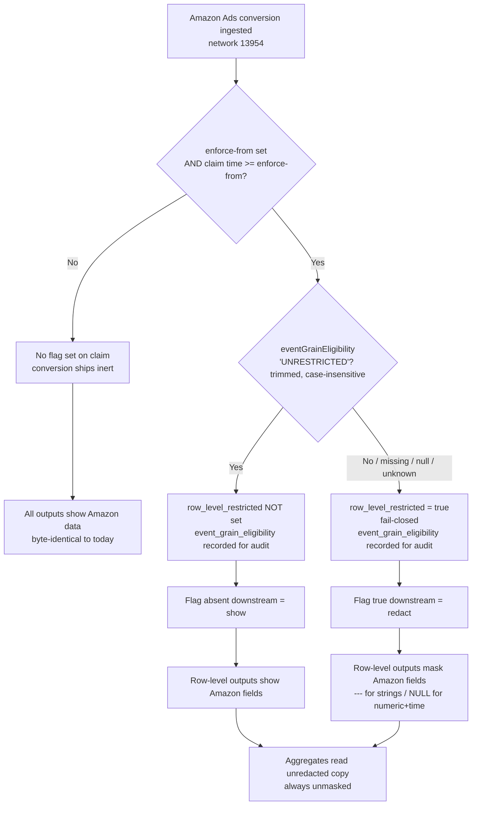
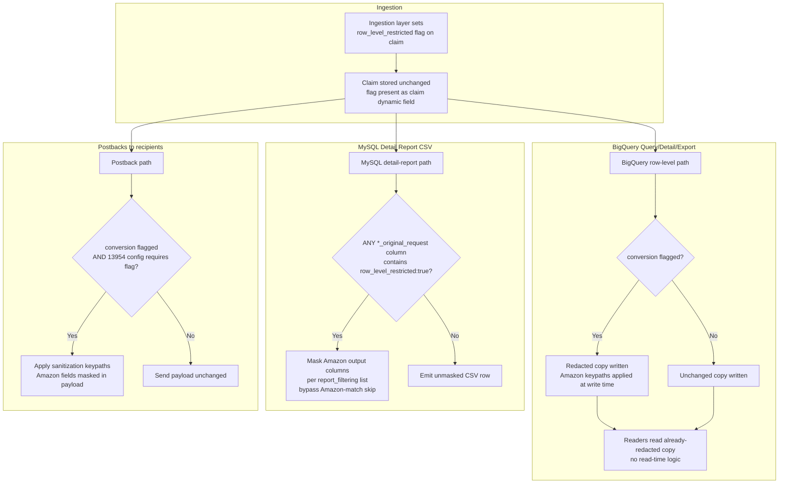
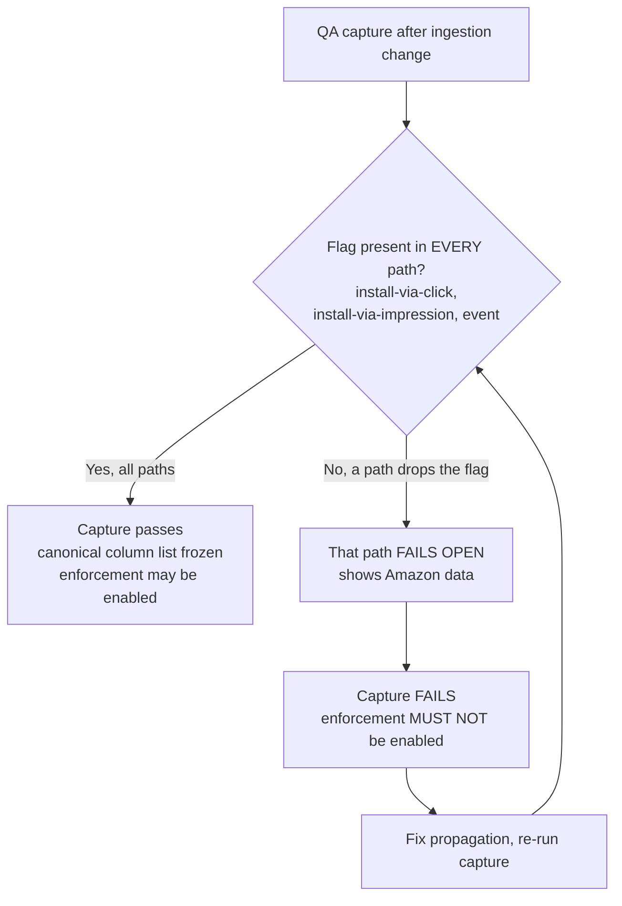

# T001: Parse eventGrainEligibility and resolve it fail-closed to a restriction decision

## In short

Teach the Amazon ingestion code to read Amazon's per-conversion eligibility value and decide whether the conversion is restricted. Anything other than a clear 'UNRESTRICTED' is treated as restricted, so data is never exposed by mistake.

🟢 Clear

## Overview

| Field | Value |
|---|---|
| Task ID | T001 |
| Repo | Kochava/watson |
| Phase | Phase 1 |
| User Story | N/A |
| Parallel | No |
| Status | New |
| Owner | Coding Agent (backend) |

## Context

Parse eventGrainEligibility and resolve it fail-closed to a restriction decision

This task is part of [DRY RUN] Amazon Ads eventGrainEligibility Row-Level Redaction.

### watson (ingestion service) — VERIFIED
**Technology**: Go (`go test -race -count=1 -tags=unit`)
**Key Files**:
- `cmd/watson/amazonadssan/request.go` - `response` struct carrying the Amazon claim response
- `cmd/watson/amazonadssan/reconcile.go` - `buildMatchObj` sets claim dynamic fields
- `cmd/watson/amazonadssan/*_test.go` - unit coverage
**Changes**:
| Change | Type | Complexity | Notes |
|--------|------|------------|-------|
| Add `eventGrainEligibility` field to `response` struct | Modify | L | Parsed from Amazon claim response (`request.go`) |
| Resolve eligibility → `row_level_restricted` (fail-closed) in `buildMatchObj` | Modify | M | BR-2/BR-3; set true only (BR-17, FR-ING-001/003); unset when UNRESTRICTED (FR-ING-002) |
| Record `event_grain_eligibility` audit value via `SetDynamicField` | Modify | L | FR-AUD-001/NFR-009; audit-only, never used downstream |
| Enforce-from gating via `AMAZON_ADS_EGE_ENFORCE_FROM` env var | Modify | M | Unix seconds; unset=disabled; malformed=startup failure; compared to claim time (BR-11, FR-ING-004, FR-ENF-004) |
| Scope all logic to app/network 13954 | Modify | L | FR-ING-005, BR-13 |
| Flag as top-level claim dynamic field | Modify | M | FR-ING-006; depends on OQ-3 proto confirmation |
| Unit tests: fail-closed truth table + gating + 13954-scope + pre-enforce | New | M | FR-ING-001/002/003/004/005 |
| Never log raw eligibility/Amazon fields | Modify | L | NFR-006, FR-AUD-003 |

## Technical Context
**Language/Version**: Go (watson ingestion service, verified via `go test -race -count=1 -tags=unit`). Stack for all other services: **undetermined — not code-verified** (eng-research OQ-2/OQ-4/OQ-5).
**Primary Dependencies**: watson claim-build pipeline (`request.go`, `reconcile.go`, `SetDynamicField`); existing write-time redaction split (spec-asserted, not verified); BigQuery per-app/per-account datasets; MySQL detail workers; postback engine; `bqgolden`.
**Storage**: BigQuery (redacted `app_N`/`account_N.analytics` + unredacted `unredacted_app_N`/`account_N_unredacted`), MySQL detail-report source tables, BigQuery sanitization-config model. No new tables/schemas (BR-15, OOS-1). No `ko-db-migrations` changes (OOS-9).
**Testing**: Go unit tests in watson (`go test -race -count=1 -tags=unit`); integration/E2E/regression harnesses undetermined pending service checkouts; QA capture gate (FR-ENF-003) owned by QA.
**Target Platform**: Kochava measurement/reporting/ingestion/postback backend services; Mimir monitoring (optional, for AUD only).
**Performance Goals**: Row-level p95 within current baseline (NFR-001); detail-worker per-row check adds no new query/external call (NFR-002); aggregate scan/cost within baseline (NFR-003).
**Constraints**: Fail-closed at ingestion (BR-2/BR-3); 13954-only (BR-13); additive/backward-compatible (NFR-011); inert-until-enforced (BR-11, FR-ENF-001); no historical backfill (BR-12, FR-ENF-005); never log raw Amazon data (NFR-006, FR-AUD-003).

### Confirmed Assumptions
| Spec Statement | Verified By | Notes |
|----------------|-------------|-------|
| `grafana-mimir-rules` is not a target for core redaction logic | Investigation CA-1/CA-P1/CA-P2/CA-P3 (Read-verified) | 99 YAML, no app code, no data model, no API; zero eligibility/redaction/row_level/13954 hits |
| watson owns the ingestion decision point (ING) | eng-research (resolved, Go stack verified) | `cmd/watson/amazonadssan`; `response` struct in `request.go`, `buildMatchObj` in `reconcile.go`, `SetDynamicField` |
| Postback engine exists as a monitored service | Investigation CA-2/CA-P3 (`postback-engine/alerts.yaml:87-105`) | Confirms existence only; its code was not investigated |

### Source Code Changes
```text
watson/  (VERIFIED code home for ING only)
└── cmd/
    └── watson/
        └── amazonadssan/
...

## Target Interface / Data Model

**Produces:**

```
// request.go: new field on the existing response struct (request.go:3-9)
EventGrainEligibility json.RawMessage `json:"eventGrainEligibility,omitempty"`

// restriction.go
// resolveRowLevelRestricted returns restricted=false ONLY when raw is a JSON string that equals "UNRESTRICTED" after strings.TrimSpace, case-insensitive. Absent, null, empty, non-string, unparseable or any other token => restricted=true (fail-closed, BR-2). audit is the string value when raw is a JSON string, else the raw JSON text, else "".
func resolveRowLevelRestricted(raw json.RawMessage) (restricted bool, audit string)
```

## Spec Excerpts

# Amazon Ads `eventGrainEligibility` Row-Level Redaction

> **Scope of this document part:** Sections 0–3 (Business Logic & Context, User Flows, Functional Requirements). Information Requirements, Non-Functional Requirements, and Phasing follow separately.

**Related PRD:** PRD-087 (`087-enforce-amazon-eventgraineligibility-in-row-level-`) — same ticket, superseded by this work item.

---

## 1. Business Logic & Context

### Problem

Amazon Ads attaches an `eventGrainEligibility` value to each conversion's claim response. When that value is not exactly `"UNRESTRICTED"`, Amazon's data-sharing terms require that the Amazon-sourced fields on that conversion not be exposed in row-level outputs (Query reports, Detail reports, exports, postbacks). Today, Amazon Ads conversions (network **13954**) are ingested and surfaced raw everywhere, with no per-conversion gating. This is a compliance exposure against Amazon's own terms.

### Value

- **Compliance:** Honor Amazon's per-conversion eligibility contract, unblocking continued Amazon Ads data flow.
- **Precision:** Mask only the sensitive columns on only the restricted rows — no loss of non-Amazon data, no loss of aggregate accuracy, no loss of rows.
- **Containment:** Reuse the existing redaction machinery (the write-time redacted/raw split already in production for Snap/TikTok/Reddit) rather than building a new redaction system, keeping blast radius small and the November-2026 target reachable.

### Business Rules

| # | Rule |
|---|------|
| BR-1 | The redaction decision is **per conversion**, driven solely by Amazon's `eventGrainEligibility` value on that conversion's claim response. |
| BR-2 | `eventGrainEligibility` equal to `"UNRESTRICTED"` (after trimming whitespace, case-insensitive) → **show** (no masking). Any other value — `"RESTRICTED"`, missing, null, empty, or unrecognized — → **mask** (fail-closed). |
| BR-3 | The fail-closed interpretation of a missing/null/unknown eligibility value lives **only at the ingestion decision point**. It is the ingestion layer that resolves ambiguity into a definite restricted/unrestricted flag. |
| BR-4 | Downstream consumers key **only on the resolved per-conversion flag** (`row_level_restricted`). Flag present and true → redact. Flag absent → show. Downstream consumers never read or interpret `eventGrainEligibility` themselves. |
| BR-5 | The decision is **not** role-, user-, or account-based. It applies identically to every viewer of row-level output. |
| BR-6 | Masking **masks columns, never removes rows**. Every conversion (restricted and unrestricted) remains present in row-level output; only Amazon-sourced columns on restricted rows are replaced. |
| BR-7 | Masked value is `---` for string columns and `NULL` for numeric/time columns. |
| BR-8 | Masking applies only to **Amazon-sourced fields and values derived from them**. Non-Amazon fields and network/tracker columns always remain visible, including on restricted rows. |
| BR-9 | Masking applies to **row-level outputs only**: Query reports, Detail reports, exports, and postbacks. **Aggregate outputs read unredacted data** and report unmasked values/counts for all 13954 conversions. |
| BR-10 | A single advertiser account may contain both restricted and unrestricted rows simultaneously in the same query result. |
| BR-11 | Enforcement is gated by a single ingestion-layer setting, the **enforce-from timestamp** (unset = off), compared against the claim time in the same process. Before enforce-from, no conversion is flagged, so nothing is masked anywhere and every output byte is identical to today's output. |
| BR-12 | Conversions ingested before enforce-from are never flagged and are never reprocessed; they remain unmasked permanently, including when re-read after enforcement is enabled. No historical backfill occurs. |
| BR-13 | Scope is **network 13954 only**. All other networks (including Snap/TikTok/Reddit and any other configured network) are unchanged in behavior. |
| BR-14 | The postback sent to Amazon itself (the attributed network's own postback) stays **raw** by default. [DECISION REQUIRED: DEC-001] |
| BR-15 | No new BigQuery tables or schemas are created for 13954. Existing per-app tables are reused. |
| BR-16 | The exact canonical list of Amazon-sourced columns/keys to mask is **frozen from a QA capture** that confirms the flag reaches every conversion type before enforcement is enabled. Until frozen, the column list is treated as provisional. |
| BR-17 | `row_level_restricted` is only ever written as true, never false. |
| BR-18 | Each claim response is evaluated when it is ingested. A later event inherits the flag of its attributing claim (latest re-engagement claim, else the install claim); there is no reprocessing. |

### Enforcement Lifecycle (business view)

1. All downstream readers, config rows, and workers are deployed and remain **inert** (no flag exists yet, so nothing masks).
2. Per-conversion configuration for 13954 is created.
3. A QA capture confirms the flag propagates to every conversion type and every output path.
4. Enforcement is enabled last by setting the enforce-from timestamp at the ingestion decision point.
5. From enforce-from forward, newly-ingested restricted conversions are masked in row-level outputs; aggregates and all prior data are unaffected.

---

## 2. User Flows (Visuals)

> "Viewer" here means any consumer of output — a reporting user, an export, or a downstream postback recipient. The redaction decision is identical for all of them.

### 2.1 Decision & Propagation Flow (Happy Path + Fail-Closed + Pre-Enforcement)



### 2.2 Row-Level Output Masking Flow (per output channel)



### 2.3 Error State — Flag Fails to Propagate to a Path



---

## 3. Functional Requirements

> Group IDs: **ING** (ingestion decision & flag), **BQR** (BigQuery row-level), **AGG** (aggregates), **MYD** (MySQL detail workers), **PBK** (postbacks), **QRY** (query-engine blacklist), **ENF** (enforcement/lifecycle), **AUD** (audit & monitoring).

### 3.1 Ingestion Decision & Flag (ING)

#### FR-ING-001 — Resolve eligibility to a per-conversion flag
```gherkin
Scenario: Restricted eligibility sets the flag
  Given enforcement is enabled for network 13954
    And a conversion's ingest time is at or after the enforce-from timestamp
    And the conversion's claim response eventGrainEligibility value is not "UNRESTRICTED" (trimmed, case-insensitive)
  When the Amazon module processes the claim at ingestion
  Then row_level_restricted is set to true on the claim
    And event_grain_eligibility is recorded on the claim for audit only
```

#### FR-ING-002 — Unrestricted eligibility leaves the flag unset
```gherkin
Scenario: Unrestricted eligibility does not set the flag
  Given enforcement is enabled for network 13954
    And a conversion's ingest time is at or after the enforce-from timestamp
    And the conversion's claim response eventGrainEligibility value is "UNRESTRICTED" (trimmed, case-insensitive)
  When the Amazon module processes the claim at ingestion
  Then row_level_restricted is NOT set on the claim
    And event_grain_eligibility is recorded on the claim for audit only
```

#### FR-ING-003 — Fail-closed on ambiguous eligibility
```gherkin
Scenario Outline: Missing, null, or unrecognized eligibility is treated as restricted
  Given enforcement is enabled for network 13954
    And a conversion's ingest time is at or after the enforce-from timestamp
    And the conversion's claim response eligibility value is <value>
  When the Amazon module processes the claim at ingestion
  Then row_level_restricted is set to true on the claim

  Examples:
    | value                        |
    | absent (field not present)   |
    | null                         |
    | empty string                 |
    | "RESTRICTED"                 |
    | any unrecognized token       |
    | non-string or unparseable    |
```

> No partial state: the Amazon module sets the flag in memory while building the claim, and the claim and flag leave the ingestion layer together in one response. If the Amazon module itself errors, no Amazon claim is produced, so there is nothing to show.

#### FR-ING-004 — No flag before enforce-from
```gherkin
Scenario: Pre-enforcement conversions carry no flag
  Given a conversion's ingest time is before the enforce-from timestamp
    OR enforcement is not enabled for network 13954
  When the Amazon module processes the claim at ingestion
  Then row_level_restricted is NOT set on the claim
    And the conversion ships inert through every downstream path
```

#### FR-ING-005 — Flag is set only for network 13954
```gherkin
Scenario: Other networks are never flagged by this logic
  Given a conversion belongs to a network other than 13954
  When the conversion is ingested
  Then this feature's eligibility logic does not run
    And row_level_restricted is NOT set by this feature
```

#### FR-ING-006 — Claim stored unchanged with flag present
```gherkin
Scenario: Downstream stores retain the flag as a claim dynamic field
  Given the Amazon module has set row_level_restricted = true on a 13954 claim
  When the claim is persisted
  Then the flag is present as a top-level claim dynamic field in every stored copy of the claim blob
    And the stored claim is otherwise unchanged from what the ingestion layer produced
```

### 3.2 BigQuery Row-Level Output (BQR)

#### FR-BQR-001 — Fl

## Existing Pattern

Same package style as cmd/watson/amazonadssan/reconcile.go:227-229 (small unexported helper next to the response types); test build tag as cmd/watson/amazonadssan/reconcile_test.go:1

From `cmd/watson/amazonadssan/reconcile.go`:
```
package amazonadssan

import (
	"bytes"
	"context"
	"encoding/json"
	"errors"
	"fmt"
	"math"
	"net/http"
	"os"
	"strings"
	"sync"
	"time"

	"github.com/Kochava/watson/cmd/watson/claimid"
	"github.com/Kochava/watson/cmd/watson/httputil"
	"github.com/Kochava/watson/cmd/watson/util"
	"github.com/Kochava/watson/cmd/watson/zeroid"

	"github.com/Kochava/watson/cmd/watson/ruleset"
	"github.com/Kochava/watson/cmd/watson/tracker/santracker"

	"github.com/Kochava/watson/cmd/build"
	"github.com/Kochava/watson/cmd/reclog/creclog"
```

From `cmd/watson/amazonadssan/credentials.go`:
```
package amazonadssan

import (
	"context"
	"crypto/sha256"
	"encoding/hex"
	"encoding/json"
	"math/rand"
	"net/http"
	"sync"
	"time"

	"github.com/aws/aws-sdk-go-v2/aws"
	v4 "github.com/aws/aws-sdk-go-v2/aws/signer/v4"
	"go.uber.org/zap"

	"github.com/Kochava/watson/cmd/build"
)

type Credentials struct {
	httpClient             *http.Client
	credentialsApiKey      string
	credentialsApiHost     string
	credentialsApiEndpoint string
	amazonAdsApiKey        string
```

Already in the repo:
- `cmd/watson/amazonadssan/request.go`

## Implementation Guide

1. In cmd/watson/amazonadssan/request.go, add `EventGrainEligibility json.RawMessage `json:"eventGrainEligibility,omitempty"`` to the existing `response` struct.
2. Create cmd/watson/amazonadssan/restriction.go with `resolveRowLevelRestricted(raw json.RawMessage) (restricted bool, audit string)`.
3. Return restricted=false only when raw is a JSON string equal to "UNRESTRICTED" after strings.TrimSpace, compared case-insensitively.
4. Return restricted=true for absent, null, empty, non-string, unparseable, or any other value (fail-closed).
5. Set audit to the string value for a JSON string, else the raw JSON text, else "". Do not log the raw value.
6. Write a table-driven test in restriction_test.go covering: UNRESTRICTED, ' unrestricted ', RESTRICTED, missing, null, "", number, object, malformed JSON, unknown token.

## Files to Modify

| File | Create/Modify/Test | Note |
|---|---|---|
| `cmd/watson/amazonadssan/restriction.go` | Create | - |
| `cmd/watson/amazonadssan/request.go` | Modify | - |
| `cmd/watson/amazonadssan/restriction_test.go` | Test | - |

## Acceptance Criteria

- WHEN eventGrainEligibility is the JSON string "UNRESTRICTED", with any case and surrounding whitespace, THE SYSTEM SHALL return restricted=false from resolveRowLevelRestricted. [BR-2]
- WHEN eventGrainEligibility is "RESTRICTED" or any other unrecognized string, THE SYSTEM SHALL return restricted=true. [BR-2, BR-3]
- WHEN eventGrainEligibility is missing, null, empty, non-string, or unparseable, THE SYSTEM SHALL return restricted=true. [BR-2, BR-3]
- WHEN a claim response is parsed, THE SYSTEM SHALL derive the decision only from that response's eventGrainEligibility field. [BR-1]
- WHEN resolveRowLevelRestricted returns a decision, THE SYSTEM SHALL return only a restricted boolean for the caller to set as true, never as an explicit false flag. [BR-17]
- Existing tests pass
- New functionality has test coverage
- Code follows repository conventions (see CLAUDE.md)

## Dependencies

**Blocked by:**
- none

**Blocks:**
- T002 - Gate on AMAZON_ADS_EGE_ENFORCE_FROM and stamp row_level_restricted / event_grain_eligibility on the 13954 claim

## Testing Notes

```bash
go test ./...
```

## Reviewer Notes

Add suggestions here or as Asana comments; tell the agent in the Slack thread and it will apply them.

Coding agent: one PR per repo — include all `Kochava/watson` tasks in one PR on branch `impl/wi_dry088_a2-backend`.

---

**Parent Task:** [DRY RUN] Amazon Ads eventGrainEligibility Row-Level Redaction — Kochava/watson (6 tasks · 1 PR)
**PRD:** 088-amazon-ads-eventgraineligibility-row-level-redacti