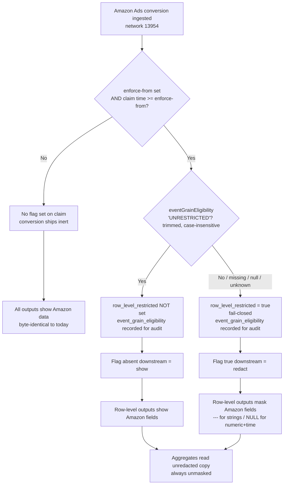
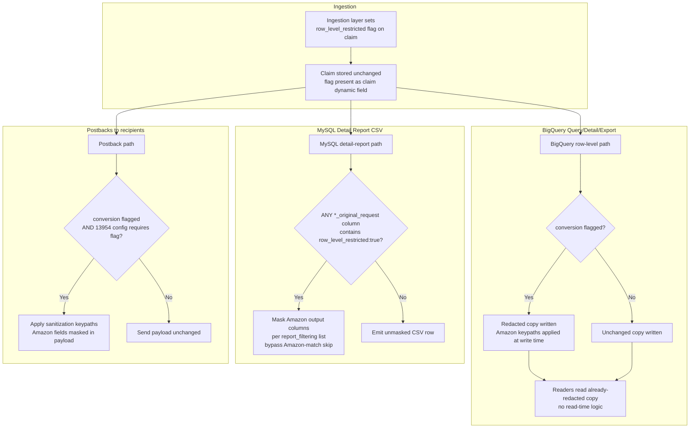
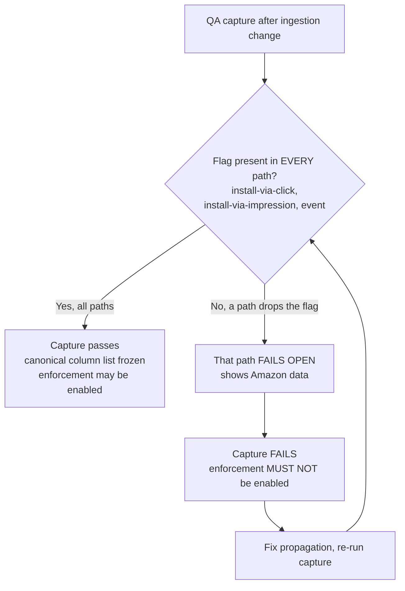

# T001: Resolve eventGrainEligibility to row_level_restricted claim flag (fail-closed, enforce-from gated)

## In short

When Amazon Ads says a conversion's data can't be shown, watson now marks that conversion as restricted at the moment it arrives. Nothing is marked until a switch date is set, and anything unclear is treated as restricted.

🟢 Clear

## Overview

| Field | Value |
|---|---|
| Task ID | T001 |
| Repo | Kochava/watson |
| Phase | Phase 1 |
| User Story | N/A |
| Parallel | No |
| Status | New |
| Owner | Coding Agent (backend) |

## Context

Resolve eventGrainEligibility to row_level_restricted claim flag (fail-closed, enforce-from gated)

This task is part of Amazon Ads eventGrainEligibility Row-Level Redaction.

### Source Code Changes
```text
watson/cmd/watson/amazonadssan/
├── request.go            [MODIFY] EventGrainEligibility json.RawMessage on response
├── reconcile.go          [MODIFY] parseEligibility, enforce-from check, dynamic fields in buildMatchObj, mock block (mockResponse :160-225)
└── reconcile_test.go     [MODIFY] eligibility + enforcement tests
watson config/env         [MODIFY] AMAZON_ADS_EGE_ENFORCE_FROM
sanitization-api/internal/dao/bqnetworksanitization/structs.go  [MODIFY] require_restriction_flag
sanitization-api create/update/get handlers + BQ migration       [MODIFY/NEW] nullable BOOL column
soccer-v2/internal/httpclients/sanitization/models/sanitization.go [MODIFY] RequireRestrictionFlag
soccer-v2/cmd/soccer-v2/main.go (Handle :261-300)                  [MODIFY] conditional sanitization
soccer-v2/internal/sanitization/sanitize.go                        [MODIFY, only if QA capture needs it] typed non-string leaves, repeated fields
control/source/var/www/lib/KochavaControl/Event/Postback.php       [MODIFY] keypath path (:1640-1695, retrieveKeyPaths :1688) honors the flag
control/.../SanitizationApiClient.php                              [MODIFY] read require_restriction_flag
control/tests/lib/KochavaControl/Event/Postback_test.php           [MODIFY]
krepdetailworkerv14 branch mysql (cmd/krepdetailworkerv14/main.go, sanitize.go)  [MODIFY] per-row flag check
krepdetailworkerv14 main (legacy RunReportGen path)                             [MODIFY] same
krepdetailworkerv13 (src/krepdetailworkerv13/main.go)                           [MODIFY] same
koch-query-api/cmd/query/blacklist.go (:3-37) + blacklist_test.go  [MODIFY] "unredacted" entry
bqgolden (OPTIONAL, only if the rollup missing-table guard is dropped)
├── app_golden_image.go (:52-72)                          [MODIFY] CoreUnredactedGoldenImage → unredacted_app_%d
├── cmd/bqgoldenutil/config/app_golden_image.go (:5-29)   [MODIFY] flag golden-image-core-unredacted
└── cmd/bqgoldenutil/subcmd/app_golden_images.go (:10-32) [MODIFY] explicit list + all-tables fallback
rollup-worker-cloud/cmd/rollup-worker-cloud/buildquery.go          [MODIFY] src() UNION ALL for installs/san_claims/events
rollup-worker-cloud/cmd/rollup-worker-cloud/main.go (:724)         [MODIFY] pass ReadProjectID + app id separately
rollup-worker-cloud/cmd/rollup-worker-cloud/buildquery_test.go     [NEW] (repo has no tests today)
analytics-query/pkg/analyticstechspecs/namerproduction.go (:92, :353) [MODIFY] standardSource()
analytics-query/pkg/analyticstechspecs/namerconditional.go (:42)      [MODIFY] bare-table path
apache-superset-dashboards/prod/datasets/Google_BigQuery_Kochava_Query_1370/
├── analytics.yaml (:8-16)                                 [MODIFY]
├── cost_measurement.yaml (:31-32, :50-51)                 [MODIFY]
├── aggregated_insights_app_campaign_filter.yaml (:8-12)   [MODIFY]
└── aggregated_insights_match_to_type_filter.yaml (:8-9)   [MODIFY]
app-match-api/pkg/directmatch/getter.go (:12-72) + getter_test.go [MODIFY/NEW] unredacted step between analytics and restricted
Data rows (sanitization-api API; report_filtering via ko-sql-ops): 13954 configuration, keypath rows, amazonadssan report_filtering row
```
**Structure Notes**: one branch per repo off fresh main; `test:` commit (failing) then `feat:` commit per change; one PR per repo, merged in Rollout order.

### watson (ingestion)
**Technology**: Go. CI: `go test -race -count=1 -tags=unit ./...`
...

## Target Interface / Data Model

**Consumes:**

```
none (existing: response struct request.go:3-9; Reconciler.buildMatchObj reconcile.go:438; build.AmazonAdsSANConfig amazonadssan_config.go:9; waterfall.ClaimInterface.SetDynamicField)
```

**Produces:**

```
// request.go
type response struct { /* existing fields */ EventGrainEligibility json.RawMessage `json:"eventGrainEligibility,omitempty"` }
// reconcile.go (pure, package-private)
func resolveEligibility(raw json.RawMessage, claimUnix int64, enforceFromUnix int64) (restricted bool, audit string, hasAudit bool)
// amazonadssan_config.go
type AmazonAdsSANConfig struct { /* existing */ EnforceFromUnix int64 } // env AMAZON_ADS_EGE_ENFORCE_FROM, 0 = off

Claim dynamic fields: row_level_restricted (bool, only ever true), event_grain_eligibility (string, upper-cased, omitted if missing/invalid).
```

## Spec Excerpts

# Amazon Ads `eventGrainEligibility` Row-Level Redaction

> **Scope of this document part:** Sections 0–3 (Business Logic & Context, User Flows, Functional Requirements). Information Requirements, Non-Functional Requirements, and Phasing follow separately.

**Related PRD:** PRD-087 (`087-enforce-amazon-eventgraineligibility-in-row-level-`) — same ticket, superseded by this work item.

---

## 1. Business Logic & Context

### Problem

Amazon Ads attaches an `eventGrainEligibility` value to each conversion's claim response. When that value is not exactly `"UNRESTRICTED"`, Amazon's data-sharing terms require that the Amazon-sourced fields on that conversion not be exposed in row-level outputs (Query reports, Detail reports, exports, postbacks). Today, Amazon Ads conversions (network **13954**) are ingested and surfaced raw everywhere, with no per-conversion gating. This is a compliance exposure against Amazon's own terms.

### Value

- **Compliance:** Honor Amazon's per-conversion eligibility contract, unblocking continued Amazon Ads data flow.
- **Precision:** Mask only the sensitive columns on only the restricted rows — no loss of non-Amazon data, no loss of aggregate accuracy, no loss of rows.
- **Containment:** Reuse the existing redaction machinery (the write-time redacted/raw split already in production for Snap/TikTok/Reddit) rather than building a new redaction system, keeping blast radius small and the November-2026 target reachable.

### Business Rules

| # | Rule |
|---|------|
| BR-1 | The redaction decision is **per conversion**, driven solely by Amazon's `eventGrainEligibility` value on that conversion's claim response. |
| BR-2 | `eventGrainEligibility` equal to `"UNRESTRICTED"` (after trimming whitespace, case-insensitive) → **show** (no masking). Any other value — `"RESTRICTED"`, missing, null, empty, or unrecognized — → **mask** (fail-closed). |
| BR-3 | The fail-closed interpretation of a missing/null/unknown eligibility value lives **only at the ingestion decision point**. It is the ingestion layer that resolves ambiguity into a definite restricted/unrestricted flag. |
| BR-4 | Downstream consumers key **only on the resolved per-conversion flag** (`row_level_restricted`). Flag present and true → redact. Flag absent → show. Downstream consumers never read or interpret `eventGrainEligibility` themselves. |
| BR-5 | The decision is **not** role-, user-, or account-based. It applies identically to every viewer of row-level output. |
| BR-6 | Masking **masks columns, never removes rows**. Every conversion (restricted and unrestricted) remains present in row-level output; only Amazon-sourced columns on restricted rows are replaced. |
| BR-7 | Masked value is `---` for string columns and `NULL` for numeric/time columns. |
| BR-8 | Masking applies only to **Amazon-sourced fields and values derived from them**. Non-Amazon fields and network/tracker columns always remain visible, including on restricted rows. |
| BR-9 | Masking applies to **row-level outputs only**: Query reports, Detail reports, exports, and postbacks. **Aggregate outputs read unredacted data** and report unmasked values/counts for all 13954 conversions. |
| BR-10 | A single advertiser account may contain both restricted and unrestricted rows simultaneously in the same query result. |
| BR-11 | Enforcement is gated by a single ingestion-layer setting, the **enforce-from timestamp** (unset = off), compared against the claim time in the same process. Before enforce-from, no conversion is flagged, so nothing is masked anywhere and every output byte is identical to today's output. |
| BR-12 | Conversions ingested before enforce-from are never flagged and are never reprocessed; they remain unmasked permanently, including when re-read after enforcement is enabled. No historical backfill occurs. |
| BR-13 | Scope is **network 13954 only**. All other networks (including Snap/TikTok/Reddit and any other configured network) are unchanged in behavior. |
| BR-14 | The postback sent to Amazon itself (the attributed network's own postback) stays **raw** by default. [DECISION REQUIRED: DEC-001] |
| BR-15 | No new BigQuery tables or schemas are created for 13954. Existing per-app tables are reused. |
| BR-16 | The exact canonical list of Amazon-sourced columns/keys to mask is **frozen from a QA capture** that confirms the flag reaches every conversion type before enforcement is enabled. Until frozen, the column list is treated as provisional. |
| BR-17 | `row_level_restricted` is only ever written as true, never false. |
| BR-18 | Each claim response is evaluated when it is ingested. A later event inherits the flag of its attributing claim (latest re-engagement claim, else the install claim); there is no reprocessing. |

### Enforcement Lifecycle (business view)

1. All downstream readers, config rows, and workers are deployed and remain **inert** (no flag exists yet, so nothing masks).
2. Per-conversion configuration for 13954 is created.
3. A QA capture confirms the flag propagates to every conversion type and every output path.
4. Enforcement is enabled last by setting the enforce-from timestamp at the ingestion decision point.
5. From enforce-from forward, newly-ingested restricted conversions are masked in row-level outputs; aggregates and all prior data are unaffected.

---

## 2. User Flows (Visuals)

> "Viewer" here means any consumer of output — a reporting user, an export, or a downstream postback recipient. The redaction decision is identical for all of them.

### 2.1 Decision & Propagation Flow (Happy Path + Fail-Closed + Pre-Enforcement)



### 2.2 Row-Level Output Masking Flow (per output channel)



### 2.3 Error State — Flag Fails to Propagate to a Path



---

## 3. Functional Requirements

> Group IDs: **ING** (ingestion decision & flag), **BQR** (BigQuery row-level), **AGG** (aggregates), **MYD** (MySQL detail workers), **PBK** (postbacks), **QRY** (query-engine blacklist), **ENF** (enforcement/lifecycle), **AUD** (audit & monitoring).

### 3.1 Ingestion Decision & Flag (ING)

#### FR-ING-001 — Resolve eligibility to a per-conversion flag
```gherkin
Scenario: Restricted eligibility sets the flag
  Given enforcement is enabled for network 13954
    And a conversion's ingest time is at or after the enforce-from timestamp
    And the conversion's claim response eventGrainEligibility value is not "UNRESTRICTED" (trimmed, case-insensitive)
  When the Amazon module processes the claim at ingestion
  Then row_level_restricted is set to true on the claim
    And event_grain_eligibility is recorded on the claim for audit only
```

#### FR-ING-002 — Unrestricted eligibility leaves the flag unset
```gherkin
Scenario: Unrestricted eligibility does not set the flag
  Given enforcement is enabled for network 13954
    And a conversion's ingest time is at or after the enforce-from timestamp
    And the conversion's claim response eventGrainEligibility value is "UNRESTRICTED" (trimmed, case-insensitive)
  When the Amazon module processes the claim at ingestion
  Then row_level_restricted is NOT set on the claim
    And event_grain_eligibility is recorded on the claim for audit only
```

#### FR-ING-003 — Fail-closed on ambiguous eligibility
```gherkin
Scenario Outline: Missing, null, or unrecognized eligibility is treated as restricted
  Given enforcement is enabled for network 13954
    And a conversion's ingest time is at or after the enforce-from timestamp
    And the conversion's claim response eligibility value is <value>
  When the Amazon module processes the claim at ingestion
  Then row_level_restricted is set to true on the claim

  Examples:
    | value                        |
    | absent (field not present)   |
    | null                         |
    | empty string                 |
    | "RESTRICTED"                 |
    | any unrecognized token       |
    | non-string or unparseable    |
```

> No partial state: the Amazon module sets the flag in memory while building the claim, and the claim and flag leave the ingestion layer together in one response. If the Amazon module itself errors, no Amazon claim is produced, so there is nothing to show.

#### FR-ING-004 — No flag before enforce-from
```gherkin
Scenario: Pre-enforcement conversions carry no flag
  Given a conversion's ingest time is before the enforce-from timestamp
    OR enforcement is not enabled for network 13954
  When the Amazon module processes the claim at ingestion
  Then row_level_restricted is NOT set on the claim
    And the conversion ships inert through every downstream path
```

#### FR-ING-005 — Flag is set only for network 13954
```gherkin
Scenario: Other networks are never flagged by this logic
  Given a conversion belongs to a network other than 13954
  When the conversion is ingested
  Then this feature's eligibility logic does not run
    And row_level_restricted is NOT set by this feature
```

#### FR-ING-006 — Claim stored unchanged with flag present
```gherkin
Scenario: Downstream stores retain the flag as a claim dynamic field
  Given the Amazon module has set row_level_restricted = true on a 13954 claim
  When the claim is persisted
  Then the flag is present as a top-level claim dynamic field in every stored copy of the claim blob
    And the stored claim is otherwise unchanged from what the ingestion layer produced
```

### 3.2 BigQuery Row-Level Output (BQR)

#### FR-BQR-001 — Fl

## Existing Pattern

Existing SetDynamicField usage in buildMatchObj (cmd/watson/amazonadssan/reconcile.go:456-469); flag definition style in cmd/build/amazonadssan_config.go:17-50

From `cmd/watson/amazonadssan/credentials.go`:
```
package amazonadssan

import (
	"context"
	"crypto/sha256"
	"encoding/hex"
	"encoding/json"
	"math/rand"
	"net/http"
	"sync"
	"time"

	"github.com/aws/aws-sdk-go-v2/aws"
	v4 "github.com/aws/aws-sdk-go-v2/aws/signer/v4"
	"go.uber.org/zap"

	"github.com/Kochava/watson/cmd/build"
)

type Credentials struct {
	httpClient             *http.Client
	credentialsApiKey      string
	credentialsApiHost     string
	credentialsApiEndpoint string
	amazonAdsApiKey        string
```

From `cmd/watson/amazonadssan/credentials_interface.go`:
```
package amazonadssan

import (
	"context"
	"net/http"
)

// CredentialsSigner defines the interface for signing HTTP requests,
// primarily used by the Reconciler to interact with Amazon Ads SAN credentials.
// This allows for interchangeable real and mock implementations.
type CredentialsSigner interface {
	SignHTTP(ctx context.Context, r *http.Request, bodyBytes []byte) error
}
```

Already in the repo:
- `cmd/watson/amazonadssan/request.go`
- `cmd/watson/amazonadssan/reconcile.go`
- `cmd/build/amazonadssan_config.go`
- `cmd/watson/amazonadssan/reconcile_test.go`

## Implementation Guide

1. In cmd/watson/amazonadssan/request.go, add `EventGrainEligibility json.RawMessage` (`json:"eventGrainEligibility,omitempty"`) to the `response` struct, so a legacy Boolean, null or object still unmarshals the claim.
2. In cmd/build/amazonadssan_config.go, add `EnforceFromUnix int64` to `AmazonAdsSANConfig`, read from env `AMAZON_ADS_EGE_ENFORCE_FROM` as Unix seconds. Unset means 0 (off). A malformed value must fail at startup.
3. In cmd/watson/amazonadssan/reconcile_test.go, write failing tests first: string, Boolean and missing/null eligibility; enforcement off (no flag key at all); restricted when enforced; unrestricted when enforced.
4. In reconcile.go, add the pure function `resolveEligibility(raw, claimUnix, enforceFromUnix)`. It returns unrestricted only when the trimmed, upper-cased string equals `UNRESTRICTED`. Missing, null, empty, non-string and any other value count as restricted. Restriction applies only when enforceFromUnix > 0 and claimUnix >= enforceFromUnix.
5. In `Reconciler.buildMatchObj` (reconcile.go:438), call `SetDynamicField` to write `row_level_restricted=true` only when restricted and enforced. Also write the upper-cased `event_grain_eligibility`, omitted when missing or invalid. Keep the change inside the amazonadssan module (13954 only).
6. Run `go test -race -count=1 -tags=unit ./cmd/watson/amazonadssan/...` and confirm it passes.

## Files to Modify

| File | Create/Modify/Test | Note |
|---|---|---|
| `cmd/watson/amazonadssan/request.go` | Modify | - |
| `cmd/watson/amazonadssan/reconcile.go` | Modify | - |
| `cmd/build/amazonadssan_config.go` | Modify | - |
| `cmd/watson/amazonadssan/reconcile_test.go` | Test | - |

## Acceptance Criteria

- WHEN enforce-from is set, the claim time is at or after it, and eligibility is RESTRICTED, missing, null, empty, non-string or unrecognized THE SYSTEM SHALL set claim field row_level_restricted to true. [BR-2, BR-3]
- WHEN eligibility is "UNRESTRICTED" in any letter case with surrounding whitespace and enforcement is active THE SYSTEM SHALL NOT set row_level_restricted. [BR-2]
- WHEN AMAZON_ADS_EGE_ENFORCE_FROM is unset or the claim time is before it THE SYSTEM SHALL leave the row_level_restricted key off the claim entirely. [BR-11, BR-12]
- WHEN row_level_restricted is written THE SYSTEM SHALL write it only as true and never as false. [BR-17]
- WHEN a claim response is processed THE SYSTEM SHALL record the upper-cased event_grain_eligibility as an audit field and omit it when the value is missing or invalid. [FR-AUD-001]
- Existing tests pass
- New functionality has test coverage
- Code follows repository conventions (see CLAUDE.md)

## Dependencies

**Blocked by:**
- none

**Blocks:**
- TG12 - Run tests & validate build

## Testing Notes

```bash
go test ./...
```

## Reviewer Notes

Add suggestions here or as Asana comments; tell the agent in the Slack thread and it will apply them.

Coding agent: one PR per repo — include all `Kochava/watson` tasks in one PR on branch `impl/wi_a8a2f1cb9bf4c32e30c5-backend`.

---

**Parent Task:** Amazon Ads eventGrainEligibility Row-Level Redaction — Kochava/watson (5 tasks · 1 PR)
**PRD:** 088-amazon-ads-eventgraineligibility-row-level-redacti