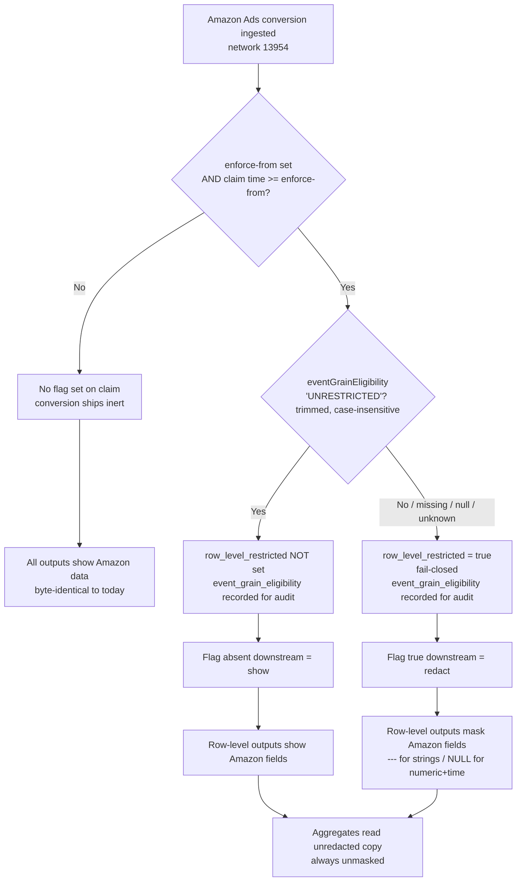
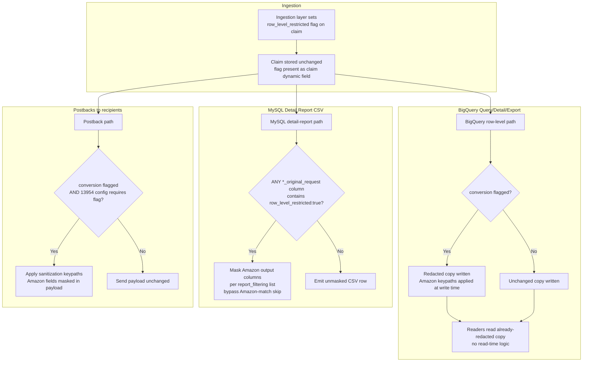
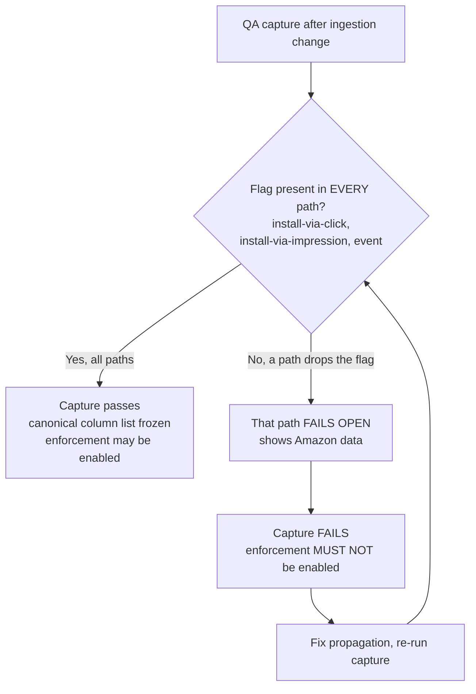

# T901: Add amazonadssan detail-report masking driven by row_level_restricted (non-event and event variants)

## In short

Teaches the detail-report worker to hide Amazon-sourced columns on Amazon Ads conversions that are flagged as restricted. Rows stay in the report, and nothing changes until the flag and its configuration exist.

🟢 Clear

## Overview

| Field | Value |
|---|---|
| Task ID | T901 |
| Repo | Kochava/krepdetailworkerv13 |
| Phase | Phase 1 |
| User Story | N/A |
| Parallel | No |
| Status | New |
| Owner | Coding Agent (backend) |

## Context

Add amazonadssan detail-report masking driven by row_level_restricted (non-event and event variants)

This task is part of [DRY RUN] Amazon Ads eventGrainEligibility Row-Level Redaction.

## Target Interface / Data Model

**Consumes:**

```
blob JSON containing top-level "row_level_restricted":true written by watson T002; the report_filtering row for partner `amazonadssan` is a RUNTIME input only (the code treats an absent row as an empty column list and does nothing), so there is no build-time dependency on ops task T1201
```

**Produces:**

```
// amazonadssan.go (package main)
const amazonAdsSANNetwork = "13954"
var amazonSANCols []int // column positions from the amazonadssan filter_columns; empty until the report_filtering row exists
func amazonSANRowRestricted(rowArr []string, blobCols []int, extra string) bool // true if extra or any rowArr[blobCols[i]] contains "row_level_restricted":true (whitespace tolerant, CSV-doubled quotes tolerated); never parses eventGrainEligibility
func maskAmazonSANColumns(rowArr []string, cols []int, include func(col int) bool) // sets rowArr[c]="---" for each c in cols where include(c)
```

## Spec Excerpts

# Amazon Ads `eventGrainEligibility` Row-Level Redaction

> **Scope of this document part:** Sections 0–3 (Business Logic & Context, User Flows, Functional Requirements). Information Requirements, Non-Functional Requirements, and Phasing follow separately.

**Related PRD:** PRD-087 (`087-enforce-amazon-eventgraineligibility-in-row-level-`) — same ticket, superseded by this work item.

---

## 1. Business Logic & Context

### Problem

Amazon Ads attaches an `eventGrainEligibility` value to each conversion's claim response. When that value is not exactly `"UNRESTRICTED"`, Amazon's data-sharing terms require that the Amazon-sourced fields on that conversion not be exposed in row-level outputs (Query reports, Detail reports, exports, postbacks). Today, Amazon Ads conversions (network **13954**) are ingested and surfaced raw everywhere, with no per-conversion gating. This is a compliance exposure against Amazon's own terms.

### Value

- **Compliance:** Honor Amazon's per-conversion eligibility contract, unblocking continued Amazon Ads data flow.
- **Precision:** Mask only the sensitive columns on only the restricted rows — no loss of non-Amazon data, no loss of aggregate accuracy, no loss of rows.
- **Containment:** Reuse the existing redaction machinery (the write-time redacted/raw split already in production for Snap/TikTok/Reddit) rather than building a new redaction system, keeping blast radius small and the November-2026 target reachable.

### Business Rules

| # | Rule |
|---|------|
| BR-1 | The redaction decision is **per conversion**, driven solely by Amazon's `eventGrainEligibility` value on that conversion's claim response. |
| BR-2 | `eventGrainEligibility` equal to `"UNRESTRICTED"` (after trimming whitespace, case-insensitive) → **show** (no masking). Any other value — `"RESTRICTED"`, missing, null, empty, or unrecognized — → **mask** (fail-closed). |
| BR-3 | The fail-closed interpretation of a missing/null/unknown eligibility value lives **only at the ingestion decision point**. It is the ingestion layer that resolves ambiguity into a definite restricted/unrestricted flag. |
| BR-4 | Downstream consumers key **only on the resolved per-conversion flag** (`row_level_restricted`). Flag present and true → redact. Flag absent → show. Downstream consumers never read or interpret `eventGrainEligibility` themselves. |
| BR-5 | The decision is **not** role-, user-, or account-based. It applies identically to every viewer of row-level output. |
| BR-6 | Masking **masks columns, never removes rows**. Every conversion (restricted and unrestricted) remains present in row-level output; only Amazon-sourced columns on restricted rows are replaced. |
| BR-7 | Masked value is `---` for string columns and `NULL` for numeric/time columns. |
| BR-8 | Masking applies only to **Amazon-sourced fields and values derived from them**. Non-Amazon fields and network/tracker columns always remain visible, including on restricted rows. |
| BR-9 | Masking applies to **row-level outputs only**: Query reports, Detail reports, exports, and postbacks. **Aggregate outputs read unredacted data** and report unmasked values/counts for all 13954 conversions. |
| BR-10 | A single advertiser account may contain both restricted and unrestricted rows simultaneously in the same query result. |
| BR-11 | Enforcement is gated by a single ingestion-layer setting, the **enforce-from timestamp** (unset = off), compared against the claim time in the same process. Before enforce-from, no conversion is flagged, so nothing is masked anywhere and every output byte is identical to today's output. |
| BR-12 | Conversions ingested before enforce-from are never flagged and are never reprocessed; they remain unmasked permanently, including when re-read after enforcement is enabled. No historical backfill occurs. |
| BR-13 | Scope is **network 13954 only**. All other networks (including Snap/TikTok/Reddit and any other configured network) are unchanged in behavior. |
| BR-14 | The postback sent to Amazon itself (the attributed network's own postback) stays **raw** by default. [DECISION REQUIRED: DEC-001] |
| BR-15 | No new BigQuery tables or schemas are created for 13954. Existing per-app tables are reused. |
| BR-16 | The exact canonical list of Amazon-sourced columns/keys to mask is **frozen from a QA capture** that confirms the flag reaches every conversion type before enforcement is enabled. Until frozen, the column list is treated as provisional. |
| BR-17 | `row_level_restricted` is only ever written as true, never false. |
| BR-18 | Each claim response is evaluated when it is ingested. A later event inherits the flag of its attributing claim (latest re-engagement claim, else the install claim); there is no reprocessing. |

### Enforcement Lifecycle (business view)

1. All downstream readers, config rows, and workers are deployed and remain **inert** (no flag exists yet, so nothing masks).
2. Per-conversion configuration for 13954 is created.
3. A QA capture confirms the flag propagates to every conversion type and every output path.
4. Enforcement is enabled last by setting the enforce-from timestamp at the ingestion decision point.
5. From enforce-from forward, newly-ingested restricted conversions are masked in row-level outputs; aggregates and all prior data are unaffected.

---

## 2. User Flows (Visuals)

> "Viewer" here means any consumer of output — a reporting user, an export, or a downstream postback recipient. The redaction decision is identical for all of them.

### 2.1 Decision & Propagation Flow (Happy Path + Fail-Closed + Pre-Enforcement)



### 2.2 Row-Level Output Masking Flow (per output channel)



### 2.3 Error State — Flag Fails to Propagate to a Path



---

## 3. Functional Requirements

> Group IDs: **ING** (ingestion decision & flag), **BQR** (BigQuery row-level), **AGG** (aggregates), **MYD** (MySQL detail workers), **PBK** (postbacks), **QRY** (query-engine blacklist), **ENF** (enforcement/lifecycle), **AUD** (audit & monitoring).

### 3.1 Ingestion Decision & Flag (ING)

#### FR-ING-001 — Resolve eligibility to a per-conversion flag
```gherkin
Scenario: Restricted eligibility sets the flag
  Given enforcement is enabled for network 13954
    And a conversion's ingest time is at or after the enforce-from timestamp
    And the conversion's claim response eventGrainEligibility value is not "UNRESTRICTED" (trimmed, case-insensitive)
  When the Amazon module processes the claim at ingestion
  Then row_level_restricted is set to true on the claim
    And event_grain_eligibility is recorded on the claim for audit only
```

#### FR-ING-002 — Unrestricted eligibility leaves the flag unset
```gherkin
Scenario: Unrestricted eligibility does not set the flag
  Given enforcement is enabled for network 13954
    And a conversion's ingest time is at or after the enforce-from timestamp
    And the conversion's claim response eventGrainEligibility value is "UNRESTRICTED" (trimmed, case-insensitive)
  When the Amazon module processes the claim at ingestion
  Then row_level_restricted is NOT set on the claim
    And event_grain_eligibility is recorded on the claim for audit only
```

#### FR-ING-003 — Fail-closed on ambiguous eligibility
```gherkin
Scenario Outline: Missing, null, or unrecognized eligibility is treated as restricted
  Given enforcement is enabled for network 13954
    And a conversion's ingest time is at or after the enforce-from timestamp
    And the conversion's claim response eligibility value is <value>
  When the Amazon module processes the claim at ingestion
  Then row_level_restricted is set to true on the claim

  Examples:
    | value                        |
    | absent (field not present)   |
    | null                         |
    | empty string                 |
    | "RESTRICTED"                 |
    | any unrecognized token       |
    | non-string or unparseable    |
```

> No partial state: the Amazon module sets the flag in memory while building the claim, and the claim and flag leave the ingestion layer together in one response. If the Amazon module itself errors, no Amazon claim is produced, so there is nothing to show.

#### FR-ING-004 — No flag before enforce-from
```gherkin
Scenario: Pre-enforcement conversions carry no flag
  Given a conversion's ingest time is before the enforce-from timestamp
    OR enforcement is not enabled for network 13954
  When the Amazon module processes the claim at ingestion
  Then row_level_restricted is NOT set on the claim
    And the conversion ships inert through every downstream path
```

#### FR-ING-005 — Flag is set only for network 13954
```gherkin
Scenario: Other networks are never flagged by this logic
  Given a conversion belongs to a network other than 13954
  When the conversion is ingested
  Then this feature's eligibility logic does not run
    And row_level_restricted is NOT set by this feature
```

#### FR-ING-006 — Claim stored unchanged with flag present
```gherkin
Scenario: Downstream stores retain the flag as a claim dynamic field
  Given the Amazon module has set row_level_restricted = true on a 13954 claim
  When the claim is persisted
  Then the flag is present as a top-level claim dynamic field in every stored copy of the claim blob
    And the stored claim is otherwise unchanged from what the ingestion layer produced
```

### 3.2 BigQuery Row-Level Output (BQR)

#### FR-BQR-001 — Fl

## Existing Pattern

Per-row FB check inside sanitizeNetworkDataCSV_2 (src/krepdetailworkerv13/main.go:4615-4880) and sanitizeNetworkDataCSV_2event (src/krepdetailworkerv13/main.go:4277-4613); partner switch at main.go:4698-4748 and main.go:4347-4397

From `src/krepdetailworkerv13/bq.go`:
```
package main

import (
	"context"
	"database/sql"
	"encoding/csv"
	"encoding/json"
	"fmt"
	"google.golang.org/api/bigquery/v2"
	"os"
	"strconv"
	"strings"
	"time"

	_ "github.com/go-sql-driver/mysql"

	"golang.org/x/oauth2/google"
	"google.golang.org/api/googleapi"
)

const kochavaQueryProjectId = "kochava-query-1370"

var cacheInstalls map[int64][8]string

func initBigQuery() (*bigquery.Service, error) {
```

From `src/krepdetailworkerv13/agency.go`:
```
package main

import "database/sql"

// getTrackerCampaignID gets the campaign id used on a click...not the DB campaign id
func getTrackerCampaignIDForAppAndAgency(db *sql.DB, appID, agencyID int64) ([]string, error) {
	var (
		err           error
		campaignGUIDs []string

		rows  *sql.Rows
		query = `SELECT concat(koch_blogs.guid, trackers.legacy_campaign_id) as campaign_id
FROM kochava_conversions.trackers
JOIN kochava_wordpress.koch_blogs ON koch_blogs.blog_id = trackers.app_id
WHERE app_id = ?
  AND agency_network_id = ?;`
	)

	if rows, err = db.Query(query, appID, agencyID); err != nil {
		return campaignGUIDs, err
	}

	defer rows.Close()

	for rows.Next() {
```

Already in the repo:
- `src/krepdetailworkerv13/main.go`

## Implementation Guide

1. Read src/krepdetailworkerv13/main.go and find_sanitization_indices.go, and compare how other partner cases are handled in bq.go, agency.go, email.go and event_queries.go. Identify the existing code that loads a partner's filter_columns from report_filtering, and the places in main.go where the non-event and event variants handle partner-specific masking. Reuse them and do not invent new loader names.
2. Create src/krepdetailworkerv13/amazonadssan.go (package main) with `const amazonAdsSANNetwork = "13954"` and `var amazonSANCols []int`, populated through the existing loader found in step 1. It stays empty when the amazonadssan row is absent.
3. Implement `amazonSANRowRestricted(rowArr, blobCols, extra)`: return true if `extra` or any `rowArr[blobCols[i]]` contains `"row_level_restricted":true`, tolerating whitespace and CSV-doubled quotes. Never parse `eventGrainEligibility`.
4. Implement `maskAmazonSANColumns(rowArr, cols, include)`: set `rowArr[c] = "---"` for each c in cols where `include(c)` is true.
5. In main.go add the `amazonadssan` case at the non-event and event hook points found in step 1. Mask only rows for which `amazonSANRowRestricted` is true, never drop rows, and log no raw Amazon or blob values.
6. Write src/krepdetailworkerv13/amazonadssan_test.go covering restricted and unrestricted rows, whitespace and quote variants, an empty column list, and both report variants.

## Files to Modify

| File | Create/Modify/Test | Note |
|---|---|---|
| `src/krepdetailworkerv13/amazonadssan.go` | Create | - |
| `src/krepdetailworkerv13/main.go` | Modify | - |
| `src/krepdetailworkerv13/amazonadssan_test.go` | Test | - |

## Acceptance Criteria

- WHEN a row's blob contains `"row_level_restricted":true` THE SYSTEM SHALL replace each configured Amazon column with `---` and keep the row in the output. [BR-6, FR-MYD-001]
- WHEN a row is restricted THE SYSTEM SHALL leave all non-Amazon and network/tracker columns unchanged. [BR-8, FR-MYD-002]
- WHEN the flag is absent, or the amazonadssan column list is empty THE SYSTEM SHALL produce output identical to current behavior. [FR-ENF-006, FR-MYD-002]
- WHEN a detail report runs in either the non-event or event variant THE SYSTEM SHALL apply the same flag-driven masking and check the flag without extra queries or external calls. [FR-MYD-003, NFR-002]
- WHEN rows are evaluated THE SYSTEM SHALL decide only on `row_level_restricted` and SHALL NOT parse `eventGrainEligibility` or log raw Amazon data. [BR-9, FR-AUD-003]
- Existing tests pass
- New functionality has test coverage
- Code follows repository conventions (see CLAUDE.md)

## Dependencies

**Blocked by:**
- none

**Blocks:**
- T004 - Deploy to QA and run the QA capture job to verify flag propagation on every conversion type and freeze the column and…
- TG7 - Run tests & validate build

## Testing Notes

```bash
go test ./...
```

## Reviewer Notes

Add suggestions here or as Asana comments; tell the agent in the Slack thread and it will apply them.

Coding agent: one PR per repo — include all `Kochava/krepdetailworkerv13` tasks in one PR on branch `impl/wi_dry088_a2-backend`.

---

**Parent Task:** [DRY RUN] Amazon Ads eventGrainEligibility Row-Level Redaction — Kochava/krepdetailworkerv13 (3 tasks · 1 PR)
**PRD:** 088-amazon-ads-eventgraineligibility-row-level-redacti