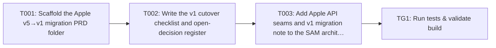

Approving locks the requirements and your decisions. Tasks are a guide; code questions go to the coding agent.

> Plan of record, not execution order: the coding agent works one repo at a time from the requirements and the approved decisions, and links its PR on the repo epic.

---
id: implementation-task-matrix
title: Implementation Task Matrix
---

## Implementation Task Matrix — wi_prd088_d35ab6

**Matrix ID:** `wi_prd088_d35ab6-r1` · **Generated:** 2026-11-06T07:23:27.924468+00:00 · **Source:** `tasks` · **Verdict:** **BLOCKED**

### Summary

| Metric | Value |
| :--- | :--- |
| Tasks total | 4 |
| AI-allocated | 4 |
| Manual-allocated | 0 |
| Waves | 4 |
| Conflicts | 0 |
| Requirements uncovered | 0 |
| Low-confidence allocations (<0.6) | 0 |

### Wave 0

| Task | Title | Repo | Owner | Allocation | Confidence | Status |
| :--- | :--- | :--- | :--- | :--- | :--- | :--- |
| T001 | Scaffold the Apple v5→v1 migration PRD folder | Kochava/docs | coding-agent | ai | 0.60 | planned |

### Wave 1

| Task | Title | Repo | Owner | Allocation | Confidence | Status |
| :--- | :--- | :--- | :--- | :--- | :--- | :--- |
| T002 | Write the v1 cutover checklist and open-decision register | Kochava/docs | coding-agent | ai | 0.60 | planned |

### Wave 2

| Task | Title | Repo | Owner | Allocation | Confidence | Status |
| :--- | :--- | :--- | :--- | :--- | :--- | :--- |
| T003 | Add Apple API seams and v1 migration note to the SAM architecture page | Kochava/docs | coding-agent | ai | 0.60 | planned |

### Wave 3

| Task | Title | Repo | Owner | Allocation | Confidence | Status |
| :--- | :--- | :--- | :--- | :--- | :--- | :--- |
| TG1 | Run tests & validate build | Kochava/docs | test-change-gate | ai | 0.90 | planned |

### Dependency Graph

### Open Questions

None.

### Validation Errors

- T001: repo Kochava/docs is not in agents.yaml and allocation is not manual
- T002: repo Kochava/docs is not in agents.yaml and allocation is not manual
- T003: repo Kochava/docs is not in agents.yaml and allocation is not manual

---
> Generated by: taskmatrix 0.1.0
