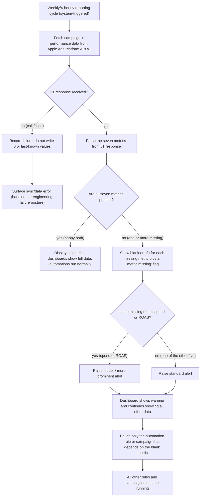
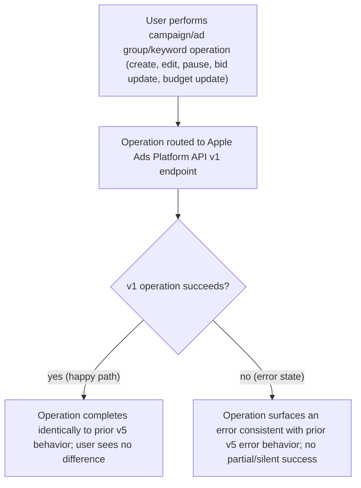

# Product Specification — SAM: Migrate Search Ads Maven to Apple Ads Platform API v1

## 1. Business Logic & Context

### Problem

Search Ads Maven (SAM) currently integrates with Apple's Ads Campaign Management API v5. Apple is moving to the Platform API v1, and v5 will eventually be retired. Today, with v5 live, users see no problem. The risk is entirely future-facing: once v5 is turned off, campaign operations could fail, reports could error, or — the failure mode the requester is most worried about — reports could **look fine while quietly showing 0 for a metric that has silently stopped arriving**. A metric reading 0 instead of its true value directly corrupts financial decision-making: spend at 0 invites overspend or wrongful campaign pauses; ROAS at 0 makes healthy campaigns look dead. The consequence is eroded trust in the numbers and costly manual cleanup.

This is an **internal-team migration**, not a customer-facing feature. The defining success condition is invisibility: users must not be able to tell the underlying API changed.

### Value

- Preserve uninterrupted campaign management, optimization, and 4-hourly performance reporting through the v5→v1 cutover.
- Protect the integrity of spend and ROAS data — the metrics with the highest financial and trust cost if they fail silently.
- Replace the dangerous "quietly shows 0" failure mode with an explicit, visible "metric is missing" state that never masquerades as real data.

### Business Rules

- **Behavioral parity:** All campaign, ad group, and keyword operations (create, edit, pause, bid update, budget update) and 4-hourly performance reporting must behave identically to current v5 behavior. No user-observable difference in functionality or behavior post-migration.
- **Seven tracked metrics:** The system must return and display all seven metrics — impressions, taps, installs, spend, ROAS, avg CPT, avg CPM.
- **Missing-metric handling (never fabricate data):** When v1 stops sending any of the seven metrics, the system displays **blank or n/a plus a flag** indicating the metric is missing. It must **never** show the last known value and must **never** default to 0 for any missing metric.
- **Two-tier alert severity:** Spend and ROAS missing → a **louder / more prominent** alert. The other five metrics (impressions, taps, installs, avg CPT, avg CPM) missing → a **standard** alert.
- **Dashboard behavior:** Dashboards display a **warning only** when a metric shows blank or n/a, and continue to show all other data. Nothing on the dashboard is paused.
- **Automation behavior:** Automated bid and budget adjustments **pause only the specific rule or campaign** that depends on a blank metric. All other rules and campaigns continue to run. The entire dashboard and all automations are never paused wholesale.

### Risk & Scope Grounding

This migration is classified **HIGH risk** — it affects a broad set of backend services, touches payment/spend data integrity, and drives financial decision-making, against a fixed Dec 28 2026 target that leaves limited room to course-correct.

**Note on affected-services evidence:** A codebase knowledge-graph analysis and an independent cross-check of it were performed. The two passes largely agree on the core migration surface but diverge on a few services: the independent pass surfaced additional or differently-named components (for example a core SAM monorepo, a possibly-duplicate/renamed campaign-data-sync component, and a low-confidence SAM component that may touch the Apple Ads API) that the first pass did not list, while some services named in the first pass were not re-found in the second. This discrepancy is unresolved and is called out so engineering reconciles the true service list during planning rather than trusting either pass as complete. [DECISION REQUIRED: DEC-001]

**Note on UI/frontend impact:** Whether this migration requires any frontend change is marked **unclear / to be confirmed** in intake. The new missing-metric states (blank/n-a + flag, two-tier alert severity, dashboard warnings) imply display surfaces may need updating, but this is not confirmed. [DECISION REQUIRED: DEC-002]

---

## 2. User Flows (Visuals)

The primary "user journey" here is the 4-hourly reporting cycle and how the system handles present versus missing metrics, since the migration's visible surface is the reporting/alerting behavior rather than a new user interaction.





---

## 3. Functional Requirements

### Feature Area A — Campaign, Ad Group & Keyword Operations via v1

**FR-001 — Create operations via v1**
```gherkin
Given SAM is configured to use the Apple Ads Platform API v1
When a user creates a campaign, an ad group, or a keyword
Then the create operation is performed against the v1 endpoints
And the result is identical in outcome and user-visible behavior to the current v5 create behavior
```

**FR-002 — Edit operations via v1**
```gherkin
Given SAM is configured to use the Apple Ads Platform API v1
When a user edits an existing campaign, ad group, or keyword
Then the edit operation is performed against the v1 endpoints
And the result is identical in outcome and user-visible behavior to the current v5 edit behavior
```

**FR-003 — Pause operations via v1**
```gherkin
Given SAM is configured to use the Apple Ads Platform API v1
When a user pauses a campaign, an ad group, or a keyword
Then the pause operation is performed against the v1 endpoints
And the result is identical in outcome and user-visible behavior to the current v5 pause behavior
```

**FR-004 — Bid updates via v1**
```gherkin
Given SAM is configured to use the Apple Ads Platform API v1
When a user updates a bid
Then the bid update is performed against the v1 endpoints
And the result is identical in outcome and user-visible behavior to the current v5 bid-update behavior
```

**FR-005 — Budget updates via v1**
```gherkin
Given SAM is configured to use the Apple Ads Platform API v1
When a user updates a budget
Then the budget update is performed against the v1 endpoints
And the result is identical in outcome and user-visible behavior to the current v5 budget-update behavior
```

**FR-006 — Bulk operations via v1**
```gherkin
Given SAM is configured to use the Apple Ads Platform API v1
And a user initiates a bulk operation across multiple campaigns, ad groups, or keywords
When the bulk operation executes
Then each underlying operation is performed against the v1 endpoints
And the bulk operation's outcome and user-visible behavior is identical to the current v5 bulk behavior
```

**FR-007 — Operation failure surfaces an error (no silent success)**
```gherkin
Given SAM is configured to use the Apple Ads Platform API v1
When a campaign, ad group, keyword, bid, or budget operation fails at the v1 endpoint
Then the failure is surfaced as an error consistent with the current v5 error behavior
And the operation does not report a partial or silent success
```

### Feature Area B — Metrics Sync & Display

**FR-008 — All seven metrics sync and display from v1**
```gherkin
Given the 4-hourly performance reporting cycle runs
And the v1 API returns a response containing all seven metrics
When the metrics are processed and displayed
Then impressions, taps, installs, spend, ROAS, avg CPT, and avg CPM are each displayed with their correct values
And each value matches what the equivalent v5 response would have displayed for the same data
```

**FR-009 — A missing metric is shown as blank/n-a with a flag, never 0, never last-known**
```gherkin
Given the 4-hourly performance reporting cycle runs
And the v1 API response is missing one of the seven metrics
When that metric is processed for display
Then the metric is displayed as blank or n/a
And a flag indicating the metric is missing is shown alongside it
And the metric is never displayed using its last known value
And the metric is never defaulted to 0
```

**FR-010 — Louder alert when spend or ROAS is missing**
```gherkin
Given the 4-hourly performance reporting cycle runs
And the v1 API response is missing spend or missing ROAS
When the missing-metric handling triggers
Then a louder / more prominent alert is raised for that metric
```

**FR-011 — Standard alert when one of the other five metrics is missing**
```gherkin
Given the 4-hourly performance reporting cycle runs
And the v1 API response is missing one of impressions, taps, installs, avg CPT, or avg CPM
When the missing-metric handling triggers
Then a standard alert is raised for that metric
```

**FR-012 — Non-missing metrics still display when another is missing**
```gherkin
Given the 4-hourly performance reporting cycle runs
And the v1 API response is missing one or more of the seven metrics
When the metrics are processed for display
Then every metric that IS present is displayed with its correct value
And only the missing metric or metrics are shown as blank or n/a with a flag
```

### Feature Area C — Dashboards

**FR-013 — Dashboard shows a warning and continues on a missing metric**
```gherkin
Given a dashboard displays data that includes one of the seven metrics
And that metric is currently blank or n/a
When the dashboard renders
Then the dashboard displays a warning for the missing metric
And the dashboard continues to display all other data
And nothing on the dashboard is paused
```

### Feature Area D — Automated Bid & Budget Adjustments

**FR-014 — Pause only the rule or campaign dependent on a blank metric**
```gherkin
Given an automated bid or budget adjustment rule depends on one of the seven metrics
And that metric is currently blank or n/a
When the automation evaluation runs
Then only the specific rule or campaign that depends on the blank metric is paused
And all other automation rules and campaigns continue to run
And neither the entire dashboard nor all automations are paused
```

**FR-015 — Unaffected automations continue running**
```gherkin
Given one metric is blank or n/a and has caused a specific rule or campaign to pause
And other automation rules and campaigns depend only on metrics that are present
When the automation evaluation runs
Then those other rules and campaigns execute their bid and budget adjustments normally
```

I've written Sections 0–3. Reporting the two business trade-offs I tagged.

## 4. Information Requirements

The system must track the following business information to support the functional requirements above. This is a "behave identically" migration, so most of these concepts already exist today — the migration changes where they come from (Apple v1 instead of v5), not what they are.

- **Campaign / ad group / keyword configuration** — The entities users create, edit, and pause, including bid and budget values. Source: User-Entered (via SAM) and External API (Apple Ads Platform API v1 for current state). Matters because FR-001 through FR-006 depend on these being read from and written to v1 identically to v5.
- **The seven performance metrics** — impressions, taps, installs, spend, ROAS, avg CPT, avg CPM. Source: External API (Apple Ads Platform API v1 response), consumed through the sync/ingestion/reporting path. Matters because these are the core reported values (FR-008) and the subject of all missing-metric handling.
- **Per-metric presence state** — For each of the seven metrics on each reporting cycle, whether the metric was present or missing in the v1 response. This must distinguish a genuinely missing metric from a legitimate zero value. Source: System-Derived (from parsing the v1 response). Matters because it is what drives the blank/n-a + flag behavior and prevents the "quietly shows 0" failure mode (FR-009).
- **Missing-metric flag** — The indicator shown alongside a metric that is blank or n/a. Source: System-Derived. Matters because FR-009, FR-012, and FR-013 all key off it.
- **Alert severity classification** — Whether a missing metric triggers a louder alert (spend, ROAS) or a standard alert (the other five). Source: System-Derived from the business rule. Matters because it drives FR-010 and FR-011.
- **Missing-metric cause classification** — Whether a metric is temporarily delayed versus permanently unsupported in v1. Source: System-Derived (inferred from v1 response signals, which are not yet characterized). Matters because it determines whether the system retries the fetch or settles into a blank/n-a state, and intake flagged this as an open question. [DECISION REQUIRED: DEC-003]
- **Automation rule → metric dependency** — Which automated bid/budget rules and campaigns depend on which of the seven metrics. Source: System-Derived (existing rule configuration). Matters because FR-014 pauses only the rules/campaigns tied to a blank metric and leaves the rest running.
- **Paused-rule state** — Which specific rules or campaigns have been paused due to a blank metric, and whether they resume automatically once the metric reappears or require manual restart. Source: System-Derived. Matters because FR-014/FR-015 define the pause scope and intake flagged resume behavior as an open question. [DECISION REQUIRED: DEC-004]
- **Reporting cycle cadence / timing** — The 4-hourly schedule and the timestamp cadence of v1 data. Source: System-Derived (scheduler) and External API (v1 response timestamps). Matters because the reporting cycle drives when missing metrics are detected and alerts fire, and v1's timestamp cadence may differ from v5's.
- **Apple Ads API credentials / connection** — The authentication context used to call v1 endpoints. Source: External (Apple) / System-held. Matters because every operation and metric fetch depends on it; credentials and tokens must never be logged in raw form.
- **Operation audit trail** — A record of state-changing operations (create/edit/pause/bid/budget) and missing-metric events, for later traceability. Source: System-Derived. Matters because spend/financial-decision data is sensitive and stakeholders may need to trace what the system did and when (see NFR-008).

---

## 5. Non-Functional Requirements & Guardrails

### Performance & Reliability

**NFR-001 — Reporting cadence continuity**
The 4-hourly performance reporting pipeline must continue running on its existing cadence through and after the v5→v1 cutover, with no additional user-visible latency versus current v5 behavior. Report generation and display latency post-migration must be within parity of the current v5 baseline (measured p95 over a representative reporting cycle).

**NFR-002 — Missing-metric detection latency**
A metric missing from a v1 response must be detected and classified (present vs missing, and alert severity) within the same reporting cycle in which the response is received, so users are not shown a stale or incomplete dashboard without the accompanying flag/warning. The exact maximum acceptable latency between response receipt and alert surfacing is not specified in intake. [DECISION REQUIRED: DEC-005]

**NFR-003 — External dependency error handling (Apple Ads API v1)**
Calls to the Apple Ads Platform API v1 must use bounded retry with exponential backoff (default: 3 attempts), never indefinite retry. A 429/rate-limit response must honor the Retry-After header rather than retrying on a fixed schedule. Distinct failure conditions — timeout, dependency-unavailable, and rate-limited — must each be handled and recorded as named, distinct conditions rather than collapsed into one generic error. On a failed fetch, the system must record the failure and must never write 0 or last-known values for any metric (reinforcing FR-009). The failure posture is **graceful degradation**: on a dependency failure the report surfaces an explicit missing/error state rather than blocking, and never fabricates data — consistent with the dashboard "warn and continue" rule.

**NFR-004 — Idempotent reporting ingestion**
Because the 4-hourly cycle is a scheduled job over an at-least-once data path, metric ingestion and report generation must be idempotent on a natural key (e.g. reporting period + campaign/ad group/keyword identity): a re-run or re-delivery of the same reporting window produces the same end state — an upsert of the existing record — never duplicate rows and never double-counted metrics. Automatic concurrent re-runs of the same scheduled reporting job must be prevented at the scheduler level (overlap guard) as a complementary safeguard.

**NFR-005 — Bulk operation parity**
Bulk campaign/ad group/keyword operations against v1 must preserve current v5 partial-failure and error-handling semantics at scale, and must respect v1's rate limits. A per-call v1 contract difference must not silently change bulk success/failure reporting versus v5.

### Security & Data Handling

**NFR-006 — Server-side credential and contract enforcement**
Apple Ads API v1 authentication and the v1 field contract must be enforced server-side within the backend/adapter layer; v1 field shapes must not leak through the exposed SAM API contract to downstream consumers (e.g. sam-agent, frontend) in a way that changes user-visible behavior. The encapsulation must keep the exposed contract identical to today.

**NFR-007 — No raw secrets or credentials in logs**
Apple Ads API credentials, tokens, and secrets must never be logged in raw form. Where a key must be shown for identification, mask to the last 4–8 characters only.

**NFR-008 — Audit trail for state-changing operations**
State-changing operations (create/edit/pause, bid update, budget update) and missing-metric events (metric, cycle, severity, outcome) must be recorded to an immutable, append-only audit trail capturing actor identity, resource identity, action, timestamp, and outcome. Audit writes are asynchronous and must never block the primary operation, but an audit-write failure must fire an immediate operational alert rather than fail silently. Minimum retention: 12 months. Because this is an internal-team tool rather than a third-party data-sharing agreement, the standard Kochava retention range applies unless the team sets a longer period. [DECISION REQUIRED: DEC-006]

### Monitoring & Guardrails

**NFR-009 — Missing-metric monitoring**
Operational alerting for missing metrics must follow the two-tier severity rule (louder for spend/ROAS, standard for the other five) and must additionally alert when the rate of missing-metric events or sync failures exceeds a sustained threshold — e.g. sync error rate > 1% for 5 minutes, sustained — so a systemic v1 mapping failure is caught beyond per-metric flags.

**NFR-010 — Consistency across ingestion/sync/reporting surfaces**
The "blank + flag, never 0, never last-known" rule and the present-vs-missing determination must be implemented identically across every surface that ingests, syncs, or reports metrics. A metric treated as missing by one surface must not be treated as 0 or present by another.

### Risk Mitigation

**NFR-011 — Kill-switch / rollback to v5**
Because this is a HIGH-risk, multi-service migration touching spend/financial data, the v1 integration must be disableable via config without a code deploy, so an on-call engineer can revert to the prior path during an incident without a separate approval step. New requests pick up the change within a stated propagation window (default: 5 minutes); in-flight requests submitted before the flip complete under the prior behavior. The rollback trigger, owning authority, and timing target must be defined; already-produced reports are not retroactively altered — only new reporting cycles and operations follow the reverted path. Whether v5 remains available as a rollback target (i.e. Apple has not yet retired it) must be confirmed against Apple's v5 retirement timeline. [DECISION REQUIRED: DEC-007]

**NFR-012 — Parallel-run / soak verification before full cutover**
Given the "quietly shows 0" failure mode is both the most likely and most damaging, the migration should run v1 in parallel against v5 output (or a soak period) with an explicit variance/exit gate — verifying the seven metrics match between v5 and v1 for the same reporting windows — before decommissioning the v5 path. This directly mitigates the risk tier's concern about spend/ROAS data integrity.

**NFR-013 — Backward compatibility of the exposed SAM contract**
The exposed SAM API contract consumed by sam-agent and the frontend must remain unchanged by this migration (field names, shapes, and user-visible behavior). The migration must translate/normalize v1 field shapes behind the contract rather than forwarding raw v1 shapes to existing consumers. Any field that cannot be preserved identically is a change that must be surfaced, not silently passed through.

### Risk-register mapping

| Risk (from intake) | What must be true to mitigate |
|---|---|
| Report quietly shows 0 for a silently-missing metric | FR-009, NFR-010, NFR-012 — missing is always blank/flag, never 0; consistent across surfaces; verified against v5 before cutover |
| Spend/ROAS silently wrong → overspend, wrong pauses, eroded trust | FR-010, NFR-009, NFR-012 — louder alerts, systemic-failure alerting, parallel-run verification |
| v5 retired mid-migration with no fallback | NFR-011 — confirm Apple's v5 retirement date; kill-switch only works while v5 exists |
| 10-service blast radius, limited course-correct room before Dec 28 | NFR-010, NFR-011, NFR-013 — consistency, kill-switch, contract backward compatibility |
| v1 drops/renames fields unsupported in v5 | NFR-013 — contract preserved or change surfaced; unsupported-field handling (see Section 6) |

---

## 6. Out of Scope & Phasing

### Out of Scope (Phase 1)

| Item | Rationale |
|---|---|
| Any new user-facing feature or behavior change beyond the missing-metric states | This is a "behave identically" migration; the only net-new behavior is missing-metric handling (blank/flag, two-tier alerts, dashboard warnings, per-rule pause). |
| Customer-facing changes | Intake confirms this is an internal-team project, not a customer-facing change. |
| Confirmed frontend/UI redesign | UI/frontend impact is marked unclear/to-be-confirmed; see the UI-impact decision flagged in Section 1. The missing-metric display surfaces may require UI work, but that is not scoped until confirmed. |
| Definition of how v1 signals "temporarily delayed" vs "permanently unsupported" | Intake open question; depends on characterizing v1 response behavior, which is not yet known. Drives the cause-classification decision flagged in Section 4. |
| Auto-resume policy for paused automation rules | Intake open question; whether a paused rule resumes automatically or requires manual restart is a product decision flagged in Section 4. |
| Blocking vs allowing campaign edits while a metric is missing | Intake open question; default in Phase 1 is to continue allowing operations (dashboards warn and continue), but an explicit block-vs-allow policy is not defined here. [DECISION REQUIRED: DEC-008] |
| Handling of v5 data fields/endpoints unsupported by v1 | Intake open question; requires engineering to enumerate v1 gaps during planning (see NFR-013). The product rule is that unsupported-field handling must not silently drop or corrupt configuration. |
| Reconciliation of the true affected-services list | The two KG passes disagree; engineering reconciles during planning (flagged in Section 1), not a product deliverable. |

### Rollback (HIGH-risk explicit subsection)

- **Trigger:** Sustained v1 sync failures, detected spend/ROAS corruption, or systemic missing-metric events beyond the NFR-009 threshold.
- **Owning authority:** On-call engineering (no separate approval needed to flip the kill-switch), with the migration owner accountable for the decision to hold the reverted state.
- **Timing target:** New requests follow reverted behavior within the NFR-011 propagation window (default 5 minutes).
- **Data handling:** No retroactive reversion of already-produced reports; only new reporting cycles and operations follow the reverted path.
- **Precondition:** Rollback to v5 is only viable while Apple's v5 remains live (see NFR-011).

### Future Phases

- Confirmed frontend updates for missing-metric display, if the UI-impact review determines they are needed.
- Defined cause-classification (delayed vs unsupported) and retry policy once v1 response behavior is characterized.
- Defined auto-resume policy for paused automation rules.

## Appendix: Engineering Reference

_The sections below are derived automatically from the codebase knowledge graph, for the engineering team's reference during planning — not required reading for product/requirement review._

### Affected Services (grounded context, not implementation direction)

Primary affected-services list (first KG pass, agent-derived):

- **k4a-sam-backend** (backend) — Implements the v5→v1 API migration; endpoint/header/request-response updates. Central blast-radius origin.
- **sam-api** (backend) — Search Ads Maven API; owns the exposed contract for campaign/ad group/keyword management.
- **sam-campaign-data-sync** (backend) — Syncs campaign data from the Apple API; must adapt to v1 response schema and field shapes.
- **sam-performance-reporter** (backend) — Reports the seven critical metrics; consumes v1 response fields. Heart of the missing-metric behavior.
- **sam-agent** (backend) — Reads Apple-shaped fields (avgCPT, avgCPM, spend, ROAS, etc.) from the SAM API; depends on the adapter maintaining the correct v1 field contract.
- **sam-util** (backend) — Shared utilities for campaign/ad group/keyword data models; likely owns v5 model definitions requiring v1 updates.
- **sam-mmp-ingestion** (backend) — Ingests performance data feeding reporting; consumes v1 metrics.
- **sam-report-scheduler** (backend) — Schedules and triggers report generation; consumes performance data synced from v1.
- **sam-bulk-actions** (backend) — Bulk campaign/ad group/keyword operations; must call updated v1 endpoints.
- **sam-keyword-search-optimization** (backend) — Keyword optimization logic; depends on v1 keyword response structure (lowest-confidence evidence in the set).

Independent cross-check pass — reconcile during planning (see Section 1 note):

- Surfaced but not in the primary list: **sam-mono** (core SAM monorepo calling the Apple Ads API; high confidence in the cross-check), **k4a-sam-campaign-data-sync** (possible duplicate/renamed sibling of sam-campaign-data-sync), **sam-hayride** (low confidence, possibly touches the Apple Ads API).
- Named in the primary list but not re-found in the cross-check: engineering should confirm each remains in scope.

This discrepancy is unresolved by design — engineering reconciles the authoritative service list during planning rather than either pass being treated as complete.

---
## Open Questions & Decisions Register

_Durable, ID'd reference for HITL 2 (G1) and beyond — inline `[DECISION REQUIRED: DEC-00N]` tags in the sections above point back here. Reflects the latest round only._

### Decisions Required (business trade-offs — needs a human call)

_Each carries an **Owner** (accountable for supplying the answer) and a **Provisional Value** (the working assumption engineering may build against until the decision lands), so none of these fully block engineering — implementation proceeds on the provisional value and adjusts if the confirmed decision differs._

| ID | Decision | Owner | Provisional Value (build against until confirmed) |
|----|----------|-------|-----------------------------------------------------|
| **DEC-001** | The automated service-list analysis and an independent re-check of it disagree on which backend components this migration actually touches — should we treat the broader combined list as the authoritative scope, or narrow it to only the services both checks agreed on? | Product owner + Engineering | Treat the union of both passes as in-scope for planning (verify every service either pass named), and have engineering confirm/remove each during the eng-plan phase rather than dropping any unverified service up front. |
| **DEC-002** | Does this migration need any change to what users see on screen, or is it purely a backend swap with the existing report and dashboard displays reused as-is? | Product owner | Assume the existing display surfaces are reused and only the new missing-metric states (blank/n-a plus flag, louder vs standard alert, dashboard warning) need frontend treatment; confirm with product before build whether any further UI change is wanted. |
| **DEC-003** | When a metric goes missing, how should the system tell the difference between the number being temporarily delayed from Apple versus permanently no longer supported, and should it keep retrying or settle on showing blank? | Product owner + Engineering | Treat a metric as temporarily delayed and retry within the reporting cycle; if still absent at cycle close, show blank/n-a with the flag. Revisit once Apple v1's response behavior is characterized. |
| **DEC-004** | When an automation rule or campaign is paused because a metric went blank, should it resume automatically once the metric comes back, or should it wait for someone to restart it manually? | Product owner | Auto-resume once the metric reappears for a full reporting cycle, with the resume recorded in the audit trail so users can see it happened. |
| **DEC-005** | How quickly after a metric goes missing must users see the alert and warning before the dashboard is considered stale? | Product owner + Engineering | Detect and surface within the same 4-hourly reporting cycle the response arrives in — no stale cycle shown without its flag. |
| **DEC-006** | How long do we need to keep the audit record of campaign changes and missing-metric events? | Compliance/Security + Product owner | 12 months minimum (standard Kochava range for an internal tool), extendable if a longer period is required. |
| **DEC-007** | While a metric is showing blank or n-a, should users still be allowed to edit campaigns and update bids, or should those actions be blocked until all metrics are back? | Product owner | Continue to allow campaign edits and bid/budget updates while a metric is missing — dashboards warn and continue; only the specific automation rule tied to the blank metric pauses. |
| **DEC-008** | Note on affected-services evidence: A codebase knowledge-graph analysis and an independent cross-check of it were performed. The two passes largely agree on the core migration surface but diverge on a few services: the independent pass surfaced additional or differently-named components (for example a core SAM monorepo, a possibly-duplicate/renamed campaign-data-sync component, and a low-confidence SAM component that may touch the Apple Ads API) that the first pass did not list, while some services named in the first pass were not re-found in the second. This discrepancy is unresolved and is called out so engineering reconciles the true service list during planning rather than trusting either pass as complete. | _(not yet assigned)_ | _(not yet specified)_ |

### Open Questions (evidence gaps — needs more input)

- **OQ-001**: How should the product distinguish a metric that's temporarily delayed from v1 versus one that's permanently unsupported in v1 — does the API give a signal we can act on, and should the two states look different to users (retry vs. show blank/n-a)?
- **OQ-002**: What's the acceptable detection-to-alert latency within the 4-hourly reporting cycle before a missing metric must surface as an alert, given reports can otherwise look fine while silently incomplete?
- **OQ-003**: When a paused automated bid/budget rule's missing metric reappears, should the rule auto-resume or require manual user intervention to restart?
- **OQ-004**: Does v1 return metrics in a different format, structure, or timestamp cadence than v5 — and if so, where should normalization happen so dashboards and the 4-hourly scheduling stay consistent?
- **OQ-005**: While a dashboard shows a missing-metric warning, should users still be able to manually trigger campaign edits or bid/budget updates, or should those actions be blocked until all metrics are available?
- **OQ-006**: Are there v5 endpoints or data fields that v1 does not support at all, and how should the product handle configuration requests that rely on those unsupported fields?
- **OQ-007**: Is there confirmed UI/frontend work in scope for this migration (the intake left it 'unclear'), e.g. rendering the missing-metric flag and the louder vs. standard alert states?
- **OQ-008**: For the alert-severity tiers, how should 'louder' spend/ROAS alerts differ concretely from the 'standard' alert for the other five metrics — different channel, persistence, escalation?

---
> **Classification:** Type B — requirement-agent's independent re-check DISAGREES with intake's original Type A call. The behavior is clearly specified — identical v5 feature parity, explicit missing-metric handling (blank/n/a + flag, no last-known/0, louder alerts for spend/ROAS), dashboard warnings, and targeted rule/campaign pausing — so this is a well-defined engineering-led migration across 10 backend services (schema/data-contract/reporting work), not a product-discovery problem; the open questions are implementation details, not unresolved product rules.
