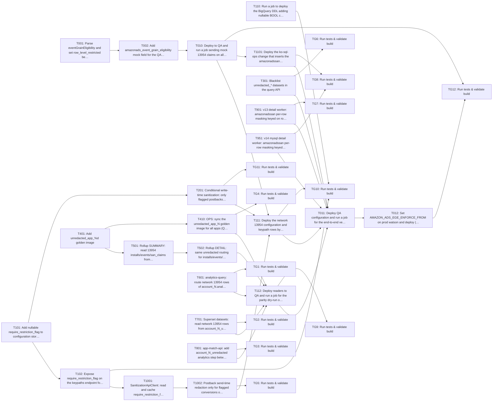

Approving locks the requirements and your decisions. Tasks are a guide; code questions go to the coding agent.

> Plan of record, not execution order: the coding agent works one repo at a time from the requirements and the approved decisions, and links its PR on the repo epic.

---
id: implementation-task-matrix
title: Implementation Task Matrix
---

## Implementation Task Matrix — wi_95477170d7e160488811

**Matrix ID:** `wi_95477170d7e160488811-r1` · **Generated:** 2026-11-05T13:45:17.000139+00:00 · **Source:** `tasks` · **Verdict:** **READY with 3 warnings**

### Summary

| Metric | Value |
| :--- | :--- |
| Tasks total | 36 |
| AI-allocated | 30 |
| Manual-allocated | 6 |
| Waves | 8 |
| Conflicts | 0 |
| Requirements uncovered | 0 |
| Low-confidence allocations (<0.6) | 0 |

### Wave 0

| Task | Title | Repo | Owner | Allocation | Confidence | Status |
| :--- | :--- | :--- | :--- | :--- | :--- | :--- |
| T001 | Parse eventGrainEligibility and set row_level_restricted behind AMAZON_ADS_EGE_… | Kochava/watson | coding-agent | ai | 0.80 | planned |
| T101 | Add nullable require_restriction_flag to configuration storage and config API | Kochava/sanitization-api | coding-agent | ai | 0.80 | planned |
| T110 | Run a job to deploy the BigQuery DDL adding nullable BOOL column require_restri… | Kochava/sanitization-api | manual-developer | manual | 0.80 | planned |
| T301 | Blacklist unredacted_* datasets in the query API | Kochava/koch-query-api | coding-agent | ai | 0.80 | planned |
| T401 | Add unredacted_app_%d golden image | Kochava/bqgolden | coding-agent | ai | 0.80 | planned |
| T601 | analytics-query: route network 13954 rows of account_N.analytics to account_N_u… | Kochava/analytics-query | coding-agent | ai | 0.80 | planned |
| T701 | Superset datasets: read network 13954 rows from account_N_unredacted via config… | Kochava/apache-superset-dashboards | coding-agent | ai | 0.90 | planned |
| T801 | app-match-api: add account_N_unredacted analytics step between analytics and re… | Kochava/app-match-api | coding-agent | ai | 0.80 | planned |
| T901 | v13 detail worker: amazonadssan per-row masking keyed on row_level_restricted | Kochava/krepdetailworkerv13 | coding-agent | ai | 0.80 | planned |
| T951 | v14 mysql detail worker: amazonadssan per-row masking keyed on row_level_restri… | Kochava/krepdetailworkerv14 | coding-agent | ai | 0.80 | planned |

### Wave 1

| Task | Title | Repo | Owner | Allocation | Confidence | Status |
| :--- | :--- | :--- | :--- | :--- | :--- | :--- |
| T002 | Add amazonads_event_grain_eligibility mock field for the QA matrix | Kochava/watson | coding-agent | ai | 0.80 | planned |
| T102 | Expose require_restriction_flag on the keypaths endpoint for Control | Kochava/sanitization-api | coding-agent | ai | 0.80 | planned |
| T201 | Conditional write-time sanitization: only flagged postbacks reach the redacted… | Kochava/soccer-v2 | coding-agent | ai | 0.90 | planned |
| T410 | OPS: sync the unredacted_app_N golden image for all apps (QA then prod) before… | Kochava/bqgolden | coding-agent | ai | 0.80 | planned |
| T501 | Rollup SUMMARY: read 13954 installs/events/san_claims from unredacted_app_N via… | Kochava/rollup-worker-cloud | coding-agent | ai | 0.90 | planned |
| TG1 | Run tests & validate build | Kochava/analytics-query | test-change-gate | ai | 0.90 | planned |
| TG2 | Run tests & validate build | Kochava/apache-superset-dashboards | test-change-gate | ai | 0.90 | planned |
| TG3 | Run tests & validate build | Kochava/app-match-api | test-change-gate | ai | 0.90 | planned |
| TG6 | Run tests & validate build | Kochava/koch-query-api | test-change-gate | ai | 0.90 | planned |
| TG7 | Run tests & validate build | Kochava/krepdetailworkerv13 | test-change-gate | ai | 0.90 | planned |

### Wave 2

| Task | Title | Repo | Owner | Allocation | Confidence | Status |
| :--- | :--- | :--- | :--- | :--- | :--- | :--- |
| T010 | Deploy to QA and run a job sending mock 13954 claims on all claim paths; freeze… | Kochava/watson | manual-developer | manual | 0.80 | planned |
| T1001 | SanitizationApiClient: read and cache require_restriction_flag from the keypath… | Kochava/control | coding-agent | ai | 0.80 | planned |
| T502 | Rollup DETAIL: same unredacted routing for installs/events/san_claims | Kochava/rollup-worker-cloud | coding-agent | ai | 0.90 | planned |
| TG11 | Run tests & validate build | Kochava/soccer-v2 | test-change-gate | ai | 0.90 | planned |
| TG4 | Run tests & validate build | Kochava/bqgolden | test-change-gate | ai | 0.90 | planned |

### Wave 3

| Task | Title | Repo | Owner | Allocation | Confidence | Status |
| :--- | :--- | :--- | :--- | :--- | :--- | :--- |
| T1002 | Postback send-time redaction only for flagged conversions on conditional configs | Kochava/control | coding-agent | ai | 0.80 | planned |
| T1101 | Deploy the ko-sql-ops change that inserts the amazonadssan kochava_reports.repo… | Kochava/krepdetailworkerv14 | coding-agent | ai | 0.80 | planned |
| T112 | Deploy readers to QA and run a job for the parity dry-run of aggregate readers… | Kochava/rollup-worker-cloud | manual-developer | manual | 0.80 | planned |

### Wave 4

| Task | Title | Repo | Owner | Allocation | Confidence | Status |
| :--- | :--- | :--- | :--- | :--- | :--- | :--- |
| T111 | Deploy the network 13954 configuration and keypath rows by running sanitization… | Kochava/sanitization-api | manual-developer | manual | 0.80 | planned |
| TG5 | Run tests & validate build | Kochava/control | test-change-gate | ai | 0.90 | planned |
| TG8 | Run tests & validate build | Kochava/krepdetailworkerv14 | test-change-gate | ai | 0.90 | planned |
| TG9 | Run tests & validate build | Kochava/rollup-worker-cloud | test-change-gate | ai | 0.90 | planned |

### Wave 5

| Task | Title | Repo | Owner | Allocation | Confidence | Status |
| :--- | :--- | :--- | :--- | :--- | :--- | :--- |
| T011 | Deploy QA configuration and run a job for the end-to-end verification of every… | Kochava/watson | manual-developer | manual | 0.80 | planned |
| TG10 | Run tests & validate build | Kochava/sanitization-api | test-change-gate | ai | 0.90 | planned |

### Wave 6

| Task | Title | Repo | Owner | Allocation | Confidence | Status |
| :--- | :--- | :--- | :--- | :--- | :--- | :--- |
| T012 | Set AMAZON_ADS_EGE_ENFORCE_FROM on prod watson and deploy (final activation ste… | Kochava/watson | manual-developer | manual | 0.80 | planned |

### Wave 7

| Task | Title | Repo | Owner | Allocation | Confidence | Status |
| :--- | :--- | :--- | :--- | :--- | :--- | :--- |
| TG12 | Run tests & validate build | Kochava/watson | test-change-gate | ai | 0.90 | planned |

### Dependency Graph

### Open Questions

None.

### Warnings

- T410: `sync_cmd.go` has no folder in the repo; check where it belongs
- grounding pinned to mysql; knowledge graph skipped for Kochava/krepdetailworkerv14
- T101: task too large (13 files (max 5)); consider splitting

---
> Generated by: taskmatrix 0.1.0
