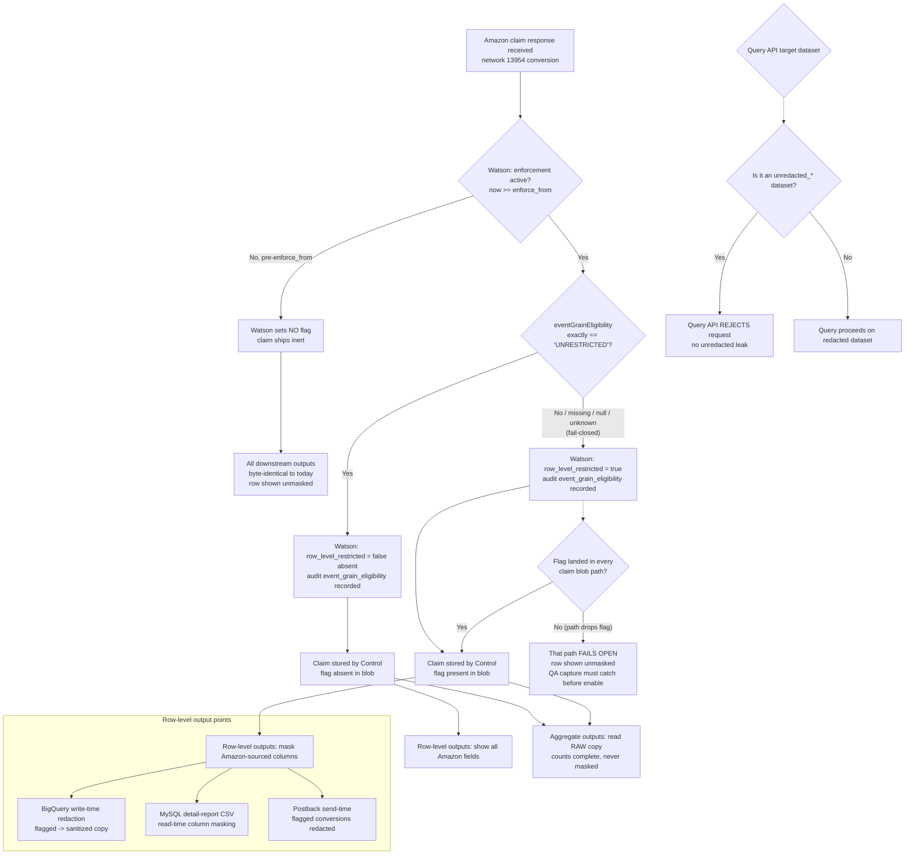

# T001: Parse eventGrainEligibility and set row_level_restricted behind AMAZON_ADS_EGE_ENFORCE_FROM

## In short

Parse eventGrainEligibility and set row_level_restricted behind AMAZON_ADS_EGE_ENFORCE_FROM

🟢 Clear

## Overview

| Field | Value |
|---|---|
| Task ID | T001 |
| Repo | Kochava/watson |
| Phase | Phase 1 |
| User Story | N/A |
| Parallel | No |
| Status | New |
| Owner | Coding Agent (backend) |

## Context

Parse eventGrainEligibility and set row_level_restricted behind AMAZON_ADS_EGE_ENFORCE_FROM

This task is part of Amazon Ads eventGrainEligibility Row-Level Redaction.

### Source Code Changes
```text
watson/cmd/watson/amazonadssan/
├── request.go            [MODIFY] EventGrainEligibility json.RawMessage on response
├── reconcile.go          [MODIFY] parseEligibility, enforce-from check, dynamic fields in buildMatchObj, mock block (mockResponse :160-225)
└── reconcile_test.go     [MODIFY] eligibility + enforcement tests
watson config/env         [MODIFY] AMAZON_ADS_EGE_ENFORCE_FROM
sanitization-api/internal/dao/bqnetworksanitization/structs.go  [MODIFY] require_restriction_flag
sanitization-api create/update/get handlers + BQ migration       [MODIFY/NEW] nullable BOOL column
soccer-v2/internal/httpclients/sanitization/models/sanitization.go [MODIFY] RequireRestrictionFlag
soccer-v2/cmd/soccer-v2/main.go (Handle :261-300)                  [MODIFY] conditional sanitization
soccer-v2/internal/sanitization/sanitize.go                        [MODIFY, only if QA capture needs it] typed non-string leaves, repeated fields
control/source/var/www/lib/KochavaControl/Event/Postback.php       [MODIFY] keypath path (:1640-1695, retrieveKeyPaths :1688) honors the flag
control/.../SanitizationApiClient.php                              [MODIFY] read require_restriction_flag
control/tests/lib/KochavaControl/Event/Postback_test.php           [MODIFY]
krepdetailworkerv14 branch mysql (cmd/krepdetailworkerv14/main.go, sanitize.go)  [MODIFY] per-row flag check
krepdetailworkerv14 main (legacy RunReportGen path)                             [MODIFY] same
krepdetailworkerv13 (src/krepdetailworkerv13/main.go)                           [MODIFY] same
koch-query-api/cmd/query/blacklist.go (:3-37) + blacklist_test.go  [MODIFY] "unredacted" entry
bqgolden (OPTIONAL, only if the rollup missing-table guard is dropped)
├── app_golden_image.go (:52-72)                          [MODIFY] CoreUnredactedGoldenImage → unredacted_app_%d
├── cmd/bqgoldenutil/config/app_golden_image.go (:5-29)   [MODIFY] flag golden-image-core-unredacted
└── cmd/bqgoldenutil/subcmd/app_golden_images.go (:10-32) [MODIFY] explicit list + all-tables fallback
rollup-worker-cloud/cmd/rollup-worker-cloud/buildquery.go          [MODIFY] src() UNION ALL for installs/san_claims/events
rollup-worker-cloud/cmd/rollup-worker-cloud/main.go (:724)         [MODIFY] pass ReadProjectID + app id separately
rollup-worker-cloud/cmd/rollup-worker-cloud/buildquery_test.go     [NEW] (repo has no tests today)
analytics-query/pkg/analyticstechspecs/namerproduction.go (:92, :353) [MODIFY] standardSource()
analytics-query/pkg/analyticstechspecs/namerconditional.go (:42)      [MODIFY] bare-table path
apache-superset-dashboards/prod/datasets/Google_BigQuery_Kochava_Query_1370/
├── analytics.yaml (:8-16)                                 [MODIFY]
├── cost_measurement.yaml (:31-32, :50-51)                 [MODIFY]
├── aggregated_insights_app_campaign_filter.yaml (:8-12)   [MODIFY]
└── aggregated_insights_match_to_type_filter.yaml (:8-9)   [MODIFY]
app-match-api/pkg/directmatch/getter.go (:12-72) + getter_test.go [MODIFY/NEW] unredacted step between analytics and restricted
Data rows (sanitization-api API; report_filtering via ko-sql-ops): 13954 configuration, keypath rows, amazonadssan report_filtering row
```
**Structure Notes**: one branch per repo off fresh main; `test:` commit (failing) then `feat:` commit per change; one PR per repo, merged in Rollout order.

### watson (ingestion)
**Technology**: Go. CI: `go test -race -count=1 -tags=unit ./...`
...

## Target Interface / Data Model

**Consumes:**

```
none (build.AmazonAdsSANConfig, Reconciler, response and waterfall.ClaimInterface.SetDynamicField already exist in the repo: cmd/build/amazonadssan_config.go:9, cmd/watson/amazonadssan/reconcile.go:83, request.go:3)
```

**Produces:**

```
// cmd/build/amazonadssan_config.go
type AmazonAdsSANConfig struct {
    // ...existing fields...
    EGEEnforceFrom int64 // unix seconds; 0 = enforcement off. flag amazonadssan-ege-enforce-from, env AMAZON_ADS_EGE_ENFORCE_FROM
}
// cmd/watson/amazonadssan/request.go
type response struct {
    // ...existing fields...
    EventGrainEligibility json.RawMessage `json:"eventGrainEligibility,omitempty"`
}
// cmd/watson/amazonadssan/reconcile.go
const (
    dynFieldRowLevelRestricted    = "row_level_restricted"      // bool, only ever true
    dynFieldEventGrainEligibility = "event_grain_eligibility"   // string, audit only
)
type Reconciler struct {
    // ...existing fields...
    Now func() time.Time // nil => time.Now
}
func parseEligibility(raw json.RawMessage) (value string, unrestricted bool)
func (reconciler *Reconciler) enforcementActive() bool
```

## Spec Excerpts

# Product Specification — Amazon Ads `eventGrainEligibility` Row-Level Redaction

## 1. Business Logic & Context

### Problem

Amazon Ads (network `13954`) returns an `eventGrainEligibility` value on each conversion's claim response. When that value is anything other than exactly `"UNRESTRICTED"`, Kochava is contractually required to suppress the Amazon-sourced detail on that conversion in all row-level outputs. Today Kochava ships this data unmasked everywhere, which is non-compliant for restricted conversions and carries a hard external deadline of **12/31/2026**.

The core difficulty is not the masking rule (which is well-specified) but the multi-system coordination: the decision is made once at ingestion, then must be honored consistently across write-time redaction (BigQuery), read-time filtering (MySQL detail reports), postback send-time, and aggregate reporting — without affecting any other network and without changing any output while enforcement is off.

### Value

- **Compliance:** Honor Amazon's per-conversion `eventGrainEligibility` restriction before the contractual cutoff, avoiding partner-agreement breach.
- **Precision:** Mask only the Amazon-sourced columns on restricted rows; keep every row present and keep non-Amazon fields visible. Aggregate counts stay complete.
- **Safety:** A single enforcement switch (Watson `enforce_from`) means the entire change ships inert and is activated only after end-to-end verification.

### Business Rules

| # | Rule |
|---|------|
| BR-1 | Scope is Amazon network `13954` only. All other networks (Snap, TikTok, Reddit, every other) are unaffected in every output. |
| BR-2 | The masking decision is **per conversion**, not per user, per role, or per account. Every viewer of row-level output sees the same masking. One advertiser account may contain both masked and unmasked rows simultaneously. |
| BR-3 | Masking means **column masking**, never row removal. Every row stays in the output; only Amazon-sourced columns on a restricted row are replaced. |
| BR-4 | The decision is driven by Amazon's `eventGrainEligibility` value on that conversion's claim response: exactly `"UNRESTRICTED"` → show; `"RESTRICTED"`, missing, null, or any other value → mask. |
| BR-5 | **Fail-closed evaluation lives only in Watson:** a missing / null / unknown eligibility value counts as restricted at flag-setting time. |
| BR-6 | **Separately from BR-5:** before the Watson `enforce_from` timestamp, Watson sets no flag at all, so nothing is masked anywhere. Downstream, an absent flag always means "show". |
| BR-7 | Aggregate reports (standard summaries, Aggregated Insights, analytics-query, Superset, app-match-api) are **never masked** — they read the raw copy for `13954` and must yield identical counts and breakdowns with enforcement on vs. off. |
| BR-8 | Row-level outputs subject to masking: Query reports, Detail reports, exports, and postbacks. |
| BR-9 | Masking value is `---` for string columns and `NULL` for numeric/time columns. |
| BR-10 | Pre-`enforce_from` conversions are never flagged and therefore never masked — including when re-read after enforcement goes live. No historical backfill or reprocessing of old data occurs. |
| BR-11 | Postbacks to the attributed network's own endpoint (i.e. postbacks to Amazon itself) stay **raw** by default, pending a product decision. [DECISION REQUIRED] |
| BR-12 | The canonical column list is frozen **as data** (sanitization keypath rows + one `report_filtering` row) only after a QA capture confirms every key. Enforcement must not be enabled until this list is frozen and flag propagation is verified across all claim blob paths. |

> **Note on BR-11:** the open product question about whether Amazon's own postback is eventually redacted is a single decision; where postback behavior is described again in Section 3 (FR group E), it refers back to this same decision rather than re-flagging it.

---

## 2. User Flows (Visuals)

This change is backend/data-flow only; there is no UI. The "actors" below are system stages, not human users. The flow traces a single `13954` conversion from ingestion through the points where masking is (or is not) applied.



---

## 3. Functional Requirements

> IDs are unique and grouped by feature area. Each scenario is independently verifiable by QA. "Enforcement active" always means the conversion was ingested on/after Watson's `enforce_from` timestamp.

### Group A — Watson: Ingestion & Flag-Setting

**FR-001 — Flag set true for restricted eligibility (enforcement active)**
```gherkin
Given enforcement is active for Watson
  And a conversion belongs to Amazon network 13954
  And the Amazon claim response eventGrainEligibility value is "RESTRICTED"
When Watson processes the claim at ingestion
Then Watson sets the claim dynamic field row_level_restricted to true
  And Watson records the raw eligibility value in the audit field event_grain_eligibility
```

**FR-002 — Flag NOT set for UNRESTRICTED eligibility (enforcement active)**
```gherkin
Given enforcement is active for Watson
  And a conversion belongs to Amazon network 13954
  And the Amazon claim response eventGrainEligibility value is exactly "UNRESTRICTED"
When Watson processes the claim at ingestion
Then Watson does not set row_level_restricted to true (flag absent or false)
  And Watson records the raw eligibility value in the audit field event_grain_eligibility
  And all downstream outputs show the Amazon-sourced fields for this conversion
```

**FR-003 — Fail-closed on missing / null / unknown eligibility (enforcement active)**
```gherkin
Given enforcement is active for Watson
  And a conversion belongs to Amazon network 13954
  And the Amazon claim response eventGrainEligibility value is missing, null, empty, or any value other than exactly "UNRESTRICTED"
When Watson processes the claim at ingestion
Then Watson sets row_level_restricted to true (fail-closed)
  And Watson records the raw eligibility value (or its absence) in the audit field event_grain_eligibility
```

**FR-004 — Exact-match evaluation, case and whitespace sensitive**
```gherkin
Given enforcement is active for Watson
  And a conversion belongs to Amazon network 13954
  And the Amazon claim response eventGrainEligibility value is "unrestricted", " UNRESTRICTED ", or "UNRESTRICTED_FOO"
When Watson processes the claim at ingestion
Then Watson treats the value as not exactly "UNRESTRICTED"
  And Watson sets row_level_restricted to true (fail-closed)
```

**FR-005 — No flag before enforce_from (inert)**
```gherkin
Given a conversion belongs to Amazon network 13954
  And the conversion is ingested before Watson's enforce_from timestamp
When Watson processes the claim at ingestion
Then Watson sets no row_level_restricted flag on the claim
  And every downstream output for this conversion is byte-identical to today's behavior
```

**FR-006 — Non-Amazon networks untouched by Watson flag logic**
```gherkin
Given enforcement is active for Watson
  And a conversion belongs to any network other than 13954 (e.g. Snap, TikTok, Reddit)
When Watson processes the claim at ingestion
Then Watson does not apply eventGrainEligibility flag logic to the conversion
  And row_level_restricted is not set by this feature for the conversion
```

**FR-007 — Flag propagates to all claim blob paths**
```gherkin
Given enforcement is active for Watson
  And a 13954 conversion is evaluated as restricted (row_level_restricted = true)
When the claim is persisted and inherited across claim blob paths (install via click, install via impression, and events)
Then the row_level_restricted flag is present in every claim blob path for that conversion
  And any path in which the flag fails to land is detectable by QA capture before enforcement is enabled
```

### Group B — Soccer-v2: BigQuery Write-Time Redaction Split

**FR-010 — Flagged 13954 conversion sanitized into redacted copy**
```gherkin
Given a 13954 conversion has row_level_restricted = true
When soccer-v2 performs its write-time BigQuery split
Then soccer-v2 applies the 13954 sanitization keypaths and writes the sanitized version to the redacted copy
  And soccer-v2 writes the original, unmodified version to the unredacted copy
```

**FR-011 — Unflagged 13954 conversion written unchanged to both copies**
```gherkin
Given a 13954 conversion does not have row_level_restricted = true (flag absent or false)
When soccer-v2 performs its write-time BigQuery split
Then soccer-v2 writes the conversion unchanged to the redacted copy
  And soccer-v2 writes the original, unmodified version to the unredacted copy
```

**FR-012 — Every 13954 original is preserved in the unredacted copy**
```gherkin
Given any 13954 conversion (flagged or unflagged)
When soccer-v2 performs its write-time BigQuery split
Then the original unmodified conversion is always present in the unredacted copy
```

**FR-013 — Other networks' existing split behavior unchanged**
```gherkin
Given a conversion belongs to a network already configured for a redacted/unredacted split (Snap, TikTok, Reddit) or to any other network
When soccer-v2 performs its write-time BigQuery split
Then soccer-v2 applies its existing behavior for that network unchanged by this feature
```

### Group C — MySQL Detail Workers: Read-Time CSV Masking

> Detail workers (krepdetailworkerv13, krepdetailworkerv14 `mysql` branch) produce detail-report CSVs. Masking is applied **per output column** after the SQL has joined all source tables into one CSV row. The workers key only on the `row_level_restricted` flag and never parse `eventGrainEligibility`.

**FR-020 — Row restricted if ANY original_request column carries the flag**
```gherkin
Given a detail-report CSV row for a 13954 conversion
  And at least one of the row's *_original_request columns (the COALESCE chain across install/click/impression/reengage sources) contains "row_level_restricted":true
When the detail worker builds the CSV row via sanitizeNetworkDataCSV_2
Then the worker treats the row as restricted
  And the worker masks every Amazon-sourced output column listed in the amazonadssan report_filtering row
```

**FR-021 — Row not restricted when no column carries the flag**
```gherkin
Given a detail-report CSV row for a 13954 conversion
  And none of the row's *_original_request columns contain "row_level_res

## Existing Pattern

Follow the dynamic-field stamping already in buildMatchObj (reconcile.go:456-469, SetDynamicField for partner_request_id / vendor_device_id) and the cli flag style in cmd/build/amazonadssan_config.go:17-50 (use cli.Int64Flag with Destination).

From `cmd/watson/amazonadssan/credentials.go`:
```
package amazonadssan

import (
	"context"
	"crypto/sha256"
	"encoding/hex"
	"encoding/json"
	"math/rand"
	"net/http"
	"sync"
	"time"

	"github.com/aws/aws-sdk-go-v2/aws"
	v4 "github.com/aws/aws-sdk-go-v2/aws/signer/v4"
	"go.uber.org/zap"

	"github.com/Kochava/watson/cmd/build"
)

type Credentials struct {
	httpClient             *http.Client
	credentialsApiKey      string
	credentialsApiHost     string
	credentialsApiEndpoint string
	amazonAdsApiKey        string
```

From `cmd/watson/amazonadssan/credentials_interface.go`:
```
package amazonadssan

import (
	"context"
	"net/http"
)

// CredentialsSigner defines the interface for signing HTTP requests,
// primarily used by the Reconciler to interact with Amazon Ads SAN credentials.
// This allows for interchangeable real and mock implementations.
type CredentialsSigner interface {
	SignHTTP(ctx context.Context, r *http.Request, bodyBytes []byte) error
}
```

Already in the repo:
- `cmd/watson/amazonadssan/request.go`
- `cmd/watson/amazonadssan/reconcile.go`
- `cmd/build/amazonadssan_config.go`
- `CLAUDE.md`
- `cmd/watson/amazonadssan/reconcile_test.go`

## Implementation Guide

1. Implement: Parse eventGrainEligibility and set row_level_restricted behind AMAZON_ADS_EGE_ENFORCE_FROM
2. Add or update the tests listed under Files to Modify
3. Run `go test ./...`

## Files to Modify

| File | Create/Modify/Test | Note |
|---|---|---|
| `cmd/watson/amazonadssan/request.go` | Modify | - |
| `cmd/watson/amazonadssan/reconcile.go` | Modify | - |
| `cmd/build/amazonadssan_config.go` | Modify | - |
| `CLAUDE.md` | Modify | - |
| `cmd/watson/amazonadssan/reconcile_test.go` | Test | - |

## Acceptance Criteria

- BR-1: Scope is Amazon network `13954` only. All other networks (Snap, TikTok, Reddit, every other) are unaffected in every output. -- the behaviour this task contributes to works as described.
- BR-4: The decision is driven by Amazon's `eventGrainEligibility` value on that conversion's claim response: exactly `"UNRESTRICTED"` → show; `"RESTRICTED"`, missing, null, or any other value → mask. -- the behaviour this task contributes to works as described.
- BR-5: **Fail-closed evaluation lives only in Watson:** a missing / null / unknown eligibility value counts as restricted at flag-setting time. -- the behaviour this task contributes to works as described.
- BR-6: **Separately from BR-5:** before the Watson `enforce_from` timestamp, Watson sets no flag at all, so nothing is masked anywhere. Downstream, an absent flag always means "show". -- the behaviour this task contributes to works as described.
- BR-10: Pre-`enforce_from` conversions are never flagged and therefore never masked — including when re-read after enforcement goes live. No historical backfill or reprocessing of old data occurs. -- the behaviour this task contributes to works as described.
- New/changed tests in the Test files above pass.
- Build and existing tests still pass.
- Existing tests pass
- New functionality has test coverage
- Code follows repository conventions (see CLAUDE.md)

## Dependencies

**Blocked by:**
- none

**Blocks:**
- T002 - Add amazonads_event_grain_eligibility mock field for the QA matrix

## Testing Notes

```bash
go test ./...
```

## Reviewer Notes

Add suggestions here or as Asana comments; tell the agent in the Slack thread and it will apply them.

Coding agent: one PR per repo — include all `Kochava/watson` tasks in one PR on branch `impl/prd089-backend`.

---

**Parent Task:** Amazon Ads eventGrainEligibility Row-Level Redaction — Kochava/watson (6 tasks · 1 PR)
**PRD:** 089-amazon-ads-eventgraineligibility-row-level-redacti