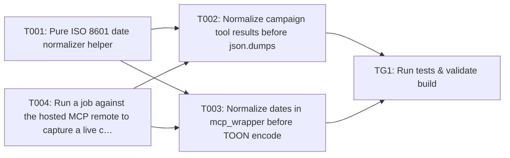

Approving locks the requirements and your decisions. Tasks are a guide; code questions go to the coding agent.

> Plan of record, not execution order: the coding agent works one repo at a time from the requirements and the approved decisions, and links its PR on the repo epic.

---
id: implementation-task-matrix
title: Implementation Task Matrix
---

## Implementation Task Matrix — wi_e225ebbd1d55b1bc06c4

**Matrix ID:** `wi_e225ebbd1d55b1bc06c4-r2` · **Generated:** 2026-11-17T16:12:38.893973+00:00 · **Source:** `tasks` · **Verdict:** **READY with 2 warnings**

### Summary

| Metric | Value |
| :--- | :--- |
| Tasks total | 5 |
| AI-allocated | 4 |
| Manual-allocated | 1 |
| Waves | 3 |
| Conflicts | 0 |
| Requirements uncovered | 0 |
| Low-confidence allocations (<0.6) | 0 |

### Wave 0

| Task | Title | Repo | Owner | Allocation | Confidence | Status |
| :--- | :--- | :--- | :--- | :--- | :--- | :--- |
| T001 | Pure ISO 8601 date normalizer helper | Kochava/k4a-mcp-server | coding-agent | ai | 0.80 | planned |
| T004 | Run a job against the hosted MCP remote to capture a live campaign-stats respon… | Kochava/k4a-mcp-server | manual-developer | manual | 0.80 | planned |

### Wave 1

| Task | Title | Repo | Owner | Allocation | Confidence | Status |
| :--- | :--- | :--- | :--- | :--- | :--- | :--- |
| T002 | Normalize campaign tool results before json.dumps | Kochava/k4a-mcp-server | coding-agent | ai | 0.80 | planned |
| T003 | Normalize dates in mcp_wrapper before TOON encode | Kochava/k4a-mcp-server | coding-agent | ai | 0.80 | planned |

### Wave 2

| Task | Title | Repo | Owner | Allocation | Confidence | Status |
| :--- | :--- | :--- | :--- | :--- | :--- | :--- |
| TG1 | Run tests & validate build | Kochava/k4a-mcp-server | test-change-gate | ai | 0.90 | planned |

### Dependency Graph

### Open Questions

None.

### Warnings

- T004: `decisions.md` has no folder in the repo; check where it belongs
- grounding pinned to 87831c34; knowledge graph skipped for Kochava/k4a-mcp-server

---
> Generated by: taskmatrix 0.1.0
