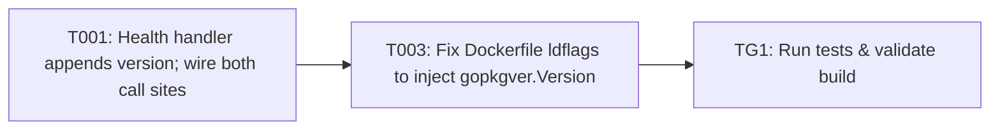

Approving locks the requirements and your decisions. Tasks are a guide; code questions go to the coding agent.

> Plan of record, not execution order: the coding agent works one repo at a time from the requirements and the approved decisions, and links its PR on the repo epic.

---
id: implementation-task-matrix
title: Implementation Task Matrix
---

## Implementation Task Matrix — wi_prd089_838787

**Matrix ID:** `wi_prd089_838787-r1` · **Generated:** 2026-11-12T15:31:48.576732+00:00 · **Source:** `tasks` · **Verdict:** **READY**

### Summary

| Metric | Value |
| :--- | :--- |
| Tasks total | 3 |
| AI-allocated | 2 |
| Manual-allocated | 1 |
| Waves | 3 |
| Conflicts | 0 |
| Requirements uncovered | 0 |
| Low-confidence allocations (<0.6) | 0 |

### Wave 0

| Task | Title | Repo | Owner | Allocation | Confidence | Status |
| :--- | :--- | :--- | :--- | :--- | :--- | :--- |
| T001 | Health handler appends version; wire both call sites | Kochava/household-id-adornment-api | coding-agent | ai | 0.80 | planned |

### Wave 1

| Task | Title | Repo | Owner | Allocation | Confidence | Status |
| :--- | :--- | :--- | :--- | :--- | :--- | :--- |
| T003 | Fix Dockerfile ldflags to inject gopkgver.Version | Kochava/household-id-adornment-api | manual-developer | manual | 0.70 | planned |

### Wave 2

| Task | Title | Repo | Owner | Allocation | Confidence | Status |
| :--- | :--- | :--- | :--- | :--- | :--- | :--- |
| TG1 | Run tests & validate build | Kochava/household-id-adornment-api | test-change-gate | ai | 0.90 | planned |

### Dependency Graph

### Open Questions

None.

---
> Generated by: taskmatrix 0.1.0
