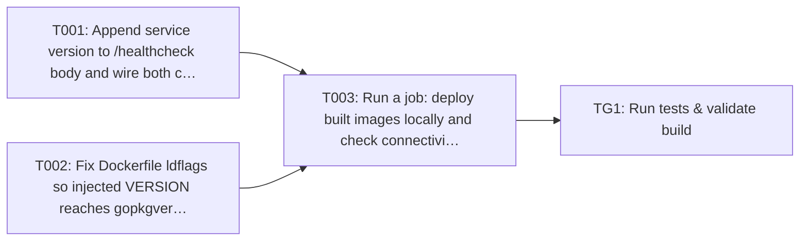

## Implementation Task Matrix — wi_379f44c2fdf4e54066f2

**Matrix ID:** `wi_379f44c2fdf4e54066f2-r1` · **Generated:** 2026-11-12T14:34:34.995425+00:00 · **Source:** `tasks` · **Verdict:** **READY with 1 warnings**

### Summary

| Metric | Value |
| :--- | :--- |
| Tasks total | 4 |
| AI-allocated | 2 |
| Manual-allocated | 2 |
| Waves | 3 |
| Conflicts | 0 |
| Requirements uncovered | 1 |
| Low-confidence allocations (<0.6) | 0 |

### Wave 0

| Task | Title | Repo | Owner | Allocation | Confidence | Status |
| :--- | :--- | :--- | :--- | :--- | :--- | :--- |
| T001 | Append service version to /healthcheck body and wire both call sites | Kochava/household-id-adornment-api | coding-agent | ai | 0.80 | planned |
| T002 | Fix Dockerfile ldflags so injected VERSION reaches gopkgver.Version | Kochava/household-id-adornment-api | manual-developer | manual | 0.70 | planned |

### Wave 1

| Task | Title | Repo | Owner | Allocation | Confidence | Status |
| :--- | :--- | :--- | :--- | :--- | :--- | :--- |
| T003 | Run a job: deploy built images locally and check connectivity with curl to /hea… | Kochava/household-id-adornment-api | manual-developer | manual | 0.80 | planned |

### Wave 2

| Task | Title | Repo | Owner | Allocation | Confidence | Status |
| :--- | :--- | :--- | :--- | :--- | :--- | :--- |
| TG1 | Run tests & validate build | Kochava/household-id-adornment-api | test-change-gate | ai | 0.90 | planned |

### Dependency Graph

### Open Questions

None.

### Uncovered Requirements

`PRD-089-product-k4a-title-show-the-service-version-in-the-`

### Warnings

- T003: `adornment/household-id` is a folder, not a file; dropped from the task's files

---
> Generated by: taskmatrix 0.1.0
